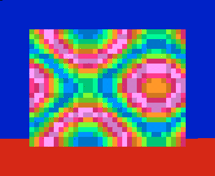

# 01 · Section timing: how long does a piece of code take

Put an **entry** and an **exit** marker around a piece of Z80 code and get the T-state statistics of every pass:
count, min, average, max. You can also pause the machine when a pass takes longer than a limit, or at an
ordinary breakpoint. The tools ride on the WebAPI, so they work with any program you can load. A small demo is
included to try them on.

| File | What it is |
|:--|:--|
| `demo.asm` | The demo: an attribute plasma, 2..33 XOR sparkles (the count follows a sine) and an IM2 interrupt with a stand-in music player, profiling itself on the border (a colour per routine). Runs on a 48K and a Pentagon. |
| `demo.sna`, `demo.sym` | `demo.asm` built by sjasmplus: the snapshot and its labels (`build.sh` rebuilds them). |
| `minimal.py` | The smallest form: one pair of markers, 100 passes, pause above a limit. About 40 lines. |
| `profile_sections.py` | The full tool: many sections, nesting, interrupts inside a section, `--break-if`, `--stop-at`, `--expect`, a live panel in the terminal while it runs, a Markdown report and JSON data. |
| `prompt.md` | The same through MCP: what to ask an AI agent connected to the emulator. |
| `sample-report-48k.md` | What `profile_sections.py` writes, from a 200-frame run on a 48K. |
| `border-48k.png` | The border profile of one frame on a 48K. |

## Run it

Start unreal-qt, before or after the script: the script finds the emulator by itself and waits for it while there is
none. Then:

```bash
python3 minimal.py                                       # Sparkles .. Sparkles.End, pause above 20000 T
python3 profile_sections.py                              # every section, 100 frames on a new 48K
python3 profile_sections.py --model PENTAGON --frames 200
python3 profile_sections.py --break-if "Frame>69888"     # pause on the first frame that does not fit
python3 profile_sections.py --stop-at Sparkles.inside    # pause at an ordinary breakpoint
python3 profile_sections.py --attach                     # the program already running in the emulator window
```

Python 3.8+ and nothing else: the client (`../lib/unreal_webapi.py`, `../lib/unreal_tui.py`) uses only the standard
library. It works in Windows Terminal, PowerShell, cmd, macOS Terminal, iTerm2 and Linux terminals.

- **Finding the emulator.** The script looks on localhost ports 8090..8099; `UNREAL_WEBAPI_PORT` is tried first.
  `UNREAL_WEBAPI_PORTS=8190-8199` gives other ports to scan, and `--url http://host:port/api/v1` names one emulator
  (another host, for example). One emulator answers on its WebAPI port and on its MCP port; it is listed once.
- **Nothing running yet.** The script waits, with a spinner, until unreal-qt starts. Ctrl+C gives up.
- **Several emulators or instances.** With `--attach`, the script asks which instance to use: arrows or 1..9, Enter,
  r to refresh the list, q to quit. `--attach 61d8` takes the instance whose id starts with that. Without a
  terminal (a pipe, CI), the script prints the list and asks for `--attach ID`.
- **New or running.** Without `--attach`, the script creates its own instance, measures, and removes the instance
  again. With `--attach`, it measures the instance as it is and lets it run on afterwards. When a run pauses on
  purpose (`--break-if`, `--stop-at`), the instance stays paused so you can look at it in the debugger.
- **When the emulator goes away.** The emulator can be closed or crash, or the instance can be removed, in the
  middle of a run. The script then says so (`LOST: ...`), writes the report from the passes measured until then, and
  exits with code 2. Ctrl+C during a run also writes the report so far.
- **While it runs.** In a terminal, a panel updates in place: the progress, marker hits per second, one row per
  section (last, min, average and max pass, the passes off an `--expect`, the interrupted ones) and the latest events.
- **Remote control.** For the run the script takes run control, which opens an automation session. The emulator
  window then shows "Remote control: profile_sections" and locks its own controls. *Take back control* on the window's
  toolbar stops the script: it writes the report so far, exits with code 3, and does not take control again. The
  script releases control at the end, and also before it pauses the machine for you to look at in the debugger.

`profile_sections.py` writes `section-report.md` and `section-report.json` to the current directory (`--out PREFIX`
for other names).

## What is measured

- **Sections.** A section is a name, an entry address and one or more exit addresses. You can give them as
  `--section NAME` (labels `NAME` and `NAME.End` from the `.sym`) or as `--section name=ENTRY:EXIT[,EXIT]` (labels or
  numbers: `#8000`, `0x8000`, `32768`). Without `--section`, every label `X` that has an `X.End` becomes a section.
- **Time.** Time is counted in global T-states: frame × frame length + T in the frame. A pass can therefore cross
  frames. It is measured from the start of the instruction at the entry to the start of the instruction at the exit,
  and memory contention is included. The emulator itself runs the measured code; the script only reads the clock at
  the markers.
- **Stack.** Every entry pushes the time on a stack; every exit pops back to the latest entry of its section. Nested
  sections (Plasma inside Frame) and recursion work. An exit that has no entry, and an entry that never got its exit,
  are both counted and reported. They come from markers that are not paired symmetrically.
- **Interrupts.** `--interrupt` names the section that is the frame interrupt (`Isr` here; the ROM handler at `#0038`
  is `--section isr=#0038:#0052`, or wherever your handler ends). An interrupt that comes in while other sections are
  open is counted in each of them, with its time. **Net** is a pass without the interrupts inside it. `--log`
  prints every one of them as it happens.
- **Pause.** `--break-if "NAME>T"` pauses at the exit of the first pass longer than T. The machine stays paused
  there, so the registers and the variables are those of the slow pass. `--stop-at LABEL` pauses at an ordinary
  execution breakpoint.

## What the demo shows

200 frames on each machine (`sample-report-48k.md` is the 48K run in full):

| | 48K (69888 T / frame) | Pentagon (71680 T / frame) |
|:--|--:|--:|
| Plasma | 53361 .. 53400 | 52206, every pass |
| Sparkles | 1535 .. 23853 | 1528 .. 23792 |
| Frame (all of the main loop) | 54959 .. 77288 | 53788 .. 76052 |
| Frames drawn in 200 | 140 | 149 |

- **Plasma.** Plasma does the same work every frame. On a 48K it varies by 39 T-states, depending on where its
  attribute writes fall in the ULA's contention pattern. On a Pentagon, which has no contention, it is about 1170 T
  faster and the same on every pass.
- **Sparkles.** The cost of Sparkles follows its pixel count. When the count peaks, the main loop no longer fits in a
  frame: the frame interrupt then arrives in the middle of Sparkles ("interrupted"), and the demo drops to 25 fps.
  The Pentagon's longer frame and lack of contention let it skip fewer frames.
- **Finding it.** `--break-if "Frame>69888"` stops at the first frame that does not fit. `SparkCount` (see `demo.sym`) at
  that point shows how many pixels it was drawing.

### On the border



The demo also profiles itself the classic way. Each routine paints the border its own colour while it runs: blue
for Plasma, red for Sparkles, magenta for the interrupt, green for Music, black while idle in HALT. Each stripe is as
high as the share of the frame that routine takes (one line is 224 T-states). The short magenta and green stripes come
at the start of the frame, above the visible border. The border shows the picture at a glance. The scripts give the
exact number of T-states per pass, the worst case, and the frame where it happened. The `OUT`s cost time too: about
30 T-states per routine, inside the measured sections.

**Why the border is sometimes all black.** Eight frames in a row on a 48K, top to bottom of the 288 visible lines:

| Frame | Sparkles | Border |
|--:|--:|:--|
| 0 | 20 | blue 226, red 58, black 4 |
| 1 | 21 | blue 226, red 61, black 1 |
| 2..6 | 22..24 | blue 226, red 62: red to the bottom and beyond |
| 7 | 24 | black, all of it |

In frame 6 Sparkles does not finish within the frame. It finishes early in frame 7, in the top lines of the border
that the screen does not show (288 of the frame's 312 lines are visible). Then the main loop paints the border
black and waits in `HALT` for the next interrupt, so the rest of frame 7 shows only idle time. Every frame that
overruns costs one such idle frame: the demo drops to 25 fps. On a live window this shows as a flicker between
blue/red and black, more often when the sparkle count peaks. In the 200 frames above, 140 frames were drawn and 60
were black. The Pentagon has fewer black frames.

## How a script like this is built

Every example here follows the same steps; the WebAPI calls are in brackets:

1. Find or create an instance: `POST /emulator/start {"model":"48K"}`, or the one already running (`GET /emulator`).
   Mute it: `PUT /audio/mixer/master {"muted":true}`.
2. Load the program and its labels: `POST /snapshot/load {"path":...}`, `POST /symbols/import {"path":...}`. Use the
   labels, not fixed addresses, so that a rebuilt program still works.
3. Pause it and run a fixed number of frames so the program can set itself up: `POST /pause`, `POST /run_frames`.
   Wait in emulated time, never with `sleep`.
4. Set the breakpoints: `PUT /feature/breakpoints {"enabled":true}`, `POST /breakpoints {"type":"exec","address":...}`.
5. Drive the machine yourself: `POST /steps {"count":100000}` returns at the next breakpoint, and `GET /debug/snapshot`
   tells the time there (`time.frame`, `time.t`, `time.frame_t`). The machine is paused between the two calls, so
   nothing is missed.
6. Write the report. Clean up after yourself: delete the breakpoints, and delete the instance unless you stopped
   somewhere on purpose.

More recipes are in the repository's `.recipe/` directory. Each one covers WebAPI, MCP, Lua and Python. Start with
`.recipe/analysis/breakpoints-and-events.md` and `.recipe/analysis/waiting-and-watching.md`. The full API is served
at `GET /api/v1/openapi.json`.

## Limits

- **Speed.** Every marker hit costs two HTTP requests, a few milliseconds. The demo hits about 8 markers per frame,
  and 100 frames take 2 to 8 s depending on the host. A marker inside a loop that runs thousands of times per frame
  works, but slowly.
- **What is reported.** The interrupt is seen only through its handler's entry. Use a section that starts where your
  handler starts.
