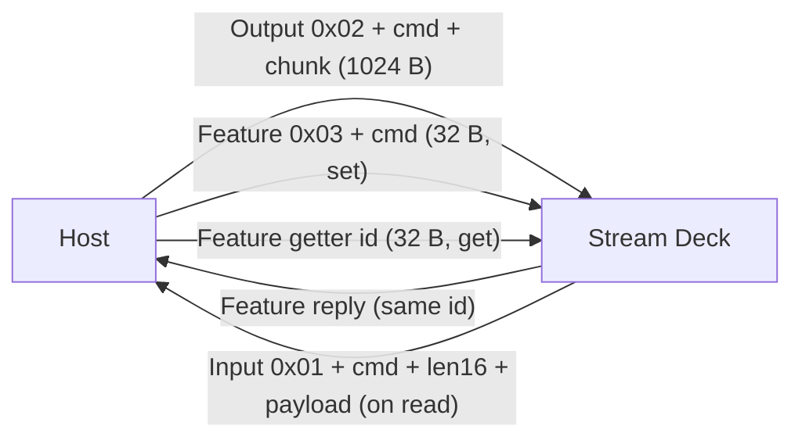
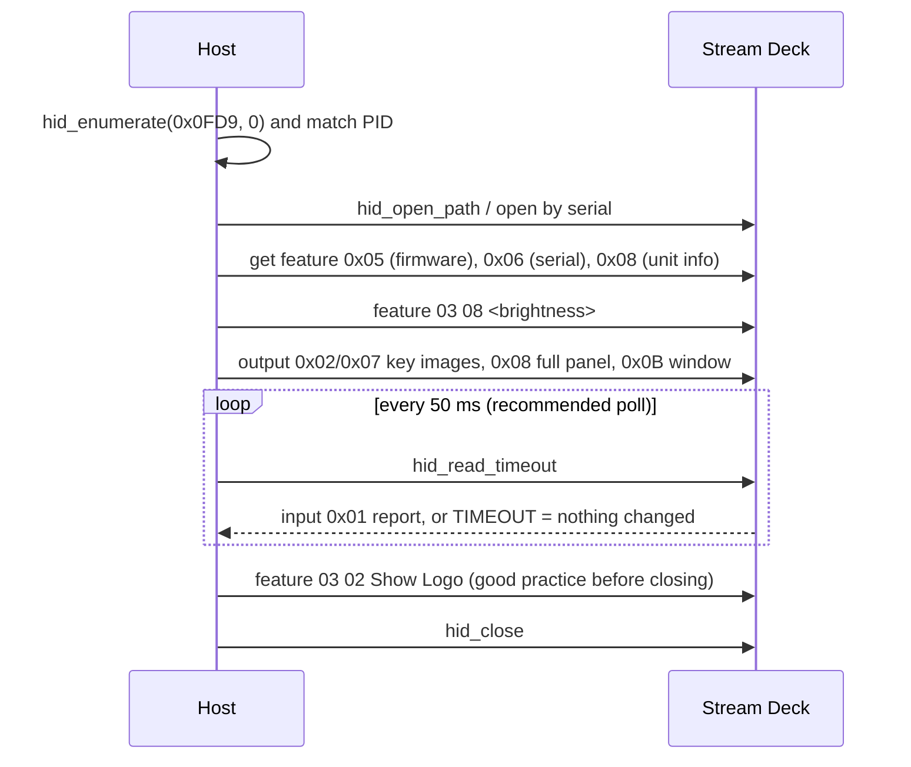

# 01 - Transport: HID reports, IDs, workflow

## Report types [docs]

Every exchange is a HID report: a byte array whose first byte is the **Report ID**.

| Direction | HID call | Type | Max size | Used for |
|-----------|----------|------|----------|----------|
| device -> host | `hid_read` (timed) | Input | 512 B (expanded) / 65 B (Mini) | key, encoder, touch events |
| host -> device | `hid_write` | Output | 1024 B, zero-padded | images (bulk data) |
| host <-> device | `hid_send_feature_report` / `hid_get_feature_report` | Feature | 32 B, zero-padded | settings, commands, getters |

Report IDs of the expanded protocol [docs]:

| ID | Kind | Meaning |
|----|------|---------|
| `0x01` | input | every event; second byte = event command |
| `0x02` | output | every image upload; second byte = command |
| `0x03` | feature, set | setters; second byte = command |
| `0x04` `0x05` `0x07` | feature, get | firmware version LD / AP2 (primary) / AP1 |
| `0x06` | feature, get | serial number |
| `0x08` | feature, get | unit information |
| `0x0A` | feature, get | sleep timer |

The Mini family uses other IDs, see [06](06-legacy-protocols.md).

hidapi convention: the buffer passed to every call includes the Report ID as byte 0.

## Session workflow [docs]

- **Polling**: "Recommended polling period is 50 ms" [docs]. A `TIMEOUT` means no state changed. A tighter loop is
  fine: the bridge reads with a 5 ms timeout [hw].
- **Closing**: send Show Logo first so the device does not keep the last picture [docs].
- **No handshake** is needed for any Stream Deck: open, then read and write [docs] [hw].

## Throughput [hw]

Each USB transaction takes about 0.4 ms whatever its size, output or feature report alike: roughly 2,400 reports per
second and about 2.3 MB/s of image data on macOS. The full benchmark tables are in
[`../performance.md`](../performance.md).

| Operation on the + XL | Reports | Time |
|-----------------------|---------|------|
| One key, typical icon (4:4:4 JPEG) | 3-6 | 1.3-2.6 ms |
| Whole window strip, `0x0B` | 28 | 11 ms |
| Whole panel incl. strip, `0x08`, test pattern | 136-200 | 55-86 ms |
| Fill one key with a colour (feature) | 1 | 0.4 ms |

## Threading [hw]

Reading and writing the same macOS hidapi handle from **two threads** delivered **no input at all**, although the
same code worked when both ran on one thread. Let one thread own the handle and alternate short reads with writes.
