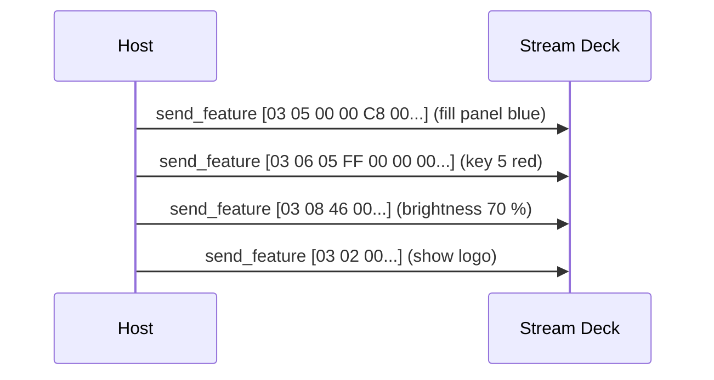

# 02 - The expanded protocol (all current models except the Mini family)

## Data types [docs]

| Type | Meaning |
|------|---------|
| `UINT8` / `BYTE` | unsigned 8-bit |
| `INT8` / `CHAR` | signed 8-bit (ASCII for text) |
| `UINT16` / `INT16` | 16-bit, **little-endian** |
| `UINT32` / `INT32` | 32-bit, little-endian |
| `RGB` | three `UINT8`: red, green, blue |
| `T[n]` / `T[]` | fixed / variable length array |

## Report layouts [docs]

```text
Input   (<= 512 B)  [0x01][cmd][len lo][len hi][payload ...]
Output  (1024 B)    [0x02][cmd][command-specific header][chunk data ...][zero padding]
Feature (32 B)      [id  ][cmd][payload ...][zero padding]          (cmd ignored for getters)
```

## Input commands (ID `0x01`) [docs]

| Cmd | Event | Payload |
|-----|-------|---------|
| `0x00` | key / button state change | one byte per key: `0` up, `1` down (Neo: + 2 sensor bytes) |
| `0x02` | touch window gesture (+, + XL) | type `1` tap, `2` press, `3` flick + coordinates |
| `0x03` | encoder change (+, + XL) | type `0` press states / `1` rotation ticks (signed) |

Details and parsing in [05-input.md](05-input.md).

## Output commands (ID `0x02`) [docs]

| Cmd | Command | Models |
|-----|---------|--------|
| `0x07` | Update Key / Button Image | all expanded models |
| `0x08` | Update Full Screen Image (the whole panel) | all expanded models |
| `0x0B` | Update Window Image (whole strip) | Neo, +, + XL |
| `0x0C` | Update Partial Window Image | Neo, +, + XL |
| `0x0D` | Update Background (stored by index) | Classic, XL |

Byte layouts in [04-images.md](04-images.md).

## Setter feature reports (ID `0x03`) [docs]

| Cmd | Command | Payload | Verified [hw] |
|-----|---------|---------|---------------|
| `0x02` | Show Logo | - | yes: boot logo |
| `0x05` | Fill LCD with Color | `RGB` | yes: whole panel incl. strip |
| `0x06` | Fill Key / Button with Color | `UINT8` index, `RGB` | yes: no image needed |
| `0x08` | Set Backlight Brightness | `UINT8` 0..100 (`0x64`) | yes |
| `0x0D` | Set Sleep Mode Duration | `INT32` seconds, `0` = never | read back with `0x0A` |
| `0x13` | Show Background by Index | `UINT8` index | XL family only |

Example, brightness 80 % (32 bytes on the wire): `03 08 50 00 00 ... 00`.



`Fill Key with Color` is the cheapest way to clear or colour a key: one 32-byte feature report instead of a JPEG upload.
`sdctl clear` uses it [hw].

## Getter feature reports [docs] [hw]

The host sends a 32-byte buffer whose first byte is the getter ID; the reply comes back in the same buffer.

| ID | Getter | Reply layout | + XL reply [hw] |
|----|--------|--------------|-----------------|
| `0x04` | firmware LD | `id, len 0x0C, UINT32 checksum, char[8]` | `04 0C EB 92 CE 17 "1.0.0.2"` |
| `0x05` | firmware AP2 (primary) | same | `05 0C A3 63 FC 59 "1.0.2.2"` |
| `0x07` | firmware AP1 | same | `07 0C A3 63 FC 59 "1.0.2.2"` |
| `0x06` | serial number | `id, len 0x0C or 0x0E, char[len]` | `06 0E "AD4MA62512RPEP"` (14 chars) |
| `0x0A` | sleep timer | `id, len, INT32 seconds` | `0A 04 00 00 00 00` (off) |
| `0x08` | unit information | see below | see below |

So the version text starts at byte 6 and the serial at byte 2 of the buffer.

### Get Unit Information (`0x08`)

| Offset | Type | Field [docs] | + XL [hw] |
|--------|------|--------------|-----------|
| `+0x01` | `UINT8` | keypad rows | 4 |
| `+0x02` | `UINT8` | keypad columns | 9 |
| `+0x03` | `UINT16` | key width | 112 |
| `+0x05` | `UINT16` | key height | 112 |
| `+0x07` | `UINT16` | LCD width | 1280 |
| `+0x09` | `UINT16` | LCD height | 800 |
| `+0x0B` | `UINT8` | image bits per pixel | 2 |
| `+0x0C` | `UINT8` | image colour scheme | 5 |
| `+0x0D` | `UINT8` | key images in gallery | 0 |
| `+0x0E` | `UINT8` | LCD images in gallery | 0 |
| `+0x0F` | `UINT8` | frames for demo | 4 |
| `+0x10` | `UINT8` | reserved | 6 |
| `+0x11` ... | | "window-capable devices extend this response" | `64 00 B0 04 03` |

The docs warn that the layout "may vary across firmware versions". The + XL reports 112-pixel keys here, which is what the
docs say and what the crate got wrong (120). The extra bytes probably encode the window size (`0x0064` = 100,
`0x04B0` = 1200), but that interpretation is ours, not documented.

Use this getter to validate a model table at runtime: `sdctl info` prints it.

## Sizes, padding, chunking [docs]

- Output reports are always 1024 bytes; pad with zeros.
- Feature reports are always 32 bytes; pad with zeros.
- Images larger than one report are split into chunks; the last chunk sets **Transfer is Done = 1**. Each image command
  has its own header (see [04-images.md](04-images.md)).
- All expanded-protocol images are **JPEG**.
