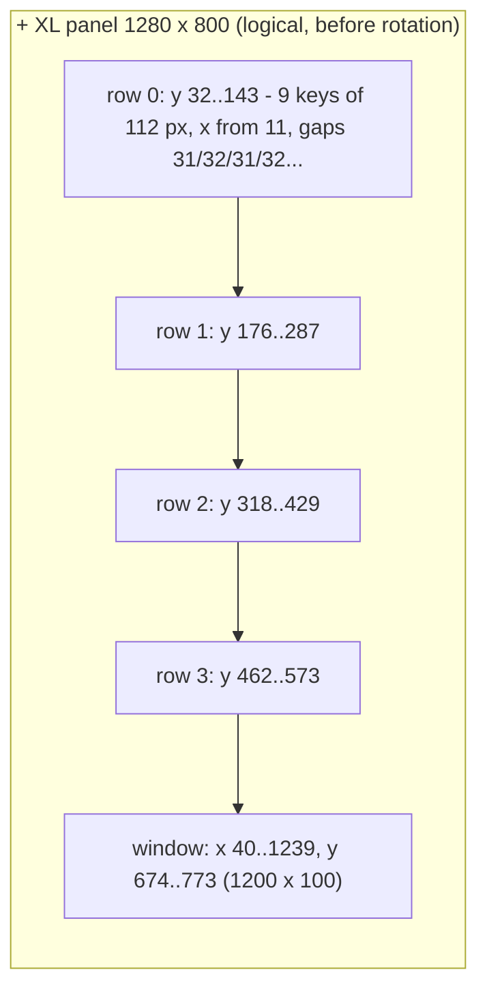
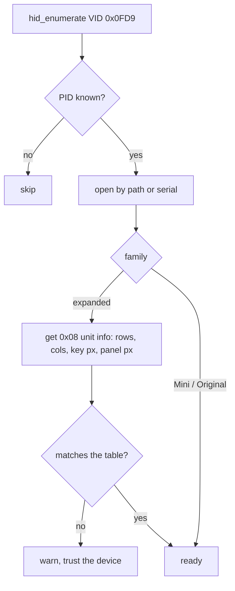

# 03 - Models, capabilities and pixel layouts

Vendor ID for every model: **`0x0FD9`** (Elgato).

## Model table [docs] [crate]

| PID | Name | Family | Protocol | Keys (cols x rows) | Dials | Window | Sensors |
|-----|------|--------|----------|--------------------|-------|--------|---------|
| `0x0060` | Stream Deck (2017) | Original | legacy, not in docs [crate] | 5 x 3 | - | - | - |
| `0x006D` | Stream Deck 2019 | Classic | expanded | 5 x 3 | - | - | - |
| `0x0080` | Stream Deck Mk.2 | Classic | expanded | 5 x 3 | - | - | - |
| `0x00A5` | Stream Deck Mk.2 Scissor Keys | Classic | expanded | 5 x 3 | - | - | - |
| `0x00B9` | Stream Deck 15-Key Module | Classic | expanded | 5 x 3 | - | - | - |
| `0x006C` | Stream Deck XL | XL | expanded | 8 x 4 | - | - | - |
| `0x008F` | Stream Deck XL 2022 | XL | expanded | 8 x 4 | - | - | - |
| `0x00BA` | Stream Deck Module 32 | XL | expanded | 8 x 4 | - | - | - |
| `0x009A` | Stream Deck Neo | Neo | expanded | 4 x 2 | - | 248 x 58, no touch | 2 |
| `0x0084` | Stream Deck + | + | expanded | 4 x 2 | 4 | 800 x 100, touch | - |
| `0x00C6` | Stream Deck + XL | + XL | expanded | 9 x 4 | 6 | 1200 x 100, touch | - |
| `0x0063` | Stream Deck Mini | Mini | legacy Mini | 3 x 2 | - | - | - |
| `0x0090` | Stream Deck Mini 2022 | Mini | legacy Mini | 3 x 2 | - | - | - |
| `0x00B3` | Stream Deck Mini Discord | Mini | legacy Mini | 3 x 2 | - | - | - |
| `0x00B8` | Stream Deck 6-Key Module | Mini | legacy Mini | 3 x 2 | - | - | - |
| `0x0086` | Stream Deck Pedal | Pedal | expanded input only [crate] | 3 switches | - | - | - |

Key indices run row by row from the top-left key, starting at 0 [docs] [hw]. Neo sensors are indices 8 and 9.

## Images per model [docs] [hw]

| Family | Key image | Full panel (`0x08`) | Window | Rotation before upload | Format |
|--------|-----------|---------------------|--------|------------------------|--------|
| Classic | 72 x 72 | 480 x 272 | - | 180 deg | JPEG |
| XL | 96 x 96 | 1024 x 600 | - | 180 deg | JPEG |
| Neo | 96 x 96 | 480 x 320 | 248 x 58 | 180 deg | JPEG |
| + | 120 x 120 | 800 x 480 | 800 x 100 | none | JPEG |
| + XL | **112 x 112** [hw] | 1280 x 800 [hw] | 1200 x 100 [hw] | **90 deg counter-clockwise** [hw] | JPEG, **4:4:4** [hw] |
| Mini | 80 x 80 | no full-panel command | - | 90 deg clockwise | BMP |
| Original | 72 x 72 | - | - | mirrored both ways [crate] | BMP |

"180 deg" equals mirroring both axes, which is how the crate expresses it.

## The panel is one LCD [docs] [hw]

Keys and the window are areas of a single LCD. `Update Full Screen Image` writes all of it at once. Where every key sits
inside that frame comes from the docs' "Unit Pixel Layout" drawings. On the + XL a test frame built from these numbers
landed exactly on the keys and the strip [hw]. A frame that simply divided the panel into equal cells did not.

### Pixel layouts [docs]

| Model | Panel | Key | Column x (left edges) | Row y (top edges) | Window rect |
|-------|-------|-----|-----------------------|-------------------|-------------|
| Classic | 480 x 272 | 72 | 11, 108, 205, 302, 399 (gap 25) | 5, 102, 199 (gap 25) | - |
| XL | 1024 x 600 | 96 | 14 + n x 128 (gap 32) | 47, 182, 317, 452 (gap 39) | - |
| Neo | 480 x 320 | 96 | 3, 129, 255, 381 (gap 30) | 9, 135 (gap 30) | 116, 262, 248 x 58; sensors 96 x 16 at (3, 283) and (381, 283) |
| + | 800 x 480 | 120 | 13, 232, 451, 670 (gap 99) | 12, 172 (gap 40) | 0, 380, 800 x 100 |
| + XL | 1280 x 800 | 112 | 11, 154, 298, 441, 585, 728, 872, 1015, 1159 (gaps 31/32 alternating) | 32, 176, 318, 462 (gaps 32/30/32) | 40, 674, 1200 x 100 |
| Mini | 320 x 240 | 80 | 14, 122, 229 (gaps 28/27) | 26, 134 (gap 28) | - |

Gaps between keys lie behind the bezel. A picture spread over several keys must be laid out on these physical
coordinates (gaps included) and each key given the part that lies under it. Slicing it into equal key-sized pieces
breaks lines at every key edge. On the + XL a 4:3 ZX Spectrum screen fitted to the physical rectangle of a 4 x 3 key
block (x 11..553, y 32..430, about 1.36:1) lines up across the keys [hw]. The same layout works either through one
full-panel upload (`0x08`) or by cutting the canvas per key and uploading 36 key images (`0x07`).

## Visible area of a key [hw]

On the + XL the bezel hides part of each 112-pixel key image when looking straight at the deck: the left edge is fully
visible, the top almost, the right and bottom are covered by about 8 px. Keep important content at least 8 px from every
edge (the inner ~96 x 96). `libsdb` shrinks generated icons and labels into this area; photos and
screenshots are not shrunk.

## Runtime detection [docs] [hw]

An hidapi enumeration can return several interfaces per device; deduplicate by serial [crate].
