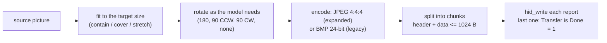
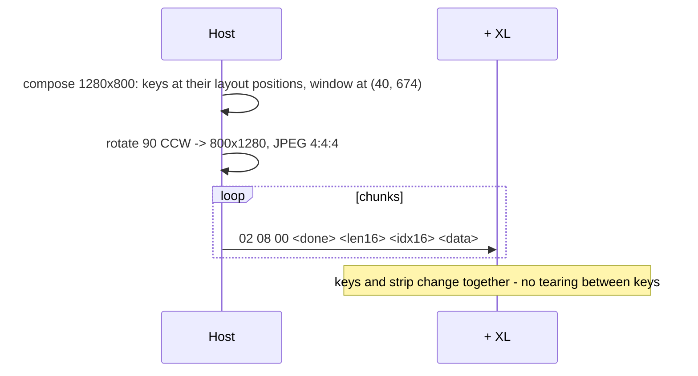
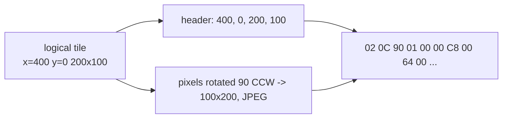

# 04 - Uploading images

## Pipeline



- **Formats** [docs]: all expanded models take **JPEG** only; the Mini family and the Original take **BMP** only. No PNG, GIF,
  alpha channel or animation: an animation is the host sending a new image per frame.
- **Chroma subsampling** [hw]: on the + XL keys, 4:2:0 JPEG renders as stringy noise that only vaguely resembles the
  picture; **4:4:4** displays correctly. The strip decoded both. Always encode 4:4:4.
- **Rotation** [docs] [hw]: see the table in [03-models.md](03-models.md). It is applied to the pixels before encoding; the
  coordinates in the headers stay logical.

## Key image - output `0x02 / 0x07` [docs] [hw]

| Offset | Type | Field |
|--------|------|-------|
| `+0x00` | `UINT8` | `0x02` |
| `+0x01` | `UINT8` | `0x07` |
| `+0x02` | `UINT8` | key index |
| `+0x03` | `UINT8` | Transfer is Done (`1` = last chunk) |
| `+0x04` | `UINT16` | chunk data size |
| `+0x06` | `UINT16` | chunk index, from 0 |
| `+0x08` | `BYTE[]` | chunk data (up to 1016 B) |

Example: a 2,500-byte JPEG for key 5 becomes three reports with headers
`02 07 05 00 F8 03 00 00`, `02 07 05 00 F8 03 01 00`, `02 07 05 01 D4 01 02 00`.

## Full panel - output `0x02 / 0x08` [docs] [hw]

Same 8-byte header as the key image with `+0x02` reserved (`0`). The image covers **the whole LCD including the
window**, laid out as in [03-models.md](03-models.md). On the + XL a 1280 x 800 frame (rotated 90 deg CCW to 800 x 1280)
took 129-200 reports and 52-86 ms [hw]: about one panel per 60-90 ms, versus 36 separate key uploads.



## Window - output `0x02 / 0x0B` [docs] [hw]

Same 8-byte header (`+0x02` reserved). The whole strip in one image: + 800 x 100, + XL 1200 x 100 (rotated 90 deg CCW),
Neo 248 x 58 (rotated 180 deg). + XL: 28 reports, 11 ms [hw].

## Partial window - output `0x02 / 0x0C` [docs] [hw]

| Offset | Type | Field |
|--------|------|-------|
| `+0x02` | `UINT16` | x |
| `+0x04` | `UINT16` | y |
| `+0x06` | `UINT16` | width |
| `+0x08` | `UINT16` | height |
| `+0x0A` | `UINT8` | Transfer is Done |
| `+0x0B` | `UINT16` | chunk index |
| `+0x0D` | `UINT16` | chunk data size |
| `+0x0F` | `UINT8` | reserved |
| `+0x10` | `BYTE[]` | chunk data (up to 1008 B) |

The header is 16 bytes, and the field order differs from the 8-byte commands: index comes before size.

**Coordinates are logical**: "use logical coordinates, without accounting for image rotation" [docs]. Verified on the
+ XL [hw]: tile *n* of a dial goes to `x = 200 n, y = 0, w = 200, h = 100` while the JPEG inside is the rotated
100 x 200 picture. The crate rotates the coordinates as well (`x = 0, y = 1200 - 200 (n + 1), w = 100,
h = 200`). The firmware then puts every tile at x = 0 [hw], so partial updates were broken there.

**The rectangle must span the full window height** [hw]: on the + XL a 248 x 58 write at y = 21 is silently ignored, while
248 x 100 at y = 0 is drawn at any x. To update a smaller area, send the full-height column range around it. The
bridge keeps a copy of the strip content for this.



## Background - output `0x02 / 0x0D`, show with feature `03 13` [docs]

Classic and XL can store whole-panel backgrounds by index:

| Offset | Type | Field |
|--------|------|-------|
| `+0x02` | `UINT8` | background index |
| `+0x03` | `UINT8` | Transfer is Done |
| `+0x04` | `UINT16` | **chunk index** |
| `+0x06` | `UINT16` | **chunk data size** |
| `+0x08` | `BYTE[]` | chunk data |

Note the swapped order compared with `0x07` / `0x08` / `0x0B`. The XL page documents `03 13 <index>` to show a stored
background. Not tested here: no Classic or XL was available.

## Colour fills (feature reports) [docs] [hw]

| Report | Effect |
|--------|--------|
| `03 05 R G B` | whole panel, including the window, one colour |
| `03 06 i R G B` | key `i` one colour (Neo: `i` = 8, 9 are the sensors' LEDs [crate]) |

These need no image and cost one 32-byte transfer each.

## Chunking rules [docs]

```text
payload per report = 1024 - header (8 or 16)
reports            = ceil(image bytes / payload)
chunk index        = 0, 1, 2 ...
Transfer is Done   = 1 only on the last report of the image
padding            = zeros up to 1024 bytes
```

The device shows the image when the last chunk arrives; there is no separate "present" command [hw].
