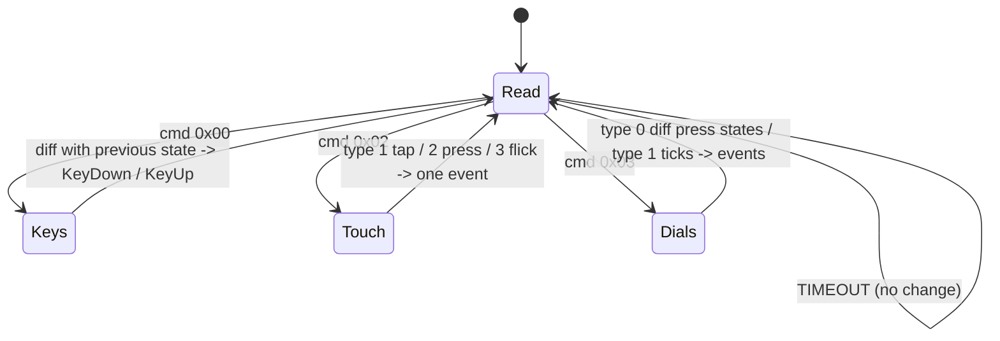

# 05 - Input reports

All expanded-model events arrive as input reports `[0x01][cmd][len16][payload]` on `hid_read` [docs]. On the + XL every
read returns a 512-byte report [hw].

## Keys - cmd `0x00` [docs] [hw]

| Offset | Type | Field |
|--------|------|-------|
| `+0x02` | `UINT16` | payload length = number of keys (+ Neo sensors) |
| `+0x04` | `UINT8[]` | `0` up, `1` down, one byte per key |

+ XL key 27 pressed [hw]: `01 00 24 00` followed by 27 zero bytes and then `01` (36 key bytes in total).

The report carries the **state of all keys**, not an edge: keep the previous state and compare to produce down/up events.
On the Neo the two touch sensors are two extra bytes after the 8 keys (indices 8 and 9) [docs].

## Touch window - cmd `0x02` (+ and + XL) [docs] [hw]

| `+0x04` type | Gesture | Fields |
|--------------|---------|--------|
| `0x01` | TAP | `+0x06` x, `+0x08` y |
| `0x02` | PRESS (hold) | `+0x06` x, `+0x08` y |
| `0x03` | FLICK | `+0x06` start x, `+0x08` start y, `+0x0A` end x, `+0x0C` end y |

"The event is reported after the interaction completes - touch and release are not reported as separate events" [docs].

Measured on the + XL [hw]:

- coordinates are logical: x 0..1199 from left to right, y 0..99; no mirroring;
- a FLICK covers only about 60-110 px between start and end, even for a slow drag across the whole strip;
- there are **no intermediate drag points**: a marker cannot follow the finger continuously. Treat the flick's end point
  as an absolute position (as for a tap): dragging in steps then moves the marker in steps.

```text
tap   x=199 : 01 02 0E 00 01 01 C7 00 2E 00
flick 26->138: 01 02 0E 00 03 00 1A 00 51 00 8A 00 4B 00
```

## Encoders - cmd `0x03` (+ and + XL) [docs] [hw]

| `+0x04` type | Meaning | Payload from `+0x05` |
|--------------|---------|----------------------|
| `0x00` | press state | one byte per encoder: `0` up, `1` down |
| `0x01` | rotation | one **signed** byte per encoder: ticks, + clockwise, - counter-clockwise |

+ XL, dial 0 turned counter-clockwise by 3 detents within one report [hw]: `01 03 07 00 01 FD 00 00 00 00 00`.
A fast turn packs 1-5 detents into one report; scale the step with the turn rate. The bridge goes from 1 frame per detent
when turning slowly to 100 when turning fast.

## Parsing



Polling: 50 ms is recommended [docs]. A thread that only reads with a 5 ms timeout and writes in between gives
key-to-event latency well under one frame [hw].
