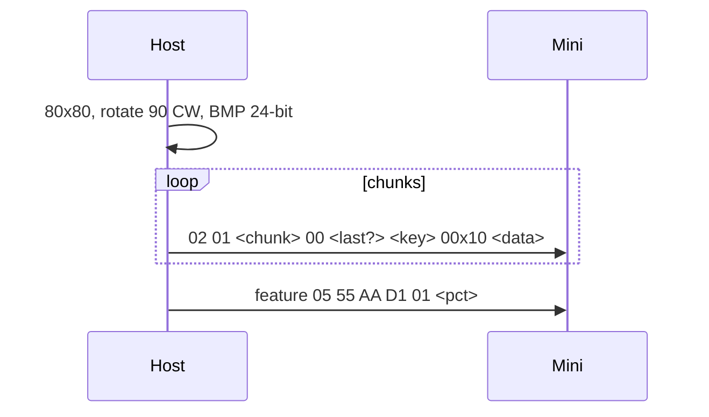

# 06 - Legacy protocols: Mini family and the 2017 Original

Neither was available for hardware tests; facts come from [docs] for the Mini family and [crate] for the Original.

## Mini family (`0x0063`, `0x0090`, `0x00B3`, `0x00B8`) [docs]

"The Mini family uses a different HID protocol from all other Stream Deck families" [docs].

| | Mini family | Expanded models |
|---|---|---|
| Input report | fixed 65 B: `[0x01][key0..key5][unused]` | `[0x01][cmd][len16][payload]` |
| Image format | **BMP**, 80 x 80, rotated 90 deg clockwise | JPEG |
| Image header | 16 B (below) | 8 B |
| Full panel image | none: upload each key's 80 x 80 slice | `0x08` |
| Brightness | feature `05 55 AA D1 01 <pct>` | `03 08 <pct>` |
| Show logo | feature `0B 63 00` | `03 02` |
| Sleep timer | set `0B A2 <INT32>`, get `0xA3` | `03 0D`, get `0x0A` |
| Firmware | get `0xA0` LD, `0xA1` AP2, `0xA2` AP1; text from byte 5 | `0x04` / `0x05` / `0x07`; text from byte 6 |
| Serial | get `0x03`; text from byte 5 | `0x06`; text from byte 2 |

### Upload Data to Image Memory Bank - output `0x02 / 0x01`

| Offset | Type | Field |
|--------|------|-------|
| `+0x02` | `UINT8` | chunk index |
| `+0x03` | `UINT8` | reserved `0` |
| `+0x04` | `UINT8` | Show Image flag (`1` on the last chunk = display it) |
| `+0x05` | `UINT8` | key index |
| `+0x06` | `BYTE[10]` | reserved |
| `+0x10` | `BYTE[]` | chunk data (up to 1008 B) |

The crate writes `key + 1` at `+0x05` and has worked with real Minis for years [crate]. The docs say "Key Index". Which
base a given firmware expects is unverified here, so `libsdb` keeps the crate's `+1`.

## Original 2017 (`0x0060`) [crate]

"The Stream Deck with PID 0x0060 is not supported by this protocol" [docs]; the crate implements it:

- 15 keys, 72 x 72 BMP, mirrored in both axes;
- key columns are mirrored in input and output: `flip(k) = k - c + (4 - c)` with `c = k % 5`;
- an image is always exactly two output reports of 8191 bytes, header `02 01 <page+1> 00 <last> <key+1> 00x10`;
- brightness and show logo use the Mini family's feature reports.

## Pedal (`0x0086`) [crate]

Three foot switches, no screen; the docs do not cover it. Input as expanded keys (`cmd 0x00`, three bytes from `+0x04`);
image commands must not be sent.
