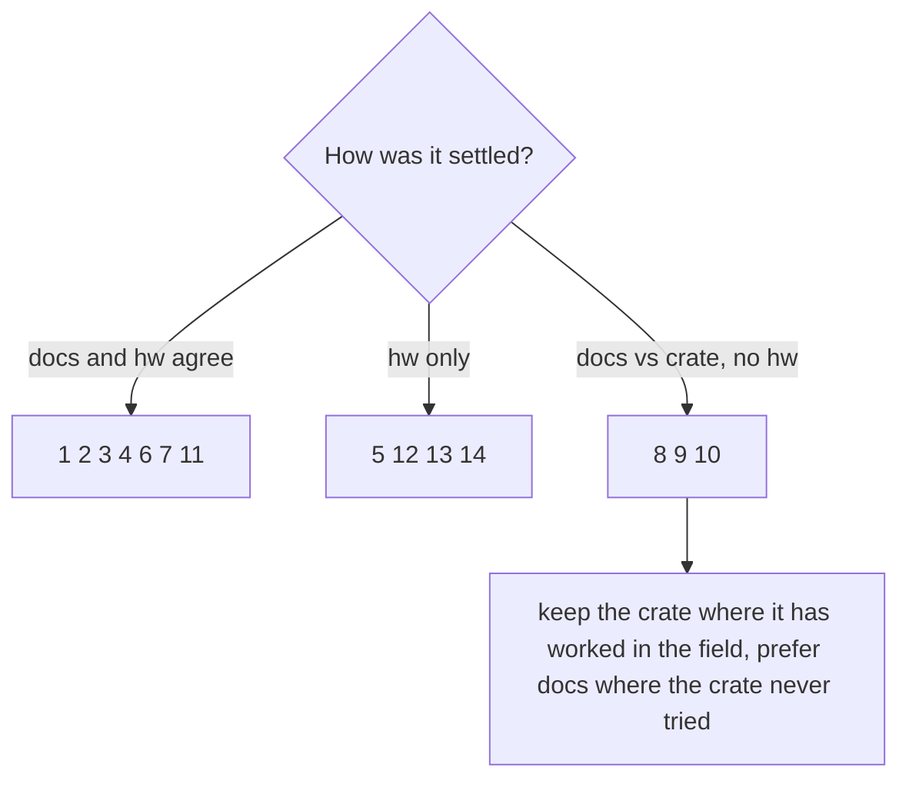

# 07 - Discrepancies and what `libsdb` does

| # | Topic | [docs] | [crate] | [hw] (+ XL) | libsdb |
|---|-------|--------|--------------------|-------------|------------|
| 1 | + XL key image size | 112 x 112 | 120 x 120 | Unit Information says 112; a 112 test frame fills the key | **112** |
| 2 | Partial window `0x0C` coordinates | logical | rotated into device axes | logical correct; rotated ones put every tile at x = 0 | **logical**, device mode kept as an option |
| 3 | Whole strip | `0x0B` Update Window Image | `0x0C` region covering the strip (Neo uses `0x0B`) | `0x0B` works, 11 ms | **`0x0B`** |
| 4 | Whole panel `0x08` | documented for all expanded models | not used | works; includes the window; keys at the documented layout positions | `set-panel`, `Device::SetFullScreen/setPanel` |
| 5 | JPEG chroma subsampling | not specified | encoder default | 4:2:0 = garbage on + XL keys, 4:4:4 fine | **4:4:4** always |
| 6 | Clearing keys | Fill Key with Color `03 06` | upload a blank JPEG per key | works | `ClearAllKeys` uses `03 06` on expanded models |
| 7 | Fill panel, sleep timer, unit info | `03 05`, `03 0D` / `0x0A`, `0x08` | not used | all work | `FillScreenColor`, `sdctl sleep`, `sdctl info` |
| 8 | Mini firmware getter | `0xA1`, text at byte 5 | `0x04` | not tested | `0xA1`, falls back to `0x04` |
| 9 | Mini key index in the image header | "Key Index" | `key + 1` | not tested | keep `key + 1` |
| 10 | Neo partial window `0x0C` | supported | not used | not tested | flagged as supported in the model table |
| 11 | Touch drag | events only after the gesture | same | flick = short segment, no drag points | flick end = absolute position |
| 12 | Visible key area | not documented | - | bezel hides ~8 px right / bottom | generated content kept 8 px inside |
| 13 | macOS hidapi read + write from two threads | - | one mutex around both | no input at all | one I/O thread owns the handle |
| 14 | Partial window height | any rectangle | full height only | writes shorter than the strip are ignored | full-height column range from a shadow copy of the strip |



## Testing the other models without owning them

`sdctl --emulate <model>` presents any smaller model on a + XL (see the bridge README): its key block, window and dials,
its own image pipeline (size, rotation, JPEG / BMP) decoded back for display, and its input indices. This checks layout,
geometry and encoding for every model on real glass. It cannot check what only the real device does: the legacy USB
headers of the Mini / Original, or whether those firmwares accept our files.

## How to re-check

```bash
tools/build/build.sh sdctl            # needs -DUNREAL_STREAMDECK=ON once
cmake-build-agent-release/bin/sdctl probe                 # every getter, raw bytes and decoding
cmake-build-agent-release/bin/sdctl hid-test --only N     # 1 key size, 2 full panel, 3 window 0x0B, 4/5 partial device/logical,
                                    # 6 fill keys, 7 fill panel, 8 show logo
cmake-build-agent-release/bin/sdctl events --raw          # input reports as hex
```
