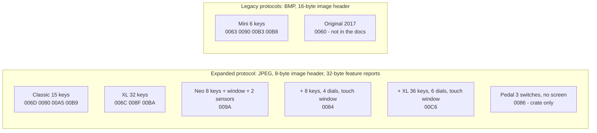

# Stream Deck HID protocol

A cross-checked description of how a host talks to every Elgato Stream Deck over USB HID. Every fact carries its source:

| Mark | Source |
|------|--------|
| **[docs]** | Elgato's public HID documentation, <https://docs.elgato.com/streamdeck/hid/intro> (read 2026-10-17), including its "Unit Pixel Layout" drawings |
| **[crate]** | `elgato-streamdeck` 0.13 (Rust), derived from `python-elgato-streamdeck` |
| **[hw]** | Measured with `sdctl` on a Stream Deck + XL (PID `0x00C6`, firmware AP2 1.0.2.2, LD 1.0.0.2), macOS, 2026-10-16/17 |

Only the Stream Deck + XL was available for [hw]. Everything else about the other models rests on [docs] and [crate].

| Article | Content |
|---------|---------|
| [01-transport.md](01-transport.md) | HID concepts, report types and sizes, report IDs, session workflow, polling |
| [02-expanded-protocol.md](02-expanded-protocol.md) | The protocol of all current models: data types, report layouts, every common command and getter |
| [03-models.md](03-models.md) | Every model: PIDs, capabilities, image sizes, rotations, panel pixel layouts |
| [04-images.md](04-images.md) | Image upload: formats, rotation, chunking; key, full-panel, window, partial-window and background commands |
| [05-input.md](05-input.md) | Input reports: keys, touch window gestures, encoders; what the touch window can and cannot report |
| [06-legacy-protocols.md](06-legacy-protocols.md) | The Mini family's legacy protocol and the 2017 Original (PID `0x0060`) |
| [07-discrepancies.md](07-discrepancies.md) | Where docs, crate and hardware disagree, and what `libsdb` does |

Tools in [`companions/streamdeck/sdctl`](../../../../companions/streamdeck/sdctl): `sdctl probe` dumps every getter, `sdctl hid-test` runs the
visual checks used to settle the disagreements, `sdctl events --raw` prints input reports as hex.
