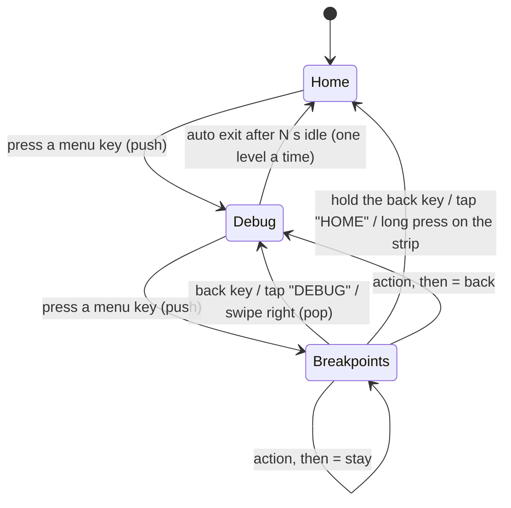
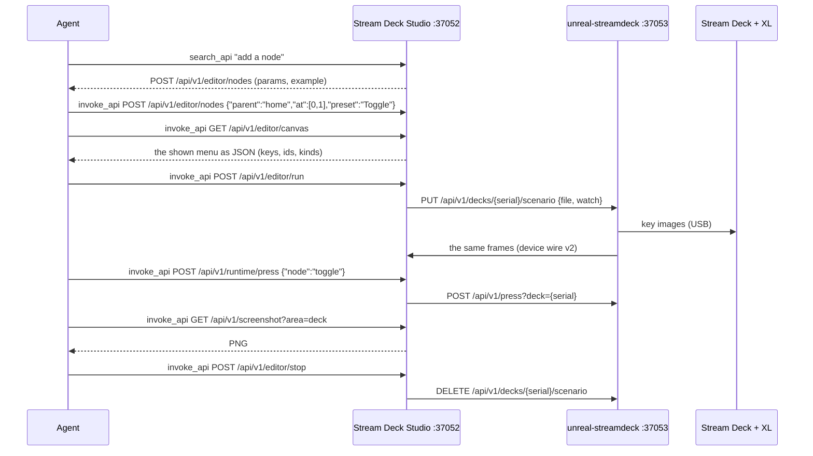

# Scenario editor: UX design

How a scenario behaves on the deck, and how the editor in Stream Deck Studio builds it. Field names refer to the
file format ([03-technical-design.md §2](03-technical-design.md#2-file-format-v1)).

## Contents

- [1. On the deck](#1-on-the-deck)
- [2. The editor window](#2-the-editor-window)
- [3. Running on the deck](#3-running-on-the-deck)
- [4. Agent workflow](#4-agent-workflow)

## 1. On the deck

### Stack navigation



- Every menu has its own layout: Home may use 30 keys, Debug six in the middle row. Keys a menu does not use are
  black.
- A menu key enters on press. An action key queues its action on press; actions run one at a time, in order.
- `then: back` or `home` navigates after the action succeeded; a failed action stays.
- With `settings.navigation.stack: false` entering replaces the menu: no path, no back key; menus need their own
  `nav` actions.

### The back key

```text
+---------+
|   <     |   arrow, the parent's title, the depth
|  DEBUG  |   release = back; held 600 ms = home (home_on_hold)
|  . . o  |
+---------+
```

| Rule | |
|:--|:--|
| Shown | Below the root, when stack navigation is on and the breadcrumbs resolve to `key`, or a menu sets `nav.back` explicitly |
| Slot | The nearest `nav.back` up the stack, else `settings.navigation.back` (default `[0, 0]`); `nav.back: null` (or `false`) = none here and below, unless a deeper menu sets a slot |
| Reserved | Drawn by the runtime; an item on its slot is a validation error, and the editor refuses drops there |

### Breadcrumbs on the strip

On the + and + XL (`auto` resolves to `strip` there):

```text
+-----------------------------------------------------------------------------------------------+
|  HOME  >  DEBUG  >  BREAKPOINTS                                       [the menu's own content]  |
+-----------------------------------------------------------------------------------------------+
   tap = pop to Home   tap = pop to Debug   (current, highlighted)      swipe right anywhere = back
```

- Chips, the current one highlighted; a long path keeps the root and the newest levels and collapses the middle to
  `..`.
- The rest of the strip is the menu's content (`strip.content`: `title`, `text`, `image`, `breadcrumbs` (the path
  only), `none`) and the dial labels of the page.
- `strip.status: "ttd"` reserves a slot at the right for the time-travel readout (frame, or `mm:ss.ff` with
  `strip.fps`).
- A long press on the strip goes home.

### Dials

| Input | Does |
|:--|:--|
| Turn | The bound `turn` action with `$ticks` (detents, negative = left) and `$rate` (detents a second, smoothed); turns that come while it still runs are merged into the waiting one |
| Press | The bound `press` action |

A menu's bindings replace the parent's per dial; unbound dials inherit, unless the menu says `nav.dials: own` or
the scenario `inherit_dials: false`.

### Feedback

| Event | On the deck | Log line (the studio's APP source, the daemon's stdout) |
|:--|:--|:--|
| Menu entered | Keys redrawn (only those that changed), breadcrumbs updated | `menu: Home › Debug` |
| Action done | A toggle's face flips to `face_on` | `action pause: webapi POST /pause -> 200 (9 ms)` |
| Action failed | "PAUSE FAILED" on the strip for 2 s | `FAILED pause: ...` |
| Auto exit | A shrinking bar and "BACK IN n" while it counts | `auto exit -> Home` |
| Reloaded | The same menu (the longest prefix of the stack that still exists); toggles reset | `scenario reloaded: <name>, menu Home › Debug` |

## 2. The editor window

Toolbar button "Scenario editor" or Cmd+E (Scenario > Editor in Its Own Window); Scenario > Editor Docked Here puts
it beside the deck in one window.

```text
+--[New][Open][Save][Save as][Export][Import]--[Undo][Redo]--[▶ Run on the deck][■ Stop]------------------------------+
| SCENARIO        KEY  ACTION   | HOME › DEBUG           drop actions on keys, double-click a menu, Esc = up | INSPECTOR |
|  Home           menu (4)      | +-------------------------------------------------------------------+      | Menu debug|
|   Pause #run    0,1  webapi   | |  [ < ]  [STEP] [OVER] [ OUT] [    ] [    ] [    ] [    ] [    ]    |      | Id        |
|   Debug         0,5  menu (3) | |  [    ] [BRK ] [    ] [    ] [    ] [    ] [    ] [    ] [    ]    |      | Title     |
|    Step         0,1  webapi   | |  ...                                                              |      | Tags      |
|   ↪ Tape        1,4  menu (6) | |  HOME > DEBUG                                          | DEBUGGER |      | Label     |
|-------------------------------| |   (o)     (o)     (o)     (o)     (o)     (o)                     |      | Icon      |
| [search actions             ] | +-------------------------------------------------------------------+      | Colours   |
| Actions (drag onto a key)     | ISSUES (1) | RUNTIME                                                       | ...       |
|  Menu: Menu, Menu (back key)  |  ✖ bp: slot [0, 0] is under the back key of 'debug'                     | JSON      |
|  HTTP · Multi / Toggle ·      |                                                                          | [Apply]   |
|  System · Navigation · Device |                                                                          |           |
+-----------------------------------------------------------------------------------------------------------------------+
  status line: the last message ("saved ...", "running on the deck (deck CL12...) - edits go live", errors)
```

| Area | What it does |
|:--|:--|
| Tree | Every node with its key (`row,col`) and kind (`menu (n)` for menus); menus bold, nodes with errors red, `#tags` after the title. Included nodes italic and grey, an include placeholder marked `↪`. Selecting a node shows its menu on the canvas; double-click enters a menu |
| Breadcrumbs | Above the canvas: the path of the shown menu; a click shows that level (the editor's view, not the deck's) |
| Canvas | The shown menu on the model's panel, faces drawn by the runtime's renderer at the key's own size. The back key hatched (reserved); keys with errors get a red dot; the selection a cyan frame; a click on the strip or a dial selects the menu itself |
| Inspector | A form for the selection; with nothing selected, the scenario (name, model — every model by its token, stack navigation, breadcrumbs, hold = home, the WebAPI URL and the emulator id). Below it the node's JSON: Apply replaces the node's fields (not `items`, not `at`) as one undo step |
| Palette | Presets by category, a search box; drag one onto a key. Generic: Menu, Menu (back key), HTTP request, Multi action, Toggle, Delay, Shell command, Open URL / file, Keystroke, Type text, Back, Home, Go to menu, Brighter, Dimmer. The user's own from `<config>/unreal-ng/streamdeck/presets/*.json` ([studio.md §5](../studio.md#5-the-scenario-editor)) |
| Issues | Validation, errors (✖) and warnings (⚠); double-click selects the node. Errors block Run |
| Runtime | The run's lines (see [§3](#3-running-on-the-deck)) |

The inspector's form, by node:

| Node | Fields |
|:--|:--|
| Every node | Id (a rename makes it unique; `nav` targets follow), Title, Tags (comma separated), Key (shown; moved on the canvas), Label, Icon (the built-in icon names), Background / Foreground (hex or a colour picker), Image (a file picker) |
| Action | Action kind (the 14 kinds: `webapi`, `http`, `multi`, `toggle`, `shell`, `open`, `keys`, `nav`, `delay`, `brightness`, `first`, `dir`, `ttd_seek`, `run_toggle`; a new kind starts from a template, an unknown kind is shown as it is), Method (`webapi`, `http`), the kind's main argument (path, url, command, target, combo, to, ms, value), `node` for `nav` to a node, `body` (JSON, `webapi` / `http`), Then |
| Menu | Breadcrumbs (inherit, strip, key, none), Back key (`row, col`; `none`; empty = inherit), Auto exit (seconds, `inherit`), Dials (inherit, own), Strip (content), Strip text, the item count |
| Include | File (relative to the scenario's folder), Node, Title; buttons "Open the file in the editor", "Inline here (editable copy)" |
| Included node | Read-only: the file it comes from, "Open <file>" |

Steps of `multi`, `toggle`'s two actions, `first`, `dir`, dial bindings, `face_on` and the strip image are edited in
the JSON box.

### Gestures and commands

| Gesture | Result |
|:--|:--|
| Palette item -> empty key | A new node there, selected |
| Palette item -> menu key | The node goes into that menu, at its first free key |
| Palette item -> occupied action key | Refused: "drop on an empty key or a menu" |
| Key -> empty key | Move |
| Key -> occupied action key | Swap |
| Key -> menu key | Into that menu, at its first free key |
| Anything -> the back key | Refused |
| Click an empty key | Selects nothing; that key is where Paste and Import put the next node |
| Double-click a menu key / the back key | Enter / up one level |
| Right-click a key | Enter, Duplicate, Inline (an include), Export subtree..., Move to file (link)..., Delete; on an empty key: Import file as submenu..., Link file here (include)..., Import file items into this menu..., Add <category> > <preset>; Up one level |
| Delete; Backspace on the canvas or the tree | Delete the selected node and its subtree |
| Cmd+C / Cmd+V | Copy the selected node / paste it into the shown menu (the clicked empty key, else the first free one); a copy of an included node is an ordinary editable node, its ids made unique against the included ones |
| Cmd+D | Duplicate into the next free key |
| Cmd+Z / Shift+Cmd+Z | Undo / redo |
| Esc | Up one level |
| Cmd+S | File › Save Scenario, docked or floating (asks for a file when untitled) |

In a text field (the inspector, the JSON box, the runtime log) the edit keys work on the text.

Menus of the studio window:

| Menu | Items |
|:--|:--|
| File | New Scenario... (Cmd+N), Open Scenario... (Cmd+O), Save Scenario (Cmd+S), Save Scenario As... (Shift+Cmd+S), Export a Copy (JSON / YAML / CSV / TSV)..., Import into the Shown Menu (As a Submenu (copy), Its Keys Here (copy), As a Link (include)), Export Selected Subtree... (Shift+Cmd+E), Move Selected to File (link)..., Save / Copy Screenshot (Display Only, Device, Studio Window, Editor Canvas, Editor Window) |
| Edit | Undo, Redo, Cut, Copy, Paste, Duplicate, Delete, Select All, Inline Include (editable copy), Select None |
| Scenario | Editor in Its Own Window (Cmd+E), Editor Docked Here, Hide Editor, Run on the Deck (Cmd+R), Stop (Cmd+.), Show Issues, Canvas: Up One Level, Canvas: Home |

### Files

- Open, Save, Save as and Export take `.json`, `.yaml` / `.yml`, `.csv`, `.tsv`; the format follows the extension.
  Save writes the document as it is (includes stay links); Export writes a copy and the document keeps its file.
- Open asks before discarding unsaved changes; the title shows `*` while there are some.
- Subtrees: **Export subtree** writes the node as a scenario of its own (an action wrapped in a root menu) and lists
  `nav` targets that point outside it. **Move to file (link)** does the same and replaces the node by an include of
  that file. **Import** copies a file in as a submenu, merges its root's keys into the shown menu, or links it.
  **Inline** replaces an include by an editable copy.
- Included nodes are read-only: drops and imports into an included menu are refused with the file it comes from;
  edits, moves and deletes of included nodes fail (they are not in this document).

## 3. Running on the deck

**Run on the deck** (Cmd+R, the toolbar's ▶):

1. Refused while the scenario has errors (the Issues tab comes up).
2. The document, includes resolved, goes to a run file in the studio's data folder: `run/<name>.deck.json`
   (`~/Library/Application Support/unreal-ng/Stream Deck Studio/` on macOS, `~/.local/share/unreal-ng/Stream Deck
   Studio/` on Linux, `%APPDATA%\unreal-ng\Stream Deck Studio\` on Windows).
3. A daemon answers on `127.0.0.1:37053`: the deck the window shows plays the run file, that deck only
   (`PUT /api/v1/decks/{serial}/scenario`, watched).
4. None answers: the studio starts `unreal-streamdeck run <run file> --watch --wait --api 37053 --with-parent`.

| The window | Run plays on | The other decks |
|:--|:--|:--|
| Own deck (`own: neo`) | That own deck | The real deck keeps the daemon's scenario |
| Mirror of the real deck | The real deck (and so on every mirror) | Own decks keep theirs |
| Not joined | The daemon's first deck | |

- Edits write the run file 250 ms after the last change; the daemon sees the new file within its 250 ms watch and
  reloads it with the menu stack kept. The user's own file changes only on Save.
- An edit with errors still reaches the run file; the daemon refuses it and the deck keeps the last good scenario
  ("scenario error (deck ... keeps the previous one)").
- **Stop** (Cmd+.): the deck gets the daemon's start scenario back (`DELETE /api/v1/decks/{serial}/scenario`), not
  the one it played before Run; a daemon started for the run ends.
- The Runtime tab shows the run's own lines and, for a daemon the run started, the daemon's output. A daemon the
  studio started at launch writes to the protocol log (info); one started elsewhere keeps its output.
- The title says `[running: deck <serial>]` or `[running: started]`.

## 4. Agent workflow

Everything above has a route on the studio's port ([04-automation.md](04-automation.md)); MCP clients reach it
through `unreal-mcp-bridge` (Automation > Copy MCP Config).


