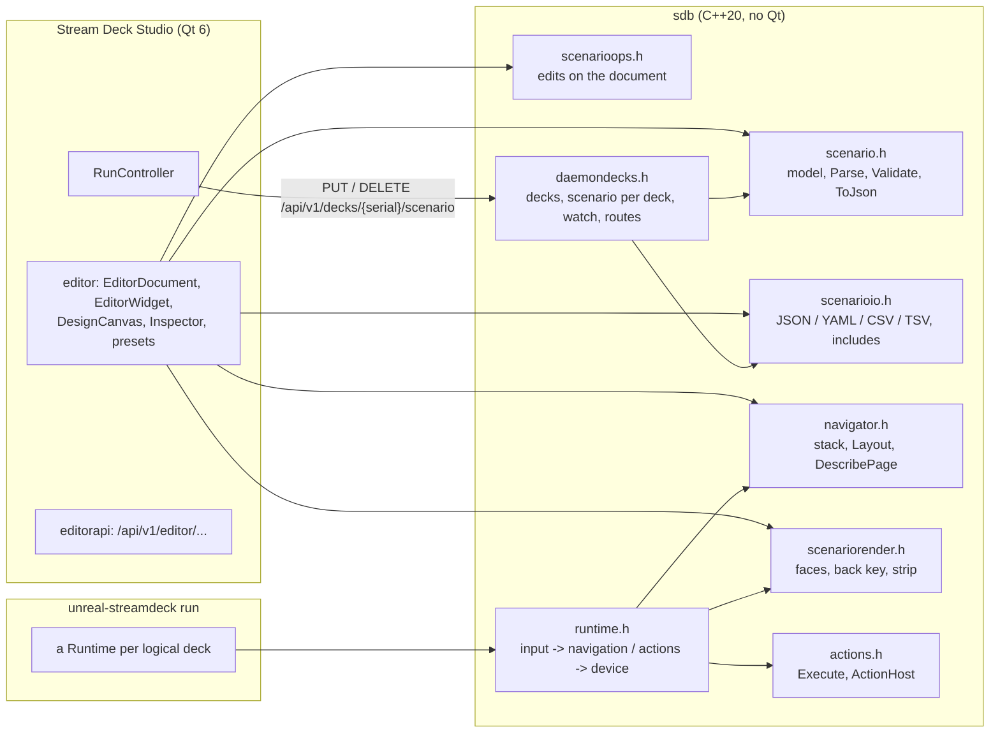
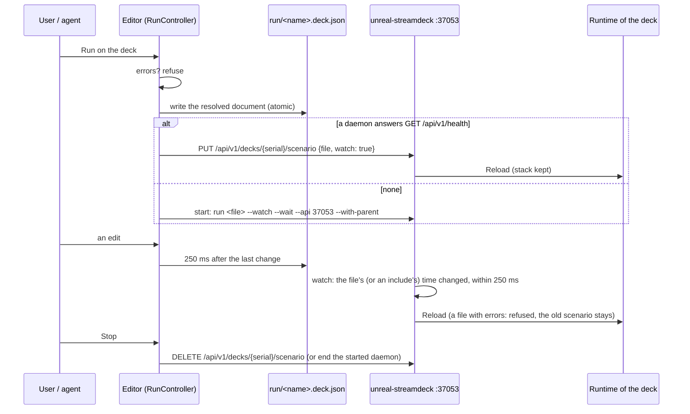

# Scenario editor: technical design

The file format, the engine in `sdb` (no Qt) that the daemon and the editor share, the editor's classes in Stream
Deck Studio, and how Run reaches the deck. Sources: [`companions/streamdeck/lib`](../../../../companions/streamdeck/lib),
[`companions/streamdeck/studio/editor`](../../../../companions/streamdeck/studio/editor).

## Contents

- [1. Components](#1-components)
- [2. File format v1](#2-file-format-v1)
- [3. Other formats and includes](#3-other-formats-and-includes)
- [4. Engine](#4-engine)
- [5. Editor](#5-editor)
- [6. Run, autosave and the daemon's watch](#6-run-autosave-and-the-daemons-watch)
- [7. Tests](#7-tests)
- [8. Planned](#8-planned)

## 1. Components



One engine: the editor never runs actions. Its canvas draws with the runtime's renderer and layout; Run hands the
document to the daemon, which plays it with the same runtime as on the real deck.

## 2. File format

Extension by convention `*.deck.json` (also `.deck.yaml`, `.csv`, `.tsv`, [§3](#3-other-formats-and-includes)). The
current format is **v2** (2026-10-20): the tables below are v1 plus the v2 fields, marked "v2"; the full v2
reference with its rules is [scenarios.md](../../../inprogress/2026-10-19-streamdeck-integration/scenarios.md). A v1
file loads as v1 (its kinds and settings work as before); the editor's Save and Convert, and `unreal-streamdeck
scenario upgrade`, write it as v2 (`scn::ConvertToV2`). The example below is v1.

```json
{
  "format": "streamdeck-scenario", "version": 1,
  "name": "debugger",
  "model": "plusxl",
  "settings": {
    "brightness": 70,
    "webapi": "http://127.0.0.1:8090", "emulator": "auto",
    "navigation": { "stack": true, "breadcrumbs": "auto", "back": [0, 0], "home_on_hold": true,
                    "auto_exit": 0, "inherit_dials": true }
  },
  "root": {
    "id": "home", "type": "menu", "title": "Home",
    "strip": { "content": "title", "text": "UNREAL NG" },
    "items": [
      { "id": "pause", "type": "action", "title": "Pause", "at": [0, 1], "tags": ["run"],
        "face": { "icon": "pause", "label": "PAUSE", "bg": "4D4400" },
        "do": { "kind": "webapi", "method": "POST", "path": "/pause" } },
      { "id": "debug", "type": "menu", "title": "Debug", "at": [0, 5],
        "face": { "icon": "bug", "label": "DEBUG", "bg": "2A0040" },
        "nav": { "back": [1, 0], "auto_exit": 30 },
        "dials": [ { "index": 0, "label": "FRAMES",
                     "turn":  { "kind": "ttd_seek", "unit": "frames", "min": 1, "max": 50 },
                     "press": { "kind": "run_toggle" } } ],
        "items": [
          { "id": "debug.step", "type": "action", "title": "Step", "at": [1, 1],
            "face": { "icon": "stepinto", "label": "STEP" },
            "do": { "kind": "webapi", "method": "POST", "path": "/step" } },
          { "id": "debug.home", "type": "action", "title": "Home", "at": [1, 2],
            "do": { "kind": "nav", "to": "home" } }
        ] }
    ]
  }
}
```

### Document and settings

| Field | Values | Default |
|:--|:--|:--|
| `format` | `"streamdeck-scenario"` (another value is an error) | |
| `version` | `1` or `2`; a higher one is refused ("made by a newer version") | 2 |
| `name` | text | `""` |
| `model` | `original`, `original2`, `classic`, `mk2`, `scissor`, `module15`, `xl`, `xl2`, `module32`, `neo`, `plus` (`+`), `plusxl` (`+xl`), `mini`, `mini2`, `discord`, `module6`, `pedal`, or a PID in hex (`0x00C6`) | `plusxl` |
| `settings.brightness` | 0..100, the deck's brightness when the scenario starts | 50 |
| `settings.webapi` | v1: the unreal-ng WebAPI (v2: a warning; the host is `unreal-streamdeck run --host`) | `http://127.0.0.1:8090` |
| `settings.emulator` | v1: `auto` (the instance with symbolic id `unreal-qt`, else the first), an id or a symbolic id (v2: a warning) | `auto` |
| `settings.companion_file` | v1: the companion token file (v2: a warning) | `~/.config/unreal-streamdeck/companion.json` |
| `settings.target` | v2: `"follow"` or `{"view": n}` (n >= 1); acted on with SD4 | `"follow"` |
| `settings.activity` | v2: `enabled`, `flash_keys` (true / false), `strip` (`none`, `line`), `seconds` (> 0), `ignore` (action ids) | on, flash, `none`, 1 s |
| `settings.navigation.stack` | stack navigation | `true` |
| `settings.navigation.breadcrumbs` | `auto`, `strip`, `key`, `none` | `auto` |
| `settings.navigation.back` | `[row, col]` or `null` (no back key) | `[0, 0]` |
| `settings.navigation.home_on_hold` | holding the back key goes home | `true` |
| `settings.navigation.auto_exit` | seconds idle before a menu pops, 0 off | 0 |
| `settings.navigation.inherit_dials` | unbound dials take the parent's bindings | `true` |

### Nodes

| Field | On | Values | Default |
|:--|:--|:--|:--|
| `id` | every node | unique in the document | required |
| `type` | every node | `menu`, `action`, `include` ([§3](#3-other-formats-and-includes)); the root is a menu | required |
| `title` | every node | text | the id |
| `tags` | every node | an array of strings (a string `"a, b"` is accepted) | |
| `at` | not the root | `[row, col]` in the parent menu | required |
| `face` | every node | `label`, `icon` (a built-in icon: `record tape disk play pause stop reset speaker mute rewind forward stepback flag bug gear check cross warn camera chip stepinto stepover stepout eye memory regs disasm stack`), `svg` (a monochrome SVG file, recoloured to `fg`), `image` (PNG, JPEG, GIF, BMP), `fit` (`contain`, `cover`, `stretch`), `bg`, `fg` (`RRGGBB`, `#` allowed) | bg `10101C`, fg `FFFFFF`, fit `contain`; no label, icon or picture = the title; a label with a picture is drawn under it (the picture shrinks above it) |
| `items` | menu | nodes | `[]` |
| `dials` | menu | `{index, label, turn?, press?}`; `turn` / `press` are actions | |
| `strip` | menu | `content` (`title`, `text`, `image`, `breadcrumbs`, `none`), `text`, `image`, `status` (`ttd`; v2 also `run`, `tape`, `target`, not drawn yet), `fps` (> 0, for the time codes), `target` (v2, true / false) | `title`; fps 50 |
| `context` | menu | v2: a surface context set on entering (`ctx.set`): lower case, digits, `.`, `_`, `-` | |
| `nav.breadcrumbs` | menu | `inherit`, `strip`, `key`, `none` | `inherit` |
| `nav.back` | menu | `[row, col]`; `null` or `false` = no back key | inherited |
| `nav.auto_exit` | menu | seconds, 0 off, -1 inherit | -1 |
| `nav.dials` | menu | `inherit`, `own` | `inherit` |
| `do` | action | the action, `{kind, ...}` | required |
| `then` | action | `stay`, `back`, `home` (after a successful run) | `stay` |
| `face_on` | action | a face shown while a `toggle` is on, or while `state` is true | |
| `state` | action | v2: a readout path (`run.state.paused`, `toggle.<action id>`, `audio.mute.muted`, `debug.mode.enabled`) | |
| `activity` | every node | v2: `false` = no activity flash for this key | `true` |

Paths in `face.image`, `face.svg`, `strip.image` and in action params take the roots `$data`, `$icons`, `$testdata`,
`$user`, `$scenario`; a relative path is relative to the scenario's folder (not the working directory); an unknown
root is an error, an absolute path a warning
([scenarios.md §3](../../../inprogress/2026-10-19-streamdeck-integration/scenarios.md#3-paths)).

### Action kinds

| Kind | Fields | Does |
|:--|:--|:--|
| `action` | v2: `id` (a catalogue id, required), `value`, `params` (object), `hold` (true / false) | A call of the host's action registry; `value` becomes the call's value or params ([scenarios.md §2](../../../inprogress/2026-10-19-streamdeck-integration/scenarios.md#2-the-action-kind)); `hold`: the press on the key's press, the release on its release. Through `ActionExecutor`: today the REST fallback `POST /api/v1/controllers/actions/{id}` |
| `webapi` | `path` (required), `method` (POST), `body`, `control` (default: not GET) | An unreal-ng WebAPI call. `path` relative to `/api/v1/emulator/{id}`; a path starting with `/api/` is used as is. The companion token when one is stored, else a short run-control session for `control` calls. `"$emulator"` and `"$model"` in the body become the instance's id and model |
| `http` | `url` (required), `method` (GET, POST with a body), `headers`, `body` | Any HTTP request |
| `multi` | `steps` (actions) | In order; stops at the first failure ("step 2/3: ...") |
| `delay` | `ms` (required) | Waits (cancellable) |
| `first` | `try` (actions, not empty) | The first step that works |
| `dir` | `left`, `right` (actions) | A dial turn: the side's action once per detent, at most 16 a turn |
| `toggle` | `on`, `off` (actions, both required) | Runs `on` and `off` in turn; the state flips on success and lives in the runtime (reset by a reload) |
| `shell` | `command` (required), `timeout_ms` (10000) | `/bin/sh -c` (macOS, Linux), `cmd.exe /c` (Windows); exit code 0 = success |
| `open` | `target` (required) | `open` (macOS), `xdg-open` (Linux), `start` (Windows) |
| `keys` | `combo` (`cmd+shift+4`) or `text` | macOS CGEvent (Accessibility permission), Windows `SendInput`, Linux `xdotool` (a clear error when it is missing; X11 only); one key table for all three, unknown keys are validation errors; key names in [daemon.md](../daemon.md) |
| `nav` | `to`: `back`, `home`, `node` (+ `node`, must exist), `scenario` (+ `file`) | `node` opens the menu (an action's node: its menu) with the path from the root; `scenario` loads another file on this deck |
| `brightness` | `value` (0..100) or `delta` | The deck's brightness |
| `ttd_seek` | `unit` (`frames`, `seconds`), `min`, `max` (a detent), `fps` (50) | v1 (a warning in v2; converted to `ttd.seek_by`): time travel by the dial's detents, from `min` at 4 detents a second to `max` at 40; the strip shows the frame or `mm:ss.ff` |
| `run_toggle` | | v1 (a warning in v2; converted to `run.pause_toggle`): pauses or resumes by the machine's state |

- Steps (`multi`, `first`, `dir`, `toggle`) nest up to 8 levels.
- `"$name"` placeholders take run variables: a dial turn passes `ticks` (detents, negative = left) and `rate`
  (detents a second). A whole-string `"$ticks"` becomes the number; inside text, its text.

## 3. Other formats and includes

`sdb/scenarioio.h`. `LoadFile` / `SaveFile` choose the format by extension (`.json`, `.yaml` / `.yml`, `.csv`,
`.tsv` / `.tab`; anything else is JSON). Saving writes `<file>.tmp` and renames it over the file.

**YAML** holds the same document (fkYAML).

**CSV / TSV** hold one row per node, depth first, parents before children (rapidcsv):

| Column | Holds |
|:--|:--|
| `id`, `parent`, `type`, `title` | The tree; `parent` empty = the root. A first row of type `scenario` carries the name (`title`, else `id`), the model (`kind`) and the rest of the document (`settings`, ...) in `extra` |
| `row`, `col` | `at` |
| `label`, `icon`, `bg`, `fg` | The common `face` fields |
| `kind`, `method`, `arg`, `then` | The action; `arg` = its main field: `webapi` path, `http` url, `shell` command, `open` target, `keys` combo, `nav` to, `delay` ms, `brightness` value |
| `tags` | Separated by `;` (`,` read too) |
| `extra` | A JSON object with everything else (`nav`, `strip`, `dials`, the other face and `do` fields, `face_on`) |

A spreadsheet edit of the simple columns round-trips without touching JSON. Reading needs the `id`, `parent` and
`type` columns; duplicate ids, two roots and a parent that is not a menu row are errors.

**Includes** link a subtree in another file:

```json
{ "id": "tape", "type": "include", "file": "lib/tape.deck.yaml", "node": "tape", "at": [1, 4],
  "title": "Tape", "face": { "bg": "203040" } }
```

| Rule | |
|:--|:--|
| What | `node` in that file (default its root); a wrapped action (`"fragment": true`, as Export writes it) comes back as the action |
| Where | `file` relative to the including file's folder |
| Ids | The included root takes the include's id and slot; its descendants get `<includeId>.` before their ids (one file can be included twice); `nav` targets inside follow |
| Overrides | `title`, `tags` replace; `face` is merged |
| Marks | Every resolved node carries `included_from` (the file's canonical path), in the editor only: `scenario resolve`, the run file, Export, Import and Paste strip them |
| Errors | A missing file or node, a cycle, nesting deeper than 8 |

`ResolveIncludes` (a document and its folder) and `LoadResolved` (a file) do it. `Parse` refuses an unresolved
include ("not resolved"), so the daemon and Run always play the resolved document.

Command line, on any of the formats:

```bash
unreal-streamdeck scenario check my.deck.yaml                 # includes resolved, issues listed
unreal-streamdeck scenario convert my.deck.json my.csv        # as written: includes stay links
unreal-streamdeck scenario extract my.deck.json debug dbg.yaml   # a subtree as its own scenario
unreal-streamdeck scenario resolve my.deck.yaml flat.json     # every include inlined, without `included_from` marks
```

## 4. Engine

### 4.1 Model: `sdb/scenario.h`

| Type | Holds |
|:--|:--|
| `Scenario` | `name`, `model` (a `Model*`), `Settings`, `root` |
| `Settings` | brightness, webapi, emulator, companion file; stack, crumbs (`Crumbs::Auto`), back (`Back`), home on hold, auto exit, inherit dials |
| `Node` | `type` (Menu, Action), id, title, tags, `at` (`Slot`), `face`; a menu's items, dials, strip, `nav`; an action's `action`, `then`, `faceOn` |
| `Face`, `Strip`, `Dial`, `Nav`, `Back` | As the file; `Back::Mode` Inherit, At, None |
| `Action` | `kind` and `spec` (the whole `do` object) |
| `Issue` | node, message, error or warning |

| Function | |
|:--|:--|
| `Parse(doc, issues)` | Parses and validates; `nullopt` on errors, warnings keep the scenario |
| `ParseLoose(doc)` | The tree without validation (the editor draws a document with issues) |
| `Validate(s)` | The rules of [01-requirements.md R7](01-requirements.md#2-scenario-model) |
| `ToJson(s)`, `ToJson(node)` | Back to JSON, defaults left out; an include placeholder round-trips as written |
| `Find`, `PathTo` | A node by id; the path root .. node |
| `ResolveNav(s, path)` | The effective breadcrumbs, back key and auto exit of the last menu |

`ResolveNav`:

- Auto exit: the nearest `nav.auto_exit >= 0` up the path, else the setting.
- Stack off: no breadcrumbs, no back key.
- Breadcrumbs: the first non-`inherit` value from the menu up, else the setting; `auto` = `strip` on models with a
  touch window, else `key`.
- Back key (below the root only): the nearest menu up the path with `nav.back` decides (`At` = that slot, `None` =
  none); if none does, `settings.navigation.back` when the breadcrumbs are `key`.

### 4.2 Navigation: `sdb/navigator.h`

| | |
|:--|:--|
| `Navigator` | The stack (root first): `Enter` (stack on: push; off: replace), `Back`, `Home`, `PopTo(depth)`, `GoTo(id)` (a menu, or an action's menu, with the path from the root), `Rebind(s, ids)` (after a reload: the longest prefix of the old stack's ids that still exists) |
| `Layout(s, nav, model)` | The `Page`: a node per key of the **device's** model (slots outside its grid are left out), the back key index, crumbs, a dial binding per dial (inherited until a menu with `nav.dials: own`, or not at all with `inherit_dials: false`), the strip, the path titles, auto exit |
| `DescribePage(...)` | The page as JSON for agents: `menu`, `path` (`id`, `title`), `breadcrumbs`, `back_key`, `can_back`, `keys` (`key`, `row`, `col`, `role` item or back, `id`, `type`, `title`, `label`, `tags`, `kind`, `then`, `on`, `items`), `dials` (`index`, `label`, `turn`, `press` kinds), `model`, `grid`, `strip`, `auto_exit` |
| `ListNodes(doc, filter)` | One line per node, filtered by `tag`, `type`, `kind`, `menu` (the direct parent), `text` (in id or title) |

### 4.3 Rendering: `sdb/scenariorender.h`

- `RenderFace`, `RenderBackKey`, `RenderEmptyKey` draw at any size; the runtime and the canvas use the key's own
  size, so nothing is resized after. `safePad` keeps icons and labels clear of the bezel; a picture keeps the whole
  key.
- Key text is the 5x7 pixel font: `DisplayText` upper-cases and replaces characters the font lacks.
- `CrumbSegments(path, width)` lays out the strip's chips; `CrumbHit` maps a tap to the depth it pops to. The
  renderer and the tap use the same function. Long paths keep the root and the newest levels, the middle becomes
  `..`.
- `RenderStrip(page, ...)`: crumbs when they go on the strip, the menu's content, dial labels, a banner (failures),
  the auto-exit bar and countdown, the status readout.

### 4.4 Actions: `sdb/actions.h`

`Execute(action, host, vars, toggleState)` runs one action ([§2](#action-kinds)); the side effects go through an
`ActionHost`: `Webapi`, `Http`, `TtdSeekBy`, `TtdState`, `Shell`, `Open`, `Keys`, `Navigate`, `Brightness`,
`SleepMs`, `Note`, `Cancelled`. `MakeSystemHost(settings, callbacks)` is the real one (the unreal-ng instance found
by `settings.emulator`, the token from the companion file); the tests use a fake.

### 4.5 Runtime: `sdb/runtime.h`

- One device thread reads input, applies navigation and renders; actions run on a worker thread, one at a time,
  FIFO. A dial turn waiting in the queue takes the next turn's detents (one action, no backlog).
- Only keys whose face changed are sent (a hash of the face, the node, pressed, the toggle state); the strip only
  sends the columns that differ.
- Back key: acts on release; held 600 ms = home (when `home_on_hold`). Strip: tap = crumb, swipe right = back, long
  press = home.
- `Reload(scenario)` is applied on the device thread's next step: stack rebound by ids, toggles reset, everything
  redrawn.
- Every menu change and action result goes to `Device::Note`: the daemon sends it to the viewers (the studio's APP
  log) and prints action lines on stdout.
- `State()`, `CurrentPage()` (`DescribePage`), `Nodes(filter)`, `PressNode(id)`, `Navigate(request)` serve the
  daemon's routes.

### 4.6 Document operations: `sdb/scenarioops.h`

Edits on the JSON document, shared by the editor's UI and its routes. Each keeps a parseable document parseable and
returns `{ok, error, id}`.

| Operation | |
|:--|:--|
| `NewScenario(model, name)` | A document with an empty root `home` |
| `FindNode`, `ParentOf`, `NodeAt(menu, slot)`, `FreeSlot(menu)` | Lookups; the first free slot skips the back key's |
| `ReservedSlot(doc, menu)` | The back key's slot in that menu |
| `UniqueId`, `Slug` | `pause`, `pause-2`, ...; a title becomes `lower-case-dashes` |
| `InsertNode(doc, parent, at?, node)` | Ids made unique over the subtree (`nav` targets inside follow); `at` defaults to the first free key; refuses slots outside the grid, occupied or the back key |
| `RemoveNode` | A node and its subtree (not the root) |
| `MoveNode(doc, id, parent, at, swap)` | To another slot or menu; an occupant is an error unless `swap` (it takes the old place, in the old menu); a menu cannot move into itself |
| `UpdateNode(doc, id, patch)` | JSON merge patch (RFC 7386, `null` removes); a new `id` is made unique and `nav` targets follow; `at` is refused (use move) |
| `DuplicateNode(doc, id, at?)` | A copy in the same menu |
| `ExtractSubtree(doc, id, outside)` | The node as a scenario of its own (an action wrapped in a root menu with `fragment: true`); `outside` lists `nav` targets that leave it |
| `ImportSubtree(doc, parent, at?, fragment, mode, node)` | `Menu`: as one submenu; `Items`: the root's items into `parent`, each at its own slot when free, else the next free one |
| `LinkNode(doc, id, file, node)` | The node becomes an include (id, slot and title kept) |
| `InlineNode(doc, id, replacement)` | An include becomes its resolved subtree (marks removed, ids made unique) |

## 5. Editor

| Class | Role |
|:--|:--|
| `EditorDocument` | The JSON document and its file; the resolved view (includes replaced); `QUndoStack` of whole-document snapshots (every change is one `Apply` = one undo step); parse and validate after each change (`Issues`, `Valid`, `Loose`); the selection and the menu on the canvas |
| `EditorWidget` | Toolbar, tree, palette, breadcrumbs, canvas, inspector, Issues / Runtime tabs, status line; file and subtree commands, copy / paste, shortcuts. Hosted by the studio's `MainWindow` in a dock: floating (its own window) or docked |
| `DesignCanvas` | A `DeckWidget` with its own `VirtualDeck` on the document's model; faces from `RenderFace` at the key's size, the strip from `RenderStrip`; selection, drops, drags, the context menu |
| `Inspector` | The form per node type and action kind (edits are merge patches through `UpdateNode`; the action step's id, value and hold are set as a whole), the scenario form (v1: WebAPI, emulator, Convert; v2: target, activity), State on actions, Context on menus, the JSON box |
| `EditorCatalogue` (`actioncatalogue.h`) | The action catalogue: the shipped `$data/streamdeck/catalogue.json` first, the running emulator's after "Catalogue from the running emulator" (`GET /api/v1/controllers/actions`); feeds the picker, the palette and the validation's catalogue warnings |
| `Presets()` (`presets.h`) | The palette: built-in generic presets, one per catalogue action (`unreal-ng: <group>`, name `<label>  [<id>]`, the `action` kind), and the user's files; drag MIME types `application/x-unreal-streamdeck-preset`, `-node` |
| `RunController` | The run file, autosave, Run and Stop through `DaemonControl` ([§6](#6-run-autosave-and-the-daemons-watch)) |
| `AddEditorRoutes` (`editorapi.cpp`) | The editor's WebAPI / MCP routes and the runtime proxy ([04-automation.md](04-automation.md)); handlers run on the GUI thread (`OnGui`) |

- The document keeps includes as links; the tree, the canvas and validation use the resolved view. Includes resolve
  from the file's folder (the working directory while untitled).
- Edits address the document, so an included node cannot be changed in place; its menu refuses drops and imports.
- A preset is a node without id and slot; `InsertNode` gives both.

## 6. Run, autosave and the daemon's watch



| Detail | |
|:--|:--|
| The run file | `<AppData>/run/<name>.deck.json` (`QStandardPaths::AppDataLocation` of "Stream Deck Studio", organisation "unreal-ng"); the name's characters outside `A-Za-z0-9_.-` become `_` |
| What it holds | The resolved document: the run file lives elsewhere, so relative includes would not resolve from there |
| The deck | The serial given (`POST /api/v1/editor/run {serial}`), else the deck the window shows (`DeckSerial()` while joined), else `first` |
| Autosave | Only while running; the user's own file changes only on Save |
| The watch | The daemon's watcher thread wakes every 250 ms and compares the write times of the deck's file and every file it included |
| Stop | `DELETE` gives the deck the daemon's start scenario (watched when the daemon runs with `--watch`); a daemon the run started is terminated |

## 7. Tests

| Where | Covers |
|:--|:--|
| `streamdeck-tests` (`companions/streamdeck/tests/`) `scenario_test.cpp` | Parse, validation, round trip, navigation resolution, the navigator, page layout; crumb segments and faces |
| `io_test.cpp` | Every format round-trips to the same scenario |
| `ops_test.cpp` | Every operation leaves a document that still parses: insert, move, swap, remove, update with rename, duplicate |
| `subtrees_test.cpp` | Export, import as a menu and as items, includes (prefixes, overrides, marks, cycles, missing files and nodes), link, inline |
| `actions_test.cpp` | The kinds against a fake host: order, delays, nesting, failure, cancel, toggles, substitution; the kind table, key combos and key names |
| `runtime_test.cpp` | The runtime on a mock transport: only changed keys sent, menus, back key (press / hold), strip crumbs, swipe, `then`, dials, toggles, failures, reload keeping the stack, the state JSON |
| `daemondecks_test.cpp` | Decks, a scenario per deck (`PUT` / `DELETE`, the others keep theirs), watched files, loads asked for by a runtime |
| `scenariov2_test.cpp` | v2: parse, round trip, versions, validation of every v2 field, `ConvertToV2`, the call mapping, the REST fallback, path roots, the catalogue check, the runtime's held keys, state-bound faces, contexts and activity flash; the generator's fixture output |
| `tools/tests/test_make_deck_scenario.py` | The generator: the checked-in fixture output is its output, determinism, the spec's mistakes stop it |
| `tools/tests/test_deckflow.py` | The scenario pipeline ([pipeline.md](../pipeline.md)): spec errors with lines, deterministic builds, the checked-in sample, the 3-way sync and its conflicts, a project saved by the studio |
| `streamdeck-studio-tests` | The daemon control's scenario calls against a stand-in automation; the editor (`editor_test.cpp`, offscreen): Paste without marks, the kind and model boxes, the run document, the route examples, the action picker / value / catalogue presets, Save of a v1 file as v2 (one undo step) |

```bash
tools/build/build.sh streamdeck-tests && cmake-build-agent-release/bin/streamdeck-tests
```

## 8. Planned

| What | Phase |
|:--|:--|
| Done 2026-10-20 (SD5): format v2 with conversion, the `action` kind, `state`, `context`, activity settings, the path roots, the catalogue picker and palette | SD5 |
| The surface client behind `ActionExecutor`; readouts pushed into `state`; the activity feed; `target`, `strip.target` and `strip.status` beyond `ttd` drawn | S4, SD4 |
| Action forms per param (today one JSON value field with the catalogue's `params` line as a hint) | SD4 |
| The default scenario v2 in `data/streamdeck/scenarios/`: written as a spec of the scenario pipeline ([pipeline.md](../pipeline.md), done 2026-10-22) from the use-case document, opened from the studio | after the owner's review of the packs and use cases |
