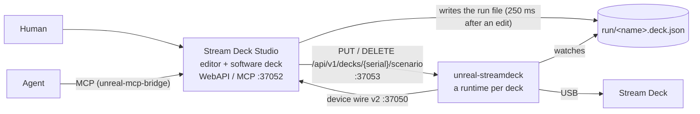

# Scenario editor

A scenario is what a Stream Deck does: a tree of menus (keys, dials, the touch strip) and actions. Stream Deck Studio
edits it; the daemon `unreal-streamdeck` plays it on the real deck and on the studio's own decks; agents drive both
over WebAPI and MCP. The studio as a whole: [studio.md](../studio.md); the daemon: [daemon.md](../daemon.md).

| Document | Contents |
|:--|:--|
| [01-requirements.md](01-requirements.md) | What a scenario is, goals, requirements with their state (done / planned), scope |
| [02-ux-design.md](02-ux-design.md) | On the deck: stack navigation, the back key, breadcrumbs, gestures, feedback. The editor window, gestures, menus and shortcuts, the agent flow |
| [03-technical-design.md](03-technical-design.md) | File format v1 (JSON, YAML, CSV, TSV, includes), the model, validation, navigation, rendering, actions, document operations, the editor's classes, Run and autosave, tests |
| [04-automation.md](04-automation.md) | The editor's routes on `127.0.0.1:37052`, the runtime proxy, the daemon routes Run uses, MCP |

Sources: the scenario engine in [`companions/streamdeck/lib`](../../../../companions/streamdeck/lib) (`sdb/scenario.h`,
`scenarioio.h`, `scenarioops.h`, `navigator.h`, `scenariorender.h`, `actions.h`, `runtime.h`), the editor in
[`companions/streamdeck/studio/editor`](../../../../companions/streamdeck/studio/editor). Format changes in design:
[scenarios.md](../../../inprogress/2026-10-19-streamdeck-integration/scenarios.md).
