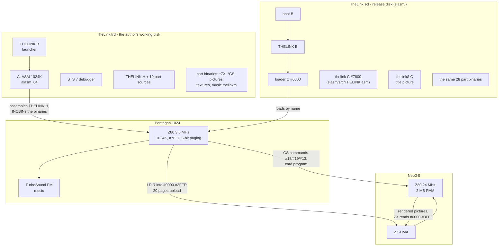
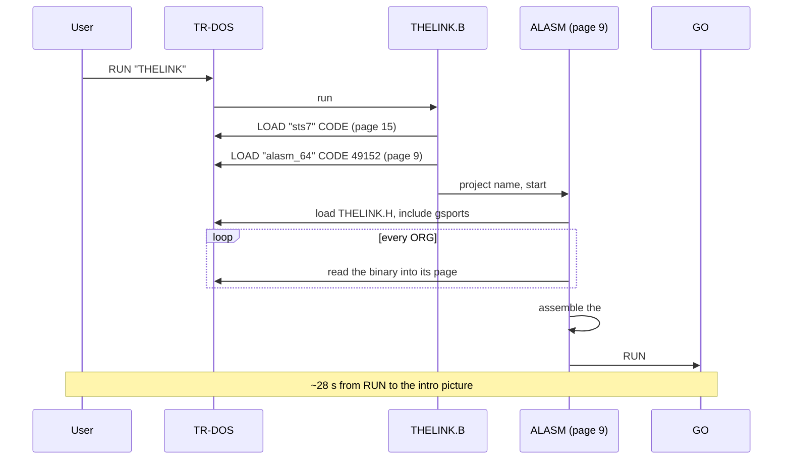
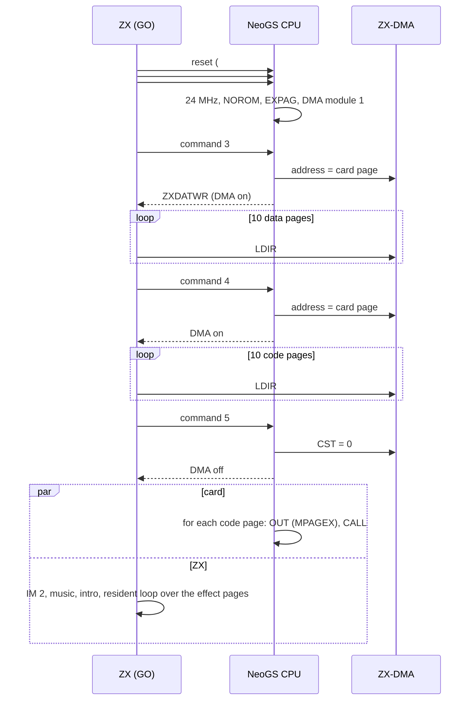
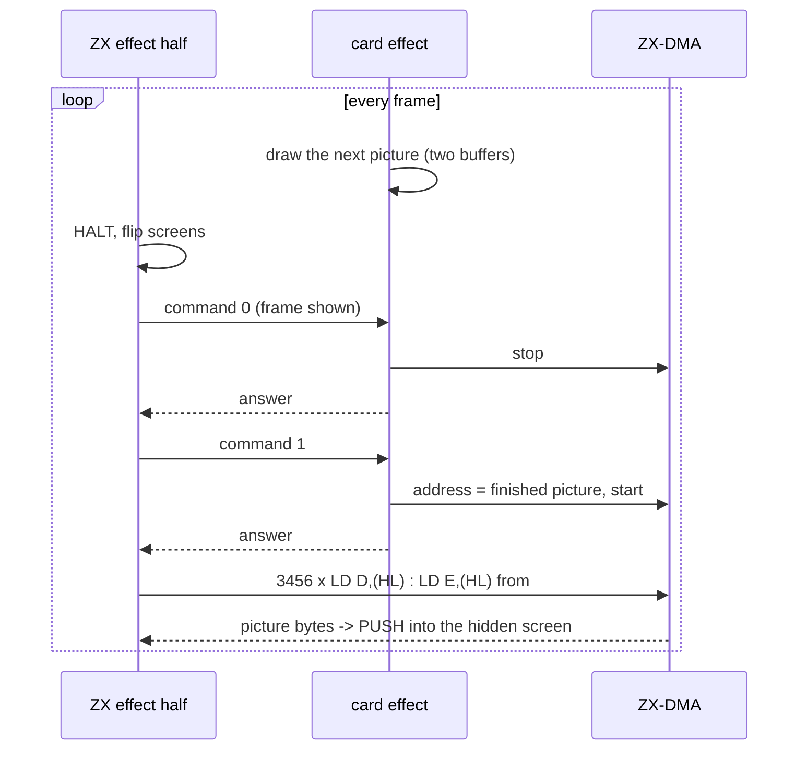

# The Link (invdemo, 2009) - source analysis, sjasmplus build and release loader

Code and music: Alone Coder; graphics: Alone Coder, Oimidrol, Shiru (from the
demo's own credits screen).

`testdata/machines/pentagon1024sl/TheLink.trd` is not a release disk: it is
the author's **working disk**. It holds the ALASM assembler, the STS debugger,
the ALASM sources of every part and all the data files. `RUN "THELINK"`
starts ALASM, which assembles the demo from its sources and runs it. The demo
needs a **Pentagon 1024** and a **NeoGS**: the card renders every effect and
the ZX fetches the pictures from it through NeoGS ZX-DMA.

`testdata/machines/pentagon1024sl/TheLink-sjasm.scl` is the release disk built here
([sjasm/](sjasm/README.md)): every part converted to sjasmplus with unreal-asm and built
from source, byte for byte the author's binaries; the disk boots straight into the demo,
without the assembler, and checks the machine first ([sjasm/loader/](sjasm/loader/README.md)).


Left to right, top row: the intro picture ("medieval", with the FM music),
tunnel, rotator (the logo), rotating bars; bottom row: multi-bars, hedgehog
(the dragon), "baba" (girl and mill), textured face. Multi-bars is an
80-frame (1.6 s) transition: it cuts the rotating-bars picture into bars and
clears them to black before the hedgehog; its frame is the first one, before
the first cut.

## 0. What was done, and why

| Step | Why | How | Result |
|---|---|---|---|
| 1. The "hang" | a report: the demo stops on a Pentagon | ran it on every machine and card | it needs Pentagon 1024 + NeoGS; the hang was a classic GS (section 7) |
| 2. Sources out of the disk | the disk is the author's working disk, the sources are on it | [`extract_thelink.py`](extract_thelink.py): ALASM tokenized text -> UTF-8, BASIC -> listings | [`src/`](src/), [`basic/`](basic/) - the originals |
| 3. How it starts | 28 s of disk activity before the first picture | read `THELINK.B` and `THELINK.asm` | the demo is assembled at every start (section 2) |
| 4. A suspected NeoGS regression | the demo stopped after the NeoGS idle-sleep optimisation (`92ab8dc1f`) | the whole start and 70 s of the demo with the card's idle sleep on and off, in core tests and in unreal-qt | identical, the demo runs; the sleep wakes correctly |
| 5. What the assembler produces | to replace it, every byte it leaves in memory must be known | the ALASM start stopped in the emulator when the card got its program; 64 RAM pages dumped and compared with the disk files | 28 page files byte for byte at `#C000` of their page, one block of code at `#7800`; nothing else ([sjasm/loader/README.md](sjasm/loader/README.md) section 1) |
| 6. The block at `#7800` from source | a loader must not depend on ALASM | the code part of `THELINK.asm` ported to sjasmplus by hand, compared with the dump | identical (ALASM's `JNZ` is `JR NZ`); later replaced by step 10 |
| 7. A loader | an ordinary demo start | [`sjasm/loader/loader.asm`](sjasm/loader/loader.asm): TR-DOS by name and type, page by page, title on screen, `JP #7800` | the demo from the loader is frame for frame the demo from the assembler |
| 8. A machine check | on a wrong machine the demo just stops | the NeoGS flasher's card detection, page markers for 1024K paging; an error screen that says what was found | 512K, 128K, classic GS, no card: each named on screen |
| 9. A clean disk | the goal: a release image | a build script writes the SCL: silent `boot` -> `THELINK` -> loader | `TheLink.scl`, 33 files, boots on Enter |
| 10. The whole demo from source | the stretch goal: no binary from ALASM, a project anyone can build | `zxasm convert TheLink.trd --to sjasmplus --out-codepage utf-8` (unreal-ng's unreal-asm), SAVEBIN for ALASM's object saver, 50 explicit `low`; the four tables recomputed from the author's BASIC | [`sjasm/`](sjasm/README.md): all 19 objects, the tables, the main block and the SCL identical to the author's; 0 sjasmplus warnings |

## 1. Folder layout

| Path | Origin | Content |
|---|---|---|
| [`src/`](src/) | **original**, extracted from `TheLink.trd` | the 20 ALASM sources (TR-DOS type `H`) as UTF-8 text |
| [`basic/`](basic/) | **original**, extracted | the BASIC programs as listings (`THELINK.bas` is the author's launcher) |
| [`extract_thelink.py`](extract_thelink.py) | new | regenerates `src/` and `basic/` from the image (`--raw`: every file raw) |
| [`stages/`](stages/README.md) | **new** | the intermediate builds, one folder each: 1 a loader, 2 the machine check (each with its sources, `build.py` and `TheLink.scl`) |
| [`sjasm/`](sjasm/) | **new** | the sjasmplus project: converted and annotated sources, data, the table generator, the loader, `build.py`; its [README](sjasm/README.md) is the conversion story |
| `parts.png` | new | the parts as captured in unreal-ng |

The original sources are kept unchanged in `src/`; `sjasm/src/` is derived from them, and
[sjasm/README.md](sjasm/README.md) lists every change made after the conversion.

## 2. Components



## 3. Files on the author's disk

`extract_thelink.py` regenerates `src/` and `basic/` from the image:

```
python3 docs/disasm/demo/thelink/extract_thelink.py \
    testdata/machines/pentagon1024sl/TheLink.trd docs/disasm/demo/thelink
```

- `src/*.asm` - the 20 ALASM sources (TR-DOS type `H`), detokenized to UTF-8
  text; the Russian comments are converted from code page 866.
- `basic/*.bas` - the BASIC programs (type `B`) as listings.
- The binary files (type `C` and the numbered data files) are not copied;
  `--raw` writes every file raw for analysis.

**ALASM source format**, read from the assembler on the same disk
(`alasm_64.C`, keyword table with bit 7 set on the last letter of each word):
a 64-byte header (`NAME    H`, source length at `+#21`), then lines of
`[length including itself][body]`. In a body, `#01`-`#1F` are runs of spaces;
the first byte `>= #80` is a mnemonic or directive (`#80` INCLUDE, `#82`
MACRO, `#8E` LDIR, `#9B` ENDM, `#C1` OUT, `#D4` LD ... `#E6` RUN); later ones
are operands (`(BC)`..`(IY)` from `#9F`, `(C)` `(IX` `(IY` `AF'` from `#D0`,
`BC`..`I` from `#E0`); `#FF` is an editor flag on a line, not text. Inside
comments and strings the high bytes are cp866 letters.

### Which source builds what

| Source | Builds | Role |
|---|---|---|
| `THELINK.asm` | the demo itself: loader at `#7800`, the card program, the page plan | main module |
| `gsports.asm` | - | NeoGS port and bit names (GSCFG0, MPAGEX, DMA_*, VOL5-8, ...) |
| `GSTUNNE4.asm` | `TUNNELZX`, `TUNNELGS` | tunnel |
| `GSROTAT7.asm` | `ROTATEZX`, `ROTPREGS`, `ROTATEGS` | rotator with the logo |
| `GSRBAR24.asm` (includes `GSRBARP3.asm`) | `ROTBARZX`, `ROBPREGS`, `ROTBARGS` | rotating bars |
| `GSMULBA3.asm` | `MULBARZX`, `MULBARGS` | multi-bars |
| `hedge12.asm` (includes `texpp4`, `vujump`, `instlpp`) | `HEDGEZX1`, `HEDGEZX2`, `HEDGEGS` | hedgehog (dragon); `hedgepre.asm` is a sibling that reads `demon16.p`, a file not on the disk |
| `baba4.asm` | `BABAZX`, `BABAGS` | girl and mill; `baba5.asm` is a later take whose `BABAGS` (3907 bytes) is not the one on the disk |
| `TEX28.asm` (includes `texpp4`, `vujump`, `instpp3`) | `TEXZX`, `TEXGS` | textured face |
| `texpp4.asm`, `instpp3.asm`, `instlpp.asm`, `vujump.asm` | - | shared texture mappers, included |

Which source built which file was settled by building them all with sjasmplus and comparing
with the disk ([sjasm/README.md](sjasm/README.md)).
| `16CCON.asm`, `RECPIC.asm` | - | 16-colour picture converter, picture recorder |
| `m2hrust.asm`, `SAVEOBJ4.asm` | - | the author's release tools (a Hrust packer; an object saver) - not used by the demo; `THELINK.asm` includes `m2hrust` at its end, so ALASM leaves it at `#FB00` of the music page |

The `sin*`, `sectg`, `uv256d` BASIC + code pairs generate tables; `dplan2r.p`
and `torusr.p` are Hrust-packed (`hr21`) data.

## 4. How the demo starts on the author's disk

`THELINK.B` (250 bytes) is the author's work-environment launcher:

```basic
0 CLEAR VAL "24575": RANDOMIZE USR VAL "23893": REM <code>
10 OUT 32765,VAL "87": RANDOMIZE USR 23752: REM : LOAD "sts7 " CODE
20 OUT VAL "32765",VAL "81": RANDOMIZE USR VAL "15619": REM : LOAD "alasm_64" CODE 49152
40 RANDOMIZE USR 23996 <code>
```

- Line 0: the code in the REM (at `#5D55`) hides the line (RECLAIM through
  `JP #19E5`) and continues at line 10.
- Line 10 loads the STS 7 debugger into RAM page 15 (`#7FFD` = `#57`), line 20
  loads ALASM into page 9 (`#51`) at `#C000`.
- Line 40's code copies the project name to ALASM and starts it: ALASM loads
  `THELINK.H`, includes `gsports`, pulls every data file in with `INCBIN`
  into its page (`ORG #C000,page`), assembles, and jumps to `GO` (`#7800`).



So the ~28 seconds of disk activity before the picture are **the demo being
assembled**. This phase switches `#7FFD` through `#D6`, `#91`, `#B4` ... -
`alasm_64` is the 64-page (1024K) build of the assembler, and the demo's page
plan uses pages above 512K too. The release loader does the same work without
the assembler: [sjasm/loader/README.md](sjasm/loader/README.md) section 4.

## 5. The page plan (`THELINK.asm`)

| Pages (`#7FFD` value) | Content |
|---|---|
| `#90`-`#97`, `#11`, `#13`, `#14` (`pgdata1`-`10`) | effect data for the card: pictures and textures (`kishki`, `baba`, `mill`, `girl13`, `blugr`) |
| `#52`, `#55`, `#30`-`#37` (`pgcode1`-`10`) | the card's effect code (`ROTPREGS` ... `TEXGS`) |
| `#B0`-`#B7` (`pgeffects`) | the ZX half of each effect (`TUNNELZX` ... `TEXZX`) |
| `#D0` (`pgeffects+#20`) | the credits screen |
| `#54` (`pgmusic`) | `thelinkm` - the music player (TurboSound FM) |
| `#5F00`-`#BFFF` resident | IM 2 vector table `#BE00`, frame counter `timer` at `#BF02`, resident loop `#BF04`, interrupt handler `#BFBF` |

Every file with its physical page and size, and how the pages reach the card:
[sjasm/loader/README.md](sjasm/loader/README.md) section 2.

## 6. The ZX and the card

**Card program.** `GO` sends the card its program with the standard GS
commands: `#18`/`#19` (write a byte to card memory, "as in RIFF TRACKER") for
`GSPROG` at `#5830`, then `#13` (jump). The program (`GSPROGGO`):

1. silences all eight channels (`VOL1`-`VOL8`, ports `#06`-`#09`, `#16`-`#19`);
2. `GSCFG0` = 24 MHz, NOROM, EXPAG (`#09`); `MPAG` 1, `MPAGEX` 2;
3. selects DMA module 1 (ZX-DMA), points it at card page `#20`, starts it
   (`CST` = `#80`) and answers the ZX (`OUT (ZXDATWR)`).

**Upload by ZX-DMA.** The ZX then copies each 16 KB page with
`LDIR #C000 -> #0000`: writes into its own ROM area, which change nothing on
the ZX, but NeoGS's ZX-DMA takes every one of them into card RAM. Command 3
starts the data pages (`#20` up), command 4 the code pages (`#10` up),
command 5 ends the upload.



**Running.** The card loops over its code pages: `OUT (MPAGEX)`, `CALL #C000`
(one effect), next page. The ZX's resident loop does the same with its effect
pages, passing each one its start and end frame from `zxtimings`:

| Part | Frames (`timer`, 50 per second) | ZX / card |
|---|---|---|
| intro picture + music | 0-895 | `medieval` on screen, the card waits |
| tunnel | 896-1778 | `TUNNELZX` / `TUNNELGS` |
| rotator | 1792-2674 | `ROTATEZX` / `ROTATEGS` |
| rotating bars | 2688-3248 | `ROTBARZX` / `ROTBARGS` |
| multi-bars | 3476-3556 | `MULBARZX` / `MULBARGS` |
| hedgehog | 3584-4466 | `HEDGEZX1`, `HEDGEZX2` / `HEDGEGS` |
| girl and mill | 4480-4914 | `BABAZX` / `BABAGS` |
| textured face | 4928-5824 | `TEXZX` / `TEXGS` |
| credits | after | `credits`, then `JR $` - the demo ends here by design |

**One effect frame, the rotator as an example** (`GSROTAT7.asm`):

- ZX, every frame: `HALT`; command 0 ("frame shown, stop the DMA"); flip
  screens; wait for the card's answer; command 1 ("start the DMA"); wait; then
  `LD D,(HL) : LD E,(HL) : PUSH DE` with `H` = 0 - 3,456 reads from the ROM
  area, each answered by ZX-DMA with the next byte of the picture the card has
  drawn - pushed into the hidden screen (6,912 bytes).
- Card: draws the next picture into one of two screens, waits for command 0,
  stops the DMA, waits for command 1 (a 65,536-poll timeout resets the card),
  points the DMA at the finished screen and starts it.



The card needs about two ZX frames per picture, so the rotator shows a new
picture every second frame (25 per second).

## 7. What the emulator must provide

| Feature | Used for | unreal-ng |
|---|---|---|
| Pentagon 1024 paging (`#7FFD` bits 5-7) | the page plan above | yes |
| NeoGS main ROM commands `#18`, `#19`, `#13` | sending the card program | the real firmware (flash image) |
| GSCFG0 24 MHz, NOROM, EXPAG, MPAGEX | card program | yes |
| ZX-DMA writes (ZX writes into the ROM area) | uploading 20 pages | yes (neogs-zxdma-design.md, Divert) |
| ZX-DMA reads (`LD r,(HL)` from the ROM area) | fetching each picture | yes |
| VOL5-VOL8 | silencing | yes |
| TurboSound FM | the music | yes |
| `#EFF7` bit 0 (16 colours) | hedgehog, bars, face | yes |

`#EFF7` bit 4 is written as "noturbo" by the author (his Pentagon 1024SL);
our port decoder names it GigaScreen and only logs it - no effect either way.

## 8. Why it "hangs"

| Machine | What happens |
|---|---|
| Pentagon 1024 + **NeoGS** | runs to the credits (checked in the emulator: frame counter 6,116, page `#D0`, the credits screen; see `parts.png`) |
| Pentagon 1024 + **classic GS** | assembly, then 18 s of the intro picture with the music; at the tunnel the ZX waits for the card for ever (the classic card has no ZX-DMA, no EXPAG) - **the reported hang** |
| Pentagon 512 (any card) | stops about 6 s in, during the assembly: the 1024K build of ALASM and the page plan need 1024K |

The release disk checks for exactly this before it loads and says so on screen
([sjasm/loader/README.md](sjasm/loader/README.md) section 4).

**How to run it:** Pentagon with 1024K RAM and the NeoGS card (the shipped
Pentagon config fits `zxbus.1 = neogs`). Release disk: insert `TheLink-sjasm.scl`,
TR-DOS, Enter (`boot`); about 27 s of loading under the title, then the intro.
Author's disk: insert `TheLink.trd`, `RUN "THELINK"`: about 28 s of assembly,
then the intro. Either way, 18 s of the static intro picture before the first
effect.

## 9. Regression tests

`NeoGSTheLink_Test` (`core/tests/emulator/sound/chips/neogs/soundchip_neogs_acceptance_test.cpp`),
Pentagon 1024 + NeoGS:

- `DemoAssemblesItselfAndRunsItsCardRenderedEffects`: `RUN "THELINK"` from the author's disk;
  the card must enter the demo's configuration (`GSCFG0` = `#09`), the tunnel must change the
  picture every frame, and the rotator every second frame;
- `ReleaseDiskBootsIntoTheDemo`: `TheLink-sjasm.scl` booted from TR-DOS reaches the tunnel the same
  way;
- `ReleaseDiskNamesWhatIsMissing`: on a 512K Pentagon and on a 1024K one with a classic GS, the
  loader's error screen with what it found.
