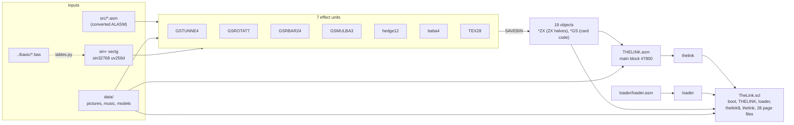

# The Link - built from source with sjasmplus

The Link (invdemo, 2009) by Alone Coder - code and music; graphics by Alone Coder, Oimidrol
and Shiru - for a **Pentagon 1024** with a **NeoGS** card. The author left no release disk,
only his working disk: ALASM, its 20 sources and every binary, and a launcher that assembles
the demo at every start ([../README.md](../README.md)).

This folder is that demo as an ordinary cross-assembler project. Every source was converted
from ALASM to sjasmplus by unreal-asm (unreal-ng's assembler-source library), every effect is
assembled from it, and the result is **byte for byte what the author's ALASM built**: the 19
effect objects, the four tables, the main block and, from them, a release disk that boots
into the demo and checks the machine first.


## 1. Build

Needs [sjasmplus](https://github.com/z00m128/sjasmplus) 1.23 and Python 3.

```
SJASMPLUS=/path/to/sjasmplus python3 build.py [out]
```

```
GSTUNNE4  -> TUNNELZX TUNNELGS
GSROTAT7  -> ROTATEZX ROTPREGS ROTATEGS
GSRBAR24  -> ROTBARZX ROBPREGS ROTBARGS
GSMULBA3  -> MULBARZX MULBARGS
hedge12   -> HEDGEZX1 HEDGEZX2 HEDGEGS
baba4     -> BABAZX BABAGS
TEX28     -> TEXZX TEXGS
THELINK   -> thelink #7800..#B154
loader    -> loader #6000..#6493
out/TheLink.scl: 33 files, 1172 sectors
```

`out/TheLink.scl` (and the same files on a 640K `out/TheLink.trd`) boots on `RUN` / Enter.
Every built file is checked against the sha256 of the author's file (`EXPECTED` in
`build.py`); a difference stops the build (`--no-check` builds anyway, for experiments).
A unit also assembles alone: `sjasmplus -Isrc -Idata -I<tables> src/GSTUNNE4.asm`, where
`<tables>` is a folder `python3 tables.py <tables>` wrote (`GSROTAT7`, `GSRBAR24` and `TEX28` read
tables from it).

## 2. Layout

| Path | What |
|---|---|
| [`src/`](src/) | the 20 sources, converted and annotated (English notes next to the author's Russian comments) |
| [`data/`](data/) | what the sources `INCBIN` and no source makes: pictures, textures, palettes, 3D models, music, the title and credits screens; from the author's disk, unchanged |
| [`tables.py`](tables.py) | the four tables the author computed in BASIC ([`../basic/`](../basic/)), computed again |
| [`loader/`](loader/) | the release loader: machine check, error screen, loading by name ([its README](loader/README.md)) |
| [`build.py`](build.py) | the whole build: tables, units, main block, loader, BASIC, SCL / TRD |



### Units

| Source | Includes | Builds | Part |
|---|---|---|---|
| `GSTUNNE4` | `gsports`, `SAVEOBJ4` | `TUNNELZX` 489, `TUNNELGS` 14222 | tunnel |
| `GSROTAT7` | same | `ROTATEZX` 311, `ROTPREGS` 4564, `ROTATEGS` 8261 | rotator (the logo) |
| `GSRBAR24` | + `GSRBARP3` | `ROTBARZX` 7936, `ROBPREGS` 7520, `ROTBARGS` 3854 | rotating bars |
| `GSMULBA3` | same | `MULBARZX` 1563, `MULBARGS` 7826 | multi-bars |
| `hedge12` | + `texpp4`, `vujump`, `instlpp` | `HEDGEZX1` 14356, `HEDGEZX2` 14703, `HEDGEGS` 8557 | hedgehog (dragon) |
| `baba4` | same | `BABAZX` 394, `BABAGS` 3286 | girl and mill |
| `TEX28` | + `texpp4`, `vujump`, `instpp3` | `TEXZX` 350, `TEXGS` 12915 | textured face |
| `THELINK` | `gsports`, `m2hrust` | `thelink` 14677 (`#7800`-`#B154`) | main block: `GO`, card program, resident, IM 2, credits, intro |

`*ZX` runs on the Spectrum, `*GS` on the card; the page each one goes to, and how the card
gets its code and pictures, are in [loader/README.md](loader/README.md) section 2 and
[../README.md](../README.md) section 6.

Not in the build, kept as the author left them:

| Source | Why |
|---|---|
| `baba5` | a later take on `baba4`: its `BABAGS` (3907 bytes) is not the one on the disk. It assembles; its `SAVEBIN` names start with `baba5.` |
| `hedgepre` | a sibling of `hedge12` that reads `demon16.p`, a file the disk does not have |
| `RECPIC` | a picture recorder; `INCBIN`s `baba16.C` / `baba16.0`, not on the disk |
| `16CCON` | converts a 16-colour BMP in memory on the Spectrum; nothing to build |
| `m2hrust` | the author's Hrust packer: `THELINK` includes it, the demo never calls it |
| `SAVEOBJ4` | ALASM's object saver (section 3.3); still assembled, harmless |

### Tables

The author made four tables with BASIC programs (`../basic/`); `tables.py` computes them the
same way, rounding as Sinclair BASIC rounds where it stores (`POKE` and `RANDOMIZE`: nearest
integer of the magnitude, sign kept; `INT(x+.5)`):

| Table | BASIC | Used by |
|---|---|---|
| `sin+` | `127*SIN((n+.5)/256*2*PI)` | `GSRBAR24`, `TEX28` |
| `sectg` | `128/COS a`, `256*TAN a`, a in 0..PI/4 | `GSRBAR24` |
| `sin32768` | `32768*SIN(n/256*2*PI)` as words, low bytes then high bytes | `GSROTAT7` |
| `uv256d` | the u,v texture offsets of a 64x32 quarter screen | `TEX28` |

Three are the formula exactly. `sin32768` has `#7FFF` at 90 degrees where the formula gives
`#8000` - +32768, which a signed word reads as -32768; `tables.py` holds that entry at the
signed maximum, and the table is then the disk's, byte for byte.

## 3. The conversion

### 3.1 One command

```
zxasm convert testdata/machines/pentagon1024sl/TheLink.trd --to sjasmplus --out-codepage utf-8 -o out/
```

`zxasm` (`core/src/3rdparty/unreal-asm/tools/zxasm`) reads the TR-DOS image itself. The 20
sources on it are ALASM's tokenized format (a 64-byte header, then lines of length-prefixed
bodies where bytes from `#80` are keywords and `#01`-`#1F` runs of spaces); the codec decodes
each, detects which ALASM version wrote it, and the ALASM frontend reads it into unreal-asm's
neutral IR. The 20 files are converted **as one project**: `INCLUDE "gsports"` and
`INCLUDE "m2hr*"` are resolved against the disk, macros are known across files, and every file
an `INCBIN` names is extracted next to the sources. The sjasmplus backend writes the IR back as
text; `--out-codepage utf-8` turns the comments from code page 866 into UTF-8 (the code itself
is ASCII; the tool warns about any line where it is not).

### 3.2 What the converter does by itself

Counted in the 20 originals (17661 lines; 23516 after the conversion, mostly from expanded
macros and the split multi-operand lines):

| ALASM | sjasmplus | In The Link |
|---|---|---|
| `JNZ x`, `JC x` ... | `JR NZ,x`, `JR C,x` - a **relative** jump, not `JP` | 439 |
| `LD H,A,D,A` | `LD H,A` + `LD D,A` | 147 |
| `PUSH AF,BC` / `POP BC,AF` | one `PUSH` / `POP` each | 53 |
| `HX` `LX` `HY` `LY` | `IXH` `IXL` `IYH` `IYL` | 331 |
| `EXA` | `EX AF,AF'` | 65 |
| `'label` / `.label` | `high label` / `low label` | |
| `x<1`, `x>1`: 16-bit cyclic shifts | `((x&#FFFF)<<1\|(x&#FFFF)>>>(16-1))&#FFFF` | 36 |
| `/` (unsigned 16-bit) | operands masked to 16 bits | |
| `IF x` (true when `x` = 0) | `IF (x)==0` | |
| `ORG addr,page` | the same, plus `DEVICE ZXSPECTRUM4096` at the top so pages exist | 82 |
| `DS -$` (fill to `#10000`) | `DS (-$&#FFFF)` | 3 |
| a macro that glues its parameters into names (`DRAWLINE`, `BARDIAG0ADDBYTE`, `KPOLY` ...) | expanded at every call (sjasmplus cannot glue) | 17 macros |
| a label named like a sjasmplus keyword (`m`) | renamed (`L_m`) | 1 |
| `DISP` / `ENT`, `DUP` / `EDUP`, `LOCAL` | the sjasmplus equivalents | |

The `JNZ` row is the one that matters most: a hand port that reads it as `JP NZ` assembles
without a complaint and is 1 byte longer at every site - the first hand port of `THELINK.asm`
was 6 bytes off for exactly this reason.

### 3.3 What was done by hand after it - and what the converter now does itself

The converted sources assembled at once, the objects byte for byte. Three kinds of edits
followed, each one reviewable on its own. All three were then taught to the converter: since
then `zxasm convert TheLink.trd --to sjasmplus` assembles **unchanged**, every unit with no
sjasmplus warning (`tools/verification/unreal-asm/checks/objcheck.py`). The sources here were
made before that and keep the hand edits; the converter writes the same code (its comments are
worded differently, and `baba5`'s objects keep their names):

1. **`SAVEBIN` for the object saver.** In ALASM the author assembled a unit, then `RUN`
   it: `SAVEOBJ4` walks the unit's `ObjTab` (name, address, length, page) and saves each
   object to disk. Each unit now ends with the same table as sjasmplus directives:

   ```
           SLOT 3
           PAGE pgtunnelzx
           SAVEBIN "TUNNELZX",#C000,LENTUNNELZX
   ```

   `THELINK.asm` saves only the main block: each page holds one file as it is, and the
   loader loads those files itself.
2. **`low x` on 50 lines.** ALASM keeps the low byte of an 8-bit operand without a word
   (`LD (HL),IMER` with `IMER` = `#BFBF`: the IM 2 vector byte; `DB _` in a `DUP` over
   addresses). sjasmplus assembles the same byte but warns, and that warning has no id to
   silence. Each line got `low` and the note `; ALASM keeps the low byte`.
3. **`ORG $,0 ; orgpage-ok`** in `GSMULBA3`: a page with an address outside `#C000`, which
   both assemblers map at `#C000`; sjasmplus warns, the comment says it is meant.

Then the annotations: comments only, checked by assembling (same bytes) and by comparing the
code of every line, comments stripped, with the converter's output.

### 3.4 What the conversion taught the converter

| Found | Now |
|---|---|
| `DS -$` became sjasmplus' negative `DS`, which moves `$` back: the zeroed rest of a page was silently lost (no file on the disk depended on it) | fixed: `DS (-$&#FFFF)` for 16-bit-word dialects, with a test |
| no way to get readable comments from a whole-disk conversion | `zxasm convert --out-codepage` |
| the low-byte warnings | the layout of the converted project finds every byte operand outside -256..255; the conversion writes `low` there |
| the `orgpage` warning | `; orgpage-ok` on an `ORG` page whose address may be outside `#C000`-`#FFFF` |
| the object saver | a unit with `ObjTab` that INCLUDEs `SAVEOBJ*` ends with its `SAVEBIN` lines |
| the unreadable cyclic shifts | still open (unreal-asm's TODO, "Findings from The Link") |

## 4. Verification

| Check | Result |
|---|---|
| 19 objects vs the author's disk | identical (sha256 in `build.py`) |
| 4 tables vs the disk | identical |
| main block vs ALASM's `#7800`-`#B154` | identical, 14677 bytes |
| `out/TheLink.scl` vs `testdata/machines/pentagon1024sl/TheLink-sjasm.scl` | identical (and, with the loader before the music fix, identical to the first release build `TheLink.scl`) |
| sjasmplus warnings, all 9 assemblies | 0 |
| the demo from the release disk vs the author's ALASM start, unreal-ng, Pentagon 1024 + NeoGS | same screen at every frame compared (1092 frames, tunnel and rotator) |
| the music page once `GO` runs, vs `thelinkm` | identical (`GO` clears `#D800` of the page at `#C000`; the loader leaves page 7 there: [loader/README.md](loader/README.md) section 4) |
| wrong machines (512K, 128K, classic GS, no card) | the loader's error screen names what is missing |

The release disk boots in unreal-ng's regression tests (`NeoGSTheLink_Test` in
`core/tests/emulator/sound/chips/neogs/soundchip_neogs_acceptance_test.cpp`).
