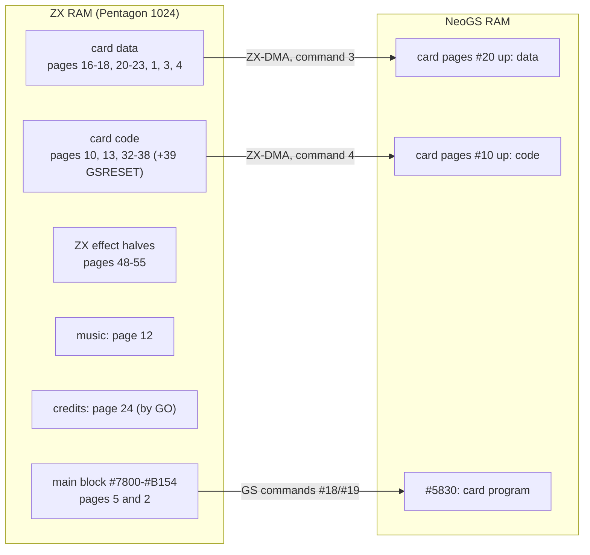
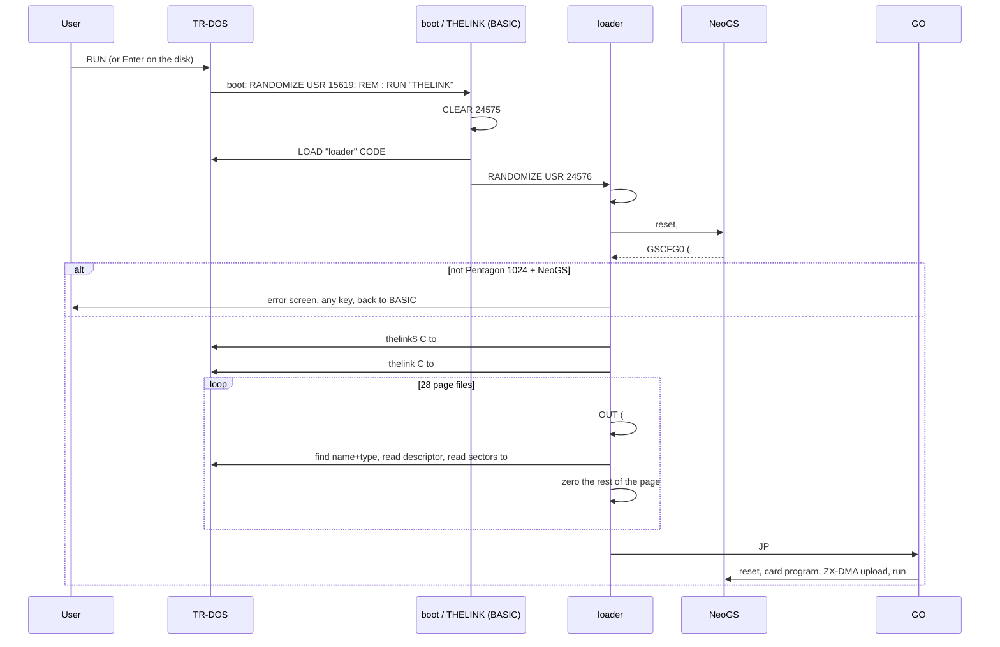
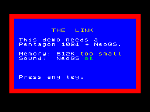
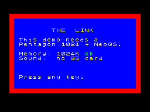

# The Link - release loader

The author's disk starts the demo by assembling it (`RUN "THELINK"` -> ALASM -> `GO`, see
[../../README.md](../../README.md) section 4). The loader replaces that start with an ordinary
demo loader: the release disk, `TheLink.scl`, boots straight into the demo on a Pentagon 1024
with a NeoGS, and tells the user what is missing on anything else.

| File | What |
|---|---|
| [`loader.asm`](loader.asm) | the loader at `#6000`: machine check, error screen, title, main block and 28 page files through TR-DOS, `JP #7800` |
| `title.png`, `error-*.png` | the loading screen (`thelink$` from the author's disk) and two error screens, as rendered |

[`../build.py`](../build.py) assembles it with the rest of the demo and writes the disk with
the `boot` and `THELINK` BASIC programs ([../README.md](../README.md)). The release image is
kept as `testdata/machines/pentagon1024sl/TheLink-sjasm.scl`. `TheLink.scl` next to it is the first
release build, kept as it was: the loader without the page 7 fix of section 4 (the music bug).

## 1. What ALASM actually builds

Nothing of the effects is compiled at start. Every part was built earlier from its own source
(`GSTUNNE4.asm`, `GSROTAT7.asm`, ...) and lies on the disk as a binary (`TUNNELZX`,
`TUNNELGS`, ...). `THELINK.asm` is a linker script in assembler clothing:

1. one block of code at `#7800` (`begin` .. `end`): `GO`, two copy routines, the blocks `GO`
   moves elsewhere at run time, and the intro picture `medieval` as data;
2. `ORG #C000,<#7FFD value>` + `INCBIN "<file>"` for each page: a plain copy, no relocation;
3. `INCLUDE "m2hr*"` at the end: the author's Hrust packer, assembled at `#FB00` into the
   last selected page (the music page). The demo never calls it - it is not loaded by the
   loader.

Checked in the emulator: the ALASM start was stopped when the card took its program (pages
not yet touched by `GO`), the 64 RAM pages dumped and every page file compared with the disk
file - all 28 at `#C000` of their page, byte for byte, the rest of each page zero. The block
`#7800`..`#B154` (14677 bytes, `medieval` at `#9655`, `credits` at `#7B55`) is what
[`../src/THELINK.asm`](../src/THELINK.asm) assembles to with sjasmplus, sha256 `d1df3075...b147`
(`build.py` refuses anything else).

## 2. The memory image at `GO`

Pentagon 1024 paging (`#EFF7` bit 2 = 0): the RAM page at `#C000` for a `#7FFD` value `v` is
`(v & 7) | ((v & #C0) >> 3) | (v & #20)`. Bit 4 selects the ROM (1 = 48K BASIC): every value
below has it, so TR-DOS stays callable with any of these pages in.

| CPU window | At `GO` |
|---|---|
| `#0000`-`#3FFF` | ROM: 48K BASIC, TR-DOS at `#3Dxx` |
| `#4000`-`#7FFF` (page 5) | screen 0; the loader at `#6000`; `GO` at `#7800` |
| `#8000`-`#BFFF` (page 2) | the main block up to `#B154`; `GO` then uses `resbuf` `#BD00`, IM 2 table `#BE00`, `curpg` / `timer` `#BF01`-`#BF03`, resident `#BF04`, IM 2 handler `#BFBF` |
| `#C000`-`#FFFF` | the page selected by `#7FFD`, table below |

| `#7FFD` | RAM page | File (name, type) | Bytes | Role |
|---|---|---|---|---|
| `#90` | 16 | `kishki` C | 16384 | card data 1 |
| `#91` | 17 | `baba` C | 16384 | card data 2 |
| `#92` | 18 | `baba` 0 | 8192 + 8192 zero | card data 3 (`DS -$`: "for the mask") |
| `#94` | 20 | `mill` C | 16384 | card data 4 |
| `#95` | 21 | `mill` 0 | 13696 | card data 5 |
| `#96` | 22 | `girl13` 2 | 16384 | card data 6 |
| `#97` | 23 | `blugr` C | 16384 | card data 7 |
| `#11` | 1 | `blugr` 0 | 16384 | card data 8 |
| `#13` | 3 | `blugr` 1 | 16384 | card data 9 |
| `#14` | 4 | `blugr` 2 | 16384 | card data 10 |
| `#52` | 10 | `ROTPREGS` C | 4564 | card code 1: rotator precalc |
| `#55` | 13 | `ROBPREGS` C | 7520 | card code 2: rotating bars precalc |
| `#30` | 32 | `TUNNELGS` C | 14222 | card code 3 |
| `#31` | 33 | `ROTATEGS` C | 8261 | card code 4 |
| `#32` | 34 | `ROTBARGS` C | 3854 | card code 5 |
| `#33` | 35 | `MULBARGS` C | 7826 | card code 6 |
| `#34` | 36 | `HEDGEGS` C | 8557 | card code 7 |
| `#35` | 37 | `BABAGS` C | 3286 | card code 8 |
| `#36` | 38 | `TEXGS` C | 12915 | card code 9 |
| `#37` | 39 | - | - | card code 10: `GO` copies `GSRESET` here |
| `#B0` | 48 | `TUNNELZX` C | 489 | tunnel, ZX half |
| `#B1` | 49 | `ROTATEZX` C | 311 | rotator |
| `#B2` | 50 | `ROTBARZX` C | 7936 | rotating bars |
| `#B3` | 51 | `MULBARZX` C | 1563 | multi-bars |
| `#B4` | 52 | `HEDGEZX1` C | 14356 | hedgehog, part 1 |
| `#B5` | 53 | `HEDGEZX2` C | 14703 | hedgehog, part 2 |
| `#B6` | 54 | `BABAZX` C | 394 | girl and mill |
| `#B7` | 55 | `TEXZX` C | 350 | textured face |
| `#D0` | 24 | - | - | `GO` copies the credits here |
| `#54` | 12 | `thelinkm` C | 9810 | music (TurboSound FM): init `#C000`, play `#C005` |

Names repeat with different types (`baba` C / 0, `mill` C / 0, `blugr` C / 0 / 1 / 2): the
loader matches name **and** type. Pages 4-7 (`#14`-`#17`) are cleared by `GO` after the upload
(`CL1800PG`); page 4 then no longer needs `blugr.2`, the card has it.

## 3. What `GO` expects

`GO` sets up everything it uses: `SP` = `#6000`, `#7FFD` at every switch, IM 2 with its own
table, the card through a hard reset (`OUT (#33),#80`) and its own program. From the machine
as found it needs only:

- IM 1 with a ROM at `#0038` for its first `EI : HALT` (any BASIC / TR-DOS state);
- `#EFF7` bit 2 = 0 (1024K paging);
- the NeoGS firmware alive two frames after the reset;
- nothing from ALASM (page 9) or STS (page 15).

The ZX halves of the effects later run code at `#78xx`: once `GO` has started the resident
loop, the `#7800` area is free for them.

## 4. The loader

**Machine check.**

- *Memory*: `#EFF7` = 0, then a marker byte at `#C000` of pages 0, 8, 16, 24 (`#7FFD` =
  `#10`, `#50`, `#90`, `#D0`: bits 6 and 7). Not all four apart: 128K. Then page 32
  (`#30`, bit 5) and page 0 must still hold its marker: otherwise 512K. Bit 5 is tried last:
  on a 512K Pentagon it is the paging lock (the machine then needs a reset, after the
  message).
- *Sound*: the NeoGS flasher's own detection (`FINDNGS`, `neogs/z80/flasher/flasher.a80`):
  card reset, GS command `#F3`, wait until the command is taken, then GS command `#11` reads
  card port `#0F` (`GSCFG0`); `#FF` means a GS that is not a NeoGS. The flasher waits 48
  frames; the loader waits 150: a classic GS takes `#F3` as a reboot through its POST
  (0.3-1.1 s) and is otherwise reported as missing. No answer at all: no card.

**Error screen.** Black screen, red frame, blue box, the title in yellow; what the demo needs
and what was found, the found value green when it is right and yellow when not:

 

A missing file gets the same box with its name. A key clears the screen and returns to BASIC.

**Loading.** TR-DOS from code (`#3D13`, function in `C`): `#0A` finds the file named at
`#5CDD` (`#5D06` = 9: name and type compared), `#08` reads its descriptor, `#05` reads the
sectors from its track / sector to the page. The loader zeroes the rest of each page from the
file's exact length (and the main block's last-sector padding up to `#BD00`), so memory at
`GO` is what the ALASM start leaves. The title (`thelink$`, the author's own logo picture on
the disk, never used by his start) is on screen while the rest loads:

**Before `JP GO`.** `GO` loads `A` with `#17` and clears `#D800`-`#DAFF` - screen 1's
attributes - but never writes `A` to `#7FFD`, so the clear hits whatever page is at `#C000`.
After the ALASM start that is a page nothing uses; after the loader it was the last page
loaded, the music, and 733 bytes of the player (`#1800`-`#1AFF` of `thelinkm`) were zeroed. The
picture was the same frame for frame, so the screen compare missed it; a compare of the page
with the file found it. The loader now selects `#17` itself before `JP GO`.

**Disk.** `boot` (autostart, one line, prints nothing) runs `THELINK`; `THELINK` loads the
loader and starts it. Files in load order, 33 in all, 1172 sectors - the SCL fits any 640K
disk, and the loader finds its files by name wherever they land.

## 5. Verification

| Check | Result |
|---|---|
| main block vs ALASM | 14677 bytes, identical (`../build.py`) |
| page files vs the ALASM memory image | 28 / 28 identical, tails zero |
| the music page after `GO` starts, vs `thelinkm` | identical, as after the ALASM start (see below) |
| demo from `TheLink.scl` vs from `RUN "THELINK"`, Pentagon 1024 + NeoGS | screen identical at every demo frame 900-1991 (1092 frames: tunnel, rotator); start after 27 s instead of 29 s |
| Pentagon 512 + NeoGS | error screen, memory 512K |
| Pentagon 128 + NeoGS | error screen, memory 128K |
| Pentagon 1024 + classic GS | error screen, "GS, not NeoGS" |
| Pentagon 1024, no GS card (unreal-qt, slot removed through the WebAPI) | error screen, "no GS card" |
| unreal-qt, shipped Pentagon config (TSFM, NeoGS, MoonSound, SounDrive), TR-DOS `RUN` | boots, demo runs |

Regression tests: `NeoGSTheLink_Test` in
`core/tests/emulator/sound/chips/neogs/soundchip_neogs_acceptance_test.cpp`.
