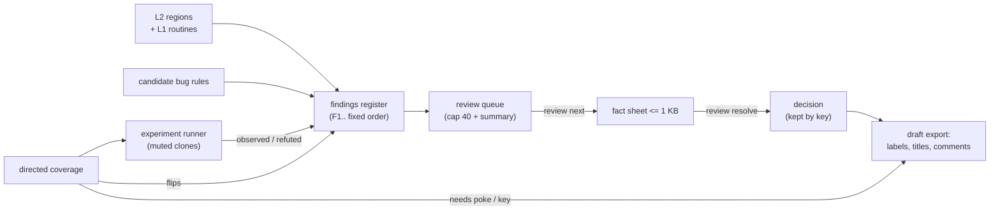

# Analysis layers

Typed program analysis built from what the emulated CPU does. The design and the phases are in
[docs/inprogress/2026-10-24-analysis-layers](../../inprogress/2026-10-24-analysis-layers/README.md); this page
describes what is built. Phase P1 is in: the **L0 access facts** and the `analysis` verbs on every plane. Phase P2
adds **L1 code behaviour**: `analysis build` replays a recording on an analysis instance and folds every instruction
into routines, a call graph, loops, record fields and data flow; `explain` gives a routine's fact sheet. Phase P3
adds the **L2 structure** (detectors over L1, a region store) and the **draft**: `query` lists the claims, `export`
writes a SkoolKit ctl / skool that builds relocatable, the record fields, a relocation layout and symbols. Phase P4
adds the media detectors and the gallery. Phase P5 adds **L3 review**: the findings register, the review queue whose
decisions go into the draft, the experiment runner on muted clones, directed coverage and candidate bugs. The agent
workflow on top of it: [.recipe/analysis/analysis-layers.md](../../../.recipe/analysis/analysis-layers.md).

## L0 access facts

The memory tracker (`MemoryAccessTracker`) has a level besides its mode:

| Level | What is recorded |
|-------|------------------|
| `counters` | the read / write / execute counters per address, the regions, ports, segments (as before) |
| `facts` | the counters plus, per byte, the facts below |

Per byte (`ByteFacts`, `core/src/emulator/memory/memoryaccessfacts.h`, 16 bytes, one cache line per access):

| Fact | Meaning |
|------|---------|
| kinds | bitmask of `OpcodeFetch` (the first byte of an instruction), `OperandFetch` (any other byte of an instruction: prefixed opcodes, displacements, immediates), `DataRead`, `DataWrite`, `StackRead` (POP, RET, RETI, RETN, EX (SP)), `StackWrite` (PUSH, CALL, RST, EX (SP), interrupt and NMI acceptance), `BlockAccess` (with DataRead / DataWrite: LDI.., CPI.., INI.., OUTI.. and their repeats), `WrittenWhileCode` (written after it was fetched as code: self-modifying code) |
| last reader, last writer | the PC of the instruction of the last data or stack read / write |
| multi reader, multi writer | two or more instructions read / wrote the byte |
| first frame, last frame | the frame of the first and the last access |
| written values | the smallest and the largest value written, and how many distinct values: 1, 2 or 3+ (exact: two values are always the min and the max) |

Stack accesses carry the stack kinds instead of the data kinds. The HALT idle fetch (the byte after a HALT, fetched
and discarded while the CPU waits) is no instruction byte and records nothing.

### Modes

- `z80`: one 64K table (1 MB) for the Z80 address space.
- `physical`: one table per physical page (RAM, ROM, cache, misc), allocated when the page is first touched (256 KB a
  page); the same Z80 address in two banked pages keeps two sets of facts. `explain` takes the page (default: the page
  mapped at the address now).

The facts are allocated with the counters at level `facts` only and freed when the level goes back to `counters` or
tracking is switched off. A reset of the counters (and a new session) clears them; segments do not touch them; a
stopped session keeps them until the next start.

### How a byte gets its facts

The memory code sees reads and writes, not instructions. The Z80 marks the running instruction's class in a
one-byte access context: after the opcode fetch it looks the opcode up in a 256-entry table per prefix (base for
none / DD / FD, ED; CB has no stack or block opcode), interrupt and NMI acceptance set `Stack` around their two
pushes, a halted CPU sets `HaltFetch`. The Z80 stores the context only while a tracker at level `facts` has
attached its byte (`Z80::SetAccessContextSink`): with the tracker off or at `counters`, the cost is one relaxed load
of a null pointer per instruction. Opcode vs operand: an execute-kind fetch at the instruction's M1 PC is the opcode,
every other one an operand.

Cost (M1 Ultra, [memorytracker-p1.md](../../inprogress/2026-10-24-analysis-layers/baselines/memorytracker-p1.md)):
level `facts` stays within the budget of 1.25x level `counters`.

Machines on their own CPU engine (`ICpuEngine`: the engine runs the instruction, not `Z80Step`) get no access
context: their stack and block accesses are recorded as plain data accesses.

## L1 code behaviour

Code: `core/src/debugger/analyzers/analysis/` (`replaytracer.h`, `l1builder.h`, `l1model.h`, `z80opinfo.h`,
`analysisjobs.h`).

### How L1 is built

1. **Record.** `analysis start record=true` starts the TTD recording (the engine, `TimeTravelController`) next to
   the L0 facts. Any TTD recording of the instance serves as well.
2. **Capture.** `analysis build` ends the recording and captures the session as a `TraceBundle`: the TTD session
   file in memory (journals and keyframes), the source's configuration, and what the same session left on the
   source (L0 facts, coverage, call trace: named in the bundle, read where they are). The source's CPU is held only
   for the capture.
3. **Replay.** A worker thread makes the **analysis instance**: a headless machine of the same model and devices,
   sound off and muted, logging off, that loads the session file, seeks to the first keyframe and runs to the end of
   the recording. The instruction-start hook and the bus hook are set on this instance only, so the source and
   every other instance never see the tracer. At each frame boundary that has a keyframe the replayed CPU is
   compared with it (`checked`, `diverged`).
4. **Fold.** `L1Builder` folds each instruction as it ends (its PC as physical page + offset, the opcode class,
   the registers read and written, the memory operands and their values, the ports) into per-instruction-location
   state, a shadow call stack and the active loops. No trace is stored: memory grows with the code executed, not
   the length of the recording (1.2 MB for 5 minutes of Garfield).
5. **Build.** At the end the structures below are built, every list sorted and every number an integer, so two
   builds of one recording serialize byte for byte the same on every compiler (`L1Result::ToJson`).

### The structures

| Structure | What it holds |
|-----------|---------------|
| Cfg | basic blocks (split at branch targets, after branches, at routine entries) with counted edges (fallthrough, taken); `JP (HL)` / `JP (IX)` / `JP (IY)` keep every target taken with its count |
| CallGraph | edges between routines: `call`, `rst`, `tail` (a jump into another routine's entry), `falls_into`, `dispatch` (a RET to an address the code pushed: PUSH + RET, or a patched return address), `indirect` (JP (rr)), `interrupt` (the interrupted routine to the handler); counts and up to 8 sites. A shadow stack follows CALL / RST / interrupts and the RETs, so call depth is known |
| Routine | an entry and the blocks reached from it inside the routine. Entries: CALL / RST targets, interrupt handlers, dispatch and JP (rr) targets, a JP into another run of code of the same routine (a JP target entered from outside), code two routines run into (`shared`), and `root` (where the replay started) |
| RoutineProfile | read / write / execute ranges as merged intervals (physical, with the Z80 address), ports in and out (16-bit), own and inclusive T-states, entries, frames active, call depth, live-in registers (read before written; a PUSH that saves a register is no use), live-out (written, then read by the caller after the return), registers written and not restored |
| LoopInfo | per back edge target: instances, passes, a trip histogram, induction registers (constant change per pass; a pair moving by 256s shows as its high byte, DJNZ's `B -1`), the stride of every memory operand in the body (constant or not), `delay` (a body with no memory or port access) |
| BaseOffsetPattern | per routine and base (IX, IY, HL): the offsets used (HL: from the HL a walk started at), the bases seen, the most common step between bases, reads / writes |
| DataFlow | one block plus one hop: an immediate later used as an address (`LD HL,nn` .. `LD A,(HL)`), a constant compared with a loaded value (`LD A,(nn)` .. `CP n`, with the load's address), a page table (`LD H,n` .. `(HL)`: the table at n * 256) |
| BranchCondition | per conditional branch: taken / not taken, the instruction that set the flags, what it looked at (memory address, port, constant), whether that varied |

The same Z80 address in two pages is two instructions and two routines (`PagedRoutinesSeparate`).

### Fact sheet

`explain` at an address a routine of L1 runs at answers the routine's sheet, at most 1 KB, with a disassembly excerpt
of at most 24 lines:

Manic Miner's conveyor routine (skoolkid `MVCONVEYOR` at 37125) from a 3600-frame session: its record
$806F-$8072 read, the two pixel rows of the conveyor rotated by one loop of 20 trips:

```text
Routine $9105 [RAM 2] call, 22 instr, 4 blocks
  T 0.2% (incl 0.2%), entered 482x, 486 frames, depth 1-3
  exec $9105-$9126
  reads $806F-$8072, $7828, $7A28; writes $7828-$783B, $7A28-$7A3B
  regs in -; out -
  callers $8769 callx482
  loop $9120 trips 20 x482 DE+1 HL+1 B-1 w$9120+1 w$9121+1
  fields HL+0 step 1, 21 bases $7828..$7A3B
  $9105  ld hl,(#8070)
  $9108  ld e,l
  $9109  ld d,h
  $910A  ld a,(#8072)
  $910D  ld b,a
  $910E  ld a,(#806F)
  $9111  or a
  $9112  jr nz,#9127
  $9114  ld a,(hl)
  $9115  rlc a
  $9117  rlc a
  $9119  inc h
  $911A  inc h
  $911B  ld c,(hl)
  $911C  rrc c
  $911E  rrc c
  $9120  ld (de),a
  $9121  ld (hl),c
  $9122  inc l
  $9123  inc e
  $9124  djnz #9120
  $9126  ret
```

### Cost

Replay plus L1 of a 5-minute 48K recording (Garfield): about 27x real time on an M1 Ultra (11 s), 8 million
instructions a second, 1.2 MB held by the builder, no divergence from the recording
([replay-p2.md](../../inprogress/2026-10-24-analysis-layers/baselines/replay-p2.md)).

### Where P2 differs from design.md

- The analysis instance is always a clone of the machine made from the recording; there is no "pause the live
  machine and replay on it" mode. The live machine keeps running (it is held only while the bundle is captured).
- `build` captures and stops the recording `start record=true` began; a new `start record=true` records afresh.
- The bundle names facts, coverage and call trace, but they stay on the source machine; the replay rebuilds what L1
  needs from the hooks.
- The partial frame after the last whole frame is not replayed; divergence is checked at the checkpoints the
  recording has (frame boundaries).
- NMI entries are not detected (interrupts are seen through the accepted interrupt counter, IM 1 / IM 2 only).
- Routine `entries` count calls, interrupts and dispatches and also tail jumps and falls into it.
- A loop's strides start at its second pass and belong to the innermost loop; a loop the replay ends inside counts its
  passes, not its trips (unless it never finished a run).
- A delay loop is one without memory or port access that writes only its induction registers; a DJNZ counter is named
  by its byte (`B -1`, not `BC -256`).
- A `PUSH` that saves a register is no use of it: it does not make the register live-in.
- `active_frames` is a lower bound: the frame count of the routine's busiest instruction (no per-routine frame set).
- Data intervals of one instruction are capped at 8.
- `analysis.progress` and `analysis.ready` are monitoring state topics (sent on change, rate-limited by `max_hz`),
  not events.
- REST `wait` blocks the request (at most 30 s); MCP `build` waits 20 s by default. `query`, `export` and the detectors came in P3
  (L2 above).

## L2 structure and the draft

The build runs the structural detectors on its L1 right after the replay (`analysis::RunDetectors`,
`core/src/debugger/analyzers/analysis/detectors/`, one file per detector). Each reads L1 (routines, per-byte uses,
block copies, pointer uses, the memory at the start and the end of the replay) and the claims made before it, and adds
its own to the **region store** (`l2model.h`): a claim is a range with a kind, a detector, a confidence (fixed point
0..1000, integer arithmetic only, the same on every compiler), a status (`observed`, `inferred`), its geometry (stride,
count, fields, instances, terminator, generator) and the evidence that made it. Claims that clash are all kept
(`query kind=conflicts`); the store is sorted by address, then detector, then the claim's own order, so one recording
gives the same bytes everywhere.

### Detectors, in their order

| Detector | Claims | From |
|----------|--------|------|
| `signatures` | ROM routines (the 48K ROM catalog, `signatures/rom48.cpp`; masked patterns matched with `MemorySearch`, a check at the entry) as code with their names | the start image |
| `code_map` | executed code (observed); code reached from it over a branch never taken, a call never made or a fall-through never seen (inferred, decoded until executed code, an unconditional transfer or a data byte); self-modifying code; data and untouched fallbacks. Entries: L1's, the call targets in inferred code, and a jump target after an unconditional transfer that only a tail jump or a backward branch reaches | L1 uses, the start image |
| `text` | printed text (printable runs read by a routine on a print path: a font read or the ROM print, two calls deep; terminator zero, bit 7, a length byte or the count in code); source remnants (untouched tokenized assembler source) as `unused` with the decoded lines | L1 readers, call graph |
| `init_tables` | tables one routine built and others read, and tables as loaded (a page table read as `LD H,n / LD L,A / LD A,(HL)`, a run read through a pointer), checked against the generators (screen rows, `x*n`, shifts, sine shape, bit reverse) | L1 writers, data flow |
| `pointer_tables` | word tables whose words the code used as addresses (`LD E,(HL) / INC HL / LD D,(HL)`, `LD A,(HL) / INC HL / LD H,(HL) / LD L,A`, then an access, `JP (rr)` or `PUSH` + `RET`); handler tables (words jumped to) grow over the neighbouring words that point at code, their targets become entries | L1 word pointers |
| `records` | record arrays from a base + offset pattern on one lattice (`(IX+d)`, `(IY+d)`, an `(HL)` walk): size the step, count the bases, a terminator test ends it; buffers (block copy destinations the code used) with the copy sources as instances | L1 patterns, block copies |
| `variables` | bytes and words addressed directly that nothing else explains, with a role (counter, flag, pointer, word, value); then strided variables (four or more one-byte variables a constant step apart: an array of records) and groups (adjacent variables that share a routine, routines touching more than an eighth of the surroundings aside: one record) | L1 uses, profiles |
| `graphics` | fonts, sprites and tiles drawn by blit loops (below): width, height, frames, the step from frame to frame, an interleaved mask, the bytes before each frame (a tile's attribute); a font when the glyphs drawn are the characters of the printed text (96 characters from the space); copied to the buffers of the records detector (observed where the replay read the copy, inferred elsewhere) | L1 loop strides, block copies, text claims |
| `level_maps` | maps the loop around a tile blit walked one byte a cell: 32 cells a row when the map is (or is copied to) attributes, else the walk's trip count | L1 loops |
| `screens` | pictures and back buffers block-copied to the screen (or to a buffer copied there): pixels 256 wide in display file order, attributes 32 cells a row | L1 block copies |
| `rng` | the state of a random number generator: a byte or word one short routine (64 instructions at most) reads and writes with three or more values, with `LD A,R` or an XOR and a rotate; the routine is `RANDOM` | L1 uses, routines |
| `unpackers` | packed data: a routine that writes at least 32 bytes (at least 5/4 of what it reads, read once each) and copies back references from its own output, whose output is then executed or read; the routine is `UNPACK`, the output `UNPACKED` | L1 uses, block copies |
| `music` | player code by signature (Vortex Tracker II PT3 player r.7: `VTII_INIT`, `VTII_PLAY`, the module as `VTII_MODULE` up to the last byte the player read) and the read-only data an AY writer (`OUT ($FFFD)` / `($BFFD)`) and its callees read | signatures, L1 ports, uses |

A blit loop: a loop whose writes go to the display set (the screen and the buffers copied to it) one pixel row a pass
(not ±1: a horizontal copy is no blit) and whose reads of one source stream (one base register, one constant stride
of 1..16) load A or an ALU operand from outside the display set (a stream that loads an address register, or reads
a table another detector claimed, is no graphics). Height = the loop's dominant trip count; bytes a row = the source
stride (half of it with a mask: twice as many reads as display writes, with an AND); the frames are where the loop's
instances began reading (`Stride::starts`), grouped by shape and laid on one lattice (the first gap up to one frame
past the frame size sets the step; frames drawn between two seen ones are filled in, inferred).

At the end each buffer gets its field list (`FinishBufferFields`): one field per claim inside it, a group followed by
its variables, the spans between as `unclaimed` (split where a page the code named by its high byte starts).

### Export

`analysis export <format>` writes the draft from the store (`l2export.h`); the ctl and the skool share one plan
(entries, sub-blocks, labels, `@org` points), where one owner wins each byte: executed code, text, unused, records,
tables, init tables, media, inferred code, terminators, variables, other data, then the higher confidence; buffers
are containers whose owners inside become sub-blocks.

| Format | Content |
|--------|---------|
| `ctl` | SkoolKit control file for `sna2skool.py -c`: one directive per entry, sub-blocks, labels, `i` after each range |
| `skool` | a skool draft: comments state replay facts only (users, copies, loops, fields, confidence); `@label` on every referenced address (skool2asm then puts it into the operands), `@isub` where an operand points inside an instruction (`label+1`) or names a page (`label/256`), `@keep` on a constant equal to an address, `ALIGN 256` before a page-aligned table and the ORG of a range start or the fixed tail as `@isub=+` on the instruction before (an instruction inserted at an entry start breaks `skool2asm -c`), `#R$xxxx` for entry addresses in comments, DEFB lines of `width` bytes split at field starts |
| `fields` | JSON: every record array and buffer with base, stride, count, instances and fields (offset, size, name, values) |
| `geometry` | JSON: the graphics regions (fonts, sprites, tiles, screens, level maps) with start, exclusive end, kind, width, height, frames, stride, mask, prefix, layout, detector, confidence |
| `layout` | zx-reaper `re/layout.mk` lines: `REGION_START` (the start of the range with the most code: it moves), `SHIFT_END` (the fixed tail: after the last unused block of at least $101 bytes in it, which the moved code grows into) |
| `symbols` | the entry labels through the unreal-asm symbol codec (`skoolkit-ctl` by default) |
| `map` | one line per claim: range, kind, detector, confidence, status, title |

A graphics entry's description starts with a SkoolKit image macro inside `#UDGTABLE { ... } TABLE#` (skool2asm
drops the table: the assembly does not change; skool2html draws it): one `#UDGARRAY` a frame (at most 16; the mask
taken as the byte before each graphic byte, a tile's attribute from its prefix byte), `#FONT` for a font, `#SCR` for
pixels in display file order. Addresses are decimal (the export turns `$nnnn` in comments into `#R` references).

### The gallery

`analysis gallery` shows what the media detectors found (`l2gallery.h`). Without an address it lists the graphics
regions with their geometry; with an address (or a label) it draws the region starting there (else the first covering
it) from the memory at the end of the replay (the start's when the page was not mapped then) and answers a PNG:

| Kind | Drawn as |
|------|----------|
| sprite, tile, font | the frames in a grid (8 a row, 16 for a font) with a 1-pixel grey gap; black ink on white paper, a tile's attribute byte colours its frame, a mask's transparent pixels (mask bit set, no ink) light grey |
| screen (pixels) | 256 pixels wide, the rows in display file order, black on white |
| screen (attributes), level map | each byte an 8x8 cell: its paper colour with a 4x4 ink square in the middle |

`scale` (1..8, default 2) zooms by whole pixels. The same claims and memory give the same PNG bytes everywhere
(integer drawing, lodepng). The answer: `region` (the claim as in `query`), `width`, `height`, `frames`, `scale`,
`bytes`, `mime_type`, and `png` (base64) or, with `path`, the file. The MCP tool sends the PNG as an image content
block (the model sees the picture; `structuredContent` keeps the rest).

### Manic Miner gate (P3)

`tools/verification/analysis/mm_session.py` records the four zx-reaper input scripts of run B (27536 frames) through MCP,
builds and exports; `reaper_gate.py` puts the draft into a fresh zx-reaper project with no hand fixes and scores it
against skoolkid's mm.skool. Result 2026-10-26: byte categories 99.98 %, code entries 31 of 33, all five record field
lists complete, `make` identical, `make test` and both shift tests (+$100, +$101) pass
([score-p3.md](../../inprogress/2026-10-24-analysis-layers/baselines/score-p3.md)).

### Manic Miner gate (P4)

The same session and gate with the media detectors: all 106 reference graphics regions get the right geometry (width,
height, frames; target 96), and the P3 numbers stay (categories 99.98 %, entries 31 of 33, records 5 of 5, `make`, `make
test` and both shift tests pass). The draft grows from 103 to 303 entries
([score-p4.md](../../inprogress/2026-10-24-analysis-layers/baselines/score-p4.md)).

### Manic Miner (P5)

The same session with `mm_session.py --l3` (findings, review, a coverage run before the exports): 619 findings, a
review queue of 108 open items (7 unnamed hot routines, 40 low-confidence claims, 61 unknown areas, no conflicts, no
candidate bugs), coverage over 51 one-way branches: 19 tried in 38 attempts, 17 flipped, 77 instructions the session
never ran, 5.4 s on 4 workers. The gate numbers of P4 stay (categories 99.98 %, entries 31 of 33, records 5 of 5,
geometry 106 of 106, `make`, `make test`, both shift tests); the coverage notes are comments, the build is unchanged
([score-p5.md](../../inprogress/2026-10-24-analysis-layers/baselines/score-p5.md)).

### Where P3 differs from design.md

- Pointer / handler tables run before records (design: after): a table whose words the code used as addresses is a
  table even where its walk also fits an array of 2-byte records; a record walk inside a table is not claimed.
- Strided variables and variable groups are record claims of the variables detector that the ctl / skool do not own
  (their variables are written one by one); they appear in the fields JSON and in the buffer field lists.
- The skool's `ALIGN 256` and the ORG of a range start are `@isub=+` on the instruction before, not `@isub=>` on the
  entry (skool2asm `-c` fails on an inserted first instruction); the ORG is in `#` hex (skool2asm turns a `$` address
  in an inserted instruction into a label). The first entry keeps a plain `@org`.
- The export disassembles with the debugger's labels off: the draft names its own entries.
- zx-reaper needed three fixes for the gate (branch `unreal-ng-fixes`): `zxq asm` moves only the ORGs in
  `REGION_START..SHIFT_END-1` and reads `#` hex ORGs; the shifted build saves `REGION_START..REGION_END`; the shift test
  finds the entry through the shifted build's symbols (an ALIGN moves code by more than the shift).
- No review queue or findings yet (P5); the gallery and the media detectors came in P4 (the next sections).

### Where P4 differs from design.md

- Media are found from blit loops (one source stream, one pixel row a pass), not from the screen writes back to a
  source: the loop's stride, trip count and instance starts give the geometry without a pixel model.
- A tile's attribute byte is the frame's prefix and the region starts there (Manic Miner's portals: the reference
  starts one byte later at the graphic).
- The image macros assume the mask before each graphic byte; horizontal blits (±1 writes a pass) are not graphics.
- The music detector has one player signature (Vortex Tracker II PT3 r.7) and no beeper signature; RNG and unpackers
  are mechanism rules proven on fixtures only.
- The gallery draws from the memory at the end of the replay, in fixed colours (no per-frame attributes).

## L3 review

L3 turns the L2 claims into a list of decisions. It lives in core
(`core/src/debugger/analyzers/analysis/l3*.{h,cpp}`) and is reached through four `analysis` actions.



### Findings register

`l3findings.h`. One finding per L2 claim (in the region store's order), then the conflicts between two claims, the
candidate bugs, the unnamed hot routines and the unknown areas, then what was added since the build (notes,
coverage flips, experiments). Ids are `F1`, `F2`, ... in that order, so the same build gives the same ids. Each
finding has a kind (`claim`, `conflict`, `bug`, `routine`, `unknown`, `coverage`, `note`, `experiment`), a status
(`observed`: seen in the replay or an experiment; `inferred`: from a rule or the code; `confirmed`; `refuted`), a
range, a one-sentence claim, its evidence and its references. The register exports as zx-reaper's `re/findings.md`
table (`format=markdown`) and as JSON lines.

A decision is stored under the finding's key (kind, range, subject, source), not its id: a rebuild keeps the decisions
but may give the findings other ids.

### Review queue

`l3review.h`. Only the findings that need a decision, in this order:

| Priority | Reason | Rule |
| ---: | --- | --- |
| 0 | `bug` | every candidate bug |
| 1 | `conflict` | two specific claims (not the code map's fallbacks) overlap, confidences within 300 of each other |
| 2 | `unnamed-hot` | a routine at $4000 or above with at least 1 % of the replayed T-states (inclusive) or one entry a frame, and no name |
| 3 | `low-confidence` | a specific claim below 700 |
| 4 | `unknown` | more than 16 bytes with only a fallback claim |

In each priority by address. A decided finding (a verdict, label, title or comment) leaves the queue. At most 40 items
(`limit`); the rest is one summary line by reason. `review next` gives the next open item and its fact sheet (at most
1 KB: the finding, its evidence, 16 bytes, a 4-line disassembly or the routine's L1 fact sheet, the resolve line).
`review resolve` takes `verdict` (`ok`: confirmed, `wrong`: refuted, `skip`: out of the queue), `label` (an
identifier, unique), `title`, `comment`, and optionally an `experiment` whose result is recorded on the finding. The
draft export (`export ctl` / `skool`) puts the label and title on the entry starting at the finding and the comment
first in its description; a label inside an entry becomes a comment line there.

The thresholds were tuned on the Manic Miner session ([Manic Miner (P5)](#manic-miner-p5)) and are frozen; JSW and a 128K game
are the hold-outs.

### Experiment runner

`l3experiment.h`, on `analysisinstance.h`. A spec changes the machine and checks a predicate:

```json
{"id": "mode5", "finding": "F12", "from": "start",
 "poke": {"$8100": 5}, "regs": {"a": 1}, "input": [{"frame": 0, "key": "q"}, {"frame": 10, "key": "q", "up": true}],
 "frames": 50,
 "watch": [{"pc": "$8130", "as": "rare"}, {"write": "$8101", "as": "w"}],
 "expect": {"rare": "reached", "w": ">=1", "mem:$8101": "$AA", "screen": "unchanged", "new_code": ">0"}}
```

- One **base** analysis instance holds the recording (`TraceBundle`, kept per build) and is seeked to each start point
  (`start`: the first keyframe, `end`, `frame:N`). Every experiment gets the base's state copied into an analysis
  instance of its own (`MachineStateTransfer`, the clone path) and runs there; the source instance is never touched.
- A pool of workers (`parallel`, default min(4, cores / 4), at most 8) runs the experiments; two never share a
  machine. Every analysis instance is muted, sound off, logging off.
- Pokes and registers go in once the state is copied; input events (keys, Kempston directions, release all) at their
  frame; watches count executions (pc), writes and reads. Checks: a watch reached / not reached / a count; a byte's
  value or change; the screen changed; instructions L1 never saw run.
- A result is `observed` (every check held), `refuted` (one did not) or `error`; with `finding` it marks that
  finding, without it adds an `experiment` finding.

### Directed coverage

`l3coverage.h`. The branches L1 saw go one way only, in the ranges (default $4000-$FFFF), each tried on the experiment
runner from the last frame it ran in:

- a branch on a memory byte: the byte is held (written before every instruction) at the compared constant, its
  neighbours, $00, $01, $FF, $80 until the branch runs once;
- a branch on port `$xxFE`: each key of the half-rows the high byte selects is held;
- a branch on port `$xx1F`: each Kempston direction and fire.

An attempt flips the branch when it goes the other way; it stops early when the branch goes the old way. The first
arrival at the branch counts only when it goes the new way: the start state is taken at a frame boundary, which may
fall between the read and the branch, so that arrival can test flags from before the poke or the key. Attempts
spread breadth first (`budget` 64 in all, `per_branch` 8, `frames` 50). Branches on registers, constants and other
ports are listed as skipped with the reason. A flip is a `coverage` finding (observed) with the code it reached and a
draft note at the branch ("needs poke $8100=$05", "needs key q"), and at the first new instruction ("reached only in
an experiment").

### Candidate bugs

`l3bugs.h`. Rules over L1's per-byte uses, the routines' stack balance and the L2 claims; each hit is a `bug` finding,
`inferred`, never a verdict:

| Rule | Fires on |
| --- | --- |
| `read-unwritten` | data reads of RAM bytes ($5B00 up) the replay never wrote, in a zero-filled run of at least 2 bytes no claim explains, unless the reader also reads a never-written non-zero byte within 256 bytes (it walks static data: the zeros are table values) |
| `stack-over-code` | stack writes onto bytes that ran as code |
| `code-overwritten` | an opcode byte written after it ran, by a block copy or the stack (not an operand patch) |
| `stack-imbalance` | a routine whose frames were left without a return, or that returned to another address than pushed |
| `index-past-table` | a pointer / handler / init table whose readers also read up to 16 bytes past its ends |
| `counter-wrap` | a byte ($5B00 up) only INC / DEC wrote that took both $00 and $FF |

### Where P5 differs from design.md

- `experiment` and `cover` answer when they are done (no job id, no `analysis.experiment` topic): a batch of short
  runs on a 48K game takes seconds.
- Experiments start from a TTD point of the recording (`start`, `end`, `frame:N`), not from a snapshot file; there is
  no screenshot in the result.
- The specs are not stored for a re-run of the whole register: a result is recorded as evidence on its finding.
- Coverage makes one round over the branches of the session; branches inside the new code it reaches are not tried in
  the same call (call `cover` again after a rebuild with a recording that reaches them).
- Coverage flips and review decisions go into the findings and the draft notes; they do not re-run the L2 detectors.
- The worker count is a fixed rule (min(4, cores / 4), at most 8), not `tools/build/slot.sh`'s slots.
- The fact sheet of a non-routine finding has a 4-line disassembly (a routine's has L1's, up to 24 lines).

## The `analysis` verbs

One core handler, `analysis::Execute(emulator, action, options)` in
`core/src/debugger/analyzers/analysis/analysiscontrol.h`, checks the options, runs the action and builds the answer:
its fields and a `text` (the lines the CLI prints and the MCP tool's text). Every plane is a thin mapping onto it.

| Action | Options | Answer |
|--------|---------|--------|
| `start` | `level` (`facts`, default, or `counters`), `mode` (`z80`, default, or `physical`), `record` (`true`: also start the TTD recording L1 is built from) | switches on debug mode and memory tracking, sets level and mode, starts a fresh memory session (and the recording); the status |
| `stop` | - | stops the session (and the recording `start` began; the facts and the history stay); the status |
| `status` | - | `state` (capturing, paused, stopped), `level`, `mode`, `frame`, `facts` {allocated, bytes, z80_bytes_touched, pages [{page, name}]}, `recording`, `l1` {progress, ready} (the topic values below) |
| `build` | `frames` (replay at most that many), `path` (write the L1 JSON there), `wait` (ms to wait for the result, at most 30000) | a long operation: captures the recording and starts the replay on a worker thread; `job`, `state` (running, done, failed, cancelled), `bundle` {source, model, first_frame, end_frame, frames, checkpoints, session_bytes, facts, facts_mode, coverage, calltrace}, `progress`, `ready` |
| `cancel` | - | cancels the running build; the status |
| `explain` | `address` (`$80BC`, `#80BC`, `0x80BC`, `80BCh`, decimal or a label), `page` (index, `ram:N`, `rom:N`), `what` (`auto`, default, `routine` or `byte`) | a routine of L1 at the address (`what` auto or routine): `what` = routine, `entry`, `page`, `page_name`, `kinds`, `instructions`, `blocks`, `profile`, `callers`, `callees`, `loops`, `fields`, `sheet_bytes`, and the fact sheet as `text`. Otherwise the byte (L0): `what` = byte, `address`, `mode`, `bank` or `page` {page, name, offset}, `label`, `accessed`, `kinds`, `kinds_mask`, `first_frame`, `last_frame`, `last_reader` {pc, label} or null, `multi_reader`, `last_writer`, `multi_writer`, `written` {distinct, min, max}, `counters` {reads, writes, executes} |
| `query` | `kind` (`all`, default, `conflicts` or a region kind: `code`, `data`, `text`, `buffer`, `init_table`, `records`, `variable`, `pointer_table`, `handler_table`, ...), `range` (`8000-83FF`, `$8000-$83FF`; default all), `limit` (default 200, at most 100000) | `kind`, `range`, `regions` [{start, end, page, size, kind, detector, confidence, status, label, title, stride, count, ...}] or `conflicts` [{a, b}], `count`, `truncated`; the text one line per claim |
| `export` | `format` (`ctl`, `skool`, `fields`, `geometry`, `layout`, `symbols`, `map`), `path` (write the file there), `ranges` (`5900-59FF,8000-FFFF`, no overlap; default `4000-FFFF`), `width` (DEFB bytes per line, 1..64, default 8) | `format`, `entries`, `bytes`, `ranges`, `path`; without `path` the file in `content` and the text (up to 16 KB) |
| `findings` | `op` (`list`, default, or `add`), `kind`, `status`, `range`, `limit` (200), `format` (`table`, default, `markdown`, `jsonl`), `path`; add: `claim`, `range`, `status`, `evidence` (`;`-separated), `by`, `title` | `count`, `total`, `by_kind`, `by_status`, `findings` [{id, kind, status, start, end, subject, source, confidence, claim, evidence, refs, label, title, comment, verdict, by}], `truncated`; markdown / jsonl in `content` or written to `path` |
| `review` | `op` (`next`, default, `list`, `show`, `resolve`), `id`, `verdict` (`ok`, `wrong`, `skip`), `label`, `title`, `comment`, `by`, `experiment` (a spec), `ranges`, `limit` (40) | next / show: `item` {id, reason, state, kind, start, end, claim, confidence}, `sheet`, `sheet_bytes`, `queue`; list: `items`, `queue` {open, shown, resolved, summary, by_reason}; resolve: `finding`, `experiments` ([L3 review](#review-queue)) |
| `experiment` | `spec` (an object or an array of up to 256, as JSON text on the CLI / Lua), `path` (a JSON file), `parallel` (1..8), `finding` | `results` [{id, finding, claim, verdict, error, checks [{key, expect, actual, pass}], hits, new_code, new_ranges, from_frame, frames_run, worker}], `observed`, `refuted`, `errors`, `workers`, `peak_concurrency`, `seeks`, `micros` ([experiment runner](#experiment-runner)) |
| `cover` | `budget` (64), `per_branch` (8), `frames` (50), `parallel`, `limit` (200 branches), `ranges` | `candidates`, `tried`, `flipped`, `attempts`, `new_code`, `branches` [{pc, cond, want, tested, address, status, reason, how, attempts, from_frame, new_code, new_ranges}], `workers`, `peak_concurrency`, `micros` ([directed coverage](#directed-coverage)) |
| `gallery` | `address` (as `explain`; none: the list), `kind` (`all`, default, `font`, `sprite`, `tile`, `screen`, `level_map`), `scale` (1..8, default 2), `path` (write the PNG there), `limit` (default 200) | the list: `regions` [...], `count`, `truncated`, the text one line per region (range, kind, shape, detector, confidence, title); one region: `region`, `width`, `height`, `frames`, `scale`, `bytes`, `mime_type`, `png` (base64; empty with `path`), `path` ([the gallery](#the-gallery)) |

Refusals: an unknown action or option, a value that does not parse (400); no such label, `what=routine` where no
routine runs (404); `explain` of a byte at level `counters`, `what=routine` before a build, `build` with no recording
or while one runs, `cancel` with none running, `query` / `export` / `gallery` before a build, a file `export` or
`gallery` cannot write, a region the gallery cannot draw (409); no graphics region at the gallery's address (404);
`findings` / `review` / `experiment` / `cover` before a build, a label another entry has (409); no such finding (404);
a bad spec, a resolve with no decision (400); no memory tracker, `record` without a time travel engine
(503).

The long operation has two WebSocket state topics (monitoring names, also `GET /api/v1/monitor/{name}`):

| Topic | Value |
|-------|-------|
| `analysis.progress` | `job`, `state` (none, running, done, failed, cancelled), `frames_done`, `frames_total`, `percent`, `error` |
| `analysis.ready` | `ready`, `job`, `routines`, `blocks`, `loops`, `instructions`, `frames`, `checked`, `diverged`, `path` |

Example text of `explain`:

```text
$80BC (score) [RAM 2]: DataRead, DataWrite
  written by $8A10 (add_score) (the only writer), values $00..$39 (3+ distinct)
  read by $8B02 (print_score) (last of several readers)
  frames 12..840
  counters: 1210 reads, 403 writes, 0 executes
```

### Planes

| Plane | Shape | Doc |
|-------|-------|-----|
| CLI | `analysis start [facts\|counters] [z80\|physical] [record]`, `analysis stop`, `analysis status`, `analysis build [frames] [path=F] [wait=MS]`, `analysis cancel`, `analysis explain <addr> [page] [routine\|byte]`, `analysis query [kind] [range] [limit=N]`, `analysis export <format> [path] [ranges=] [width=]`, `analysis gallery [kind] [addr [path]] [scale=N] [limit=N]`, `analysis findings [list\|add] [kind=] [format=]`, `analysis review [next\|list\|show\|resolve] [id] [ok\|wrong\|skip] [label=] [title=] [comment=]`, `analysis experiment <spec.json\|{json}> [finding=]`, `analysis cover [budget] [frames=]`, `--json` for the fields | [cli-interface.md](../design/control-interfaces/cli-interface.md#analysis-layers) |
| REST | `POST /api/v1/emulator/{id}/analysis/start` {level?, mode?, record?}, `POST .../analysis/stop`, `POST .../analysis/build` {frames?, path?, wait?}, `POST .../analysis/cancel`, `GET .../analysis/status`, `GET .../analysis/explain?address=&page=&what=`, `GET .../analysis/query?kind=&range=&limit=`, `POST .../analysis/export` {format, path?, ranges?, width?}, `POST .../analysis/gallery` {address?, kind?, scale?, path?, limit?}, `GET\|POST .../analysis/findings`, `GET\|POST .../analysis/review` (options in the query or the body), `POST .../analysis/experiment` {spec (object or array), path?, parallel?, finding?}, `POST .../analysis/cover` {budget?, per_branch?, frames?, parallel?, limit?, ranges?} | [webapi-interface.md](../design/control-interfaces/webapi-interface.md#analysis-layers) |
| WebSocket | every route as a `call` on `/api/v1/ws`; state topics `analysis.progress`, `analysis.ready` | [websocket-interface.md](../design/control-interfaces/websocket-interface.md#analysis-layers) |
| Python | `emu.analysis(action="status", **options)`: the answer as a dict (with `text`), or `{ok: False, error}` (error: the reason); `spec=` / `experiment=` take a dict or a list | [python-interface.md](../design/control-interfaces/python-interface.md#analysis-layers) |
| Lua | `emu.analysis(action, opts)`: opts a table, or a string (the address for `explain` and `gallery`, the level for `start`, the frames for `build`, the kind for `query`, the format for `export`, the op for `findings` / `review`, the spec's JSON text for `experiment`, the budget for `cover`); a refusal `{ok = false, error}` | [lua-interface.md](../design/control-interfaces/lua-interface.md#analysis-layers) |
| MCP | one tool `analysis` {action: start, stop, status, build, cancel, explain, query, export, gallery, findings, review, experiment, cover; level, mode, record, frames, path, wait, address, page, what, kind, range, limit, format, ranges, width, scale, op, id, verdict, label, title, comment, by, status, claim, evidence, spec, experiment, finding, parallel, budget, per_branch}; `build` waits 20 s by default so one call answers the result; `content[]` carries the text, `gallery` with an address also the PNG as an image block | [docs/features/mcp/README.md](../../features/mcp/README.md) |

The MCP tool calls are counted per tool and action in `host.clients.mcp.tools` (`GET /api/v1/monitor/host.clients`):
`{"analysis": {"calls": N, "actions": {"explain": n, ...}}}`, every tool alike (`(none)` for a call without an
action), so a split of `analysis` into several tools can be decided on use.

Overview of all commands: [command-interface.md](../design/control-interfaces/command-interface.md#55a-analysis-layers-l0-access-facts).
