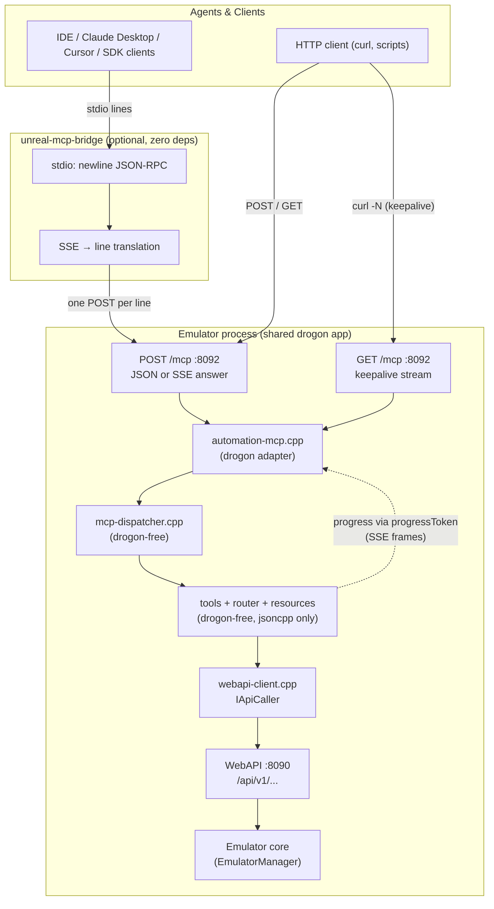

# MCP Server (Model Context Protocol)

> AI-agent control surface for Unreal-NG: 11 smart tools + 2 router tools,
> 7 resources, Streamable HTTP with optional SSE progress streaming, and a
> zero-dependency stdio bridge for IDE integration.

## Overview

The MCP server lets LLM-driven agents (Claude Desktop, Claude Code, Cursor,
Cline, Continue, VS Code, custom SDK clients) operate the emulator the way a
human does — through high-level intent ("load this tape and run it", "why is
this frame slow?", "record a GIF of the effect") instead of raw register
poking. It sits on top of the existing WebAPI: every tool fans out to loopback
HTTP calls and forwards the payloads verbatim, so MCP clients get the same
information WebAPI clients get — identical data from the same handlers
(parity rule: all automation modules are equally important).

Design facts at a glance:

| Property | Value |
|:--|:--|
| Protocol | MCP `2025-06-18`, also `2025-03-26` / `2024-11-05` (JSON-RPC 2.0); the `MCP-Protocol-Version` header of later requests is checked (unsupported: HTTP 400; none: `2025-03-26`) |
| Transport | Streamable HTTP — JSON or SSE answers, stateless |
| Endpoint | `http://localhost:8092/mcp` (also reachable on :8090) |
| stdio | via `unreal-mcp-bridge` (one process, no deps) |
| Tools | 11 smart + `search_api`/`invoke_api` schema-driven router |
| Resources | 6 (`unreal://…`) |
| Sessions | none — no `Mcp-Session-Id`, every request is self-contained |
| Prompts | none advertised (empty `prompts/list`) |
| Token cost | ~1.6k for the tool catalog |

Implementation: [`core/automation/mcp/`](../../../core/automation/mcp/README.md)
(module internals, tool→endpoint mapping, test layout). Client hookup:
[integration-guide.md](integration-guide.md). Bridge details:
[bridge README](../../../core/automation/mcp/bridge/README.md).

## Architecture



Key properties:

- **Drogon-free core**: the dispatcher, all tools, the router and resources
  depend only on jsoncpp — `core-tests` drives the entire protocol stack
  against a synchronous `FakeApiCaller`, no HTTP in sight.
- **Loopback orchestration**: tools never touch the emulator directly; they
  call `http://127.0.0.1:8090/api/v1/...` through `IApiCaller`. One transport,
  one truth.
- **Bridge stays a byte pipe**: it never parses JSON; SSE answers are
  translated at the line level (each `data:` payload → one stdout line).

## Transport matrix

| Path | Client speaks | Request framing | Answer | Best for |
|:--|:--|:--|:--|:--|
| stdio bridge | newline JSON-RPC on stdin | one POST per line | JSON body → one stdout line; SSE body → one line per event | Claude Desktop, IDEs, sandboxed tool environments |
| HTTP JSON (`curl`, SDKs) | HTTP POST | JSON-RPC body | `application/json` (202 + empty for notifications) | scripts, tests, simple clients |
| HTTP SSE | HTTP POST + `Accept: text/event-stream` + `_meta.progressToken` | JSON-RPC body | `text/event-stream`: `notifications/progress` frames, final frame = response | long tools (bounded recordings, multi-aspect inspection) |
| GET stream | HTTP GET | — | `text/event-stream`, `: keepalive` comment every 15 s | future lifecycle events; liveness probing |

The SSE answer mode is strictly opt-in on both ends: without the `Accept`
header **or** without a `progressToken` the server answers plain JSON — every
existing client keeps working unmodified. `DELETE /mcp` and `HEAD /mcp`
return `405` (`Allow: GET, POST`): the server is stateless, there are no
sessions to manage.

## Tool catalog

All tools accept `target` (emulator id or `"auto"`) and answer with dual
content: `content[]` (human/LLM text summary) + `structuredContent`
(machine-readable data). Some clients (claude.ai connectors) hand the model
only `content[]`, so every tool takes `response_format`: `text` (default) keeps
`content[]` human-readable; `json` adds `structuredContent` there as a second
text block of compact JSON (MCP 2025-06-18, Structured Content), cut at 64 KB
with a note. Any other value is a tool error. `capture_media screenshot` with
`include_image: true` puts the pixels in an MCP `image` content block, so the
model sees the picture (the JSON echo does not repeat the base64). The
listings are in the text either way: `debug_code disassemble` writes the listing itself, one line per instruction
(`7396  CD 00 74      call #7400            ; -> draw`); `inspect_state`
`disasm` puts the same listing under `[disasm]`. The default text carries the data, not just a headline:
`memory_access read` the bytes (hexdump, up to 256 lines), `control_execution bp_list` one line per breakpoint
(`#1 0x0038 X hits 3`), `debug_code trace` one line per control-flow event (`0x02D6 jr -> 0x02C6 x7 sp 0x5BDF`), and
an `inspect_state` aspect without a text form of its own its fields as `key=value` (`[machine] model=PENTAGON
ram_kb=128 ...`, the first 1500 characters); `screen_attributes` the grid as attribute bytes, one row per line;
`audio_opl4_fm` / `audio_opl4_pcm` the channel count and the keyed ones; the status calls (`emulator_manage status`,
`analyze_performance profile_status` / `frame_cost`, `capture_media record_status` / `screen_digest`, the mouse,
joystick and keyboard `status`) their fields as `key=value`. `manage_symbols list` takes `from` / `to` (CPU addresses)
and `name` (a case-insensitive substring) and writes the first `limit` (default 100) labels one per line
(`0x09F4 PRINT_OUT rom3 code ; comment`); the whole ROM set is ~2400 labels, so filter rather than page through the
JSON. `inspect_state registers` writes the full set (the alternate registers, I, R, MEMPTR, IM, IFF1/2),
`manage_symbols resolve` the answer (`CLS = 0x0D6B rom3 code ; comment`), `type_input list_keys` the key names.
`control_execution bp_add` switches the breakpoints feature on when it is off (a breakpoint never fires without it)
and says so; `run_frame` / `run_frames` / `run_tstates` / `run_to_interrupt` skip breakpoints: `resume` and `wait`
stop at one. Live checks of all of this: [tools/verification/mcp](../../../tools/verification/mcp/README.md). Tools that perform real multi-step work report
progress when the request carries a `_meta.progressToken` (see
[Protocol details](#protocol-details)).

| Tool | Purpose | Progress |
|:--|:--|:--|
| `emulator_manage` | create/list/status/start/stop/pause/resume/reset/destroy, `operations` (the operation log: reset, autostart, snapshot load, media insert / eject / discard and refusals, one line each with frame, machine mode, result and TTD effect; `since` = after that seq, `limit` = newest N, default 20; [command-interface.md](../../emulator/design/control-interfaces/command-interface.md)), `switch_model` (`model`, optional `ram_size` and `stranded`: the media follow, [media.md](../media.md#model-switch); the cards too, the dropped ones listed, [slots.md](../slots.md#model-switch)), ZX-bus slots `slots_catalog` / `slots_matrix` / `slots_plug` / `slots_remove` / `slots_set` (planned, refused with the plan without `replace_if_incompatible`, applied by a restart, [slots.md](../slots.md)), `network_configure` (`settings`: the network settings; a ZX-bus network card change is a slot change applied by a restart, [slots.md](../slots.md#the-network-cards)), `transfer_state` (copy the target's running state in memory into `to`, an existing instance, or into a new instance of `model` with the source's sound cards; `check: true` only decides; floppies and the tape follow as clean in-memory copies with a postfixed path, SD / HDD / CD are not moved; per-item report, [automation.md](../automation.md#machine-state-transfer)), `list_models` (per-model `creatable` flags), `server` (build fingerprint + `models_creatable`), `switches` / `switch` (`switch`: turbo / cpm, `on`: the Profi's front panel); responses carry machine identity. `create` with `zxpoly: true` (+ `zxpoly_file`), or with a configuration as `model` (`ZXPOLY-48K`/`ZXPOLY-128K`/`ZXPOLY-PENTAGON`), starts a ZX-Poly machine, `zxpoly_status` reports its group ([recipe](../../../.recipe/machines/zxpoly.md)) | — |
| `load_software` | `.sna/.z80/.szx` snapshots, `.rzx` input recordings (played on the model they need), `.tap/.tzx` tapes (`play`; `autostart` plays and types `LOAD ""`, a paused machine paused again), `.trd/.scl/.fdi` disks (`autostart`: drive A, TR-DOS); `paused` pauses the machine first, so the program has not run when the call returns | — |
| `control_execution` | run/pause/resume/step/step_n/step_over/step_out, `run_frames`/`run_tstates`/`run_to_interrupt`, `run_to_scanline` (`scanline`) / `run_scanlines` (`count`) / `run_to_pixel` / `run_until_pc` (`pc`, `max_tstates`, `breakpoints`), `pace` (the paced run: `pace_op` get / set / next / prev / start / stop / toggle / step, `preset`, `interval_ms`), breakpoints (`bp_add` of every type, keyboard included; `bp_remove` / `bp_enable` / `bp_disable` / `bp_toggle` by `bp_id` or `select`: all, a kind, `group:<name>`; `bp_groups`, `bp_group_set`, `bp_note`; a `condition` on `bp_add` of a memory or port breakpoint, `condition_dialect` `c`, `bp_condition` to change or clear it, `bp_list` shows `hits N matched M if …`: [conditional breakpoints](../conditional-breakpoints.md)), `set_register`, `port_out`, `take_control` / `release_control` (the automation session: a take takes over another client's implicit session, never an explicit one, and names it and the session id for a host script; a release without a session of its own ends the MCP server's implicit session, or says who holds control; a run refused `held_by_other` names the holder and how to resolve it) | — |
| `inspect_state` | aspect fan-out: machine, registers, memory, disasm, stack, breakpoints, memory_banks, paging (tagged latches + bank table), ports (static port map with semantic tags + live routing), video (video mode report), screen (screen state, verbose), screen_flash (FLASH timing) — screen reports per command-interface.md §6.6, screen_ocr, screen_image, screen_digest, timing, rom, audio_ay, audio_fm, audio_gs, audio_covox, audio_moonsound, audio_opl4_fm, audio_opl4_pcm, audio_multisound (the ZX-MultiSound: options, CPLD, YM pair, SAA, GS, DACs, MIDI), audio_midi (its MIDI line and SAM2695: parts, programs, notes, counters; panic = invoke_api POST /api/v1/emulator/{id}/control/audio/midi {action: panic}), slots (the ZX-bus slot report: buses, slots, cards, built-ins; change it with emulator_manage slots_plug / slots_remove / slots_set), fdc, ide, cdaudio (the CD drives' audio: disc, tracks, status, head, volume, mixer row; control with invoke_api POST /api/v1/emulator/{id}/cdaudio/{verb}), rtc, mouse (device reports, see command-interface.md §3.3; CMOS cells are written with invoke_api POST /api/v1/emulator/{id}/rtc/cells), ttd (time-travel session: state, recorded range, checkpoints, current position), monitor (GET /api/v1/monitor?instance=, [command-interface.md §17](../../emulator/design/control-interfaces/command-interface.md#17-monitoring): the host process's CPU %, memory and threads, the clients per plane, and the instance's emulator.stats (measured fps, real-time speed %, frame time, CPU MHz, interrupts per frame), breakpoint counts by kind and groups, media slots with unsaved changes, recording, labels, TTD sizes, profiler states, controllers; one text line per instance); the breakpoints aspect carries the groups (name, total, active, ids) | one notification per aspect |
| `type_input` | type (tokenized BASIC entry), tap/press/release, combo, macro, `release_all`, status, `list_keys` | — |
| `joystick_input` | Kempston joystick: press / release / set (exact `state` byte or `buttons` list) / tap (hold N frames) / status (alias `get`); forwards to `/joystick/*` | — |
| `controllers` | the machine's joystick connectors (`list`, `get`, `plug`, `unplug`, `options`, `targets`, `auto`, `input`; with `target`) and the host's game controllers (no target; [command-interface.md §15](../../emulator/design/control-interfaces/command-interface.md#15-game-controllers)): `devices` (the text names each device's role and layers, its battery (`unknown` when the OS says nothing), whether its light can be set, and a `notice:` line of what is missing and how to fix it), `context`, `profiles`, `profile`, `save`, `delete`, `apply`, `bindings`, `bind`, `unbind`, `scheme`, `haptics`, `rumble`, `output`, `light` (`device`, `color`: `#RRGGBB`, `r,g,b`, `off`), `match` (`path` or `signatures` / `file_sha256` / `file_set`, `machine`: the game profiles a program's signatures choose and how, the one chosen and `haptics_reason`; `context` adds the loaded program's signatures, `game_matches` and `haptics_reason` to its text); forwards to `/api/v1/emulator/{id}/controllers/*` and `/api/v1/controllers/{verb}` | — |
| `time_travel` | time-travel debugging: record, then seek / step / search backward through the recording; `.ttd` files, bookmarks, coverage index (`space` for the Sprinter's video / fast RAM); `memory_at` / `memory_diff` read any recorded memory at a past checkpoint without seeking — see [Time-travel debugging](#time-travel-debugging) | — |
| `rzx_playback` | RZX input recordings: `play` (`path`, `desync_mode`, conventions, `switch_model`: a recording for another model switches the machine, the answer's `emulator_id` is the new target), `stop`, `status` (frame, progress, desyncs), `seek` (`frame`: back through keyframes, forward by playing on) - [recipe](../../../.recipe/media/play-rzx.md) | — |
| `memory_access` | Every memory by name: `regions` (name, aliases, size, writable, ttd_region), `read` / `write` (`space`: `cpu` or a region name / alias - `sprinter.vram`, `neogs.ram`, `gs.ram`, `moonsound.wave`, `tsconf.cram`, `rtc.cmos`, `evo.flash` ...; `offset` (or its alias `address`), `length`, `hex`), `save` / `load` a region to / from a file (`path`) | — |
| `manage_symbols` | `load_labels`, list, resolve, `load_listing`, `source_at`, `step_line`, `run_to_line` (sjasmplus `.lst`) | — |
| `signature_info` | media signatures ([command-interface.md §18](../../emulator/design/control-interfaces/command-interface.md#18-media-signatures)): `file` (`path`, `details`, `external`: the exact SHA-256, the tape content / TR-DOS file set / snapshot memory signature, `keys` for a game profile's `match.signatures`, the `file_set` tokens), `media` (the tapes and disks loaded, with `target`), `compare` (`path`, `with`: exact, content, fuzzy, memory or none); the text carries every signature; forwards to `/api/v1/signature`, `/api/v1/signature/compare`, `/api/v1/emulator/{id}/signature`. The profile a signature chooses: `controllers` action `match` | — |
| `debug_code` | disassemble, assemble (two-pass, labels), `find_bytes`, `trace` (calltrace sessions), `porttrace` | `trace`: per phase (start/run/stop/read) |
| `analyze_performance` | coverage_* (+gaps, `coverage_export`: SkoolKit code execution map), `frame_cost`, profiler suites, `profile_report`, `porttrace`, `vdac2_line_budget` / `vdac2_line_budget_set` (FT812 line metrics); `profiler` {profiler: opcode / memory / calltrace / porttrace / all, op: start / stop / pause / resume / clear / status}, `gs_trace`, `aylog`, `pchist`, `analyzers` {op, name} | `profile_report` + `porttrace`: per phase |
| `bus_analyzer` | peripheral bus analyzer ([recipe](../../../.recipe/analysis/bus-analyzer.md)): `list` (buses `zc.spi`, `next.spi`, `divmmc.spi`, `neogs.*`, ATA `ide0` / `ide1`, their devices, trace / checks state), `enable` / `disable` / `clear` (`bus`, default all; `checks`, `capacity`, `protocol_only`), `events` (`kinds`, `slot`, `since`, `from`, `to`, `limit`: one line per chip select / byte / early access / SD command with R1 / block / ATA register, command, data word, with frame, T, PC, source), `findings` (`rules`: early_access, select_mid_byte, deselect_mid_command, command_while_busy, command_drops_answer, crc_error, dma_collision, ata_data_without_drq, ata_command_drops_data, ata_write_while_busy, with PC and meaning), `sd_timing` (`profile` ideal / realistic / slow, `seed`, `slot`), `export` (`format` vcd / jsonl, `path`) | — |
| `actions` | the host actions of the core registry ([command-interface.md §16](../../emulator/design/control-interfaces/command-interface.md#16-host-actions)): `list` (each id with kind, scope, and whether it can run now or why not), `run` (`id`, `value`: omitted = a press, `false` = a release, steps or `{delta, rate}` for a delta, 0..1 for a level, a string for text; `params`: `ttd.seek_by` `unit`, `min`, `max`, `rate_lo`, `rate_hi`); the text names a seek's frames and marks and a step-by's steps; `context` (the instance's surface context, `GET /api/v1/surfaces/context`); the surface verbs ([command-interface.md §16.1](../../emulator/design/control-interfaces/command-interface.md#161-surface-targets-readouts-activity)): `views` (the windows in focus order, the followed instance), `target` (`session`), `sessions`, `pin` (`session`, `pin`: follow, view:<id>, instance:<id>), `readouts` (`names`, `target`), `activity` (`since`, `limit`), `view_add` / `view_update` / `view_remove`, `session_open` / `session_close` (`/api/v1/surfaces/...`); forwards to `/api/v1/controllers/actions` | — |
| `streamdeck` | the Stream Deck daemon as unreal-qt supervises it ([command-interface.md §16.2](../../emulator/design/control-interfaces/command-interface.md#162-the-stream-deck-daemon)): `status` (default: state, pid, decks, viewers, pairing), `start`, `stop`, `restart`, `settings` (`mode` off / deck / always, `activity` off / flash / line, `api_port`, `viewers_port`, `binary`), `pairing`, `pair` (the user approves it at the GUI: an agent cannot), `pair_cancel`, `revoke` (`id`), `brightness` (`deck`, `value`), `udev`; forwards to `/api/v1/streamdeck/...` | — |
| `audio_mixer` | the sound mixer and settings ([mixer channels](../../emulator/design/audio/mixer-channels-and-settings.md)): `get` (default: the rows; with `source` a row and its channels), `source` (one row or channel), `set` (`source` a row or channel `ay1.a`; `muted`, `solo`, `volume`, `gain_db`), `mute` / `unmute` (`muted` of `source`, default the master), `levels` (every row's and channel's peak, active, mute, solo), `settings`, `set_setting` (`name`: `ay_stereo`, `ay_chip`, `ay_voicing`, `ay_room`, `ay_punch`, `beeper_punch`, `fm_trim_db`, `neogs_stereo`, `covox_dc_removal`, `fir_filter`, `audio_rate`; `value`); forwards to `/audio/mixer`, `/audio/levels`, `/settings` | — |
| `media` | every media slot: list, insert (a file or a folder; `slot:"auto"`), swap, eject, save, export (another format by the path's extension: a disk as trd / scl / udi / fdi / dsk / td0 / mgt / img / hfe / scp, the tape as tap / tzx), discard, rescan, create (`format` `trdos` / `plus3` / `unformatted`, `size` for a card), protect ([media.md](../media.md)); `recent` / `recent_clear` (`kind`): the files opened lately ([media.md → Recent files](../media.md#recent-files); open one with `actions` `run` `media.open_recent`) | — |
| `capture_media` | screenshot (PNG default / GIF; `area` `full` = whole frame with border, default, or `screen` = the working picture; `source` `presented` default, `live` = the frame as drawn now, or `window` = the picture as the unreal-qt window draws it (its shape, CRT shader, HUD; GUI only, `area=full`; adds `window`: viewport, picture, device pixel ratio, backend; 409 `no-window` without the GUI); the answer names the frame geometry and the rectangle cut), `screen_digest`, video recording (GIF native, `every_nth:"auto"` quantum sampling; `preset`, `container`, `record_mode` single / multi / audio; `record_presets` lists the core's presets), `audio_capture` (RMS/peak/dominant-Hz, WAV), `temporal_status` / `temporal_set` (ZX DLSS de-flicker: `algorithm` name or `"off"`; one-line summary of the algorithm and the video / audio delay it causes, e.g. "ZX DLSS mod-tpgwafsd active, video +7 frames (143 ms), audio +5, 4.8 ms/frame, late 0, restarts 0"), `window_display` / `window_display_set` (the GUI window's display settings: GPU acceleration, CRT effects and profile, temporal blending, full screen, scale, toolbar / status bar, HUD with its theme and notices, on-screen keyboard and its picture, the ZX Next layers window; `display` = any of `gpu`, `crt`, `crt_profile` (a profile or `shader:<name>`), `blending`, `blending_frames`, `blending_weights`, `blending_decay`, `fullscreen`, `scale`, `toolbar`, `status_bar`, `hud`, `hud_theme`, `hud_notices` {id: bool}, `osd_keyboard`, `osd_keyboard_picture`, `osd_keyboard_style` (photo / schematic / hybrid), `next_layers`, `next_layers_mode`, `next_layers_shown` {name: bool}; a summary, e.g. "window gpu on (available), crt basic, blending off (2 frames, equal), scale 2x, toolbar on, status bar on, hud off (theme dark_glass), keyboard off, next layers off", then `crt_profiles:`, `hud_themes:`, `osd_keyboard_pictures:`, `osd_keyboard_styles:` and `hud_notices (off):` - the words the setters take (CRT off still names the chosen profile); 409 `no-window` headless), `window_crt_params` / `window_crt_params_set` (the active CRT profile's parameters via `/video/window/crt_params`; `crt_params` = {values, steps, reset}; the text lists each one with its value, range and step), `viewport` / `viewport_set` (the overscan frame's crop via `/video/viewport`; `viewport` = full, symmetric, standard, screen_only, next, prev), `window_record_start` / `_frames` / `_stop` / `_status` (the GUI window as drawn, the on-screen keyboard and the machine's sound, frame for frame at the machine's rate, via `/video/window/record*`; `filename`, `keyboard`, `codec`, `audio`, `scale`, `picture_height`, `width` / `height`, `layout`; `window_record_frames {frames}` steps a paused machine; [recipe](../../../.recipe/media/window-recording.md)), `vdac2_capture_start` / `_stop` / `_status` (TS-Conf VDAC2 card: the FT812 bus to an .evr replay stream, `filename` = the file; [recipe](../../../.recipe/machines/tsconf-vdac2.md)) | bounded `every_nth` recordings: captured-frame counter (throttled to ~20 updates) |
| `search_api` | keyword search over the OpenAPI spec (scored), optional `auto_invoke` | — |
| `invoke_api` | direct WebAPI call with `{id}` target substitution | — |

The router pair (`search_api` / `invoke_api`) exposes the entire WebAPI —
28 endpoint groups, 212 paths — without minting a tool per endpoint. Agents
discover the surface via `search_api` and fall back to `invoke_api` when a
smart tool doesn't cover the use case.

## Time-travel debugging

Time-travel debugging (TTD) records the machine while it runs, so that
afterwards you can move backward through what happened: jump to any recorded
moment, step back one instruction, or ask "who last wrote to this address?".
The `time_travel` tool exposes the whole feature; each action is a thin
wrapper over one WebAPI route under `/api/v1/emulator/{id}/ttd/…`
([webapi-interface.md](../../emulator/design/control-interfaces/webapi-interface.md)
has the route reference, the
[TTD design](../../emulator/design/debugger/time-travel-debug/time-travel-debugging-tdd.md)
the internals).

### Terms

| Term | Meaning |
|:--|:--|
| frame | One video frame of emulated time (about 1/50 s). Frame numbers are the emulator's frame counter. |
| `tinframe` | T-states (CPU clock ticks) inside a frame. `frame 12 t=500` is a point in time. |
| checkpoint | A saved machine state taken at a frame boundary while recording. Moving through history restores the nearest checkpoint and replays forward from it. |
| session state | `idle` (not recording; history may or may not exist), `recording`, `detached` (the machine sits at a point in the recorded past and is paused). |
| marker | A replay barrier: something the recording cannot reproduce happened here (tape play/stop, a disk sector write, a memory edit made by a tool while recording). A reset writes no marker: it stops the recording instead (the `hardware_reset` kind is reserved and never written). Seek and backward searches stop at a marker and say so. |
| bookmark | Your own label on a point in time. Advisory only, never a barrier. |
| write journal | A log of every memory write (off by default). Inside the spans it covers, `find_last` for a write answers at once; outside them the search replays one frame (same answer, a few ms). Switch it at any moment (`journal_on` / `journal_off`; each on-off span is a segment) or build it later for any span by replay (`journal_build`). |

### Actions

| Action | Arguments | What it does |
|:--|:--|:--|
| `status` | — | Session state, recorded frame range, checkpoint count, memory use |
| `start` | `journal`: `true` also records the write journal (default `false`); `black_box`: `true` records as the black box (the engine): the last `minutes` (default 5, 1..1440), turbo and host speed stay free | Begin recording |
| `journal_on` / `journal_off` | — | Switch the write journal at any moment, also while recording; the answer lists the spans it covers |
| `journal_build` | `from_frame` / `to_frame` (optional; default: the whole session) | Build the write journal by replaying those frames, about 2-4 ms per frame; not while recording |
| `journal_build_cancel` | — | Stop a write-journal build that runs |
| `stop` | — | Stop recording; history is kept and can be browsed |
| `invalidate` | `reason` (optional) | Drop all history |
| `position` | — | Current point and session end |
| `markers` | — | List the replay barriers |
| `seek` | `frame`, `tinframe` (default 0) | Move the machine to that point in the recording |
| `step_back_frame` / `step_forward_frame` | — | One frame back / forward |
| `step_back_instruction` / `step_forward_instruction` | — | One instruction back / forward |
| `reverse_step` | `count` (instructions) **or** `tstates` **or** `scanlines` | Step back several instructions, T-states or scanlines of the machine |
| `reverse_continue` | `pcs`: list of addresses | Run backward until the CPU was about to execute one of them |
| `find_last` | `addr` or `addr_from`/`addr_to`; `access` (`write` default, `read`, `execute`, `io`); optional `value`, `pc_from`/`pc_to`, `phys_page`, `space` (`ram` / `vram` / `cache`: the Sprinter's video or fast RAM by offset), `before_frame`/`before_tin` | Latest matching access before the current point (or before `before_frame`) |
| `port_events` | `event` (`key`, `ear`, `ay-read`, `ay-write`, `ay-select`, `border`, `beeper`, `in`, `out`); optional `event_arg` (a key name or an AY register), `limit`, `newest`, `from_frame`/`to_frame`, `port`/`port_mask`, `value`/`value_mask`, `match`, `trigger`, `ay_register`, `file` (a saved `.ttd` searched without loading it) | "When did the program ...": every matching IN/OUT with frame, tinframe, PC, port, value - from the port journals, no replay (needs a stopped or paused recording) |
| `resume` | `frame`/`tinframe` (optional, default: current point) | Continue recording live from that point; **everything recorded after it is discarded**. Needs the machine positioned in history (`seek` or a step first); right after `stop` it fails |
| `dump` / `load` | `path` | Save / load a `.ttd` session file; `load` also takes a recording's folder (or one of its `segment-NNNN.ttd` files), e.g. one a black box left when it restarted |
| `file_info` | `path` | Describe a `.ttd` file without loading it and without a target: frame range, checkpoints, sections and the recorded machine (model, ROM signature, devices, General Sound card, TurboSound slot device). Load needs that model and card |
| `export_clip` | `from_frame`, `to_frame`, `path`, optional `chunk` | Write frames from..to as a lossless clip into the directory `path` (final picture, plane B when `zxdlss` is on, frame meta) in one call; not while recording |
| `bookmark_add` / `bookmark_list` / `bookmark_delete` / `seek_bookmark` | `label`, optional `frame`/`tinframe` | Named points in time |
| `coverage_probe` / `coverage_scan` / `coverage_summary` | `frame` or `from_frame`/`to_frame`, `kind`, `addr_from`/`addr_to`, … | Which frames touched which addresses, without replaying |

Addresses may be integers or strings such as `"0x5800"`. Everything that moves
through history (`seek`, the step actions, `reverse_*`, `find_last`) needs a
stopped session: while recording the call fails with HTTP 409 and the tool
tells you to call `stop` first. `find_last` reports where the access happened;
`seek` to the reported `frame`/`tinframe` to inspect the machine there.
`find_last` and `reverse_continue` also name the part of history they searched
(`Searched frame A .. frame B.`): a marker (tape, disk write, edit) can cut a
search short, and the span shows it. `status` says what the write journal
covers: `write journal off (covers 1 span(s): frames 1200..1501; write
searches outside replay)`, `covers the whole session` or `covers nothing`.

### Session rules

- **Recording runs at real speed.** While a session records (and while the
  machine sits in the past), the host speed control is held at 1x and 2x-16x
  is refused, turbo mode is off and cannot be switched on. Fast tape, turbo
  tape and fast disk loading are also off, both while recording and while a
  stopped or loaded session is replayed. The previous settings come back when
  the session returns to `idle`. The emulated machine's own hardware turbo
  (ATM, Scorpion) is not affected. Feature lists show a held feature as off,
  and switching it on answers HTTP 409.
- **These wipe the history:** loading a snapshot, tape or disk (or creating a
  disk), reloading the ROM, changing the speed on a stopped session that still
  holds history, and `invalidate`. Load your software *before* `start`.
- **A media change while recording is an event of the recording.** A tape,
  disk or other medium inserted, ejected or created while a recording runs
  lands at the next frame boundary and the recording goes on; seeking back to
  before that frame shows the slot empty.
- **Reset keeps the history.** A reset (including a disk autostart) stops the
  recording; the recorded history stays browsable.
- **The ZX-Evo SD card is recorded.** Using it while recording no longer
  ends the session.
- **`load`** only restores into a machine of the model the session was
  recorded on (the error names both models). After a load the session is
  `idle`: `seek` to position the machine inside it. The path is resolved by
  the emulator process.

### Worked example: who overwrote the screen attribute?

A game's top-left attribute cell (`0x5800`) turns red and you want the code
that did it.

```jsonc
// 1. Load first (a load after start would wipe the recording), then record
{"name": "load_software",     "arguments": {"path": "/games/game.sna"}}
{"name": "time_travel",       "arguments": {"action": "start"}}
{"name": "control_execution", "arguments": {"action": "run_frames", "frames": 500}}
{"name": "time_travel",       "arguments": {"action": "stop"}}
// -> "TTD recording stopped on emu-1; history kept (state idle) - seek/step/find_last are available now"

// 2. Ask for the last write to 0x5800
{"name": "time_travel", "arguments": {"action": "find_last", "addr": "0x5800", "access": "write"}}
// -> "Last write at frame 431 t=20112 by PC 0x8F3A, value 16, RAM page 5. Searched frame 431 t=20112 .. frame 480. Seek to that frame/tinframe ..."

// 3. Go there and look at the code
{"name": "time_travel",   "arguments": {"action": "seek", "frame": 431, "tinframe": 20112}}
{"name": "inspect_state", "arguments": {"aspects": ["registers", "disasm", "ttd"]}}
```

Narrow a noisy search with `value` (only writes of that byte), `pc_from` /
`pc_to` (only code in that range) or `phys_page` (only that RAM bank on a
128K+ machine). On the Sprinter, `space: "vram"` or `"cache"` searches its
video RAM or fast RAM, `addr` then an offset in it.

### Worked example: when was this routine last entered?

```jsonc
{"name": "time_travel", "arguments": {"action": "reverse_continue", "pcs": ["0xBF00", "0xBF40"]}}
// -> "Hit PC 0xBF00 at frame 212 t=31000"
{"name": "time_travel", "arguments": {"action": "step_back_instruction"}}   // the caller's last instruction
{"name": "time_travel", "arguments": {"action": "resume"}}                  // continue live from here (later history dropped)
```

If the answer is `"... blocked by marker tape_control 'play' at frame 180"`,
the search reached a point the recording cannot replay across; everything
before the marker is out of reach for that search.

### Worked example: keep a session for later

```jsonc
{"name": "time_travel", "arguments": {"action": "bookmark_add", "label": "depacker done"}}
{"name": "time_travel", "arguments": {"action": "dump", "path": "/tmp/game.ttd"}}
// later, on a machine of the same model:
{"name": "time_travel", "arguments": {"action": "load", "path": "/tmp/game.ttd"}}
{"name": "time_travel", "arguments": {"action": "seek_bookmark", "label": "depacker done"}}
```

## Resources

| URI | Content |
|:--|:--|
| `unreal://keyboard-layout` | ZX Spectrum key names for `type_input` |
| `unreal://basic-reference` | BASIC tokens/commands cheat sheet |
| `unreal://z80-isa` | Z80 instruction set reference (markdown) |
| `unreal://trdos-commands` | TR-DOS command reference |
| `unreal://memory-map` | 48K/128K memory map |
| `unreal://machine/profi` | Profi 1024: ROM pages, ports, hi-res mode, limitations |
| `unreal://emulator-state` | live instance overview (dynamic — fetched per read) |

## Protocol details

### initialize negotiation

```json
→ {"jsonrpc":"2.0","id":1,"method":"initialize",
   "params":{"protocolVersion":"2025-06-18","capabilities":{},"clientInfo":{"name":"curl","version":"0"}}}
← {"jsonrpc":"2.0","id":1,"result":{
     "protocolVersion":"2025-06-18",
     "capabilities":{"tools":{"listChanged":false},"resources":{"subscribe":false,"listChanged":false}},
     "serverInfo":{"name":"unreal-ng","version":"1.0.0"},
     "instructions":"…agent-facing briefing…"}}
```

The server echoes the client's `protocolVersion` when supported (`2025-06-18`, `2025-03-26`, `2024-11-05`),
otherwise answers with `2025-06-18`. `notifications/initialized` completes the
handshake (acknowledged with `202` + empty body, like every notification). Later requests may carry
`MCP-Protocol-Version: <revision>` (2025-06-18 clients do): an unsupported revision is refused with HTTP 400 and a
JSON-RPC `-32600` naming the supported ones; without the header the request is served as `2025-03-26`. A request
with an `Origin` header that is not this machine (`http(s)://localhost`, `127.0.0.1`, `[::1]`, any port) is refused
with HTTP 403 (DNS rebinding from a web page); the stdio bridge, curl and scripts send no `Origin` and pass.

### Progress streaming

A client opts in per call by sending a `progressToken` (any string or number)
inside `_meta`:

```json
→ {"jsonrpc":"2.0","id":2,"method":"tools/call",
   "params":{"name":"inspect_state","arguments":{"aspects":["registers","disasm","screen_ocr"]},
             "_meta":{"progressToken":42}}}
```

- Over **HTTP with `Accept: text/event-stream`**, the answer becomes an SSE
  stream: one `event: message` frame per `notifications/progress` (params echo
  the token, `progress` increases monotonically, `total`/`message` describe
  the step), the final frame carries the JSON-RPC response, then the stream
  closes.
- Over the **stdio bridge**, each progress notification and the final response
  arrive as separate stdout lines — stdio clients get progress for free.
- Without a token (or over plain JSON HTTP) progress is silently dropped —
  never a protocol violation.

### Statelessness

No `Mcp-Session-Id` is ever issued or required. Consequences: any number of
clients may share the server; requests may be retried; load-balancing is
trivial; `DELETE /mcp` (session termination in the spec) is `405`. State that
*matters* (emulator instances, breakpoints, recordings) lives in the
emulator, addressed by `target`.

### Error model

| Situation | Result |
|:--|:--|
| Tool ran, work failed | tool result with `isError: true` + remediation hint (e.g. "Already recording — stop it first (record_stop)") — never a JSON-RPC error |
| Unknown tool | `-32602` Invalid params |
| Unknown method | `-32601` Method not found (`resources/subscribe` etc.) |
| Batch array | `-32600` (batching removed in `2025-03-26`) |
| Malformed JSON body | HTTP `400` + `-32700` |
| WebAPI unreachable | tool `isError` result: "WebAPI unreachable — is the emulator running with WebAPI enabled (port 8090)?" |
| Bridge cannot connect | `{"error":{"code":-32603,"message":"bridge: cannot reach <url> (…)"}}` on stdout, bridge keeps running |

## Comparison with xspeccy-mcp

| Aspect | xspeccy-mcp | unreal-ng (this server) |
|:--|:--|:--|
| Transport | stdio only | Streamable HTTP :8092 (JSON/SSE) + stdio bridge |
| Backend | direct core calls | loopback WebAPI — shared handlers, identical information |
| Tool count | 48 flat tools | 11 smart tools + schema-driven router |
| Context cost | ~4k tokens | ~1.6k tokens |
| Progress | — | `notifications/progress` per real work unit (SSE or stdio lines) |
| Resources | — | 6 (keyboard/BASIC/Z80/TR-DOS/memory map/state) |
| Sessions | per-process | stateless — share one server between clients |

## Security

- The MCP listener binds all interfaces (`0.0.0.0:8092`) with **no
  authentication** — the trust boundary is the network itself. This matches
  the WebAPI (:8090) and CLI (:8765) listeners. Run on a trusted machine or
  behind a firewall; anyone who can reach the port can control the emulator
  and read/write emulator memory.
- There is no path traversal or file access through MCP beyond what WebAPI
  itself exposes (load files the emulator process can already read, write
  recordings to the scratch dir).
- The bridge adds no surface of its own: it only connects to
  `http://127.0.0.1:8092/mcp` (or `--url`/`UNREAL_MCP_URL`).

## Quick test

```bash
# JSON round-trip
curl -s -X POST http://localhost:8092/mcp \
  -H 'Content-Type: application/json' \
  -d '{"jsonrpc":"2.0","id":1,"method":"tools/list"}' | jq '.result.tools | length'
# → 11

# SSE progress stream
curl -N -s -X POST http://localhost:8092/mcp \
  -H 'Content-Type: application/json' -H 'Accept: text/event-stream' \
  -d '{"jsonrpc":"2.0","id":2,"method":"tools/call",
       "params":{"name":"inspect_state","arguments":{"aspects":["registers","screen_ocr"]},
                  "_meta":{"progressToken":1}}}'

# stdio bridge
echo '{"jsonrpc":"2.0","id":1,"method":"ping"}' | ./cmake-build-release/bin/unreal-mcp-bridge
```

The emulator application must be running (it serves `/mcp`; a busy :8092
disables MCP for that instance with a console warning — the app keeps
running).

## Testing

Unit tests (drogon-free, `FakeApiCaller`-driven) run in `core-tests`:

```bash
ninja -C cmake-build-release && cmake-build-release/bin/core-tests \
  --gtest_filter='McpSse_Test.*:McpDispatcher_*:McpRouter_Test.*:McpTools_Test.*'
```

- `McpSse_Test` — SSE frame encoding, progress notification shape
- `McpDispatcher_Test` / `McpDispatcher_Progress_Test` — JSON-RPC routing,
  notification ordering, progressToken plumbing
- `McpTools_Test` — action→endpoint mapping + progress sequences
- `McpRouter_Test` — OpenAPI search/invoke against a scripted spec

End-to-end: `scripts/mcp-smoke-test.sh` (HTTP + bridge + SSE round-trips
against a running emulator).
