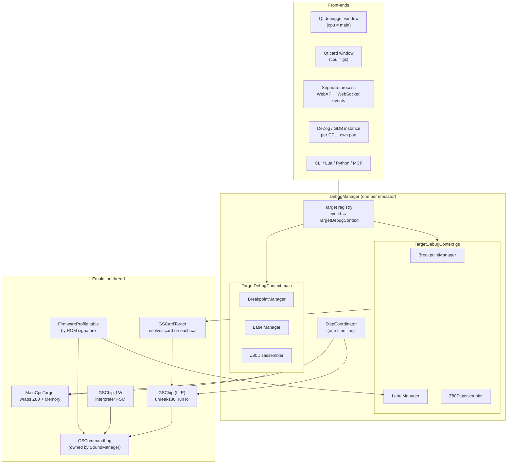
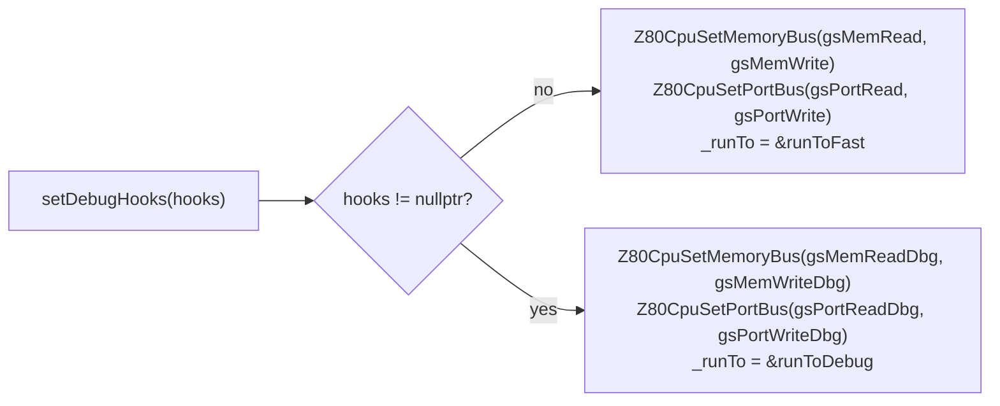
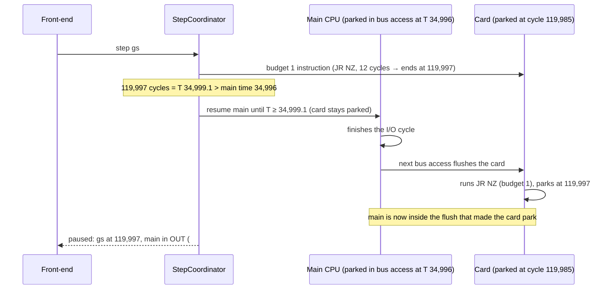
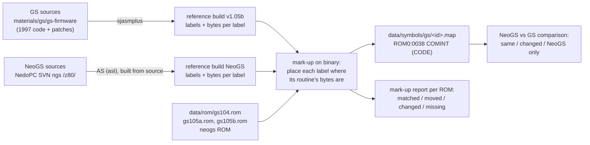
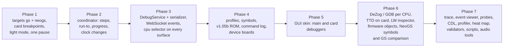

# Sound-card CPU debugging (General Sound, NeoGS) — design

- **Date:** 2026-09-27; revisions 2 and 3 on 2026-09-28
- **Status:** draft for review. §8 D1 / D4 (TTD positions on the card's CPU) built 2026-11-17 on branch
  `card-positions` (not landed): see §8 "As built".
- **Implements:** [requirements.md](requirements.md) (revision 4).
- **Revision 3** adds §8A: the engine for the tracing and analysis tools
  (X1-X21), the audio tools (AU1-AU6) and the firmware metadata (M1-M12) of
  requirements §4.13-§4.15. It also adds these to the phases (§10).
- **Revision 2** does three things:
  - It aligns the design with NeoGS as built and merged into master (§3.1,
    §10).
  - It hands every front-end matter to the debugger model
    ([2026-09-28-debugger-model](../2026-09-28-debugger-model/)): §7 of this
    document now only records what the engine gives the model. The protocol
    (routes, commands, events, surface bindings) is
    [protocol.md](../2026-09-28-debugger-model/protocol.md).
  - It moves the NeoGS target from phase 6 into phases 1-2.
  Requirement IDs (T1, S4, F1c, ...) refer to that document. Terms (machine
  time, clock ratio, instruction progress, firmware profile, FSM) are defined
  in its §1.

## 0. Summary

Five pieces, each described in its own section:

1. **Debug targets (§3).** A small interface, `IDebugTarget`, describes one
   CPU: registers, side-effect-free memory access, memory map, clock. There are
   two implementations now (main Z80, GS card Z80) and a third later (NeoGS).
   `DebugManager` keeps, per target, its own breakpoint manager, label manager
   and disassembler. The main target keeps today's instances, so existing
   callers do not change.
2. **Card hooks (§4).** The card CPU (unreal-z80) gets debug variants of its
   bus callbacks and of its catch-up loop, swapped in only while card
   debugging is active. The card can stop only between its instructions;
   memory and port watchpoints stop right after the instruction that made the
   access.
3. **One time line (§5).** The rule is **the main CPU leads, the card
   follows.** Today the card follows lazily, up to a frame behind. While card
   debugging is active it follows **tightly**: it catches up at every main-CPU
   bus access, so it is never more than one main bus cycle behind. A stepping
   coordinator on the emulation thread executes all step and run requests for
   both CPUs. The main CPU's instruction progress is computed from the time it
   started its instruction and the opcode's T-state count.
4. **Firmware knowledge (§6).** Firmware profiles are data tables selected by
   ROM SHA-256. Symbols come from the firmware sources and are marked up and verified
   against the ROMs. The command log is a compact ring owned outside the card,
   so it survives an LLE ↔ LW switch.
5. **Front-ends (§7).** Every automation surface takes a CPU selector. A new
   event stream on the WebAPI WebSocket serves separate processes. The Qt card
   window, and a second DeZog or GDB instance per target, sit on the same
   target interface.

Delivery is in six phases (§10). Phase 1 gives card breakpoints and a
consistent pause.

## 1. What exists today (facts the design builds on)

Paths are relative to `core/src/` unless they start with another top-level
folder.

**Main-CPU debugger**

- `DebugManager` (`debugger/debugmanager.h:24-54`) is one per emulator. It
  owns one `BreakpointManager`, one `LabelManager`, one `Z80Disassembler`, the
  analyzers and the keyboard and mouse debug managers.
- Callers reach it through `ctx->pDebugManager->GetBreakpointsManager()` (60
  call sites), `Emulator::GetBreakpointManager()` (72), `GetLabelManager()`
  (44) and `GetDisassembler()` (21).
- `BreakpointManager`:
  - It is keyed by address, or by page plus address, with the key layout
    `[pageType:8][page:8][addr:16]` (`breakpointmanager.cpp:1402-1411`), and
    by port.
  - It has a hot-path filter, `_hotState`: `hasExec/Read/Write/PortIn/PortOut`
    plus a 64K `addressFlags[]` array.
  - Its only tie to the main machine is
    `_context->pMemory->MapZ80AddressToPhysicalPage` in
    `FindAddressBreakpoint(uint16_t)` (`:1477-1485`). An overload that takes
    the page explicitly already exists (`:1492`).
- `LabelManager`:
  - Lookup is keyed by the 16-bit address only (`labelmanager.h:19-58`), so
    there is one label per address. The bank is metadata.
  - `AddLabel` marks addresses below `#4000` as ROM, which is Spectrum-specific
    (`labelmanager.cpp:67-70`).
  - The `.map` parser accepts `ROM1:0000` / `RAM2:4000` page prefixes
    (`:543-606`).
- `Z80Disassembler` decodes from a byte buffer.
  - Its runtime helpers take a concrete `Memory*`:
    `disassembleSingleCommandWithRuntime`, `getNextInstructionAddress`,
    `getStepOverExclusionRanges`.
  - Label lookup is hard-wired to `_context->pDebugManager->GetLabelManager()`
    (`z80disasm.cpp:2052, 2905`).
  - Each opcode record carries its T-states: `t`, `met_t`, `notmet_t`
    (`z80disasm.h:21-28`).
- **Pause sequence.** Every breakpoint call site runs the same inline code:
  `Pause()`, then `Post(NC_EXECUTION_BREAKPOINT, BreakpointTriggeredPayload)`,
  then `WaitWhilePaused()`. This blocks the emulation thread where it stands.
  - For execute breakpoints that is the instruction start.
  - For memory and port breakpoints it is inside the bus callback, in the
    middle of the instruction (`z80.cpp:277-294`, `memory.cpp:295-312`).
  - The payload has `emulatorId`, `address` and `hidden`, but no CPU field
    (`notifications.h:313-338`).
- **Stepping.**
  - `RunSingleCPUCycle` / `RunNCPUCycles` run `ExecuteStep` on the *calling*
    thread (`emulator.cpp:2178-2247`).
  - Step over uses a hidden execute breakpoint and a one-shot observer
    (`:2649-2795`). Step out uses `RunUntilCondition` (`:2836-2881`).
- **Cost gating.** The main Z80 swaps between fast and debug memory
  interfaces (`core.cpp:574-582, 768-783`). Feature flags feed cached booleans
  (`memory.cpp:95-106, 1820-1830`). `breakpoints` auto-enables `debugmode`
  (`featuremanager.cpp:193-213`).

**GS card (LLE)**

- The card CPU is `Z80CPU*` from the vendored unreal-z80. Its static bus
  callbacks are `gsMemRead`, `gsMemWrite`, `gsPortRead`, `gsPortWrite` and
  `gsIntRead` (`soundchip_gs.h:216-221`), set through `Z80CpuSetMemoryBus` /
  `Z80CpuSetPortBus` (`z80cpu.h:339-342`).
- `Z80CpuStep` runs exactly one instruction and returns its cycles. A
  redundant DD/FD prefix is a step of its own. Callbacks cannot stop a step.
  `Z80CpuTstates` is the cycle counter, published before each bus callback.
  `Z80CpuInstructionPc` is the address of the current instruction's first
  byte (`z80cpu.h:139-200`).
- **Catch-up.**
  - `flush()` (`soundchip_gs.cpp:277`) computes
    `target = frameStartGs + llround((AudioTstate(z80->t) - frameStartZx) * gsCyclesPerZxTact())`
    and calls `runTo(target)` (`:288`).
  - `runTo`'s loop (`:293-353`) delivers the pending NMI, then the pending
    INT, then advances the 320-cycle interrupt quantum, then calls
    `Z80CpuStep`. It has no early exit.
  - Callers: host port IN/OUT on `#B3`/`#BB`/`#33` (`:505-549`), the
    automation actions (`:612-641`), and frame end (`:404`).
- **Main CPU T during a port access.** The port callback runs inside the
  instruction, with `z80->t` already at the I/O cycle. For example,
  `OUT (n),A` is `cputact(1); out(); cputact(3)` (`op_noprefix.cpp:1235`).
- **Memory map** (`applyBanking`, `:879-906`):
  - `#0000-#3FFF`: ROM page 0.
  - `#4000-#7FFF`: RAM page 3. Reads in `#6000-#7FFF` are DAC fetches.
  - `#8000-#FFFF`: MPAG 0 maps ROM (32K); MPAG V≥1 maps RAM pair
    `(V-1) & mask`.
  - RAM is 128-512K.
- **Mailbox** (`gsmailbox.h`): status bit 7 is the data flip-flop, bit 0 the
  command flip-flop.
  - Host side: `onHostDataWrite` / `onHostCommandWrite` (`:562, 576`); the
    latter already tracks module-upload commands.
  - Card side: `gsIn` / `gsOut` (`:827, 845`).
- **Port trace** (`gsporttrace.h`): a 65,536-entry ring of 24-byte events.
  `start/stop/pause/resume/clear` are exposed through CLI, WebAPI, Lua and
  Python. Checking whether capture is on costs two atomic loads.
- **LW card**: the interpreter state and a mirror of the firmware variables
  live in `soundchip_gslw.h:209-255`. Entry points are `acceptHostCommand`,
  `acceptHostData`, `dispatchCommand` and `postReply`.
- **Personality switch** (`soundmanager.cpp:1311, 1411`) deletes the card
  object and creates a new one. **Nothing may cache the card pointer.**

**Front-ends**

- There is no shared automation command layer. CLI, WebAPI, Lua, Python and
  GDB call the core directly; MCP calls WebAPI over HTTP.
  - MCP already uses the argument name `target` for the emulator instance
    (`mcp/src/target-resolver.h`).
- The WebAPI WebSocket (`/api/v1/websocket`) is a stub. It sends a welcome
  string and echoes messages. `broadcastEmulatorData` has no callers, and
  there is no subscription protocol and no event types.
- There are no `/debug*` WebAPI routes; the debug routes sit at the emulator
  level (`/step`, `/registers`, `/breakpoints`, `/disasm`, …), and none takes
  a CPU.
- DeZog talks to an abstract interface, `dzrp::IDebugInterface`
  (`dzrpserver.h:17-118`). GDB is wired to `EmulatorContext` directly, with a
  single fixed thread.
- The Qt `DebuggerWindow` is a single instance (`mainwindow.cpp:214`). Its
  widgets reach into `Emulator` / `Memory` / `Z80` directly. Its breakpoint,
  label and CPU-step handlers are not subscribed (`debuggerwindow.cpp:215-223`);
  it learns about breakpoint hits only from the Paused state change. It is
  not the reference for the new UI (requirements rev. 3, §6).

## 2. Architecture overview



## 3. Debug targets

### 3.1 The target interface

```cpp
// debugger/targets/debugtarget.h
enum class DebugCpuId : uint8_t { Main = 0, GS = 1, NeoGS = 2 };

struct DebugMemoryWindow            // one address window of the CPU
{
    uint16_t start, size;           // e.g. #8000, #8000
    MemoryBankModeEnum kind;        // ROM / RAM / FLASH (FLASH added)
    uint16_t page;                  // page mapped now
    bool writable;
};

struct DebugPageSpace               // everything the CPU can page in
{
    MemoryBankModeEnum kind;
    uint16_t pageCount;             // GS RAM: 8..32 (16K pages); NeoGS RAM up to 256
    uint32_t pageSize;              // 16K
};

class IDebugTarget
{
public:
    virtual DebugCpuId id() const = 0;
    virtual const char* name() const = 0;               // "main", "gs", "neogs"
    virtual bool available() const = 0;                 // gs: LLE card fitted
    virtual double clockHz() const = 0;                 // current clock, S9
    virtual uint64_t cycles() const = 0;                // monotonic cycle count

    virtual Z80Registers registers() const = 0;         // plain struct (z80.h:20)
    virtual void setRegisters(const Z80Registers&) = 0; // only while paused
    virtual uint8_t boundaryState() const = 0;          // int shadow, pending prefix

    virtual uint8_t peek(uint16_t addr) const = 0;      // no side effects (no DAC fetch)
    virtual void poke(uint16_t addr, uint8_t v) = 0;    // respects ROM read-only unless forced
    virtual uint8_t peekPage(MemoryBankModeEnum, uint16_t page, uint32_t offset) const = 0;
    virtual void pokePage(MemoryBankModeEnum, uint16_t page, uint32_t offset, uint8_t) = 0;

    virtual size_t windows(DebugMemoryWindow* out, size_t max) const = 0;
    virtual size_t pageSpaces(DebugPageSpace* out, size_t max) const = 0;
    virtual MemoryPageDescriptor mapAddress(uint16_t addr) const = 0;  // for page-tied BP/labels
};
```

- **`MainCpuTarget`** wraps `pCore->GetZ80()` and `pMemory`. `mapAddress`
  calls `Memory::MapZ80AddressToPhysicalPage`.
- **`GSCardTarget`** holds only the `EmulatorContext*`. Every call resolves
  `ctx->pSoundManager->getGeneralSound()` and checks
  `hasCoprocessor()`, so a personality switch never leaves a stale pointer.
  It calls a new debug access interface on the card:

```cpp
// gs/generalsoundcard.h additions (LLE implements; LW returns "no CPU")
struct GSDebugAccess
{
    virtual Z80CpuRegisters cpuRegisters() const = 0;
    virtual void setCpuRegisters(const Z80CpuRegisters&) = 0;
    virtual uint8_t peek(uint16_t) const = 0;         // _bankR lookup, no dacFetch
    virtual void poke(uint16_t, uint8_t) = 0;
    virtual uint8_t* romData(); virtual uint8_t* ramData(); virtual size_t ramSize() const = 0;
    virtual uint8_t mpag() const = 0;
    virtual uint64_t cardTime() const = 0;            // in the card's own unit; GS: totalGsCycles()
    virtual double unitsPerSecond() const = 0;        // GS 12e6 (one cycle); NeoGS 120e6 (base tick)
    virtual void setDebugHooks(GSDebugHooks*) = 0;    // §4; nullptr = off
    // NeoGS additions (neogs-tdd.md §7.2); GS answers from its fixed map
    virtual uint8_t pageRegister(int window) const;   // page byte of window 0-3
    virtual bool windowIsFlash(int window) const;     // ROM mode shows flash in windows 0/2/3
    virtual uint8_t* flashData();                     // NeoGS 512 KB flash; GS: nullptr
};
virtual GSDebugAccess* debugAccess() { return nullptr; }   // GeneralSoundCard
```

**GS memory map through the interface:**

| Window | Kind | Page |
|---|---|---|
| `#0000-#3FFF` | ROM | 0 |
| `#4000-#7FFF` | RAM | 1, fixed: the upper half of MPAG 1 (§11 risk 7) |
| `#8000-#BFFF` | ROM or RAM | MPAG 0: ROM 0; MPAG V: RAM `2·((V-1)&mask)` |
| `#C000-#FFFF` | ROM or RAM | MPAG 0: ROM 1; MPAG V: RAM `2·((V-1)&mask)+1` |

- The target never hard-codes this table: `windows()` and `mapAddress()`
  read the card's live bank pointers (`_bankR` / `_bankW` against `_rom` /
  `_ram`). The debugger shows whatever the emulation does, so a correction of
  the emulation's map (§11 risk 7) needs no debugger change.
- GS RAM is 128-512 KB = 8-32 pages of 16K. NeoGS has up to 4 MB = 256 pages
  (current FPGA; the fpgaD revision in our materials addresses 2 MB), which
  still fits the 8-bit page field. NeoGS flash is a new `MemoryBankModeEnum`
  value.
- **NeoGS already has most of this access** (as built, 2026-09-28):
  - `SoundChip_NeoGS::peek` / `poke` (no side effects);
  - `pageRegister(w)`, `windowIsFlash(w)`;
  - `memory()` (`NeoGSMemory`: `page`, `isFlash`, `physical`, `ram`) and
    `flash()`;
  - `cardTicks()`, `cardClockHz()` and `neogsState()`.

  The NeoGS `GSDebugAccess` is therefore mostly a thin adapter. What is
  still missing:
  - register read and write through `Z80CpuGetRegisters` /
    `Z80CpuSetRegisters` on the private `_cpu`;
  - `setDebugHooks`, and the debug variant of the runner loop (the
    `GSCardRunner` hooks are templates, not virtual, so the debug loop is a
    second instantiation).

  The classic GS needs `poke`, page access and the full register file.
- **NeoGS windows are all switchable.** In its current FPGA, each of the four
  windows has its own 8-bit page register (ports `#20`-`#23`, `ports.v:159-162,
  416-442`; reset values PG0 = 0, PG1 = 3). `MPAG` / `MPAGEX` write PG2 / PG3,
  and `GSCFG0` bit NOROM chooses ROM or RAM (`memmap.v`). The window table is
  therefore four rows of `{kind, page, writable}` for any card, never a GS
  special case.

**Pages are always 16K** (decided in review; the Spectrum standard). The
MPAG register selects 32K pairs, but the debugger never shows pairs: MPAG 3
appears as RAM pages 4 and 5. Symbol files, breakpoints, memory views and
automation all use 16K page numbers.

**The same page in two windows.** With MPAG 0, ROM page 0 is visible at both
`#0000` and `#8000`. A page-tied breakpoint or label therefore matches by
**page + offset within the page**, not by CPU address. Both
`BreakpointDescriptor` and `Label` already carry `bankOffset`. So
`ROM0:0038` also matches execution at `#8038` while MPAG is 0. Address-only
breakpoints (no page) keep matching by CPU address, as on the main CPU.

### 3.2 Per-target debug context

```cpp
// debugger/debugmanager.h
struct TargetDebugContext
{
    std::unique_ptr<IDebugTarget> target;
    std::unique_ptr<BreakpointManager> breakpoints;
    std::unique_ptr<LabelManager> labels;
    std::unique_ptr<Z80Disassembler> disassembler;
};

class DebugManager
{
    // existing accessors unchanged: they return the Main context's objects
    BreakpointManager* GetBreakpointsManager();          // == Target(Main).breakpoints
    ...
    TargetDebugContext* GetTarget(DebugCpuId);            // nullptr if not available
    TargetDebugContext* GetTarget(std::string_view name); // "main" / "gs" / "neogs"
    size_t ListTargets(DebugCpuId* out, size_t max) const;
    StepCoordinator& Coordinator();
};
```

- **Compatibility.** The 60 + 72 + 44 + 21 existing call sites keep working:
  the old accessors return the main target's objects. Only code that should
  become CPU-aware changes: automation, Qt, DeZog, GDB.
- **Lifetime (T4).** The `gs` context is created the first time any
  front-end asks for it, and it stays alive for the emulator's lifetime.
  - `available()` follows the card: false while the card is LW or absent.
  - Its breakpoints and labels stay in memory while it is unavailable, and
    fire again after a switch back to LLE.
  - The debug hooks (§4) are re-attached on every card creation. For this,
    `SoundManager` calls `DebugManager::OnCardCreated()` after
    `createGeneralSoundCard` and after a switch.

### 3.3 Changes to the managers

**`BreakpointManager`**

- New constructor argument: `IDebugTarget* target`.
- `FindAddressBreakpoint(uint16_t)` uses `target->mapAddress(addr)` in place
  of `_context->pMemory`, then calls the existing page overload.
- **The page-tied key changes to the physical address.** Today it is
  `[pageType:8][page:8][z80address:16]` (`breakpointmanager.cpp:1406-1410`,
  `:1501-1502`), i.e. page plus *CPU* address. A breakpoint on ROM page 0 at
  `#0038` therefore misses when the same byte executes at `#8038`. The new key
  is `[pageType:8][page:8][offset:16]` with `offset = addr & #3FFF` (taken from
  `MemoryPageDescriptor::offset` / `BreakpointDescriptor::bankOffset`, which
  both exist). Address-only breakpoints keep the `0xFFFF'0000 | addr` key.
  - This fixes the same miss on the main CPU: on a 128K machine RAM page 5 is
    visible at `#4000` and, when paged in, at `#C000`; page 2 at `#8000` and
    `#C000`.
  - Existing page-tied breakpoints are created with a CPU address. On add, the
    manager converts it to the offset (`addr & #3FFF`). Saved breakpoint
    files keep their format; the conversion happens on load.
  - The hot filter `addressFlags[]` is indexed by CPU address. A page-tied
    breakpoint marks the CPU addresses of *every* window where its page can
    appear (four entries at most), so the filter stays a single lookup.
- The `_DEBUG` log line in `HandlePCChange` uses the target too.
- Descriptors, groups and the Handle* entry points are per instance already.

**`LabelManager`** (needed for L2: one address, different names per page)

- Page-tied labels are indexed by physical address, `(bankType, bank,
  bankOffset)`, in a new map. Address-only labels stay in
  `_labelsByZ80Address`. New lookup `GetLabelByAddress(addr, const
  MemoryPageDescriptor&)`:
  - It returns the page-tied label at the page and offset the CPU address maps
    to now, so a ROM 0 label shows at `#0038` and at `#8038`.
  - Failing that, it returns an address-only label.
  - `.map` entries such as `ROM1:C000` store page 1 offset `#0000`: the offset
    is `address & #3FFF`, whatever window the file wrote.
- The old `GetLabelByAddress(addr)` keeps its behaviour for the main target:
  the first label at that address.
- The "below `#4000` is ROM" guess in `AddLabel` moves to the target: labels
  added without a page take `target->mapAddress(addr)` when they are added
  interactively. File imports keep what the file says.
- `.map` files with `ROM1:0000` / `RAM5:8000` prefixes load as they do today
  (L3, "same format as now").

**`Z80Disassembler`**

- The constructor takes `TargetDebugContext*` (labels and target).
- The `Memory*` parameters of the runtime helpers become `const IDebugTarget&`.
  Their body reads through `peek` / `mapAddress`.
- The main-CPU overloads that take `Memory*` stay as thin wrappers during
  migration, then go.
- `Z80ControlFlowDecoder` gets the same change.
- New helper `instructionTiming(const DecodedInstruction&)` returns
  `{t, met_t, notmet_t}` from the opcode table. Instruction progress (§5.4)
  uses it.

## 4. Card hooks

### 4.1 Two loops, two callback sets

The zero-cost requirement (P1) is met the way the main CPU meets it: the
debug path is a separate path, chosen by a swap, not by a branch in the hot
path.



- **`runToFast`** is today's `runTo`, unchanged.
- **`runToDebug`** is the same loop with three additions:
  1. Before each `Z80CpuStep` it asks the hooks whether to stop:
     - an execute breakpoint at the current PC and page (via the `gs`
       `BreakpointManager::HandlePCChange`, with the page from
       `GSCardTarget::mapAddress`);
     - a pending watchpoint hit from the last instruction;
     - a step budget from the coordinator (§5.3);
     - a time limit from the coordinator.
  2. After an interrupt or NMI is accepted, it reports the card event for B2.
  3. When a stop is due, it calls `hooks->park(reason)`. Park returns a
     command (§5.3), and the loop then continues, runs one more step, or
     returns early with the card behind its target.
- **Debug bus callbacks** do the normal work, then:
  - call `HandleMemoryRead/Write` and `HandlePortIn/Out` on the `gs`
    breakpoint manager, gated by its `_hotState` flags;
  - record a hit as *pending*, with address, value and PC.

  They never park. The library has no way to stop mid-instruction, and a
  card instruction is at most 23 cycles (6.7 main T). So the hit is reported
  at the next instruction boundary, before the next instruction: "write
  `#4100` ← `#12` by instruction at `#0C30`". This is how most hardware
  watchpoints work. It keeps the card on an instruction boundary (S2).
  - It differs from the main CPU, which parks inside the access. The UI
    states which one applies.
- **Card events (B2):**
  - INT and NMI acceptance: `runToDebug`, as above.
  - Reset: `resetCard`.
  - Page switch: `gsOut` port `#00`, with the value.

  They go into the `gs` breakpoint manager as a new breakpoint type,
  `BRK_EVENT`, with an event kind and an optional value filter. They use the
  same Handle* shape, `HandleEvent(kind, value)`.
- **Protocol breakpoints (B3)** use the same `BRK_EVENT` type, with kinds
  `HostCommandWrite`, `HostDataWrite`, `HostReplyRead`, `CardCommandRead`,
  `CardDataRead` and `CardReplyWrite`, plus an optional command filter.
  - Host-side kinds live in the **main** breakpoint manager and fire in the
    main CPU's port callback, which already parks mid-instruction.
  - Card-side kinds live in the `gs` manager and fire at the card's next
    instruction boundary, like the watchpoints.

### 4.2 Why not the paged bus or the contention hook

unreal-z80 offers page tables (`Z80CpuAttachPageTables`) and an M1 contention
hook (`Z80CpuSetContendFn`). They were considered and not used:

- The GS card uses the plain callback bus, and switching it to page tables is
  a performance change unrelated to debugging.
- The contention hook fires on every opcode fetch and costs more than a check
  between steps.

A check between steps sees every instruction start, because each step ends on
a boundary, and it costs nothing when the fast loop is selected.

## 5. One time line

### 5.1 The rule: main leads, card follows

- The card and the main CPU affect each other only through the host ports
  (`#B3`, `#BB`, `#33`). Before every such access the card is brought up to
  the access time (`flush`). So the order of everything the two CPUs can see
  of each other is exact, however far behind the card otherwise runs. That is
  why lazy catch-up is correct today.
- The debugger keeps that rule: **the card never runs ahead of the main CPU.**
  If the card ran ahead, a main-CPU `OUT` to the card that belongs earlier in
  time would reach a card that has already polled the port and moved on. The
  results would change (S8).
- To move the card forward past the main CPU's position, the coordinator
  first moves the main CPU (§5.3).

What changes while card debugging is active is **how far behind** the card
may be:

| Mode | When | Card behind main by at most | Where the card catches up |
|---|---|---|---|
| Lazy (today) | no card debugging | one frame | host port access, frame end |
| Tight | any card breakpoint, card step or card run-to active; or a `gs` pause being shown | one main bus cycle (3-6 T) | additionally at every main-CPU memory access and instruction start |

**Worked example, the §2 case of the requirements.** A card breakpoint sits
at cycle 60,000, which is main T 17,500.

- **Lazy:** the card reaches cycle 60,000 only in the burst at main T 34,996.
  The main CPU would be shown 17,496 T in the future (S4 violated).
- **Tight:** the card catches up at every main bus access. It reaches cycle
  60,000 in the flush at the first main memory access at or after T 17,500,
  say T 17,502. The main CPU parks there, inside its current instruction.

### 5.2 Tight mode: where the flushes go

- The main CPU already has a debug memory interface (`DbgMemIf`), active
  whenever `debugmode` is on. Tight mode turns on `debugmode` in the same way
  `breakpoints` does.
- It adds one cached check to `Memory::MemoryReadDebug` / `MemoryWriteDebug`
  and to `Z80::RunInstructionStartHooks`:
  `if (_cardTight) gs->flush();`.
- `flush()` already returns at once when the card is caught up. Its cost is
  one `llround` of a double, called about 3 times per main instruction.
- The fast memory interface is untouched, so P1 holds: no card debugging
  means no tight flag, which means the fast path as today.
- Measuring the tight-mode cost is part of phase 1 (P4). An expected order of
  magnitude: the main CPU makes about 20,000 memory accesses per frame, which
  means 20,000 short calls against a card burst of about 25,000 instructions.

**When tight mode is on:**

- `gs` breakpoints exist and are enabled: `BreakpointManager::_hotState`
  reports any flag.
- A coordinator command targets the card (§5.3).
- The machine is paused with the `gs` target selected in any front-end.

When all three are false, tight mode is off. The card then simply stays
behind until the next port access or frame end, as today.

> **As built (2026-11-14), the third trigger:** the selection is one per machine (`DebugManager::SelectCpu`, the last
> front-end's choice). Tight mode comes with a direct run of the paused machine (`Emulator::DirectStepScope`: a step,
> steps, a run of T or frames), plus one catch-up at the run's end, rather than with the pause itself: switching tight
> mode takes a `CpuHold` (`FeatureManager::applyDebugMode`), and a pause edge comes from inside the execution arbiter.
> The main CPU only runs while paused in a direct run, so the effect is the same. The card does not catch up at the
> selection itself, only with the next step.

### 5.3 The stepping coordinator

> **As built (2026-11-15), run to the cursor:** no coordinator object; a card's step in / over / out / to arms a
> one-shot park in `GSCardTarget` (`ArmStep`), `RunControl::CardStep` resumes the machine and waits for the pause. The
> cursor is the step kind `to`, not a hidden breakpoint, so it never shows in the breakpoint lists; the planes reach it
> as the main CPU's run until PC with a card `cpu` (`/skip_until?cpu=gs`).

All run and step requests from all front-ends go to one object,
`StepCoordinator`. It executes them **on the emulation thread**, at the park
points. This also removes a latent hazard: today `RunSingleCPUCycle` runs
`ExecuteStep` on the calling thread even while the emulation thread is
parked inside a bus callback.

**Park points.** These are the places where the emulation thread can stop
and take commands:

| Park point | CPU state there |
|---|---|
| Main instruction start (`RunInstructionStartHooks`) | main on a boundary |
| Main bus callback: memory breakpoint, port breakpoint, protocol breakpoint, tight-mode flush that made the card park | main inside an instruction |
| Card `runToDebug`, between steps | card on a boundary |

- A park calls `StepCoordinator::park(where)`. That replaces today's
  `Pause(); Post(); WaitWhilePaused();` sequence at every call site, with the
  same behaviour when no card is involved.
- The coordinator publishes the pause (event with CPU id, §7.2). It then
  waits for a command and returns an action to the park point.

**Commands and what the parked code does with them:**

| Command | Card parked in `runToDebug` | Main parked |
|---|---|---|
| Continue | return from park; loops continue normally | same |
| Step card 1 instruction | run one `Z80CpuStep` if the card's next instruction ends at or before main's current time. Otherwise, first let main run to its next park point past that time (card still parked), then step | set a main "stop after time X" limit and card budget 1; resume main until the card catches up and parks |
| Step main 1 instruction | return from the card park with "stop main after its current instruction"; main finishes it (the card follows in tight mode, bounded by the new main time) and parks at the next instruction start | as today (`StepInstruction`), but executed here |
| Step over / out, run to cursor (either CPU) | expressed as a hidden breakpoint (over, cursor) or a condition (out) on the chosen CPU, followed by Continue | same |
| Run to card cycle N / main T N / next frame / next card INT | set time limits; Continue; the limit parks the CPU that reaches it | same |

**Walk-through: stepping the card while main is inside `OUT (#B3),A`.**



Main is parked inside a flush, which happens at a main bus access, not at a
precise T. So main's clock may be slightly past the card's time. That
difference is the **gap** in S2, and it is shown.

### 5.4 Instruction progress for the main CPU

> **As built (2026-11-14):** `Z80::instrStartT` (T, not `tt`), set at each instruction start while the start-of-
> instruction debug work runs; tight mode catches the card up before it moves, so `m1_pc` and `instrStartT` name the
> finished instruction the card's moment is in. The machine cycles come from `Z80MCycleDecoder` (no table in the
> opcode records), checked against the FUSE vectors. Contention: the measured T (`t_in_instruction`) beside the
> table's, `contended` when they differ; no contention counter. The payload is `MainPosition` / the `main` node, not
> `CpuTimePosition`.

- **Start T.** A new field `Z80::instrStartTT` (same scale as `tt`) is set
  next to `m1_pc` in `RecordInstructionStart`, which runs once per
  instruction start already (commit `1bce58b7`). It costs one store in the
  debug path only.
- **Shown moment.** When the card is the target that stopped, the moment
  shown is the card's time converted to main T:
  `tShown = frameStartZx + (cardTime - frameStartCard) / unitsPerZxTact`.
  This is the inverse of `flush`'s formula, so conversion is exact both ways.
  Each card uses its own unit (GS: 12 MHz cycles, NeoGS: 120 MHz base ticks,
  `neogs-tdd.md` §5.2), so the formula holds across NeoGS clock changes.
- **Progress.** Elapsed = `tShown - instrStartT`. Total = the opcode's T from
  `Z80Disassembler::instructionTiming`, decoded at `m1_pc`. For a conditional
  instruction whose condition is not yet decided, both totals are shown
  (`met_t` / `notmet_t`).
  - Contention (48K / 128K) makes the real total longer than the table's. The
    progress then uses the table total plus the contention counted so far
    (`Z80::contentionAccumulated`, if exposed; otherwise the table total, and
    the note "contended").
- **Bus cycle.** The UI turns elapsed T into the bus cycle under way: opcode
  fetch, operand read, memory write, I/O. It uses a per-opcode M-cycle table
  added to the disassembler's opcode records (`mcycles`, e.g. `OUT (n),A` is
  `{4 OCF, 3 OD, 4 IO}`).
- **Payload.**

  ```cpp
  struct CpuTimePosition
  {
      DebugCpuId cpu;
      uint64_t cycles;          // on its own clock
      bool onBoundary;
      uint16_t instrPc;         // == m1_pc when inside
      double elapsedT, totalT, totalTAlt;  // alt for conditional
      uint8_t busCycleIndex;    // index into the opcode's mcycles
      double gapT;              // how far its real clock is past the shown moment
  };
  ```

> **As built, the twin timeline phase 1 (2026-11-25, `core/src/debugger/timeline/twintimeline.h`; gui-card-debugger
> §A5.1).** The data behind the twin timeline on every automation plane, no Qt canvas yet. One builder
> (`timeline::BuildNow`) for every plane.
>
> - **Records with time.** `ExecRecord` is 16 bytes: `{frame, t, pc, kind, page, idle}`. Main `t` is `Z80::t` at the
>   instruction start; a card's `t` is its units since its frame start (GS: 12 MHz cycles, NeoGS: 120 MHz ticks). New
>   event records: `kind` 0xF0 INT and 0xF1 NMI (at the acknowledge's start, the interrupted PC), 0xF2 the NeoGS clock
>   change (`page` = old MHz, `idle` = new Hz; takes no time). A block lasts until its lane's next record starts, so
>   contention, /WAIT, an acknowledge and the NeoGS clock are in its width exactly; a card block's width is exact in
>   its own units (`duration_units`) and converts to main T by `unitsPerZxTact`, the inverse of the catch-up.
> - **NOW and the gap.** NOW = main T − gap. The gap is the card's lead over main: `hostLead / unitsPerZxTact`; in the
>   frame-end catch-up (the card finishing the frame main already wrapped), `z80->t + frameLength − cardUnits /
>   unitsPerZxTact`. `at` of a block is its start relative to NOW in main T (negative: past).
> - **Zero cost off.** Nothing records until a client holds a lease (`Timeline::Arm(owner, leaseMs)`, REST and MCP 30
>   s by default, renewed by every read; CLI / Lua / Python until released). Armed, the histories it reads that were
>   off (`cpu`, `<slot>.cpu`, `<slot>.commands`) are switched to a ring and back off at the last release (only if still
>   a ring: a user's change wins). Off: one relaxed load per frame end in `MainLoop`.
> - **Density.** While armed, each frame end samples the card's always-on counters (steps, idle-slept steps, INT, NMI,
>   commands taken, the host port accesses by kind; the profiler's cycles when it runs) into a 64-frame ring under a
>   short lock. A running read never parks the machine: it answers the density only.
> - **Node** (`GET /debug/timeline`, `pause.timeline`, Lua / Python `timeline()`, CLI `timeline json`): `available,
>   state, armed, cpu, lanes [{cpu, name, unit, clock_hz, units_per_t?, recording, readout}], now {frame, t, gap_t,
>   main_t, main_frame, card_units, card_cycle}, position {main?, main_text, card_text, gap_t}, window {span_t, from_t,
>   to_t, frame_t}, recent {main, gs|ms: [{frame, t | units, pc, kind (instruction | int | nmi), at, duration_t,
>   duration_units?, duration_cycles?, clock_hz?, open?, idle_iterations?, text, label?}]}, next {main, gs|ms: {pc,
>   at, text, label?}}, markers [{lane, kind (breakpoint | host_port | int | nmi | clock_change), at, frame, t | units,
>   pc, text, ...}], density [{frame, main {commands, data_writes, data_reads, status_polls, accesses}, card {steps,
>   idle_steps, busy_steps, interrupts, nmis, commands_taken, profiled, cycles?, isr_cycles?, idle_cycles?,
>   halt_cycles?, busy_cycles?}}], revision, text`, plus `started_now, leases` from a read that armed.
> - **Not done in phase 1:** the Qt canvas (U-side of §A5.1; the embedded debugger's is phase 2, §7.3); the clock-change marker is in the card's history only
>   while that history records; a block's width for the oldest record of a ring is open-ended on the left (it has no
>   predecessor, not needed: a width runs to the next start).

### 5.5 Clock ratio changes (S9)

- `flush` already reads `gsCyclesPerZxTact()` at each call, so a ratio change
  applies from the next flush. `AudioTstate` removes hardware turbo, and host
  speed cancels out.
- NeoGS switches its clock between 10, 12, 20 and 24 MHz. No re-basing is
  needed: the shared card runner counts **base ticks** at 120 MHz, and every
  card clock is a whole number of ticks per cycle (`neogs-tdd.md` §5.2). A
  clock change only changes the tick cost of the following instructions. The
  inverse conversion (§5.4) works in ticks and divides by the tick cost in
  effect at that point.

### 5.6 Determinism check (S8)

Tight mode only changes *when* the card runs, never *what* it runs. Every
host-port access is still preceded by a flush to the exact access time. The
card-side order of events is identical in lazy and tight mode, and the test
suite asserts it (§9).

## 6. Firmware knowledge

### 6.1 Firmware profiles (F2, L4)

```cpp
// emulator/sound/chips/gs/firmware/firmwareprofile.h
enum class GSParamKind : uint8_t { Byte, Word, Slot, Volume, Note, Position };
enum class GSTransferKind : uint8_t { None, ModuleUpload, SampleUpload, Stream };

struct GSCommandInfo
{
    const char* name;            // "load module"
    uint8_t paramCount;          // data bytes the firmware reads before running it
    GSParamKind params[4];
    bool hasReply;
    const char* replyMeaning;    // "slot number"
    GSTransferKind transfer;
};

struct GSVariableInfo { const char* name; uint16_t addr; uint8_t size; const char* meaning; };

struct GSFirmwareProfile
{
    const char* sha256;          // hex SHA-256 of the 32K ROM image (SignatureCache)
    const char* sha256Pages[2];  // hex SHA-256 of each 16K ROM page
    const char* id;              // "gs105a"
    const char* title;           // "General Sound firmware v1.05a"
    GSCommandInfo commands[256]; // index = command number; name == nullptr → unknown
    const GSVariableInfo* variables; size_t variableCount;
    const char* symbolFile;      // "symbols/gs/gs105a.map"
    uint16_t comtab, comtabh;    // command table addresses, for the self-check
};

const GSFirmwareProfile* FindGSFirmwareProfile(const std::string& sha256);
```

- **Built in (phase 3).** There are tables for v1.04, v1.05a and v1.05b in
  `gs/firmware/profile_gs10x.cpp`. They are written from the firmware sources
  (`COMTAB`, `COMTABH`), not from the guide.
- **Signature: SHA-256, as elsewhere in unreal-ng.**
  - The card computes the digests once in `loadROM` with
    `SignatureCache::Sha256Hex` (`common/signaturecache.h`): one for the 32K
    image, one per 16K page. The main machine's `ROM` class names its pages
    the same way.
  - The card exposes them as `firmwareSha256()` and `firmwarePageSha256(i)`.
    The profile is looked up by the image digest.
  - The 16K page digests identify a ROM that has been re-paired from pages
    of known versions, and a page shown in the memory view.
  - The GS and NeoGS ROM digests are also added to the known-ROM table in
    `ROM` (`rom.cpp`), so every place that shows ROM titles names them. That
    table covers host ROMs only today; card images never pass through it. The
    NeoGS card keeps its own digest table (`neogsflashimages.h`,
    `neogs-tdd.md` §4.1), and the `rom.cpp` entries are generated from it and
    from the GS list, not maintained twice.
- **From files (later).** The same structure is read from
  `data/firmware/gs/<id>.json`, selected by SHA-256. Built-in tables remain
  as the fallback. The file format is decided when this is implemented.
- **Self-check test.** For each profile, read the handler address table from
  the ROM at `comtab`. Resolve every handler address to a label through the
  symbol file. Assert the profile names a command for every entry whose
  handler is not the "unknown command" stub. A table typed by hand therefore
  cannot drift from the ROM.

**As built (phase 4, item 2).**

- **Code.** `core/src/emulator/sound/chips/gs/firmware/gsfirmwareprofile.h/.cpp`.
  - Each command has a name, `pre` (the byte written to the data register
    before the command, which the handler takes on entry), `post` (bytes sent
    after the firmware took the command, or variable) and up to four named
    parameters with a kind.
  - It also records the reply bytes and their meaning, the transfer it starts
    (module / sample upload, block up / down, Covox stream), whether the guide
    documents it, and a note.
  - The stream commands taken during an upload are listed apart: `#D1`, `#D2`.
- **Command sets.** v1.04 names 129 commands. v1.05a and v1.05b name 131:
  the patch adds `#6A` and `#6B`.
- **Sources over the guide.** Every handler in `COM_L.a80` / `COM_H.a80` was
  read. The sources name commands the guide omits: `#2C`, `#2D`, `#2F`,
  `#34`, `#3B`, `#3C`, `#50`, `#F0`, channels 4-7 of `#80-#AF`. They also
  correct the guide:
  - `#02` sets every volume to maximum and `#03` sets them to zero (the guide
    swaps them).
  - `#3E #00` loads a signed sample and `#3E #01` behaves as `#38`.
  - The setters (`#2E`, `#42`, `#45`-`#47`) reply the old value.
- **Variables.** 35 variables per version (37 in 1.05: `PlMode`, `MODLLEN`).
  Each has its address, size and meaning. The addresses are the same in every
  version.
- **Identity.** `IdentifyGSFirmware(card)` hashes the card's ROM pages
  (`cardRomPage`). The image digest selects the profile.
- **Where the card names its firmware.** The GS report (`state audio gs` on
  every plane, MCP `audio_gs`) carries `firmware_profile`:
  - for a known ROM: `known`, `id`, `title`, `symbols` (the bundle set of the
    card CPU's labels), `sha256`, `page_sha256`;
  - for an unknown ROM: `known: false` with the digests, and MCP says
    "unknown firmware, no symbols".
- **Self-check** (`GSFirmwareProfile_Test`). For each shipped ROM:
  - every `COMTAB` / `COMTABH` handler that is not `COMZ` / `COMHZ` has a
    named command, no stub has one, and every handler has a label;
  - the variables sit at their labels;
  - the digests select the profile and its symbol bundle.
- **Not done.** The `rom.cpp` known-ROM table entries; profiles from files.
  NeoGS reports its flash as unknown firmware.

### 6.2 Firmware symbols (L3, L5, R1, N5)

The binaries are the truth; the sources supply the names. For each shipped
ROM, symbols are marked up directly on the binary using what the sources say
about each routine. No version needs to be reproduced from sources
byte-for-byte, except v1.05b, which R1 adds as a ROM built from sources.



- **Tool.** `tools/gsfirmware/markup_symbols.py`, with `sjasmplus` as a
  build-time tool. The firmware builds with it (`make_rom.bat`); it is not
  installed on the development machine yet.
  - The generated `.map` files and reports are committed. Normal builds
    need neither the script nor `sjasmplus`.
  - CI reruns the script and fails if the committed output differs.
- **Mark-up steps, per ROM:**
  1. Assemble the reference build. For each label, record its address and
     the bytes of its routine or data (up to the next label).
  2. Place every label on the binary:
     - at the same address, if the bytes match there. The readme says the
       patches keep routines in place, so this is the common case;
     - otherwise, at the unique place where the bytes match (moved);
     - otherwise, at the same address, if most of the bytes match (changed).
       The report lists the differing ranges; these are the patch areas;
     - otherwise, not at all (missing), listed in the report.
  3. Write the `.map` and the report. The report is reviewed once per ROM,
     and the "changed" entries are checked against the patch notes
     (`firmware/gs105a.txt`, `gs105b.txt`, `firmware/patch/*.a80`).
- **Verification (L3):** for every label in a shipped `.map`, the ROM bytes at
  that label equal the reference bytes, except the ranges the report lists as
  changed. A test checks this on every build.
- **Format.** Symbols use the existing `.map` format, with a 16K page prefix
  per label (`ROM0:0038`, `ROM1:C000`), so that one file per firmware covers
  all pages. The existing parser reads it (`labelmanager.cpp:543-606`).
- **v1.05b ROM (R1).** The reference build is v1.05b. The script writes it to
  `data/rom/gs105b.rom`, adds its SHA-256 to the known-ROM table, and CI
  checks that the build and the committed file are identical. Config:
  `GS=rom/gs105b.rom`.
- **User labels (L5)** are saved separately in the user settings folder, as
  `gs-<sha256>.map`, and loaded after the shipped file.
- **NeoGS (N5).**
  - The sources are imported from the NedoPC SVN into
    `materials/neogs/firmware/`, with a README giving the revision.
  - The script marks up the NeoGS ROM the same way.
  - A comparison step matches NeoGS routines against the GS v1.05a mark-up
    by bytes, and writes `materials/neogs/firmware/COMPARISON.md`: same as
    GS, changed from GS, NeoGS only.

**As built (phase 4, item 1).**

- **The mark-up is a build, not a search.** The sources rebuild two shipped
  ROMs byte for byte: the plain sources give `gs104.rom`, the sources with
  `patch/` give `gs105b.rom`. For those two the labels are the build's own
  (sjasmplus SLD). `gs105a.rom` uses the patched build's labels. It differs in
  63 bytes in 5 ranges (#00CE-#00D5, #013C, #0EF3-#0EF5, #1147-#1149,
  #1D00-#1D2F). `data/symbols/gs/REPORT.md` lists them and the labels over
  them. Labels per firmware: 1354 for 1.04, 1396 for 1.05a and 1.05b.
- **Verification (L3, R1).** The script's default mode rebuilds and fails
  when 1.04 or 1.05b differ from the shipped ROMs, when two firmwares share a
  page-0 digest, or when the committed output differs. CI does not run it yet,
  because it needs `sjasmplus`.
- **Store.** `GSCardTarget` owns a `LabelManager` with CPU name `gs` / `ms`
  and a page mapper over `mapCardAddress`. The card's ROM pages are hashed
  when the card is made (`cardRomPage`). `data/symbols/gs/manifest.json`
  bundles (`gs:gs104`, `gs:gs105a`, `gs:gs105b`) match page 0. Disassembly
  (`CpuView` with `Z80Disassembler::LabelsScope`, CLI `disasm --cpu gs`) and
  card breakpoint conditions use this store. The planes reach it with `cpu`
  ([command interface 4.4](../../emulator/design/control-interfaces/command-interface.md#44-labels--symbol-management)).
- **Open.** User labels per firmware (L5) are not saved to the settings folder
  yet; `symbols export --cpu gs` writes them by hand. The Qt debugger's card
  view still shows no labels (phase 5).

**As built (N5, NeoGS).**

- **Sources.** The NedoPC SVN `ngs` `/z80/` (r193) parts the emulator runs are
  in `materials/neogs/ngs-firmware/` with a README (the main ROM, the loader,
  the shared includes). They are for AS (`asl` + `p2bin`), which builds from
  its C sources on macOS.
- **The mark-up is a build here too.** `markup_symbols.py` assembles
  `main_rom/main_ngs.a80` with `asl -g MAP`. The result equals the main ROM in
  `data/rom/neogs/full_ngs.rom` at `#10000` byte for byte, and the script
  fails otherwise. Labels come from asl's MAP file: segment CODE, plus the
  EQUs of `equ_ngs.a80` that lie in the RAM window (the variables). There are
  1378 labels, 1254 in the ROM and 124 in the RAM window.
- **Pages.** The loader runs the main ROM from RAM pages 0-1, so
  `neogs.map` uses `RAM0:` (low 16K at `#0000`) and `RAM1:` (high 16K at
  `#C000` with MPAG 0). The bundle `gs:neogs` matches flash page 4, the copy
  the loader starts. A different `NEOGS.ROM` on the SD card still gets these
  labels; the profile (below) does not match it.
- **Comparison.** `data/symbols/gs/NEOGS-VS-GS.md` classes each NeoGS ROM
  label against GS v1.05a. A label's routine is its bytes up to the next
  label, compared with as many GS bytes from the GS label of the same name. A
  16-bit operand counts as equal when it names the same label in both. A label
  GS does not have counts as the same when its bytes are in the GS ROM. The
  result: 1230 same, 14 changed, 10 NeoGS only, and 30 GS labels NeoGS drops
  (the RAM test `INITR*`, the `SMPMD1`/`SMPMD3` paths, `Patch6`/`Patch7`).
  NeoGS adds the module speed tables (`CREATE_TABL`, `SET7XOR`, `SPEDI*`) and
  `COMM5__`. The comparison file is in `data/symbols/gs/`, not
  `materials/neogs/firmware/COMPARISON.md` as planned, next to the report it
  belongs to.
- **Profile.** The command tables are v1.05a's handler for handler (131
  commands, the same addresses; NeoGS names `#6A`/`#6B` `COM6A`/`COM6B`, GS
  `Patch2`/`Patch5`), and so are the variables. The built-in profile `neogs`
  therefore reuses the v1.05a tables and matches the 32 KB main ROM.
  `GeneralSoundCard::firmwarePage` gives the pages the command code runs from:
  the ROM on a GS; on NeoGS, RAM pages 0-1 once the main ROM runs, else the
  flash copy. `IdentifyGSFirmware` hashes those, so the command log, the state
  and the firmware objects know NeoGS v1.11.
- **Open.** The loader is not marked up: it runs at boot only, from the RAM
  window at `#4080`, and has its own command set.

### 6.3 The command log (F1-F1c, F3, F4, W1-W4)

**Ownership.** `GSCommandLog` is owned by `SoundManager`, not by the card.
The card gets a pointer at creation and after a switch, so the log survives
LLE ↔ LW switches (W1), and both cards feed the same log.

**Entry (32 bytes):**

```cpp
struct GSCommandLogEntry
{
    uint64_t cardCycle;       // machine time on the card clock (LW: its virtual clock)
    uint32_t frame;
    uint32_t mainT;
    uint16_t mainPc;          // main CPU instruction that did the IN/OUT (m1_pc)
    uint8_t kind;             // Command, Param, Reply, Block, Anomaly, CardTook, Marker
    uint8_t command;          // command number this entry belongs to
    uint8_t value;            // param / reply byte; anomaly code
    uint8_t destKind;         // Block: RAM / unknown
    uint16_t destAddr;        // Block: start address in the card window
    uint32_t count;           // Block: bytes; Anomaly: extra info
    uint8_t destPageFirst, destPageLast;
    uint8_t flags;            // truncated, dropped-before, ...
    uint8_t reserved[1];
};
static_assert(sizeof(GSCommandLogEntry) == 32);
```

- **Capacity.** The ring holds 65,536 entries (2 MB). F1c's sizing gives
  about 30,000 entries for 5 minutes at 2 commands per frame, so this is
  twice that. The entry count and memory use are listed in the WebAPI
  status.
- **Feeds.**

| Event | LLE hook | LW hook |
|---|---|---|
| Host writes command | `onHostCommandWrite` | `acceptHostCommand` |
| Host writes data | `onHostDataWrite` | `acceptHostData` |
| Host reads reply | `portDeviceInMethod` `#B3` | same |
| Card takes command | `gsIn` port `#01` (debug + log-on only) | interpreter step |
| Card takes data | `gsIn` port `#02` | `consumeParam` |
| Card writes reply | `gsOut` port `#03` | `postReply` |

- **Decoder.** A small state machine in the log, per the profile (the FSM of
  requirements §4.11):
  - After a command it expects `paramCount` data bytes (`Param` entries).
  - After a command whose transfer is not `None`, it switches to block mode.
    Data bytes are only counted, and one `Block` entry is written when the
    transfer ends: the next command, or the terminator the profile names.
  - The block entry takes its destination from the firmware state after the
    transfer: the module table variables named in the profile (LLE), or the
    `_store` bookkeeping (LW). When unknown, it is marked unknown.
  - The existing module-upload capture in `onHostCommandWrite` already tracks
    `#30`/`#D2`/`#31`. The decoder reuses its boundaries, so the two cannot
    disagree.
- **Anomalies (F4)**, each written as an `Anomaly` entry:
  - Host writes data while status bit 7 says the previous byte was not taken:
    `DataOverwritten`, with the lost byte.
  - Host writes a command while bit 0 is still set: `CommandOverwritten`.
  - Host reads `#B3` when bit 7 says no reply is there: `ReplyNotReady`.
  - An upload makes no progress for N frames (default 50): `TransferStalled`.
- **Activation (F1b).** `start/stop/clear` work like the port trace, through
  the same five surfaces. An option in the debugger settings starts the log
  when a debugger front-end attaches.
  - Gating is one atomic load in the host port handlers. They already call
    `flush`, which costs far more.
  - The card-side hooks are only installed in the debug callbacks (§4.1). When
    the log is on but card debugging is off, `CardTook` entries are derived
    from status-bit changes seen at the next host access instead.
- **Retention (F1c).** When the ring wraps, the oldest entries are dropped and
  a `droppedCount` counter increases, which the log header shows. Whether the
  log becomes always-on is decided after the P2 measurement in phase 3. The
  design allows it either way: the cost per port access is fixed.
- **TTD (D3).** The log is not part of the checkpoint. On a TTD seek, entries
  with a time after the seek target are cut off, using the per-entry frame
  and cycle. Replay forward regenerates them, because the hooks fire during
  replay as well. (As built below: a replay is not logged, the cut entries are
  held back and come back on a move forward; a live run logs anew.)

**As built (phase 4, item 3).**

- **A device history.** `GSCommandLog` (`core/src/emulator/sound/chips/gs/gscommandlog.h/.cpp`) is the decoder in
  front of a `history::DeviceHistory<GSCommandLogEntry>` named `<slot>.commands` (`zxbus.1.commands`; a
  ZX-MultiSound's GS `<slot>.gs.commands`).
  - The planes get it through the history verbs (`device_history` in MCP, `history` in the CLI, `/history` in the
    WebAPI and the WebSocket, Lua, Python). "Start" is a ring or a capture, "stop" is off, plus read and clear.
    "Export" is the stream: every record to a JSON Lines file.
  - Each record carries the fields, the profile's names and a decoded `text` line
    (`#2C Set current module, module #05`).
  - It is off by default; the ring holds 65,536 entries.
- **Ownership.** `SoundManager` owns the machine's log, as it owns `<slot>.cpu`. Every personality is bound to it
  (`GeneralSoundCard::attachCommandLog`), so the log survives LLE ↔ LW switches. The MultiSound slot card owns its
  card's log.
- **Feeds.** The host port handlers and the automation actions (`sendCommand`, `sendData`, `readData`, flagged
  `automation`) of LLE, LW and NeoGS, plus a `#33` reset and the frame start. Each hook runs before the access
  changes the mailbox, so it sees the status the access met.
  - While the log is off a hook is a null test and one relaxed load. A log switched on again starts over and
    identifies the firmware again.
  - A TTD replay is not recorded (as in the WD1793's history); the decoder still runs in it (D3 below).
- **TTD (D3, done 2026-11-20).** The log follows time travel (`history::ITimeFollower`, devicehistory.h): it shows
  the line of history up to where the machine stands. The rule:
  - **Order.** An entry is after the machine's moment when its `(frame, t)` (the main CPU's T-state in the frame) is
    later. A move lands on an instruction boundary; an access happens inside an instruction, so the entries of one
    instruction are all before it or all after it. Entries at a frame start (`card_took` seen there, a stall) carry
    the checkpoint's own moment and stay.
  - **A move** (seek, step either way, reverse continue, bookmark, card move: every one ends in `PresentPosition`)
    holds the entries after the moment back (`DeviceHistory::Rewind`): not shown, not counted. A move forward on the
    same line keeps the held ones up to the new moment again, in order; a seek back to the end restores the log
    exactly. A replay logs nothing, so nothing is twice.
  - **A live run from the past** (a resume forks a branch, a tool's access there) is a new line: at its first hook
    the held entries and the kept ones after the moment go (`Truncate`), and the run logs anew. After a seek back
    and a run forward the log equals what a straight run logged, a wrapped ring included (written and dropped
    counts too).
  - **A branch switch** (`SwitchBranch`) keeps the past the two lines share (`LineagesPartAt`, the fork of their
    lineages): entries after the parting go. Past the parting the target line's entries are not there (the log did
    not see them on this pass) and the decoder starts over.
  - **The decoder** follows the machine. At each frame start after traffic the log keeps a mark: the decoder's
    state there (at most 65,536, oldest dropped). A checkpoint restore (any, `TimeRestored`) puts back the newest
    mark at or before its frame (none: the decoder starts over), the replay to the target runs the decoder without
    logging, and a query that replays elsewhere saves and loads it around (`SaveLiveState`). So a post byte, a
    reply or an upload's byte count due at the target is decoded as a straight run decodes it.
  - **Uploads and the profile stack (M5, F4)** go with it. The decoder value holds the profile stack (at most 8, a
    fixed array), the mode, the host data stream and the revision 4 flags, so a move back to before a `#13` decodes
    by the ROM's profile again. Outside it, as log state: the bytes of the `#14` block going on (a restore into the
    same block keeps its first bytes, into another reads them back from the card's RAM through its window; a query
    saves them with the decoder) and the upload records, shown up to the machine's frame (from a checkpoint's frame
    start: not that frame's own). A replay meets a held record again (same frame, address, digest) and does not add
    it; a live run from the past drops the records after its moment. The unknown command counts (AU6) count live
    runs only.
  - **Cost.** Off: the hooks as before (a null test, one relaxed load); the controller's calls are one relaxed load
    with no follower and a test per follower. On: a mark per frame with traffic, the decoder in a seek's replay.
  - **Not cut:** the stream file (a record goes there once, when first pushed). Planes see the cut through the
    history verbs; no API change.
- **The card side is not hooked.** `CardTook` is seen at the next host access, when status bit 0 is clear. The
  card's own reads of `#01` / `#02` and its reply writes `#03` are not entries.
- **Profile.** The ROM digest selects it (§6.1); the lightweight card uses gs105a's. NeoGS firmware has no profile,
  so its records are raw: commands and bytes without names.
- **Decoder.**
  - The data byte written before a command is its `pre` (`kHasPre`). The profile's `post` bytes are `Param` entries
    (`#0D`: one per bit of the mask's low nibble; `#6B`: its optional high byte as one). Any other byte is `Data`.
    Replies are numbered against the profile's count; one nothing asked for is flagged `unasked`.
  - An upload or a stream is one `Block` entry with its byte count.
    - `#30` / `#38` / `#3E` (format `#00` / `#01` only): LOAD takes a command as a stream command (flag `stream`,
      `#D1` / `#D2` named). `#D2`, `#F3` or `#F4` ends the upload.
    - `#14` / `#15` end at their length, at their address (dest `ram`).
    - `#0E` / `#0F` streams end at the next command.
    - A profile's `block256` (a fixed length, NeoTracker's `#E8` header) ends at its length; `block_pages` (the pre
      byte's count of 256-byte pages, NeoTracker's `#EA`) at that many pages (V-4).
    - A profile's `sectors` (M12, the NeoGS SD driver's `#1E`, V-5): `"sectors": { "length": 512, "count": 5,
      "select": 0, "read": 2, "write": 3 }` names the parameter that counts the sectors (0: 256) and the one whose value
      selects the direction (pre byte = parameter 0). A read is the host's reads, a write its data bytes; with
      `handshake.strobe` the `#BB` write before each sector is part of the transfer, not a command. The block ends at
      count x length (text `sector read: N bytes` / `sector write: N bytes`, `direction` in its state), and the
      command's reply (the status byte, `#77` done) is still due after it. Any other sub-command (init, compare)
      moves no sectors: its reply follows the parameters. A command takes up to 6 parameters (`#1E`: sub-command,
      LBA 31-0, count).
    - A profile with `hostDataStream` (GP's MP3 streamer, V-3) takes data bytes outside its commands as a stream:
      they count into one `Block` (`host_data`, text `stream: N bytes of host data`), not `Data` entries or pre bytes.
      The code's polls (`#01`, `#06`) go on inside it; a barrier or exit command, a command with its own transfer, a
      reset or a profile change ends it (the last three `truncated`). The protocol state shows it as a transfer.
    - A reset ends any of them `truncated`.
  - The block's firmware destination (the module table) is not read: `dest` is `unknown` except for `#14` / `#15`.
- **Anomalies (F4).**
  - `command_overwritten`: a command while bit 0 is still set by the previous one.
  - `data_overwritten`: data while bit 7 is still set by the host's previous byte and no reply is due.
  - `reply_not_ready`: a due reply read while bit 7 is clear. The byte is flagged `not_ready` and the reply stays due.
    Not for the handlers that write the reply and then read their data byte before RSCOM (`#2A`-`#2E`, `#30`,
    `#32`-`#35`, `#38`, `#3B`-`#3E`, `#42`, `#45`-`#47`, `#6A`; `GSCommandInfo::replyUnflagged`): that read clears
    bit 7, so once the card took the command the reply is in the register without the flag.
  - `transfer_stalled`: an upload with no byte for 50 frames, reported once.
  - Revision 4 (TODO item 7, requirements F4; every card feeds the same hooks, so LW too, W4):
    - `reply_read_without_poll`: a due reply read while bit 7 is set but no status poll (`IN #BB`, the hook
      `HostStatusRead`) saw it since the command or the last reply. The byte was right by the card's speed; it breaks
      under turbo. Tool reads (`readData`) poll for themselves and are not flagged.
    - `data_before_command`: a note: a data byte before a command the profile gives no pre byte.
    - `command_while_busy`: inside a LOAD stream, `#F3` / `#F4` (restart the upload) or a command that is not a
      stream command (acknowledged, not run).
    - `card_reply_stall`: a command whose handshake has `replyWait` (the handler spins until its reply is read) with
      its reply unread for 50 frame starts, once.
    - `stale_reply_drain`: a read nothing asked for while bit 7 is the card's byte, once a run (a command or a data
      write starts a new one). Not for a profile with `unsolicitedReplies` (NeoTracker's `DataToZX`).
    - `upload_over_running_code`: a `#14` block whose 16K windows map the RAM page the card PC executes from.
    - `command_rejected_in_state`: a command the profile's current `modes` entry does not accept (entered by `enter`,
      left by `leave` or a card reset).
  - The handshake (M6) keeps legal cases out: after a command with `ack: data` a set bit 0 is no
    `command_overwritten`; a `barrier` command ends what was open and starts the decoder over.
  - `GSCommandLog::PushProfile` selects the profile code started on the card decodes by (item 8 calls it at `#13`); a
    card reset returns to the ROM's.
- **Tests.** `GSCommandLog_Test`: decoding on the lightweight card; one block per upload with the stall; `#14` at its
  length; the three host anomalies on the LLE card; a reset; a restart. D3: `TtdSeekBackCutsAndSeekForwardRestores`
  (seek back, forward, frame step back, back to the end; the decoder at the target), `TtdRunAfterSeekBackLogsAsAStraightRun`
  (the default ring and a wrapped one of 256; then a switch to the trunk), `TtdSeekWithTheLogOff`; `DeviceHistory_Test`
  `RewindHoldsBackAndBringsBackAWrappedRing`, `TruncateKeepsTheSharedPartAndTheStreamOnce`. The MCP check is
  `test_the_command_log_is_a_device_history`.
- **Benchmark (P2).** `BM_GSCommandLog_HostTraffic_{None,Off,Ring}`: one frame of an upload with 256 host writes.
- **Not done.** The log starting itself when a debugger attaches (an option, F1b). A Qt panel (U2).

### 6.4 Protocol state and firmware objects (F3, F5, W2, W3)

A common read-only structure is filled by either card:

```cpp
struct GSFirmwareStateView
{
    bool valid; const char* source;     // "firmware variables (gs105a)" / "LW interpreter"
    uint8_t cmdInProgress; uint8_t paramsExpected, paramsReceived;
    GSTransferKind transfer; uint32_t transferDone, transferTotal;
    struct Object { uint8_t slot; bool isModule; uint32_t size; uint8_t page; uint16_t addr; };
    Object objects[32]; uint8_t objectCount;
    uint8_t songPos, row, speed; bool playing; uint8_t volumes[4]; uint8_t masterVolume;
};
```

- **LLE** reads card RAM at the profile's variable addresses through
  `GSDebugAccess::peek`.
- **LW** copies its mirror fields (`_curMod`, `_cntMod`, `_modVol`, ...,
  `soundchip_gslw.h:229`) and its interpreter state. The LW mirror uses the
  firmware's variable names, so the field mapping is one-to-one.
- The protocol-state part comes from the command-log decoder for both cards.
  It is also valid when the firmware variables are unknown, for example for a
  ROM without a profile.

**As built (phase 4, item 4: F3 and F6).** The protocol-state part and the send; the firmware objects (F5) are phase 6.

- **Protocol state (F3).** `GSCommandLog::State()` (`GSProtocolState`): the decoder's view, published at the end of
  each host hook under a small lock, read on any thread.
  - Fields: the last command, whether the card took it, the parameters expected / received, the replies expected /
    read, the transfer in progress (kind, bytes so far, the length when known, the address of `#14` / `#15`).
  - The card's taking of a command is seen at the next host access or at the frame start, whichever comes first
    (a host that polls only the status has no hook): `#2F Set current track: not taken yet, then parameter 2 of 2
    due` until then.
  - A text line: `#2F Set current track: parameter 2 of 2 due`, `module upload: 12,288 bytes so far (#30 Load
    module)`, `idle (last #2C Set current module)`.
  - In the GS report as `protocol` (every plane: `state audio gs`, `/state/audio/gs`, `gs_state()`, MCP
    `audio_gs` with a `protocol:` line).
  - Only while the log records: off it says so and names the history to configure. A switch of the history
    (on, off, pause) restarts the decoder (`OnSwitch`), so a log switched on mid-conversation starts at the next
    command.
  - The module upload has no total: LOAD ends at `#D2`, the module's length is not in the protocol.
- **Send (F6).** `GSHostDriver` (`gshostdriver.h`), owned by `SoundManager` for the machine's card, polled at the
  frame start only while a send is queued (one relaxed load otherwise).
  - A send is a command with its pre byte, the parameters after it and the reply count. It is checked against the
    profile: a missing or extra pre byte, or a wrong parameter count, is refused with the parameters' names. Without
    a profile (NeoGS firmware) the bytes go as given and replies are read only when asked.
  - It goes in as a careful host sends it, one step a frame:
    - a set data flag at the start: one frame for the card to take a host byte, then the stale reply is read (`drained`);
    - the pre byte while bit 7 is clear;
    - the command while bit 0 is clear;
    - wait for the card to take it (bit 0 clear);
    - each parameter while bit 7 is clear;
    - each reply once bit 7 is set; for a `replyUnflagged` command (the handler's data read clears the flag) the
      reply is read as soon as the card took the command.
    A step the mailbox does not allow for 50 frames fails the send and names the byte.
  - Every step is live input: `GSData`, `GSCommand` and the new `GSReadData` (IN `#B3`, the data flag cleared), so a
    TTD recording replays the bytes; while a replay owns input the send fails ("refused").
  - The replies are what the card's `readData` returned (`lastAutomationRead`), not a peek.
  - The log records the bytes with the `automation` flag; a careful send raises no anomaly.
  - The last 16 sends are kept; at most 16 wait. A paused machine keeps them queued.
  - Planes: CLI `gs send` / `gs conversation`, WebAPI `/control/audio/gs` actions `send` / `conversation` (waits up
    to `wait_ms` on a timer, not holding the thread), MCP `emulator_manage` `gs_send` / `gs_conversation`, Lua
    `gs_send` / `gs_conversation` (never waits), Python `gs_send(..., wait_ms)` / `gs_conversation`. The GS report
    carries `last_send`.
- **Tests.** `GSHostDriver_Test`: `#23` on the firmware's card with its reply and no anomaly; the parameter checks
  and names; drain, timeout, replay refusal; the protocol state through a command, an upload and its end.
  `TTDInputApply_Test` covers `GSReadData`. MCP: `test_the_debugger_sends_a_command`.
- **The GUI (U2, gui-card-debugger.md A5.3 Send console), 2026-11-25.** A card tab "GS send" in both debuggers, next to
  the GS monitor (a tab, not a dialog: the monitor's Send... and Ctrl+Shift+S bring it to the front). The picker lists
  the profile's command set (`gs-firmware` object `commands`: names, pre / post counts, typed parameters, the reply and
  its meaning) or takes any byte (#NN, $NN, 0xNN, decimal); a field per parameter, More bytes for a variable count or a
  byte the profile does not name, Replies (empty: the profile's); Send is `gs send` with no wait, the tab follows the
  send by id to its replies decoded (the conversation's `text`, also in the WebAPI answer). Embedded:
  `unreal-qt/src/debugger/gssendpane.{h,cpp}`, `CardPanes_Test.TheSendTabSendsACommandAndShowsItsReply`.
- **Not done.** A MultiSound slot's card has a log but no send (the planes address the machine's card): the tab says
  so.

### 6.5 Device boards (N4, N8)

The card's hardware as boards of the debugger model ([widget catalog](../2026-09-28-debugger-model/widget-catalog.md)
§4.4-§4.7, [protocol](../2026-09-28-debugger-model/protocol.md) §3.10, §6.4): a layout of columns, groups and
controls with their values, rendered by any front-end with one generic renderer.

**As built (phase 4, item 5a: N4, N8).**

- **Core.** `DebugBoards` (`core/src/debugger/boards/debugboards.h`): `List`, `Read` (layout and values, or the
  values only), `Action`; `DebugBoardBuilder` writes the catalog's schema (`hex8`, `hex16`, `hex21`, `dec`,
  `counter`, `rate`, `bool`, `led`, `text`, `bits` with the bit names, `enum` with its values, `bar` with min / max)
  and a text form for the planes.
  - No plugin registry yet (debug-plugins.md §3): the boards come from the GS slot's card, the only device that
    publishes any. A plugin registry replaces the switch in `DebugBoards::Build` when a second device publishes one.
  - Built on read from the card's report getters, side-effect free, the same reading as the GS report
    (`DeviceState::Gs`): nothing runs while nobody reads.
- **Boards.**
  - `gs` (classic GS and the lightweight player): MPAG with the RAM pages it maps, the four channels, the mailbox
    (`status` as bits C / D), the firmware (ready, the profile's title and SHA-256).
  - `neogs`: GSCFG0 as bits (NOROM, RAMRO, 8CHANS, EXPAG, CLK0 / CLK1, PAN4CH, INV7B), the four window pages and
    whether each shows flash, MPAG, the clock, the eight channels and the audio mode, the output level per side and
    the listening mode, INTENA / INTREQ / TIM_FREQ with the timer rate, SCTRL, SSTAT (computed as the card's
    `IN (#12)` reads it, without the read's SPI catch-up), the LED, the mailbox, the firmware.
  - `neogs_dma`: per module (zx, sd, mp3) selected, running, the 21-bit address and its page; the ZX-DMA detail
    (mode, watch, latch, pending, the byte counters, waits, late starts, the overlay).
  - `neogs_sd`: the slot `sd.ngs` as the media manager reports it (source, image or folder, write protect, pending,
    unsaved changes) and the card's protocol (initialized, state, mode, last command and argument, blocks read and
    written). Actions `insert <path>` (an image or a host folder) and `eject`: `NeoGSRequestSdInsert` /
    `NeoGSRequestSdEject`, the media manager's rules (at once while not running, else at the next frame boundary;
    while TTD records, an event of the recording).
  - `neogs_mp3` (`available` only with a decoder fitted): chip, running, DREQ, rate, channels, decode time, input
    fill of 2048, PCM queued, gain, frames, samples, bytes received, the 16 SCI registers.
  - `neogs_flash`: title, modified, mode (read / busy / command), vendor, write mode, the persist path. Action `save`.
  - `NeoGSStateInfo` grew the fields these show (SSTAT, the DAC levels, the SD protocol and write mode, the decoder's
    queue, counters, gain and SCI registers, the flash's mode, vendor, write mode and path); each is on a board.
- **Planes.** WebAPI `GET /debug/boards`, `GET /debug/boards/{board}` (`?values=1`), `POST
  /debug/boards/{board}/actions/{action}` (`{"arg": ...}`), OpenAPI; CLI `board [list]`, `board <id> [values]`,
  `board <id> <action> [arg]`; MCP `inspect_state` aspects `boards` and `board.<id>` (the text lists every control
  with its value), `emulator_manage` `board_action` (`board`, `operation`, `path`); Lua `boards()`, `board(id,
  values)`, `board_action(id, action, arg)`; Python the same.
- **Tests.** `DebugBoards_Test`: the classic card's board and its values, the unknown board naming the boards; the
  NeoGS boards against `neogsState`; a host folder inserted through the SD board is the slot's medium, eject, the
  refusals (no path 400, no action 404, no file 422). MCP: `test_the_neogs_boards`.
- **Not done.** Writing a board control (`PUT /debug/boards/{id}/{control}`): the controls the card's program owns
  are not automation's to change (neogs-automation-design.md §7.1). The counters the catalog lists beside the state
  (DMA transactions, SD commands and errors, MP3 drops, flash operations, clock switches) are in the statistics
  (§6.6), not on these boards. MPAGEX is not latched by the card model. A MultiSound slot's card has no boards. The
  Qt renderer.

### 6.6 Card statistics (N7)

As built (2026-11-17, TODO item 5b): the `GSSlotStats` block of
[neogs-automation-design.md](../2026-09-19-general-sound/neogs-automation-design.md) §10, one block for every card in
the GS slot.

- **The Stats widget** is the board `gs_stats`: its groups are the block's sections (card, mailbox, interrupts, cpu,
  audio; on NeoGS dma, spi, sd, mp3, flash; rates, errors), its controls the leaves (counters as `counter`, rates as
  `rate`). It is built from the same published block as `GET /state/audio/gs/stats`, so both show the same numbers
  for the same frame (`frame`, `age_frames`).
- **Cost.** The counters are plain increments where the event already happens; the block is collected at frame ends
  only for 100 frames after a read. Listing the boards, reading another board or running an action does not read the
  block (`DebugBoards::Build` builds `gs_stats` without values then), so only a client that shows the statistics
  keeps the publishing on.
- **On a running machine** the first read of the board after a quiet spell answers "not available" with the reason
  (no frame end since the read); the next one, a frame later, has the block. The WebAPI read waits for it.
- **Not done.** The LW `player` / `module` sections, the NeoGS aliases and actions, `gs watch` (§10 there). The Qt
  renderer.

## 7. Front-ends

> **Revision 2.** The front-end side of the debugger is now the debugger
> model, which covers the main CPU too:
> - [widget-catalog.md](../2026-09-28-debugger-model/widget-catalog.md)
>   (widgets and fields);
> - [rules.md](../2026-09-28-debugger-model/rules.md) (behavior);
> - [protocol.md](../2026-09-28-debugger-model/protocol.md) (the one
>   protocol, with a `DebugService` in the core, the WebSocket event
>   protocol, and bindings for every surface);
> - [gui-main-debugger.md](../2026-09-28-debugger-model/gui-main-debugger.md)
>   and [gui-card-debugger.md](../2026-09-28-debugger-model/gui-card-debugger.md)
>   (the GUI).
>
> Where they differ from §7.1-§7.4 below, the model documents win. The
> subsections are kept as the engine's view of what it must provide.

### 7.1 CPU selector in automation (A1, A2)

- **Name.** The selector is named `cpu` (`main` | `gs` | `neogs`), not
  `target`, because MCP already uses `target` for the emulator instance. The
  default is `main`, so existing scripts keep working.
- **Shared resolution.** One helper, `ResolveDebugTarget(ctx, cpuName)`,
  returns a `TargetDebugContext*` or an error: "unknown cpu", or "cpu gs not
  available: LW card fitted". Every surface calls it.

| Surface | Form |
|---|---|
| CLI | `bp add exec 0038 --cpu gs`, `step --cpu gs`, `regs --cpu gs`, `labels load file --cpu gs`; `cpu gs` sets the session default |
| WebAPI | `?cpu=gs` on the existing debug routes; new `GET /debug/targets`; `GET/POST /state/audio/gs/commandlog` modelled on `.../porttrace` |
| MCP | `cpu` argument on `control_execution` and on the breakpoint and memory tools; new `gs_command_log`, `gs_firmware_state` |
| Lua / Python | `emu:target("gs")` returns an object with the same methods as today's debugger object |

### 7.2 Event stream (A4)

- A new `DebugEventBridge` subscribes to `NC_EXECUTION_BREAKPOINT`,
  `NC_EXECUTION_CPU_STEP`, `NC_EMULATOR_STATE_CHANGE` and a new
  `NC_DEBUG_TIMELINE`.
- It publishes JSON through the existing
  `EmulatorWebSocket::publishToSubscribers`.
- Clients subscribe with `{"subscribe": "debug", "emulator": id, "cpu": "gs"}`.
  The `cpu` field is optional; without it the client gets all CPUs.
- The payloads gain a `cpu` field. `BreakpointTriggeredPayload` gets
  `DebugCpuId cpu = Main`. `NC_DEBUG_TIMELINE` carries both
  `CpuTimePosition` records (§5.4).

```json
{"event":"paused","emulator":"a1","cpu":"gs","reason":"breakpoint","id":3,
 "positions":[
  {"cpu":"gs","cycles":119985,"boundary":true,"pc":"0C32"},
  {"cpu":"main","cycles":34996,"boundary":false,"pc":"8123",
   "elapsedT":6.6,"totalT":11,"bus":"OD","gapT":0.4}]}
```

> **As built (twin timeline phase 1, 2026-11-25).** No `NC_DEBUG_TIMELINE`: the positions ride on the stop itself.
> `EmulatorStateChangePayload` carries `StopPositions` (main frame / T / PC and each card lane's PC, units, cycle,
> clock, units per T, gap), taken at the stop by `Emulator::StopPositionsNow`. The WebSocket `paused` event of a
> breakpoint or a step and the debugger snapshot's `pause.positions` carry them as one list
> (`execution::PositionsNode`):
>
> ```json
> "positions": [
>   {"cpu": "main", "frame": 120, "t": 1000, "pc": 32779, "elapsed_t": 4, "total_t": 11, "bus_cycle": "...", "text": "..."},
>   {"cpu": "gs", "frame": 120, "units": 11850, "cycle": 987654, "clock_hz": 12000000, "units_per_t": 3.429,
>    "pc": 3122, "gap_t": 12.5, "now_t": 987.5, "frame_end": false}]
> ```
>
> `elapsed_t / total_t / bus_cycle / text` come with a card's stop (main's instruction progress, §5.4). The running
> picture is the coalesced state topic `debug.timeline` (at most 10 Hz, the monitoring cache's 100 ms), published
> state only: `{available, armed, state, revision, cpu, frame, density [the newest 10 frames]}`.

### 7.3 Qt (U1, U1a, U2)

- **Target binding.** `DebuggerWindow` gets a `DebugCpuId` at construction.
  Its widgets stop reaching into `Emulator` / `Memory` / `Z80`, and receive a
  `TargetDebugContext*` plus the coordinator instead:
  `RegistersWidget::setTarget`, `DisassemblerWidget`, `MemoryWidget`,
  `StackWidget`. This is the largest mechanical change. It is done widget by
  widget, and the main window keeps working after each step.
- **Windows.** `MainWindow` keeps a list of debugger windows, one per open
  CPU. The menu gains "Debugger → General Sound CPU", enabled while
  `gs` is available.
- **Other CPU's line.** Each window shows the other CPU's `CpuTimePosition`,
  for example "main: `OUT (#B3),A` 60%, before port write".
- **New panels** (U2): card hardware (V4), command log (F1), protocol state
  (F3) and firmware objects (F5). The LW inspector (§4.11) is the same set of
  panels in read-only mode, opened from the audio menu when an LW card is
  fitted.
- The TUI debugger (U3) uses the same `TargetDebugContext` API.
- **As built (2026-11-18).** Not a window per CPU: the Embedded `DebuggerWindow` has processor tabs (Main CPU, then
  each card CPU fitted) above its shared panes, and the tab in front retargets them (`DebuggerCpuTabs`,
  `debuggercpu::CardSource` in `unreal-qt/src/debugger/debuggercpu.cpp`; widgets' `setCpu`). The card is read
  through `GSCardTarget` on the GUI thread of a paused machine; steps through `RunControl::CardStep`; the time group
  by the card verbs ([TTD branches debuggers.md §8](../2026-11-08-ttd-branches/debuggers.md)).
- **The GS monitor's log row actions (U2, gui-card-debugger.md A5.4), 2026-11-25.** A context menu on a log row, in
  both debuggers: break when the game sends this command (event breakpoint `host_command` = the row's command on the
  main CPU), break when the firmware takes it (`card_command` on the card's CPU: the GS slot's, or the MultiSound's own
  GS CPU; disabled on the lightweight player, which has no firmware CPU), break on data byte N of this upload
  (`host_data` on the main CPU with the hit policy `N`: the Nth data byte the host writes from the moment it is set;
  only on an upload's block row), go to this moment (a TTD `seek` to the row's frame and T, the T scaled to the
  history's units; enabled only when the recording holds that moment, otherwise the tooltip says why), Copy (the
  selected rows, tab-separated; also Ctrl+C on the log). The breakpoints are the managers' own (the breakpoint list
  and editor show them): Embedded through `BreakpointManager::AddBreakpoint` under the window's lease, eCat through the
  shim's event breakpoints (in process, or `POST /breakpoints` with `hits` over --connect). An equal user breakpoint
  already there (same kind, value, mask, hit policy, stopping, no condition) is taken instead of a second: enabled
  again, a hit policy's count reset. Embedded: `GsMonitorPane::rowMenu` / `runRowAction`, test
  `CardPanes_Test.TheMonitorRowActionsBreakGoAndCopy`; eCat: `GsMonitorView::row_menu` / `run_row_action`, self-check
  `gs log menu:`. The lightweight player now reports the host-side events too (`host_data`, `host_command`,
  `host_reply` from its port handler, as the full card does; before, a host breakpoint on it was accepted and never
  fired): `GSCardTarget_Test.TheLightweightPlayerReportsTheHostsEvents`. Not done: the host-side events come only
  from the game's port writes (the debugger's own sends do
  not stop it); over --connect the history's units are not known, so on a turbo-clocked model the seek lands at the
  row's T taken as history units (earlier in the frame).

- **The twin timeline (U2, gui-card-debugger.md A5.1, C03), embedded debugger, 2026-11-26.** `TwinTimelineView`
  (`unreal-qt/src/debugger/twintimelineview.h`) under the card line, full width, while a card CPU is fitted: the §5.4
  node drawn (`timeline::Read`, the card lane following the card tab in front). Paused or stopped: blocks per lane
  (width ∝ duration), NOW, the gap as a dashed line to main's own time, main's instruction at NOW in its bus cycles
  when the stop has them, the next instructions outlined, the markers, the readouts. Running: the density ring at 10
  Hz (`CardPanes::LiveLine`), a read that never parks. The view holds a lease (owner `qt-debugger-<id>`, no timeout)
  only while shown. A click on a block: `DebuggerWindow::selectCpu` + the disassembly at its PC. Test
  `TwinTimelineView_Test`. Not done: zoomed out, the merged bar holds the newest 512 blocks per lane (the read's
  `recent` limit), so far left of NOW it is empty; the strip has no TTD view of its own (it shows the machine as
  sought).
- **The twin timeline is opt-in (owner, 2026-11-26).** Debug > Show GS Timeline (`TwinTimelineSettings`, the
  application's settings key `Debugger/ShowGsTimeline`), off by default; eCat the same as the toolbar's checkable
  "GS timeline" (setup `Debugger/show_gs_timeline`). Off: the strip hidden, nothing read, the timeline not armed (the
  histories stay off). `TwinTimelineView::follow(machine, card)` is the debugger's call; the view shows itself only
  with the switch on.
- **No GUI-thread wait for the timeline (owner report 2026-11-26: Step Over / Step Out froze the embedded debugger
  with eCat connected over `--connect`).** Root cause: a paused `timeline::Read` ran `RunAtCoherentMoment(work, 500)`
  on the GUI thread. While another client held the CPU for its own read (eCat's `GET debug/timeline` and its other
  reads at the same stop, each a `RunWhileParked` command) or the stop was not parked yet, the GUI thread polled every
  2 ms for a free moment, up to 500 ms per refresh, and a step does two or three refreshes (after the step, at the
  stop, the card line). Measured in `TwinTimelineView_Test.StepOverAndOutNeverBlockTheGuiThread` (12 step overs /
  outs, another client reading 30 times at each stop): the longest refresh 45-57 ms before, 1.7-2.1 ms after (the
  longest GUI block of all, a step queued behind the other client's read, 1.7-4.7 ms). Fix: `timeline::Query::waitMs` (default 500 for the planes; REST
  `wait_ms`, 0..500); the Qt view and eCat (in process and remote, `wait_ms=0`) make one try: a busy machine keeps
  the last picture and the read is tried again on a timer (Qt 30 ms, eCat 40 ms, 25-30 tries), never blocked for.
- **The stall without the timeline (same report, measured with the strip off as well).** Two more causes in the
  embedded debugger, found with an event-loop gap meter and per-pane timings in an offscreen unreal-qt with eCat
  `--connect` (120 WebAPI step overs / outs):
  - every stop notice refreshed all panes: the frame refreshes queued while a step ran (`NC_VIDEO_FRAME_REFRESH`),
    the step's end, the pause; 627-1121 `DebuggerWindow::updateState` calls for 120 steps, up to 10 in one event-loop
    turn. Now `requestUpdateState()` coalesces them into one refresh in the next turn (120-128 calls);
  - the PC history pane read `PcHistory::Report` with the same 500 ms wait (now `waitMs` 0, busy: the list stays and
    is read again on a 30 ms timer), rebuilt all 1024 rows on every stop and sized two columns `ResizeToContents`
    (all rows shaped on every refresh and window layout). Now the columns have fixed widths and a stop makes only its
    new rows (the older ones move down).

  The longest event-loop gap went from 724-978 ms to 80-103 ms, the GUI thread's CPU time over the run from 2.8-5.1 s
  to 2.5 s; the host ran at load average 95-115 on 20 cores, so the wall times are several times the CPU time (the
  longest single event, a window repaint, 15 ms of CPU). Tests `PcHistoryPane_Test.AStopMakesOnlyItsNewRows`,
  `.ARefreshNeverWaitsForABusyMachine`.
- **The repaint cost of a stop (2026-11-27).** With the waits gone, a stop (step, step over, step out) still cost the
  GUI thread 11.7 ms of CPU on average on a quiet host (Pentagon with NeoGS, default panes, offscreen). Measured with a
  temporary event profiler (per-pane `updateState` scopes, CPU per paint and layout event by widget, panes switched
  off one at a time): `updateState` itself took 1.6 ms, the rest was repainting and relayout it caused. The memory view
  (QHexView) laid out all its rows as a `QTextDocument` on every stop (3.6 ms); the PC history list repainted all its
  rows, and its word-wrapping status `QLabel` ("N instructions", a new text per stop) relaid out the side tabs, the
  splitter and the window (4.4 ms with the list); the disassembly repainted every row (2 ms); the registers, stack and
  memory pages repainted whole panes after an explicit `update()` and set the same style sheets again, which repolish.
  Fixes, the panes look the same:
  - QHexView (vendored): `beginChanges()` / `endChanges()` around the stop's new document, cursor and metadata; the
    view compares what each row on screen was painted from (its bytes, metadata, cursor, selection) and repaints only
    the rows that differ; a scroll of a few rows moves the pixels (`viewport()->scroll`) and paints the new rows; the
    paint lays out only the exposed rows. A change to the view itself (scroll outside a batch, size, options, focus)
    still repaints it all. The previous document is deleted (one leaked per stop before);
  - `DisassemblyView::setLines` repaints only the rows that changed, the paint draws only the exposed rows;
  - PC history: a status line that relays out only when it needs another number of lines; a cell delegate that draws
    plain cells as cached `QStaticText` (selected and focused cells still go through the style); a stop reads the
    newest 64 entries and reads the whole ring only when they do not continue the rows shown;
  - registers, stack, memory pages: no `update()` after a refresh (the labels repaint themselves), style sheets and
    tooltips set only when they change (`debugger/widgetupdates.h`).

  Interleaved A/B, 120 stops per run, 3 runs each, same harness, host at load average 60-67 on 20 cores (CPU times
  inflated by about 1.3x against a quiet host): GUI-thread CPU per stop, timeline off, 15.0-19.4 ms average before,
  4.0-5.1 ms after (median 14.8-18.7 -> 3.3-3.8 ms); timeline on 15.7-16.4 -> 5.5-6.2 ms (median 15.1-15.6 -> 4.9-5.3);
  GUI-thread CPU over the run 2.4-2.5 s -> 1.0-1.3 s. The worst stop is still 14-20 ms: a stop that lands in the same
  event-loop turn as a main-window repaint or a timer, under that load. Left per stop: `updateState` 1.3 ms (the
  disassembly decode 0.45, the PC history read 0.4), the PC history list repaint 0.55 ms (every row moves down, Qt's
  item view repaints them all), the memory view 0.5 ms, with the timeline on its read 0.4 ms and paint 0.6 ms. Tests
  `QHexViewRepaint_Test`, `PcHistoryPane_Test.ALongRunBetweenStopsReadsTheWholeRing`, `.AStopsStatusRelaysOutNothing`.
- **The second pass at a stop's cost (2026-11-27, target 3 ms).** Measured the same way: the temporary event profiler,
  QoS user-interactive on the offscreen GUI thread. This time the app clicked its own Step In / Step Over / Step In /
  Step Out actions, the owner's path, with no automation session. Under a session `RemoteControlGuard` switches every
  action, and that cost belongs to it, not to the debugger. The program repeats: a chain of `CALL #9000`, the routine
  `CALL #9100` (`DI; LD B,0; DJNZ $; RET`, so a step over adds 259 entries to the PC history and fills its ring).
  What was left before this pass, per stop:
  - the PC history list, a `QTreeWidget` of items: every stop made items, removed 1024 and relaid out the view;
  - the memory view laid out each exposed row through a `QTextDocument`;
  - a step over or a step out switched the toolbar to its running state and back (two toolbar and window relayouts);
  - `clearStopBanner` hid the card line and main's position line, which the stop showed again (two window relayouts);
  - a step out refreshed all panes three times: `stepOut` itself, the breakpoint hit and the pause notice;
  - the speed control's spin box repainted on every sync, the same value set again;
  - the disassembly's scroll bar repainted on every step, its handle on the same pixels.

  Fixes, the panes look the same:
  - PC history:
    - a `QTreeView` over a ring model (`PcHistoryModel`); once the ring is full, a stop turns the ring (one
      `dataChanged`, no relayout);
    - the new rows go in at the top as moved pixels (`viewport()->scroll`) plus the new rows;
    - the stripes follow the entry (its sequence number), not the row, so the moved pixels stay right;
    - the picked row follows its entry;
  - the memory view (QHexView, vendored): a row is built once as a `QTextLayout` (`QHexRowSink`, the same formats as
    the document) and cached as an opaque pixmap keyed by its contents. This needs an integer row height, a solid
    background and no transform other than a translation. A row with a block background, or any other case, takes
    the document path;
  - the disassembly draws its pieces as cached `QStaticText`; its 64K scroll bar (`widgetupdates::QuietScrollBar`)
    repaints on a value change only when the handle moves, except a transient (overlay) bar or one at its ends;
  - `DebuggerWindow::requestStepUpdate()` drops a refresh when the machine is where the last one showed it
    (`stateMark()`: frame, T, PC, the pages, each fitted card CPU's PC / SP / AF);
  - the running toolbar state is set only while the machine still runs (not for a step paused again before the
    queued state arrived);
  - `clearStopBanner` leaves the two lines to their own fill;
  - the spin box is set only when its value changes.

  Interleaved A/B: master against this branch, the profiler counting only outermost events (its own cost out). 3 runs
  × 120 stops each, Pentagon with NeoGS, default panes, host at load average 36-45 on 20 cores. GUI-thread CPU per
  stop:

  | Timeline | Mean (master -> branch) | Median (master -> branch) | Max (master -> branch) |
  |---|---|---|---|
  | Off | 9.1 -> 3.7 ms | 8.6 -> 3.7 ms | 34 -> 13.7 ms |
  | On | 13.2 -> 4.6 ms | 11.3 -> 4.5 ms | 38 -> 14.2 ms |

  Without the first 4 stops after the debugger opens (cold caches), the max is 8.2 ms (timeline off) and 9.8 ms
  (timeline on). By action, timeline off: step 3.2, step over 3.4, step out 4.7 ms.

  Left per stop:
  - `updateState` 1.1 ms: the PC history 0.4, the disassembly 0.4, the memory view 0.2;
  - the window repaint 2 ms: the disassembly 0.3, its scroll bar 0.13 when PC moves far, the memory view 0.2, the PC
    history 0.17, backing store flush;
  - a step out pays the toolbar's running state (the machine still runs when the queued state arrives).

  Tests:
  - `PcHistoryPane_Test.AStopPaintsOnlyItsNewRowWhileTheListFills` and `.AStopPaintsOnlyItsNewRowOnceTheRingIsFull`
    (both fail on master: 335 px painted, rows not moved);
  - `PcHistoryPane_Test.ThePickedRowFollowsItsEntry`;
  - `QHexViewRepaint_Test.TheRowLayoutsPaintWhatTheDocumentPainted` (pixel equality);
  - `QuietScrollBar_Test` (`.AStepThatLeavesTheHandleInPlacePaintsNothing` fails with a plain `QScrollBar`).

### 7.4 External debuggers (A3)

- **DeZog.** `GSDezogDebugAdapter` implements `dzrp::IDebugInterface` over
  `TargetDebugContext` and the coordinator. `Automation::startDezog` accepts a
  `cpu` and starts one `AutomationDezog` per requested CPU:
  - default port 12000 for `main`, 12001 for `gs`;
  - override with `UNREAL_DEZOG_PORT_GS`.
- **GDB.** `GDBSession` is changed to hold a `TargetDebugContext*`
  (registers, memory, breakpoints) and the coordinator (run control), in
  place of `EmulatorContext*`. It then runs one instance per CPU on its own
  port: 2000 for `main`, 2001 for `gs`.
  - This was preferred over exposing the card as a second GDB thread: in GDB,
    threads share one address space, and the two CPUs do not.
- **Pause propagation.** Pausing through either connection goes through the
  coordinator, so it pauses the whole machine (S1). The other connection gets
  a stop reply for its CPU with reason "stopped by other CPU".

## 8. TTD (D1-D4)

> **Owner decision (2026-11-17): positions on either CPU, both directions** (settles Q2 of the TTD v2 phase-3 TDD,
> [phase-3-replay-inputs-tdd.md §8](../2026-09-25-ttd-v2-migration/phase-3-replay-inputs-tdd.md)).
>
> - Stepping works on either CPU in both directions: by main-CPU instructions or by card instructions.
> - The other CPU is always in a known state. At frame boundaries both are exact and the clock ratio is fixed, so for
>   any position of one CPU the other's state is computed by a replay from the nearest checkpoint.
> - No "resumable burst inside a host instruction" is needed. Every step, forward or backward, is a replay to a
>   target position. A card step inside a long main-CPU instruction works.
> - Display: when the card stands at instruction N, the main CPU is shown as its last completed instruction plus a
>   T-state offset inside the current one (its registers are those at the last boundary). A run or resume from such a
>   position first lets the main CPU reach its instruction boundary.
>
> **As built (2026-11-17), how a card position is reached.**
>
> - *The card's instruction count* is part of the card's state: `GeneralSoundCard::cardInstructionCount` (the
>   always-on `cpuSteps` counter, no new work per instruction; the idle sleep adds the steps it stands for). The TTD
>   blob carries it (GS and the MultiSound GS: bytes 59-66 and the flag byte 67; NeoGS: bytes 240-247 and the flag
>   byte 248). A recording made before it has no counts, and card positions in it are refused with that reason.
> - *A position* names a card CPU (`gs`, also NeoGS in the GS slot; `ms`, the MultiSound's GS) and its instruction
>   count: the card has run that many instructions and stands at the next one's boundary (an accepted INT or NMI
>   already taken, as a card breakpoint sees it).
> - *Seek to a card position* (`TimeTravelController::SeekToCardInstruction`): the frame whose checkpoint has the
>   largest card count at or below the target is restored. That frame is replayed in tight mode with the card's debug
>   loop (`GSCardTarget::BeginScan`): breakpoints collect instead of parking, and at the target count the card's whole
>   state is copied together with the main CPU's instruction start and the card's moment in main T. Then the main CPU
>   is put at its last boundary at or before that moment (a seek; if the moment lies past the decoded length of that
>   instruction, it moves on one instruction at a time). The copy is loaded into the card. The card stands ahead of
>   the main CPU by the T offset.
> - *Steps* are seeks: `StepCardInstructions(cpu, ±n)` from the card's count at the current position. That count is
>   the card's own, caught up to the main CPU's moment when the position is a main one.
> - *Reverse continue* (`ReverseContinueCard`) replays frames backwards from the current one with the card's breakpoint
>   manager armed in the scan. The newest hit before the current card count is the answer; with none, the machine is
>   put back exactly where it stood and the answer says so.
> - *Step over back* (`ReverseStepOverCard`, 2026-11-19) mirrors the main CPU's `ReverseStepOver`. It goes one card
>   instruction back. When that instruction is a return (`IsReturnAt`) and the card's SP there is below the level
>   it has now (int16 compare), frames are replayed backwards with the scan watching the card's SP at every boundary
>   (`ScanStackLevel`). The newest boundary before the return with SP at or above the level is the landing (the
>   CALL / RST, or the instruction an interrupt came after). At most `kCardReverseMaxFrames` frames are searched;
>   with no landing in them the card stays on the return (`callOutOfReach`).
> - *Step over / step out forward in the past* (`StepCardForward`, 2026-11-19) give the step a live card step would
>   take from the card's position. The replay runs forward from the frame holding the card's count. The scan arms
>   the step at the start boundary from the card's registers and code, as `ArmStep` arms a step from a standing card
>   (`ScanStep`). It decides each later boundary as `StepBoundary` does:
>   - over: the address after a CALL / RST / DJNZ / block instruction with SP at or above the start's; any other
>     instruction is a step in;
>   - out: the first boundary after a return at the start's stack level or above.
>
>   The card's stopping breakpoints end the step at their oldest hit after the start, as live; the hit counts are
>   untouched. A step that does not end in the history goes to the history's end (`historyEnd`). There the
>   debuggers run the next step live, unrecorded (TTD branches D-3). If it does not end within
>   `kCardReverseMaxFrames` frames, it goes as far as they reach (`truncated`). At the history's end already the
>   answer is `AtEnd` and nothing moves.
> - *Run to cursor forward* (`RunCardToCursor`, 2026-11-20): the same scan with `StepKind::To` and the cursor's
>   address; a boundary ends it when the card's PC is the cursor. The card's breakpoints end it first. Not reached in
>   the history or within `maxFrames` (default `kCardReverseMaxFrames`) frames: `NoHit`, the card put back where it
>   stood, nothing moved (`truncated` when the frame limit ended the search). At the history's end: `AtEnd`, the
>   debuggers run the card live.
> - *Moves back from past the history's end* (after a live card step there, D-3): a step back whose target is
>   beyond the history lands at the history's newest card instruction (the count at its last frame's checkpoint,
>   `historyEnd`); a move asked while the machine stands inside the card's run first leaves it
>   (`Emulator::LeaveCardRun`, TTD branches debuggers.md §7).
> - *Leaving a card position*: the card's natural state (the one a plain seek to the main boundary gives) is kept
>   with the position (`CardStand`). The machine leaves the position at the first input service outside a replay
>   (`ServiceInput` -> `LeaveCardStand`: a resume, a run of frames or T-states), at a main-CPU step forward, on
>   leaving the history and on continuing the recording there; the natural state goes back into the card and the
>   main CPU finishes its current instruction with the card behind it, as it was recorded. While a position stands,
>   the input path does not idle (`InputIdleLimit` 0), so the first instruction run meets it. Any other move in time
>   (a seek, a reset) drops the position. A tool's save / restore of the live state (`LiveStateSnapshot`) carries it.

- **Card reverse step.** The card's instruction count, `cpuSteps`, becomes
  part of the card state (it already counts steps in `runTo`). A reverse step
  is: seek to the nearest checkpoint before the current moment, then replay
  forward with the coordinator's "stop the card at instruction count N-1".
  Tight mode is on during the replay. Replay is deterministic, so the card
  reaches the same states.
- **Who wrote card memory (D2).**
  - The debug write callback appends `(cycle, addr, old, new, pc)` to a card
    write journal when TTD recording is on and card debugging is active.
  - The journal has the same shape as the main CPU's TTD write journal
    (`time-travel-debugging-tdd.md`), in a separate stream.
  - Without card debugging active, "who wrote" answers by replaying the frame
    range in debug mode.
- **Command log (D3):** §6.3 (done 2026-11-20: the log follows every move, "As built").
- **Card breakpoints in reverse search (D4)** reuse the main CPU's reverse
  search, which replays checkpoints forward and records hits. It runs with
  the `gs` breakpoint manager armed.

## 8A. Tracing, audio tools and firmware metadata (revision 3)

The engine behind requirements §4.13-§4.15. Every piece follows the same two
rules:

1. **Debug path only.** A piece runs only while its feature is on, through
   the debug callbacks and the debug runner loop (§4.1). The fast path is
   untouched (P1).
2. **One producer, many views.** A piece produces records once; the widgets
   and every automation surface read them through the `DebugService`
   ([protocol.md](../2026-09-28-debugger-model/protocol.md)).

### 8A.1 Trace rings (X1)

```cpp
struct TraceRecord              // 32 bytes
{
    double   machineT;          // main T since the session start (the card converts, S9)
    uint64_t cycles;            // the CPU's own count
    uint16_t pc; uint8_t pageKind, page;
    uint16_t af, bc, de, hl;    // a register subset; the full set on request
    uint16_t accessAddr; uint8_t accessKind, accessValue;   // the instruction's memory / port access, if any
};
```

- **One ring per target.**
  - The main CPU fills it from `RecordInstructionStart`; the card fills it
    from the debug runner's `onStep`.
  - The default capacity is 1 M records (32 MB), adjustable.
  - A ring is on only while a trace view or a trace request is active.
- **Merge.** A trace view merges the rings by `machineT`. The card converts
  its cycles with the inverse of `flush` (§5.4), so the order is the one
  clock's order.
- **Formatting is lazy.** Text is produced only for the rows on screen, from
  a user format (`[f{frame} T{mainT} c{cycles}] {pc} {label} {mnemonic}
  {regs}`).
- **Loop condensation** happens at format time. A run of records whose PCs
  repeat a short cycle (up to 8 instructions) becomes one line,
  `(loop ×N)`.
- **Filters** use the condition engine (B4) over the record fields, plus
  "while the F3 command is `#30`", which is taken from the command-log
  decoder's state at the record's time.

### 8A.2 Breakpoint actions and probes (X3, X4, X5)

- `BreakpointDescriptor` gains:
  - `action {stop, log, mark, count}`;
  - `format` (for `log`);
  - `forbid` (a PC range with a condition).
- `Handle*` runs the action before any park:
  - `log` appends a formatted line to the session log, and to the trace as
    a marker;
  - `mark` adds a timeline and event-viewer marker;
  - `count` only counts.

  None of them parks, so the machine keeps running.
- **Forbid ranges** are checked after a match, before the action. They are a
  PC-range test.
- **Break before the access (X5)** is an option on memory and port
  breakpoints.
  - For the card: at each step boundary, decode the next instruction (the
    disassembler already gives its operands), compute its effective memory
    and port addresses from the current registers, and compare them with the
    armed watch ranges.
  - It runs only while such a breakpoint exists.

### 8A.3 Event viewer data (X2)

- The event viewer reuses the card port trace, `GSTraceEvent`
  (`gsporttrace.h:43`). Its `side` gains `IntAccept`, `IsrEnd`, `PageWrite`,
  `VolumeWrite`, `DmaBurst` and `Probe`.
- `IsrEnd` is detected in the debug loop:
  - a `RETI` / `RETN` through `Z80CpuSetRetiFn` / `Z80CpuSetRetnFn`;
  - or the firmware's `EI; RET` pattern, found by the profile's ISR exit
    label when one is declared.
- The viewer's grid (rows = interrupt periods, columns = the cycle in the
  period) is computed by the client from `timestamp` and the period length.
  The period length comes from the target (GS: 320 cycles; NeoGS: from
  `tim_freq` and the clock at that time).

**As built (P5.6, 2026-11-23).** The trace's sides are unchanged: the ISR bars come from the profiler (8A.6), not
from new trace sides. `gs events` (every plane: `DeviceState::GsEvents`, `gsprofilereport.h`) builds the grid on the
server for the last complete host frame: the profiler's ISR marks (accept, end, entry, NMI) of the frame, and the
port trace's events whose card time falls in the frame (host `#B3` / `#BB` / `#33`, DAC fetches with their channel,
card OUTs to the page ports - `#00`, NeoGS `#10`, `#20`-`#23` - and the volume ports, ZX-DMA bytes), each binned by
its period (`anchor + k * period`) as `[cycle, kind, value, detail]`. The period grid is the target's at the frame's
last run (classic GS `_gsCyclesAbs` and 320 / MultiSound 1,284 units; NeoGS the next timer strobe and its period).
`IsrEnd` needs no RETI hook: the profiler's SP watermark sees the return address popped (EI; RET as much as RETI).
`IntAccept` is the runner's acknowledge (`recordExecInterrupt`). `DmaBurst`, `Probe` and the page/volume sides are not
added: the page and volume writes are the trace's card OUTs by port.

### 8A.4 Master-tagged accesses (X6, X10)

Every debug memory callback knows who is on the bus:

| Access | Master | Where it is known |
|---|---|---|
| card CPU fetch / read / write | `cpu` | the card's debug bus callbacks |
| DAC fetch (GS `#6000-#7FFF`, NeoGS equivalent) | `dac` | the same callback, by address |
| NeoGS SD-DMA / MP3-DMA burst | `sd_dma` / `mp3_dma` | `NeoGSDma` burst copy |
| NeoGS ZX-DMA card side | `zx_dma` | `NeoGSZxDma` access path |
| host access diverted to card RAM | `zx_dma` (host side) | the ZX-DMA bus overlay |

- **Watchpoints (X6)** carry a master mask. The DMA paths call the target's
  `HandleMemoryWrite` with the master, only when a watch with that master
  exists: one flag test.
- **Heat map (X10):**
  - One `uint8_t` per 64-byte cell per master (4 MB / 64 = 64 K cells per
    master), saturating, and decayed once a frame by a shift.
  - It is allocated when the heat-map view opens, and freed when it closes.
  - The main CPU's map is the existing `MemoryAccessTracker`, which gains the
    `zx_dma` master.

### 8A.5 Register writers (X7) and validators (X12)

- **Register writers (X7).**
  - A per-target table of the card's ports: `{value, pc, machineT, master}`.
  - It is updated in `cardOut` / `gsOut` on the debug path: one store per
    port write.
  - The host ports `#B3` / `#BB` / `#33` are recorded on the main side, in
    the card's host port handlers.
  - DMA records its registers' programmed values beside the live ones, and
    the PC of the `CST` write that started it.
- **Validators (X12)** are checks in the same debug handlers:
  - an undecoded card port;
  - a page beyond the fitted RAM (from the RAM mask);
  - a DMA address beyond RAM;
  - GSCFG0 clock or paging writes while `dma.running(any)`;
  - SD commands against `SdCardSpi` state;
  - a flash command in RAM mode.

  Each raises a `validator` event (log; optional stop).

### 8A.6 Code / data log (X8), profiler (X9), uninitialized reads (X11)

- **Code / data log (X8).**
  - One flag byte per physical byte: code, operand, data read, data written,
    jump target, subroutine entry, DAC-fetched.
  - The flags are allocated per page space when enabled: GS ROM 32 KB and
    RAM up to 512 KB; NeoGS flash 512 KB and RAM up to 4 MB.
  - They are set in the debug callbacks: the `onStep` PC for code, and the
    access callbacks for data.
  - They are saved per firmware SHA-256 and merged with OR.
  - "Break on the first execution of new code" is a probe on the code flag's
    0 → 1 transition.
- **Profiler (X9).**
  - A shadow call stack per target, driven in `onStep` by the instruction
    class: CALL / RST push, RET pops, and an accepted INT or NMI pushes an
    interrupt frame.
  - Per routine (by the label at the entry): calls, inclusive and exclusive
    cycles, min and max.
  - Interrupt frames are separate, so inclusive time never leaks across
    interrupts.
  - **The ISR budget:** the cycles from the INT accept to its exit (8A.3),
    per interrupt period, kept as min / avg / max against the period length.

  **As built (P5.6, 2026-11-23): `GSCardProfiler` (`gscardprofiler.h`), reports in `gsprofilereport.h`.**
  - Not in `onStep` of the debug loop: the card runs the execution history's record loop
    (`GSCardRunner::runToRecord`) while the profiler is on (and the debug loop calls the same hooks through the
    recorder when a debugger is attached). The runner tells the card each instruction (`recordExecStep`) and each
    acknowledge with its length (`recordExecInterrupt`). The fast loop is unchanged; off, a card run pays one more
    relaxed load (`recordLoopWanted`).
  - The call stack: a frame is pushed by a *taken* CALL / CALL cc / RST (the previous instruction is one and SP went
    down by 2) and by an acknowledge; it ends at the first boundary where SP is above its return address's slot (the
    SP watermark: RET, RETI, RETN, a POP of the return address, a stack reload). 64 frames deep, 1,536 routines keyed
    by (page kind, page, entry PC); the labels are looked up at read time.
  - Inclusive = the frame's time minus the interrupt frames inside; exclusive = inclusive minus the callees'
    inclusive. The ISR's length runs from the acknowledge's start to the boundary after its return, nested interrupts
    included; latency from the period start; an overrun ends after its period's end; `lost` = `interruptsCoalesced`.
  - The command cost (no RETI / handler-exit label needed): busy segments from the card's COMRG / DATRG read to its
    next FLAGS poll (the firmware back in a wait loop), interrupt time apart, summed until the next command read (a
    new command = a read with another code, or after an acknowledge).
  - Activity per host frame (256 kept): ISR cycles (nested once), idle (the runner's idle sleep), halted, commands,
    interrupts, overruns, lost.
  - Bounded memory allocated at the first profiled run; one copy published at each frame end under a short lock;
    readers never wait for the emulation. Not machine state (no TTD blob); a TTD replay is not profiled and a time
    jump drops the stack (`resyncs`).
- **Uninitialized reads (X11):** a "written since the card reset" bit in the
  code / data log flags. A read of a byte without it raises the event.

### 8A.7 Script callbacks and headless runs (X13)

- The `DebugEventBridge` (protocol §5.4) also feeds the in-process scripting
  hosts (Lua, Python). Callbacks run **on the emulation thread**:
  - a script callback is a probe action that calls into the interpreter;
  - it has a time budget (1 ms); a callback over the budget is logged and
    disabled.
- **Value override** is allowed only for card memory reads and card port
  reads, on the debug path. The callback returns the value the CPU sees.
- **Headless:** `unreal-ng --headless --script test.lua --exit-on-script`
  returns the script's exit code.

**Card writes from a hook (Q3, owner 2026-10-29).** A time travel track is immutable: what changes the machine
after a seek is a fork, and the fork's track records it. A card hook writes the card the way a main CPU `logic` hook
writes the machine:

- `poke` (card memory as the card CPU sees it), `set_reg` (the card CPU's registers) and the byte a card read sees
  (the sync hook's return value). `poke` / `set_reg` are made at the card's next instruction boundary (a register
  set inside a step would be lost), the read's byte at once. Role `view`: refused while a session records or is
  browsed. Role `logic`: while a session records each write is an input of the track. While a session is browsed nothing writes (a hook does not run in a
  replay; seek + resume forks, and the fork records).
- **Where it sits in the track.** The card runs behind the host and catches up at the host's port accesses and the
  frame end; a replay repeats the same catch-ups, so the card's time in the frame (`totalGsCycles -
  _frameStartGsCycles`, NeoGS `_runner.now() - _frameStartTicks`, both in the card state) places an edit exactly. The
  record is a `DebuggerEdit` event at the main CPU's position of the hook (its payload `kEditCardBytes`,
  `kEditCardCpu`, `kEditCardRead`: the card's CPU id, the card time in the frame, the address or port and the bytes).
- **The frame.** The card's frame-end catch-up runs after the frame counter moved on: an edit made there names the
  frame the card is in (`GeneralSoundCard::inFrameEndCatchUp`), and its event sits just past that frame's end.
- **Replay.** At the first instruction of a frame the controller hands every card edit of that frame (two frames of
  events from the cursor hold them) to the card's target (`DeliverCardEdits`), which takes the card's debug loop
  while edits wait; the main cursor passes those events by. At the
  boundary whose card time reaches an edit's, `poke` / `set_reg` are made; a read substitution replaces the byte of
  the read at that card time and address. The hook itself does not run.

### 8A.8 Audio tools (AU1-AU6)

- **Mute and solo (AU1)** are applied in `GSAudioOut` / the NeoGS mixer, on
  the host output only. The card's DAC latches and every emulated value are
  untouched.
- **Scopes (AU2).**
  - A per-channel ring of (card time, latch × volume) is filled by the audio
    output while the scope view is open.
  - The NOW cursor maps through the one clock.
  - A click resolves to the DAC fetch through the trace (8A.1).
- **Export (AU3):** a CSV and WAV writer over the same ring.
- **Audition (AU4):**
  - The sample or module is rendered **on the host thread** from a copy of
    card RAM taken while paused, using the format fields of the profile
    (M1): start, length, loop, rate from the note.
  - It plays through the host audio preview device; nothing is written to
    the card.
  - Play / stop as a real command goes through F6.
- **Capture and replay (AU5):**
  - A capture file of `{mainT delta, port, direction, value}` records the
    host port accesses *with* payloads, only while capturing.
  - Replay feeds `sendCommand` / `sendData` / reads at the recorded times,
    into any card personality.
- **Unknown commands (AU6):**
  - LW: the interpreter's default branch counts the command.
  - LLE: the profile names the unknown-command stub (`unknownStub`). A probe
    there counts the command in A.

### 8A.9 Firmware metadata (M1-M12)

**The profile schema grows** (the file form of §6.1; the built-in tables use
the same structure):

```json
{
  "id": "neotracker", "title": "NeoTracker BIOS",
  "match": [ {"kind": "rom", "sha256": "…"},
             {"kind": "upload", "addr": "0000", "sha256": "…"} ],
  "dispatch": { "pc": "COMINT", "register": "A", "table": "COMTAB", "entries": 256, "unknownStub": "BADCOM" },
  "commands": [ { "number": "E8", "name": "start load", "params": [{"name":"slot","kind":"byte"}],
                  "handshake": { "ack": "data", "barrier": false }, "transfer": "block256" } ],
  "structs":  [ { "name": "smp", "size": 24, "fields": [ {"name":"SamplAdr","offset":0,"type":"u16"},
                                                         {"name":"Vol","offset":6,"type":"u8"} ] } ],
  "instances":[ { "struct": "smp", "at": "SamplTabl", "count": 8, "page": {"kind":"ram","page":2} } ],
  "variables":[ { "name": "streamRingFree", "kind": "register", "register": "HL", "pc": ["ringLoop","ringEnd"] },
                { "name": "streamInfo", "kind": "smc_operand", "at": "streaminfobyte" } ],
  "isrExit": "INTEND",
  "symbolFile": "neotracker.map"
}
```

- **Active profile stack (M5).**
  - The card keeps a stack of active profiles: the ROM's profile at the
    bottom.
  - A `#14` upload is tracked by a small decoder: the length and address
    parameters, then the bytes, hashed as they arrive (SHA-256 is
    incremental). Only while the log or the debugger is on.
  - On completion, the hash is looked up among the `upload` matches.
  - On `#13 <addr>`, the profile whose upload covers `addr` is pushed. A card
    reset pops back to the ROM's.
  - The command decoder of §6.3 asks the top profile first, then the ones
    below, for commands the new code passes back.
- **Dispatch view (M4).**
  - The table is read at the profile's `dispatch.table` (in RAM on NeoGS, and
    after a firmware copy).
  - It is compared with the ROM baseline, or with the upload baseline; the
    differing entries are "patched", with the upload that wrote them (from
    X7's writer data).
  - The dispatch PC is a probe: its hit records the command and the handler
    for `card_pc` / `card_label`.
- **Handshake (M6)** feeds the decoder's anomaly rules:
  - `ack: data` means the host acknowledges by the data flag, so a command
    flag still set is not "unconfirmed";
  - `barrier` commands reset the decoder state;
  - `strobe` marks `#BB` writes inside a transfer as part of the transfer.
- **Variables (M7).** `register` variables are valid only while the PC is in
  the range. `smc_operand` reads the byte after the instruction's opcode at
  the symbol.
- **Instances (M2)** read through `peekPage(kind, page, offset)` (§3.1),
  never through the current windows.
- **Generator (M8):** `tools/gsfirmware/profile_from_source.py` (next to the
  mark-up tool of §6.2) parses `COMTAB` / `COMTABH`, `STRUCT … ENDS`,
  `EQU` offset blocks and the symbols, and writes the JSON. CI regenerates it
  and compares.
- **Page map (M9)** combines the instances (M2), the F1a block destinations,
  the upload records (M5) and the stream ring declared in the profile.
- **SD transaction log (M12)** is a decoder for the `#1E` extension command,
  driven by the NeoGS SD driver's profile (its handshake and parameters),
  writing entries to the command log with `kind = sd`.

**As built (2026-11-19, TODO item 6: M1, M2, M6, M7).**

- `gsfirmwareprofile.h` holds schema 2: `matches`, `dispatch`, commands with `handshake` and `transferLength`
  (`block256`), `structs` (u8 / u16 / u24 / u32 / s8 / s16 / bytes / nested struct, `count` and `stride`),
  `instances` and `objectVariables` (memory, register over a PC range, `smc_operand`).
- `ParseGSFirmwareProfile(json, symbols, error)` reads the JSON form; names resolve through the profile's
  `symbolFile` (relative to `<symbols>/gs`) (`[ROMn:|RAMn:]ADDR NAME` lines, the `data/symbols/gs/*.map` format). A symbol of a RAM or ROM page
  binds an instance to that page; `"page": {"kind": "ram", "page": n}` binds an address. Faults are named and the
  file is skipped with a warning.
- `GSFirmwareProfiles()`: the three built-ins first (the command log stores the index), then
  `<symbols>/gs/profiles/*.json` in name order. `FindGSFirmwareProfile` also checks the files' `rom` matches;
  `FindGSUploadProfile(sha, addr, length)` is the M5 lookup (used by item 8).
- Page-bound reads go through `GeneralSoundCard::cardRomPage` / `cardRamPage` (LLE and NeoGS), never the windows.
- `gsfirmwareobjects.h`: `GSReadFirmwareObjects` (rows of fields, nested up to depth 8; registers from the card CPU,
  valid only in the PC range), `GSFirmwareProfilesState`, and the planes: WebAPI `/state/audio/gs/firmware`
  (`profile`, `object`) and `/firmware/profiles`, CLI `gs firmware`, MCP aspects `audio_gs_firmware[.<object>]` /
  `audio_gs_firmware_profiles`, Lua / Python `gs_firmware`, `gs_firmware_profiles`.
- Not yet: `isrExit`. The M6 handshake (item 7) is in §6.3; the profile stack and the dispatch view are below.

**As built (2026-11-19, TODO items 8-10: M4, M5, M8, AU6).**

- **Uploads (M5).** `GSCommandLog` buffers each `#14` block and hashes it (SHA-256) when the block ends;
  `Uploads()` (and `uploads` in the protocol state) keep the last 16 with address, length, digest, matched
  profile and whether the code was started. An `upload` match covers a prefix (`length`), so the kernel's 768-byte
  padded block matches the 686 bytes of `ngssd.bin`. `#13 <addr>` pushes the profile of the newest upload that covers
  the address: on top of the stack when the profile has `extends: true` (the SD driver patches the stock firmware),
  else in place of it. A card reset returns to the ROM's profile; a command with `handshake.exit` (GP's `#00`) too.
  The decoder asks the stack top-down, falling through `extends` profiles; each entry keeps the index of the
  profile that named it.
- **Dispatch view (M4).** `dispatch.kind`: `words` (a word per entry; entries from `#20` on are the commands from
  `highFrom`, NeoTracker's `#E0`) or `stock_split` (COMTAB / COMTABH, as the built-ins). The firmware objects read
  (`object = dispatch`, or all) adds `dispatch`: each entry's `handler`, its `baseline` (stock split), `patched` with
  `patched_by` (the `extends` profile that names the command), `unknown` (the stub, or no command named). The stock
  split is read where the firmware keeps it, not through window 3 as mapped now: COMHIGH maps page 0
  (`OUT (MPAG),0`) before it reads COMTABH, so COMTAB is at its address in the firmware's page 0 and COMTABH at
  `-#C000` in its page 1 (`GeneralSoundCard::firmwarePage`: a GS's ROM, a NeoGS's RAM copy). The baseline is the
  firmware as it started (`firmwareBaselinePage`): a GS's ROM; a NeoGS's RAM pages 0-1 copied when the main ROM
  starts (GSCFG0 `#23`, once per boot; the flash's main ROM before that or after a state loaded from elsewhere), so
  the stock firmware has nothing patched on either card. Without `profile`, the read decodes by the
  command log's stack top while it records, else by the ROM's.
- **Handler per command (M4).** Instead of a probe at the dispatch PC (a check on every card instruction), the log
  reads the handler from the dispatch table when the host writes the command: the table does not change between the
  write and the dispatch. The entry carries it (`destAddr` with `kHandler`; `card_pc` in the state) and the
  profile's `handler` label (`card_label`: the kernel's `#1E` is `GSDDRV`). LW cards have no card memory: no
  `card_pc`.
- **Unknown commands (AU6).** The log counts the commands the stack names no command for
  (`UnknownCommands()`, `unknown_commands` in the firmware objects read): one implementation for LLE, NeoGS and LW,
  no card-side probe.
- **Generator (M8).** `tools/gsfirmware/profile_from_source.py` reads `COMTAB` / `COMTABH`, the `; #NN - TEXT`
  comments, stub aliases (`COMF2 EQU COMZ`), `STRUCT … ENDS` and `; struct` EQU blocks, and the addresses from the
  mark-up map. The committed `tools/gsfirmware/gs105a.profile.json` is regenerated and compared by
  `test_profile_from_source.py`; `GSFirmwareProfile_Test.TheGeneratedProfileNamesTheBuiltinCommands` checks that it
  names exactly the commands of the built-in v1.05a profile. The v1.05a sources comment only the low commands, so
  the generated names of the others are their labels; the built-in profile keeps the guide's names.

**As built (2026-11-19, TODO item 11, found by V-1).** gstest on the classic GS showed two decoder gaps, closed in
the profile schema, not per program:

- **Mode selections.** A mode may take commands as its own selections (`selects`) and end at any command from
  `leaveFrom` on. The built-ins have the stock test mode: `#FA` enters, `#00-#1F` pick a test from `TCOMTB` (logged
  `#0B (test selection)`, no parameters or transfer: `#0E` there is not the LPT Covox stream), a command from `#20`
  leaves (`COMINT2` runs it).
- **Value poll.** `handshake.valuePoll`: the host reads the reply until it is not 0. `#F4` has one reply (INIT
  writes 0, then the number of RAM pages); its 0 reads are logged "not ready" with the reply still due, and neither
  `stale_reply_drain` nor `reply_read_without_poll` fires for them.
- NeoGS's own firmware had no profile then (N5), so V-1 runs on the classic GS (`FitGeneralSoundCard(Z80)` in the
  ZX-Evo's ZX-bus slot); the NeoGS scenarios (V-3 to V-5) run on the NeoGS profile.

### 8A.10 Validation scenarios (requirements §4.16)

- **Fixtures.** NedoOS disk images carrying gstest, GP, ngsplay, the kernel
  with its NeoGS SD driver, and Moon Rabbit go into
  `testdata/software/nedoos/`, with a README giving their revision.
- **Test.** `gs_nedoos_scenarios_test.cpp` runs each scenario headlessly.
  It asserts:
  - the command log against a golden text file;
  - zero unexpected F4 anomalies, and the expected ones for V-1
    (`reply_read_without_poll`);
  - the profile switches of V-3 and V-4;
  - the patched `#1E` of V-5.
- **Accuracy checks:**
  - `SSTAT.MCRDY` polling: a test with GP's original polling loop (the one
    its TODO says fails in UnrealSpeccy) must complete;
  - host `IN (#0F)`: a test pins what the bus returns on each machine, with
    and without NeoGS.

## 9. Testing

| Test (file after the code under test) | Checks |
|---|---|
| `debugtarget_test.cpp` | `GSCardTarget` window map for MPAG 0, 1, 4, 8 and for 128K / 512K RAM; `peek` has no DAC side effect; a breakpoint and a label at `ROM0:0038` match execution at `#8038` while MPAG is 0; the target survives LLE → LW → LLE and reports unavailable while LW |
| `breakpointmanager_test.cpp` (extended) | Page-tied breakpoint through `IDebugTarget::mapAddress` on a fake target; `BRK_EVENT` filter by value |
| `labelmanager_test.cpp` (extended) | Two labels at `#8000` on different pages; lookup by page; the old lookup unchanged for main |
| `soundchip_gs_debug_test.cpp` | Exec breakpoint in `runToDebug`; watchpoint reported after the instruction with the access PC; card NMI / INT / page-switch events; hooks off selects `runToFast` (pointer check) |
| `stepcoordinator_test.cpp` | The §5.3 walk-through with exact numbers; main step runs the card for about 37.7 cycles; step over `CALL` on the card; run to next frame; **S8 determinism**: card RAM hash, DAC stream and reply bytes over 300 frames are identical in lazy mode, tight mode, with 10 hit-and-resumed card breakpoints, and with 1,000 alternating steps |
| `z80_test.cpp` (extended) | `instrStartTT` equals the T at `m1_pc`; progress for `OUT (n),A` at each of its 11 T |
| `gscommandlog_test.cpp` | Decoding with the v1.05a profile; one `Block` entry for a 38,400-byte upload with its destination; each anomaly kind; wrap and `droppedCount`; the log survives a personality switch; LLE and LW logs of the same scenario match |
| `firmwareprofile_test.cpp` | The `COMTAB` self-check (§6.1) for every built-in profile |
| `tools/gsfirmware` CI job + `gssymbols_test.cpp` | Reruns the mark-up and compares with the committed files; for every shipped label, the ROM bytes equal the reference bytes outside the listed changed ranges; `gs105b.rom` equals the build |
| Benchmarks | GS playback pipeline, no debugging: within 2% of before (P1). Command log on: within 2% (P2). Tight mode: measured and recorded (P4) |

## 10. Phases

Revision 2: NeoGS is in master. Its target is built together with the GS
target, which also proves that the target interface assumes nothing about GS
(N1). The front-end work follows the debugger model and serves the main CPU
too.



| Phase | Delivers requirements | Done when |
|---|---|---|
| 1 | T1-T3, T5, B1, B5, V1-V3 (automation only), S1, S2, S4, N1-N3, P1, P4 | a `gs` and a `neogs` breakpoint set through the CLI stop the machine with both positions reported; P1 benchmark within 2% |
| 2 | S3, S5-S9, B2, B4, N2, N6 (tight mode through the overlay) | the §5.3 walk-through passes as a test on GS and on NeoGS with a clock change; S8 determinism test passes |
| 3 | A1, A2, A4, T4 (the protocol: `DebugService`, serializer, events, all surfaces) | the surface-parity test (protocol.md §10) passes; a separate process follows events |
| 4 | F1-F4, F6, L1-L4, R1, P2, N4, N7, N8 (boards, stats, the SD board) | the command log decodes a real game's module load; symbols auto-load for v1.04 / v1.05a / v1.05b; every NeoGS board reads through `GET /debug/boards` |
| 5 | U1, U1a, U2, B3 (the GUI skin: gui-main-debugger.md, then gui-card-debugger.md) | two Qt windows paused together; the acceptance checklists of both documents |
| 4 (rev. 3 additions) | M1-M8 (profiles with structs, dispatch, handshake, uploaded code), AU6, the F4 extensions | the §8A.10 scenarios V-1 to V-6 pass with their golden logs |
| 6 | A3, D1-D4, F5, F7, V4-V5, L5, N5, W1-W5, U3 | DeZog on port 12001 debugs the card; NeoGS firmware symbols and the GS comparison report |
| 7 (rev. 3) | X1-X21 (trace, event viewer, probes, CDL, profiler, heat map, validators, scripts, …), AU1-AU5, M9-M12 | the ISR budget of a GS module reads out; a Lua headless test passes; the heat map shows the playing samples; benchmarks: all off = P1 |

## 11. Risks and open points

| # | Point | Handling |
|---|---|---|
| 1 | Tight-mode cost (flush at every main memory access) | Measured in phase 1. If too high, flush only at instruction start. The card can then be one whole main instruction behind (still meets S4's "within one instruction"). **Taken in phase 2:** at every memory access (the debug memory path) it cost +44 % over lazy; at the instruction start (`Z80::cardTight`, the memory keeps its path) +24 %. |
| 2 | Contention makes the table total wrong on 48K / 128K | Progress uses the table total plus contention so far (§5.4); marked "contended" |
| 3 | Labels that cannot be placed on an older binary (routine rewritten, not just patched) | Listed as missing in the mark-up report; named by hand if needed, in the same `.map` (§6.2) |
| 4 | NeoGS sources | A local git-svn mirror of NedoPC `ngs` exists (synced 2026-09-19); imported from it with the revision recorded |
| 5 | `LabelManager` physical index touches main-CPU code paths | Old address-only lookup kept; covered by the existing label tests plus new mirror tests |
| 6 | Qt widget refactor size | Widget by widget, with the main window working after each step |
| 7 | Which RAM the GS fixed window `#4000-#7FFF` shows | **Resolved 2026-09-27**: the upper half of MPAG 1 (16K RAM page 1), from the original schematic; the emulator mapped MPAG 2's upper half and was fixed (GS verification findings BUG-10). The target still reads the live map, never a copy of this table. |
| 8 | Changing the page-tied breakpoint key affects the main CPU | Intended: it fixes misses at mirrored pages (§3.3). Covered by tests on 128K page 5 at `#4000` / `#C000` and GS ROM 0 at `#0038` / `#8038`. |

## 12. References

See [requirements.md §7](requirements.md#7-references) for the full list.
Documents this design depends on directly:

- [requirements.md](requirements.md) — what this design implements.
- [`docs/emulator/design/debugger/label-manager.md`](../../emulator/design/debugger/label-manager.md) — label manager, changed in §3.3.
- [`docs/inprogress/2026-08-17-conditional-breakpoints/design.md`](../2026-08-17-conditional-breakpoints/design.md) — condition engine used by B4 on both CPUs.
- [`docs/emulator/design/debugger/time-travel-debug/time-travel-debugging-tdd.md`](../../emulator/design/debugger/time-travel-debug/time-travel-debugging-tdd.md) — write journal and reverse search reused in §8.
- [`docs/emulator/design/debugger/time-travel-debug/overhead-and-gating.md`](../../emulator/design/debugger/time-travel-debug/overhead-and-gating.md) — the gating pattern §4.1 and §5.2 follow.
- [`docs/inprogress/2026-09-19-general-sound/gs-tdd.md`](../2026-09-19-general-sound/gs-tdd.md) — card emulation, catch-up and mailbox.
- [`docs/inprogress/2026-09-19-general-sound/neogs-tdd.md`](../2026-09-19-general-sound/neogs-tdd.md) — NeoGS target (phase 6).
- [`core/src/3rdparty/unreal-z80/README.md`](../../../core/src/3rdparty/unreal-z80/README.md) — card CPU library API used in §4.

## Appendix A. Page mapping: verification of an external analysis

A separate analysis of GS / NeoGS paging was reviewed against primary
sources before this design was fixed. Its claims, one by one:

| Claim | Verdict | Evidence |
|---|---|---|
| The page register is port `#30` | **Wrong.** It is port `#00` on both GS and NeoGS. | Original GS port doc `materials/neogs/GS_PORTS.TXT` (CP866): "port 0 - extended memory"; `materials/neogs/ports.inc:38` `MPAG equ #00`; emulator `soundchip_gs.cpp:850`. |
| MPAG low bits select `#8000-#BFFF`, high bits `#C000-#FFFF` | **Wrong for GS.** D0-D3 select one 32K page for the whole `#8000-#FFFF`; D4-D7 are unused. On NeoGS, normal mode sets PG2 = 2v, PG3 = 2v+1; only in extended mode (`GSCFG0.EXPAG`) do `MPAG` and `MPAGEX` set the two windows separately. | `GS_PORTS.TXT` lines 1-4; NeoGS `fpgaD/ports/ports.v:406-415`; current `fpga/current/ports/ports.v:416-429`. |
| Window 0 (`#0000-#3FFF`) is switchable through a latch | **Wrong for GS** (always ROM 0). **Right for the current NeoGS FPGA**: PG0 at port `#20`, plus `GSCFG0.NOROM` for ROM / RAM. The older fpgaD fixes page 0. | `GS_PORTS.TXT` "#0000-#3FFF - the first 16Kb of ROM"; `fpga/current/memmap/memmap.v`, `ports.v:434-436`; `fpgaD/memmap/memmap.v`. |
| Window 1 is fixed RAM page 0 | **Wrong**: it is the upper half of MPAG 1 (16K RAM page 1). Settled by the original schematic, see §11 risk 7. | GS doc and Xpeccy (`gs.c:120`): first 16K of the first RAM page. NeoGS FPGA (`memmap.v`: `high_addr = 3`) and Unreal Speccy (`gsz80.cpp:132`, `GSRAM_M + 3*PAGE`, with RAM pages 0-1 holding the ROM copy): upper half of MPAG 1. Firmware probe (`INIT_L.a80:50-81`): expects `#7FFF` to alias `#FFFF` of some page. Emulator before the fix: upper half of MPAG 2. Original schematic `GeneralSound/v.1.0/GS_GENER.TXT`: the `0x4000` window decode and page 1 both select chip RAM1, and A14=1 picks its upper half. |
| With MPAG 0, ROM page 0 is also visible at `#8000` | **Right.** MPAG 0 maps the 32K ROM to `#8000-#FFFF`: ROM 0 at `#8000`, ROM 1 at `#C000`. | `GS_PORTS.TXT` "page 0 - ROM"; emulator `applyBanking`; Xpeccy `gs.c:65-66`. |
| Physical address = page × 16K + (address & `#3FFF`); breakpoints and labels should be stored by physical address | **Right**, and the current breakpoint key does not do it (it keys page + CPU address). Adopted in §3.3. | `breakpointmanager.cpp:1406-1410`. |
| NeoGS RAM is 2 MB, pages 0-127 | **Right for fpgaD, outdated for the current FPGA**, which has 8-bit pages and `mema21`: 4 MB, 256 pages. | `fpgaD/memmap/memmap.v` (7-bit `mode_pg`); `fpga/current/memmap/memmap.v` (8-bit, `mema21`). |
| Flat ROM / RAM arrays plus four window pointers | **Already so** in the emulator (`_rom`, `_ram`, `_bankR[4]`, `_bankW[4]`). | `soundchip_gs.h:263-271`. |
| Two views: CPU 64K and a physical page inspector | **Already required** (V3). | requirements V3. |

Sources outside the repository used here live under
`/Volumes/TB4-4Tb/Projects/emulators/github/`: `neogs` (git-svn mirror of
NedoPC `ngs`, FPGA and firmware sources), `GeneralSound` (original hardware
revisions and programming guides), `Xpeccy`, `unreal-speccy`.
