# Host MIDI output (SAM-6): technical design

| | |
|---|---|
| **Date** | 2026-10-08 (two same-day drafts merged 2026-10-27) |
| **Status** | Design, draft for owner review. Nothing is implemented |
| **Origin** | [tdd-libsam2695.md](tdd-libsam2695.md) §8 row SAM-6; [MultiSound TODO](TODO.md) "SAM-6" |
| **First client** | ZX-MultiSound: YM2203 chip 1 (U4) IOA2 -> `MidiLine` -> `sam2695::Synth::WriteLine` ([tdd-midi-line.md](tdd-midi-line.md)) |
| **Plan** | phases H0-H7 (§13), checklist in the MultiSound [TODO](TODO.md) |
| **Effort scale** | S < 1 week, M 1-2 weeks, L 2-4 weeks |

> **About this document.** It merges two drafts written on 2026-10-08. The first one (router at message level, frame
> granularity, per-platform sketches, sniffer) is kept where it is unique: the backend sketches (Appendix A), the
> sniffer (§17) and the failure table (§7.4). The second one added what the first lacked: the tap on `MidiLine`, timing,
> TTD / determinism / stuck notes, the sender thread, routing and port selection, surfaces, the library choice, the test
> plan and the owner questions (§2-§15). Where the two disagree the second wins; Appendix B lists every change.

The SAM-6 backlog row also lists a **DLS bank loader**. It is not part of this design (§1.3): it is a bank format
behind `ISoundBank`, it does not touch the MIDI stream, and nothing in either piece needs the other. It stays a
separate backlog item in the MultiSound TODO.

## 1. Goal, requirements, non-goals

### 1.1 Goal

The MIDI stream a Spectrum program sends to an emulated MIDI receiver also reaches a MIDI port of the host: a hardware
synthesizer on a USB-MIDI interface (Roland SC-55, MT-32 with a GM map, a Yamaha MU module), a software synthesizer
(FluidSynth, Munt, Roland Sound Canvas VA, a DAW), or a virtual port that another program records. The user picks,
per emulator instance, whether a source plays on the internal SAM2695, on the host port, or on both.

The host sink is a **generic service** of the core: the MultiSound is its first client; the 128K / +2 / +2A / +3
AY MIDI OUT (register 14 bit 2) is the second (§2.3); a UART-based MIDI peer can follow.

### 1.2 Requirements

| ID | Requirement |
|---|---|
| R1 | **Off by default.** No shipped config enables host output. With host output off (or never configured) nothing is created: no thread, no backend, no platform library loaded, no change in what the emulator thread executes beyond one existing-path null test (owner rule "zero cost when unused") |
| R2 | **The host device hears what the chip hears.** Bytes are decoded from the line exactly as the emulated receiver decodes them (same UART, same framing-error rule); a byte the chip drops is not sent |
| R3 | **Well-formed output only.** The host port receives complete MIDI 1.0 messages with explicit status (no running status across our own resyncs), SysEx only when terminated, realtime bytes in place |
| R4 | **No stuck notes, no clicks.** Every transition (pause, TTD restore, replay, turbo, route change, port change, unplug, machine reset, instance close) leaves the host device with no note sounding that the emulated program did not intend; switching the internal synthesizer in or out of the mix ramps, it never steps |
| R5 | **Determinism untouched.** The route, the port and everything the host sink does are render-layer settings: not chip state, not in TTD blobs, not in the session fingerprint, not journaled. A session recorded with host output on replays identically with it off and vice versa |
| R6 | **The emulator thread never blocks** on the host: no lock shared with the sender, no system call, no allocation on the per-byte path |
| R7 | **Hot-plug.** Ports appear and disappear while the emulator runs; a saved port that is missing is waited for, not replaced by another |
| R8 | **Every surface**: CLI, WebAPI + OpenAPI, MCP, Lua, Python, Qt. One `Describe` per object feeds them all |
| R9 | **Cross-platform, zero warnings**: macOS (clang), Linux (gcc 16 -O3 CI flags), Windows (MSVC, MinGW). A platform without a backend builds a null backend and reports "unavailable" |

### 1.3 Non-goals

- DLS bank loader (separate SAM-6b item, §1 above).
- MIDI 2.0 / UMP semantics. Output is MIDI 1.0 (CoreMIDI may carry it as MIDI 1.0 UMP; that is transport).
- Host MIDI **input** (keyboard -> emulated MIDI IN). Room is left for it (§12), nothing is built.
- Sample-accurate alignment with the emulator's audio across devices. The target is "the same perceived latency as
  the audio output", within about 1 ms of jitter (§4).
- Recording the host stream into TTD or into `.mid` files (a `.mid` capture sink is a natural later client of the
  same stream, §12).
- Remapping (MT-32 -> GM, channel remap, velocity curves). The stream is forwarded as the program wrote it.

## 2. The stream today

### 2.1 MultiSound path (as built)

| Piece | Where | Relevant facts |
|---|---|---|
| `IAyIoPortListener` | `core/src/emulator/sound/chips/ayioport.h` | `OnIoPortPins(t, port, pins)`, pin levels (input = `#FF`), called on change only; one pointer test per R7 / R14 / R15 latch |
| YM2203 SSG hook | `core/src/emulator/sound/chips/tsfm/ym2203pair.{h,cpp}` | `Ym2203Pair::setIoPortListener(chip, listener)`; the card attaches chip 0 (U4) |
| `MidiLine` | `core/src/emulator/sound/midi/midiline.{h,cpp}` | filters port A bit 2, `SetLevel` -> `sam2695::Synth::WriteLine(t, level)` on every edge; no bit timing of its own; `Reset(t)` pulls high; TTD blob 18 bytes inside the card's blob; `MidiLineReport` |
| UART | `core/src/3rdparty/sam2695/src/midi/uart.h` (`sam2695::Uart`, library-internal) | 500 kHz receive grid, 3-sample majority at ticks 7-9, false start, low stop bit = framing error (byte dropped, wait for high); `AdvanceTo(t, sink)` emits `(time of the stop-bit middle, byte)`; bytes complete only when the UART is advanced (next edge, or `Synth::Run` at frame end) |
| Parser | `core/src/3rdparty/sam2695/src/midi/parser.h` (`sam2695::MidiParser`, library-internal) | running status for channel messages, system common cancels it, realtime `F8-FF` at once, SysEx bounded to `kSysExCapacity` = 128; any status byte ends a SysEx (the message is delivered even without `F7`) |
| Synth | `core/src/3rdparty/sam2695/include/sam2695/sam2695.h` | `WriteLine`, `WriteByte`, `Panic(t)`, `Run`, `Render`, `SetChannelMute` (mix only), `Describe(SynthReport&)` (programs, bank MSB, volume, pan, expression, pitch bend, keys sounding; **no** full CC array, no RPN / NRPN values); bytes are parsed only when `Run` reaches their sample; no public byte or message tap |
| Card | `core/src/emulator/slots/cards/multisound/multisoundcard.{h,cpp}` | owns `MidiLine _midiLine` and `unique_ptr<sam2695::Synth> _synth`; card axis = `CPU_CLOCK_RATE` ticks (`multisoundslotcard.cpp`, turbo descaled); `FrameEnd(t, frames)` runs and renders the synth; `BusReset(t)` resets line and synth; `MidiPanic(t)` |
| TTD | `multisoundttd.{h,cpp}` | `MultiSoundCardTtd` (id 58) carries the line; `Sam2695Ttd` (id 59) carries UART, parser, queue, channels, voices; `TtdLoad` restarts the render layers (`++_renderEpoch`) |
| Panic | `core/src/emulator/sound/midi/midicontrol.{h,cpp}` | `MidiControl::Execute(ctx, "panic")` -> TTD live input `TTDInputKind::MidiPanic` (17) -> `ICard::MidiPanic` -> `Synth::Panic` |
| Reports | `multisounddevicestate.cpp` | `DeviceState::Midi`: `line`, `bank`, 16 `parts`, counters (`bytes_received`, `framing_errors`, ...) |
| Surfaces | `core/automation/webapi/src/api/state_device_api.cpp`, `openapi/openapi_multisound.inc`, `cli/src/commands/cli-processor-multisound.cpp`, `mcp/src/mcp-tools.cpp` (aspect `audio_midi`), Lua / Python `midi_state()`, `midi_panic()` | `GET /state/audio/midi`, `POST /control/audio/midi {"action":"panic"}`; Qt Tools > MIDI Activity (`unreal-qt/src/cardslots/midiactivitywindow.*`) |
| Config | `core/src/emulator/config.h` (`[MIDI]`, `Config::_midiBank`, `GetMidiBank`, `SetMidiBankHook`) | `[MIDI] Bank=` only; kept outside `CONFIG` on purpose (layout); no shipped INI has a `[MIDI]` section |
| Bus trace | `multisoundbustrace.h` (CL-2) | records host / GS port cycles, not line edges; the MIDI bytes of a trace are recovered by decoding R14 bit 2 writes (as [cl2-real-program-traces.md](cl2-real-program-traces.md) §2.5 did) - useful as a test input (§9), not as a tap |

### 2.2 Host-side facts that shape the design

| Fact | Source |
|---|---|
| Audio: the core mixes on the emulator thread and hands frames to `pAudioCallback`; the Qt app owns the device (miniaudio) with a lock-free SPSC `AudioRingBuffer` | `core/src/emulator/sound/soundmanager.cpp`, `core/src/common/sound/audioringbuffer.h`, `unreal-qt/src/emulator/soundmanager.cpp` |
| Audio presentation delay is published lock-free (ring occupancy + device buffer depth) | `core/src/common/sound/audiodevicedescriptor.h` |
| Host output holds: `SoundManager::HostHoldReason` `DirectRun`, `TtdReplay`, `Turbo`; while held, devices render but nothing reaches the host | `core/src/emulator/sound/soundmanager.h` |
| Pause: `Emulator` calls `SoundManager::onEmulatorPaused()`; cards get no pause call | `core/src/emulator/emulator.cpp` |
| TTD: `TTDAfterRestore(context)` per device after a restore (`replayFollows`), `ttdReplayActive` flag, `SoundManager::onStateRestored()`, `RenderEpoch` | `core/src/debugger/ttd/ttdserializable.h`, `timetravelmanager.h` |
| Host network: core-owned `HostNetBridge`, own worker thread, emulator thread never waits, "naive first" mutex queues | `core/src/common/network/hostnetbridge.{h,cpp}` |
| Host serial: `HostSerialPort` with `ListDevices` / `Open`, platform files in `core/src/platform/{posix,windows}/`, selected by `[NETWORK] ComPort=SERIAL:<device>` | `core/src/common/serial/hostserialport.h`, `core/src/emulator/io/serial/comportspec.{h,cpp}` |
| Platform folders are filtered per host by `EXCLUDE_FILES_FROM_DIR_IN_LIST`; optional shared libraries go through `platform/dynamiclibrary.h` (libpcap precedent) | `core/src/CMakeLists.txt`, `core/src/platform/dynamiclibrary.h` |

The design follows `HostNetBridge` (a core-owned host service with its own thread, reached from the emulator through a
non-blocking interface) and `HostSerialPort` (platform implementations behind one header, a device list, a port
chosen by name in the INI). The Qt app only presents it, as it presents the network bridge.

### 2.3 Other MIDI-capable devices

| Device | State in the code | Client of the host sink? |
|---|---|---|
| ZX-MultiSound (SAM2695 on U4 IOA2) | built | yes, first (H2) |
| 128K / +2 / +2A / +3 AY register 14 | `core/src/emulator/ports/models/spectrum128ayioport.{h,cpp}` models only the inputs (bits 4-7, `IAyIoPortInput`); no output listener on the board AY | yes, second (H5): a `MidiLine` on the board AY, no internal synthesizer |
| Serial UARTs (16550 on ZiFi / EVO AVR / Sprinter ISA, 8251) | `core/src/emulator/io/serial/` with `ISerialPeer` peers | later: a `ComPort=MIDI` peer feeding bytes (31 250 baud MIDI through a UART is how many PC-style interfaces work) |
| NeoGS (VS10xx), MoonSound (OPL4), GS | built, no MIDI | no |
| Sprinter | no MIDI / MPU-401 ([peripherals-survey.md](../2026-09-28-sprinter/peripherals-survey.md)) | no |
| ZX Next (MIDI via its AY ports) | research only ([research-other-emulators.md](../2026-10-07-zx-next/research-other-emulators.md)) | later, through the same `MidiLine` |
| ZXM-MIDI, MPU-401 | no code, no design | - |

**128K bit check (done for this design).** The 128 ROM's MIDI byte routine at `#11A3` (`data/rom/128.rom`) selects
register 14 and writes `#FA` / `#FE` to `#BFFD` - bit 2 low / high - with bit 0 held low; the RS-232 output routine at
`#08D4` toggles bit 3 (`AND #F7` / `OR #08`). So MIDI OUT is **bit 2**, as `MidiLine::kMultiSoundBit`; the comment in
`spectrum128ayioport.h` ("bit 3 RS-232 RXD (also MIDI out)") is wrong about MIDI and gets fixed with H5.

**128K reset caveat.** [tdd-midi-line.md](tdd-midi-line.md) §5 deviation 2: the
board AY's `reset()` sets R7 = `#FF`, which makes port A an output carrying latch 0, so the line sits low from
power-on (a break) until the ROM writes R14. The receiver sees one framing error and recovers; H5 decides whether the
recommended fix (R14 / R15 = `#FF` at reset plus a TTD bench gate refresh) lands with it (Q9).

## 3. Where to tap the stream

### 3.1 Options

| Option | How | Verdict |
|---|---|---|
| A. Raw line | forward line edges to the host | no: hosts take bytes, and an emulated UART would be needed anyway |
| B. Synth observer | `Synth::SetByteObserver(fn)` called from the UART sink inside the library | works for the MultiSound only; the 128K client has no synth; couples the host path to the library's internal call order (bytes are produced inside `WriteLine` or `Run`) |
| C. Parsed messages | tap the parser in `RenderBlock` | bytes are parsed only when `Run` reaches them (up to a frame late, in render order); "host only" would still need the synth to render; parser state after a restore is the synth's |
| **D. Tap on `MidiLine` with its own decoder** | `MidiLine::SetTap(IMidiByteSink*)`; when set, the line also feeds a decoder - the **same** `sam2695::Uart` class, same tick rate, same edges - and pushes `(t, byte)` into the stream | **chosen**: one place for every line-based client, bytes identical to the chip's by construction (same code, same input), nothing exists when no tap is set |

The UART and parser are library-internal headers today. H1 promotes them to public headers of libsam2695
(`include/sam2695/midiuart.h`, `include/sam2695/midiparser.h`) without changes to their code; the synthesizer keeps
using them. The core uses them instead of a copy (owner rule: modules are shared, never forked).

Byte-oriented clients (a future UART peer, a `.mid` player) call `IMidiByteSink::PushByte(t, byte)` directly and skip
the decoder.

### 3.2 Byte timing on the tap

The decoder emits a byte at its **stop-bit middle time** (the same time the synth queues it), but only when it is
advanced. The line advances it on every edge; the owner calls `MidiLine::FlushTap(t)` at its frame end (the card does
so next to `Synth::Run`), so a byte never waits more than one frame for its push and always carries its exact
emulated time. Time conversion to host time happens on the sender (§4).

### 3.3 Message assembly (sender side)

`MidiOutAssembler` turns the byte stream into whole messages before the backend sees it. It reuses `MidiParser`'s
rules with three output policies:

| Input | Output to the host |
|---|---|
| Channel message, running status | full message with its status byte (CoreMIDI forbids running status in a packet; WinMM `midiOutShortMsg` takes whole messages; ALSA events are per message) |
| Realtime `F8-FF` | sent at once as a one-byte message, also in the middle of a SysEx or a channel message (MIDI 1.0 rule). `FF` (System Reset) is forwarded (the chip resets on it too); `FE` (Active Sensing) is forwarded, so a device that saw it from the program will time out on its own when the stream stops - the stuck-note policy (§5) does not rely on it |
| SysEx `F0 ... F7` | sent whole once `F7` arrives (UMP SysEx packets in an event list on CoreMIDI, `midiOutLongMsg` on WinMM, `snd_midi_event_encode` splits on ALSA) |
| SysEx ended by another status byte, no `F7` | **dropped, counted** (`sysExUnterminated`); the status byte that ended it is processed normally. The chip's parser accepts such a message and then ignores it (body does not match any chart entry); an external device may hang waiting for `F7`, so a partial SysEx never leaves the emulator |
| SysEx longer than `HostSysExMax` (default 4096 bytes) | dropped, counted (`sysExOversize`). Larger than the chip's 128 bytes on purpose: an external synth may take bulk dumps the SAM2695 cannot |
| Data byte without status, `F4` / `F5`, `F7` alone | dropped silently (counted in `bytesIgnored`), as the chip's parser does |
| Framing error | nothing to do: the decoder dropped the byte (R2); `framingErrors` is the decoder's counter |

**GSPLAYER case** (CL-2, [cl2-real-program-traces.md](cl2-real-program-traces.md) §2.5): the
plugin sends `F0` and then `C0 00`. The assembler drops the empty, unterminated SysEx, sends `C0 00` and counts one
`sysExUnterminated`. The trace is a ready-made test vector (§9).

The assembler runs on the sender thread, so the emulator thread only pushes bytes. It also maintains the **host ledger**
(§5.2): what the host device is currently holding, as far as what we sent can tell.

## 4. Timing

### 4.1 Model

Each pushed record carries its emulated time on the client's axis (card axis, `CPU_CLOCK_RATE` ticks). At every frame
end the client pushes a `FrameAnchor{emuTime, hostNow, speed, live}` record. `hostNow` is read with
`std::chrono::steady_clock` **on the emulator thread** at the frame end (one clock read per frame, not per byte); the
sender cannot stamp it when it pops the record, because the sender may run late.

The sender maps a byte time to a due host time:

```text
due(t) = anchor.hostNow + (t - anchor.emuTime) / tickRate / speed + latency
```

- `anchor` = the most recent anchor at or before the byte (bytes of a frame are mapped through that frame's anchor;
  `t - anchor.emuTime` is then within the frame and can be negative by at most one frame: the anchor is taken at the end).
- `speed` = the host speed multiplier in force for that frame (in the anchor), so x2 plays the notes twice as fast, as
  the audio does.
- **Monotonic**: `due` is clamped to `>=` the previous message's `due` (order is never changed; a late anchor cannot
  reorder notes).
- **Jitter smoothing**: frame ends are bursty (a frame is emulated in a few ms, then the emulator waits for audio /
  vsync). The sender low-pass filters `anchor.hostNow - anchor.emuTime / rate` (a slow PLL, about 1 s time constant),
  so the burst pattern does not show in the note timing while real speed drift is followed. A step larger than
  100 ms (a hitch) re-centers the filter at once.

### 4.2 Latency

`latency` must be at least one frame (bytes of a frame are known only by the frame end). Default **`auto`**: the
audio presentation delay from `AudioDeviceDescriptor` (ring occupancy + device buffer), so a MIDI note and an FM / AY
note of the same frame come out of the host at about the same time - important in "both" mode and for the
MultiSound's other chips. Clamp 20-500 ms; a fixed value in ms is allowed (`HostLatency=40`). Without an audio device
(headless) `auto` = 2 frames (40 ms).

A USB-MIDI cable adds 1-3 ms and the 31 250 baud wire of the external device 0.32 ms per byte; not compensated (no API
reports it).

### 4.3 Who schedules

| Approach | Verdict |
|---|---|
| Backend timestamps: CoreMIDI `MIDITimeStamp` (host time, scheduled by the MIDI server), ALSA queue (`snd_seq_ev_schedule_real`), Windows MIDI Services timestamps | precise, but three different clocks and semantics, none on WinMM, harder to test, and a scheduled event cannot be recalled when a pause / seek / route change must silence the device now |
| **Sender-side scheduler, backends send immediately** | **chosen**: one portable clock (`steady_clock`), the fake backend sees exact due times in tests, and events not yet due can be dropped on a discontinuity. The sender sleeps until the next due time (`std::condition_variable::wait_until`; on Windows the thread uses `timeBeginPeriod(1)` while a stream is open, or a high-resolution waitable timer) - jitter target 1 ms, about 3 MIDI byte times |

Backend timestamps stay a possible later refinement behind the same backend interface (`SendAt(hostTime, msg)`),
measured first (owner rule "naive first").

### 4.4 Special conditions

| Condition | Behavior |
|---|---|
| Speed x2 / x4 (no turbo hold) | anchors carry the multiplier; notes play faster, as audio does |
| Turbo (`HostHoldReason::Turbo`), direct run / stepping (`DirectRun`), TTD replay (`TtdReplay`) | the host stream follows the audio holds: **not live** (§5.1). The tap keeps decoding (its UART stays in step) but the stream discards bytes while not live |
| Pause | not live: on pause the stream silences the device (§5.3); on resume it resyncs before the first new byte |
| Frame skipping (video) | irrelevant: anchors are per emulated frame, video skipping does not change them |
| Emulator slower than real time | anchors arrive late; the filter follows; due times already in the past are sent at once in order |
| Several instances | each instance has its own stream(s) and anchors; one sender thread serves all streams; two streams on one destination interleave at message boundaries only (the sender sends whole messages); the report shows `shared_with` and the Qt UI warns (two programs on the same 16 channels collide) |

## 5. TTD, determinism and stuck notes

### 5.1 Live vs not live

A stream is **live** when its emulator runs forward in real time with the audio output not held, and its route
includes the host. The client computes it at frame start from what the sound manager already knows (no new state):

```text
live = routeIncludesHost && portOpen && !paused && !soundManager.isHostOutputHeld()   // DirectRun, TtdReplay, Turbo
```

Every transition between live and not live is a **discontinuity**, pushed into the ring in order with the bytes:

| Transition | Record | Sender action |
|---|---|---|
| live -> not live (pause, turbo on, replay starts, stepping, route leaves the host, port closes) | `Silence` | drop every queued message not yet due; silence the device from the ledger (§5.2) |
| not live -> live | `Resync` + the state messages (§5.4) | send the state messages at once (before any new byte), then resume scheduling |
| TTD restore (`TTDAfterRestore`) | `Silence` then, if live afterwards, `Resync` | the device forgets the old timeline before it hears the restored one |
| machine reset / card `BusReset` | `Silence` | the guest will initialize the device itself |
| ring overflow (§6) | flagged by the producer; the sender treats the next record as after `Silence`, and the client resyncs at its next frame end | |
| stream closed (instance closed, card unplugged, route off) | `Silence` then close | |

Recording a TTD session changes nothing: the host stream is not journaled and is not state. The MIDI panic stays a TTD
input for the chip (as built); for the host it also emits `Silence` + `Resync` when live (a replayed panic while not
live reaches only the chip).

### 5.2 The host ledger

The sender keeps, per open destination and per channel, what the device holds because of what **we sent**:
notes on (2 x 64-bit masks, note on with velocity > 0 sets, note off or note on velocity 0 clears), sustain (CC64),
sostenuto (CC66), hold 2 (CC69), and "a SysEx was sent" (the device may be in a non-default mode).

**Silence sequence** for a channel with anything in its ledger, in this order:

1. CC64 = 0, CC66 = 0, CC69 = 0 (pedals up, so the note offs are not held);
2. Note Off (`8n kk 40`) for every key in the ledger - the only stop every device honors (some old modules ignore
   CC123 in omni mode);
3. CC123 All Notes Off, then CC120 All Sound Off (stops release tails and anything the ledger cannot know, e.g. a
   note the program started before a SysEx reset);
4. clear the channel's ledger.

Channels with an empty ledger get nothing (no 16 x 5 messages on every pause). A device that was given a SysEx gets
the same sequence on all 16 channels (it may have remapped parts). Controllers other than the pedals are left as they
are: the resync sets them before any new note.

### 5.3 Pause and resume

Pause = live -> not live: the device is silenced (notes held across a pause stop, unlike the internal synth, whose audio
simply freezes). Resume resyncs. Re-striking notes that were sounding is **not** done: a re-struck note restarts its
attack and is not what the program played; the cut is the lesser artifact (Q4).

### 5.4 Resync after a restore or a pause

The device must be told the state at the **restored** emulated position, not the state the sender last sent. Two
sources implement `IMidiStateExporter::ExportState(std::vector<uint8_t>& messages)` on the emulator thread (where the
restored state lives), at the frame end that makes the stream live:

| Client | Source | Messages |
|---|---|---|
| MultiSound | the restored `sam2695::Synth` (new library call `Synth::ExportControllerState`, H3) | per part that is not at power-on defaults: Bank Select MSB / LSB, Program Change, CC 1, 5, 7, 10, 11, 64-67, 71-74, 84, 91, 93 and the rest of the controller array the chip holds, RPN 0 / 1 / 2 (bend range, fine / coarse tune) with RPN null after, channel pressure, pitch bend; GS-level state the chip holds outside the channel messages (master volume, reverb / chorus program, part receive channel, key shift) as GS DT1 SysEx with checksum; mono / poly mode |
| 128K line and other synth-less clients | `MidiStateTracker`: the same channel-state model fed by the tap's parsed messages, carried in the client's TTD blob (the client exists only when the user enables the 128K MIDI OUT, so R1 holds; its blob is fixed-size and present whenever the device is) | the same channel messages; no GS-level state |

Notes are never part of a resync (they were silenced). A resync is limited to state that differs from power-on
defaults, so a fresh machine resyncs with nothing.

Q2 asks whether the exported state should begin with a GM System On (`F0 7E 7F 09 01 F7`) to bring the external device
to a known base first. Recommendation: yes, for the MultiSound (the SAM2695 is a GS / GM device and the program
targets that); configurable (`HostResyncReset=gm|gs|none`), default `gm`.

### 5.5 Reverse step and seek while recording

Every reverse step, seek and replay runs under `ttdReplayActive` / `HostOutputHold(TtdReplay)`: not live, no bytes
leave. The user hears nothing on the external synth while scrubbing, as the audio output is silent. When the run
continues from the restored position (the "run after a seek"), the stream becomes live: `Resync`, then new bytes.
A byte in flight across the restore (a checkpoint between two bits) completes in the chip (its UART state is in the
synth blob) but not on the host: the tap's decoder is render-layer state, reset to "wait for a high line" on restore,
so at most the byte being received at the restore point is lost on the host - it belongs to a message the resync has
already reproduced or to a note that will be retriggered by the program.

## 6. Threading

```text
emulator thread (per instance)              sender thread (one per process, lazily started)
--------------------------------            -----------------------------------------------
MidiLine edge -> tap decoder (Uart)          wait until: next due time | ring signaled | backend event
  -> HostMidiStream::Push(t, byte)           pop records of every stream in order
       SPSC ring, fixed size, no lock        assemble messages, map due times, update ledger
frame end: FrameAnchor, live check,          send due messages through the backend
  Resync / Silence records, signal            hot-plug: enumerate, reopen, resync requests
```

- **Ring**: one `SpscRing<HostMidiRecord, 4096>` per stream (16-byte records: time 8, kind 1, byte 1, aux 6; 64 KB).
  The MIDI wire carries at most 3125 bytes per second, so 4096 records hold more than a second of a saturated line;
  a Spectrum program bit-banging at 3.5 MHz cannot exceed the wire rate the UART decodes. Resync payloads go through
  the same ring (kind `ResyncByte`), so order is preserved. The existing `AudioRingBuffer` is sample-typed; H1 adds
  a small generic `SpscRing<T, N>` next to it in `core/src/common/` (acquire / release indices, power-of-two size,
  `TryPush` / `TryPop`), with its own tests.
- **Overflow**: `TryPush` fails -> the record is dropped, `dropped` is incremented and the stream sets `overflowed`
  (atomic). The sender silences and the client resyncs at its next frame end (§5.1). No blocking, no allocation.
- **Wake-up**: the client signals the sender once per frame end (not per byte) through a non-blocking notifier
  (`std::atomic` flag + `condition_variable::notify_one`, which does not block the notifier; on macOS
  `CFRunLoopSourceSignal` + `CFRunLoopWakeUp`, both thread-safe). Bytes pushed mid-frame wait for the frame end at
  most, which the latency (§4.2) already covers.
- **Sender thread**: started by the first stream that opens, stopped when the last closes (R1). On macOS it runs a
  `CFRunLoop` (the CoreMIDI client is created on it, so its notify callback - delivered on the run loop current at
  `MIDIClientCreate` - arrives there). On Linux it also polls the ALSA announce port's fd. On Windows it polls the
  WinMM device list every 2 s while a stream is waiting for a port or the port list is being shown.
- **Backend calls** may block (WinMM `midiOutLongMsg` waits for the driver); they happen only on the sender thread.
- **Control** (route / port / latency changes from surfaces, any thread): applied by the client on the emulator thread
  at the next frame start (the media manager's `ApplyPending` pattern), which pushes the matching records; reports
  are read from atomics and a mutex-guarded snapshot the sender refreshes (never the ring).

## 7. Routing

### 7.1 Modes

| `Output` | Internal synth | Host port |
|---|---|---|
| `internal` (default) | in the mix | no stream exists |
| `host` | runs (its state is chip state and must stay identical, R5), its mixer row ramps to silence | live stream |
| `both` | in the mix | live stream |

The internal synthesizer always receives the line: TTD blobs, reports, the MIDI activity window and the resync source
all depend on it. "host" only takes it out of the **mix** (a render-layer gain on the `MS MIDI` row with a 10 ms
ramp, R4), like `SetChannelMute`. Its CPU cost stays; a "parse only" mode would change chip state between modes and
is rejected.

Synth-less clients (128K) have `internal` meaning "nowhere" (the device is a bare MIDI OUT socket); their default
route is off and enabling the device implies `host` (Q9).

### 7.2 Host port selection

| `HostPort` value | Meaning |
|---|---|
| empty (default) | no port; `Output=host` / `both` without a port reports `no port selected` |
| `virtual` | the instance publishes its own virtual source, "unreal-ng MIDI out" (+ " #n" for the second instance), that synths and DAWs connect to. macOS (CoreMIDI `MIDISourceCreateWithProtocol`) and Linux (ALSA `snd_seq_create_simple_port` with `CAP_READ | CAP_SUBS_READ`). Windows: not available with WinMM (§10.2); reported as `unsupported on this host` |
| `<name>` | a destination by display name (`kMIDIPropertyDisplayName`, `MIDIOUTCAPS.szPname`, ALSA `client:port` names), exact match first, then case-insensitive prefix |
| `HostPortId` (optional) | the platform's stable id when it has one (CoreMIDI `kMIDIPropertyUniqueID`, ALSA `client:port` numbers are not stable across boots and are not used); preferred over the name when it resolves |

Selection rules:

- **Missing port**: the stream stays in `waiting for "<name>"`; nothing is substituted (a different synth would play
  the program with other sounds, which is worse than silence). While waiting, `Output=host` falls back to the internal
  synthesizer in the mix (`HostMissing=internal`, default) or stays silent (`HostMissing=silent`) - Q5.
- **Hot-plug**: when a matching port appears, the sender opens it and the client resyncs; when it disappears, the
  ledger is discarded (the device is gone) and the stream goes back to waiting (§8.2 diagram).
- **Two instances, one destination**: allowed; one platform handle per destination, reference-counted in the
  service.

### 7.3 Configuration (INI)

Keys in the existing `[MIDI]` section (read in `Config::ParseConfig` next to `Bank=`, stored outside `CONFIG` the same
way and for the same reason):

```ini
[MIDI]
Bank = midi/generaluser-gs.sf2
Output = internal          ; internal | host | both                 (default internal)
HostPort =                 ; empty | virtual | <destination name>   (default empty)
HostPortId =               ; optional platform id (CoreMIDI unique id)
HostLatency = auto         ; auto | <ms 20..500>                     (default auto)
HostMissing = internal     ; internal | silent                       (default internal)
HostResyncReset = gm       ; gm | gs | none                          (default gm)
HostSysExMax = 4096        ; bytes, 0 = never send SysEx             (default 4096)
Midi128Out = 0             ; 1 = 128K / +2 / +2A / +3 AY MIDI OUT is a client (H5) (default 0)
```

- No shipped config gets these keys (R1); `data/midi/README.md` documents them next to `Bank=`.
- One route per machine config applies to every client of the instance; per-client override keys
  (`Output.zxbus.1=`) only if a real need appears (Q6).
- Runtime changes from a surface are session-only (there is no INI writer in the core). The Qt app remembers the
  user's last choice in `QSettings` (`Midi/Output`, `Midi/HostPort`, `Midi/HostLatency`) and applies it to a machine
  it creates when that machine's INI does not set the key - the same split as the sound character preferences
  (`unreal-qt/src/emulator/soundcharacterpreferences.cpp`). Q7.
- An environment variable `UNREAL_HOST_MIDI=0` disables the service process-wide (CI, debugging a driver); it gets a
  row in `docs/emulator/environment-variables.md`.

### 7.4 Failure handling

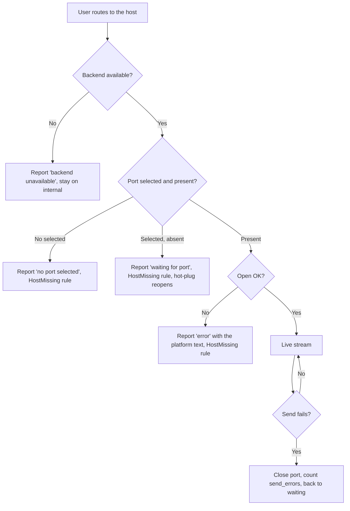

| Failure | Action |
|---|---|
| Backend init fails | Log once, state `backend unavailable` for the session |
| No ports enumerated | State `waiting` (hot-plug can still bring one) |
| Port open fails | Log the error with the port name; `waiting`; `HostMissing` decides what is heard meanwhile |
| Send fails | Log, count `send_errors`, close the port, `waiting` (a send to a vanished port is how an unplug shows on WinMM) |
| Port disappears (hot unplug) | Ledger discarded, back to `waiting`; reopened and resynced when the port returns |

**Key principle:** the emulator always works. MIDI output is a convenience; failures are logged and reported, never
block emulation, and never swap the user's device for another one.

## 8. Architecture and diagrams

### 8.1 Components and classes

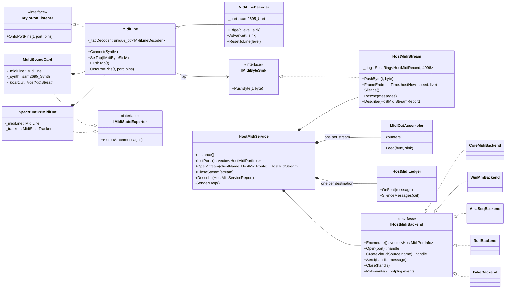

| Piece | Location (proposed) | Notes |
|---|---|---|
| `midiuart.h`, `midiparser.h` (promoted) | `core/src/3rdparty/sam2695/include/sam2695/` | code unchanged, moved from `src/midi/` |
| `MidiLineDecoder` | `core/src/emulator/sound/midi/midilinedecoder.{h,cpp}` | wraps `sam2695::Uart`; render-layer state |
| `MidiLine` changes | `core/src/emulator/sound/midi/midiline.{h,cpp}` | `SetTap`, `FlushTap`; tap null = today's code path; TTD blob unchanged |
| `MidiStateTracker` | `core/src/emulator/sound/midi/midistatetracker.{h,cpp}` | channel state from parsed messages; TTD-serializable; used by synth-less clients |
| `IMidiByteSink`, `IMidiStateExporter` | `core/src/emulator/sound/midi/midisink.h` | |
| `SpscRing<T, N>` | `core/src/common/spscring.h` | generic, header-only |
| `HostMidiService`, `HostMidiStream`, `MidiOutAssembler`, `HostMidiLedger` | `core/src/common/midi/` | core-owned, GUI-independent, as `common/network/hostnetbridge` |
| `IHostMidiBackend` + `NullBackend` + `FakeBackend` | `core/src/platform/hostmidi.h`, `core/src/platform/hostmidinull.cpp`; the fake in `core/tests/_helpers/` | |
| Backends | `core/src/platform/macos/hostmidicoremidi.cpp`, `core/src/platform/windows/hostmidiwinmm.cpp`, `core/src/platform/linux/hostmidialsaseq.cpp` | picked by the existing per-host folder filter |
| `HostMidiRoute` (client glue) | `core/src/emulator/sound/midi/hostmidiroute.{h,cpp}` | reads `[MIDI]`, applies route changes at frame start, computes `live`, owns the client's stream handle, ramps the internal row |
| Surfaces | `midicontrol.{h,cpp}` (actions), `state_device_api.cpp`, `openapi_multisound.inc`, `cli-processor-multisound.cpp`, `mcp-tools.cpp`, Lua / Python bindings | §9 |
| Qt | `unreal-qt/src/debugger/widgets/audiosettingswidget.*`, `unreal-qt/src/cardslots/midiactivitywindow.*` | §9 |

### 8.2 Data flow

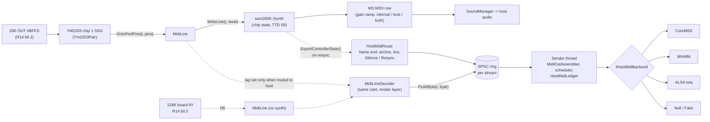

### 8.3 Sequence: a byte from `OUT` to the host device

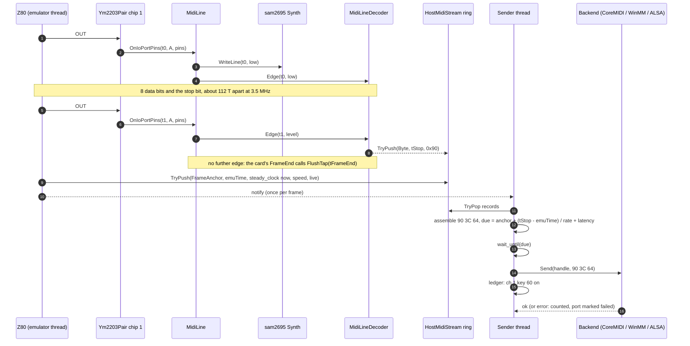

### 8.4 Sequence: hot-plug and unplug

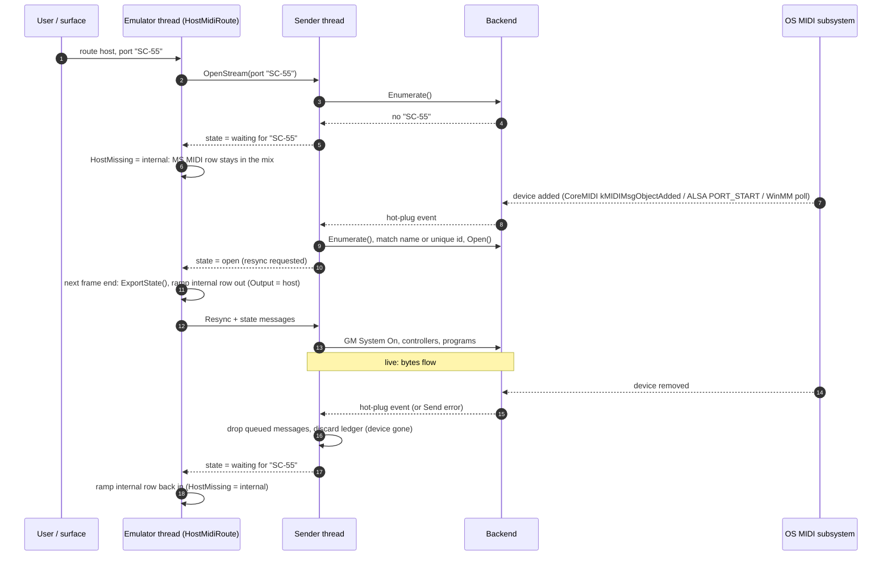

### 8.5 Sequence: TTD seek / restore and pause

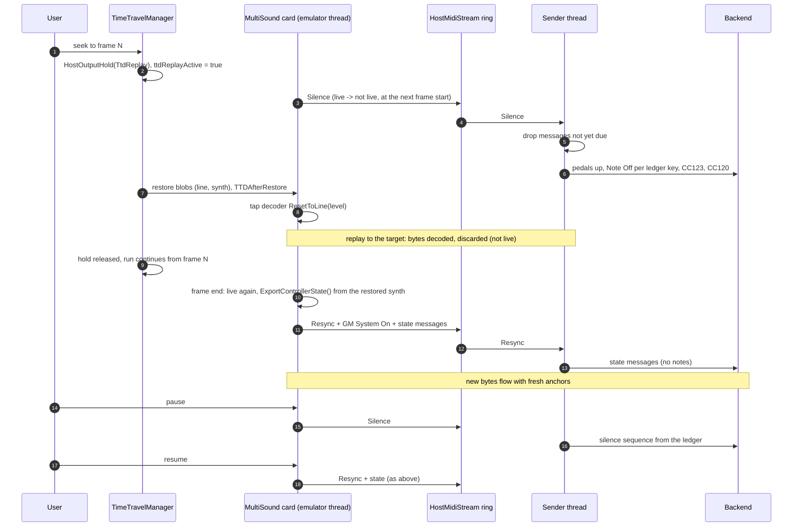

### 8.6 Sequence: runtime routing switch

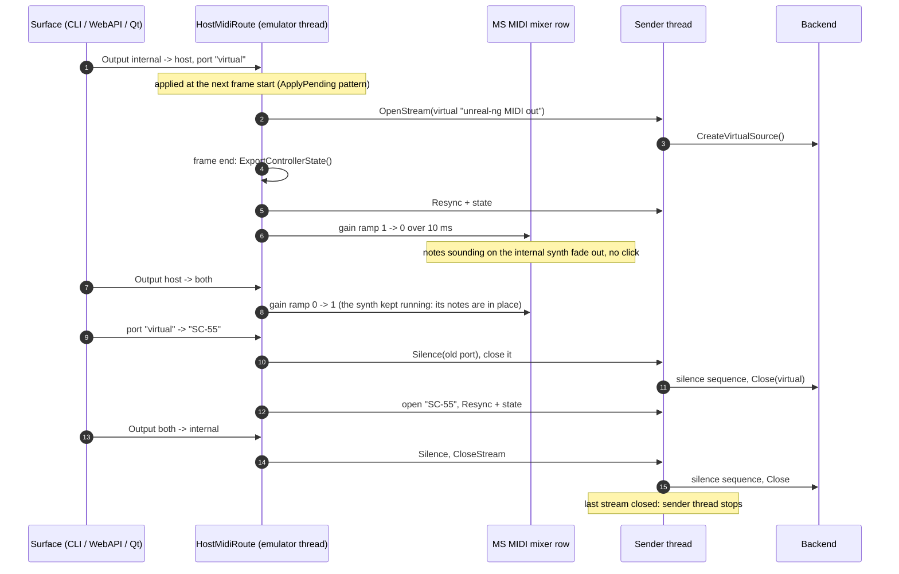

## 9. Automation surfaces and Qt

One report object per stream (`HostMidiStreamReport`) and one for the service (`HostMidiServiceReport`) feed every
surface.

| Report field | Meaning |
|---|---|
| `output` | `internal` / `host` / `both` |
| `port` | requested port (`virtual`, a name, empty) and `port_id` |
| `state` | `off`, `no port selected`, `waiting`, `open`, `unsupported`, `backend unavailable`, `error` |
| `backend` | `coremidi`, `winmm`, `alsa-seq`, `null` |
| `live` | the stream is live now (and why not: `paused`, `turbo`, `replay`, `direct run`) |
| `latency_ms` | effective latency and its source (`auto` from the audio device or fixed) |
| counters | `bytes_in`, `messages_sent`, `sysex_sent`, `sysex_unterminated`, `sysex_oversize`, `bytes_ignored`, `dropped_overflow`, `silences`, `resyncs`, `send_errors`, `late_messages` (sent after their due time), `max_lateness_ms` |
| `shared_with` | other instances sending to the same destination |
| service: `ports` | `[{name, id, backend, virtual: false}]` plus `virtual_supported` |

| Surface | Additions |
|---|---|
| WebAPI | `GET /api/v1/emulator/{id}/state/audio/midi` gains a `host` object; `POST /api/v1/emulator/{id}/control/audio/midi` gains actions `route` (`{"action":"route","output":"host","port":"SC-55"}`), `latency` (`{"action":"latency","ms":40}` or `"auto"`), `silence` (host only, not a TTD input), `resync`; `GET /api/v1/emulator/{id}/midi/ports` (per instance, as `/network/adapters`) lists the host's ports. OpenAPI in `openapi_multisound.inc` (or a new `openapi_midi.inc` once a second client exists) |
| CLI | `midi` shows a `host:` line; `midi ports`; `midi route internal|host|both [virtual|<port>]`; `midi latency auto|<ms>`; `midi silence` |
| MCP | `inspect_state` aspect `audio_midi` includes `host`; changes through `invoke_api` (as the panic) |
| Lua / Python | `midi_ports()`, `midi_route(output, port)`, `midi_latency(ms)`; `midi_state()` includes `host` |
| Qt | audio settings widget (`audiosettingswidget.*`): group "MIDI output" with Output (Internal synthesizer / Host MIDI port / Both), Port combo box (destinations, "Virtual port: unreal-ng MIDI out" where supported, a missing saved port shown as "SC-55 (not connected)"), Latency (Auto / ms), state line; refreshed on hot-plug through the service report. MIDI Activity window: route and counters line, the Panic button also silences the host port. The group is shown only when the machine has a MIDI client |
| Recipe | `.recipe/peripherals/multisound.md` gains "play through the host": route to `virtual`, check counters; a loopback check where the platform allows (§10) |
| Docs | `docs/features/multisound.md` user section; `data/midi/README.md` keys; `docs/emulator/environment-variables.md` row for `UNREAL_HOST_MIDI` |

## 10. Platform backends, library choice, build

### 10.1 Library choice

| | RtMidi | libremidi | PortMidi | Native thin backends |
|---|---|---|---|---|
| License | MIT-style | BSD-2 (+ MIT parts) | MIT-style | ours (GPL with the project) |
| Last release | 6.0.0, 2023-08 | 5.4.3, 2026-01 | 2.0.8, 2025-12 | - |
| Size | about 6.9k lines | about 36k lines, many backends | about 7.4k lines C | estimate 300-500 lines per backend + shared assembler |
| Hot-plug on all three | no | yes (CoreMIDI notify, ALSA announce + udev, WinMM polling, MIDI Services watcher) | no (re-initialize) | yes, written for our three |
| Virtual ports | macOS, ALSA | macOS, ALSA, Windows via MIDI Services | macOS, ALSA | macOS, ALSA; Windows later |
| Timestamps | no | yes | via PortTime | not needed (§4.3) |
| ALSA without a hard runtime dependency | no | yes (dlopen) | no | yes (`platform/dynamiclibrary.h`) |
| C++ | 11 | 20 | C99 | 20 |

**Recommendation: native thin backends behind `IHostMidiBackend`.** The job is small (enumerate, open, send whole
MIDI 1.0 messages, a virtual source, hot-plug), the message assembler is needed by us anyway (CoreMIDI and WinMM
both want whole messages), and the zero-warning rule on gcc 16 -O3 / clang / MSVC / MinGW would otherwise apply to
36k lines we do not own. Should host MIDI **input**, Windows virtual ports or MIDI 2.0 become requirements, vendor
**libremidi** (C++20, BSD-2, maintained, the only one with hot-plug everywhere) as one more `IHostMidiBackend`
implementation; RtMidi is not recommended (no hot-plug, no Windows virtual ports, last release 2023). Q1.

### 10.2 Backends

| Backend | API | Notes |
|---|---|---|
| CoreMIDI (macOS) | `MIDIClientCreate` (on the sender thread's run loop; notify: `kMIDIMsgObjectAdded` / `Removed` / `SetupChanged` / `IOError`); `MIDIOutputPortCreate` + `MIDISendEventList` to a destination; `MIDISourceCreateWithProtocol(kMIDIProtocol_1_0)` + `MIDIReceivedEventList` for the virtual source; `MIDIEventListInit` / `MIDIEventListAdd` with MIDI 1.0 UMP words built by the SDK's inline helpers (`MIDI1UPChannelVoiceMessage` for channel messages, `MIDI1UPSystemCommon` for system common and realtime, `MIDI1UPSysEx` packets of up to 6 bytes for SysEx, split into start / continue / end; an event list is at most 64 KB); `MIDIGetNumberOfDestinations` / `MIDIGetDestination`, `kMIDIPropertyDisplayName`, `kMIDIPropertyUniqueID` | The event-list API is macOS 11+; the release deployment target is macOS 12.0 (`MACOS_DEPLOYMENT_TARGET` in `.github/workflows/release.yml`), so no availability check is needed. The older packet-list calls (`MIDISend`, `MIDIReceived`, `MIDISourceCreate`, `MIDIPacketList*`, `MIDISendSysex`) are marked `API_TO_BE_DEPRECATED` in the macOS 26.2 SDK - no warning today (checked, §10.4) - and are not used. The assembler's whole messages convert one to one into UMP words. Link `-framework CoreMIDI` (CoreFoundation is already linked) |
| WinMM (Windows, MSVC and MinGW) | `midiOutGetNumDevs`, `midiOutGetDevCaps` (`szPname`, 32 characters), `midiOutOpen(CALLBACK_NULL)`, `midiOutShortMsg`, `midiOutPrepareHeader` + `midiOutLongMsg` + wait for `MHDR_DONE` + `midiOutUnprepareHeader`, `midiOutReset` on close | No virtual ports and no change notification: poll the device list (2 s) while waiting or listing; device ids shift on hot-plug, so ports are matched by name. On Windows 11 25H2+ with Windows MIDI Services (rolled out from 2026-02), WinMM is served by the new service: ports become multi-client and the built-in app-to-app loopback endpoints appear as WinMM devices, so a user can route to a software synth without loopMIDI. Our own named virtual port on Windows needs the Windows MIDI Services SDK runtime (separate install): a later backend (H7), not in the first release. `winmm` is already linked for MSVC through `core/src/stdafx.h`; MinGW gets `-lwinmm` in CMake |
| ALSA sequencer (Linux) | `snd_seq_open(SND_SEQ_OPEN_OUTPUT)`, `snd_seq_set_client_name("unreal-ng")`, `snd_seq_create_simple_port` (`CAP_READ | CAP_SUBS_READ`, the virtual source; also the source of `snd_seq_connect_to` for a chosen destination), `snd_midi_event_encode` (bytes -> events, SysEx split), `snd_seq_ev_set_direct` + `snd_seq_event_output_direct`; enumeration with `snd_seq_query_next_client` / `_port` filtered on `CAP_WRITE | CAP_SUBS_WRITE`; hot-plug by subscribing to `SND_SEQ_CLIENT_SYSTEM:SND_SEQ_PORT_SYSTEM_ANNOUNCE` | `snd_seq_open` fails without `/dev/snd/seq` (Docker, CI, module not loaded): the backend reports `backend unavailable`, the emulator runs on. libasound is loaded with `platform/dynamiclibrary.h` at the first stream (R1, and the AppImage / DEB does not gain a hard dependency); headers needed at build time (`libasound2-dev`, `pkg-config alsa`). Without the headers the build uses the null backend |
| Null | everything reports `unsupported` | other platforms, `ENABLE_HOST_MIDI=OFF`, `UNREAL_HOST_MIDI=0` |
| Fake (tests) | records `(dueTime, sendTime, message)`, scripted port list, scripted hot-plug, injectable send errors | core-tests (§13) |

### 10.3 CMake and flags

- Root option `ENABLE_HOST_MIDI` (default ON). When ON, core defines `UNREALNG_HAVE_HOST_MIDI=1` (PUBLIC, as
  `UNREALNG_HAVE_SAM2695`) and one of `UNREALNG_HOST_MIDI_COREMIDI`, `UNREALNG_HOST_MIDI_WINMM`,
  `UNREALNG_HOST_MIDI_ALSA` (PRIVATE) for the backend that builds; Linux sets the ALSA one only when
  `pkg_check_modules(ALSA alsa)` finds the headers (include path only; no link - dlopen).
- macOS: `find_library(COREMIDI_LIB CoreMIDI)`, linked PRIVATE to core. Windows MinGW: `winmm` added next to `ws2_32`.
- Docker (`docker/Dockerfile.universal`) and the `gcc:16` CI job add `libasound2-dev`, so the ALSA backend is compiled
  with the CI flags (the gcc 16 -O3 check of new C++ before landing, owner memory). The release runners (Ubuntu
  24.04) install it for the DEB / AppImage builds.
- Zero warnings on all compilers; CoreMIDI calls are made from a `.cpp` (no Objective-C needed: the C API and blocks
  are not required - `MIDIClientCreate` with a C callback).

### 10.4 Verified by POC

`poc-coremidi/poc.cpp` (throwaway, not committed; kept next to the SAM-6 worktree backup, not in the repository): built with
`clang++ -std=c++20 -Wall -Wextra -mmacosx-version-min=11.0 -framework CoreMIDI -framework CoreFoundation`, no
deprecation warning for `MIDIReceived` / `MIDIPacketListInit` / `MIDIPacketListAdd`; a process creates a virtual
source with `MIDISourceCreateWithProtocol(kMIDIProtocol_1_0)`, connects its own input port to it
(`MIDIInputPortCreateWithProtocol` + `MIDIPortConnectSource`) and receives what it sent - both an event-list note on
(`20903c64`) and a legacy packet-list note off converted to UMP (`20803c00`). That is the self-contained loopback the
platform smoke test (§11.2) uses; no IAC driver needed. The machine had 0 MIDI destinations (no IAC bus enabled),
so `MIDIOutputPortCreate` + `MIDISendEventList` to a destination was not exercised.

## 11. Testing

### 11.1 core-tests (fake backend, deterministic, under 50 ms each)

| Test | Checks |
|---|---|
| `MidiLineDecoder_Test.SameBytesAsTheSynth` | a scripted edge timeline (good bytes, half-speed framing errors, double-speed wrong bytes, false starts) gives the decoder exactly the bytes the synth's UART counts, with the same times |
| `MidiLine_Test.NoTapNoChange` | without a tap the line's calls and blob are unchanged (a CUT counts decoder constructions: 0) |
| `MidiOutAssembler_Test.*` | running status expanded; realtime inside a SysEx and inside a channel message; `F0` ended by `C0` dropped and counted (`GsplayerPartialSysEx`); oversize SysEx; data without status; `F4` / `F5` |
| `HostMidiLedger_Test.*` | silence sequence order; only channels with a ledger; note on velocity 0 as note off; pedals; SysEx -> all channels |
| `HostMidiScheduler_Test.*` | due times from anchors and latency; monotonic clamp; burst anchors smoothed; speed x2; hitch re-centering (a fake clock, no sleeps) |
| `HostMidiStream_Test.OverflowSilencesAndResyncs` | a full ring drops, counts, silences, resyncs |
| `HostMidiRoute_Test.*` | each `Output` mode; the mixer ramp (no step larger than the ramp slope at the switch sample); `HostMissing` fallback; hot-plug appear / disappear through the fake |
| `HostMidiTtd_Test.NoStuckNotesAcrossSeek` | MultiSound staged machine (the existing `multisoundstagedmachine.h`), TTD recording on, a Z80 routine holds notes with sustain; seek back, reverse step, run on: after every transition the fake device's state (computed from all messages it received) has no key sounding that the restored synth does not have, and controllers / programs equal the restored synth's |
| `HostMidiTtd_Test.SessionIndependentOfRoute` | a session recorded with `Output=host` replays bit-identically with `internal` (blobs, audio digests); the fingerprint does not contain host keys |
| `HostMidiTtd_Test.PauseResumeAndTurbo` | pause / turbo / direct run transitions silence and resync once each |
| `MultiSoundTrace_Test.WcMidiPlayerOnTheHostPort` | the CL-2 GSPLAYER trace (`testdata/sound/multisound/traces/wc-midi.msc.zst`) replayed through a card routed to the fake: the 96 bytes minus the lone `F0` arrive as whole messages, in order, with `sysex_unterminated` = 1 and one framing error |
| `HostMidiBackend_Test.EnumerateReturnsEmptyWhenNoBackend` | the null backend: no crash, `unsupported` |
| `HostMidiRoute_Test.FallbackOnOpenFailure` | the fake refuses the open: the report says `error`, the `HostMissing` rule applies, nothing blocks |
| `HostMidiService_Test.TwoInstancesShareADestination` | message atomicity, `shared_with`, one platform handle |
| `MidiStateTracker_Test.*` (H5) | 128K: tracker state = what the parser saw; TTD round trip |

Fake clock and fake backend: the sender loop is a class with a `Step(now)` method the tests call; the thread wraps it
in production. No `sleep_for` (AGENTS.md).

### 11.2 Platform smoke tests (run where available, skipped otherwise)

| Platform | Test | Skips when |
|---|---|---|
| macOS | `HostMidiCoreMidi_Test.VirtualSourceLoopback`: create the virtual source, connect an input port of the same process, send a note on / SysEx / note off, receive them (the POC pattern) | `MIDIClientCreate` fails (sandboxed runner) |
| Linux | `HostMidiAlsa_Test.VirtualPortLoopback`: own virtual port + own input port subscribed to it; `Midi Through` (`snd-seq-dummy`) if present | `/dev/snd/seq` absent (Docker, gcc:16 container, most CI) |
| Windows | `HostMidiWinMm_Test.EnumerateAndOpenDefault`: enumerate; open "Microsoft GS Wavetable Synth" and send a note on / off when present | no device (CI runners usually have none) |

These live in core-tests behind `GTEST_SKIP()` with the reason; `TestWait::For` for the receive, never `sleep_for`.
A manual checklist (H6) covers real hardware: a USB-MIDI interface with a GM module, FluidSynth / Munt through the
virtual port, unplug while playing, two instances.

### 11.3 CI

- Linux Docker image and the gcc:16 job: build with the ALSA backend (headers installed), smoke test skips.
- MinGW (MSYS2) and MSVC release builds compile the WinMM backend.
- macOS runners compile and may run the CoreMIDI loopback (skip on failure to create a client).
- A build with `-DENABLE_HOST_MIDI=OFF` in one CI job keeps the null path compiling.

## 12. Room for host MIDI input and other sinks

- **Input** (keyboard -> emulated MIDI IN): the backend interface gets `OpenInput(port, callback)`; incoming bytes
  become TTD **input records** (a new `TTDInputKind`, like `MidiPanic`), applied at a frame position by
  `ICard::MidiIn(t, byte)` -> `Synth::WriteByte` for the MultiSound (no MIDI IN on the card itself: this is "play the
  emulated synth from a keyboard"), or an emulated UART receive for a guest that reads MIDI. Journaling makes it
  deterministic; nothing in this design blocks it. libremidi becomes attractive at that point (Q1).
- **Sniffer** (§17): another `IMidiByteSink` on the same tap; it needs the decoder's framing errors and times, so it uses the tap, not the router.
- **`.mid` capture**: a second `IMidiByteSink` that writes a standard MIDI file with the emulated time; same tap,
  no host involvement, deterministic.
- **128K MIDI OUT into an internal synth**: route the 128K line to a `sam2695::Synth` instance as an emulated external
  module ("SAM2695 sound module on the MIDI socket"): a separate item.
- **UART peers**: `ComPort=MIDI` peer for the 16550 / 8251 UARTs at 31 250 baud feeding `PushByte`.

## 13. Phases

| Phase | Content | Size | Gate |
|---|---|---|---|
| H0 | Owner review of this design; Q1-Q10 answered | S | owner |
| H1 | Foundations: promote `Uart` / `MidiParser` to public library headers; `SpscRing`; `MidiLineDecoder`; `MidiLine::SetTap` / `FlushTap`; `MidiOutAssembler`; `HostMidiLedger`; scheduler as a steppable class; fake backend | M | §11.1 tests for these; `MidiLine_Test` / `MultiSoundCard_Test` / TTD corpus unchanged; A/B of the MultiSound frame bench with no tap (no change) |
| H2 | `HostMidiService` + `HostMidiStream` + null backend; `HostMidiRoute` for the MultiSound: `[MIDI]` keys, modes, mixer ramp, live detection, Silence / Resync records (resync = GM System On only) | M | route / overflow / pause tests with the fake; zero-cost check (no thread, no stream without `Output`) |
| H3 | `Synth::ExportControllerState` in libsam2695 (+ its library tests); full resync; TTD tests (seek, reverse step, replay, pause, turbo); GSPLAYER trace through the host path | M | `HostMidiTtd_Test.*`, `MultiSoundTrace_Test.WcMidiPlayerOnTheHostPort`, library tests |
| H4 | Backends: CoreMIDI, ALSA seq (dlopen), WinMM; hot-plug; virtual sources; CMake option and flags; Docker / CI packages | M-L | smoke tests where available; macOS + Linux (Docker gcc:16 -O3) + MinGW + MSVC builds with zero warnings; manual check with a real device |
| H5 | Second client: 128K / +2 / +2A / +3 board AY MIDI OUT (`Midi128Out=1`), `MidiStateTracker` with its TTD blob, the `spectrum128ayioport.h` comment, Q9 reset decision | S-M | ROM `PLAY` with the MIDI channel (the 128 BASIC `PLAY "Y..."` path) reaches the fake as the expected messages; TTD round trip |
| H6 | Surfaces: WebAPI + OpenAPI, CLI, MCP, Lua, Python, Qt (audio settings group, MIDI Activity line); recipe; feature docs; environment variable row | M | surface tests (`CliMultiSound_Test`, `McpTools_Test`, OpenAPI checks, `unreal-qt-tests`); recipe verified on a real run |
| H7 (later) | Windows MIDI Services backend (virtual port on Windows) when its SDK runtime is in-box; backend timestamps if measurements show jitter problems; libremidi if input is taken up | M | - |

## 14. Risks

| Risk | Mitigation |
|---|---|
| Sender wake-up jitter on Windows (default 15.6 ms timer) | `timeBeginPeriod(1)` while a stream is open, or a high-resolution waitable timer; `late_messages` / `max_lateness_ms` in the report make it visible |
| External devices that ignore CC120 / CC123 | explicit Note Offs from the ledger first (§5.2) |
| Notes started by the program before the stream went live (route switched mid-note) are not in the ledger | they were never sent to the device: nothing to stop |
| A destination shared by two instances | allowed, reported, warned; atomic at message level |
| CoreMIDI packet-list API removal in a future macOS | the event-list API (macOS 11+) from the start |
| libasound ABI | dlopen of `libasound.so.2` with the stable symbols only (about 25), as libremidi does |
| Promoting library-internal headers widens libsam2695's public API | the two classes are header-only and already stable (UART fixed by SAM-1 tests, parser by the chart conformance); the library README lists them as public |
| Resync exports state the chip has that the external device interprets differently (GS-specific SysEx on an MT-32) | `HostResyncReset=none` and a later "GM only" export level if users report it |

## 15. Owner questions

| ID | Question | Recommendation |
|---|---|---|
| Q1 | Native backends or a vendored library (libremidi / RtMidi / PortMidi)? | Native thin backends behind `IHostMidiBackend`; libremidi as an additional backend if host MIDI input, Windows virtual ports or MIDI 2.0 are taken up (§10.1) |
| Q2 | Should a resync start with a reset SysEx (GM System On / GS Reset) before the state messages? | Yes, GM System On by default (`HostResyncReset=gm`), `none` for devices that react badly |
| Q3 | Should host output play during TTD replay at 1x if the audio ever does (today replay holds the audio)? | Follow the audio output's holds exactly, whatever they become; no separate rule for MIDI |
| Q4 | Pause: cut notes (silence) or let them hang until resume? | Cut on pause, resync (no re-strike) on resume; a held external note across a long pause is the worse artifact |
| Q5 | `Output=host` with the saved port missing: fall back to the internal synthesizer or stay silent? | Fall back to internal (`HostMissing=internal`), visible in the report and the Qt state line |
| Q6 | One route per machine, or per client (MultiSound and 128K OUT on one machine routed differently)? | One per machine in the INI now; surfaces address clients by id from the start so a per-client key can be added without breaking anything |
| Q7 | Persistence: the INI only, or also the Qt app's `QSettings` for the last choice? | Both: INI keys for headless and automation; the Qt app remembers the user's last port and applies it to machines whose INI does not set it |
| Q8 | Internal synth in `host` mode: keep it running (chip state, resync source) or allow a cheaper "host only" mode that skips voices? | Keep it running; skipping voices changes chip state between modes and breaks R5 |
| Q9 | 128K MIDI OUT (H5): in this item or separate? And land the AY reset fix (R14 / R15 = `#FF`, TTD bench gate refresh) with it? | In this item as H5 (it proves the service is generic); land the reset fix with it so a 128K line does not start with a break |
| Q10 | Send `FF` (System Reset) and `FE` (Active Sensing) from the program to the external device? | Yes, as the chip receives them; add a filter key only on a user report |
| Q11 | Add a row to `docs/inprogress/PLAN.md`? | Not now (the owner took the MultiSound off the global plan on 2026-10-08); add one if SAM-6 is scheduled |

## 16. Sources

- Apple CoreMIDI reference: <https://developer.apple.com/documentation/coremidi> and the macOS 26.2 SDK headers
  `CoreMIDI.framework/Headers/MIDIServices.h`, `MIDIMessages.h`
- WinMM MIDI functions: <https://learn.microsoft.com/en-us/windows/win32/multimedia/midi-functions>
- Windows MIDI Services: <https://microsoft.github.io/MIDI/>, general availability announcement
  <https://blogs.windows.com/windowsexperience/2026/02/17/making-music-with-midi-just-got-a-real-boost-in-windows-11/>,
  releases <https://github.com/microsoft/MIDI/releases>
- ALSA sequencer: <https://www.alsa-project.org/alsa-doc/alsa-lib/seq.html>, `seq_midi_event.c` in alsa-lib
- libremidi <https://github.com/celtera/libremidi>, RtMidi <https://github.com/thestk/rtmidi>, PortMidi
  <https://github.com/PortMidi/portmidi>
- MIDI 1.0 Detailed Specification (running status, realtime bytes, All Notes Off / All Sound Off, Active Sensing)
- Spectrum 128 ROM (`data/rom/128.rom`): MIDI byte routine at `#11A3`, RS-232 output at `#08D4`

## 17. MIDI sniffer / protocol analyzer

A logging layer between `MidiLine` and the sinks captures every MIDI event for debugging, verification and analysis.

### 17.1 Architecture

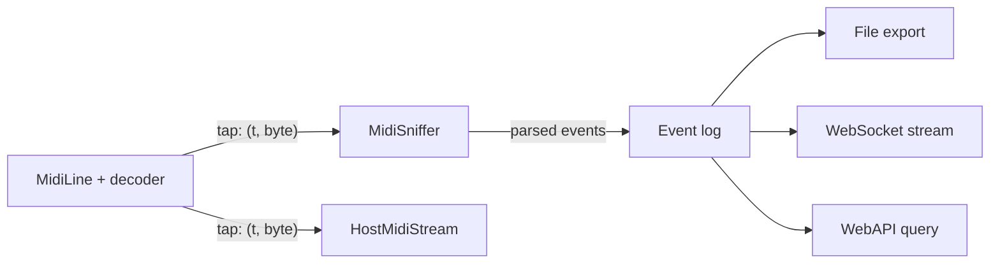

The sniffer is a client of the tap (§3.1 option D, `IMidiByteSink`), not of the sender, so it sees every message regardless of the output mode, with the decoder's exact times and framing errors. It runs on the emulator thread at the frame end, like the anchors, or on its own consumer of a ring (never a lock shared with the emulator thread, R6).

### 17.2 Event log entry

```cpp
struct MidiLogEntry
{
    uint64_t frameIndex;      // Emulator frame
    uint64_t tState;          // T-state within frame
    double   wallTimeMs;      // Wall clock (for correlation with external recordings)
    std::vector<uint8_t> raw; // Raw bytes
    std::string decoded;      // Human-readable: "Note On Ch1 C4 vel=100"
    bool     valid;           // False if framing error / incomplete
};
```

### 17.3 Automation surfaces

#### WebAPI

```
GET  /api/v1/emulator/{id}/midi/log
     ?limit=100           # Last N entries (default 100, max 10000)
     &since=<frameIndex>  # Entries after this frame
     &channel=<0-15>      # Filter by channel
     &type=<noteon|noteoff|cc|pc|sysex|...>
Response:
{
  "entries": [
    {
      "frame": 12345,
      "t": 45678,
      "wall_ms": 1234567890.123,
      "raw": "90 3C 64",
      "decoded": "Note On Ch1 C4 vel=100",
      "valid": true
    },
    ...
  ],
  "overflow": false  // True if log wrapped and entries were lost
}

DELETE /api/v1/emulator/{id}/midi/log   # Clear the log

POST /api/v1/emulator/{id}/midi/log/export
     <- { "format": "csv" | "json" | "mid", "path": "/path/to/file" }
     -> { "ok": true, "path": "/path/to/file", "entries": 1234 }
```

#### WebSocket (real-time stream)

```
WS /api/v1/emulator/{id}/midi/stream

-> (server sends each event as it happens)
{ "type": "midi", "frame": 12345, "t": 45678, "raw": "90 3C 64", "decoded": "Note On Ch1 C4 vel=100" }
```

Useful for live monitoring in external tools or the Qt MIDI activity window.

#### CLI

```bash
# Dump last 50 events
unreal-cli midi log --limit=50

# Stream to stdout (Ctrl+C to stop)
unreal-cli midi stream

# Export to file
unreal-cli midi export --format=mid --output=capture.mid
```

### 17.4 Export formats

| Format | Description |
|--------|-------------|
| **JSON** | Full log with all fields |
| **CSV** | `frame,t,wall_ms,raw_hex,decoded,valid` |
| **SMF (Standard MIDI File)** | Type 0 .mid file with delta-time from T-states (requires tempo assumption: default 3.5 MHz CPU) |

### 17.5 Configuration

```ini
[MIDI]
; Enable the sniffer (default off for performance)
Log = false

; Ring buffer size (entries)
LogSize = 10000

; Auto-export on emulator exit
LogExportOnExit = false
LogExportPath = ~/midi-log.json
```

**Off by default.** The ring buffer and decoding add minimal overhead, but the WebSocket broadcast could affect
performance if a slow client backs up.

### 17.6 Qt integration

- **MIDI Activity window** (existing): add a scrolling log view with filters (channel, message type).
- **Export button:** save log to file.
- **Clear button:** reset the log.

```mermaid
flowchart TD
    subgraph Qt MIDI Activity Window
        Filter[Channel / Type filter] --> List[Scrolling log list]
        List --> Detail[Selected entry detail]
        Toolbar[Clear | Export | Pause]
    end
```

### 17.7 Use cases

| Use case | How |
|----------|-----|
| Debug a MIDI program | Watch the stream in real-time via WebSocket or Qt |
| Compare with real hardware | Export to .mid, play both, diff |
| Verify timing | Export JSON, analyze T-state deltas |
| CI / automated tests | Query `/midi/log` after a TTD replay, assert expected events |
| Protocol reverse engineering | Log SysEx from unknown software |

## Appendix A. Backend interface and platform sketches (first draft)

The first draft's sketches, kept as reference. The chosen design is §3.3 (assembler), §6 (sender thread) and §10 (backends,
library choice, build): the sketches' `Send(span)` is called by the sender thread with whole messages, and port lookup
follows §7.2, not the first match.

Each backend implements `IHostMidiBackend`:

```cpp
class IHostMidiBackend
{
public:
    virtual ~IHostMidiBackend() = default;

    // List available output ports. Returns empty if the subsystem is unavailable.
    virtual std::vector<MidiPortInfo> EnumeratePorts() = 0;

    // Open a port by id. Returns false on failure (port gone, permission denied).
    virtual bool Open(const std::string& portId) = 0;

    // Close the current port. Safe to call if not open.
    virtual void Close() = 0;

    // Send a MIDI message (1-3 bytes for channel messages, variable for SysEx).
    // Returns false if the port is not open or the send fails.
    virtual bool Send(std::span<const uint8_t> message) = 0;

    // Human-readable error from the last failed operation.
    virtual std::string LastError() const = 0;
};
```

### A.1 macOS: CoreMIDI

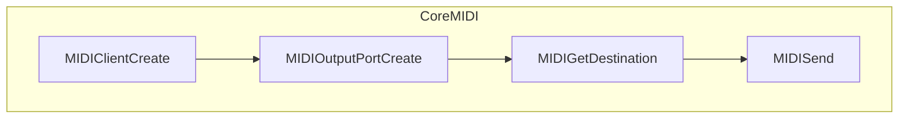

| Step | API | Notes |
|------|-----|-------|
| Init | `MIDIClientCreate` | One client per process; name = "Unreal-NG" |
| Enumerate | `MIDIGetNumberOfDestinations`, `MIDIGetDestination`, `MIDIObjectGetStringProperty` | Destination = output port from our perspective |
| Open | `MIDIOutputPortCreate` | One output port, reused for all destinations |
| Send | `MIDISend` with `MIDIPacketList` | Timestamp 0 = now |
| Close | `MIDIPortDispose`, `MIDIClientDispose` | Client disposed at shutdown |

**Fallback:** `MIDIClientCreate` returns `kMIDIServerStartErr` if the MIDI server is unreachable (sandbox, daemon
crash). Log once, disable the feature for this session.

**Framework:** `CoreMIDI.framework` (weak-linked, availability check at runtime).

```cpp
// coremidibackend.mm (sketch)
#include <CoreMIDI/CoreMIDI.h>

class CoreMidiBackend : public IHostMidiBackend
{
    MIDIClientRef client_ = 0;
    MIDIPortRef outPort_ = 0;
    MIDIEndpointRef dest_ = 0;
    std::string lastError_;

public:
    CoreMidiBackend()
    {
        OSStatus err = MIDIClientCreate(CFSTR("Unreal-NG"), nullptr, nullptr, &client_);
        if (err != noErr) {
            lastError_ = "MIDIClientCreate failed: " + std::to_string(err);
            return;
        }
        MIDIOutputPortCreate(client_, CFSTR("Output"), &outPort_);
    }

    std::vector<MidiPortInfo> EnumeratePorts() override
    {
        std::vector<MidiPortInfo> result;
        if (!client_) return result;

        ItemCount n = MIDIGetNumberOfDestinations();
        for (ItemCount i = 0; i < n; ++i) {
            MIDIEndpointRef ep = MIDIGetDestination(i);
            CFStringRef name = nullptr;
            MIDIObjectGetStringProperty(ep, kMIDIPropertyDisplayName, &name);
            // Convert CFString to std::string, add to result
        }
        return result;
    }

    bool Open(const std::string& portId) override
    {
        // Find endpoint by id, store in dest_
        return dest_ != 0;
    }

    bool Send(std::span<const uint8_t> message) override
    {
        if (!dest_) return false;
        MIDIPacketList pktList;
        MIDIPacket* pkt = MIDIPacketListInit(&pktList);
        pkt = MIDIPacketListAdd(&pktList, sizeof(pktList), pkt, 0,
                                message.size(), message.data());
        return MIDISend(outPort_, dest_, &pktList) == noErr;
    }

    void Close() override { dest_ = 0; }
    std::string LastError() const override { return lastError_; }
};
```

### A.2 Windows: WinMM (midiOut*)

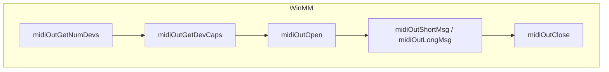

| Step | API | Notes |
|------|-----|-------|
| Enumerate | `midiOutGetNumDevs`, `midiOutGetDevCapsW` | Device 0 = Microsoft GS Wavetable (fallback soft synth) |
| Open | `midiOutOpen` | Callback = null (we don't need done notifications) |
| Send | `midiOutShortMsg` (channel messages), `midiOutLongMsg` (SysEx) | Short msg packed into DWORD |
| Close | `midiOutClose` | |

**Fallback:** `midiOutGetNumDevs() == 0` means no MIDI devices. `midiOutOpen` returns `MMSYSERR_*` on failure (device
busy, removed). Log and disable.

```cpp
// winmmbackend.cpp (sketch)
#include <Windows.h>
#include <mmsystem.h>
#pragma comment(lib, "winmm.lib")

class WinMmBackend : public IHostMidiBackend
{
    HMIDIOUT hMidiOut_ = nullptr;
    std::string lastError_;

public:
    std::vector<MidiPortInfo> EnumeratePorts() override
    {
        std::vector<MidiPortInfo> result;
        UINT n = midiOutGetNumDevs();
        for (UINT i = 0; i < n; ++i) {
            MIDIOUTCAPSW caps;
            if (midiOutGetDevCapsW(i, &caps, sizeof(caps)) == MMSYSERR_NOERROR) {
                // Convert wchar to utf8, add to result
            }
        }
        return result;
    }

    bool Open(const std::string& portId) override
    {
        UINT devId = /* parse from portId */;
        MMRESULT res = midiOutOpen(&hMidiOut_, devId, 0, 0, CALLBACK_NULL);
        if (res != MMSYSERR_NOERROR) {
            lastError_ = "midiOutOpen failed: " + std::to_string(res);
            return false;
        }
        return true;
    }

    bool Send(std::span<const uint8_t> message) override
    {
        if (!hMidiOut_) return false;
        if (message.size() <= 3) {
            DWORD msg = 0;
            for (size_t i = 0; i < message.size(); ++i)
                msg |= message[i] << (8 * i);
            return midiOutShortMsg(hMidiOut_, msg) == MMSYSERR_NOERROR;
        }
        // SysEx: midiOutLongMsg with MIDIHDR
        return true;
    }

    void Close() override
    {
        if (hMidiOut_) {
            midiOutClose(hMidiOut_);
            hMidiOut_ = nullptr;
        }
    }

    std::string LastError() const override { return lastError_; }
};
```

### A.3 Linux: ALSA (RawMidi or Sequencer)

Two options:

| API | Pros | Cons |
|-----|------|------|
| **RawMidi** (`snd_rawmidi_*`) | Simple, direct byte stream | No virtual ports, hardware only |
| **Sequencer** (`snd_seq_*`) | Virtual ports, timestamps, routing | More complex |

**Recommendation:** Use the **Sequencer API** for flexibility (software synths like FluidSynth expose sequencer ports).

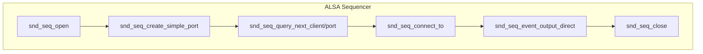

| Step | API | Notes |
|------|-----|-------|
| Init | `snd_seq_open`, `snd_seq_set_client_name` | Mode = `SND_SEQ_OPEN_OUTPUT` |
| Create port | `snd_seq_create_simple_port` | Caps = `SND_SEQ_PORT_CAP_READ | SND_SEQ_PORT_CAP_SUBS_READ` |
| Enumerate | `snd_seq_query_next_client`, `snd_seq_query_next_port` | Filter: `SND_SEQ_PORT_CAP_WRITE | SND_SEQ_PORT_CAP_SUBS_WRITE` |
| Connect | `snd_seq_connect_to` | Our port -> destination |
| Send | `snd_seq_event_output_direct` | Event type from MIDI status byte |
| Close | `snd_seq_close` | |

**Fallback:** `snd_seq_open` fails if ALSA is not available (no `/dev/snd/seq`). Log and disable.

```cpp
// alsabackend.cpp (sketch)
#include <alsa/asoundlib.h>

class AlsaBackend : public IHostMidiBackend
{
    snd_seq_t* seq_ = nullptr;
    int port_ = -1;
    snd_seq_addr_t dest_{};
    std::string lastError_;

public:
    AlsaBackend()
    {
        if (snd_seq_open(&seq_, "default", SND_SEQ_OPEN_OUTPUT, 0) < 0) {
            lastError_ = "snd_seq_open failed";
            return;
        }
        snd_seq_set_client_name(seq_, "Unreal-NG");
        port_ = snd_seq_create_simple_port(seq_, "MIDI Out",
            SND_SEQ_PORT_CAP_READ | SND_SEQ_PORT_CAP_SUBS_READ,
            SND_SEQ_PORT_TYPE_APPLICATION);
    }

    std::vector<MidiPortInfo> EnumeratePorts() override
    {
        std::vector<MidiPortInfo> result;
        if (!seq_) return result;

        snd_seq_client_info_t* cinfo;
        snd_seq_port_info_t* pinfo;
        snd_seq_client_info_alloca(&cinfo);
        snd_seq_port_info_alloca(&pinfo);

        snd_seq_client_info_set_client(cinfo, -1);
        while (snd_seq_query_next_client(seq_, cinfo) >= 0) {
            int client = snd_seq_client_info_get_client(cinfo);
            snd_seq_port_info_set_client(pinfo, client);
            snd_seq_port_info_set_port(pinfo, -1);
            while (snd_seq_query_next_port(seq_, pinfo) >= 0) {
                unsigned caps = snd_seq_port_info_get_capability(pinfo);
                if (caps & SND_SEQ_PORT_CAP_WRITE) {
                    // Add to result
                }
            }
        }
        return result;
    }

    bool Open(const std::string& portId) override
    {
        // Parse client:port from portId
        return snd_seq_connect_to(seq_, port_, dest_.client, dest_.port) >= 0;
    }

    bool Send(std::span<const uint8_t> message) override
    {
        if (!seq_ || port_ < 0) return false;
        snd_seq_event_t ev;
        snd_seq_ev_clear(&ev);
        snd_seq_ev_set_source(&ev, port_);
        snd_seq_ev_set_subs(&ev);
        snd_seq_ev_set_direct(&ev);
        // Decode MIDI message into ev (note on/off, cc, etc.)
        snd_seq_ev_set_noteon(&ev, message[0] & 0x0F, message[1], message[2]);
        return snd_seq_event_output_direct(seq_, &ev) >= 0;
    }

    void Close() override
    {
        if (seq_ && port_ >= 0) {
            snd_seq_disconnect_to(seq_, port_, dest_.client, dest_.port);
        }
    }

    std::string LastError() const override { return lastError_; }

    ~AlsaBackend()
    {
        if (seq_) snd_seq_close(seq_);
    }
};
```

## Appendix B. Changes from the first draft

| First draft | Now | Why |
|---|---|---|
| `MidiRouter::OnMidiMessage` calls `HostMidiOutput::Send` on the emulator thread | the emulator thread only pushes into an SPSC ring; one sender thread talks to the backend (§6) | backends may block (WinMM `midiOutLongMsg`); R6 |
| Mode `External` mirrors messages | mode `host`: the internal synthesizer keeps running and ramps out of the mix; stream with its own decoder on the line (§3, §7.1) | the chip's state must not depend on the route (R5) |
| Non-goal: timing tighter than a frame (~20 ms) | per-frame anchors map emulated time to host time, jitter target about 1 ms, latency `auto` from the audio device (§4) | notes of one frame would otherwise burst out together |
| Send failure closes the port and reverts to internal for good | a missing port is waited for, never replaced by another; `HostMissing=internal` plays on the internal synth meanwhile; hot-plug reopens (§7.2, §7.4) | the user chose that device |
| Pause, seek and TTD not covered | live / not live, ledger-based silence, resync from the restored synth (§5) | no stuck notes, determinism untouched |
| Router class owns `HostMidiOutput` per backend `#if` | `HostMidiService` (one sender thread per process, lazily started) + `HostMidiStream` per client (§6, §8) | several instances and clients (MultiSound, 128K) |
| Phases SAM-6.1-6.6 | phases H0-H7 (§13) | |
| WebAPI `/api/v1/midi/ports`, `/mode`, `/log` | per instance: `/api/v1/emulator/{id}/midi/ports`, `/control/audio/midi` actions (§9), `/midi/log` (§17) | the rest of the API is per instance |
| First-draft questions Q1-Q4 | Q1 (latency compensation in `Both`): answered by `HostLatency=auto` (§4.2), no separate delay of the internal synth; Q2 (MIDI Thru): no, host input is room only (§12); Q3 (SysEx pass or filter): whole terminated SysEx up to `HostSysExMax`, partial ones dropped (§3.3); Q4 (sniffer): opt-in, off by default (§17.5) | |
