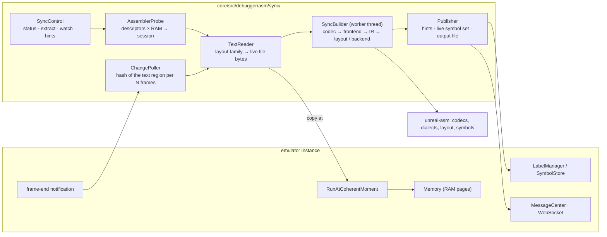
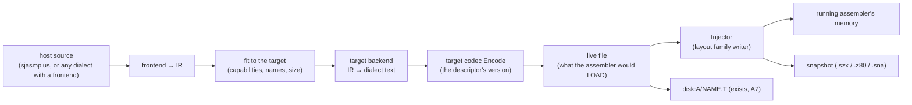

# unreal-asm: asm-synchronizer — TDD

| | |
|---|---|
| **Date** | 2026-10-09 (replaces the "memory bridge" design of 2026-10-05) |
| **Status** | Design, priority **P2** (owner decision, 2026-10-05). No code until the owner gives the go-ahead. The prerequisites exist: codecs (A2-A6), symbols (A8), emulator surfaces (A7) |
| **Builds on** | the source codecs ([source-formats.md](source-formats.md)), the IR and dialect plugins ([dialect-conversion.md](dialect-conversion.md)), `layout.h` (label values without building bytes), the symbol module ([symbols/](symbols/README.md)), `AsmControl` / `diskfiles` (A7), `Emulator::RunAtCoherentMoment` |
| **Effort** | §21: guest → host about 40 working days (first cut 6), host → guest about 60 (first cut 10), both together about 95 with the shared parts counted once |

## 1. Purpose

A user who writes a program **inside the emulator, in a ZX Spectrum assembler** (ALASM, TASM, STORM, XAS, ...) keeps
the source in that assembler's memory. The host cannot see it until the user saves it to a disk image and the host
reads the disk. And a source written on the host (sjasmplus) cannot be continued in the retro assembler until
someone retypes it there. The asm-synchronizer works in both directions:

- **Part A, guest → host** (§1-§12): it keeps a host-side copy of the source in step with the assembler's memory,
  read straight from RAM the way the assembler holds it.
- **Part B, host → guest** (§13-§20): it takes a host source (sjasmplus, or any dialect with a frontend), converts it
  through the IR to the assembler's dialect, encodes it in the assembler's own format and **injects** it into the
  running assembler's memory, or into a snapshot, ready to edit and assemble there.

### 1.1 Use cases

| # | Who / when | What the synchronizer does |
|---|---|---|
| UC-1 | Two hours of typing in ALASM without a save; the user wants the work on the host before the emulator is closed (or after a crash of the guest program) | **Extract**: the current source as text, as the assembler's file (byte-exact, its codec), or converted to sjasmplus / pasmo / z88dk, written to the host |
| UC-2 | A snapshot (.sna / .z80 / .szx) or a TTD recording someone made while working in an assembler; there is no disk with the file | **Extract from a snapshot**: load it paused and extract; no execution needed |
| UC-3 | Debugging the program in the emulator's debugger while editing it in the assembler | **Live labels**: after each pause in typing the source is built on the host, and the debugger shows `call PLAYMUS` instead of `call #8123`, before the user assembles in the guest |
| UC-4 | Typing in the guest editor | **Hints**: the host build reports errors as they appear ("line 120: PLAYMUS not defined", "line 88: JR out of range") in the Qt panel, the WebSocket and MCP |
| UC-5 | Start in the retro assembler, continue in a modern toolchain | **Convert**: the live source to sjasmplus with the A5-A9 backends, kept up to date on the host file (`watch` with an output path) |
| UC-6 | Teaching / streaming: show the source an assembler holds next to the running machine | **Live view**: the decoded text in a read-only panel that follows the guest editor |

### 1.2 Not in scope

- Merging edits made on both sides at once (a three-way merge). One side is the source of truth per operation:
  extract (guest wins) or inject (host wins); an inject over a guest text changed since the last sync asks first.
- PC cross assemblers (ASM80) and the modern cross assemblers of A9: they run on the host, so there is no guest memory.
- Making the guest assembler's own label table authoritative: it is used when it exists (§5.5), but the live labels
  come from the host build.

## 2. Today's manual path (what the synchronizer replaces)

1. Save the source in the guest assembler to the disk in drive A.
2. `asm decode disk:A/NAME.H` (or the Qt "Disk files" dialog) for the text; `asm convert` for another dialect.
3. Assemble in the guest, then `symbols import-live` for its label table.

The synchronizer removes step 1. It also turns steps 2 and 3 into a background loop.

## 3. Terms

| Term | Meaning |
|---|---|
| assembler session | one assembler (name + version) running in one emulator instance |
| descriptor | per assembler and version: how to recognize it in RAM and where its text, pointers, pages and label table are (§6) |
| layout family | the shape of the text in memory; one reader implements each family (§5.2) |
| snapshot of the text | the text's bytes copied at a coherent moment, plus the editor state (cursor line, the line being typed) |
| live file | the text as a file of the assembler's format: what its own SAVE would write, made from the snapshot |
| watch | the synchronizer armed: it polls the text and rebuilds after changes |

## 4. Architecture



| Component | Responsibility |
|---|---|
| `AssemblerProbe` | tries every descriptor's identification rule against the RAM (a string at an address, a code signature, sane pointers); gives the candidates with scores, best first |
| `TextReader` | reads the text with the descriptor's layout family at a coherent moment; joins the parts (a gap buffer), adds the line being typed when the editor keeps it apart, and returns the **live file** (the bytes the assembler's SAVE would write) plus the editor state |
| `ChangePoller` | when watching: at every N-th frame end (default 25 = 0.5 s), hashes the text region of the session (≤ 48 KB, xxHash64, microseconds); a changed hash plus a quiet period (debounce, 500 ms) triggers a read |
| `SyncBuilder` | on a worker thread: live file → codec (`Decode`) → frontend → IR → `layout::Layout` for the label values (no external tool needed); optionally the sjasmplus backend + an external sjasmplus for bytes; a newer snapshot cancels a running build |
| `Publisher` | posts hints (`NC_ASM_SYNC_HINTS`), replaces the symbol set `live:sync:<assembler>`, writes the output file of a watch (text, the assembler's own format, or a converted dialect) |
| `SyncControl` | the one layer every surface calls (the TTDControl / AsmControl pattern): `status`, `probe`, `extract`, `watch`, `unwatch`, `hints` |

### 4.1 Why polling and not a write hook

A write hook on the memory path (like the TTD dirty tracker) would cost every guest write a branch while armed. It
also needs the combined-gate work and an A/B benchmark (performance guidelines). The text region is small, and a
hash of 16-48 KB every 0.5 s is far below 0.1 % of a frame. The poller runs on the frame-end notification only while
a watch is armed, so with the synchronizer off it costs nothing. The memory path does not change at all.

### 4.2 Threads and coherence

- The copy of the text runs inside `RunAtCoherentMoment` (paused, stopped, or between two frames): one `memcpy` per
  region, then the emulation goes on. Everything else runs off the emulation thread.
- The worker owns the snapshot; a newer snapshot cancels the build by a generation counter.
- Publishing the symbol set goes through `LabelManager` (its own locking); the WebSocket event through MessageCenter.

### 4.3 As built (Y0-Y1, 2026-10-09)

**Where it lives** (owner decision, 2026-10-09). The synchronizer is a subproject of unreal-asm, and the emulator
only adapts it:

| Part | Place | What |
|---|---|---|
| readers | `unrealasm/sync/reader.h`, `src/sync/reader.cpp` | descriptors, probe, the three layout families (Y0) |
| session | `unrealasm/sync/session.h`, `src/sync/session.cpp` | `SyncSession`: Tick (who is there, the text, a change by the hash of the live file), TakeBuild (after the quiet period), Build (codec → sjasmplus conversion → layout → labels and hints). Standard library only, no threads, no clock: the caller gives the time |
| adapter | `core/src/debugger/asm/sync/asmsyncservice.h` | `AsmSyncService`, one per instance, owned by `DebugManager`: the worker thread, the coherent copy, publishing |
| surface | `core/src/debugger/asm/sync/synccontrol.h` | `SyncControl` behind AsmControl's `sync-*` verbs: WebAPI, CLI, MCP, Lua, Python |

**What differs from the drawing above.**

- **No frame-end subscription.** The worker wakes every `interval` ms (default 250), so the quiet period is the
  same in turbo. The thread exists only while a watch is on.
- **What is copied.** A look copies the pages the CPU sees plus the text's page (at most five 16 KB pages), every page
  while no assembler is known yet. It does not copy the text region alone.
- **What counts as a change.** The hash (FNV-1a) is of the live file, so the cursor and the screen do not count as a
  change.
- **No cancellation.** The build runs on the same worker, after the look that found the text quiet. A change made
  during a build is seen at the next look, so nothing needs cancelling.
- **Locking.** `LabelManager` has no lock of its own. The worker publishes the way the WebAPI threads import, by
  replacing the set `live:sync:<assembler>` at priority 900000: above every loaded file, below `user`.
- **Notifications.** The MessageCenter topic is `NC_ASM_SYNC` (payload `AsmSyncPayload`). The WebSocket topic
  `asm_sync` carries `asm_sync_found`, `asm_sync_changed`, `asm_sync_built`, `asm_sync_lost` and `asm_sync_ambiguous`.
- **Hints on the source's lines.** The sjasmplus backend now records, for every line it writes, the source line it
  came from (`SourceLine::origin`). `SymbolsFromProject` uses that to report the layout's messages on the source's
  lines, so `symconv source` and `import-source` gain it too.

## 5. Generic algorithms

### 5.1 Page ids

Assemblers name their pages in their own way. Each descriptor declares a `PageIdRule` to turn the stored id into a
physical RAM page of the current machine:

| Rule | Used by | Translation |
|---|---|---|
| `Port7FFD` | ALASM (its memory driver ids: low 3 bits = port `#7FFD` bits 0-2, bits 6-7 = the 512K / 1024K extension of the driver) | Pentagon 128: `id & 7`; Pentagon 512: `(id & 7) | ((id >> 3) & 0x18)` per the driver in use (128KDRV, PENTDRV, P1MBDRV ... from the assembler's disk); the translation table is taken from the driver the assembler loaded (identified by its bytes) |
| `MappedAtC000` | TASM 4.12, XAS (text in the page that is mapped at `#C000` while the editor runs) | the page the machine maps at `#C000` at the coherent moment (`Memory::GetRAMPageForBank(3)`) |
| `Fixed` | 48K assemblers (GENS, ZEUS, Laser Genius, Prometheus, Primus, PASM) | CPU addresses, no paging |

### 5.2 Layout families

| Family | Shape | Readers' work | Assemblers |
|---|---|---|---|
| `FileImage` | the page holds the file as the assembler saves it: header + lines; the length in a header field | copy `[base, base + header + length)` | ALASM 4.4x / 5.x (verified), XAS (from its research), STORM (from its source) |
| `GapBuffer` | the text before the cursor from the start to the gap start, the text after it from the gap end to the top; the line being edited in a line buffer | copy both parts, encode the current line with the codec from the line buffer, join; add the end record the file has | TASM 4.12 (verified) |
| `Linear` | one contiguous buffer from a start to an end pointer, with or without an end marker | copy `[start, end)` + the file's end marker | ZX-ASM (file = buffer), MASM (catalog start = text address), GENS (text + `00 00`), Laser Genius (`#7F2E` to `(#A973)` + `FF FF`), ZEUS / Primus, Prometheus, PASM (to `#1A`) |

The live file is exactly what the codec reads. So `Decode` works unchanged. The byte-exact check (live file ==
the file the assembler writes on SAVE) is the acceptance test of every descriptor (§10).

### 5.3 The line being typed

Most editors keep the line under the cursor apart until Enter (ALASM: `IX+#0C` bit 0; TASM 4.12: the line buffer near
`#928A`). The descriptor says how:

- `NotInText`: the extract is the text without the unconfirmed change, and the status says "1 line being edited". ALASM.
- `InLineBuffer`: the line buffer holds the line as text (or tokens); the reader encodes it with the codec and puts
  it at the gap. TASM 4.12.
- `InPlace`: the editor edits the text itself (XAS, from its research).

### 5.4 Projects

A source that `INCLUDE`s others needs them for a build. They are taken from the guest's own state first, then the
disk:

1. Other texts in memory: ALASM keeps one text per page (each with its header and name); XAS / ZAsm likewise.
2. The disk in the drive the assembler uses: `diskfiles` (A7) reads `NAME.T` by the INCLUDE's name (the name rules of
   each frontend, as `zxasm convert` resolves them).
3. A host folder named in the watch (`--project dir`): the converted files of a project already on the host.

Binaries (`INCBIN`) come from the disk the same way. A missing part is a hint, and the build goes on as far as it can.

**Built (2026-10-10):** 2 and 3. `BuildInput` carries the project's other sources and every file's size; `Build`
takes the live text as the main file of `SymbolsFromSourceProject`, leaving out a project source of its name.
`AsmSyncService` gathers the project for each build: a host folder (`.asm .a80 .z80 .inc .s .txt` as sources through
`ProjectFromText`, any other file as a size for INCBIN), then the disk in a drive (`ReadDiskFiles` + `ProjectFromFiles`),
so the disk wins over the folder (the last source of a name). Option `project`: `disk:A`-`disk:D`, `none`, folders,
comma-separated; default `disk:A`. Tests: `SyncSession_Test.AnIncludedSourceComesFromTheProject` (XAS `LTEXT`),
`SyncControl_Test.TheWatchTakesTheProjectFromAHostFolder`. 1 too: a descriptor with `textsPerPage` (ALASM) has
`ReadOtherTexts` read the text of every other page that holds its header; `SyncSession::MemoryProject` decodes them
under their header names, and the service adds them last (a full copy of the pages per build), so a text in memory
wins over the disk's file of its name. Test `SyncSession_Test.AlasmsOtherTextsInMemoryJoinTheProject`. XAS and ZAsm
keep one text (their research), so they have none.

### 5.5 Labels

- The **live symbol set** `live:sync:<assembler>` is replaced after every successful build. Its priority is just above
  the files, below the user set (`SymbolStore` rules, A8).
- The guest's own table (ALASM, XAS; `symbols/live.h`) is used when the guest has assembled more recently than the
  last host build (a generation flag in the descriptor: ALASM `IX+#2E` bit 7 "compiled"). This is optional, and the
  host build wins when both exist.

### 5.6 Failure states

| State | Meaning | Surfaces show |
|---|---|---|
| `none` | no known assembler in RAM | the probe's best guesses below the threshold |
| `ambiguous` | two candidates score alike (two assemblers in memory) | the candidates; the user picks one (`probe` → `watch --assembler`) |
| `partial` | the text decodes, the build fails | hints; the last good labels stay |
| `inconsistent` | pointers out of range (the guest is mid-update, or not that version) | re-read at the next frame; after 3 failures, `none` |

## 6. The descriptor

```cpp
struct SyncDescriptor
{
    std::string id;                 // "alasm-5.0x", "tasm-4.12" ...
    std::string codec, version;     // the unreal-asm codec and subversion of the live file
    std::vector<Signature> identify;   // bytes / strings at addresses (page + offset or CPU address), all must match
    PageIdRule pages;
    LayoutFamily family;
    // FileImage: where the page id lives, the base, the length field, its header size
    // GapBuffer: the four pointers, the line buffer, the end record
    // Linear: start / end pointers (or fixed start), end marker
    LayoutParams params;
    TypingRule typing;              // NotInText / InLineBuffer / InPlace, and where the flag or buffer is
    std::optional<LabelTableRef> labels;   // the guest's table (symbols/live.h scanner id)
    std::vector<IncludeRule> project;      // where other texts live (pages, names)
};
```

Descriptors are **data** (a table in `sync/descriptors.cpp`) plus a small hook when a family needs one: the TASM
line buffer decoder. Every descriptor has a golden RAM dump in the test data (§10).

## 7. Per assembler and version

Each section gives what is known (verified live, read in the assembler's own source, or inferred from its file
format) and what an implementation needs: research (R7), reader, tests. The day counts are summed in §12.

### 7.1 ALASM 5.07-5.09 (and the ZX Evolution 5.09 build)

| | |
|---|---|
| **Knowledge** | **verified live** (2026-10-09) and in ALASM 5.09's own sources (`Al50.H`, `Vars.H`) |
| identification | `ALASM v5.09` at `#97C5` (page 2). The copy at `#BE00` is a screen line buffer the editor overwrites, so it does not identify (Y0, 2026-10-09; the research note said `#BE06`) |
| pages | `Port7FFD` (its driver ids: `#C6` = the text in the 512K build; `SRCstart EQU #26` in the 1024K build) |
| family | `FileImage`. The page id of the current text is at `IX+#0D` = `#80CC` (`IX = #80BF`). The page from `#C000` holds the file: `T_NAME` `#C000`, `T_SIZE` `#C021` (the length after the 64-byte header), `T_STR` `#C023` (current line address), `T_OPT` `#C027` (changed), `T_SURE` `#C028`. The live file is `#C000 .. #C040 + word(#C021)` with `T_OPT` written as 0, as SAVE writes it (Y0: SNAKE loaded, typing and edited were byte-identical to ALASM's own saves) |
| typing | `NotInText`: `IX+#0C` bit 0 = the current line is modified; Enter writes it |
| project | one text per page: a scan of the RAM pages for headers with the signature at `+#28` gives every text in memory with its name; `IX+#0A` = the page INCLUDE loads into |
| labels | page 3 (`#43` / `#C3`), `alasm-table` scanner; `IX+#2E` bit 7 = compiled |
| **Work** | reader (shared `FileImage`), driver id table, golden dumps (fibo, an edited text, a 512K session), project scan: **1.5 d** |

### 7.2 ALASM 5.0 and 5.05

| | |
|---|---|
| **Knowledge** | **verified** (2026-10-09, dumps `testdata/sync/alasm50-*`, `alasm505-*`, `alasm507-*`, `alasm508-*`): the same `sysvars` (`#80CC`, `IX+#0C` bit 0) and file image as 5.09. Titles: `ALASM v5.00` at `#9E22`, `v5.05` and `v5.07` at `#97BC`, `v5.08` at `#97CA`, `v5.09` at `#97C5` |
| **Built** | descriptors `alasm-5.00`, `-5.05`, `-5.07`, `-5.08` (codec tables 5.0, 5.05, 5.07) |

### 7.3 ALASM 4.4x and 4.5 (4.43-4.46, 4.5)

| | |
|---|---|
| **Knowledge** | **verified live** for 4.44 (text page id `#06` at `#80CC`, AL444nfo byte-identical loaded and edited, `ALASM v4.44` at `#9E7E`; `#BE00` is overwritten in the editor as in 5.09); 4.46's source (`AL446SRC`, `Al44.H`) has the same `sysvars` at `#80BF` and the same `T_*` fields. The title's address differs per build: every further version needs its dump |
| differences | 4.4x label table ends at `#3F7F` (5.x `#3DFF`); 4.5 keeps its table in page 6 |
| **Verified** (2026-10-09, dumps `alasm443-*`, `alasm445-*`, `alasm446-*`, `alasm45-*`) | the same `sysvars` and file image. Titles: `ALASM v4.43` `#9E1B`, `v4.45` `#9E53`, `v4.46` `#9E6E`, `v4.5` `#9E06`. 4.5 keeps the text in page 1 (id `#09`). 4.43 has no "line modified" bit at `IX+#0C`: its status cannot say `typing`, the text is right |
| **Built** | descriptors `alasm-4.43` (codec table 4.5), `-4.45`, `-4.46` (4.44), `-4.5` |

### 7.4 ALASM 3.8c, 4.2, 4.42

| | |
|---|---|
| **Verified** (2026-10-09, dumps `alasm38c-*`, `alasm442-*`) | 3.8c and 4.42 keep the same `sysvars` at `#80BF` and the same file image. 4.42's title `ALASM v4.42` is at `#9E2F`. 3.8c has no "ALASM v" title; it is recognized by `3.8c\r Written by` at `#9951` |
| **Built** | descriptors `alasm-4.42`, `alasm-3.8c` (codec table 3.8) |
| **4.2** (2026-10-18) | The ALM loader is no emulator bug. Its BASIC shows `RANDOMIZE USR 23525` but runs 23908; the code reads the raw sectors that follow it on the disk (from `(#5CF4)`): 48 into page 7 at `#D000` (STS 6.2), then 64 into page 4 at `#C000` (`alasm48`). The zxart `ALM.scl` holds `alasm48` before `sts6.2`, so STS lands where ALASM is expected and the machine resets to 48 BASIC. In the order ALM, sts6.2, alasm48 it runs. The same `sysvars` at `#80BF` (text page 6, macros 1, labels / pocket 3, debugger 7) and file image; title `4.2\r Written by` at `#9D3B`; idle chain `#983F`, `#8B84` (the editor has `#A5C3`, `#A1FC` there). Descriptor `alasm-4.2` (codec table 4.2), project pages 4 and 0 (2026-10-18: both filled with a pattern stay untouched through boot, assembling, `sYmbol`, `Info`, `Catalogue`, `Edit`; a three-file project injected live assembled to sjasmplus' bytes with no INCLUDEd file on the disk). The inject writes 4.2's spelling (macro parameters `:0`, `EX AF,AF'`, WHILE as DUP: research-sjasmplus-to-alasm.md §3) |

### 7.5 TASM 4.12

| | |
|---|---|
| **Knowledge** | **verified live** (2026-10-09, SNAKE) |
| identification | `TASM128>` at `#9CDD` and `Import TASM3.0 source file: ` at `#A394` (4.0 has no import) |
| pages | lower part in page 2 (`#8000` window); upper part `MappedAtC000` (page 6 on a Pentagon 128) |
| family | `GapBuffer`: `#8F59` text start (`#A6EE`), `#8F5B` top (`#FFFF`, exclusive), `#8F5D` gap start, `#8F5F` gap end. Lines are records `n`, `n` bytes, `n`. `#94D9` counts the lines (the cursor's line included), `#94CE` is the cursor's line |
| typing | `InLineBuffer`: in the editor the cursor's line is only in the line buffer, 128 bytes of blank-padded text at `#928A` (`#930A` holds a packed copy that lags). Whether the editor holds it: the records before and after the gap add up to `#94D9` (the command line: Quit put it back and moved the gap to the end) or to one less (the editor). The reader encodes the buffer with the `tasm` codec (4.12, CP866) and puts it at the gap. No flag in memory tells the modes apart; this count does (checked on four dumps: top, middle, typing, command line) |
| end | the file's `FF FF` end record is added by SAVE: the reader appends it (the bytes at the gap start are no guide: after Enter on the last line they can read `FF FF` in the editor too) |
| caveat | Edit leaves a stale copy of the file at the text start; only the pointers count |
| **Built: inject (Z3, 2026-10-11)** | at its command line (`TASM128>`: the key wait returns through `#9CE9`, `#80BC`): the file as LOAD leaves it at `#A6EE` with the gap pointers, the line count and the cursor line 0 (the editor builds the gap buffer when it is entered; the reader takes that form), `#9BA6` (changed since LOAD / SAVE) set, the work name `#9C10` the title so Assemble takes the text in memory; refused without force when `#9BA6` says the text changed. TASM 4.12 assembled the injected `oracle1.asm` and every instruction form to sjasmplus' bytes (research-sjasmplus-to-tasm.md §3) |
| **Work** | identification, the line buffer's exact address and length, the gap reader, golden dumps (cursor at the top, in the middle, at the end, mid-typing): **1.5 d** |

### 7.6 TASM 4.0 and 4.4

| | |
|---|---|
| **Knowledge** | unknown; their files share 4.12's format family (`[n] body [n]` records, `FF FF`), so a gap buffer is likely |
| research | the same edit-and-diff session as 4.12; find the pointers by the text start's value |
| **Work** | **1 d** |
| **Verified** (2026-10-09, dumps `tasm40-*`, `tasm44-*`) | the gap buffer of 4.12 with its four pointers at `#8DD0` (start, top, gap start, gap end; the upper part in the page at `#C000`, page 6). No line count: the editor shows in the tail of its 128-byte line buffer (`#91AC`, 32 bytes): blank padded in the editor, zeros at the command line. In the editor the cursor line is out of the text and its last version is the record that ends at the gap end (as in MASM); a line being typed is not in the text (`NotInText`) |
| identification | the prompt `TASM4.0>` / `TASM4.4>` at `#9859` |
| **Built** | descriptors `tasm-4.0`, `tasm-4.4` (codec version 4.0) |
| **Built: inject** (2026-10-13) | at its command line (`TASM4.0>`: the key wait returns through `#9865`, `#807C`, found by `find-idle.py`), in the form the command line keeps after the editor (seen after Edit / load / quit): the file from the start `#9FA8`, the gap start on its `FF FF`, the gap end and the top `#FFFF`; `#975E` the "changed" byte (`#FF` after an edit, 0 after Save), the work name at `#9793` (8 characters in the menu's `WORK>` text; Assemble takes the text in memory under it). 4.0 and 4.4 assembled the injected `oracle1.asm` to sjasmplus' bytes. The editor flag is now the line buffer's last byte: a line of more than 96 characters left there at the command line reached into the 32-byte tail and the reader took the command line for the editor (the last line twice) |

### 7.7 TASM 3.x and 2.0

| | |
|---|---|
| **Knowledge** | unknown; 2.0 is plain text with editor tabs; 3.x tokenized |
| **Work** | **1.5 d** (both) |
| **Verified: 3.0, 3.2** (2026-10-09, dumps `tasm30-*`, `tasm32-*`) | the same gap buffer with the pointers at `#8910`; the line buffer at `#8C22`, its tail `#8C82` (32 bytes) the editor flag. Identified by `TASM2.0 source file: ` at `#9721` (3.0) and `TASM2.0 file: ` at `#9728` (3.2) |
| **Built** | descriptors `tasm-3.0`, `tasm-3.2` (codec version 3) |
| **Built: inject** (2026-10-13) | 3.0, 3.2, 3.5 as 4.0: the key wait `#93D5`, `#807C`, the text from `#9935`, the "changed" byte `#9322`, the work name `#9346`. 2.0: the key wait `#92CB`, `#807C`; a line feed at the start `#975D`, the plain text after it, `1A 1A` behind it, the gap start on the text's last byte; "changed" `#921D`, the work name `#9241`. Each assembled the injected `oracle1.asm` to sjasmplus' bytes |
| **Verified: 3.5, 2.0** (2026-10-10, dumps `tasm35-*`, `tasm20-*`) | 3.5 ("FLASHVERSION", loader `TASM+`) is 3.0 / 3.2's layout: pointers at `#8910`, its editor flag the line buffer's tail `#8C35`-`#8CA1` (blanks in the editor, zeros at the command line; the earlier "no flag" was wrong), identified by `TASM128 FLASHVERSION` at `#9350`; descriptor `tasm-3.5`. 2.0 keeps the four pointers at `#8847` (the start one byte before the text, the gap start on the last byte before the gap) and changes the buffer's form: at the command line the plain CR LF text SAVE writes, from `#975E`; in the editor 3.x's length-framed records with the cursor line's record before the gap end, which the reader turns into lines (`plainTextFile`). Editor flag: the line buffer's tail at `#8BA0`; identified by `TASM128>` at `#92BF`; descriptor `tasm-2.0` (codec version 2.0, type `C`). Found by diffing the three states' pages (the pointer words, the flag bytes) and checking each model against the saved file |

### 7.8 STORM 1.2 / 1.3 (1.0 beta)

| | |
|---|---|
| **Knowledge** | from STORM's own source (`MAIN`): in memory `#C000` the end pointer, `#C002` the name, `#C00A` an `#FF` sentinel, the text from `#C00B` (1.0 beta: no name field, `#C003`); lines `[body][length]` walked backwards |
| research | which page holds `#C000` while STORM runs (it unpacks to `#6F19`-`#BFFF`); confirm live |
| family | `FileImage`-like: `[#C00B, (#C000))` |
| **Work** | **1 d** |
| **Verified** (2026-10-09, dumps `testdata/sync/storm13*`, `storm13i*`) | the text is in RAM page 6 at `#C000` while STORM edits. `(#C000)` points one past an `#FF` that ends the text; SAVE (BREAK, `S`, Enter keeps the name) writes `[#C00B, (#C000) - 1)`, so the live file is those bytes. The line under the cursor joins the text when the cursor leaves it, and a line made by Enter joins it then too (`NotInText`; no flag shows it). The name is at `#C002` |
| identification | the packed program unpacks its entry code at `#8000` (24 bytes, the same in 1.0beta, 1.3 and 1.3i); the address it loads at `#8027` tells them apart (`#87xx` in 1.3 / 1.3i, `#85xx` in 1.0beta) |
| 1.0beta | the same layout without the name: the `#FF` at `#C002`, the file from `#C003` (dumps `storm10b-*`) |
| **Built** | descriptors `storm-1.3` (1.3 and 1.3i) and `storm-1.0b`; 1.3 checked live (a watch built 13 labels) |
| **Built: inject (Z3, 2026-10-11)** | 1.3 / 1.3i while the editor waits for a key (the main loop's return `#87F5` / `#87CB`): the page as LOAD writes it, and STORM's own PGUP pressed through its variables (`ABLINE` on the second line, `NLINE` 1, `PY` 1, `LASTK` 4), which redraws from the text's start; refused without force when the editor's flags say the text changed (`MBSTAT` bit 4, the cursor line typed in). STORM 1.3 assembled the injected `oracle1.asm` and every instruction form to sjasmplus' bytes (research-sjasmplus-to-storm.md §3) |
| **Built: inject 1.0beta** (2026-10-16) | as 1.3 with 1.0beta's variables, found by the same code patterns in its memory: `ABLINE` `#B6E6`, `NLINE` `#B6E4` (its `SCRP0` has `LD D,0` for `XOR A / LD D,A`), `CACHEST` `#BF89`, `VAR` `#B6DA`, `LASTK` the system variable 23560; no name in its page and no `MBSTAT`. The main loop's `CALL` returns to `#866C`. STORM 1.0beta assembled the injected `oracle1.asm` to sjasmplus' bytes |

### 7.9 ZX-ASM 3.0 / 3.01 / 3.10, ZX ASM Lite 1.07, ZAsm 3.15-4.20

| | |
|---|---|
| **Knowledge** | the file is "the editor's text buffer as is" (no header, no end marker); the buffer's address and pointers unknown; ZAsm 3.2x and later want 512K. (The TDD's "and keep several texts" was wrong: the author's ReadMe says ZAsm takes the last 128K of the memory it addresses, leaves the first 128K to the user's programs and makes a RAM disk of the rest; there is one text buffer.) |
| research | two sessions (3.10, 4.20 on a Pentagon 512); start / end pointers by the edit-and-diff method; the text list of ZAsm |
| family | `Linear` |
| **Work** | **2 d** (three generations) |
| **Verified: ZAsm 3.15** (2026-10-09, dumps `testdata/sync/zasm315-*`) | one buffer from `(#8829)` to `(#8837)` (a table at `#8829`: the start, the cursor line, marks, the end), starting at `#884C` in page 2. Its part from `#C000` is in RAM page 6, which ZAsm maps only while it needs it, so the reader takes page 6 for it whatever is mapped. A typed line joins the buffer on Enter (`NotInText`) |
| SAVE | COMMAND (Extend) SS+`2` saves under the name. It writes the buffer after a first line `;!top,line,col,...` with the editor's position, which loading takes out again. The live file is the buffer without that line (the tests compare without it) |
| identification | the resident code at `#8000` (24 bytes): ZAsm unpacks itself, and above the buffer there is no fixed code |
| **Built** | descriptor `zasm-3.15`; checked live on `service.a` (18959 bytes over two pages: 160 labels; the hints name the INCLUDE not in the project, Y5). the text buffer is one, see the Knowledge row |
| **Built: inject (Z3, 2026-10-11)** | ZAsm 3.15 at its COMMAND prompt (CS+SS: the key wait returns through `#C404`, `#E630`, `#E6F0`): the file from the start (above `#C000` into page 6), the end word, the cursor line and the marks at the start, as LOAD leaves them, the cursor's line number `#8827` and column `#8630` 0 (2026-10-17: the editor redraws from the new text when it comes back, ENTER at COMMAND, but went on from the old line and column); no "changed" flag, so a text it holds is replaced by force or when it is the caller's own. ZAsm 3.15 assembled the injected `oracle1.asm` and every instruction form to sjasmplus' bytes (research-sjasmplus-to-zxasm.md §3) |
| **Built: inject, the other versions** (2026-10-16) | every version at its COMMAND prompt (CS+SS in the editor, a STUB source loaded first), its key wait found by `find-idle.py`: 3.2x `#C930, #7B4E`, Lite `#DF74, #6428`, 3.3.02 `#CA21, #7B4E`, 3.3.51 `#CBC9, #7B4E`, 3.3.Final `#D0BC, #7B64`, 3.80.4 `#C685, #6425`, 3.4 `#CF6B, #7B4E`, x64.1 `#C94A, #7B46`, 4.0x8 `#D31F, #6212`, 4.x64 `#D919, #6212`, 4.20 `#C18A, #E431, #6212`; the four words before the start word (the cursor and the screen) set to the start, as LOAD leaves them. 3.10 `#C4D1, #D58A`, the five words after its start word and the one at `#869C`. ZX ASM 3.0 `#6986` (the editor's `#6ABD`), its table's words `#61D0`, `#61D4`, `#61DB`, `#61DD`. Each assembled the injected `oracle1.asm` to sjasmplus' bytes. Found on the way: ZX ASM 3.0 has no `&` `|` `!`, no `.` functions, no `REPT`, `EXA`, `OUT (C),0` or `DS n,fill` (a codec version `3.00` of its own: 3.0's table, the backend writes around them); 4.0x8 and Lite read their overlays from their drive D (4.0x8 ran with the disk in D as well); Lite's "No Disk" at a `SAVEOBJ` is its built-in drive D too (Retry, drive A, and it saves); ZX ASM 3.0 puts code for `#4000`-`#7FFF` in RAM page 4 The cursor's line number (start word - 10; 3.10 `#868D`, 3.0 `#61D6`) and column (start word - 14; 3.10 `#867F`, 3.0 `#61D9`) are set to 0 and 3.0's second end word `#61CA` to the end (2026-10-17, each checked live: a line typed after the inject lands in the new text; with the old end word 3.0 crashed on it) |
| **Built: the work name** (2026-10-18) | an inject gives the text its title where SAVE takes the name from and the status line shows it: the name in the editor's `A:NAME    .asm` (8 characters, blank padded), found by writing each copy and saving (SS+2 at COMMAND): 3.10 `#89B7`, 3.15 `#883F` (page 2), 3.80.4 `#6D31` (page 5); the Pentagon 512 versions in RAM page 27, mapped at `#C000` at the prompt (Lite has page 28 there): 3.2x `#F9B6`, Lite `#E692`, 3.3.02 `#F9B4`, 3.3.51 `#F889`, 3.3.Final `#F8A7`, 3.4 `#F94C`, x64.1 `#F837`, 4.0x8 `#F9BE`, 4.x64 `#FAD9`, 4.20 `#DE36` (the other copies, in page 5 and the input history, are not what SAVE takes). Before, SAVE wrote the injected text under the template's `STUB`. ZX-ASM 2.x ask the name on Save (2.6's `No Named` is shown only), 2.4 / 2.5 / 3.0 keep none: nothing to set. `LinearParams::nameAt` / `namePage` |
| **Verified: ZX-ASM 3.10** (2026-10-09, dumps `zasm310-*`) | the same buffer with its table at `#868F` (the start; the end at `#869E`), from `#89C4` in page 2, the part above `#C000` in page 6. SAVE writes the buffer alone (no `;!` line). Its file-name input types capitals; the dumps load the first file of the list (CS+7, CS+ENTER). Identified by 24 bytes of its program image at `#8171` (2026-10-16: it was `#816C`, whose first bytes change once a text is loaded, so the probe missed 3.10 after a load). Descriptor `zasm-3.10` (codec version 3.0) |
| **Verified: ZX-ASM 2.4, 2.5, 2.6** (2026-10-10, dumps `zasm24-*`, `zasm25-*`, `zasm26-*`) | plain text in one buffer: the start word at the program's load address + 3, the end word after it (2.4 / 2.5 `#6273` / `#6275`, text from `#A1DF` / `#A1EA`; 2.6 `#6003` / `#6005`, from `#9FFD`); the part above `#C000` in RAM page 0. 2.6 keeps its `;*` line in the buffer and saves it as text, so no mask. The menu starts on Edit: LEFT ENTER (File), DOWN ENTER (Load), the name; SS+SPACE back to the menu, `f` `s` ENTER saves. Identified by 24 bytes of each program below the text. Descriptors `zasm-2.4` / `-2.5` / `-2.6` (codec version 2) |
| **Verified: ZX ASM 3.0** (2026-10-09, dumps `zasm30-*`) | the same buffer from `#894F` (the start its saved files carry), the table in page 5: the start at `#61C6`, the end at `#61C8`; the part above `#C000` in page 6 (`ReadMe`, 28039 bytes, runs to `#F6D6`). The line being typed stays out of the buffer. Its command menu has no save: COMMAND Q to the main menu, File / Save under the name shown; saved as type `C`, the buffer alone. Identified by 24 bytes of its code at `#8000`. Descriptor `zasm-3.0` (codec version 3.0). The 3.01 program is not in the collection (only files it saved) |
| **Verified: ZAsm 3.2x** (2026-10-09, dumps `zasm32x-*`) | a Pentagon 512 program (on 128K it stops on its title with a red border); a key passes the title, no drive question. The buffer from `#8551`, the table at `#8530`: the start at `#8538`, the end at `#853A` (the words before follow the cursor and the screen; the text stays whole, no gap); the part above `#C000` in RAM page 30. SAVE writes a `;*` position line first (`;*19553,19878,849,0,0,19878,19910,`). The name input keeps the last name, so the dumps load the first file of the list. Identified by 24 bytes at `#8000` (relocated from its program image). Descriptor `zasm-3.2x` (codec version 3.15); checked live (`ReadMe.t`, 19911 bytes over pages 2 and 30: 851 lines). Only the text being edited is read; switching between several texts is not checked yet |
| **Verified: ZAsm Lite 1.07** (2026-10-09, dumps `zlite107-*`) | Pentagon 512 as well (a red border on 128K), straight into the menu. 3.2x's layout elsewhere: the buffer from `#85A7`, the start at `#859D`, the end at `#859F`; the part above `#C000` in page 30; a `;*` line on SAVE. Identified by 24 bytes at `#8000` (from its program image). Descriptor `zasm-lite-1.07` (codec version lite) |
| **Verified: ZAsm 3.3.51, 3.3.Final, 3.80.4, 4.20** (2026-10-09, dumps `zasm3351-*`, `zasm33f-*`, `zasm384-*`, `zasm420-*`) | all Pentagon 512 with 3.2x's layout: the start word, the end word after it, the part above `#C000` in page 30, a `;*` line on SAVE. The start words: 3.3.51 `#84FC` (text from `#8514`), 3.3.Final `#8401` (`#841A`), 3.80.4 `#6D02` in page 5 (`#8198`), 4.20 `#68FB` in page 5 (`#8201`). Start: 3.3.51 asks for the drive and then waits for a key on its title; 3.3.Final, 3.80.4 and 4.20 wait for a key. Each is identified by 24 bytes of its own; 3.2x, 3.3.02 and 3.3.51 share the code at `#8048` up to a variable's address. One descriptor function, `ZasmRubtsoff`, makes all six (3.2x and Lite 1.07 too) |
| **Verified: ZAsm 3.4, x64.1, 4.0x8, 4.x64** (2026-10-10, dumps `zasm34-*`, `zasmx641-*`, `zasm40x8-*`, `zasm4x64-*`) | the same layout: start words 3.4 `#8520` (text from `#8536`), x64.1 `#852D` (`#853A`), 4.0x8 `#692B` in page 5 (`#8201`), 4.x64 `#6929` in page 5 (`#8201`); page 30 above `#C000`. 3.4 and x64.1 start on a key. 4.0x8 has no settings file and its own drive D: an "ERROR" after its picture, and File / Drive / A before each load. 4.x64's "No disk!" dialog has no drive list: its dump disks carry its settings file with drive A (bytes +3 / +4); a date dialog follows its picture (CS+SPACE). Start keys of every version: `.recipe/assemblers/zxasm.md` |
| **Memory size** (2026-10-10) | the versions page their memory the Pentagon 512 way (`#7FFD` bits 6-7, values `#D0`-`#D7` in their memory test; bit 5 unused), so on a Pentagon 1024 4.20 keeps its upper part in page 30 as on 512K: the fixed page holds for both. 3.2x does not run on a Pentagon 1024: after its memory test it writes `#EFF7` = `#80`, `#00`, `#02`, `#04`, and bit 2 = 1 is the 128K lock mode, which takes its pages away and the machine resets (port trace; Xpeccy `pent1024.c` and ZXMAK2 `MemoryPentagon1024.cs` read bit 2 the same way as unreal-ng). The author's "512-1024" is about other 1024K machines (he works in Shalaev's emulator, whose 1024K machine is the Profi) |
| **Verified: ZAsm 3.3.02** (dumps `zasm3302-*`) | the same layout, the start word at `#850A` (text from `#8522`). Its default drive is D: the "No Disk" dialog's drive applies to the file being loaded only. The port trace (2026-10-09) shows it reading the catalog and `FONT4.f` from A (status `#00`), then selecting D (`#FF` = `#3F`) for the next file, where the controller rightly reports NOT READY; a second answer A gets it to its title and menu. The program's behaviour, not the emulator's; the red border is its own. The D comes from the settings file shipped on the disk (`z33.02.s`, type `s` at `#7465`: byte +3 "System drive", +4 "Overlays drive", both `D`; the setup overlay's SaveSet writes them), the same `DD` as in 3.15 / 3.3.51 / x64: the author works in Shalaev's DOS emulator (his ReadMe and zx-pk.ru thread 29356) and kept overlays on another disk, a RAM disk once. 3.3.51 reads its overlays from one `OVERLAYS.t` catalogue and so stays on A after one answer; 3.3.02 loads each overlay file from D. Options / Setup / Save Setting with A (or bytes +3/+4 = `A`) removes the question. The dumps start with `enter,a,enter,a,space` |

### 7.10 ZX-ASM 2.4-2.6

| | |
|---|---|
| **Built: inject** (2026-10-16) | at the menu they start on (an empty text; the key wait returns through 2.4 / 2.5 `#7279, #70EA`, 2.6 `#70A3, #6F24`; the editor's stacks hold others). Assembled from the menu (Compile / Assemble), the code lies behind the text from its end word whatever the ORG. 2.x is ZX ASM 3.0's language without parentheses (each construct tried in 2.6): the backend's version `2` writes such parts as values. Each assembled the injected `oracle1.asm` to sjasmplus' bytes The editor's state is set as at the start (2026-10-17): the second end word (start word + 4) at the end (with the old one an inserted line moved the program's own code at `#8000`), the cursor line's and the screen's pointers (+ `#0A`, + `#0D`) at the start, the line number (+ `#0F`) and the column (+ `#12`, its copy after the line buffer) 0, the line buffer (+ `#17`, 133 / 145 bytes) blank |
| **Knowledge** | text with blank runs, saved type `C` at `#A135`-`#A1DF` / `#2020`: the start field is probably the buffer's address |
| **Work** | **0.5 d** |

### 7.11 XAS 4.18, 5.05, 7.43 / 7.447, 9.07m, 9.10

| | |
|---|---|
| **Knowledge** | from XAS's research: "the text is loaded as it is at `#C000` and edited in place there". The header holds a 29-byte title, the cursor line address at +29 (`#C023` = the first line), editor state at +31 (bit 7 of byte 34 = changed), the start sentinel `#01` at +35, the lines, and `#00` at the end. The token tables and routines per version are known (research-xas.md §2) |
| identification | the title of a new text per version (`XAS by Max Petrov (HPM) 3.091` ...) is in the code; a code signature at the line packer's address per version |
| pages | `MappedAtC000` (the page XAS maps; 7.447 keeps labels in page 6, on a Pentagon 512 in page 14) |
| family | `FileImage` from `#C000` to the `#00` end |
| typing | `InPlace` (to be confirmed) |
| **Work** | five versions share the reader; identification per version, golden dumps: **1.5 d** |
| **Verified** (2026-10-09, dumps `testdata/sync/xas*`) | every version keeps the text at `#C000` of RAM page 3. SAVE (EXT, `S`, Enter keeps the name) writes whole sectors straight from `#C000` up to the sector holding the `#00` end, so the live file is those sectors. A line typed on the screen row is packed into the text only on Enter (`NotInText`; no flag shows the typing). Bit 7 of byte 34 is set by the first key, cleared by SAVE |
| editor state | SAVE also rewrites header bytes 29-34 from the editor's variables (the cursor line address, 7.447: the operand of `LD HL,nn` at `#8097`; the column and row). The reader leaves those six bytes as the memory holds them: a live file differs from the next save there and only there, and the codec keeps them as they are |
| identification | the title a new text gets, in the code: 4.18 `XAS by Max Petrov (HPM) 3.091` at `#B51A`; 5.05 / 5.05SE `XAS by Max Petrov (HPM) 5.05` at `#B601`; 7.43c `by Max Petrov & Creator v7.43` at `#B961`; 7.447 `... v7.44` at `#9B00`; 9.07m `XAS 9.07 ReCompiled by Mythos` at `#B8EA`; 9.10 `XAS by Max Petrov,64sm by STS` at `#B912` |
| **Built** | descriptors `xas-4.18`, `-5.05`, `-7.43c`, `-7.447`, `-9.07m`, `-9.10`; checked live on 7.447 (a watch built the labels, a typed label joined them) |
| **Built: inject (Z3, 2026-10-11)** | at the command line (EXT), the idle rule its return chain in each build; the file over `#C000` of page 3, and the editor's variables (cursor line, top line, flag, text end) set as LOAD sets them, found by its two routines in the code (`FileImageParams::loadVariables`, research-sjasmplus-to-xas.md §3); every build assembled the injected `oracle1.asm` and every instruction form to sjasmplus' bytes |
| done | 9.07m and 9.10 SAVE wrote nothing to the disk in unreal-ng. Cause on the emulator's side: a status read erased the WD1793's Type II error bits, so the catalog read that missed its sector (XAS's STEP `#20` after each operation leaves the head one cylinder past the track register) read as status `#00` and XAS skipped its READ ADDRESS recovery. Fixed 2026-10-09: both versions save the edited text (TODO) Since then 9.07m and 9.10 have edited dumps with their saved files too (`xas907m-edited`, `xas910-edited`, 2026-10-10) |

### 7.12 MASM 1.0 demo, 1.1, 1.3, 2.0, 3.0

| | |
|---|---|
| **Knowledge** | the catalog start of a saved file is the text address of the build (1.1 / 1.3: 38667 `#970B`; 2.0: 38106; 3.0: 37155; demo 37178); the file ends with `FF` (not counted); at run time MMM1 (3.0) sits in page 2 and a working copy of the assembler in page 1 at `#C000` |
| research | the end pointer (edit-and-diff); 2.0 / 3.0 are packed (read after they unpacked) |
| family | `Linear` from the known start |
| **Work** | **1.5 d** |
| **Verified: 1.1** (2026-10-09, dumps `testdata/sync/masm11-*`) | not linear: a gap buffer. The text starts at `#970B`; `(#96CC)` is the gap start, `(#96CE)` the gap end, and the part after the gap runs up to `#FFFF`, where the file's `#FF` end lies. Lines are records `n`, body, `n`. In the editor (`E`) the cursor line is out of the text: its last version is the record that ends at the gap end. After EXT `Q` the menu has it back before the gap |
| editor or menu | the editor's 31-byte line buffer at `#851A` is blank-padded text in the editor and zeros in the menu: a non-zero byte there means the editor |
| SAVE | SS+Enter in the editor (or `S` in the menu) writes the text closed up; the live file equals it in both states |
| identification | the prompt `MASM128> ` at `#85B1` (below the text; the title `MASTER ASSEMBLER* v1.1` at `#9B49` lies where a long text goes) |
| **Built** | descriptor `masm-1.1`; checked live. 1.3 keeps the same layout, line buffer and prompt (dumps `masm13-*`): the same descriptor reads it. The 1.0 demo: see below |
| **Built: inject (Z3, 2026-10-11)** | MASM 1.1 / 1.3 at its `MASM128>` prompt (the key wait returns through `#85C8`, the line buffer `#851A` zeros): the file as LOAD leaves it at `#970B` with the gap start there and the gap end at `#FFFF` (the editor builds the gap buffer when entered; the reader takes that form); no "changed" flag, so a text it holds is replaced by force or when it is the caller's own. MASM 1.1 assembled the injected `oracle1.asm` and every instruction form to sjasmplus' bytes (research-sjasmplus-to-masm.md §3) |
| **Verified: 1.0 demo** (2026-10-10, dumps `masm10-*`) | found with `memory/find` and the write journal (`find-last` on the tail at `#FFF8`: PC `#8A82`, after `LD HL,(#8665)`; `#8663` written in the same frame): 1.1's gap buffer from `#913A`, gap start `(#8663)`, gap end `(#8665)`, the end `FF` at `#FFFF`. In the editor the cursor line's record `[n] body [n]` is at the **gap start** (1.1: before the gap end); the tail of the line buffer (`#85EE`-`#8620`) is blanks in the editor and zeros in the menu (its head keeps the last line). It loads no file: the dumps type five lines; EXT `Q`, `N` + name, `S` saves (catalog length without the `FF`). Identified by `MASM128>` at `#88B5`. Descriptor `masm-1.0-demo` (codec version 1.0) |
| **Verified: 2.0, 3.0** (2026-10-10, dumps `masm20-*`, `masm30-*`) | found by disassembling the code, not by trying keys: the gap-closing routine (2.0 `#92C6`, 3.0 `#8C24`) is `LD DE,gs` / `LD HL,linebuf` / `LD A,flag` / `OR A` / `JP NZ,flush` / `LD HL,ge` / `LDI` up to `00`, and its operands are the variables (the code rewrites them): gap start `+1`, flag `+7`, gap end `+13`. The text runs from the address its files carry (2.0 `#94DA`, 3.0 `#9123`) to the gap start, then from the gap end to `#FFFF`; lines end in `00`. While a line is typed in (flag non-zero) it is out of the text altogether, as text in the 64-byte line buffer (2.0 `#89D1`, 3.0 `#864F`), and the text goes on at the word `#929F` / `#8BFD`: the reader encodes the line buffer between the two parts. Moving the cursor puts the line back. There is no save in their editor: EXT `Q` (puts the line back), `S`, ENTER. 3.0's header `FF lo hi FF` gets the cursor line on SAVE (masked). Identified by the prompts `MASM2.0>` at `#80E0` and `MASM128>` at `#80D3`. Descriptors `masm-2.0`, `masm-3.0`; their dumps start from a file MASM itself saved (on leaving the editor MASM encodes the cursor line again, its own way) |
| **Built: inject 2.0, 3.0, 1.0 demo** (2026-10-16) | at the menu prompt: 2.0 / 3.0 (key waits `#80EC, #807B` / `#80DF, #8091`) as their LOAD leaves a file, at the start with the gap operands not yet set (the inject writes the gap start at the start, the gap end `#FFFF` and the flag operand 0; the reader takes that form); 2.0's work name at `#8AD2`. The demo as 1.1's LOAD would (it loads no file itself): its key wait's `CALL` returns to `#8736`, the line buffer's tail zeros, the work name at `#8694`. MASM 3.0 assembled the injected `oracle1.asm` to sjasmplus' bytes (it has no `@` XOR: the backend writes the value). 2.0 (no compiler in its copy) and the demo (it assembles nothing) saved the injected text with their own Save byte for byte, and their editors show it. No "changed" flag: force |

### 7.13 GENS 3 / GENS 4 (and GENS4B on TR-DOS)

| | |
|---|---|
| **Knowledge** | the text ends with `00 00`; GENS4 started its code after its text and symbol table at `#8B87` in one session and `#CFBB` in another, so the text sits **below** the code at an address set at start-up (`Buffer size?`, the `C` command); the editor rewrites the line buffer on Enter (research-gens.md) |
| research | the text start / end pointers in GENS3 and GENS4 (48K), GENS4B |
| family | `Linear` + `00 00` |
| **Work** | **1.5 d** |
| **Verified: GENS4, GENS3M21, GENS 4.3t** (2026-10-10, dumps `gens4-*`, `gens3m21-*`, `gens43t-*`) | `Linear`: the text follows the code, records `[number lo] [number hi] text #0D`, from a start word to an end word (exclusive) that is an operand the code rewrites, `+#36` from the load address in the tape builds. GENS4 (tape, at 26000): text `#8AED`, start `(#67A8)`, end `(#65C6)`. GENS3M21 (Devpac 3 M21 tape, at 49000): text `#E20A` (above `#C000`, page 0), start `(#DE54)`, end `(#BF9E)`. GENS 4.3t (Aysoft, TR-DOS, `GENS4tf`): text `#8F2E`, start `(#689C)`, end `(#61FB)`. While a line is inserted (`I`) the editor sets bit 7 of the high byte of the number of the line it goes before (numbers stay below 32768): the reader clears it (`clearLineMark`). Identified by their copyright / version strings. The tape builds have no save here: their dumps are the loaded text and a line being typed; 4.3t saves with `P`, so it has an edited case. GENS4B (MOA B-Disk, at 30000): text `#A06A`, start `(#7928)`, end `(#7566)` (`+#36` again); it needs TR-DOS's variables, so it is started from 48K BASIC through `RANDOMIZE USR 15616`, `LOAD "gens4b" CODE 30000`, `RETURN`, `RANDOMIZE USR 30000` (docs/disasm/software/gens4b, dumps `gens4b-*`). Descriptors `gens-4`, `gens-3m21`, `gens-4.3t`, `gens-4b`; each a build at its usual address (GENS is relocatable) |

| **Built: inject (Z4, 2026-10-11)** | GENS4 (tape, at 26000) at its `>` prompt (the key wait returns through `#685D`, `#68DD`, `#67D9`): the file from the start word, the end word one past it, as `G` leaves them; no "changed" flag, so a loaded text is replaced by force or when it is the caller's own. GENS4 assembled the injected `oracle1.asm` and every instruction form to sjasmplus' bytes (research-sjasmplus-to-gens.md §3) |
| **Built: inject GENS3M21, 4B, 4.3t** (2026-10-16) | at their `>` prompts as GENS4, their key waits by `find-idle.py`: GENS3M21 `#C25B, #C2DB, #C1D7`, GENS4B `#79DD, #7A5D, #7959`, 4.3t `#6952, #69D2, #68CE`. Each assembled the injected `oracle1.asm` to sjasmplus' bytes (GENS3 asks the table size and options: `4` for no listing; 4.3t assembled to the disk file OBJ with `A,,OBJ`, a plain `A` ends in a disc error; GENS4B started from 48K BASIC after TR-DOS was entered once) |
### 7.14 ZEUS 1983, GG, 1.1 (PHT), v7.E; ZEUS 2.2, 2.2SI, Zeus Plus 2.16, Zeus Pro

| | |
|---|---|
| **Knowledge** | the file is line records with a line number and `00` ends, `FF FF` at the end; the text's address in memory not yet known; six programs share the 1983 table (A6 variants) |
| research | the text start / end per program (48K and the 128K PHT shell) |
| family | `Linear` |
| **Work** | **2 d** (six programs, two layouts expected) |
| **Verified: 1983, 1.1, GG, v7.E** (2026-10-10, dumps `zeus1983-*`, `zeus11-*`, `zeusgg-*`, `zeus7e-*`) | `Linear`: the text where `o` put it (the dumps use `o 32768`), records `[number] tokens 00`, then `FF FF`; a start word and, right after it, the end word holding the address of the last `FF`. 1983, 1.1 and GG keep them at `#FD00` / `#FD02` (above the code at 57344), v7.E at `#FAAB` / `#FAAD`. A line typed at the prompt stays out of the text until Enter. Found with a memory search for the two values in the loaded state. Identified by 24 bytes of their code with the title (`#E028` / `#E020`). Descriptors `zeus-1983`, `zeus-1.1`, `zeus-gg`, `zeus-7e`; no save here (tape / the dumps take the loaded text and a typed line). ZEUS 2.2, 3.0, 3.1, Zeus Pro 2.01, Zeus Plus 2.16 are not covered yet |

| **Built: inject (Z4, 2026-10-11)** | ZEUS 1983 at 57344 at its prompt (the line input returns through `#F6E5`, `#E0D5`): the records from the start word, the end word at the last `FF`, as `o` leaves them; no "changed" flag, so a loaded text is replaced by force or when it is the caller's own. ZEUS 1983 assembled the injected `oracle1.asm` and every instruction form to sjasmplus' bytes (research-sjasmplus-to-zeus.md §3) |
| **Built: the ports of the 1983 code** (2026-10-17) | each keeps 1983's code at `#E000`, its start / end words at `#FD00` / `#FD02` and its line input (`#F6E5`, `#E0D5`), told by its title at `#E028`: ZEUS 2.2 (Bayanov 1996, `ZEUS2_2`: `RUN "ZEUS'96"`), ZEUS 2.2SI (SI Soft 1991, `ZEUS22SI`: its Russian menu first, `Z`; its own line input `#6EAC`, `#E0D5`), Zeus Pro (RIP Group, `ZPRO`: `ZPro`; the title says V2.18, its text from `#C000`), Zeus Plus 2.16 Max (Stepanenko 1991, `ZSPL216M`: `boot`, its window menu, ENTER takes ZEUS; its text from `#6F54`). ZEUS+ 3.1 (H.S.O. 1993, `ZEUS31HS`: `RUN "ZEUS+3.1"`) keeps 1983's title up to its second line ("1993 Crystal & H.S.O. Ver 3.1"; `zeus-1983` checks "1983 Crystal" there) and takes labels of 6 characters only (a seventh is its error 1, "label too long"): codec / dialect version `3.1`. ZEUS 128 (Stars Soft 1995, `RUN "ZEUS.128"`, ENTER on its menu's first line; vtrd.in's "Zeus v3.0") is `zeus-1983`. ZEUS 2.2, 2.2SI and Pro assembled the injected `oracle1.asm` to sjasmplus' bytes, live and from their idle templates; ZEUS+ 3.1, ZEUS 128 and Zeus Plus the constructs (83 lines, 20 labels). Zeus Plus as it starts takes two labels only (ERROR 6 from the third, typed or injected): the MAX build moved 1983's label table (top `#DFF0`, 16 bytes a label downwards) into the screen, `#57F0` down, but left `LD HL,#5800` in four places where 1983 has the top (operands `#E09D`, `#E46B`, `#E5FB`, `#EB8D`): its first label lands in the slot of the name being read. Those four made `#57F0`, it takes any number (its MMAN is the file menu, not a memory setting). Descriptors `zeus-2.2`, `zeus-2.2si`, `zeus-pro`, `zeus-plus-2.16`, `zeus-3.1` |
### 7.15 Primus Assembler 2.9

| | |
|---|---|
| **Knowledge** | the text buffer starts at 33364 (`#8254`, its files' start); ZEUS 1983's records with DISK for DISP and Russian letters at `#EB`-`#FF` |
| research | the end pointer |
| **Work** | **0.5 d** |
| **Verified** (2026-10-10, dumps `primus29-*`) | ZEUS's pair: the start word at `#61B1` (`#8254`), the address of the last `FF` at `#61B3`. It loads `PRI.DOC` at start (the dumps put the source there); a numbered line typed at the prompt stays out of the text until Enter; `b` ENTER, `s NAME` ENTER, `q` ENTER saves (commands need ENTER). Identified by `PRIMUS ASSEMBLER Version` at `#6D17`. Descriptor `primus-2.9` |

| **Built: inject (Z4, 2026-10-11)** | at its prompt (the key wait returns through `#6857` / `#6858`, then `#6836` / `#6851`): the records from `#8254`, the end word at the last `FF`; no "changed" flag (force over the manual it loads). Primus 2.9 assembled the injected `oracle1.asm` and every instruction form to sjasmplus' bytes (research-sjasmplus-to-zeus.md §4.1) |
### 7.16 Laser Genius 1.04 (Beta)

| | |
|---|---|
| **Knowledge** | paragraphs from the address STATS calls `file` (`#7F2E` in 1.04 Beta), then `FF FF`; the end in `(#A973)` (2026-10-17: with the hash extensions too; `(#ADA1)`, once thought the end with them, does not move) |
| family | `Linear`: `[(#A975), (#A973))` + `FF FF` |
| **Work** | **1 d** (the two configurations, Phoenix statements in the build) |
| **Verified: without the hash extensions** (2026-10-10, dumps `lg104-*`) | the text in memory is the paragraphs and `FF FF` from `#7F2E` to `(#A973)`; the disk file drops the `FF FF` and adds the header `#AF`, the length, `#7F2E` and four characters of the name SAVE gives (an editor state: the reader fills blanks, the tests mask them) (`laserGeniusFile`). A paragraph typed is out of the text until ENTER. The loader's menu is a BASIC INPUT: `1` needs ENTER. Identified by 24 bytes of its code at `#AC00`. Descriptor `lasergenius-1.04`. With the hash extensions: below |
| **Built: inject (Z4, 2026-10-12)** | in its editor (the key wait returns to `#AB04`, then the ROM's `#1303`): the paragraphs and `FF FF` from the start word `(#A975)` (`set space` moves it), the end word `(#A973)`. The editor's screen lines, which follow the text up to `(#A9DC)`, move behind it with the pointers `#A9D4`-`#A9DE`, as LOAD does; the space ends at `(#A971)`. No "changed" flag (force). Laser Genius 1.04 assembled `oracle1.asm` and every instruction form to sjasmplus' bytes, from disk and injected (research-sjasmplus-to-lasergenius.md §3) |
| **Built: with the hash extensions** (2026-10-17) | the loader's second question answered `y` (Phoenix): the same code, idle chain and words; only the start word says `#737E` (the extensions below `#7F2E`). The descriptor `lasergenius-1.04` reads, types and injects it as is: `inject-oracle.py lasergeniushx` (live) and `--template` with `testdata/templates/lasergenius-1.04-hash.szx` assembled `oracle1.asm` at `#6900` to sjasmplus' bytes |

### 7.17 PROMETHEUS

| | |
|---|---|
| **Knowledge** | records and the label table of its saves are known (research-prometheus.md); the memory layout is not |
| research | the text and table pointers (48K; tape loading works) |
| **Work** | **1 d** |
| **Verified: 48K tape edition at 24000** (2026-10-10, dumps `prom48-*`) | read from the reconstructed source (oldcompcz/prometheus `src/prometheus.asm`, SAVE): the records run from `sourceBufferAccessLine` (`#9C28`) to twelve bytes below the symbol table (the operand of `varcSymbolTablePt`, `#87D7`); the table runs to the operand of `varcCodeEndPt` (`#881A`); SAVE writes the records, `FF` XOR them, `FF`, then the table (`prometheusTableAt` / `prometheusEndAt`). A line typed is out of the text until ENTER. SAVE goes to tape only (the TR-DOS adaptation too), so the expected file is what SAVE hands the ROM: an execution breakpoint at SA-BYTES `#04C6` gives the records' `IX` / `DE` (`#9C28`, 21 bytes for four lines). `LOAD` stages the save below U-TOP before it inserts the lines (`#FF43` here: not the source). Identified by 24 bytes at `#8000`. Descriptor `prometheus-48` (installed elsewhere, the addresses move) |
| **Built: inject (Z4, 2026-10-12)** | in its editor (the key wait leaves `#8629, #7CFD` on the stack): the records from `#9C28`, six empty records, the table; the words `#87D7` / `#881A` after them, the active line (`#826D`) and the block margins (`#80E8` / `#80EB`) at the start, as CLEAR leaves them; the end stays below U-TOP (`#7946`). No "changed" flag (force). PROMETHEUS 48K assembled `oracle1.asm` and every instruction form to sjasmplus' bytes, injected and from tape (research-sjasmplus-to-prometheus.md §4) |
| **Built: the TR-DOS adaptation** (2026-10-17) | `trdos-prometheus48.trd` (TRD-PROM, PROMBD.C installed at its default 25000): the 48K edition's code moved up by `#514` as a whole (its key wait `#8B3D, #8211`, the signature's three addresses moved too). Descriptor `prometheus-48-trdos` |
| **Built: PROMETHEUS 128** (2026-10-17) | Proxima 1993, the tape's PROM128LNG / MDM / SHT ("disk version" L / M / S; installed at 24000, L and M ask "Install D40/D80 version?": n). The text lives in a 64K space of its own over RAM pages 1, 3, 4, 6 (address bits 15-14 pick the page, mapped at `#C000`: L `#5F85`); the records start at `#C01A` (page 6), the table follows. The variables found by the 48K code around them: L varcSymbolTablePt `#9186`, varcCodeEndPt `#9217`, the active line `#8BF7`, the block `#8A59` / `#8A5C`, key wait `#8FD3, #864E`; M and S are L shorter by `#237` / `#5CC` (4 more after the block). No U-TOP: the space's end; a text stays within page 6 (16K): PROMETHEUS 128's own limit (2026-10-18: the status line shows `I 49194 65535`, a longer text loads as "Memory full"). Descriptors `prometheus-128`, `-128m`, `-128s` |
| **Built: another installation address** (2026-10-18) | the installers (48K, 128 L / M / S) move the whole code to the address typed: the 48K edition at 30000 differs from 24000 in its 1299 absolute words alone, each moved by 6000 (the 128 text in page 6 stays). A descriptor with `installedAt` (24000) and the signature's absolute words (`relocatedWords`: the CALL / LD HL / LD DE operands) is relocatable: when nothing identifies in place, the probe looks for its signature anywhere with those words masked and takes a match whose words all moved by one shift; `Relocated` builds `<id>@<address>` (every address of it below `#C000` moved; 48K: all of them), which `FindDescriptor` also takes. 48K at 30000 and 128 L at 28000 assembled `oracle1.asm` to sjasmplus' bytes from idle templates (`prometheus-48@30000.szx`, `prometheus-128@28000.szx`), 128 M at 26000 live. The installer's field takes DELETE only with CAPS SHIFT down before 0: both in one frame (a tap of DELETE) alternate a delete and a typed 0 (`--install` of the profiles) |

### 7.18 Power Assembler (PASM 3.0)

| | |
|---|---|
| **Knowledge** | a text format; the object code goes to other RAM pages while PASM runs (page 4 from `#E000` below `#8000`, pages 3 and 0 from `#8000` up: 2026-10-12); the text's place is unknown |
| research | the text pointers (ZAP / ITXT behavior known from A6) |
| **Work** | **1 d** |
| **Verified** (2026-10-10, dumps `pasm30-*`) | found in its code: the CR LF text runs from `#79AF` (an address its code holds) to a `#1A` end (no end pointer: the editor scans for it); the cursor line's address is at `#74E9`, its text in the 64-byte line buffer `#7342`. When the cursor leaves a line, and on SAVE, the routine at `#7881` writes the buffer back with blank runs packed into TABs: right to left over the tab stops, a run of 2-8 blanks that ends at a multiple of 8 becomes one TAB (a single blank stays). The reader replaces the cursor line with the packed buffer (`pasmLineAt`), so even the loaded state's file has its first line packed, as SAVE writes it. Each dump's expected file is a `P` (SAVE) made in that state. Identified by the packing routine's bytes at `#7881`. Descriptor `pasm-3.0` |
| **Built: inject (Z4, 2026-10-12)** | in its editor (the key wait leaves `#73CF, #61A6` on the stack): the text and its `#1A` from `#79AF`, the editor's words as ZAP (`#7301`) and GET (`#6E5E`) leave them (length `#7747`, last line `#7752`, the cursor line `#74E9` / `#76E9` / `#7802` and its buffer, ZAP's zeros), the redraw flag `#73B6` and the work name `#7391`; the first line packed as PASM packs it; the text below `#C000`. No "changed" flag (force). PASM 3.0 compiled `oracle1.asm` and every instruction form to sjasmplus' bytes, injected and loaded with GET (research-sjasmplus-to-pasm.md §3) |

### 7.19 Not covered

ASM80 and the A9 cross assemblers (they run on the host). STS, a monitor, keeps no source. ALASM 2.x, TASM 5.5 and MASM 2.0
syntax stay blocked as in the TODO (XAS USEL / MAKE were read and run on 2026-10-18); a descriptor can come later without a design change.

## 8. Surfaces

All of them go through `SyncControl` (`core/src/debugger/asm/sync/synccontrol.h`), which uses the same reply shape as
AsmControl.

| Surface | Calls |
|---|---|
| WebAPI | `GET /emulator/{id}/asm/sync` (status: assembler, version, family, text location, lines, typing state, last build, hints count); `POST /asm/sync/probe`; `POST /asm/sync/extract {as: text \| file \| dialect, to?, output?}`; `POST /asm/sync/watch {assembler?, output?, as?, to?, project?, interval?}`; `DELETE /asm/sync/watch`; `GET /asm/sync/hints`; WebSocket events `asm_sync_changed`, `asm_sync_built {ok, hints}`. On a snapshot file with no instance: `GET /api/v1/asm/sync?snapshot=`, `POST /api/v1/asm/sync/{probe\|extract\|inject}` (2026-10-13) |
| CLI | `asm sync status \| probe \| extract [--as text\|file\|dialect] [--to d] [--output f] \| watch [...] \| unwatch \| hints` |
| MCP | `asm_source` actions `sync_status`, `sync_probe`, `sync_extract`, `sync_watch`, `sync_unwatch`, `sync_hints` |
| Lua / Python | `asm_sync_status()`, `asm_sync_extract{...}`, `asm_sync_watch{...}` ... |
| Qt | a "Live source" dock: the decoded text (read-only, the guest's cursor line highlighted), hints in the margin, the status line (assembler, version, built / failed, labels count), buttons Extract..., Convert..., Watch on / off |

## 9. Performance and safety

| Item | Budget / rule |
|---|---|
| synchronizer off | zero: no hook, no notification subscription |
| watch armed | one hash of the text region per 25 frames (≤ 48 KB: ~10 µs); a read (≤ 48 KB `memcpy`) only after a change and the quiet period |
| host build | worker thread; ALASM → IR → layout of a 6 K-line source ≈ 30 ms at the measured A9 speeds |
| guest memory | never written; reads only at coherent moments; TTD recordings and replays unaffected (reads are not recorded events) |
| several instances | one synchronizer per instance (videowall: off by default) |

## 10. Tests

| Kind | What |
|---|---|
| golden RAM dumps | per descriptor: the pages a session needs, saved after scripted sessions (like `symbols/live` dumps), with the file the assembler saved at the same moment; `TextReader` must give the saved file byte for byte |
| reader unit tests | each family on its dumps: cursor at the top / middle / end, a line being typed, an empty text, a full page |
| probe tests | every dump identifies as its descriptor and no other; a dump of plain BASIC identifies as `none` |
| integration (core-tests) | an emulator with a dumped session loaded (`Memory` pages written directly, no guest execution): extract, watch with a changed page, the symbol set published, hints on a broken line |
| live checks | the automation scripts (`tools/verification/unreal-asm/emulator/`) drive each assembler, type a line, and compare the synchronizer's live file with the guest's SAVE |
| surfaces | AsmControl-style unit tests of `SyncControl`; MCP routing; a Qt widget test of the dock |

## 11. Phases

Status: **Y0 built (2026-10-09)**:

- the library part is `unrealasm/sync/reader.h` (descriptors, probe, the three readers), tested on golden dumps
  (`testdata/sync`, made by `tools/verification/unreal-asm/emulator/sync-dumps.py`);
- the emulator part is `SyncControl` (`core/src/debugger/asm/sync/synccontrol.h`), reached through AsmControl's
  `sync-*` verbs;
- surfaces: WebAPI `GET /asm/sync`, `POST /asm/sync/probe` / `extract`; CLI `asm sync`; MCP `asm_source` `sync_*`;
- descriptors: ALASM 5.09, ALASM 4.44, TASM 4.12; later the same day every other ALASM in the collection: 3.8c, 4.42,
  4.43, 4.45, 4.46, 4.5, 5.00, 5.05, 5.07, 5.08 (§7.2-§7.4). Each has its dumps, because the title address differs per
  build.

Status: **Y1 built (2026-10-09)** (§4.3):

- the watch: `sync-watch`, `sync-unwatch`, `sync-hints`;
- WebAPI `POST` / `DELETE /asm/sync/watch`, `GET /asm/sync/hints`;
- CLI `asm sync watch` / `unwatch` / `hints`;
- MCP `sync_watch` / `sync_unwatch` / `sync_hints`;
- Lua and Python `asm_sync_*`;
- WebSocket topic `asm_sync`.

Checked live on TASM 4.12: a line typed at the end, `MYLBL CALL nowhere`, appeared as the label `mylbl` after the next
build. The hint `unknown symbol NOWHERE` pointed at its line (105).

Status: **Y2 built (2026-10-09)**. The debugger's toolbar has a "Live source" button, which opens `LiveSourceWindow`
(`unreal-qt/src/debugger/livesourcewindow.h`). The window has:

- the text of the last build, read-only, with the guest's cursor line in blue and lines with errors in red and with
  warnings in yellow;
- the hints in a list (a double click shows the line);
- a status line: the assembler, the build number, labels, errors and warnings, a line being typed, the cursor line;
- the buttons Watch, Extract... (the assembler's file or text) and Convert... (another dialect).

The window polls `AsmSyncService` every 300 ms; it copies no memory, since the service's worker does that. It starts a
watch when none runs and stops that one again when it closes. A watch started elsewhere (the automation) stays on. The
window finds its instance by id, so it never reaches a destroyed one. Test: unreal-qt-tests `LiveSourceWindow_Test`.

| Phase | Work | Ends with |
|---|---|---|
| Y0 | Descriptor model, probe, the three readers, `SyncControl` `status` / `probe` / `extract`, ALASM 5.x / 4.4x and TASM 4.12, WebAPI + CLI + MCP | UC-1 / UC-2 for ALASM and TASM 4.12 |
| Y1 | Poller, debounce, worker build, hints, live symbol set; Lua / Python | UC-3 / UC-4 / UC-5 for those |
| Y2 | Qt "Live source" dock | UC-6 |
| Y3 | 128K assemblers: XAS, STORM, ZX-ASM / ZAsm, MASM, TASM 4.0 / 4.4 / 3.x / 2.0, ALASM 3.8c / 4.42 / 5.0 / 5.05 | descriptors with dumps |
| Y4 | 48K assemblers: GENS, ZEUS family, Primus, Laser Genius, PROMETHEUS, PASM | descriptors with dumps |
| Y5 | Projects: other texts in memory, INCLUDE from the disk / a host folder | multi-file builds |

## 12. Effort (part A)

Working days for one developer who knows the codebase (the pace of A7 / A8 here), research included. Each estimate
covers the code, the golden dumps, the tests, the docs and the live check.

| Block | Days |
|---|---|
| Framework: descriptor model, probe, `PageIdRule`s, three readers, coherent copy, `SyncControl` | 3 |
| Poller + debounce + worker build + cancellation + hints + live symbol set | 3 |
| Surfaces: WebAPI + OpenAPI + WebSocket events, CLI, MCP, Lua, Python, recipe | 2 |
| Qt "Live source" dock | 2 |
| Projects (other texts in memory, INCLUDE from the disk / a host folder) | 2 |
| **Framework subtotal** | **12** |
| ALASM 5.07-5.09 (7.1) | 1.5 |
| ALASM 5.0 / 5.05 (7.2) | 0.5 |
| ALASM 4.4x / 4.5 (7.3) | 0.5 |
| ALASM 3.8c / 4.2 / 4.42 (7.4) | 1 |
| TASM 4.12 (7.5) | 1.5 |
| TASM 4.0 / 4.4 (7.6) | 1 |
| TASM 3.x / 2.0 (7.7) | 1.5 |
| STORM (7.8) | 1 |
| ZX-ASM 3.x / Lite / ZAsm (7.9) | 2 |
| ZX-ASM 2.x (7.10) | 0.5 |
| XAS, five versions (7.11) | 1.5 |
| MASM (7.12) | 1.5 |
| GENS 3 / 4 / 4B (7.13) | 1.5 |
| ZEUS family (7.14) | 2 |
| Primus (7.15) | 0.5 |
| Laser Genius (7.16) | 1 |
| PROMETHEUS (7.17) | 1 |
| PASM (7.18) | 1 |
| **Assemblers subtotal** | **21** |
| Contingency (unknown layouts are the risk: ~20 % of the total) | 7 |
| **Total (part A)** | **≈ 40** |

**First useful cut (Y0 for ALASM 5.x / 4.4x + TASM 4.12, extract only, WebAPI / CLI / MCP): about 6 days.** Add the
watch, hints and live labels (Y1) for those two and it is about 10 days. Each further assembler adds the days of its
section.

The risks:
- A layout unlike the three families (a compressed text, a linked list of lines). It would need a fourth reader (+1-2 d).
- Programs that are packed or relocate themselves (MASM 2.0 / 3.0, STORM, XAS); they are read after they unpack.
- Memory drivers of the 512K / 1024K builds: the id → page table per driver.


# Part B: host → guest

## 13. Use cases

| # | Who / when | What happens |
|---|---|---|
| UR-1 | A project kept in sjasmplus on the host; the author wants to continue in ALASM inside the emulator (the authentic toolchain, a demo party rule, teaching) | **Inject**: sjasmplus → IR → ALASM → the ALASM text in the running ALASM's memory, the editor showing it |
| UR-2 | Proving that a converted source really builds in the original assembler | **Round trip**: inject, let the guest assemble (scripted keys), compare its bytes with sjasmplus' output. This is the A5-A9 oracle check, without a disk in between |
| UR-3 | A ready-to-run snapshot for a course or a release: the assembler loaded with the program's source | **Inject into a snapshot**: into an existing one, or a new one made from the assembler's idle template |
| UR-4 | Editing on the host, assembling in the guest | **Push watch**: the host file is watched; each save is converted and injected (with the guest's own changes checked first) |
| UR-5 | Moving a source between two retro assemblers (ALASM → TASM) | **Convert + inject**: any dialect with a frontend as the source, any with a backend as the target |

Not in scope: injecting while the guest assembler is assembling or saving (refused, §16.2); assemblers without a
backend (they get one first, §15).

## 14. Pipeline



- The frontends exist for every dialect (A5-A9). The **sjasmplus frontend** reads the constructs the backends write
  and the common ones of hand-written projects. Real projects may also use STRUCT, MODULE, Lua, DEVICE / SAVEBIN and
  similar: §15.3 covers them.
- The **target backends are new** for the retro dialects. Today the backends are sjasmplus, pasmo and z88dk. pasmo
  and z88dk share `classicbackend` with a target table, and the retro backends follow that pattern (§15).
- The codecs encode every dialect byte-exact (A2-A6), so the live file is the assembler's own format.
- The **Injector** is the inverse of part A's `TextReader`, one writer per layout family (§16).

## 15. Target backends (IR → retro dialect)

### 15.1 Shared core: `retrobackend`

The retro dialects differ from sjasmplus along a small number of axes. `retrobackend` takes a per-dialect table and
does the work once:

| Axis | Retro dialects | Strategy |
|---|---|---|
| expression order | left to right without priorities (TASM, GENS, ZEUS, XAS, MASM, PROMETHEUS, PASM), ALASM's own order, C-like (Laser Genius) | parenthesize where the target has parentheses. Where it has none (GENS), reorder, or fold to a number with the layout (`layout::Layout` gives every value) and keep the original as a comment |
| word size / sign | 16-bit, signed (GENS) or unsigned | masks and folding as the pasmo backend does (`expressionBits`, `unsignedArithmetic`) |
| names | length (GENS 6, XAS 7, ZEUS / Primus 6-ish), character set, case, reserved words (register and mnemonic names) | a collision-free renaming table (the symbol module's DT-3 name rules), reported and written as a comment header |
| local labels | dot / `@` / none | prefix with the parent label |
| macros | none (GENS3, ZEUS 1983), positional (ALASM `\0`, TASM `\0`), by value (GENS4 MAC) | expand at the call when the target cannot express them |
| repetition | DUP / REPT → none in most | unroll (warning above a size limit) |
| conditionals | IF / ELSE / ENDIF variants, one block level (XAS) | map, or evaluate with the layout and keep the taken branch |
| DISP / PHASE | ALASM DISP, ZEUS DISP-as-offset, none | map, or write the displacement out (as for pasmo) |
| data | DB / DEFB / DM / DEFM forms, string escapes, `DUP` items | map; split long lines |
| INCLUDE / INCBIN | per dialect, with name limits (TR-DOS 8+1) | map, with names fitted to the disk |
| line length / text size | ALASM 16 K per text page, XAS a page, TASM the gap buffer's free space, 48K assemblers' free RAM | split into several texts joined by the target's INCLUDE (ALASM: one text per page), or refuse with the size needed |
| tokens | the codec tokenizes on Encode | nothing in the backend; Encode reports text it cannot tokenize |

Every loss is a diagnostic with the source line: folded expressions, expanded macros, renamed names, unrolled
loops, split texts.

### 15.2 Per dialect

| Target | What is particular | Oracle (the guest assembles the injected text; bytes equal sjasmplus') | Days |
|---|---|---|---|
| ALASM 3.8-5.09 | its own expression order and `\0` macros; DISP; `?` defined; one text per page (16 K): split by INCLUDE; version keyword differences (IF / IF0, UNTIL) through the codec version | ALASM 5.09 (`assemble-in-emulator.py alasm509`; 4.44 starts the same way) | 3 |
| TASM 2.0, 3.x, 4.0 / 4.4 / 4.12 | `.PAGE`, `DEFMAC` with `\0`, `.LOCAL` (4.12); 2.0 plain text | TASM 4.12 (script exists) | 3 |
| STORM 1.2 / 1.3 | packed labels (the codec), STORM's expressions, `INCB` | STORM 1.3 (script exists) | 2.5 |
| ZX-ASM 3.x / ZAsm, 2.x | ZAsm keywords by version; 2.x plain | ZAsm 3.15 (script exists) | 2.5 |
| XAS 4.18-9.10 | 7-character names, `!ASSM` / `!CONT` one block level, postfix `&L &H` | XAS 7.447 / 4.18 (scripts exist) | 3 |
| MASM 1.x / 3.0 | MAC (3.0), no macros (1.x) | MASM 1.1 (script exists) | 2.5 |
| GENS 3 / 4 | 6-character names, no parentheses, signed 16-bit, `*F` includes | GENS4 (script exists) | 3 |
| ZEUS family + Primus | 1983 table; DISP as an offset; v7.E `*` `/` | ZEUS 1983 / 1.1 / v7.E (scripts exist) | 3 |
| Laser Genius | paragraph numbers, C-like expressions, `COND` | Laser Genius 1.04 (the A6 typing helper, to be moved into `tools/verification`) | 2.5 |
| PROMETHEUS | its record format, left to right | PROMETHEUS (A6 probe path) | 2 |
| PASM 3.0 | `+ - * /` only, no `&` / `|`, `$` limits (research) | PASM 3.0 (the A6 session script, to be moved into `tools/verification`) | 2 |
| **Subtotal** | | | **29** |

### 15.3 Source side

| Work | Days |
|---|---|
| `retrobackend` core: the axes above, the renaming table, folding with the layout, text splitting, diagnostics | 4 |
| sjasmplus frontend coverage of real projects: STRUCT, MODULE, DEVICE / SLOT / PAGE, SAVEBIN / SAVESNA (dropped with a note), a Lua block (refused with the line), `DEFINE` | 3 |

## 16. Injector

### 16.1 Writers per layout family

The writer is the inverse of the part A reader, with the same descriptor fields.

| Family | Write |
|---|---|
| `FileImage` (ALASM, XAS, STORM) | the live file into the text page from its base. Then the header fields: ALASM `T_SIZE` = length - 64, `T_STR` = `#C040` (the first line), `T_OPT` = changed, the name at `T_NAME`; `IX+#0D` (`#80CC`) = the page's id. The rest of the page is zeroed. Another page for each split text (§15.1) |
| `GapBuffer` (TASM 4.12) | the text as after a fresh Edit: the whole text in the upper part at `top - length`, gap start = text start, gap end = `top - length` + the first line's record, the first line into the line buffer. The line buffer's form needs research (part of 7.5) |
| `Linear` (the others) | the text from the start, the end pointer = start + length, the end marker; refused when it passes the assembler's limit (the next region's start) |

After the write the editor's screen still shows the old text. The descriptor gives a **refresh**: an editor command
that redraws (for ALASM, a cursor key or the "Edit" command typed into its command line), sent through the keyboard
injection (A7 surfaces use it already).

### 16.2 Preconditions and safety

- Only on an explicit request (or an armed push watch). Never while the guest assembler is assembling, saving or
  loading: the descriptor's "idle" rule (the PC in the editor's key-wait loop, or a state flag such as ALASM
  `IX+#2E` / `IX+#34`) must hold at the coherent moment. Otherwise the request is refused with the reason.
- A guest text changed since the last sync (part A's hash) is not overwritten without `force`. The old text is kept
  on the host (`.bak` live file) for an undo.
- The write is a TTD **tool edit** (`BeginToolEdit` / `EndToolEdit`, like the debugger's memory and sector edits), so
  recordings stay replayable.
- The size limit is checked before anything is written; a partial write never happens.

### 16.3 Snapshots

| Mode | How |
|---|---|
| into an existing snapshot | as built (Z1): no emulator instance. The library reads the file's RAM pages, paging and SP (`snapshot.h`: .sna, .z80, .szx), probes it and checks the idle rule on that memory, plans the write as in a running machine, and writes the file again with the text's page replaced; every other block of the file stays as it was. The first plan (a hidden paused instance, saved through the snapshot pipeline) was dropped: the file holds everything the plan needs, and `zxasm` works without the emulator |
| from a template | per descriptor, an **idle template snapshot**: the assembler started from its disk and saved **at its command prompt** with no text (not in its editor: the editor is busy by the idle rule, §16.1). `zxasm inject main.asm alasm-5.09.szx -o out.szx`, or sync-inject with `snapshot` + `output` |
| templates themselves | made once per assembler by `tools/verification/unreal-asm/emulator/make-template.py` (the disk ejected before the save), stored in unreal-asm `testdata/templates/`; the assembler binaries come from the collection's disks |
| disks | the same source as a file of the assembler on a disk image of any format unreal-disk writes (TRD, SCL, FDI, UDI, TD0, ...: `zxasm inject main.asm disk.fdi --assembler alasm-5.09`); the way back is `zxasm extract disk.fdi --file NAME.H` |

### 16.4 Projects

A host source that INCLUDEs others brings them along. `HostProject` (dialect.h) reads every file the main source
INCLUDEs, and those files' INCLUDEs, each relative to the folder of the file that INCLUDEs it. `WriteProjectAs`
converts them together, so the labels of every file are known in each, and writes each as the assembler's own file.
`ProjectTextNames` names them: the file name without folder and extension, upper case, 8 characters, made unique.

| Target | Where the other texts go |
|---|---|
| a running ALASM, or its snapshot | each into a RAM page ALASM leaves free (`SyncDescriptor::projectPages`). Its INCLUDE is written `INCLUDE "NAME",page`. ALASM's INCLUDE maps that page, compares the name in its header and, when it matches, takes the text as loaded and reads no disk (`incl3` in ALASM 4.46's source: "уже загружен"). After the included text it maps the including text's page back the same way. `PlanInjectProject` writes every page at one coherent moment: the main text by `PlanInject`'s rules, each other page refused while it holds a text with changes not saved |
| a running XAS (2026-10-18) | XAS holds one text (`SyncDescriptor::projectOnDisk`): the main text into memory by `PlanInject`'s rules, each other as an XAS file (`LTEXT "NAME"`, type X, start `AS`, length 0: `CatalogFile`) onto the disk in the drive (`drive`, default A), written first at the same coherent moment, so a disk that takes none (none in the drive, write-protected, full) leaves the memory. Into its snapshot: `zxasm inject --disk <image>` (the WebAPI refuses: a snapshot holds no disk) |
| a disk image (`zxasm inject`) | each as a file of its own, its INCLUDE naming that file |
| a hobeta file | the main source only; its INCLUDEs stay as they are |

The pages are the ones none of ALASM's own uses take. Their numbers are the same on 128K and 512K machines, since
bits 6 and 7 of the page id stay 0. The uses come from the system variables (`IX+#16` macros, `#21` debugger,
`#27`-`#2A` post labels, `#36` pocket) and, for SYSTEM and the overlay, from the source's page table:

| Build | Text | Taken | Project pages |
|---|---|---|---|
| 5.05-5.09 | 6 | 1 system, 3 labels / pocket, 7 debugger / macros / overlay | 4, 0 |
| 5.00, 4.45, 4.46 | 6 | 0 macros, 1, 3, 7 | 4 |
| 4.42-4.44 | 6 | 0 overlay (from `#EA00`), 1, 3, 7 | 4 |
| 3.8c | 6 | 0 macros, 3, 7 | 4 |
| 4.5 | 1 | its own driver (no source): 4 pocket, 6 post labels / labels, 5 macros, 7 debugger | 0, 3: texts there stayed intact through ASSEMBLE, a catalogue and a second ASSEMBLE |

A project with more INCLUDEd sources than its build has pages is refused before anything is written, and the
message points to the disk. Tests: `SyncInject_Test.AHostProjectReadsTheIncludedSourcesFromTheirFolders`,
`SyncInject_Test.AProjectPutsEachIncludedSourceInAPageOfItsOwn`,
`SyncControl_Test.InjectPutsTheSourcesAHostFileIncludesIntoPagesOfTheirOwn`.

## 17. Surfaces (part B)

| Surface | Calls |
|---|---|
| WebAPI | `POST /emulator/{id}/asm/sync/inject {path \| data + name \| text, from?, assembler?, title?, force?, backup?, snapshot?, output?}` (with `snapshot`: into that file, written to `output`; status, probe and extract take `snapshot` too); `POST /asm/sync/push-watch {path, ...}` / `DELETE` (Z2) |
| CLI | `asm sync inject --path f [--from d] [--assembler a] [--force] [--snapshot s --output o]`, `asm sync push-watch <file>` (Z2); the standalone `zxasm probe / extract / inject` for snapshots and disks |
| MCP | `asm_source` actions `sync_inject` (with `snapshot`, `output`), `sync_push_watch` (Z2) |
| Lua / Python | `asm_sync_inject{...}` ... |
| Qt | the "Live source" dock gets Inject... (a host file, the target assembler, the conversion report) and Push watch on / off |

## 18. Tests (part B)

| Kind | What |
|---|---|
| backend round trip | for each target: sjasmplus → IR → target → (target frontend) → IR → sjasmplus assembles to the same bytes as the original; on the A5-A9 corpora and constructs files |
| guest oracle | for each target: inject, the guest assembles (scripted, existing `assemble-in-emulator.py` steps without the disk), bytes equal sjasmplus'. This is the acceptance test of each backend and injector |
| injector unit tests | on the part A golden dumps: inject, then read back with the part A reader: the live file comes back byte for byte; the header fields as the assembler sets them on LOAD (compared with a dump taken after a real LOAD of the same file) |
| preconditions | busy states refused (a dump taken mid-assembly), a changed guest text refused without `force` |
| snapshots | inject into each template, save, load in a fresh instance, extract: the same text |

## 19. Phases (part B)

| Phase | Work |
|---|---|
| Z0 | `retrobackend` core + ALASM backend + the `FileImage` writer for ALASM + inject on WebAPI / CLI / MCP; the ALASM oracle |
| Z1 | Snapshots: into an existing one, ALASM template |
| Z2 | Push watch, the Qt dock's Inject |
| Z3 | Backends + writers + templates: TASM, XAS, STORM, ZX-ASM, MASM |
| Z4 | 48K targets: GENS, ZEUS family, Primus, Laser Genius, PROMETHEUS, PASM |
| Z5 | sjasmplus frontend coverage of real projects (§15.3, second row) |

**Built (2026-10-10): Z0 for ALASM 5.09.** The ALASM backend (`dialects/alasm/alasmbackend.cpp`) writes the IR as ALASM
5.07 text. Expressions go left to right. An expression ALASM cannot compute so (a later label outside `+` / `-`, an
operator it lacks, a division of values outside 0..#FFFF) is written as its value, from the source's layout
(`BackendOptions::labelValues`; a hidden label per line gives `$`). The backend also covers comparisons in IF and
WHILE, local and temporary labels, macros with LOCAL blocks, and sjasmplus' fake and multi-operand instructions. The
`retrobackend` core of §15.1 is not split out yet: its pieces (the value check, the renaming table, folding) live in
the ALASM backend and move to a shared file with the second target (Z3). `PlanInject` writes the `FileImage` file
and zeroes the rest of the page, as LOAD leaves it. `idleChain` is the precondition: the return addresses of ALASM's
command line on the stack (#91E3, #9707). `sync-inject` does both at one coherent moment as a TTD tool edit, on
WebAPI / OpenAPI, CLI, MCP, Lua and Python. Checked by ALASM 5.09 itself: `inject-oracle.py` injected
`oracle1.asm` (143 bytes) and every instruction form (1173 bytes), and ALASM's bytes equaled sjasmplus'. Tests:
`AlasmBackend_Test` (with a host round trip through the ALASM frontend over the STORM, ZAsm, TASM and ALASM corpora),
`SyncInject_Test.AlasmTakesAFileAtItsCommandLine`, `SyncControl_Test.InjectWritesASourceIntoAlasmAtItsCommandLine`.
Details: [research-sjasmplus-to-alasm.md](research-sjasmplus-to-alasm.md).

**Built (2026-10-10): Z1, snapshots and disks both ways.** `snapshot.h` reads .sna (48K, 128K), .z80 (v1-v3) and .szx
(its zlib pages inflated by the library's own inflater) into RAM pages, the windows and SP, and writes them back with
pages replaced (SNA in place, Z80 the page's block packed again, SZX an uncompressed RAMP block). `sync::ViewOf` and
`sync::InjectIntoSnapshot` run the Z0 reader and plan on that memory; `WriteAs` (dialect.h) is the conversion plus
encoding both the emulator and `zxasm` use. Disk images go through unreal-disk (core/src/3rdparty/unreal-disk, its
format drivers and TR-DOS file system; the first cut wrote TRD / SCL in unreal-asm and was replaced by it).
`zxasm probe`, `extract` and `inject` cover snapshots, every disk format and hobeta files in both directions; the sync verbs
take `snapshot` (and inject `output`) on every surface. The ALASM 5.09 idle templates (`testdata/templates/`, .szx /
.sna / .z80) come from `make-template.py`. Checked by ALASM 5.09 itself: `inject-oracle.py --template` put
`oracle1.asm` into each template with `zxasm inject`, loaded the snapshot and assembled it: 143 bytes = sjasmplus' in
all three formats, and every instruction form (1173 bytes); `zxasm inject` onto a copy of ALASM's disk, `WORK` and
`ASSEMBLE` in ALASM gave the same 143 bytes. Found on the way: unreal-ng's Z80 writer starts a run right after a single
`ED` (reported). Tests: `Snapshot_Test` (6), `Trdos_Test.FilesGoIntoANewImageAndBack`, `SclArchiveWritesAndReads`,
`SyncControl_Test.InjectWritesASourceIntoAnAlasmSnapshot`.

**Built (2026-10-11): Z2, the push watch and the Qt dock's Inject.** `AsmSyncService::StartPush` runs a thread of its
own (independent of the watch): every `interval` ms (500) it reads the times and sizes of the host source and of every
file its INCLUDEs lead to (`HostProject`, missing ones too); a change that stays `quiet` ms (300) is written by
`SyncControl::PushInject`, which is sync-inject with the files the watch wrote last as `InjectOptions::written`. A text
in memory whose lines are still those of one of them is the watch's own (marked changed, yet not the user's) and is
replaced; a text the user changed in the guest is a conflict and stays until the next save (`force` overwrites it).
While the assembler is busy (in its editor, assembling: "not waiting for a command") the write waits and is retried
every look. States `waiting`, `pending`, `pushed`, `conflict`, `error`; NC_ASM_SYNC events `pushed`, `pending`,
`conflict`, `push-error`. Surfaces: verbs `sync-push-watch` / `sync-push-unwatch` (WebAPI `POST` / `DELETE
/asm/sync/push-watch`, OpenAPI, CLI `asm sync push-watch <file>`, MCP `sync_push_watch` / `sync_push_unwatch`, Lua,
Python); `sync-status` carries `push`. Qt: the Live source window's Inject... (a host file, the report with the
INCLUDEd texts and their pages) and Push (on: a host file; the state in the status line; stopped on close when the
window started it). Checked in ALASM 5.09 from its disk, driven over the WebAPI: the first write of a
three-file project assembled to sjasmplus' bytes; a save of an INCLUDEd file written and assembled; a save while ALASM
was in its editor waited and went in after Extend `q`; a line typed in ALASM made the next save a conflict and the
text stayed. Tests: `SyncControl_Test.ThePushWatchWritesEachSaveAndKeepsTheUsersChanges`,
`LiveSourceWindow_Test.APushWatchShowsInTheStatusLineAndOutlivesTheWindow`.

**Built (2026-10-11): Z3 for XAS.** The XAS backend (`dialects/xas/xasbackend.cpp`) writes the IR as XAS 4.18-9.10
text: expressions as left-to-right chains of atoms (regrouped where `+ - * !` allow, high / low bytes and negation by
arithmetic, the rest as values from the layout), names unique in 7 characters, conditions decided while converting
(`IFNZ` / `IFZ` for the others in 7.x), `DUP` as `!ASSM` or unrolled, `WHILE` unrolled, macros expanded, a name
assigned with `=` written as its values. The inject writes XAS's editor variables too (its LOAD's, found in its code:
`InjectPlan::pokes`). Two XAS bugs the oracle found are written as bytes (4.18 / 5.05 `LD IY,(nn)`, 4.18 `LD LY,n`),
and 4.18's `!ASSM n` (one pass) is unrolled. Checked in all seven builds (4.18, 5.05, 5.05SE, 7.43c, 7.447, 9.07m,
9.10): `oracle1.asm` (143 bytes) and every instruction form (1173 bytes) assembled by XAS to sjasmplus' bytes. The
`retrobackend` core is still not split out (XAS's backend shares the ALASM backend's design, not its code). Details:
[research-sjasmplus-to-xas.md](research-sjasmplus-to-xas.md).

**Built (2026-10-11): Z3 for STORM, and the shared core.** The walk the XAS backend did (macros expanded, `WHILE` and
the repeats a target cannot hold unrolled, conditions decided, `DEFL` names as their values, names unique for the
target, `DB` / `DW` with `$` per item, sjasmplus' fake instructions) is `dialects/common/retrowriter.cpp`
(`RetroWriter`); a dialect gives its expression text, instructions, directives, repeat and condition blocks and line
layout. XAS and STORM use it; the ALASM backend keeps its own (it has macros and conditions of its own). The STORM
backend (`dialects/storm/stormbackend.cpp`) writes STORM's priorities and postfix operators, a one-line `DUP` as `.n`,
`DISP` as `ORG run,place`, lines of at most 40 characters. STORM has no command line: the inject goes in while its
editor waits for a key and lets STORM's own PGUP redraw from the new text (`LoadVariable::From` Constant / SetBits /
PageBytes / SecondLine; `FileImageParams::changedVariables` for the editor's own changed flags;
`SyncDescriptor::idleAlternatives` for two builds under one descriptor). Checked in STORM 1.3: `oracle1.asm` and
every instruction form at `#6000` and `#8000` to sjasmplus' bytes; STORM 1.3's first pass counts `DB "A"` as two bytes
(found by the oracle: characters in `DB` go as numbers). Details:
[research-sjasmplus-to-storm.md](research-sjasmplus-to-storm.md).

**Built (2026-10-11): Z3 for TASM 4.12.** The TASM backend (`dialects/tasm/tasmbackend.cpp`, on `RetroWriter`) writes
left-to-right chains with parentheses, `high` / `low` as `/256` / `&255` (4.12 has no `{ }`), conditions it cannot
decide as `.IF` (assembled on 0, one level), `.PHASE`, `DEFB` strings; `IN F,(C)`, `SLL` and two TASM 4.12 bugs
(`LD HX,LX` / `LD HX,HX` with two prefixes) as bytes. The inject writes the form LOAD leaves (not the gap buffer):
`GapBufferParams::loadedForm`, `changedAt`, `nameAt`; `InjectOptions::name` (the title) for an assembler that keeps
the name outside the file; a plan of single bytes (`InjectPlan::page` -1) for a text across two pages. `zxasm convert
--to-version` picks the target's version (TASM 4.12's tokens, not 5.5's). Checked in TASM 4.12: `oracle1.asm` and
every instruction form to sjasmplus' bytes, loaded from its disk and injected. Details:
[research-sjasmplus-to-tasm.md](research-sjasmplus-to-tasm.md).

**Built (2026-10-11): Z3 for ZX-ASM (ZAsm 3.15).** The ZX-ASM backend (`dialects/zxasm/zxasmbackend.cpp`, on
`RetroWriter`) writes left-to-right chains with the functions `.h .b .n .c .e`, ZX-ASM's own `IF` / `ELSE` / `ENDIF`
and `REPT` / `ENDR`, `PHASE`, `SAVEOBJ` for sjasmplus' `SAVEBIN` (`RetroWriter::OtherText`). The inject is the first
for a `Linear` layout (`LinearParams::resetFrom` / `resetTo`, `PlanInjectLinear`). Checked in ZAsm 3.15: `oracle1.asm`
and every instruction form to sjasmplus' bytes, loaded from its disk and injected. Details:
[research-sjasmplus-to-zxasm.md](research-sjasmplus-to-zxasm.md).

**Built (2026-10-11): Z3 for MASM 1.1.** The MASM backend (`dialects/masm/masmbackend.cpp`, on `RetroWriter`)
writes XAS-style chains without parentheses (with `& | @`, and `+0` before `@` after a name), labels of 10
characters, `BEGIN` / `END`, `PHASE`, lines of at most 31 characters (MASM's line buffer); `EX (SP),IY`, which MASM
1.1 refuses, as bytes. The inject writes the form LOAD leaves; the idle rule also wants the editor's line buffer zero
(`SyncDescriptor::idleZeroAt`). Checked in MASM 1.1: `oracle1.asm` and every instruction form to sjasmplus' bytes,
loaded from its disk and injected. With it every Z3 backend is done (ALASM, XAS, STORM, TASM 4.12, ZX-ASM, MASM).
Details: [research-sjasmplus-to-masm.md](research-sjasmplus-to-masm.md).

**Built (2026-10-11): Z4 for GENS4.** The GENS backend (`dialects/gens/gensbackend.cpp`) writes left-to-right chains
(`ChainWriter`, now shared with the MASM backend) with GENS' signed division taken care of (`high` as
`&#FF00/256&255`), names unique in 6 characters, `IF` / `END`, `DEFM`, `*F`; the undocumented instructions as bytes,
the index halves through PROMETHEUS' instruction table (`RetroWriter::HalfRegisterBytes`). The inject is the second
`Linear` one (`LinearParams::injectable`). On the way: the live synchronizer missed page 5 on a 48K machine (it copied
pages 0-2 by number): `CopyNow` takes the mapped pages always. Checked in GENS4: `oracle1.asm` and every instruction
form to sjasmplus' bytes, loaded from tape and injected. Details: [research-sjasmplus-to-gens.md](research-sjasmplus-to-gens.md).

**Built (2026-10-11): Z4 for ZEUS 1983.** The ZEUS backend (`dialects/zeus/zeusbackend.cpp`, on `ChainWriter`) writes
chains of `+ - & !` (v7.E `*`), values for what ZEUS cannot compute (a high byte, XOR, a product before v7.E),
labels of letters and digits, a lone label as `EQU $`, `DISP` as ZEUS' offset from `ORG`, `DEFM` with a free
delimiter, the undocumented instructions as bytes. `ChainWriter` now leaves out `*` / `/` forms where the target has
no such operator. The `Linear` inject takes a file that ends with the layout's end marker (the end word at its last
byte). Checked in ZEUS 1983: `oracle1.asm` and every instruction form to sjasmplus' bytes, from memory and injected.
Details: [research-sjasmplus-to-zeus.md](research-sjasmplus-to-zeus.md).

**Built (2026-10-11): Z4 for Primus 2.9.** The ZEUS backend writes Primus text too (`* / ?`, one `ORG`, `DISK`, `+0`
before `?` after a name); the inject at its prompt. Checked in Primus 2.9. Details: research-sjasmplus-to-zeus.md §4.1.

**Built (2026-10-12): Z4 for Laser Genius 1.04.** The Laser Genius backend (`dialects/lasergenius/`, on `RetroWriter`)
writes C-like priorities with `[ ]`, comparisons that give 1, `COND`, `ORG` + `PUT`, `DISP` as `ORG` and back. LG
1.04 builds its `(IX-` / `(IY-` operand tokens with a plus, so displacements below 0 are written as `(IX+-d)`. The
inject moves the editor's screen lines behind the new text (`LinearParams::followLastAt`). Checked in Laser Genius
1.04: `oracle1.asm` and every instruction form to sjasmplus' bytes, from disk and injected. Details:
[research-sjasmplus-to-lasergenius.md](research-sjasmplus-to-lasergenius.md).

**Built (2026-10-12): Z4 for PROMETHEUS 48K.** The PROMETHEUS backend (`dialects/prometheus/`, on `ChainWriter`)
writes chains left to right with `+ - * / ?`, names of 8 characters, `DISP` as `org` + `put`, comments on lines of
their own, and every line as its codec stores it. In an instruction, PROMETHEUS' `$` is the address of the byte the
value goes into (`ld hl,$` = the address +1, `ld ix,$` +2). The backend writes `$-k`, and the frontend now reads `$+k`
(`prometheuscurrent.h`). The inject writes the records, the table and its pointers. Checked in PROMETHEUS 48K:
`oracle1.asm` and every instruction form to sjasmplus' bytes, injected and from tape. Details:
[research-sjasmplus-to-prometheus.md](research-sjasmplus-to-prometheus.md).

**Built (2026-10-12): Z4 for Power Assembler 3.0.** The PASM backend (`dialects/pasm/`, on `ChainWriter`) writes
chains left to right with `+ - * /`, capitals, names of 14 characters, bytes in 0..255, `DUP` fills, one ORG (a later
one forward as zeros), `DISP` blocks with their labels as EQU of the run addresses, and lines of at most 64 columns.
PASM's `$` in EQU is 0, so EQU with `$` is written as its value (`RetroWriter::CurrentInEqu`); the frontend now reads
it as 0. The inject leaves the editor as ZAP and GET do. Checked in PASM 3.0: `oracle1.asm` and every instruction form
to sjasmplus' bytes, injected and loaded from disk. This completes Z4. Details:
[research-sjasmplus-to-pasm.md](research-sjasmplus-to-pasm.md).

**Built (2026-10-12): Z5, real sjasmplus projects.** Every retro backend now runs a sjasmplus program through
`sjasmpluslower` first: MODULE as full names (a macro using a module's names gets a copy for the module), STRUCT as
EQU of its fields and size and an instance as its data, LUA left out with a warning, ALIGN as DS, DZ / DC / D24 / DD /
ABYTE as DB / DW, IFUSED decided, SLOT / PAGE / MMU dropped. The layout lays out STRUCT; the frontend puts DEFINE
values in and reads EXA / EXD. A probe of all of it keeps its bytes through all eleven retro targets. On 37 real
projects (`projectcheck.py`) the memory sjasmplus builds stays the same through ALASM for 22, TASM 16 (6 before),
STORM 12, XAS 12; the rest meet TR-DOS file names, INCLUDEs converted apart, DEFL across files or Lua. Details:
[research-sjasmplus-projects.md](research-sjasmplus-projects.md).

## 20. Effort (part B)

| Block | Days |
|---|---|
| `retrobackend` core (§15.3) | 4 |
| Target backends, eleven dialect families with their oracles (§15.2) | 29 |
| sjasmplus frontend coverage of real projects (§15.3) | 3 |
| Injector: three family writers, refresh, preconditions, undo, TTD tool edit | 3 |
| Per-assembler injection: idle rule, header fields, refresh keys, a template each (24 programs × ~0.3) | 7 |
| Snapshots: into an existing one, templates and their script | 3 |
| Surfaces (WebAPI / OpenAPI, CLI, MCP, Lua, Python) | 2 |
| Qt: Inject and Push watch in the dock | 1.5 |
| Contingency (backends meet dialect corners; injecting may need more editor state than reading) | 8 |
| **Total (part B)** | **≈ 60** |

**First useful cut (Z0 + Z1 for ALASM): about 10 days**: sjasmplus source → ALASM in a running ALASM or in a
snapshot, checked by ALASM assembling it.

## 21. Effort, both directions

| | Days |
|---|---|
| Part A (guest → host), §12 | 40 |
| Part B (host → guest), §20 | 60 |
| Shared, counted twice above: descriptors and research (part B's per-assembler injection reuses part A's), `SyncControl`, the Qt dock frame, surfaces plumbing | −5 |
| **Both** | **≈ 95** |

| First cuts | Days |
|---|---|
| ALASM both ways (extract + inject, memory and snapshot), WebAPI / CLI / MCP | ≈ 14 |
| + TASM 4.12 both ways | ≈ 20 |
| + watch / push watch, hints, live labels, Qt dock for those two | ≈ 27 |
