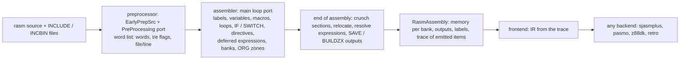

# rasm: full support (engine, frontend, backend, crunchers)

Owner request 2026-11-17: "fully support rasm (`emulators/rasm`) in unreal-asm", including crunched sections; CPC-only media
(CPC snapshot / cartridge / EDSK / HFE / CDT) are reported as not converted. Branch `unreal-asm-rasm`, worktree
`scratch/wt-rasm`.

## 1. Why an engine

The A9 rasm frontend (`src/dialects/rasm/rasmfrontend.cpp`) is an 80-line `TextDialect` table over the shared text line
engine: 11 of 13 decrunch routines. rasm's language cannot be mapped line by line to sjasmplus:

- variables are doubles (`ang=ang+360/256`, `defb 127*sin(ang)`), rounded at the end (`floor(v+0.5)`);
- generated names (`label{x}`, `{eval}`), `{bank}` / `{page}` / `{sizeof}` prefixes, SWITCH with fall-through, macros with
  `{param}` substitution, varargs, `{#}`, `{n|=default}`;
- crunched sections (`LZ48 ... LZCLOSE`) whose bytes are a compressor's output and whose following code is relocated;
- INCBIN transforms (REVERT, tiles, WAV), float data (DEFR / DEFF / DF24), SUMMEM / XORMEM / CIPHERMEM, BUILDZX snapshots.

The only exact route is to assemble the source the way rasm does. The engine is a C++ port of rasm's core (rasm.c v3.3.3,
commit a5796b9, MIT), standard C++, no globals, no `exit()`.

## 2. Pipeline

- **Preprocessor**: words exactly as rasm builds them (upper case outside quotes, comments turned into `:`, `<<`/`>>` into
  `[`/`]`, blanks dropped after a keyword, EQU rewritten to `name~value`, `=`/comparison position in `e`, INCLUDE inlined
  at preprocessing even inside a false IF, INC* turned into `HEXBIN #n`).
- **Assembler**: one pass like rasm: instructions write bytes at once, operands with symbols become deferred expressions
  (`PushExpression`, variables substituted at push time) resolved at the end (`PopAllExpression`).
- **Trace** (`TraceItem`, rasmengine.h): one item per contiguous run of bytes a statement put down (`Output`,
  `PushExpression`, the instruction fixups): bank, ORG zone, crunched section, physical range, `$` of its first byte,
  source file / line; an instruction whose bytes are one run carries its mnemonic, operand words, the encoder's bytes
  and its fixups with the translated expression text; DEFB / DEFW values carry their expression text. Crunching moves
  the items after a section like rasm moves the labels; `RasmAssembly` gives a crunched section as one item of its
  crunched bytes.

## 3. Conversion (frontend)

The frontend (`rasmfrontend.cpp`) runs the engine and writes the IR from the trace, as assembled:

- loops and macros appear expanded; IF / SWITCH keep only what was assembled; DB / DS lines carry their source line as a
  comment;
- an instruction is written as an instruction when its bytes are one Z80 instruction (a length decoder: rasm's
  enhanced forms such as `LD HL,SP` are several, written as DB) and the encoder's own bytes are in memory; rasm's
  aliases (`EXA`, `SL1`, `SHL`, `SHR`, `OTD`, `OTI`) get the standard names;
- an operand (or a DEFB / DEFW value) keeps its expression when it names a label, evaluates with the final label values
  to what rasm wrote and fits the field; otherwise the number rasm wrote;
- crunched sections, transformed INCBINs, float data, SUMMEM / XORMEM / CIPHERMEM: DB of the bytes rasm wrote; labels
  that are not at a written statement (inside a crunched section, EQU, NOCODE) as EQU of rasm's values;
- labels keep the source's spelling (rasm keeps them upper case), `.` / `@` of local labels as `_`; a label on a line
  of its own gets an IR line of its own with that source line (symbols point at the definition);
- outputs: the plain binary as sequential ORGs (rasm's .bin); SAVE as SAVEBIN of the same ranges; BUILDZX as `OUTPUT
  "rasmoutput.sna"` with rasm's header and the 48K written at #4000-#FFFF (byte for byte rasm's .sna; sjasmplus'
  SAVESNA writes its own system variables and stack);
- CPC media, AMSDOS / HOBETA headers: reported "not converted";
- a source the engine refuses (rasm's errors, a project file read alone) is converted line by line with the former
  `TextDialect` table, with an Info diagnostic.

## 4. Pieces and owners

| Piece | Files | Doc |
|---|---|---|
| Spec of rasm (research) | — | research-rasm.md |
| Compressors (bit-exact with rasm) | `src/compress/`, `include/unrealasm/compress.h` | research-rasm-crunchers.md |
| Instruction encoder + timings | `src/dialects/rasm/engine/rasminstructions.*` | research-rasm-instructions.md |
| Data helpers (floats, INCBIN transforms, headers, ZX outputs) | `src/dialects/rasm/engine/rasmdata.*` | research-rasm-data.md |
| Preprocessor, expressions, assembler, directives, trace | `src/dialects/rasm/engine/rasm{engine,prepro,expr,assemble,directives}.*` | this file |
| Frontend (IR from trace) | `src/dialects/rasm/rasmfrontend.*` | this file |
| Backend IR → rasm | `src/dialects/rasm/rasmbackend.*` | research-sjasmplus-to-rasm.md |
| Symbols (rasm -s formats, SymbolsFromProject) | `src/symbols/...` | symbols/formats.md |

## 5. Verification

- `tools/verification/unreal-asm/checks/rasmautotests.py`: rasm.c's AUTOTEST_* snippets through the rasm binary: 363
  snippets, 153 with output (the positive corpus), the others errors (the engine must fail them too).
- engine bytes vs rasm bytes (direct), then the conversion through sjasmplus vs rasm bytes;
- decrunch routines, the float24 library, real rasm projects.

## 6. Status

- 2026-11-17: worktree, rasm built (autotests 2079 OK), corpus extracted; spec / crunchers / instructions / data /
  backend in progress in parallel; engine port started (preprocessor read).
- 2026-11-17: engine complete: of the 363 AUTOTEST snippets 352 give rasm's result (bytes, or an error where rasm
  fails), the 11 others are EDSK snippets that read disk images (CPC media). BUILDZX .sna byte-identical. Trace and the
  engine frontend done: `rasmconvertcheck.py` 153 / 153 snippets with a binary give rasm's bytes through sjasmplus;
  `dialectcheck.py rasm` 13 / 13 decrunch routines; BUILDZX (banks and BANKSET 0), SAVE, LZ48 / LZX0 sections
  checked by hand against rasm.
- 2026-11-17: all pieces merged in one tree: the instruction encoder (16 728 forms, 2 699 timing rows equal to
  rasm), data helpers, the ten crunchers bit-exact (fixtures and 800 fuzz cases against rasm), the rasm backend
  (testdata 5 / 5, corpus 27 / 37 equal: 7 write code over code, which rasm refuses; 3 use LUA / INCHOB / INCTRD).
  clang build without warnings, `unreal-asm-tests` 510 passed, the converted snippets and decrunch routines equal on
  the release `zxasm`; the new sources compiled by gcc 16 `-Wall -Wextra -Wpedantic` without warnings. Open: the
  full Linux / MSVC / MinGW CI build; a project's included files may also be converted alone; macro-local names
  (`_XM0`) and strings as hex `DB` in the sjasmplus output.
