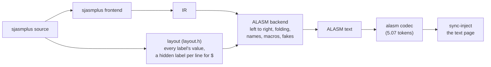

# sjasmplus → ALASM: the backend and the injection (part B, Z0)

The ALASM backend writes the IR as ALASM 5.07 text (the spelling 5.07-5.09 share; `BackendOptions::targetVersion`
picks older keywords). `sync-inject` puts that text into a running ALASM 5.09 as its own text. This page records what
the backend relies on, how the injection decides that ALASM is idle, and how both were checked. The other direction is
[research-alasm-to-sjasmplus.md](research-alasm-to-sjasmplus.md); the design is
[asm-synchronizer.md](asm-synchronizer.md) part B (§13-§20).

## 1. Example first

A sjasmplus fragment and what `zxasm convert --to alasm` writes:

```text
COUNT   EQU SIZE*3+2            COUNT   EQU SIZE*3+2
        ld a,1+2*3                      LD A,1+(2*3)            ; ALASM computes left to right
        ld hl,(1+2)*3                   LD HL,0+(1+2)*3         ; "(" first would be memory
        ld a,high table                 LD A,96                 ; table is further down: its value
        ld bc,table+COUNT               LD BC,table+COUNT       ; a later label in + and -: kept
        ld a,COUNT%7                    LD A,COUNT-(COUNT/7*7)
        IF SIZE > 5                     IF0 5-SIZE+#8000/#8000  ; 0 when 5 < SIZE
main    nop                     main    NOP
.loop   djnz .loop              main_loop DJNZ main_loop
1       jr 1B                   _T1_1   JR _T1_1
        sub a,b                         SUB A                   ; sjasmplus repeats it per operand
                                        SUB B
        ld bc,de                        LD B,D                  ; a fake instruction, written out
                                        LD C,E
        rlc (ix+4),b                    DB #DD,#CB,4,0          ; no ALASM spelling: the bytes
        MACRO WAIT n                    MACRO WAIT
        ld b,n                          LOCAL                   ; .w belongs to each expansion
.w      djnz .w                         LD B,\0
        ENDM                    w       DJNZ w
                                        ENDL
                                        ENDM
```

`testdata/dialects/alasm-backend/oracle1.asm` holds these constructs and more. Its ALASM text, injected into ALASM
5.09 and assembled there, gives the 143 bytes sjasmplus builds from the original (§5).

## 2. How the backend is built



- **Values.** ALASM assembles in one pass and in 16-bit unsigned words. An expression ALASM cannot compute the
  source's way is written as its value. `Convert` / `ConvertProject` lay a sjasmplus source out first and hand the
  labels to the backend (`BackendOptions::labelValues`; `IBackend::WantsLabelValues`). The layout also gets a
  hidden local label on each line outside macros and repeats (`.__UNREALASM_L<file>_<line>`). Its value is `$` on
  that line. No such label goes before the first global label, because a `.label` there would itself become the
  parent.
- **The check is per operator.** An expression is kept as written when every part of it is congruent modulo #10000:
  `+ - * & | ^ ~`, high, low and ALASM's rotations. Division, right shifts and remainders need both operands to lie in
  0..#FFFF by the source's own arithmetic. Comparisons and logical operators exist only as IF conditions (§3). A
  label defined further down may stand only in `+` and `-` (ALASM's help). ORG, EQU, DS, DUP, IF and DISP take no
  later label at all.
- **Names.** sjasmplus' `parent.local` is written as `parent_local`, a temporary `1` as `_T1_<n>` (`1B` / `1F`
  resolved by line). A name that is an ALASM keyword in capitals is renamed: `L_EXA`, `L_E`. A macro's `.labels` and
  the labels of a repeated block go into a `LOCAL ... ENDL`.

## 3. ALASM facts the backend relies on

From ALASM 5.07's help (`al50help`) and checked in unreal-ng where marked.

| Fact | Writing |
|---|---|
| Left to right, parentheses only; `!` xor, `'x` / `.x` high / low, `x~` inverts the result so far | a right operand that is an operation in parentheses; a left one never |
| An operand starting with `(` is memory | a value is written `0+(...)` |
| "In every operation but + and - a label defined below is not allowed (one pass)" | folded to its value (labels from the layout) |
| IF0 takes the block on 0, IFN on not 0; before 5.03 IF0 is spelled IF | `==` / `!=` as a subtraction; `a<b` as `a-b+#8000/#8000` (0 when a<b, exact while a-b+#8000 lies in 0..#FFFF, checked with the values); `exist x` as `?x` |
| REPEAT ... UNTIL0 x runs the body until x is 0 (UNTIL before 5.07) | WHILE c as `IF0/IFN c`, `REPEAT`, body, `UNTIL0 c` (or `c-1` for a 0/1 test), `ENDIF` |
| Index halves HX LX HY LY; INF, SLI, EXA, `OUT (C),0` | written so |
| **emulator**: `ADD B`, `ADC 5`, `SBC (HL)`, `ADD HX` are errors in 5.09 (code `#00`, nothing put down); only `A,x` assembles | ADD / ADC / SBC always `A,x` |
| **emulator**: a character constant is the first character low, the last high: `DW "AB"` = `41 42`, `LD HL,"AB"` = `21 41 42`, `DW "ABC"` = `41 43` | a string of one or two characters in DW, and every multi-character constant, written as its number |
| LOCAL / ENDL hides the labels inside (a label used before the block stays global) | macro and repeat labels |
| `DS n,a,b` repeats the pattern n times | sjasmplus' `DS n,v`; STORM's cyclic fill as DS + DB |
| ALASM 5.09 assembles #8000-#BFFF into its system page | the oracle sources ORG #6000 |
| **emulator** (2026-10-18): 4.2, 4.42, 4.44 and 4.5 take macro parameters as `:0`..`:9` (their help: `:0 .. :9`); there `\0` is a label (`Not defined:\0`). 5.0 takes `\0` and not `:0` | `:N` before 5.0, `\N` from it |
| **emulator**: EXA is a keyword only in the tables of 4.44 and 5.x (not 3.8, 4.2, 4.42, 4.5); 4.2 skips a line `EXA` without an error | `EX AF,AF'` where the table lacks it (the codec's table decides: 4.5 is no later than 4.44) |
| **emulator** (2026-10-18): 3.8c's calculator has no parentheses and no `& \| ! ~ < >` (only `+ - * / ' . {}`), no MACRO, no IF / IFN, and `DS` is `DEFS` there | an expression it cannot read written as its value (labels from the layout; a later label without one is a warning); macros expanded in place; IF decided at conversion, a comment line for the part taken; `DEFS` before 4.0 |
| REPEAT is not in 3.8, 4.2, 4.42 | WHILE as `DUP n` ... `EDUP` with the count the layout ran it (`IFN 0` ... `ENDIF` for none); a WHILE met with two counts (in a macro or a repeat) is not converted |

## 4. When ALASM is idle (the injection's precondition)

The text page and its header are those of part A (`FileImage`, the page IX+#0D names). ALASM's LOAD reads whole
sectors: after the file the page holds the rest of the last sector, then zeros (dump `alasm509-loaded`). Writing the
file and zeroing the rest is therefore what LOAD leaves, with "changed since saved" set in the header.

Writing is safe only while ALASM waits for a command. In the editor the cursor's pointers lead into the text, and
during ASSEMBLE, SAVE or a catalogue the text is in use. Memory flags did not tell the states apart: IX+1 is the
cursor column, and IX+#17 stays #FF at the prompt after the editor. The call chain does. In the frame wait
(`#907F`: `XOR A / LD HL,FRAMES / CP (HL) / JR Z`) the stack holds, ALASM 5.09, `alasm64` loader:

| State | Words from SP (#5FBE / #5FBC) |
|---|---|
| A> prompt (also with a command half typed) | `… 9043 8EF2 BF15 7FFD 9199 91E3 9707 2D2B` |
| editor | `… 9043 BE08 BED3 0008 9199 915D 9FD1 9733 2D2B` |
| editor's E> line | `… 9043 A537 BF15 0008 9199 91E3 A51D 9733 2D2B` |
| catalogue, ASSEMBLE | `#5FCE`/`#5FD0` = `879C 9733`, `D200 9733`, `0000 9733` |

`#91E3` returns from the line input to `#9707`, the command loop. A command (the editor too) runs with `#9733` in
that slot. The idle rule is therefore "the words #91E3, #9707 follow each other within 64 bytes above SP"
(`SyncDescriptor::idleChain`). Found by reading the stack paused in the wait loop in each state; breakpoints did not
fire in that instance (reported).

Every other build has the same chain at its own addresses: the pair right below the word both states share (#2D2B;
#1B76 in 3.8c), read at the prompt and in the editor with each build started from its own disk (64-column loaders;
4.5's and 3.8c's only loader):

| Build | Loader | Prompt pair | Editor's word there |
|---|---|---|---|
| 5.09 | `alasm64` | `91E3 9707` | `9733` |
| 5.08 | `alasm64` | `91E8 970C` | `9738` |
| 5.07, 5.05 | `alasm64` | `91DA 96FE` | `972A` |
| 5.00 | `alasm64` | `99EA 8B93` | `8BBF` |
| 4.5 | `ALASM4.5` | `998F 8B6B` | `8B98` |
| 4.46 | `boot64+` | `9A07 8B92` | `8BBE` |
| 4.45 | `boot64` | `99E1 8B93` | `8BC0` |
| 4.44 | `al64_444` | `9A08 8BA8` | `8BD5` |
| 4.43 | `al64_443` | `99A4 8B99` | `8BC6` |
| 4.42 | `alasm442` | `99B2 8B8F` | `8BBC` |
| 4.2 | `ALM` (2026-10-18) | `983F 8B84` | `8BAD` |
| 3.8c | `ALASM` | `943A 8149` | `816D` |

Checked in every build: `inject-oracle.py alasm --boot ... --assembler alasm-X` wrote a source at the prompt and the
build assembled it to sjasmplus' bytes; in the editor the same write was refused (409).

## 5. Oracle results

| Check | Result |
|---|---|
| Round trip on the host (`AlasmBackend_Test.ProgramsKeepTheirBytesThroughAlasm`): every instruction form (`instructions.asm`), ALASM 5.09's constructs, STORM 1.3 (STORMT1/2), ZAsm 3.15 (ZXT1-3), TASM 5.0 (T50PROG) → sjasmplus → ALASM → the alasm codec and back → the ALASM frontend → sjasmplus | the bytes of the original assemblers |
| `inject-oracle.py alasm509 … oracle1.asm 0x6000`: injected into ALASM 5.09, assembled by it | 143 bytes = sjasmplus' |
| the same with `instructions.asm` at ORG #6000 | 1173 bytes = sjasmplus' |
| `inject-oracle.py alasm509 --template` (Z1): `zxasm inject` into the .szx, .sna and .z80 templates, the snapshot loaded and assembled | 143 bytes = sjasmplus' in each; `instructions.asm` 1173 |
| `zxasm inject` onto a copy of ALASM's disk, `WORK ORACLE1` and `ASSEMBLE` in ALASM 5.09 | 143 bytes = sjasmplus' |
| `inject-oracle.py alasm … --assembler alasm-X` live in 3.8c, 4.2, 4.42, 4.44, 4.5, 5.00 (2026-10-18) | 143 bytes = sjasmplus' in each |

## 6. Limits and open items

- Snapshots and disks (Z1): `zxasm inject` writes the same text into an idle template snapshot (.szx / .sna / .z80) or
  onto a disk image of any format (unreal-disk); ALASM 5.09 assembled `oracle1.asm` from each to sjasmplus' bytes
  (asm-synchronizer.md §19).
- Projects (2026-10-10): the files a host source INCLUDEs go into ALASM pages of their own, each INCLUDE written
  `INCLUDE "NAME",page`, so ALASM finds the text loaded and reads no disk (asm-synchronizer.md §16.4). 5.05-5.09 keep
  two more texts (pages 4 and 0), 4.5 and 4.2 two (0 and 3; 4 and 0), 5.00, 4.42-4.46 and 3.8c one (page 4). Checked in every build:
  a project of three files (5.05-5.09, 4.5, 4.2) or two (the others) injected live and assembled to sjasmplus'
  bytes with ALASM's own disk in the drive; ALASM 5.09 assembled the three-file project from a template snapshot too.
  Onto a disk (`zxasm inject main.asm disk.trd`) each file goes as a file of its own: ALASM 5.09 loaded the main text
  with `W` and assembled the project to the same bytes. Its screen shows why the pages matter: without a page each
  INCLUDE loads its file over the text being assembled, and the main text is loaded back from the disk after it
  (`Loaded Ok to #C6 INC1`, `... pmain`, `... INC2`, `... pmain`).
- Label values come only from sjasmplus sources. Another dialect's source is written without them: its later labels
  stay as they are, with a warning.
- A comparison used as a value (not in IF / WHILE) has no ALASM form: folded where the values are known, else a
  warning.
- The idle rule is known for every build of the table above (2026-10-10); the 42-column loaders were not read (their
  code may sit elsewhere): a build not identified or without a rule refuses injection unless `force` is given.
- Fixed (2026-10-10): the ALASM frontend read `ADD B` as `ADD A,B` and `"AB"` as #4142. It now takes ALASM 5.09's rules
  (§3): a probe of 22 forms converted to sjasmplus builds the 49 bytes ALASM 5.09 put down
  (`Dialects_Test.AlasmBuildsWhatAlasm509Builds`).
  Recorded in TODO.
