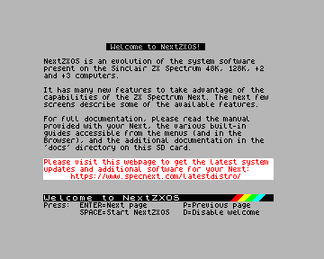

# Reference compares: the welcome-screen border, the wiki and the manual

Read 2026-11-20. Closes the "Reference compares" item of [TODO.md](TODO.md) except the ZEsarUX diff, which is
[research-zesarux-tbblue-diff.md](research-zesarux-tbblue-diff.md). Reference: the FPGA sources
`ZX_Spectrum_Next_FPGA/cores/zxnext/src` (`zxnext.vhd` 7595 lines, `video/*.vhd`, `audio/*.vhd`), core 3.02.03 as in
[research-fpga-vhdl.md](research-fpga-vhdl.md). unreal-ng: `next-refcompare` from `github/master` `c6a70f8b3`; paths below are
relative to `core/src/emulator/` unless they start with `core/`. When the wiki or the manual and unreal-ng differ, the VHDL decides.

Verdicts: **ok** = unreal-ng follows the VHDL; **wiki stale** = the wiki (or the manual) says something else than the VHDL, unreal-ng
follows the VHDL; **BUG** = unreal-ng contradicts the VHDL (listed at the end); **known** = an open item of [TODO.md](TODO.md);
**tbblue BUG n** = found by the ZEsarUX pass already, see that document.

## 1. Welcome-screen border

### 1.1 What the hardware draws

The border is the ULA layer's pixel while `border_active_d` is set (`video/zxula.vhd` 415-417, 462-468). Its attribute is synthesised:

- standard and every mode but Timex hi-res: `border_clr <= "00" & i_port_fe_border & i_port_fe_border` (`zxula.vhd` 419): paper =
  ink = port `#FE` bits 2:0, **bright = 0, flash = 0**;
- Timex hi-res (port `#FF` bits 2:0 = `110`): `border_clr_tmx <= "01" & not ink & ink` (`zxula.vhd` 420, 427-428): paper = the
  complement of the port `#FF` ink, **bright = 1**, flash = 0.

Flash never reaches the border: `pixel_en <= (shift_reg(15) xor (attr(7) and flash_cnt(4) and not ulanext and not ulap)) and not
border_active_d` (`zxula.vhd` 471), and the border attribute has bit 7 = 0 anyway. The palette index of the border
(`zxula.vhd` 484-555):

| Mode | Index | VHDL |
|------|-------|------|
| standard ULA | `16 + border` (hi-res: `24 + paper`) | `"000" & not pixel_en & attr(6)` & `attr(5:3)`, 543-553 |
| ULANext, format `#FF` | none: `ula_select_bgnd`, the fallback NR `#4A` | 497-504 |
| ULANext, any other format (also an invalid one) | `128 + border` (hi-res: `128 + paper`) | `paper_base_index(7:3) & attr(5:3)`, 504 |
| ULA+ (NR `#68` bit 3 / `#FF3B`), ULANext off | `#C8 + border` (hi-res: `#D8 + paper`) | `"11" & attr(7:6) & (sm(2) or not pixel_en)`, 531-541 |

ULANext wins over ULA+ (the `if` order). The 9-bit colour goes out as `RRR RRR RR` per channel (`zxnext_top_issue5.vhd`
1553-1555): a 3-bit value `v` becomes `v << 5 | v << 2 | v >> 1`, so the default white paper `#B6` (9-bit `101 101 101`) is
`(182, 182, 182)`.

unreal-ng: `NextVideoRenderer::UlaBorderPixel` (video/next/nextvideorenderer.cpp 164-185) computes exactly the table above (ULANext
`#FF` returns "no border pixel", the caller takes NR `#4A`, `OuterBorderRgba` 187-195); the global transparency NR `#14` applies to
the border as to the ULA pixel. `Expand3` (nextvideorenderer.cpp 37-40) is the board's expansion. jnext does the same
(`src/video/ula.cpp` 620-660, 703-731). **ok.** The wiki ([NextReg $42](https://wiki.specnext.dev/NextReg:$42),
[Palettes](https://wiki.specnext.dev/Palettes)) says an *invalid* ULANext format takes the paper **and the border** from NR `#4A`:
**wiki stale** for the border (VHDL 501-504: only `#FF` selects the fallback; the paper does go to the fallback, 526).

### 1.2 Measured

jnext has a headless mode (`--headless --delayed-screenshot FILE --delayed-screenshot-frames N`, its CLAUDE.md "Headless mode").
Its regression suite already pins this very moment: `test/00regression/regression_tests.conf` row `boot-nextzxos-welcome next BOOT
400 --rtc 2026-07-10T08:55:00` (the native boot ROM, `tbblue.fw`, NextZXOS on the official distribution image, frame 400), whose
golden is `test/00regression/img/boot-nextzxos-welcome-reference.png` (640 x 512 = the 320 x 256 grid doubled). That committed
headless screenshot is the jnext reference used here; jnext was not rebuilt (nothing on the jnext side was in question). A second
reference: CSpect's capture of the same screen in jnext's tree, `doc/issues/cspect-captures/cspect-nextzxos-boot.png`.

unreal-ng: `NextFirmware_Test.PersonalityRomStallHunt` with `UNREAL_NEXT_HUNT=1500 UNREAL_NEXT_DUMP=<dir>` (no code change): the
real chain on `testdata/machines/zxnext/card` (`TBBLUE.FW` 1.45, `[ROM] NEXTBOOT`), soft reset into NextZXOS at frame 272, the
welcome page in its key wait (`pc = #0C8F`, halted) at frame 1500; `frame.rgba` is the renderer's 720 x 576 frame.

| Picture | Border pixels | RGB of the border | Other colours (pixels) |
|---------|---------------|-------------------|------------------------|
| jnext golden, 640 x 512 | 64 + 64 columns and the 32-line rows | `(182, 182, 182)` everywhere | black 28152, white 20716, red 4972, yellow 256, green 256 |
| CSpect capture (936 x 749, scaled) | | `(182, 182, 182)` (a few `(185, 185, 185)` at scaled edges) | |
| unreal-ng, 720 x 576 | the whole ring around the paper, also outside the 320 x 256 grid (87040 pixels) | `(182, 182, 182)` everywhere | black 28152, white 20716, red 4972, yellow 256, green 256 |

The unreal-ng frame cropped at `(32, 32)` to 640 x 512 is **pixel-identical** to the jnext golden (0 of 327680 pixels differ), the
border included. `(182, 182, 182)` is 9-bit `101 101 101` = the default ULA palette's white paper `#B6` (`io/z80n/nextvideoregs.cpp`
8, entry 16 + 7; NextZXOS reprograms the ULA palette during the boot, the NR `#40` / `#41` writes of the run, and keeps that
value): border colour 7 through palette entry 23, not bright (the standard
border cannot be bright, section 1.1). **Match.**

The bright / flash cases. On this hardware there is no bright or flashing standard border (the attribute is `00 BBB BBB`), so the
only "bright border" is Timex hi-res (`24 + paper`), plus the ULANext (`128 + border`, `#FF` = fallback) and ULA+ (`#C8 + border` /
`#D8 + paper`) indexes. They were compared by code against the VHDL (section 1.1), not against a screenshot: unreal-ng, jnext and the
VHDL agree line by line, and unreal-ng's unit tests pin three of them (`core/tests/emulator/video/next/nextvideorenderer_test.cpp`:
hi-res bright border 116, ULA+ border 216, ULANext hi-res border 801). Not pinned by a test: the ULANext border with a normal
format (`128 + border`) and with an invalid one (still `128 + border`, while the paper falls back to NR `#4A`); proposed
`NextVideoRenderer_Test.UlaNextBorderIs128PlusPortFeEvenForAnInvalidFormat` (`WriteUlaNextFormat(0x05)`, border 3: `Px(0) ==
Pal(0, 128 + 3)`, a paper pixel = NR `#4A`).

## 2. Wiki and manual

Sources: the SpecNext wiki dump (`documents/specnext-wiki`, 581 pages; read: every `NextReg_$xx` page, every `NextPort_$xxxx` page,
Memory map, Interrupts, Copper, Palettes, Layer 2, Tilemap, Refresh Rates, CTC) and the distribution docs
(`documents/nextzxos-distribution-docs/extra-hw`: `registers.txt`, `ports.txt`, `dma/zxndma.txt`, `copper/COPPER-v0.1c.TXT`,
`mouse/MOUSEreadme.txt`; `registers.txt` is what `io/z80n/nextregtable.inc` is generated from). Most NextReg pages copy
`nextreg.txt` of the core and agree with the VHDL; the table lists what was checked against the VHDL, the differences first.
NextREG read-back masks are the subject of the ZEsarUX pass (its section 1) and are not repeated here.

### 2.1 Differences

| Topic | Wiki page / manual | VHDL (file:line) | unreal-ng (file:line) | Verdict |
|-------|--------------------|------------------|-----------------------|---------|
| Banks 5 and 7 exist twice: the CPU / DMA / ULA / tilemap see an FPGA BRAM, Layer 2 (display **and** the `#123B` mapping) and the NR `#04` config mapping see the external SRAM | [Memory map](https://wiki.specnext.dev/Memory_map) "exist in two instances", three exceptions; [Layer 2](https://wiki.specnext.dev/Layer_2) "secret memory" | `zxnext.vhd` 2961-2962 (`mem_active_bank5` = pages `#0A`/`#0B`, `bank7` = `#0E`), 3039-3041 and 3061-3063 (`sram_pre_active <= not bank5 and not bank7`: an MMU access to those pages never reaches the SRAM), 3100-3104 (`sram_layer2_map_en`: SRAM, `sram_bank5 <= '0'`), 3043-3048 (config mapping: SRAM), 1665 (`o_RAM_B_ADDR <= layer2_addr_eff`: the Layer 2 fetch is SRAM port B) | one array: `MapSlot` (memory/next/nextmemory.cpp 434-530), `ApplyLayer2` (537-555, `RAMPageAddress(bank16)`), the config bank (484) and the renderer (`in.ram = RAMPageAddress(0)`, video/next/screennext.cpp 639) all address the same bytes of page `#0A`/`#0B`/`#0E` | **BUG A, fixed**: `NextMemory::SramTwin` (24K) is the SRAM side |
| NR `#22` bit 7 reads the INT pulse "even when Z80N has interrupts disabled" | [NextReg $22](https://wiki.specnext.dev/NextReg:$22) | `(not pulse_int_n) & "0000" & ...` (`zxnext.vhd` 5991-5992; the pulse 2017-2031, 32 / 36 CPU clocks) | `_lineControl` only (io/z80n/nextinterrupts.cpp 99-101; written `& 0x07`, 40) | **BUG** = tbblue BUG 2 (confirmed independently) |
| Invalid ULANext format: the border | [NextReg $42](https://wiki.specnext.dev/NextReg:$42), [Palettes](https://wiki.specnext.dev/Palettes): paper **and border** from NR `#4A` | border fallback only for `#FF` (`zxula.vhd` 497-504); the paper of an invalid format falls back (526) | `UlaBorderPixel` (video/next/nextvideorenderer.cpp 171) | wiki stale; unreal-ng ok |
| NR `#06` bit 6 | [NextReg $06](https://wiki.specnext.dev/NextReg:$06): "DMA mode (0 = zxnDMA, 1 = Z80 DMA)" next to "BEEP-only to internal speaker" | bit 6 = `nr_06_internal_speaker_beep` (5163, 5900); the DMA mode is latched from the port used: `dma_mode <= port_0b_lsb` on every `#0B` / `#6B` access (1811-1819) | the mode latch by port (io/z80n/nextdma.h 61) | wiki stale (core 3.1.2 change) |
| NR `#7F` reset | [NextReg $7F](https://wiki.specnext.dev/NextReg:$7F): "`$FF` upon soft reset" | `:= X"FF"` at the declaration only (1216), not in the `reset` block: a soft reset keeps it | `SoftResetKeeps` (io/z80n/nextboard.cpp 16-19), table `0xFF` (nextregtable.inc 90) | wiki stale |
| NR `#6E` / `#6F` read-back | [NextReg $6E](https://wiki.specnext.dev/NextReg:$6E) / [$6F](https://wiki.specnext.dev/NextReg:$6F): "top two bits equal to zero", `$EB` reads `$2B` | `base_7 & '0' & base` (6107-6111): bit 7 reads back, `$EB` reads `$AB` | `& 0xBF` (nextboard.cpp 221-223) | wiki stale |
| Port `#DFFD` | [NextPort $DFFD](https://wiki.specnext.dev/NextPort_$DFFD): bit 7 = Pentagon 512K mode, bits 3:0 the bank; [Memory map](https://wiki.specnext.dev/Memory_map): "3 MSBs" | stores bits 4:0 and 6 (3686-3694); bank bits 6:3 = `dffd(3:0)` in the standard mode (3764-3766); Pentagon 512 / 1024 and Profi are NR `#8F` modes (3764-3769) | `_dffd = value & 0x0F`, bank `(_dffd << 3) \| (7ffd & 7)` (memory/next/nextmemory.cpp 613, 643) | wiki stale; NR `#8F` modes **known** (TODO.md "NR #8F memory mapping modes") |
| Port `#FADF` (Kempston mouse buttons) | [NextPort $FADF](https://wiki.specnext.dev/NextPort_$FADF): bit 3 fourth button, buttons active high, wheel "delta since previous read" | `i_MOUSE_WHEEL & '1' & not M & not L & not R` (3560): bit 3 is always 1, buttons active low, bits 7:4 the wheel input as given | `(wheel << 4) \| 0x08 \| buttons` (ports/models/portdecoder_next.cpp 554-583) | wiki stale |
| Copper timing | `extra-hw/copper/COPPER-v0.1c.TXT` (core 2.0, 14 MHz) | 28 MHz, MOVE 2 clocks ([Copper](https://wiki.specnext.dev/Copper) notes it) | modelled at 28 MHz (io/z80n/nextcopper.cpp) | manual stale (the wiki says so) |
| NR `#12` / `#13` defaults | [NextReg $12](https://wiki.specnext.dev/NextReg:$12) 8, [$13](https://wiki.specnext.dev/NextReg:$13) 11; [Layer 2](https://wiki.specnext.dev/Layer_2): NextZXOS sets both to 9 | 4943-4944 (`0001000`, `0001011`) | table `0x08` / `0x0B` (nextregtable.inc 18-19); the boot writes `12=09`, `13=09` (measured, the hunt run above) | ok (and the NextZXOS claim confirmed) |

### 2.2 Checked and matching

| Topic | Wiki page / manual | VHDL (file:line) | unreal-ng (file:line) | Verdict |
|-------|--------------------|------------------|-----------------------|---------|
| Border index (standard, hi-res, ULANext, ULA+) | [NextReg $40](https://wiki.specnext.dev/NextReg:$40), [NextPort $xxFF](https://wiki.specnext.dev/NextPort_$xxFF) (hi-res border bright) | `zxula.vhd` 419-420, 484-555 | nextvideorenderer.cpp 164-185 | ok (section 1) |
| Flash: ULA only, not with ULANext / ULA+ | [NextReg $42](https://wiki.specnext.dev/NextReg:$42) "no flash or bright bits" | `zxula.vhd` 471 | nextvideorenderer.cpp 238 | ok |
| NR `#14` / `#4A` / `#4B` / `#4C` resets `#E3` / `#E3` / `#E3` / `#0F` | NextReg $14, $4A, $4B, $4C | 4946, 5014-5018 | nextregtable.inc 21, 60-62 | ok |
| Sprite transparency: the raw pattern byte / nibble, before the palette offset | [NextReg $4B](https://wiki.specnext.dev/NextReg:$4B) | `sprites.vhd` 971 | io/z80n/nextsprites.cpp 213-231 | ok |
| Palette writes: NR `#40`, `#41`, `#43` reset the `#44` byte index; `#41` and the second `#44` byte auto-increment unless NR `#43` bit 7 | [NextReg $40](https://wiki.specnext.dev/NextReg:$40)-[$44](https://wiki.specnext.dev/NextReg:$44) | 5374-5403 | io/z80n/nextvideoregs.cpp 74-125 | ok |
| NR `#41` 9th bit = OR of the two blue bits; NR `#44` read | NextReg $41, $44 ("`p000000B`") | 6038-6048: `dat(10:9) & "00000" & dat(0)` (two stored priority bits) | `Nine()`, `ReadPaletteValue9` (nextvideoregs.cpp 133-143) | ok; the wiki's single `p` is incomplete (bit 6 also reads back) |
| NR `#28` read = the stored first byte of NR `#44` | [NextReg $28](https://wiki.specnext.dev/NextReg:$28) | 6004 | nextboard.cpp 214-215 | ok |
| NR `#07` read: bits 5:4 the speed in force, 1:0 the programmed one | [NextReg $07](https://wiki.specnext.dev/NextReg:$07) | 5902-5903: `"00" & cpu_speed & "00" & nr_07_cpu_speed` | nextboard.cpp 157-159 | ok |
| NR `#05` / `#06` reset values (joystick 1 Kempston, scandoubler; F8 / F3 hotkeys on after a soft reset) | NextReg $05, $06 | reset blocks of `zxnext.vhd` (4930-5106) | nextboard.cpp 36-47 | ok |
| Clip windows: indices auto-increment 0-3, NR `#1C` read `tm & ula & spr & l2` | [NextReg $18](https://wiki.specnext.dev/NextReg:$18)-[$1C](https://wiki.specnext.dev/NextReg:$1C) | 5979-5980 | nextvideoregs.cpp 60-72 | ok |
| NR `#1B` reset `0, 159, 0, 255` | [NextReg $1B](https://wiki.specnext.dev/NextReg:$1B) | 4978-4980 | `_clip[w][1] = w == 3 ? 159 : 255` (io/z80n/nextvideoregs.cpp 21) | ok |
| Layer 2 clip in 320 / 640 modes: X doubled | [NextReg $18](https://wiki.specnext.dev/NextReg:$18) "doubled or quadrupled" (the same in 640-pixel units) | `layer2.vhd` 130-134 | nextvideorenderer.cpp 388 | ok |
| Sprite clip: paper coordinates + 32; over the border only with NR `#15` bit 5, X doubled; else the whole 320 x 256; the 224-line limit without "over border" | [NextReg $15](https://wiki.specnext.dev/NextReg:$15), [$19](https://wiki.specnext.dev/NextReg:$19) | `sprites.vhd` 1042-1066 | io/z80n/nextsprites.cpp 418-455 | ok |
| Tilemap clip X doubled | [NextReg $1B](https://wiki.specnext.dev/NextReg:$1B) | `tilemap.vhd` 416-417 | nextvideorenderer.cpp 458 | ok |
| Line interrupt: line `n` fires on line `n - 1` at `hc` 255 (after the paper) | [NextReg $22](https://wiki.specnext.dev/NextReg:$22), [Interrupts](https://wiki.specnext.dev/Interrupts) | `zxula_timing.vhd` 566-580 | `nextinterrupts_test.cpp` 73 (value 100 -> counter line 99) | ok |
| Frame lengths 69888 / 70908 / 71680 T | [Refresh Rates](https://wiki.specnext.dev/Refresh_Rates) | `zxula_timing.vhd` | io/z80n/nexttiming.h 46-58 | ok |
| Copper: NR `#60` writes the MSB at an even address at once, NR `#63` commits whole words; address 11 bits wrapping at 2047; mode bits change only when they differ | NextReg $60-$63, [Copper](https://wiki.specnext.dev/Copper) | 3977-3999, 5419-5437 | nextcopper.cpp 33-69 | ok |
| Port `#BFF5`: the selected AY and register | [NextPort $BFF5](https://wiki.specnext.dev/NextPort_$BFF5) | 2649, 2771; `turbosound.vhd` 168 (`psg_d_o_reg_i`) | portdecoder_next.cpp 671-674 | ok |
| `#0B` = Z80-DMA mode, `#6B` = zxnDMA mode | [NextPort $xx0B](https://wiki.specnext.dev/NextPort_$xx0B), [$xx6B](https://wiki.specnext.dev/NextPort_$xx6B) | 1811-1819, 2643 | nextdma.h 61 | ok |
| Port `#123B` read layout | [NextPort $123B](https://wiki.specnext.dev/NextPort_$123B) | 3933: `segment & "00" & shadow & rd & en & wr` | `Port123b` (portdecoder_next.cpp 656-660) | ok |
| CTC: four channels, ZC/TO chained, soft reset by control word D1 | [CTC](https://wiki.specnext.dev/CTC), [NextPort $183B](https://wiki.specnext.dev/NextPort_$183B) | `NUM_CTC => 4` ([research-fpga-vhdl.md](research-fpga-vhdl.md) CTC paragraph) | `kChannels = 4` (io/z80n/nextctc.h 20) | ok; the page heading "8 channels" is stale, its text says four |
| zxnDMA (`extra-hw/dma/zxndma.txt`) | the manual | `device/dma.vhd` | the earlier audit [audit-dma-timing-2026-10-09.md](audit-dma-timing-2026-10-09.md) | ok there; not repeated |

## 3. unreal-ng bug candidates

The welcome-screen border is not one: it matches jnext pixel for pixel and the VHDL by code.

**BUG A - banks 5 and 7 (page `#0E`) are one memory in unreal-ng, two on the board.** On the board an MMU / 128K-paging access
to pages `#0A`, `#0B`, `#0E` goes to the FPGA BRAM only (`zxnext.vhd` 2961-2962, 3039-3041, 3061-3063: `sram_pre_active` is 0 for
them, the data comes from `cpu_bank5_do` / `cpu_bank7_do`, 1860-1863), while the Layer 2 fetch (`o_RAM_B_ADDR`, 1665), the Layer 2
`#123B` read / write mapping (3077, 3100-3104: `sram_bank5 <= '0'`) and the NR `#04` config mapping (3043-3048) address the external
SRAM at the same page numbers. The wiki says the same ([Memory map](https://wiki.specnext.dev/Memory_map), three exceptions).
unreal-ng keeps a single array: `NextMemory::MapSlot` / `ApplyLayer2` (memory/next/nextmemory.cpp 434-555, the Layer 2 window is
`RAMPageAddress(bank16)` at 547) and the renderer (video/next/screennext.cpp 639) read and write the same bytes. Effects: Layer 2
pointed at bank 5 or 7 (NR `#12` = 5 / 7) shows the ULA screen instead of the SRAM copy; a write through the `#123B` mapping with NR
`#12` = 5 changes the ULA screen; the 24K of "secret" SRAM cannot be stored. Rare in software (the wiki tells programmers to avoid
it), so low priority; the fix is a second 24K array for the SRAM side of the three pages, used by the Layer 2 fetch, the `#123B`
mapping and the config mapping. Proposed test: `NextMemory_Test.Layer2MappingOfBank5WritesTheSramNotTheUlaScreen` - NR `#12` = 5,
port `#123B` = `#01` (write mapping, segment 0), write `#AA` to `#0000`, port `#123B` = 0; expect `#4000` (MMU page `#0A`, BRAM) to
still read its old value and a Layer 2 pixel at (0, 0) to be palette index `#AA`.

**Fixed** (2026-11-20). The VHDL has no write-through: `cpu_bank5_we` / `cpu_bank7_we` and `sram_req` exclude each other
(`sram_active` is 0 whenever `sram_bank5` / `sram_bank7` is 1), and the Layer 2 mapping clears `sram_bank5` / `sram_bank7`. Who reaches
which copy: block RAM - the CPU and the DMA through the MMU or the 128K paging (`cpu_a <= dma_a` while the DMA holds the bus, 1834), the
ULA (`vram_bank_a1`, both banks), LoRes (bank 5, port A), the tilemap (bank 5 or the 8K of bank 7); SRAM - the Layer 2 fetch, the
`#123B` read / write mapping, the NR `#04` config mapping and (unreal-ng's zxnDDMA) the physical addresses. Sprites and the copper have
their own memories. Page `#0F` is SRAM only (`mem_active_bank7` is page `#0E` alone: the bank 7 block RAM is 8K), one instance for
everybody. unreal-ng: `RAMPageAddress(5)` / `(7)` stay what the CPU sees (snapshot loaders, the TTD page store and the memory views keep
working on them); the SRAM side of `#0A`, `#0B`, `#0E` is a 24K twin in the buffer's cache area (`NextMemory::SramTwin`,
`SramPageOffset`), used by `ApplyLayer2`, the config bank, `PhysicalRead` / `PhysicalWrite` and the Layer 2 fetch of
`NextVideoRenderer::Layer2Line` (only when NR `#12` is 0-7) and the pixel inspector. TTD saves it at the end of the `NextSystemArea`
blob (256K + 24K). Observable only through Layer 2 / NR `#04` / physical DMA on banks 5 and 7: tests `NextMemory_Test.*`.

**NR `#22` bit 7 (tbblue BUG 2).** The wiki and the VHDL agree that bit 7 reads the INT pulse (`not pulse_int_n`, `zxnext.vhd`
5992, 2017-2031), usable with interrupts disabled to wait for the frame; unreal-ng reads 0 (io/z80n/nextinterrupts.cpp 99-101).
Proposed test: `NextInterrupts_Test.Nr22Bit7IsSetDuringTheUlaIntPulse` - run to `intStart + 1` of the frame (nexttiming.h: 48K
1811 + 1), `ReadReg(0x22) & 0x80` is `#80`; at `intStart + intLength + 1` it is 0.

No other difference where unreal-ng contradicts the VHDL was found in the pages read. NR `#8F` (Pentagon 512 / 1024, Profi paging)
is the known open item of TODO.md.
