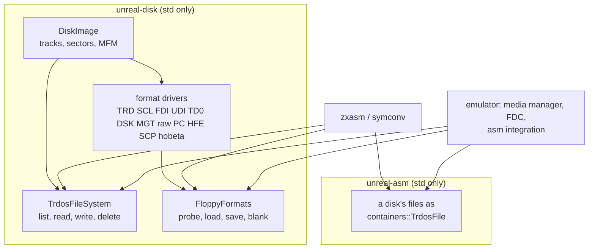

# unreal-disk: the floppy image library

The emulator's disk layer as a library of its own: the track and sector model, the format drivers and the TR-DOS file
system, in standard C++ with no emulator headers. The emulator's media manager and the standalone tools (`zxasm`,
`symconv`) both build on it. unreal-asm stays free of it: it takes a disk's files as a list, and each host fills the
list from its own disks.

## 1. Example first

A source written as ALASM's file onto a disk, in any format the library writes:

```cpp
std::unique_ptr<unrealdisk::DiskImage> disk;
std::string format;
unrealdisk::FloppyFormats::Load({}, "work.fdi", disk, format);           // "fdi"
unrealdisk::TrdosFileSystem fs(*disk);
fs.Write("MAIN", 'H', bytes, {}, error);                                 // an older MAIN.H is deleted, as TR-DOS does
unrealdisk::FloppyFormats::Save({}, *disk, "work.fdi", false);
```

## 2. Layers



| Part | What | Where |
|---|---|---|
| model | `DiskImage` (tracks, sectors, raw MFM, weak bits), `fdc.h` constants, CRC, the MFM / FM encoders and decoders | `include/unrealdisk/diskimage.h`, `fdc.h`, `flux/` |
| format drivers | one `LoaderX` per format: `loadImage` / `writeImage(path)`, and `detect` / `parse` / `serialize` on bytes where the format has them | `include/unrealdisk/loaders/` |
| registry | `FloppyFormats`: `Probe` / `ProbeData`, `Load` / `LoadData` (an image in memory), `Save` (with the UDI fallback), `CreateBlank`; `FormatResult` | `floppyformats.h` |
| file systems | `TrdosCatalog` (read), `TrdosFileSystem` (list, read, write, delete); +3DOS later | `trdoscatalog.h`, `trdosfs.h` |
| host settings | `LoaderOptions` (TR-DOS interleave): what the drivers took from the emulator's context | `options.h` |

The drivers were taken over from `core/src/loaders/disk/` as they were: namespace `unrealdisk`, the context replaced
by `LoaderOptions`, the emulator's `FileHelper` / `StringHelper` / `DumpHelper` by standard C++ stand-ins of the same
names (`detail/helpers.h`, UTF-8 paths). `DiskImage::Track::markDirty` / `markRawTrackDirty` became public: the
controllers (WD1793, uPD765) are users of the library now, no longer its friends.

## 3. Phases

| Phase | Work | State |
|---|---|---|
| L1 | the library beside the old code (nothing switched): model, drivers, registry, `TrdosFileSystem`; `unreal-disk-tests` | done |
| L2 | the emulator switched: the old headers forward to the library (`using`, loader wrappers taking `EmulatorContext*`), the old sources out of the build, `core` links `unreal-disk`; every test passes | done |
| L3 | cleanup: the old sources deleted; `debugger/asm/diskfiles.cpp` (it flattened the image to TRD bytes and wrote the catalog itself) and the WebAPI / CLI catalogs (each parsed the sectors in place; the CLI listed deleted files) on `TrdosFileSystem` | done; the forwarders' compatibility includes (`stdafx.h`, `dumphelper.h`) stay until their users include what they use |
| L4 | unreal-asm without disk images: its TRD / SCL reading and writing removed (it takes files as `containers::TrdosFile`); `zxasm` / `symconv` read and write every format through `tools/common/diskfiles` on unreal-disk; the emulator's asm and symbol surfaces read host images through `ReadImageFiles` (unreal-disk) and drives through the media manager's images | done |

Checked: every emulator test passes on the library (unreal-qt-tests, unreal-asm-tests, unreal-disk-tests, the 20
core-tests shards); `zxasm inject` wrote the same ALASM file into new TRD, SCL, FDI, UDI and TD0 images and read it
back byte for byte; ALASM 5.09 loaded the file with WORK from an FDI image `zxasm` wrote (a copy of its own disk) and
assembled it to sjasmplus' 143 bytes.

The interface unreal-asm declares is the file list: `ImageProject`, `zxasm convert` and the symbol module take
`std::vector<containers::TrdosFile>` (name, type, start, length, data, the rest of the last sector), and every host
fills it from its own disks.

## 4. Rules

- No emulator header in the library; `core/src/3rdparty/unreal-disk` builds alone
  (`cmake -S core/src/3rdparty/unreal-disk -B build -DUNREAL_DISK_TESTS=ON`).
- The emulator reaches disks only through the media manager and the library; tools only through the library.
- unreal-asm depends on neither.
