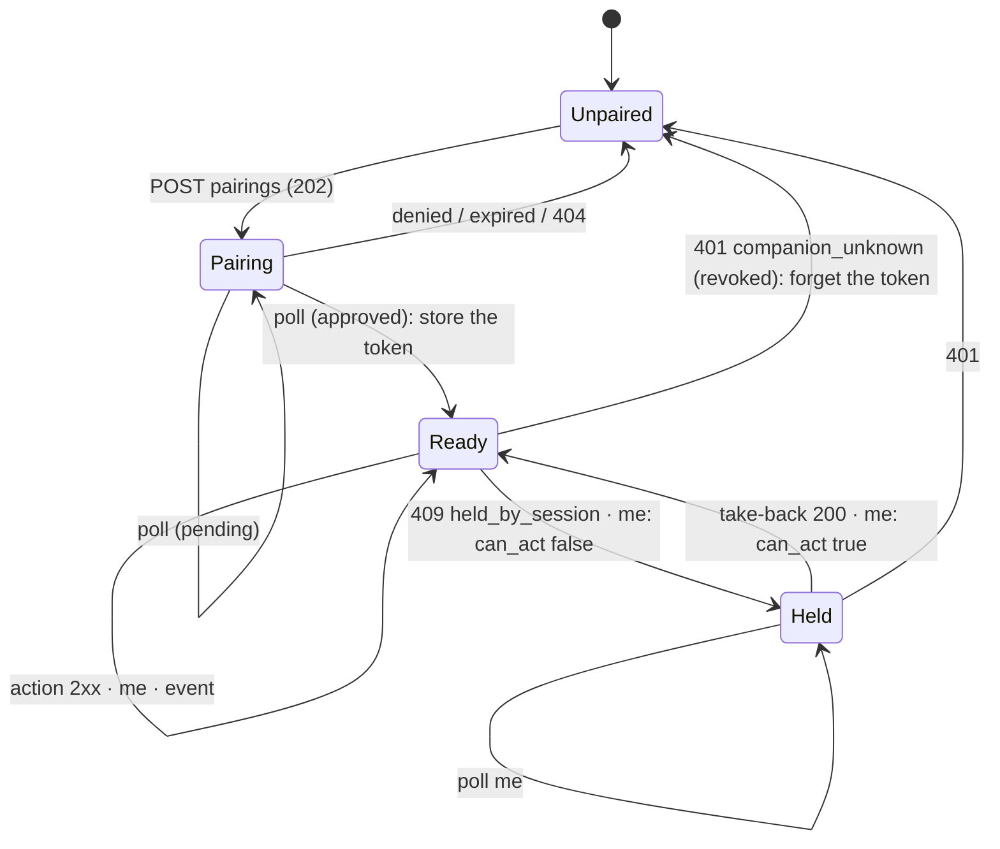

# Companion clients: WebAPI protocol

Part of [README.md](README.md). The model behind it: [design.md](design.md).

Base URL: `http://<host>:8090` (`UNREAL_WEBAPI_PORT`). All bodies are JSON. Every error body has `error` (a stable
code), `message` (for a human) and `retry` (`false` unless stated).

## 1. Authentication

```
Authorization: Bearer unc_3q2Vf0Kc…
```

- The token is issued once, at pairing (§3), or set in `UNREAL_COMPANION_TOKENS` for a headless instance.
- With the header, every request is the companion's: the operation log names `companion`.
- Do not send `X-Unreal-Session` with it, and do not send `X-Unreal-Source: mcp`.

| Status | `error` | When |
|:--|:--|:--|
| 401 | `companion_unknown` | the token is not known or was revoked: pair again |
| 400 | `companion_session` | the request also carries `X-Unreal-Session`: a companion holds no session |
| 403 | `companion_not_for_agents` | the request is marked as coming from the MCP server |

## 2. Acting on an instance

A companion uses the ordinary endpoints: `POST /api/v1/emulator/{id}/resume`, `/keyboard/tap`, `/disk/A/insert`, and so
on, with the same bodies and answers as any client ([webapi-interface.md](../../emulator/design/control-interfaces/webapi-interface.md)).
The scope each one needs is in [design.md §3](design.md#3-scopes-and-the-action-catalogue). `{id}` is an instance id or
its index, as everywhere.

What changes for a companion:

- no session is opened: the answer carries no `X-Unreal-Session*` headers and no `automation_session` field;
- three more refusals, before the handler runs:

```http
HTTP/1.1 403 Forbidden

{ "error": "companion_forbidden", "retry": false,
  "required_scope": "media",
  "message": "This companion may not use media: the user did not grant it" }
```

```http
HTTP/1.1 409 Conflict

{ "error": "held_by_session", "retry": false,
  "holder": { "surface": "mcp", "client": "MCP agent", "peer": "127.0.0.1:52144",
              "since_ms": 1792163600000, "implicit": false },
  "take_back": true,
  "message": "MCP agent controls the emulator; take control back first (POST /control/take-back)" }
```

`take_back` is `true` when this companion has the `takeback` scope.

```http
HTTP/1.1 409 Conflict

{ "error": "not_now", "retry": false,
  "message": "the machine runs: stepping, direct runs and register writes need a pause - pause first" }
```

Steps, direct runs (`skip_until`, `run_*`), register writes and TTD instruction steps need a paused machine (a
breakpoint stop is one). `me` (§4) says beforehand which actions are possible now.

### 2.1 Take control back

```
POST /api/v1/emulator/{id}/control/take-back
POST /api/v1/emulator/{id}/control/allow-again
```

| Status | Body |
|:--|:--|
| 200 | `{ "taken_back": true, "from": { "surface": "mcp", "client": "MCP agent" } }` |
| 200 (allow-again) | `{ "allowed": true }`: every client in a cooldown may take control again |
| 401 | `companion_unknown`, or `companion_required` when there is no token |
| 403 | `companion_forbidden`, `required_scope: "takeback"` |
| 409 | `nothing_held`: no session to take back |

## 3. Pairing

```
POST   /api/v1/companions/pairings          request a pairing (no token)
GET    /api/v1/companions/pairings/{pid}    poll it (no token)
DELETE /api/v1/companions/pairings/{pid}    cancel it (no token)
```

Request:

```json
{ "name": "Desk panel", "device": "panel, 15 keys", "scopes": ["run", "input", "media", "takeback"] }
```

- `name` is required, 1-64 printable characters; `device` is optional, up to 64; `scopes` is optional (the default set:
  every scope; `["all"]` says the same). Scopes: `run`, `input`, `media`, `machine`, `rewind`, `debug`, `takeback`.

| Status | Body |
|:--|:--|
| 202 | `{ "pairing_id": "p-7c41d2", "code": "418205", "expires_in": 120, "scopes": ["run", …] }` |
| 400 | `bad_request`: no name, an unknown scope |
| 429 | `too_many_pairings` (`retry: true`): 4 pending, or one pending from this address already |
| 403 | `pairing_disabled`: the user turned pairing requests off at the GUI (Tools > Companions…) |
| 503 | `pairing_unavailable`: no GUI to approve; provision the companion in `UNREAL_COMPANION_TOKENS` |

Show `code` on the device; the user compares it with the one in the GUI prompt.

Poll (once a second is plenty):

| `state` | Body | Next |
|:--|:--|:--|
| `pending` | `{ "state": "pending", "expires_in": 87 }` | poll again |
| `approved` | `{ "state": "approved", "token": "unc_…", "companion_id": "c-5f2a91", "scopes": ["run", "input"] }` | store the token; the pairing is gone after this answer |
| `denied` | `{ "state": "denied" }` | stop |
| `expired` | `{ "state": "expired" }` | offer to try again |
| 404 | `unknown_pairing` | the id is wrong, or the token was already collected |

The approved scopes may be fewer than those asked: the user can untick some.

## 4. The companion itself

```
GET    /api/v1/companions/me      who am I, what may I do, what is going on
DELETE /api/v1/companions/me      unpair myself
```

```json
{
  "companion": { "id": "c-5f2a91", "name": "Desk panel", "device": "panel, 15 keys",
                 "scopes": ["run", "input", "media", "takeback"], "source": "paired",
                 "paired_ms": 1792160000000 },
  "emulators": [
    { "id": "4d7f…", "index": 0, "model": "PENTAGON", "state": "running", "selected": true,
      "control": { "held": true, "surface": "mcp", "client": "MCP agent", "since_ms": 1792163600000,
                   "implicit": false, "can_act": false, "can_take_back": true },
      "actions": {
        "pause":     { "available": true,  "scope": null },
        "resume":    { "available": false, "scope": "run",      "reason": "MCP agent controls the emulator" },
        "step":      { "available": false, "scope": "debug",    "reason": "MCP agent controls the emulator" },
        "take_back": { "available": true,  "scope": "takeback" },
        "...": {}
      } }
  ]
}
```

`actions` is the catalogue of [design.md §3.1](design.md#31-what-is-possible-now), one entry per button-sized action,
in a stable order: `pause`, `resume`, `reset`, `nmi`, `turbo`, `speed`, `keyboard`, `joystick`, `mouse`, `tape`,
`disk`, `snapshot_load`, `snapshot_save`, `rzx`, `rewind`, `model`, `configuration`, `step`, `step_over`, `step_out`,
`run_to`, `registers`, `memory`, `breakpoints`, `debug_mode`, `take_back`, `allow_again`. Each has `available`, its
`scope` (`null`: free) and, when unavailable, a `reason` to show.

- `state`: `running`, `paused`, `stopped` (the instance's own word, as in `GET /api/v1/emulator/{id}`);
- `control.can_act`: `false` while a session is held;
- for a live status open the events channel (§4.1); a client that cannot hold a WebSocket polls `me` (twice a
  second is cheap: a few atomics and a lock per instance), and drives the buttons from `actions`.

### 4.1 Events

```
GET /api/v1/companions/events      WebSocket (Upgrade: websocket)
```

The channel sends the companion its `me` once and then every instance entry that changed, so a button goes dark the
moment the machine runs, an agent takes control or a session ends - without polling.

**Authentication.** `Authorization: Bearer <token>` on the handshake, or, for clients that cannot set handshake headers
(a browser's `WebSocket`), the first message:

```json
{ "op": "auth", "token": "unc_…" }
```

Before that the connection gets nothing. An unknown or revoked token is answered `companion_unknown` and the connection
closes; the handshake marked `X-Unreal-Source: mcp` is answered `companion_not_for_agents` and closed.

**Server → client.** Every message is a JSON text frame with `op`; `seq` counts this connection's messages from 1.

| `op` | Body | When |
|:--|:--|:--|
| `hello` | `me` (§4) plus `op`, `seq` | once, on authentication |
| `emulator` | `{ "op": "emulator", "seq": 7, "emulator": { …one entry of me.emulators… } }` | an instance's entry changed (state, control, actions, model, selected), or a new instance |
| `emulator_gone` | `{ "op": "emulator_gone", "seq": 8, "id": "4d7f…" }` | an instance was closed |
| `snapshot` | `me` plus `op`, `seq` | the answer to `{"op":"snapshot"}` |
| `revoked` | `{ "op": "revoked", "message": "…" }` | the user revoked this companion; the connection closes: pair again |
| `error` | `{ "op": "error", "error": "bad_request" \| "companion_required" \| "companion_unknown", "message": "…" }` | a bad message |

**Client → server:** `{"op":"auth","token":…}`, `{"op":"snapshot"}` (the whole view again, e.g. after the device
woke up).

An entry is sent only when it differs from the last one sent on this connection. The server compares on every
notification that can change it (state, run control, companions, instances, features) and once a second for what
changes with time alone (a re-take cooldown running out, the first recorded frame of time travel), so the latency is
that of the notification, at most a second. A dropped connection loses nothing: reconnect and take `hello` as the truth.

## 5. Managing companions (any client)

```
GET    /api/v1/companions             list companions and pending pairings
DELETE /api/v1/companions/{id}        revoke one (id or name)
DELETE /api/v1/companions             revoke all
```

```json
{
  "companions": [
    { "id": "c-5f2a91", "name": "Desk panel", "device": "panel, 15 keys", "scopes": ["run", "input"],
      "source": "paired", "paired_ms": 1792160000000, "last_seen_ms": 1792163600000 }
  ],
  "pairings": [
    { "pairing_id": "p-7c41d2", "name": "Phone", "device": "", "peer": "192.168.1.40", "expires_in": 87,
      "scopes": ["run"] }
  ],
  "approval_available": true,
  "pairing_allowed": true
}
```

`approval_available`: a GUI can approve; `pairing_allowed`: the user accepts pairing requests (the GUI setting).
Neither tokens nor codes are ever listed. Revoking needs no token: whoever can reach the WebAPI can already disturb the
machine, and revoking only takes power away. Approval has no endpoint (design §2).

| Status | When |
|:--|:--|
| 200 | `{ "revoked": true, "id": "c-5f2a91" }`, or `{ "revoked": 3 }` for all |
| 404 | `unknown_companion` |

## 6. The client state machine



- A 401 is final: forget the token and show "unpaired".
- A 409 `held_by_session` is a state, not an error: show the holder and, when `take_back` is true, a take-back button.
- A 409 `not_now` means the button should have been dark: `me.actions` said so (a step while running).
- Network errors: keep the token, retry with a back-off; the instance may be restarting.

## 7. Examples

```bash
H=http://127.0.0.1:8090
# Pair (the user allows it at the GUI)
curl -s -X POST $H/api/v1/companions/pairings -H 'Content-Type: application/json' \
     -d '{"name":"Desk panel","scopes":["run","input","media","takeback"]}'
curl -s $H/api/v1/companions/pairings/p-7c41d2        # → {"state":"approved","token":"unc_…",…}

T='Authorization: Bearer unc_…'
curl -s -X POST $H/api/v1/emulator/0/resume -H "$T"
curl -s -X POST $H/api/v1/emulator/0/keyboard/type -H "$T" -H 'Content-Type: application/json' \
     -d '{"text":"LOAD \"\"\n"}'
curl -s -X POST $H/api/v1/emulator/0/disk/A/insert -H "$T" -H 'Content-Type: application/json' \
     -d '{"path":"/games/side-b.trd"}'
curl -s $H/api/v1/companions/me -H "$T"
curl -s -X POST $H/api/v1/emulator/0/control/take-back -H "$T"
```

## 8. OpenAPI

The routes are in the generated spec (`GET /api/v1/openapi.json`), tag `Companions`, with the
`companionBearer` security scheme on the routes that need a token.
