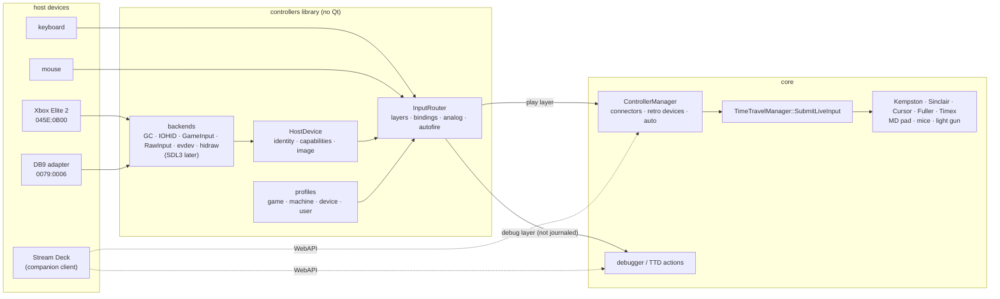

# Controller manager: host controllers to retro controllers

| | |
|---|---|
| **Date** | 2026-10-17 |
| **Status** | Design, owner decisions D1-D19 taken in the session; no code |
| **Branch** | `controller-manager-design` |
| **Builds on** | the Kempston joystick ([tdd-kempston-joystick.md](../2026-09-15-atm-baseconf-highres-ports/tdd-kempston-joystick.md)), the mouse manager ([2026-10-02-mouse-manager](../2026-10-02-mouse-manager/)), the Steam Deck input design ([input-and-profiles.md](../2026-10-08-steamdeck-client/input-and-profiles.md)), ZX bus slots ([2026-10-03-zx-bus-slots](../2026-10-03-zx-bus-slots/architecture.md)), the media manager as the design reference ([media-control-design.md](../2026-09-28-storage-manager/media-control-design.md)) |

Today a ZX machine in unreal-ng gets joystick input from PC keys only: `Joystick` (Kempston) binds eight keypad keys,
the Next takes MD pads from automation, and nothing reads a host game pad. There are no Sinclair, Cursor, Fuller or
Timex joysticks, no AMX mouse, no light gun, no input settings UI, no profiles, and no debugger or time-travel
hotkeys.

The **controller manager** connects any host input device (game pad, joystick, DB9 adapter, keyboard, mouse,
button panel) to any retro controller plugged into any connector of the emulated machine. It is built like the media
manager: one core control layer, stable ids and selectors, many modes, and `auto` everywhere, so that a pad plugged in
before launch just works in the game that is loaded.

- **Players** see one dialog page: the pad works, the picture shows what each button does, a game's profile is
  chosen by its signature.
- **Developers** get a second, separate layer and profile set for the debugger and time-travel debugging (TTD):
  scrub with the triggers, step with the D-pad, bookmarks on the paddles, a whole device as a debugger remote.

## Documents

| Document | What |
|:--|:--|
| [requirements.md](requirements.md) | **Start here.** Problem, personas, use cases, FR / NFR, non-goals, acceptance |
| [architecture.md](architecture.md) | The three layers, the `controllers` library, backends and device identity, the event pipeline, determinism and TTD, persistence, code placement |
| [retro-devices.md](retro-devices.md) | The emulated side: connectors as slots, the retro device catalogue, per-machine connector table, what the core must add |
| [mapping-and-profiles.md](mapping-and-profiles.md) | Bindings, layers, analog handling, autofire, keyboard and mouse mappings, profile layering, signature → port heuristic → manual, the JSON format, defaults |
| [debug-and-ttd.md](debug-and-ttd.md) | The developer layer: debugger and TTD actions, Elite paddles, scrub, device roles, Stream Deck, debug feedback |
| [haptics.md](haptics.md) | Rumble, impulse triggers, HD haptics; audio filters and game-event probes mapped to effects per game profile; never journaled, muted on seek and replay |
| [ui-ux.md](ui-ux.md) | The Qt dialog: three panes and patch cords, Simple and Advanced, the controller picture with callouts, test, learn and wizard flows |
| [device-database.md](device-database.md) | VID/PID identification, the device database, images and hotspot maps, the photo pipeline |
| [surface-dial.md](surface-dial.md) | The Surface Dial: reports, clicks, the late touch sensor and the inferred touch, per OS |
| [surfaces.md](surfaces.md) | WebAPI, MCP, CLI, Lua, Python: the parity table |
| [testing.md](testing.md) | Unit, integration, hardware-in-the-loop and live verification |
| [TODO.md](TODO.md) | Phases, open questions, errata found in other docs |
| [research-retro-hardware.md](research-retro-hardware.md) | Every ZX-family input peripheral: ports, decode, bits, per board; use cases by title |
| [research-other-emulators.md](research-other-emulators.md) | How 25 other emulators map controllers; comparison; ideas to take and pitfalls |
| [research-host-apis.md](research-host-apis.md) | macOS / Windows / Linux input APIs, SDL3, HID; the Xbox Elite Series 2 measured on this machine; other controllers |
| [probes/](probes/) | The probes used for the measurements: `probe.c`, `probe2.c` (SDL3 identity), `gc.m` (GameController dump), `hiddump.c` (raw IOHID reports and descriptor), `sdlev.c` (SDL3 events), `gcev.m` (GameController events), `dialtouch.c` / `dialfeat.c` (Surface Dial touch latency, its feature reports); fixtures in `testdata/controllers/hid-captures/` |

## In one picture

## Decisions (2026-10-17)

Asked one at a time in the session; the owner chose or wrote each answer. D13-D19 answer the open questions of the first draft ([TODO.md](TODO.md#owner-questions)).

| # | Decision |
|:--|:--|
| D1 | Scope: every input device in one design. Joysticks and pads, keyboard layouts, mice, light guns, debugger and TTD controls share one model, host input → binding → retro device, with a document per area. |
| D2 | Host backends: an abstraction over the most capable native API of each OS (macOS, Windows, Linux) with a less capable but universal fallback. The Qt client is the main client, so nothing is Qt-specific below the dialog. |
| D3 | Three layers. The core owns retro devices, connectors and the input stream (TTD, RZX, WebAPI and MCP see one stream). A library without Qt owns host backends, device identity, the database, bindings and profiles. Qt owns only the dialog and the window keyboard. |
| D4 | The library is built and linked like `core/recording` (`unrealng::controllers`, `ENABLE_CONTROLLERS`, `src/platform/{macos,windows,linux}`, Objective-C++ on Apple, a native-first factory with a fallback). |
| D5 | Controller images: manufacturer photos and openly licensed photos, retouched into one house style, with a JSON hotspot map per image. A user may add a photo and place the hotspots. Vectorization is a separate study (TODO Q-1). |
| D6 | Fallback order: first our own raw HID backend (no dependency), SDL3 later as a separate build option. |
| D7 | Out of the box: a game profile chosen by signature is the main mechanism (signatures are not implemented yet); then the analysis of the guest's port reads; then manual profiles. |
| D8 | The debugger and TTD are a separate layer with separate profiles. Players and advanced users are separate personas: the player sees nothing of the debug layer. |
| D9 | The debug layer is reached by holding a layer key (a paddle on the Elite, View+Menu on pads without paddles); any device may also take the whole role "debugger remote" (a second pad, a Stream Deck). Debug actions are host commands, never journaled machine input. |
| D10 | The emulated side is modelled as connectors, like media slots: a machine (or a card in a bus slot) declares connectors with stable ids; retro devices plug into connectors; host devices bind to retro devices. Selectors `auto`, alias and `kind:index`, and the media reply envelope. |
| D11 | Dialog layout: three panes with patch cords. Host devices on the left, the machine's connectors on the right, the selected controller's picture with callouts in the middle; a Simple / Advanced switch hides the debug layer and the fine settings. |
| D12 | Host devices are identified by USB VID/PID (plus version, serial, path); the database maps them to a family, a layout and an image. |
| D13 | New connector devices (Sinclair, Cursor, Fuller, Timex, light guns, keyboard joystick) journal one new kind, `ConnectorState`; Kempston, NextPad and the mice keep their kinds. |
| D14 | The Kempston mouse button order is a per-board property that follows each board's hardware (D0 = right on Next, Karabas-Pro, the Kondratyev schematic, ProfROM; D0 = left on ZX-Evo, Sprinter). |
| D15 | Elite paddles hidden by an onboard profile: read the profile byte and the raw paddle bits where the OS gives them, otherwise show "switch to profile 0". Measured: macOS Bluetooth gives both on every profile (the mirrored face button is removed by the driver); macOS USB gives neither ([research-host-apis.md §2.3a-b](research-host-apis.md#23b-live-paddle-test-bluetooth-le-045e0b22)). |
| D16 | Game signatures come from one shared library, `swsignature`, used by the controller manager, the metadata manager and the Steam Deck client. |
| D17 | Windows GameInput is a prerequisite of the installer, like the MSVC runtime, and is loaded dynamically so a portable build falls back to Raw Input. |
| D18 | macOS: a `GCController` is matched to its IOHID device by arrival and vendor name, confirmed by button-edge correlation; IOHID gives input, GameController adds outputs once matched. |
| D19 | Elite on a non-zero onboard profile, where the raw paddle bits are visible (macOS Bluetooth): the driver removes the face button the profile mirrors, learned from three consistent coincidences per device and profile, so each paddle is a control of its own on any profile. On by default; Advanced can turn it off. |
