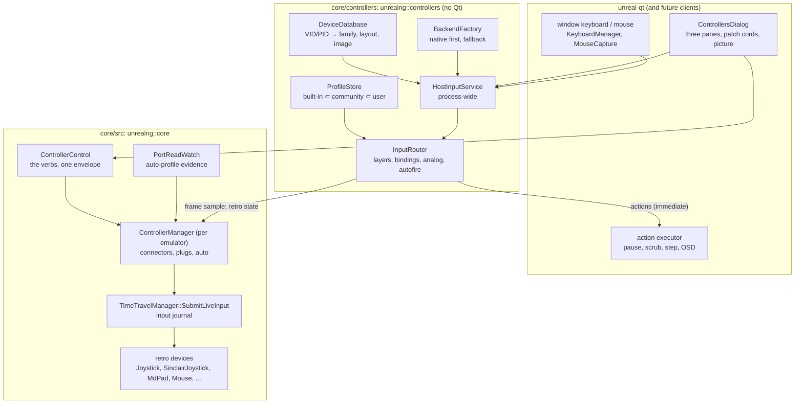
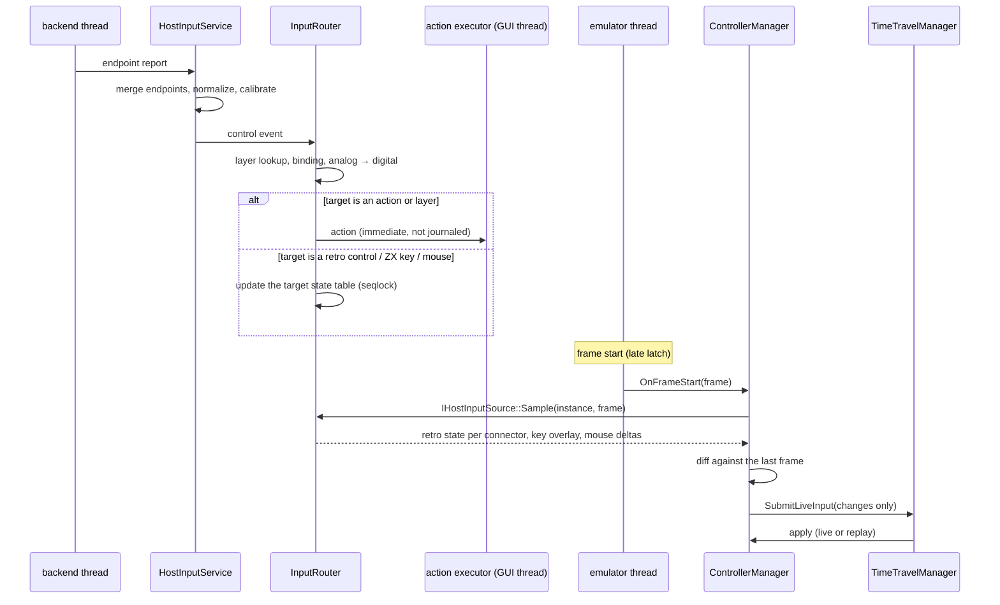

# Controller manager: architecture

| | |
|---|---|
| **Date** | 2026-10-17 |
| **Status** | Design, for review |
| **Requirements** | [requirements.md](requirements.md) |
| **Decisions** | D1-D18 in [README.md](README.md#decisions-2026-10-17) |

## Contents

- [1. Vocabulary](#1-vocabulary)
- [2. Three layers](#2-three-layers)
- [3. The controllers library](#3-the-controllers-library)
- [4. Backends per OS](#4-backends-per-os)
- [5. Device identity and merging](#5-device-identity-and-merging)
- [6. The canonical control vocabulary](#6-the-canonical-control-vocabulary)
- [7. The event pipeline](#7-the-event-pipeline)
- [8. Determinism, TTD and RZX](#8-determinism-ttd-and-rzx)
- [9. Several emulator instances](#9-several-emulator-instances)
- [10. Outputs: rumble, LEDs, triggers](#10-outputs-rumble-leds-triggers)
- [11. Threads](#11-threads)
- [12. Persistence](#12-persistence)
- [13. Code placement](#13-code-placement)
- [14. Decision trees](#14-decision-trees)

## 1. Vocabulary

| Term | Meaning |
|:--|:--|
| **Endpoint** | One backend's view of a physical device: a `GCController`, an `IOHIDDevice`, a GameInput device, an evdev node. |
| **Host device** | One physical device as the user sees it, merged from one or more endpoints ([§5](#5-device-identity-and-merging)). Has a `HostDeviceId`, capabilities, a family and an image. The keyboard and the mouse are host devices too. |
| **Host control** | A named physical input of a host device in the canonical vocabulary: `south`, `dpad.up`, `lstick.x`, `paddle.p1`, `key.kp8`, `mouse.dx` ([§6](#6-the-canonical-control-vocabulary)). |
| **Control event** | `{device, control, value, hostTimeNs}`. A button is 0 / 1, an axis -1..1, a trigger 0..1, a mouse delta an integer count. |
| **Connector** | A place on the emulated machine where a retro device plugs in: the Kempston port of a Pentagon, the two joystick sockets of a +2A, the left and right DB9 of a Next, the keyboard. Declared by the machine or by a card in a bus slot; has a stable id. |
| **Retro device** | A device plugged into a connector: `kempston-joystick`, `sinclair-joystick`, `md6-pad`, `kempston-mouse`, `amx-mouse`, `light-gun`, `keyboard`. Declares its **retro controls** (`up`, `fire`, `fire2`, `a`, `start`, `mode`, `dx`, `trigger`). |
| **Binding** | Host control(s) → one target: a retro control, a ZX key or chord, a mouse axis, a host action, or a layer switch ([mapping-and-profiles.md](mapping-and-profiles.md)). |
| **Layer** | A named set of bindings active at once. `play` and `debug` are built in; profiles may add shift layers. |
| **Profile** | Bindings, connector plugs and options, with a match rule (game signature, machine, device family) and a scope (built-in, community, user). Play profiles and debug profiles are separate sets (D8). |
| **Action** | A host command, not machine input: pause, TTD scrub, step, bookmark, screenshot, OSD keyboard ([debug-and-ttd.md](debug-and-ttd.md)). |
| **Role** | What a host device is for: `player` (default), `debugger-remote` (every control is a debug binding), `disabled`. |

## 2. Three layers



- **Core** owns what the guest can observe: connectors, retro devices, the input journal, the port-read evidence. Every
  surface (WebAPI, MCP, CLI, Lua, Python, Qt) changes connectors through `ControllerControl`, the counterpart of
  `MediaControl` ([surfaces.md](surfaces.md)).
- **The library** owns everything about the host: backends, hotplug, identity, the database, bindings, layers,
  profiles. It has no Qt dependency, so the Qt client, a headless instance, the Steam Deck client and a future SDL
  client use the same code (D3).
- **Qt** owns the dialog, the window's own keyboard and mouse events (they come from Qt, not from a backend), and the
  execution of host actions that touch the GUI.

The core does not include library headers. It declares one interface, `IHostInputSource`
(`core/src/emulator/io/controllers/hostinputsource.h`), which the library implements; the emulator calls it at each
frame start ([§7](#7-the-event-pipeline)). This keeps the core testable with a fake source, and the dependency
direction the same as `recording` (core links the library; the library does not need the emulator).

## 3. The controllers library

Built like `core/recording` (D4):

```
core/controllers/
  CMakeLists.txt                      # project(controllers), option(ENABLE_CONTROLLERS ON),
                                      # add_library(controllers STATIC), alias unrealng::controllers,
                                      # OBJCXX on Apple, frameworks IOKit GameController CoreHaptics
  src/
    hostinputservice.{h,cpp}          # process-wide entry: start/stop, devices, events, sample      (C2a)
    backendfactory.{h,cpp}            # like PlatformEncoderFactory: native list, fallback, probes   (C2a, empty)
    hostbackend.h                     # IBackend, IBackendSink, BackendProbe                        (C2a)
    hostdevice.h                      # HostDeviceId, role, instance mode, ControlEvent             (C2a)
    devicedatabase.{h,cpp}            # data/controllers/devices.json + user overrides
    hostcontrols.{h,cpp}              # canonical vocabulary, retro control names, parsing           (C2a)
    fake/fakebackend.{h,cpp}          # devices and controls set by calls: tests, scripted pads      (C2a)
    router/                           # InputRouter, bindings, analog, autofire (C2a); layers, chords, targets,
                                      # zxkeys (ZX key names for key / macro targets) (C2b)
    profiles/                         # ProfileStore, schema, merge, match
    hid/                              # report-descriptor parser, generic HID pad, vendor drivers
      drivers/xbox_gip.{h,cpp}        # Xbox One / Series / Elite input report (GIP 0x20)
      drivers/dualsense.{h,cpp}       # etc., each driver owns a VID/PID list
    platform/
      macos/  iohid_backend.mm  gc_backend.mm
      windows/ gameinput_backend.cpp  rawinput_backend.cpp  xinput_backend.cpp
      linux/  evdev_backend.cpp  hidraw_backend.cpp  udev_monitor.cpp
    sdl3/     sdl3_backend.cpp        # later, option ENABLE_SDL_CONTROLLERS (D6)
```

`core/src/CMakeLists.txt` links `unrealng::controllers` PUBLIC under `ENABLE_CONTROLLERS`, exactly as it links
`unrealng::recording`, so automation and every Qt app get it. The library uses only the core's controller headers
(`controllertypes.h`, `ihostinputsource.h`), no core symbols, so the static link order needs no cycle. Header names
carry a `host` prefix or a subdirectory (`router/binding.h`): the library's include root is public. With the option off, `IHostInputSource` has no
implementation, the keyboard path (`Joystick::OnPcKey`) keeps working, and the dialog shows only the keyboard and the
mouse.

## 4. Backends per OS

Each OS has one primary native backend for identity and input, a native companion for what the primary cannot do,
and the universal raw HID fallback (D2, D6). Measurements: [research-host-apis.md](research-host-apis.md).

| OS | Primary (identity, input) | Companion (outputs, extras) | Universal fallback | Later |
|:--|:--|:--|:--|:--|
| macOS | **IOKit HID** (`IOHIDManager`): real VID/PID/version/serial, every HID pad, Xbox pads through the `XboxGamepad.dext` vendor pipe (report 0x20, GIP; over USB truncated to 18 bytes, so Elite paddles only over Bluetooth, research §2.3a); over BLE the plain HID report carries paddles and the profile on every profile (§2.3b); GameController never reports Elite paddles, used for outputs only (§2.3c) | **GameController.framework** (outputs; never the Elite paddles or battery): haptics incl. impulse triggers, battery of pads that report it, light, SF Symbols names, MFi and Bluetooth pads with no HID endpoint | our raw HID drivers (part of the primary) | SDL3 |
| Windows | **GameInput** (installer prerequisite, loaded dynamically, D17): VID/PID, paddles (3.3+), trigger rumble, DualSense | **Raw Input** for generic HID pads, joysticks and DB9 adapters; **XInput** only if GameInput is missing | our raw HID drivers over Raw Input | SDL3 |
| Linux | **evdev** (`/dev/input/event*`, uaccess ACLs): xpad maps Elite paddles to `BTN_TRIGGER_HAPPY5-8` (kernel 6.1+) | **hidraw** where udev rules allow it: LEDs, paddles over Bluetooth, vendor features | our raw HID drivers over hidraw | SDL3 |

Rules:

1. **Most capable first, per device, not per OS.** The factory asks every backend which endpoints it sees and what
   each can do; the merge ([§5](#5-device-identity-and-merging)) picks the best source per capability: input from the
   endpoint that has the most controls, rumble from the one that can write, battery from the one that reports it.
2. **No double counting.** One physical button produces one control event. Endpoints of one device are merged before
   routing, and the macOS synthetic pad `AppleGCSyntheticDevice` (045E:028E "GamePad-1", version 0) is filtered out,
   as SDL does (Mesen2 filters XInput pads out of DirectInput for the same reason).
3. **Probes are cheap and explicit.** `BackendFactory::Probe()` reports for each backend whether it loaded, why not
   (no GameInput runtime, no hidraw permission, no NSApplication run loop), and what it found. The dialog's Advanced
   view and `GET /controllers/host` show the report.
4. **Permissions are answers, not failures.** No hidraw access on Linux, Input Monitoring not granted on macOS (needed
   for IOHID keyboards, not for game pads): the device is listed with the reason and the fix.

## 5. Device identity and merging

```
HostDeviceId = family-neutral, stable across replug and restart:
  "usb:045e:0b00:0517:<serial>"      USB with a serial number
  "usb:045e:0b00:0517@<path-hash>"   no serial: hash of the port path (stable while the cable stays in the socket)
  "bt:045e:0b22:<mac-hash>"          Bluetooth
  "gc:<vendorName>#<n>"              GameController-only device (no VID/PID visible)
  "kbd:system", "mouse:system"       the window keyboard and mouse
```

- **Tie-break for identical pads**: serial, then path, then n-th with the same VID/PID (xpeccy-plus, MAME). The name is
  for display only.
- **Reconnect match**: a returning device with the same id gets its bindings, role and instance pin back; a different
  pad of the same model gets the family defaults.
- **SDL GUID compatibility**: the library computes the SDL GUID (bus, CRC16 of the name, VID, PID, version, driver
  byte) for every HID device, so `gamecontrollerdb.txt` lines and RetroArch autoconfig files can be imported for
  generic pads ([device-database.md](device-database.md)).
- **Merging endpoints on macOS**: GameController hides VID/PID. A `GCController` is matched to an IOHID device by
  arrival time and vendor name and confirmed by correlation (the same button edge within 20 ms on both). Until it is
  confirmed both stay one device with input from IOHID only (D18). Built as `EndpointMerge` (pure, tested with fakes):
  two presses of the face or shoulder buttons coincide, more often than on any other pad of the name and on most of
  the companion's presses; a companion whose name no device has is matched by the presses alone.
- **Two raw HID interfaces of one pad** (the same bus, VID, PID and serial or port, a pad the database knows) are one
  device; input comes from the interface with the most controls. A generic device never merges: a two-player encoder
  shows two pads on one USB port.
- **Promotion**: a device first seen only through GameController (`gc:` id) that is later matched to its IOHID
  endpoint is promoted to the `usb:` / `bt:` id; the store records the old id as an alias, so its bindings, role and
  pin follow it, and the next connect is matched by the new id directly.
- **`gc:` devices, built (2026-10-23, not exercised with a pad)**: `EndpointMerge::StandaloneDue` declares a companion
  standalone when it is still unconfirmed `kArrivalWindowMs` (3 s) after it arrived and no unclaimed IOHID device has
  its name (a nameless device that arrived with it counts as a candidate; a device of another name does not, since
  at the start everything arrives together). The macOS backend checks every 0.1 s and reports it as
  `gc:<vendor name slug>#<n>` (the name in lower case, other characters as `-`, the lowest free n; family and layout
  from the database's name rules) with GameController's input (`GcPad`: the extended gamepad's elements, positional
  faces, y negated; `GcCompanion::SetInput`), its haptics, light and battery. When an IOHID device of its name
  appears later, the rule above holds (one device, input from IOHID only, D18): the `gc:` device stays listed but its
  input stops at once (`EndpointMerge::IsShadowed`; `GcCompanion::SetInput` off releases what it held, `GcPad::Release`)
  and the IOHID device gives the input; the companion's presses are counted afresh for the match (the ones of its
  standalone time had nothing to coincide with). Holding the IOHID one back instead would keep the `gc:` settings
  working until the match, but the IOHID device is the one that stays and the one the match needs presses from, and
  §5 names it the input. The shadow ends when the IOHID device goes, or after `kShadowPresses` (4) presses of the
  companion with none coincident on it (another pad of that name): the `gc:` input comes back. A device of another
  name does not shadow it (the presses alone may still match the two, both give input until then). Two coincident
  presses confirm the match; the confirmation is `promoted`: the `gc:` device is removed,
  `IBackendSink::OnDevicePromoted(gc, usb/bt)` moves the router settings chosen for it (role, instance mode, player
  connector: `InputRouter::Promote`, unless the new id has its own) and the IOHID id goes on with the companion's
  outputs.
- **Aliases, built (2026-10-23)**: `HostInputService` keeps each promotion (`TakePromotions`); the Qt client's poll
  records it in the profile store (`ProfileStore::AddAlias(old, new)`; an alias of the old id moves to the new one) and
  writes `<user profiles>/aliases.yaml` (`schema: 1`, `aliases: [{from, to}]`), read again at start. A profile's
  `applies_to.devices` and a player pin match a device by its id or any of its old ids (substrings, as before), so
  the bindings and pin of the `gc:` id follow, and the next connect is the IOHID id at once. The router settings
  (role, instance mode) are not kept across restarts for any id, so they move only at run time. The host verbs
  `aliases` (the list: `from`, `to`, `connected`) and `unalias` (`id` = the old id; saved and applied at once) show
  and forget them on the CLI, REST, WebSocket, MCP and Python ([surfaces.md §2](surfaces.md)).

## 6. The canonical control vocabulary

One namespace for every host device, positional for pads (as the W3C standard gamepad and SDL do), so a profile written
for "south button" works on Xbox A, PlayStation Cross and Nintendo B alike. The UI always shows the device's own label
and glyph from the database.

| Group | Controls |
|:--|:--|
| Face | `south` `east` `west` `north` |
| D-pad | `dpad.up` `dpad.down` `dpad.left` `dpad.right` (a hat becomes these four) |
| Shoulders | `lb` `rb` (digital), `lt` `rt` (analog 0..1, with `lt.click` / `rt.click` at the threshold) |
| Sticks | `lstick.x` `lstick.y` `rstick.x` `rstick.y` (-1..1), `lstick.click` `rstick.click`; derived digital `lstick.up` ... |
| System | `view` (Back / Select / Share on PS4), `menu` (Start / Options), `guide` (Xbox / PS / Home), `share` (Series X / Create), `profile` (Elite profile button, when visible) |
| Extra | `paddle.p1` .. `paddle.p4` (Elite P1-P4, DualSense Edge back buttons, Steam Deck L4 L5 R4 R5), `misc.1` .. `misc.6`, `touchpad.click`, `touchpad.x` `touchpad.y` |
| Motion | `gyro.x` `gyro.y` `gyro.z`, `accel.x` `accel.y` `accel.z` |
| Raw | `button.<n>` `axis.<n>` `hat.<n>.<dir>` for devices with no known layout (a DB9 adapter before the wizard) |
| Keyboard | `key.<PcKey name>` (the existing 105-key `PcKey`, `core/src/emulator/io/keyboard/pckey.h`) |
| Mouse | `mouse.dx` `mouse.dy` `mouse.wheel` `mouse.left` `mouse.right` `mouse.middle` `mouse.x4` `mouse.x5`, `pointer.x` `pointer.y` (absolute, for light guns) |

## 7. The event pipeline



- **Actions** are dispatched on arrival, because a debugger remote must work while the machine is paused.
- **Machine input** is sampled once per emulated frame, at frame start, the "late latch" point. A ZX game polls its
  controls once per frame, so this costs no latency a game can see and makes every recording reproducible.
  `Sample(instance, frame)` also advances autofire, which therefore counts emulated frames, not host time.
- A sub-frame mode (sample at each `IN` from a joystick port) is a later option for latency purists; it would still
  journal each change.

## 8. Determinism, TTD and RZX

- **One funnel.** Every machine-visible change from a host controller goes through
  `TimeTravelManager::SubmitLiveInput` (`core/src/debugger/ttd/timetravelhooks.h:153`), like the keyboard, the mouse and
  automation today. Replay and RZX playback own input (`OwnsInput`): live samples are dropped, and the dialog shows
  "input owned by replay".
- **Journal kinds.** Kempston keeps `TTDInputKind::Joystick`, the Next keeps `NextPad`, mice keep the mouse kinds. New
  connector devices that do not fit (Sinclair and Cursor as a keyboard overlay, Fuller, Timex, light guns) use
  one new kind `ConnectorState {connector index, 16-bit mask}` applied by the device itself
  ([retro-devices.md §5](retro-devices.md#5-journal-and-ttd)), D13.
- **Why not key events for Sinclair.** A Sinclair joystick is wired in parallel with the keys. Sending it as `Key`
  events makes a joystick release also release a key the user still holds. An overlay ANDed into the matrix read,
  as the Next does in `membrane_stick.vhd`, keeps both independent.
- **Debug actions are never journaled.** Scrub, step and bookmarks are host commands; replay must not repeat them.
- **Checkpoints** store connector plugs and retro device state (existing `PeripheralId::KempstonJoystick` and the
  `TTDDeviceType` scheme for new devices: `PeripheralId` is frozen at 65, `JoystickSerialPeer` (Next I/O mode) is the last one, new devices take `TTDDeviceType >= 66`; [d23-device-keys.md](../2026-09-25-ttd-v2-migration/d23-device-keys.md)). The router's host state (active layer, held
  layer keys, the chosen profile) is not part of a checkpoint; after a seek the manager resynchronizes: it re-samples and submits the difference at the next live
  frame (jnext does the same after a rewind).

## 9. Several emulator instances

The Qt client can run several instances (the video wall, the second window). Host devices are process-wide, so each
device has an **instance assignment**:

| Mode | Behaviour |
|:--|:--|
| `follow-focus` (default) | The device drives the instance whose window has focus. |
| `pinned:<instance>` | The device always drives that instance (two players on two machines). |
| `all` | Broadcast to every instance (a demo on the video wall). |

`IHostInputSource::Sample(instance, frame)` returns only what that instance should see. A debugger-remote device
follows the instance whose debugger window has focus.

## 10. Outputs: rumble, LEDs, triggers

The core publishes optional output events (`NC_CONTROLLER_FEEDBACK`): beeper and AY envelope level, tape loading,
breakpoint hit, TTD at the start of history. The library maps them to rumble, trigger rumble, LED colour and player
LEDs through the device's capabilities, rate-limited to 30 Hz, and stops every motor on pause, focus loss, seek, replay
and exit. Outputs are never journaled. Defaults are off for players except the breakpoint pulse in the debug layer
([debug-and-ttd.md §7](debug-and-ttd.md)). Game haptics (audio filters, game-event probes, per-game effects): [haptics.md](haptics.md).

The light colour and the battery are `IBackend` calls (`SetLight`, `Battery`; defaulted, built 2026-10-22): the
pure parts (GameController's and XInput's values, the Linux power supply and LED classes, the DualSense light report)
in `devicestatus.{h,cpp}` and `DualSenseOutput::UsbLightReport`, the sources per OS in
[surfaces.md §2](surfaces.md#battery-light-and-notice-built). A battery read never waits for a device: each backend
refreshes a copy on its own thread.

## 11. Threads

| Thread | Work |
|:--|:--|
| macOS main run loop | `GCController` notifications and value handlers (GameController needs it). |
| `controllers-io` (ours) | IOHID run loop / GameInput callbacks / evdev `epoll` / udev monitor; parses reports; merges; routes; writes the seqlock state table. |
| GUI thread | Executes actions that touch widgets; the dialog reads live device state through a snapshot API, 30 Hz. |
| emulator thread | `Sample` at frame start: one seqlock read per connector, no allocation, no lock. |

Budget: endpoint report to the state table under 0.2 ms; `Sample` under 2 µs per instance with four devices. No
work at all while no device is connected and no binding is active (the keyboard path is unchanged).

## 12. Persistence

| What | Where | Why there |
|:--|:--|:--|
| Device database, built-in profiles, images and hotspot maps | `data/controllers/` in the repository, shipped | Reviewed by PR, versioned with the code |
| User profiles, user photos and hotspot maps, device overrides | `<user config>/unreal-ng/controllers/` (YAML profiles, JSON device overrides) | Host-wide, shared by the Qt client and headless instances; not QSettings, so non-Qt clients read it |
| Device roles, instance pins, global options (dead zones, Simple / Advanced) | `<user config>/unreal-ng/controllers/settings.json` | Host-wide |
| Connector plugs of a machine | per-model INI, `[CONTROLLERS] <connector>=<retro device>[,option=value]` | Same place as `[MEDIA]`; survives a model switch by connector id |
| Legacy keys | `[INPUT] Joystick=`, `JoystickKeys=` (parsed today); Unreal Speccy `KJoystick=`, `FJoystick=`, `Fire=`, `FireRate=`, `ZXKeyMap=` (ignored today) | Read as defaults for unset connectors, quietly, like legacy media keys |
| Per-game choice the user kept ("Keep" on the auto toast) | a user profile matched by the media signature | [mapping-and-profiles.md §6](mapping-and-profiles.md) |

## 13. Code placement

| Area | Path |
|:--|:--|
| Library | `core/controllers/` ([§3](#3-the-controllers-library)) |
| Core manager and verbs | `core/src/emulator/io/controllers/`: `controllermanager.{h,cpp}`, `connector.{h,cpp}`, `controllercontrol.{h,cpp}`, `hostinputsource.h`, `portreadwatch.{h,cpp}` |
| Retro devices | existing `io/joystick/joystick.*`, `io/mouse/*`; new `io/joystick/sinclairjoystick.*` (Sinclair and Cursor, on the keyboard matrix overlay), `fullerjoystick.*`, `timexjoystick.*`, `mdpad.*`, `io/mouse/amxmouse.*`, `io/lightgun/*` |
| Automation | `core/automation/webapi/src/api/controllers_api.cpp`, `openapi_controllers*.inc`; `mcp/src/mcp-controllers.*`; `cli/src/commands/cli-processor-controllers.cpp`; Lua and Python bindings |
| Qt | `unreal-qt/src/controllers/`: `controllersdialog.*`, `hostdevicelist.*`, `connectorlist.*`, `controllerpicture.*` (QGraphicsView), `patchcordoverlay.*`, `bindingtable.*`, `devicetestpanel.*`, `learnwizard.*`, `hotspoteditor.*`, `profilebar.*`, `controllertoast.*` |
| Data | `data/controllers/devices.json`, `data/controllers/images/<family>/`, `data/controllers/profiles/{play,debug,schemes,games}/`, `data/controllers/70-unreal-ng.rules` (Linux udev rule for hidraw access, installed by the packages) |
| Tests | `core/tests/controllers/`, `core/tests/emulator/io/controllers/`, `tools/verification/webapi/src/test_api_controllers.py`, `tools/verification/mcp/test_controllers.py` |

## 14. Decision trees

| ID | Question | Where |
|:--|:--|:--|
| DT-1 | Which backend provides which capability of a device | [§4](#4-backends-per-os), [§5](#5-device-identity-and-merging) |
| DT-2 | Which profile applies to a loaded program | [mapping-and-profiles.md §6](mapping-and-profiles.md) |
| DT-3 | Which connector a newly connected pad drives (`auto`) | [retro-devices.md §4](retro-devices.md) |
| DT-4 | Which instance a device drives | [§9](#9-several-emulator-instances) |
| DT-5 | How a control event becomes a play input or a debug action | [mapping-and-profiles.md §2](mapping-and-profiles.md), [debug-and-ttd.md §2](debug-and-ttd.md) |
| DT-6 | Which image represents a device | [device-database.md](device-database.md) |
