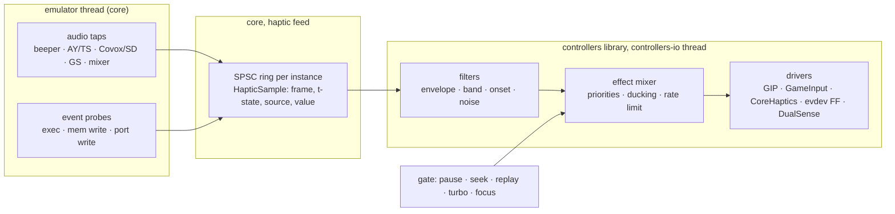

# Controller manager: haptics

| | |
|---|---|
| **Date** | 2026-10-17 |
| **Status** | Design, for review |
| **Extends** | [architecture.md §10](architecture.md#10-outputs-rumble-leds-triggers) (outputs), [debug-and-ttd.md §7](debug-and-ttd.md) (debug feedback) |

No ZX machine ever had force feedback. A host pad has two to six actuators, and the emulator knows exactly what the
game does: every beeper edge, every AY register write, every write to the lives counter. Haptics turns that into a
feel for the game: the explosion in the sound shakes the pad, losing a life is a hard knock, the engine of a racing
game hums in the triggers. The manager must support haptics on every device that has them, and game profiles map
audio and game events to haptic effects.

## Contents

- [1. Goals and rules](#1-goals-and-rules)
- [2. Actuators](#2-actuators)
- [3. Pipeline](#3-pipeline)
- [4. Sources: audio filters](#4-sources-audio-filters)
- [5. Sources: game events](#5-sources-game-events)
- [6. Effects](#6-effects)
- [7. Haptic profiles](#7-haptic-profiles)
- [8. Determinism, TTD and replay](#8-determinism-ttd-and-replay)
- [9. Backends](#9-backends)
- [10. UI](#10-ui)
- [11. Surfaces](#11-surfaces)
- [12. Testing](#12-testing)
- [13. Phases and open points](#13-phases-and-open-points)

## 1. Goals and rules

| # | Rule |
|:--|:--|
| H-1 | One effect model for every actuator kind; a device plays what its capabilities allow and degrades the rest (impulse triggers → handle motors → nothing). |
| H-2 | Two kinds of sources: **audio filters** on the emulated sound (generic, work for any game) and **game events** (exact, need a per-game profile). |
| H-3 | Per-game haptic profiles are chosen like play profiles: by game signature (`swsignature`, D16), then by machine default, then manual. |
| H-4 | Haptics is host output. It is never journaled, never part of a checkpoint, and never changes emulation. |
| H-5 | Muted on pause, focus loss (configurable), seek, scrub, replay of history, RZX playback (configurable), turbo, and exit. Every motor is stopped on each of these, not left at its last level. |
| H-6 | Off by default for players in Simple mode until a game profile with haptics matches; then on, with one master strength slider. |
| H-7 | No work on the emulator thread when no device with actuators is bound: one relaxed atomic load per hook. |
| H-8 | Latency from the emulated event to the actuator under one frame plus the backend's own latency. |

## 2. Actuators

| Actuator | Devices | Control | Notes |
|:--|:--|:--|:--|
| Handle motors, low and high frequency | Xbox, Elite, DualShock 4, most XInput / HID pads | two amplitudes 0..1 | ERM motors: spin-up ~30-50 ms, no frequency control |
| Impulse triggers | Xbox One / Series, Elite 2 | two amplitudes 0..1 (LT, RT) | Over GIP; GameInput and WGI on Windows, GameController on macOS (localities seen in the dump, research-host-apis §2.3) |
| Voice-coil HD haptics | DualSense, DualSense Edge, Steam Deck, Switch Pro / Joy-Con (HD rumble) | waveform or amplitude + frequency | DualSense: audio-rate signal on USB (the second audio channel pair), CoreHaptics patterns on macOS; Switch: amplitude + frequency pairs |
| Adaptive triggers | DualSense, Edge | resistance, vibration, weapon modes | Not haptic in the pulse sense; a separate optional output (§6.4) |
| Clicker (Simple Haptic Controller) | Surface Dial | a waveform (click, buzz), a repeat count and a period | No levels: plays HapticClicks through HID output report 1 (`01, count, 3 click / 4 buzz, period lo, hi`); the game's motor haptics skip it, the test effects and Identify click it |
| Speaker in the pad | DualSense, Wii Remote | audio | Out of scope; listed so it is not confused with haptics |
| LEDs, light bar, player LEDs | DualSense, DS4, Switch, Elite guide light | colour, brightness | Already in architecture §10; usable as a visual twin of an effect |

The device database ([device-database.md](device-database.md)) lists `outputs` per family: `rumble`,
`trigger-rumble`, `hd-haptics`, `adaptive-triggers`, `light`. Backends confirm at run time.

## 3. Pipeline



- **Core side** stays cheap: taps and probes push small samples (or per-frame summaries) into a lock-free SPSC ring,
  like `NativeAudioTap` (`core/src/emulator/sound/native_audio_tap.h`). Nothing is pushed while the feed is inactive.
- **Library side** runs the filters and the mixer on `controllers-io`, at 250-1000 Hz, and writes the actuators.
- **The gate** is driven by the same state the input side already watches (TTD state, RZX playback, pause, turbo,
  focus); a closed gate fades every actuator to zero within 10 ms and drops queued samples.

Audio is tapped **before** the host mixer's volume and mute: the user's mute (and the agents' mute of every instance
they start) must not silence the haptics, and the master volume must not change their strength.

## 4. Sources: audio filters

Generic sources that work for any game without a profile, and the building blocks of game profiles.

| Filter | Input | Output | Typical use |
|:--|:--|:--|:--|
| `envelope` | any audio source, mono | smoothed level, attack / release ms | engine hum, music pulse |
| `lowband` | any source | level of a band (default 20-150 Hz) after a biquad, then envelope | explosions, bass drum, the "thump" |
| `onset` | any source | an event when the level rises by more than X dB within Y ms | shots, impacts |
| `ay-noise` | AY / TurboSound register stream | level of channels with noise enabled (R7) times their volume (R8-R10, envelope mode) | explosions in AY music and effects; exact, no DSP |
| `ay-envelope` | AY R11-R13 writes | event on envelope restart with a decaying shape (shapes 0-3, 8, 9) | the classic AY "boom" |
| `beeper-density` | beeper port edges (bit 4 of #FE) | edges per ms, and long low-frequency runs | beeper explosions (noise bursts), engine buzz |
| `tape` | tape signal | level | optional: the loading tone as a light hum |

Source selectors: `beeper`, `ay:<n>` (chip index, TurboSound has two, ZX Next three), `covox`, `soundrive:<n>`,
`gs`, `neogs`, `saa`, `moonsound`, `next-dac`, `mix` (the whole machine before the host mixer). Register-level filters
(`ay-noise`, `ay-envelope`) read register writes, not samples, so they cost nothing per sample and are exact; the
DSP filters read the per-source stream decimated to 8 kHz.

The defaults without a game profile (Advanced, off for players): `lowband(mix)` → handle low motor, `onset(mix)` → a
short high-motor tick. That alone already gives a usable feel in most games, and a profile replaces it.

## 5. Sources: game events

Exact sources, written per game in its haptic profile. They are **probes**: debugger-style watches that never stop
the CPU and cost nothing when not armed.

| Probe | Trigger | Example |
|:--|:--|:--|
| `exec` | PC reaches an address (with optional bank / page) | the routine that kills the player |
| `write` | a write to an address (or range), optional value condition: `==`, `!=`, `<`, `>`, decreased, increased | lives counter decreased; energy byte value |
| `read` | a read of an address | rarely needed |
| `port-out` | an `OUT` to a decoded port, optional value mask | border colour change to red (a common hit flash); an AY register |
| `port-in` | an `IN` from a port | fire pressed and a shot is fired |
| `value` | a continuous value read each frame from memory, scaled | speed byte → engine hum strength; altitude → trigger tension |
| `frame` | a condition evaluated at frame end (`mem[a] & m == v`) | a state flag held |

Probe implementation reuses the debugger's watch machinery with a new non-breaking action ("notify feed"), so
memory banking, Next MMU and page selectors behave the same as in breakpoints. Addresses are page-qualified
(`page:5:0x5c3a`, `bank:...`) where the game is paged.

## 6. Effects

### 6.1 Effect model

An effect is a short program with an envelope and a target:

```json
{
  "id": "explosion",
  "target": ["handle.low", "handle.high"],
  "shape": "adsr", "attack_ms": 5, "decay_ms": 80, "sustain": 0.3, "release_ms": 300,
  "strength": 0.9,
  "priority": 3,
  "hd": { "frequency_hz": 60, "waveform": "noise" }
}
```

| Field | Meaning |
|:--|:--|
| `target` | `handle.low`, `handle.high`, `trigger.left`, `trigger.right`, `hd.left`, `hd.right`, `all`; with fallbacks (`trigger.right\|handle.high`) |
| `shape` | `pulse`, `adsr`, `ramp`, `pattern` (a list of on/off/level steps), `follow` (track a continuous value) |
| `priority` | the mixer ducks lower priorities while a higher one plays |
| `hd` | optional, used only on voice-coil devices: frequency, waveform (`sine`, `square`, `noise`), or a CoreHaptics AHAP file shipped with the profile |

### 6.2 Built-in effect library

`tick`, `knock`, `thump`, `explosion`, `engine` (follow), `heartbeat` (pattern), `hit`, `life-lost`, `pickup`,
`shot`, `rumble-strip`. Profiles reference them by id and may override fields.

### 6.3 Mixer

- Sums continuous effects per actuator, clamps to 1, applies the master strength and the per-device strength.
- Discrete effects take the actuator by priority; equal priority restarts the envelope.
- Rate limit per actuator (default 250 Hz updates for HID, 30 Hz for XInput-only paths where writes are slow).
- Fade to zero within 10 ms when the gate closes (H-5).

### 6.4 Adaptive triggers (DualSense)

Optional per profile: `trigger.right.resistance` from a `value` probe (throttle, bow tension), `weapon` mode for a
gun. Reset to off on every gate close and on unbind.

## 7. Haptic profiles

Haptics lives in the game profile, as a `haptics` section next to the bindings
([mapping-and-profiles.md](mapping-and-profiles.md)); it is selected with the same signature → machine default →
manual order, and the reason string says which won: `ResolvedProfiles::hapticsReason` (`context.haptics_reason` on
every plane) is `game profile <id> (<how>)` - how being `manual`, `signature tape:sha256:...`, `file sha256 ...` or
`file set: every entry kept, 1 of 5 files changed, 0 added` - or `<id> (default)` / `<id> (machine default)` for a profile that is not a game's. The
signatures are `core/swsignature`'s ([mapping-and-profiles.md §6.1](mapping-and-profiles.md#61-order-dt-2-d7)).

```json
{
  "match": { "signatures": ["tape:sha256:1a2b..."], "title": "Exolon" },
  "haptics": {
    "sources": {
      "boom":   { "filter": "ay-envelope", "source": "ay:0" },
      "beep":   { "filter": "beeper-density", "min_rate_khz": 2.0 },
      "died":   { "probe": "write", "address": "0x5f20", "when": "decreased" },
      "shot":   { "probe": "exec", "address": "0x8a14" }
    },
    "rules": [
      { "on": "boom", "play": "explosion" },
      { "on": "beep", "play": "engine", "scale": 0.4 },
      { "on": "died", "play": "life-lost" },
      { "on": "shot", "play": "shot", "target": "trigger.right|handle.high" }
    ]
  }
}
```

The addresses above are an illustration of the format, not verified values for this title.

- **Authoring**: the Advanced dialog has a "Haptics" tab with a live meter per source and per actuator, and
  "Add probe from debugger": a watch or breakpoint in the debugger can be turned into a probe with one click.
- **Sharing**: profiles in `data/controllers/profiles/` (built-in, reviewed) and the user folder; the same format for
  both.
- **Device independence**: profiles name abstract targets; a device without trigger motors plays the fallback.

## 8. Determinism, TTD and replay

| Situation | Haptics |
|:--|:--|
| Live play, recording or not | on per profile |
| TTD recording | on; nothing is journaled (H-4) |
| Seek, scrub, step back, replay of history | **off**; the gate closes at the first seek frame and opens on `ttd.resume_live` |
| RZX playback | off by default; option "feel the replay" (useful for demos) |
| Turbo / fast loader / run to | off (many frames per host frame would turn into a buzz) |
| Debug layer active | play-profile haptics off; the debug feedback of [debug-and-ttd.md §7](debug-and-ttd.md) only |
| Several instances (video wall) | only the instance the device follows (architecture §9); `all` instances never mix haptics |

Probes and taps read emulator state but never change it, so emulation is the same with haptics on or off. A test
asserts that frame hashes are identical with the feed active (§12).

## 9. Backends

| OS | Handle motors | Impulse triggers | HD haptics |
|:--|:--|:--|:--|
| macOS | IOHID output reports: Xbox over Bluetooth (report 3), DualSense over USB (report 2), the Surface Dial's clicks (report 1); none for an Xbox pad over USB (below) | GC localities `leftTrigger` / `rightTrigger` | DualSense through CoreHaptics; AHAP patterns |
| Windows | GameInput `SetRumbleState`; XInput `XInputSetState` as the last resort | GameInput (Xbox) | DualSense raw output reports over Raw Input / HID (no OS API) |
| Linux | evdev force feedback (`EV_FF`, `FF_RUMBLE`) where the kernel driver offers it (xpad, hid-microsoft, xpadneo, hid-playstation); else hidraw output report 3 for an Xbox One / Series pad over Bluetooth (below); the Surface Dial's clicks through hidraw (report 1) | hidraw report 3 where it is the path (below); none through evdev (`FF_RUMBLE` has no trigger motors) | hidraw output reports (hid-playstation for basic rumble) |
| SDL3 (later, D6) | `SDL_RumbleGamepad` | `SDL_RumbleGamepadTriggers` | none |

macOS over USB (2026-10-19): an Xbox pad over USB does not rumble. The `XboxGamepad.dext` endpoint offers only vendor
output reports 1 (12 bytes) and 5 (4 bytes); writes of the Bluetooth and GIP rumble layouts to them return success and
drive nothing. GameController lists the pad (vendor name "Controller", all localities) and its CoreHaptics engines start
and play without an error, yet no motor turns (a probe on an Elite Series 2, firmware 5.22; SDL reports the same,
libsdl-org/SDL#14800, and dropped output reports to wired Xbox pads on macOS in 7da728a). The backend says so: the Test
haptics button is off with "connect the pad over Bluetooth"; over Bluetooth output report 3 drives all four actuators.

Linux over Bluetooth (2026-10-22, built, not exercised on hardware): an Xbox One / Series pad (the Elite 2 included)
bound to `hid-generic` through BlueZ's uhid has no `FF_RUMBLE` on its evdev node. The evdev backend then writes output
report 3 to the hidraw node of the same HID device (`hid/hidrawnode`: `LinuxRumbleFor`, `HidrawUse::Rumble`), the bytes
from the builder macOS uses (`XboxBluetoothOutput::RumbleReport`), so the handle motors and the impulse triggers both
play. The writes go through a `RumbleWriter` on its own thread: `SetRumble` only queues, the latest levels win, equal
levels are not written again, two writes are at least 8 ms apart, and zero is written when the device goes away or the
backend stops. A pad whose driver offers `FF_RUMBLE` (hid-microsoft, xpadneo) keeps evdev (the handle motors only).
The node needs write access: `data/controllers/70-unreal-ng.rules` (uaccess for the Xbox Bluetooth product ids);
without it the Test haptics button is off with the node, the rule and the commands.

## 10. UI

- **Simple**: one row in the device card: "Vibration: Off / Game / Always", a strength slider, and a small
  "this game has haptics" badge when a profile with haptics matched.
- **Advanced**: the Haptics tab: sources with live meters, rules, the effect editor with "Test", per-actuator meters,
  the gate state ("muted: replay"), and the per-device strength.
- **Test** plays each effect on the selected device; "Identify" stays a 300 ms rumble (ui-ux.md). The selected
  device's header (built) has the test effects in a list and the **Test haptics** button that plays the chosen one:
  Identify, one effect per actuator and a swell; for a clicker (the Surface Dial) Identify (two clicks), a click,
  three clicks and a buzz (`haptics/testeffects.h`, the `rumble` verb's effects too); both off,
  with the backend's reason in their tooltip, for a device without motors the emulator can drive.
- The controller picture lights the actuator zones (grips, triggers) while they play.

## 11. Surfaces

| Surface | Verbs |
|:--|:--|
| `ControllerControl` | `HapticsState`, `SetHapticsMode(device, off\|game\|always)`, `SetHapticsStrength`, `PlayEffect(device, effect)`, `StopAll` |
| WebAPI | `GET/PUT /api/v1/controllers/haptics`, `POST /api/v1/controllers/haptics/play`, `POST /api/v1/controllers/haptics/stop` |
| MCP `controllers` | `haptics_state`, `haptics_play`, `haptics_stop` |
| Events | `NC_CONTROLLER_FEEDBACK` gains `haptic-source` and `haptic-gate` payloads, for meters and companion clients ([surfaces.md §9](surfaces.md#9-events)) |

Built (2026-10-19): the host verbs `haptics` (per device: `available` or the `reason`, `actuators`, the test
`effects`) and `rumble` (`device`, `effect`: one of the test effects of §10) on every surface - CLI `controllers
haptics` / `controllers rumble`, WebAPI `GET /api/v1/controllers/haptics`, `POST /api/v1/controllers/rumble`, MCP
`controllers` actions `haptics` / `rumble`, Python `controllers_haptics()` / `controllers_rumble()`, Lua
`controllers_haptics()` / `controllers_rumble()`. The effects are one table (`haptics/testeffects.h`) that the
dialog's Test haptics also plays. Mode, strength, gate and stop are still to come.

A companion client (Steam Deck, phone) may receive the effect stream and play it on its own actuators.

## 12. Testing

| Test | Asserts |
|:--|:--|
| `Haptics_AyEnvelopeOnset` | R13 writes with shape 0 produce one `explosion` event per restart, none on repeated R13 with the same value if the game does not restart |
| `Haptics_LowbandFilter` | a synthetic 60 Hz burst passes, a 2 kHz tone does not |
| `Haptics_ProbeWriteDecreased` | a test program decrementing a byte fires `died` once per decrement and never on increment |
| `Haptics_GateOnSeek` | a seek closes the gate within the same frame; the fake driver records zero within 10 ms |
| `Haptics_NotJournaled` | a recording with haptics active has no extra journal events; frame hashes equal with the feed on and off |
| `Haptics_Fallback` | `trigger.right\|handle.high` plays on handle.high for a device without trigger motors |
| `Haptics_NoCostWhenIdle` | no ring pushes when no device with actuators is bound |

Benchmarks: probe overhead per `write` with 0, 1 and 16 probes armed; the A/B rule of the performance guidelines
applies to the hooks on the memory and port paths.

## 13. Phases and open points

| Phase | Content |
|:--|:--|
| H1 (with C3/C8/C9) | actuators per backend, `PlayEffect`, Identify, the gate, the debug feedback |
| H2 | audio taps and the register-level filters (`ay-noise`, `ay-envelope`, `beeper-density`), generic defaults |
| H3 | probes (non-breaking watches), haptic profiles, the Haptics tab |
| H4 | HD haptics (DualSense, Switch), adaptive triggers, AHAP patterns |
| H5 | first built-in game profiles with haptics, chosen by signature (`core/swsignature`) |

Open points:

- Which games first: the owner's pick (a shooter with AY explosions, a racing game with an engine value, a platformer
  with a lives counter is a good first set).
- macOS USB output reports through the dext (§9).
- Whether a homebrew "haptic port" (a virtual OUT port that games can write to) is wanted; it would be emulator-only
  and must not decode on real-machine ports.
