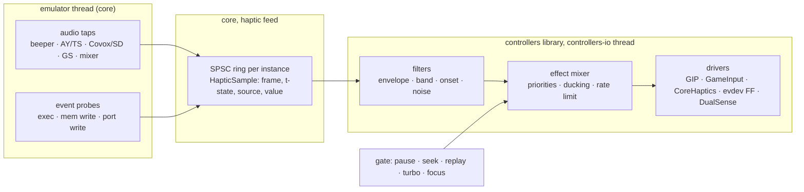

# Controller manager: haptics

| | |
|---|---|
| **Date** | 2026-10-17 |
| **Status** | Design, for review |
| **Extends** | [architecture.md §10](architecture.md#10-outputs-rumble-leds-triggers) (outputs), [debug-and-ttd.md §7](debug-and-ttd.md) (debug feedback) |

No ZX machine ever had force feedback. A host pad has two to six actuators, and the emulator knows exactly what the
game does: every beeper edge, every AY register write, every write to the lives counter. Haptics turns that into a
feel for the game: the explosion in the sound shakes the pad, losing a life is a hard knock, the engine of a racing
game hums in the triggers. The manager must support haptics on every device that has them, and game profiles map
audio and game events to haptic effects.

## Contents

- [1. Goals and rules](#1-goals-and-rules)
- [2. Actuators](#2-actuators)
- [3. Pipeline](#3-pipeline)
- [4. Sources: audio filters](#4-sources-audio-filters)
- [5. Sources: game events](#5-sources-game-events)
- [6. Effects](#6-effects)
- [7. Haptic profiles](#7-haptic-profiles)
- [8. Determinism, TTD and replay](#8-determinism-ttd-and-replay)
- [9. Backends](#9-backends)
- [10. UI](#10-ui)
- [11. Surfaces](#11-surfaces)
- [12. Testing](#12-testing)
- [13. Phases and open points](#13-phases-and-open-points)

## 1. Goals and rules

| # | Rule |
|:--|:--|
| H-1 | One effect model for every actuator kind; a device plays what its capabilities allow and degrades the rest (impulse triggers → handle motors → nothing). |
| H-2 | Two kinds of sources: **audio filters** on the emulated sound (generic, work for any game) and **game events** (exact, need a per-game profile). |
| H-3 | Per-game haptic profiles are chosen like play profiles: by game signature (`swsignature`, D16), then by machine default, then manual. |
| H-4 | Haptics is host output. It is never journaled, never part of a checkpoint, and never changes emulation. |
| H-5 | Muted on pause, focus loss (configurable), seek, scrub, replay of history, RZX playback (configurable), turbo, and exit. Every motor is stopped on each of these, not left at its last level. |
| H-6 | Off by default for players in Simple mode until a game profile with haptics matches; then on, with one master strength slider. |
| H-7 | No work on the emulator thread when no device with actuators is bound: one relaxed atomic load per hook. |
| H-8 | Latency from the emulated event to the actuator under one frame plus the backend's own latency. |

## 2. Actuators

| Actuator | Devices | Control | Notes |
|:--|:--|:--|:--|
| Handle motors, low and high frequency | Xbox, Elite, DualShock 4, most XInput / HID pads | two amplitudes 0..1 | ERM motors: spin-up ~30-50 ms, no frequency control |
| Impulse triggers | Xbox One / Series, Elite 2 | two amplitudes 0..1 (LT, RT) | Over GIP; GameInput and WGI on Windows, GameController on macOS (localities seen in the dump, research-host-apis §2.3) |
| Voice-coil HD haptics | DualSense, DualSense Edge, Steam Deck, Switch Pro / Joy-Con (HD rumble) | waveform or amplitude + frequency | DualSense: audio-rate signal on USB (the second audio channel pair), CoreHaptics patterns on macOS; Switch: amplitude + frequency pairs |
| Adaptive triggers | DualSense, Edge | resistance, vibration, weapon modes | Not haptic in the pulse sense; a separate optional output (§6.4) |
| Clicker (Simple Haptic Controller) | Surface Dial | a waveform (click, buzz), a repeat count and a period | No levels: plays HapticClicks through HID output report 1 (`01, count, 3 click / 4 buzz, period lo, hi`); the game's motor haptics skip it, the test effects and Identify click it |
| Speaker in the pad | DualSense, Wii Remote | audio | Out of scope; listed so it is not confused with haptics |
| LEDs, light bar, player LEDs | DualSense, DS4, Switch, Elite guide light | colour, brightness | Already in architecture §10; usable as a visual twin of an effect |

The device database ([device-database.md](device-database.md)) lists `outputs` per family: `rumble`,
`trigger-rumble`, `hd-haptics`, `adaptive-triggers`, `light`. Backends confirm at run time.

## 3. Pipeline



- **Core side** stays cheap: taps and probes push small samples (or per-frame summaries) into a lock-free SPSC ring,
  like `NativeAudioTap` (`core/src/emulator/sound/native_audio_tap.h`). Nothing is pushed while the feed is inactive.
- **Library side** runs the filters and the mixer on `controllers-io`, at 250-1000 Hz, and writes the actuators.
- **The gate** is driven by the same state the input side already watches (TTD state, RZX playback, pause, turbo,
  focus); a closed gate fades every actuator to zero within 10 ms and drops queued samples.

Audio is tapped **before** the host mixer's volume and mute: the user's mute (and the agents' mute of every instance
they start) must not silence the haptics, and the master volume must not change their strength.

## 4. Sources: audio filters

Generic sources that work for any game without a profile, and the building blocks of game profiles.

| Filter | Input | Output | Typical use |
|:--|:--|:--|:--|
| `envelope` | any audio source, mono | smoothed level, attack / release ms | engine hum, music pulse |
| `lowband` | any source | level of a band (default 20-150 Hz) after a biquad, then envelope | explosions, bass drum, the "thump" |
| `onset` | any source | an event when the level rises by more than X dB within Y ms | shots, impacts |
| `ay-noise` | AY / TurboSound register stream | level of channels with noise enabled (R7) times their volume (R8-R10, envelope mode) | explosions in AY music and effects; exact, no DSP |
| `ay-envelope` | AY R11-R13 writes | event on envelope restart with a decaying shape (shapes 0-3, 8, 9) | the classic AY "boom" |
| `beeper-density` | beeper port edges (bit 4 of #FE) | edges per ms, and long low-frequency runs | beeper explosions (noise bursts), engine buzz |
| `tape` | tape signal | level | optional: the loading tone as a light hum |

Source selectors: `beeper`, `ay:<n>` (chip index, TurboSound has two, ZX Next three), `covox`, `soundrive:<n>`,
`gs`, `neogs`, `saa`, `moonsound`, `next-dac`, `mix` (the whole machine before the host mixer). Register-level filters
(`ay-noise`, `ay-envelope`) read register writes, not samples, so they cost nothing per sample and are exact; the
DSP filters read the per-source stream decimated to 8 kHz.

The defaults without a game profile (Advanced, off for players): `lowband(mix)` → handle low motor, `onset(mix)` → a
short high-motor tick. That alone already gives a usable feel in most games, and a profile replaces it.

Built (2026-10-23):

- **Taps.** The feed names the streams it reads (`IHapticFeed::Streams`, at most four). The core then decimates each
  to 8 kHz mono at the frame end (`SoundManager::setHapticTaps` / `hapticTap`; an integer box filter whose phase runs
  on across frames) and hands it over in `HapticFrame::streams` (159 or 160 samples a frame of 69888 T at 3.5 MHz).
  - The taps sit before mute and volume: `mix` is the master mix, the others the per-source buffers.
  - `next-dac` is the Next's four DAC channels alone (`NextAudio`'s part tap, before the part gains). On a model with
    no DAC part, `covox` / `soundrive` is the Covox device.
  - A source the machine lacks gives an empty stream. Nothing is tapped while no feed asks.
- **Filters.** `haptics/audiofilters.{h,cpp}` work in integers, so every compiler gives the same levels.
  - The coefficients are Q16, from plain arithmetic: no libm, with π as a literal.
  - The dB ratios come from a table of literals.
- **Filter options.**
  - `envelope`: `attack_ms` (default 5), `release_ms` (default 80) and `scale`.
  - `lowband`: `low_hz` (default 20) and `high_hz` (default 150). It is a one-pole high-pass followed by two one-pole
    low-passes (12 dB / octave above the band), then the envelope. This is a deviation from the biquad above: it is
    exact in integers and the band edges matter little for a motor. A 60 Hz square wave passes and a 2 kHz one stays
    under 2 %.
  - `onset`: `rise_db` (default 12), `within_ms` (default 30), `floor` (default 0.05 of full scale) and `release_ms`
    (default 50). It is a 1 ms-attack envelope kept per millisecond. It fires when the level rises over the level
    `within_ms` earlier by `rise_db` and is above the floor; after that it stays quiet for `within_ms`.
- **Selectors.** `source` takes `mix`, `beeper`, `ay:0`..`ay:2`, `covox`, `soundrive`, `soundrive:0`..`soundrive:3`,
  `gs`, `neogs`, `next-dac`, `saa` or `moonsound`.
  - `soundrive:<n>` is one Soundrive channel alone (0 left A, 1 left B, 2 right A, 3 right B), `(value - #80) x 128`
    before the channel's gain (`Covox::SetChannelTap`, filled up to each write's sample). `soundrive` and `covox` are
    the whole device.
  - On the Next, `ay:<n>` is that chip alone. NextAudio renders each tapped chip's mono with the DC of its unsigned
    sum taken out (an integer one-pole), before the part gain. Its scale is the other machines' chip taps (a
    channel at full level is INT16_MAX / 2 of the mono), so one profile's thresholds fit every model.
  - `saa` is the ZX-MultiSound card's SAA1099 row. `moonsound` is the OPL4's FM and PCM summed.
  - A source the machine lacks gives an empty stream.
- **The DSP defaults.** `SoundHaptics(…, dspDefaults)` and `HostInputService::SetHapticsDspDefaults` add
  `lowband(mix)` on the low motor and `onset(mix)` as a 40 ms high-motor tick to the register-level defaults. They are
  off by default. The controllers dialog's Haptics panel has the switch: **DSP filters on the sound**, enabled while
  **Haptics from the sound** is on and kept in the settings (`Controllers/SoundHapticsDsp`).

## 5. Sources: game events

Exact sources, written per game in its haptic profile. They are **probes**: debugger-style watches that never stop
the CPU and cost nothing when not armed.

| Probe | Trigger | Example |
|:--|:--|:--|
| `exec` | PC reaches an address (with optional bank / page) | the routine that kills the player |
| `write` | a write to an address (or range), optional value condition: `==`, `!=`, `<`, `>`, decreased, increased | lives counter decreased; energy byte value |
| `read` | a read of an address | rarely needed |
| `port-out` | an `OUT` to a decoded port, optional value mask | border colour change to red (a common hit flash); an AY register |
| `port-in` | an `IN` from a port | fire pressed and a shot is fired |
| `value` | a continuous value read each frame from memory, scaled | speed byte → engine hum strength; altitude → trigger tension |
| `frame` | a condition evaluated at frame end (`mem[a] & m == v`) | a state flag held |

Probe implementation reuses the debugger's watch machinery with a new non-breaking action ("notify feed"), so
memory banking, Next MMU and page selectors behave the same as in breakpoints. Addresses are page-qualified
(`page:5:0x5c3a`, `bank:...`) where the game is paged.

Built (2026-10-23):

- **Two kinds of probe.**
  - `value`, `frame` and a plain `write` read their byte at the frame end (`IHapticFeed::Watches`).
  - `exec`, `read`, `port-in`, `port-out` and `write` with `each_write: true` are breakpoint probes
    (`IHapticFeed::Probes`, at most 16).
- **How a breakpoint probe works.**
  - Each one is a hidden breakpoint with the owner `haptics` and the probe index (`BreakpointDescriptor::probe`).
  - `HapticProbes`, the `IBreakpointProbeSink`, is told of each hit with the address and the byte written. Nothing
    stops, and the hit counts as one in the breakpoint's counter.
  - A probe is never adopted by a user breakpoint of the same address, and it never adopts one either.
  - A probe with a page is a bank breakpoint on that RAM page.
  - The OUT's byte now reaches the port path (`HandlePortOut(port, value)`).
- **What the feed gets.** At the frame end the feed gets the frame's hits per probe (`HapticFrame::probeHits`) and the
  writes and OUTs in order (`probeEvents`, the first 64; for a write, the byte before and after).
- **A write undone within one frame.** `write` with `each_write` sees every write, so a decrease followed by the
  restore in the same frame fires. A frame-end watch never sees it.
- **Port probes.** `port-in` / `port-out` take `port` and `port_mask`. `port-out` can also take `value` / `mask` on the
  written byte: `{probe: port-out, port: 0xFE, port_mask: 0x01, value: 2, mask: 7}` is a red border.
- **Cost.**
  - With nothing armed the feed costs the frame-end call only.
  - Port probes use the port path's existing gate.
  - Exec / read / write probes need the CPU's debug path. `FeatureManager::setProbeDebugHold` holds it on while they
    are armed, and the memory's breakpoint cache follows it. The cost is measured in §12.
- **A 16-bit value.** `value` takes `word: true`: the little-endian word at `address` and `address + 1` (two
  frame-end watches), scaled as a byte is (`value * scale / 255`), so a speed of 0 to 511 takes `scale: 0.5`.
- **During replay.** The breakpoint manager skips memory and port breakpoints while `ttdReplayActive`, and
  ControllerManager drops a replayed frame's hits.

## 6. Effects

### 6.1 Effect model

An effect is a short program with an envelope and a target:

```json
{
  "id": "explosion",
  "target": ["handle.low", "handle.high"],
  "shape": "adsr", "attack_ms": 5, "decay_ms": 80, "sustain": 0.3, "release_ms": 300,
  "strength": 0.9,
  "priority": 3,
  "hd": { "frequency_hz": 60, "waveform": "noise" }
}
```

| Field | Meaning |
|:--|:--|
| `target` | `handle.low`, `handle.high`, `trigger.left`, `trigger.right`, `hd.left`, `hd.right`, `all`; with fallbacks (`trigger.right\|handle.high`) |
| `shape` | `pulse`, `adsr`, `ramp`, `pattern` (a list of on/off/level steps), `follow` (track a continuous value) |
| `priority` | the mixer ducks lower priorities while a higher one plays |
| `hd` | optional, used only on voice-coil devices: frequency, waveform (`sine`, `square`, `noise`), or a CoreHaptics AHAP file shipped with the profile |

Built (2026-10-23), the HD frequency:

- **The fields.** `RumbleLevels` carries `lowHz` / `highHz`: the frequency each band plays at on a voice-coil pad
  (Switch HD rumble, CoreHaptics sharpness). 0 means the backend's default, and ERM motors ignore it.
- **The library.** Each built-in effect has a frequency per band. The heavy effects sit low (`explosion` 50 / 120 Hz,
  `thump` 60 / 160) and the light ones high (`tick` high band 320, `pickup` 400). All of them are inside the Switch HD
  bands.
- **A rule's `hd`.** A rule's `hd: {frequency_hz, low_hz, high_hz}` (1 to 2000 Hz) overrides them: `frequency_hz` sets
  both bands, and `low_hz` / `high_hz` set one each. `waveform` and AHAP files are not read yet.
- **The mixer.** Each band is written at the frequency of the effect that is loudest in it, after the envelope and the
  ducking. A silent band carries 0.
- **Retargeting.** A band that takes the other band's level (`target: handle.low` on a high-only effect) takes that
  band's frequency too (`HdHaptics_Test.FrequencyOfTheLoudestEffectPerBand`).

### 6.2 Built-in effect library

`tick`, `knock`, `thump`, `explosion`, `engine` (follow), `heartbeat` (pattern), `hit`, `life-lost`, `pickup`,
`shot`, `rumble-strip`. Profiles reference them by id and may override fields.

### 6.3 Mixer

- Sums continuous effects per actuator, clamps to 1, applies the master strength and the per-device strength.
- Discrete effects take the actuator by priority; equal priority restarts the envelope.
- Rate limit per actuator (default 250 Hz updates for HID, 30 Hz for XInput-only paths where writes are slow).
- Fade to zero within 10 ms when the gate closes (H-5).

### 6.4 Adaptive triggers (DualSense)

Optional per profile: `trigger.right.resistance` from a `value` probe (throttle, bow tension), `weapon` mode for a
gun. Reset to off on every gate close and on unbind.

## 7. Haptic profiles

Haptics lives in the game profile, as a `haptics` section next to the bindings
([mapping-and-profiles.md](mapping-and-profiles.md)); it is selected with the same signature → machine default →
manual order, and the reason string says which won: `ResolvedProfiles::hapticsReason` (`context.haptics_reason` on
every plane) is `game profile <id> (<how>)` - how being `manual`, `signature tape:sha256:...`, `file sha256 ...` or
`file set: every entry kept, 1 of 5 files changed, 0 added` - or `<id> (default)` / `<id> (machine default)` for a profile that is not a game's. The
signatures are `core/swsignature`'s ([mapping-and-profiles.md §6.1](mapping-and-profiles.md#61-order-dt-2-d7)).

```json
{
  "match": { "signatures": ["tape:sha256:1a2b..."], "title": "Exolon" },
  "haptics": {
    "sources": {
      "boom":   { "filter": "ay-envelope", "source": "ay:0" },
      "beep":   { "filter": "beeper-density", "min_rate_khz": 2.0 },
      "died":   { "probe": "write", "address": "0x5f20", "when": "decreased" },
      "shot":   { "probe": "exec", "address": "0x8a14" }
    },
    "rules": [
      { "on": "boom", "play": "explosion" },
      { "on": "beep", "play": "engine", "scale": 0.4 },
      { "on": "died", "play": "life-lost" },
      { "on": "shot", "play": "shot", "target": "trigger.right|handle.high" }
    ]
  }
}
```

The addresses above are an illustration of the format, not verified values for this title.

- **Authoring**: the Advanced dialog has a "Haptics" tab with a live meter per source and per actuator, and
  "Add probe from debugger": a watch or breakpoint in the debugger can be turned into a probe with one click.
  - Built (2026-10-23): the breakpoint list's context menu has **Add as Haptic Probe**. It turns an exec, read or
    write breakpoint, or a port-in or port-out one, into a source of the loaded game's user profile
    (`user/game-<sha16>`) with a rule that plays `hit`. A page breakpoint keeps its page.
  - A write probe sees every write (`each_write`, `when: changed`).
  - The first probe copies the haptics that play now into the user profile, so the probe adds to the game's profile
    and does not replace it.
  - The menu entry runs the `haptics_probe` host verb (§11): the surfaces and the menu write the same file.
- **Sharing**: profiles in `data/controllers/profiles/` (built-in, reviewed) and the user folder; the same format for
  both.
- **Device independence**: profiles name abstract targets; a device without trigger motors plays the fallback.

## 8. Determinism, TTD and replay

| Situation | Haptics |
|:--|:--|
| Live play, recording or not | on per profile |
| TTD recording | on; nothing is journaled (H-4) |
| Seek, scrub, step back, replay of history | **off**; the gate closes at the first seek frame and opens on `ttd.resume_live` |
| RZX playback | off by default; option "feel the replay" (useful for demos) |
| Turbo / fast loader / run to | off (many frames per host frame would turn into a buzz) |
| Debug layer active | play-profile haptics off; the debug feedback of [debug-and-ttd.md §7](debug-and-ttd.md) only |
| Several instances (video wall) | only the instance the device follows (architecture §9); `all` instances never mix haptics |

Probes and taps read emulator state but never change it, so emulation is the same with haptics on or off. A test
asserts that frame hashes are identical with the feed active (§12).

Built (2026-10-23): the hold is an event, not the host's 250 ms poll.

- **Who calls it.** `ControllerManager::UpdateHapticHold` runs at each of these points:
  - when either TTD controller enters or leaves replay mode (`EnterReplayMode` / `ExitReplayMode`) or changes session
    state (`SetState`: into the history, back to live);
  - when OnFrame sees replay take input or give it back.
- **What it does.** The hold is `ttdReplayActive` or the input owned by a replay (RZX playback, the recorded history).
  On a change it calls `IHapticFeed::OnHapticHold` at once, on the thread of the seek.
- **What the feeds do.** On the hold the profile and sound feeds stop the game effects of their instance's devices
  (`HapticMixer::StopGameEffects`: debug feedback stays, other instances are not touched). They then ignore frames until
  the hold ends. A seek therefore writes zero to the motors inside `SeekTo`.
- **The host gate.** The host's gate poll stays for pause, turbo and focus.

## 9. Backends

| OS | Handle motors | Impulse triggers | HD haptics |
|:--|:--|:--|:--|
| macOS | IOHID output reports: Xbox over Bluetooth (report 3), DualSense (USB report 2, Bluetooth report 0x31), DualShock 4 (USB 0x05, Bluetooth 0x11), Switch Pro controller and Joy-Cons (0x10 / 0x01, HD rumble; a pair split per half), the Surface Dial's clicks (report 1); else CoreHaptics through `GCDeviceHaptics` of the matched `GCController` (or a `gc:` device's own); none for an Xbox pad over USB (below) | Xbox report 3; DualSense trigger resistance; GC localities `leftTrigger` / `rightTrigger` | Switch Pro HD rumble (`RumbleLevels::lowHz` / `highHz`); CoreHaptics sharpness from the same frequency; AHAP patterns not yet |
| Windows | GameInput `SetRumbleState` (Xbox); XInput `XInputSetState` as the last resort; HID output reports over the Raw Input device's handle (overlapped `WriteFile`): DualSense / Edge (USB 2, Bluetooth 0x31), DualShock 4 (USB 0x05, Bluetooth 0x11), Switch Pro controller and Joy-Cons (0x10 / 0x01, HD rumble; a pair split per half), the Surface Dial's clicks | GameInput (Xbox); DualSense trigger resistance | Switch Pro and Joy-Con HD rumble (`RumbleLevels::lowHz` / `highHz`); no CoreHaptics equivalent: the frequency is dropped for every other pad |
| Linux | evdev force feedback (`EV_FF`, `FF_RUMBLE`) where the kernel driver offers it (xpad, hid-microsoft, xpadneo, hid-playstation, hid-sony, hid-nintendo, joycond's combined Joy-Cons); else hidraw output report 3 for an Xbox One / Series pad over Bluetooth (below); a PlayStation or Switch pad under hid-generic through its own protocol (as macOS); a Joy-Con pair split per half; the Surface Dial's clicks through hidraw (report 1) | hidraw report 3 where it is the path; a DualSense's trigger resistance through a trigger-only hidraw report beside hid-playstation's motors (below); none through evdev (`FF_RUMBLE` has no trigger motors) | Switch Pro / Joy-Con HD rumble through the hidraw 0x10 report beside hid-nintendo (its `FF_RUMBLE` plays fixed 160 / 320 Hz) |
| SDL3 (later, D6) | `SDL_RumbleGamepad` | `SDL_RumbleGamepadTriggers` | none |

macOS over USB (2026-10-19): an Xbox pad over USB does not rumble. The `XboxGamepad.dext` endpoint offers only vendor
output reports 1 (12 bytes) and 5 (4 bytes); writes of the Bluetooth and GIP rumble layouts to them return success and
drive nothing. GameController lists the pad (vendor name "Controller", all localities) and its CoreHaptics engines start
and play without an error, yet no motor turns (a probe on an Elite Series 2, firmware 5.22; SDL reports the same,
libsdl-org/SDL#14800, and dropped output reports to wired Xbox pads on macOS in 7da728a). The backend says so: the Test
haptics button is off with "connect the pad over Bluetooth"; over Bluetooth output report 3 drives all four actuators.

macOS PlayStation and Switch pads (2026-10-23, built, not exercised on hardware; byte fixtures from Linux's
hid-playstation.c / hid-nintendo.c at torvalds/linux 4169c9c90532, SDL3's SDL_hidapi_ps4.c / ps5.c / switch.c at
libsdl-org/SDL 3cffe56317b9 and dekuNukem's Nintendo_Switch_Reverse_Engineering at b354f21ae81f):

- **Protocol pump** (`hid/drivers/padprotocol`): a pad that talks a protocol gets a pure `IPadProtocol` (told the time,
  the input reports and what the router wants; answers the next output report or feature read and when to ask again)
  run by a `PadPump` thread per device. `SetRumble` / `SetLight` only queue; the writes, the feature reads (a Bluetooth
  round trip each) and the final stop (zero motors when the device goes or the backend stops) happen there.
- **DualSense / DualShock 4** (`hid/drivers/sonypad`, `SonyProtocol`): over Bluetooth the pad starts with its short
  report 0x01 (the descriptor's, `HidPad`); the pump first reads the calibration feature report 0x05 (41 bytes, CRC-32
  seed 0xA3, three tries 100 ms apart), which switches it to the full report (hid-playstation reads it at probe for the
  same reason; SDL reads 0x09 / 0x20). A DualShock 4 reads the USB calibration 0x02 first (37 bytes, no CRC, 35 or more
  accepted, three tries), then 0x05: SDL's `HIDAPI_DriverPS4_LoadCalibrationData` does that over Bluetooth ("this
  report switches them into advanced report mode", the 0x11 report); hid-playstation reads 0x05 alone there. `SonyPad` then decodes the full reports (USB 0x01 64 bytes; Bluetooth 0x31 /
  0x11 78 bytes, CRC-32 seed 0xA1 checked, a bad one dropped and counted): buttons, sticks, triggers, the first touch
  point (`touchpad.x` / `.y`, centred on lift), the mute button (`misc.1`), the Edge's paddles and Fn buttons, and the
  battery. Output: a DualSense report 2 (USB) or 0x31 (Bluetooth: sequence nibble, tag 0x10, CRC-32 seed 0xA2) with
  only the changed parts (motors with the trigger resistance, light bar, player LEDs), at most every 8 ms; the first
  colour releases the firmware's light bar. A DualShock 4 report (USB 0x05, Bluetooth 0x11 with hardware control 0xC0
  and the CRC) carries motors and light together, the light starting at the PlayStation player colour.
- **Switch Pro controller** (`hid/drivers/switchpro`): `SwitchProtocol` runs SDL's set-up order: 250 ms for macOS's
  own handshake; over USB the proprietary 80 02, 80 03, 80 02, 80 04; the SPI reads of the user (0x8010, 22 bytes,
  magic B2 A1 per stick) and factory (0x603D, 18 bytes) stick calibration; vibration on (0x48 01); over USB 80 04
  again; the full report (0x03 30); the player lights (0x30, SDL's patterns). Each step waits 100 ms for its reply (the
  ack bit and the same subcommand, an SPI reply of the same address), at most five writes, then goes on. `SwitchProPad`
  decodes 0x30 / 0x21 (positional faces: B south, A east; ZL / ZR as `lt` / `rt` 0 or 1; the 12-bit sticks scaled by
  SDL's extents, 0.7 of the calibrated range, widened by what the stick reaches; the battery); the simple 0x3F stays
  `HidPad`'s. Rumble: report 0x10 when the levels change, at least 30 ms apart, refreshed every 50 ms while it runs
  (SDL: the motors stop otherwise), the neutral `00 01 40 40` once at zero.
- **Joy-Cons** (057E:2006 L, 2007 R; the same `SwitchProtocol`, `SwitchProPad` with a `SwitchLayout`): alone, a
  Joy-Con is a small pad held sideways (SDL's `HandleMiniControllerStateL` / `R`: the four buttons by the stick are the
  faces, SL / SR `lb` / `rb`, L / ZL `paddle.p3` / `p4`, R / ZR `paddle.p1` / `p2`, the stick turned a quarter as
  `lstick`, + / - `menu`, Home / Capture `guide`). A left and a right one are one pad, as SDL combines them by default
  (`JoyConPairing`: the oldest alone of each side pair, a Joy-Con whose partner goes is alone again and joins the next
  one that waits; the pair's id is `<left id>+<right id>`, named "Joy-Con (L/R)"): each half gives its side of the Pro
  layout (`HandleCombinedControllerStateL` / `R`; SL / SR as `paddle.p3` / `p4` on the left and `p2` / `p1` on the
  right, SDL's LEFT_PADDLE1 / 2 and RIGHT_PADDLE2 / 1), both show the pair's player lights, the left half rumbles with
  the `low` level and the right one with `high` (SDL's `HIDAPI_DriverSwitch_RumbleJoystick`), the battery is the lower
  of the two. The charging grip (057E:200E, USB only: each Joy-Con in it an HID interface
  of its own under the one product id) runs the USB setup with the device info first (subcommand 0x02 after the
  handshake; the controller type in the reply's byte 17, `data[2]` of hid-nintendo's `joycon_read_info`: 1 left, 2
  right, SDL's `deviceInfo.ucDeviceType`). Until it answers the half is not reported and its input is dropped; then it
  is a Joy-Con of that side (`SwitchLayout::JoyConLeft` / `Right`, named "Joy-Con (L)" / "(R)") and pairs through
  `JoyConPairing` as two Bluetooth ones do. No answer leaves it hidden (SDL's `CalculateControllerType`: "a Joy-Con
  that's missing from a charging grip slot"; SDL then guesses the side from the interface number, which IOHID does not
  give). The grip's halves never merge as endpoints of one pad (they share the grip's serial).
- **HD rumble encoding** (`SwitchRumble`): per actuator the high band's frequency `hf` (9 bits) and amplitude `ha`,
  the low band's `lf` (7 bits) and `la` (9 bits) in 4 bytes. The handle motor levels play on the bands: `low` on the
  low band at `RumbleLevels::lowHz` (default 160 Hz), `high` on the high band at `highHz` (default 320 Hz), the
  actuators' resonances of the neutral value (SDL plays both at about 150 Hz instead; untested which feels closer to an
  ERM). A frequency is the code round(32 log2(f / 10)) (hf = (code - 0x60) * 4 for codes 0x61..0xDF, lf = code - 0x40
  for 0x41..0xBF), looked up in a table of the rounding boundaries in millihertz (generated once, no libm at run time:
  the same bytes on every compiler); an amplitude is the first of dekuNukem's 101 steps (SDL's table, amplitude *
  65535) not below the level, step 100 = 1.0 the most the table calls safe.
- **HD frequency** (`RumbleLevels::lowHz` / `highHz`, 0 = the device's default): what a profile's `hd.frequency_hz`
  becomes once the mixer passes it (the mixer and the profile parser are the haptics core's; until they set it every
  effect plays at the defaults). CoreHaptics has no frequency: the continuous event's sharpness (base 0.5, moved by the
  sharpness control) follows the same frequency laid on the Switch codes 41 Hz..1253 Hz (`GcPad::SharpnessFor`).
- **Player LEDs**: each pump pad gets the lowest free player number at connect (DualSense LEDs `04 0A 15 1B 1F`, the
  DualShock 4 light colour, the Switch lights); the emulator's own player slots do not drive them yet.

Windows PlayStation and Switch pads (2026-10-24, built and unit-tested with fake writers, not exercised on hardware: the
Windows host has no pads):

- **`ProtocolPads`** (`core/controllers/src/protocolpads.{h,cpp}`) is the OS-neutral part of a HID backend for the pads
  above: it runs the same `SonyProtocol` / `SwitchProtocol` pumps, `SonyPad` / `SwitchProPad` decoders and
  `JoyConPairing` as macOS (no copies), picks the lowest free player number, hides a charging-grip half until its
  device info names the side, and answers rumble, light, player LEDs and battery for the devices it reports. The Raw
  Input backend (`platform/windows/rawinputbackend`) gives it each pad's top-level collection (key: the Raw Input
  handle), its input reports and two calls run on the pump's thread: an output report written with overlapped
  `WriteFile` padded to `HIDP_CAPS::OutputReportByteLength` (hidapi's `hid_write`), and a feature read through
  `IOCTL_HID_GET_FEATURE` with a buffer of `FeatureReportByteLength`, cut to the protocol's size (41 bytes for 0x05,
  37 for 0x02, whose CRC and length checks are exact). Both give up after 1 s (`CancelIoEx`), so a pad that stops
  answering never holds its pump. The handle is opened shared for reading and writing; when Windows refuses it (another
  program holds the pad alone: Steam Input, DS4Windows, HidHide), the pad still reads its descriptor's reports and the
  notice says why rumble and light are off. ProtocolPads can serve Linux hidraw and IOHID the same way later.
- **More pads through it** (after ctl-allpads): the Steam Controllers on their vendor-page collection (Raw Input
  registers page 0xFF00 page-only; `SteamProtocol`'s feature reports through `IOCTL_HID_SET_FEATURE`; the report id 0
  Windows puts before the 2015 pad's reports dropped, `Endpoint::zeroReportIdFirst`; a dongle's slot shown while a pad
  is on it), the GameCube adapter (page 0x05 page-only, start report 0x13, each port with a controller a device
  `<adapter id>:p1`..`:p4`; SDL opens it through libusb, so on Windows it may need WinUSB: unverified), the NSO pads
  (`SwitchProPad::LayoutFor` with the product string: an NES pad is no right Joy-Con; NES / SNES / Genesis without
  motors). None of them rumbles yet.
- **Report sizes**: Raw Input pads every report to `InputReportByteLength`, the longest input report (547 bytes for a
  PlayStation pad over Bluetooth). `ProtocolPads::ReportSize` cuts a Sony full report to 64 bytes (USB 0x01) or 78
  (Bluetooth 0x31 / 0x11, CRC over those 78) before `SonyPad::Decode`; a Switch 0x21 / 0x30 is taken as it comes.
- **No start delay difference**: SwitchProtocol keeps its 250 ms before the first command (macOS's handshake); Windows
  does none, so it only delays the set-up.
- **HD frequency on Windows**: only the Switch pads have a frequency per band; GameInput's `SetRumbleState`, XInput,
  the DualSense's compatible vibration and the DualShock 4 take amplitudes only, and Windows has no sharpness API, so
  `lowHz` / `highHz` are ignored there. The DualSense's voice-coil (audio haptics over the USB audio endpoint) stays out
  of scope on every OS.

Linux over Bluetooth (2026-10-22, built, not exercised on hardware): an Xbox One / Series pad (the Elite 2 included)
bound to `hid-generic` through BlueZ's uhid has no `FF_RUMBLE` on its evdev node. The evdev backend then writes output
report 3 to the hidraw node of the same HID device (`hid/hidrawnode`: `LinuxRumbleFor`, `HidrawUse::Rumble`), the bytes
from the builder macOS uses (`XboxBluetoothOutput::RumbleReport`), so the handle motors and the impulse triggers both
play. The writes go through a `RumbleWriter` on its own thread: `SetRumble` only queues, the latest levels win, equal
levels are not written again, two writes are at least 8 ms apart, and zero is written when the device goes away or the
backend stops. A pad whose driver offers `FF_RUMBLE` (hid-microsoft, xpadneo) keeps evdev (the handle motors only).
The node needs write access: `data/controllers/70-unreal-ng.rules` (uaccess for the Xbox Bluetooth product ids);
without it the Test haptics button is off with the node, the rule and the commands.

Linux PlayStation and Switch pads (2026-10-24, built, unit-tested, run against the kernel's own drivers with the
pads emulated through uhid, not exercised on hardware). The kernel driver is the first path; hidraw adds only what it
lacks (`HidrawUseFor(LinuxPadFacts)`, the driver from the HID device's uevent `DRIVER=`):

- hid-playstation (DualSense, Edge, DualShock 4 since 6.2) and hid-sony (DualShock 3, the DualShock 4 before 6.2):
  the motors through `FF_RUMBLE` (strong = the low motor, weak = the high one; hid-playstation's compatible
  vibration). A DualSense's trigger resistance has no kernel path: the backend writes output report 2 (USB) / 0x31
  (Bluetooth, its own sequence counter, CRC) with only the trigger valid flags (`DualSenseOutput::TriggerReport`), so
  hid-playstation's own reports (motors, light bar, player LEDs) and the backend's never overwrite each other's
  fields. The writes go through a `RumbleWriter` of their own (trigger levels only: a change of the motors alone writes
  nothing). Without access to the node the motors still play; the device notice says the triggers need the rule.
- hid-nintendo (Switch Pro controller, Joy-Cons, the charging grip): the kernel did the set-up (handshake, calibration,
  the full report, vibration on, its own player lights); its `FF_RUMBLE` plays fixed 160 / 320 Hz. With the node
  writable the backend sends the HD rumble itself: report 0x10 at the effect's frequencies
  (`SwitchProtocol::RumbleOnly`: no set-up, `SetPlayer` ignored, the same 30 ms pacing and 50 ms refresh, neutral at
  the end) and leaves `FF_RUMBLE` unused, so the kernel's rumble queue stays empty. Without the node `FF_RUMBLE` is
  the path (the handle motors at the fixed frequencies).
- hid-generic (no hid-playstation / hid-nintendo: an old kernel, the module not loaded): the pad is read and driven
  through hidraw as on macOS: `SonyPad` / `SwitchProPad` decode the full reports, a `PadPump` runs `SonyProtocol` /
  `SwitchProtocol` (calibration feature, set-up, rumble, light bar, player LEDs the backend numbers itself).
- A Joy-Con pair (the backend's, as on macOS): the left half the low level, the right one the high one, each through
  its own path. joycond's combined device forwards `FF_RUMBLE` to both halves itself.

`LinuxUhid_Functional` (opt-in: `UNREAL_FUNCTIONAL_TESTS=1`, root; Linux 7.0 on x86_64) creates the pads through `/dev/uhid`, so
the kernel's own hid-playstation / hid-nintendo / hid-generic bind them and the test sees every output report: a
DualSense (hid-playstation's report 2 with the `FF_RUMBLE` motors, the backend's trigger-only report beside it, the
light bar through the LED class), a DualSense Edge (paddles and Fn from hidraw on a kernel before 7.2), a DualSense
under hid-generic (motors, trigger and light bar in the backend's own report 2), a Switch Pro controller (the HD
rumble as the backend's report 0x10 while hid-nintendo serves the pad) and two Joy-Cons (joined into one pad, each
half rumbling its side). What uhid cannot show: the real pads' timing and firmware, BlueZ's path, joycond.

## 10. UI

- **Simple**: one row in the device card: "Vibration: Off / Game / Always", a strength slider, and a small
  "this game has haptics" badge when a profile with haptics matched.
- **Advanced**: the Haptics tab: sources with live meters, rules, the effect editor with "Test", per-actuator meters,
  the gate state ("muted: replay"), and the per-device strength.
- **Test** plays each effect on the selected device; "Identify" stays a 300 ms rumble (ui-ux.md). The selected
  device's header (built) has the test effects in a list and the **Test haptics** button that plays the chosen one:
  Identify, one effect per actuator and a swell; for a clicker (the Surface Dial) Identify (two clicks), a click,
  three clicks and a buzz (`haptics/testeffects.h`, the `rumble` verb's effects too); both off,
  with the backend's reason in their tooltip, for a device without motors the emulator can drive.
- The controller picture lights the actuator zones (grips, triggers) while they play.

## 11. Surfaces

| Surface | Verbs |
|:--|:--|
| `ControllerControl` | `HapticsState`, `SetHapticsMode(device, off\|game\|always)`, `SetHapticsStrength`, `PlayEffect(device, effect)`, `StopAll` |
| WebAPI | `GET/PUT /api/v1/controllers/haptics`, `POST /api/v1/controllers/haptics/play`, `POST /api/v1/controllers/haptics/stop` |
| MCP `controllers` | `haptics_state`, `haptics_play`, `haptics_stop` |
| Events | `NC_CONTROLLER_FEEDBACK` gains `haptic-source` and `haptic-gate` payloads, for meters and companion clients ([surfaces.md §9](surfaces.md#9-events)) |

Built (2026-10-19): the host verbs `haptics` (per device: `available` or the `reason`, `actuators`, the test
`effects`) and `rumble` (`device`, `effect`: one of the test effects of §10) on every surface - CLI `controllers
haptics` / `controllers rumble`, WebAPI `GET /api/v1/controllers/haptics`, `POST /api/v1/controllers/rumble`, MCP
`controllers` actions `haptics` / `rumble`, Python `controllers_haptics()` / `controllers_rumble()`, Lua
`controllers_haptics()` / `controllers_rumble()`. The effects are one table (`haptics/testeffects.h`) that the
dialog's Test haptics also plays. Mode, strength, gate and stop are still to come.

Built (2026-10-23): the host verb `haptics_probe` (`kind` exec / read / write / port-in / port-out, `address`, `page`,
`port_mask`, `play`). It adds a probe with its rule to the loaded game's user profile and answers `id`, `source` and
`path`; without a program loaded from a file it is `unavailable`. It is on every plane:

- CLI `controllers haptics_probe <kind> <address> [page= port_mask= play=]`;
- WebAPI `POST /api/v1/controllers/haptics_probe`, in OpenAPI, and a socket `call` like every route;
- MCP `controllers` action `haptics_probe`;
- Python `controllers_haptics_probe(kind, address, ...)`.

Lua is excluded, as decided.

A companion client (Steam Deck, phone) may receive the effect stream and play it on its own actuators.

## 12. Testing

| Test | Asserts |
|:--|:--|
| `Haptics_AyEnvelopeOnset` | R13 writes with shape 0 produce one `explosion` event per restart, none on repeated R13 with the same value if the game does not restart |
| `Haptics_LowbandFilter` | a synthetic 60 Hz burst passes, a 2 kHz tone does not (built: `HapticFilters_Test`, with the envelope, onset, probe parse and evaluation, DSP defaults and Add-probe tests) |
| `Haptics_ProbeWriteDecreased` | a test program decrementing a byte fires `died` once per decrement and never on increment |
| `Haptics_GateOnSeek` | a seek closes the gate within the same frame; the fake driver records zero within 10 ms (built: `HapticFeed_Test`, the zero is written inside `SeekTo`) |
| `Haptics_NotJournaled` | a recording with haptics active has no extra journal events; frame hashes equal with the feed on and off (built: `HapticFeed_Test`, every probe and three taps, ten frames) |
| `ProbesSeeEveryAccessAndNeverStop` | on a 48K running a test program: exec, read, both writes of a change undone in the frame, the OUT with its byte, the IN; 159 or 160 samples a frame per tap; disarmed on detach |
| `TheNextDacIsAStreamOfItsOwn` | on a Next, `next-dac` is the mono sum of the DAC channels before the mixer's DAC row, and `covox` is the same stream there |
| `GameHapticsGames_Test` | each built-in game profile (H5) is found by its image's hash on a Pentagon, and each of its sources fires alone and plays when a test program calls the game's address |
| `ChaseHqSpeedDrivesTheEngine` | the 16-bit speed word drives the engine on the low motor in proportion, full at 511 |
| `FrequencyOfTheLoudestEffectPerBand` | the mixer writes each band at the frequency of its loudest effect, 0 when silent; the library defaults, a rule's `hd` over them, the frequency moving with a retarget, bad `hd` refused |
| `Haptics_Fallback` | `trigger.right\|handle.high` plays on handle.high for a device without trigger motors |
| `Haptics_NoCostWhenIdle` | no ring pushes when no device with actuators is bound |

Benchmarks: probe overhead per `write` with 0, 1 and 16 probes armed; the A/B rule of the performance guidelines
applies to the hooks on the memory and port paths.

## 13. Phases and open points

| Phase | Content |
|:--|:--|
| H1 (with C3/C8/C9) | actuators per backend, `PlayEffect`, Identify, the gate, the debug feedback |
| H2 | audio taps and the register-level filters (`ay-noise`, `ay-envelope`, `beeper-density`), generic defaults |
| H3 | probes (non-breaking watches), haptic profiles, the Haptics tab |
| H4 | HD haptics (DualSense, Switch), adaptive triggers, AHAP patterns |
| H5 | first built-in game profiles with haptics, chosen by signature (`core/swsignature`) |

Built (2026-10-23, widened 2026-10-24), H5: game profiles in `data/controllers/profiles/games/pentagon/`, found by
the SHA-256 of the disk image (no signature library yet) on a Pentagon with TR-DOS. Each file is a bundle: one
document per address set, each listing the hashes of the releases that share it. Every address was checked by play
through the WebAPI: an exec counter or breakpoint hit at the moment, and the game's state changed as expected. The
surveys covered every release on disk: the collection in `/Volumes/TB4-4Tb/Data/zx-spectrum/software/games/haptics/`
and the vtrd mirror. All of them are TR-DOS images: no tape image of the three games is on disk.

| Profile | Releases | Sources → effects |
|:--|:--|:--|
| `builtin/game/manic-miner` | 19: MMIN_EST and 18 mods on the Bug-Byte engine (Manic Miner 2 to 6, the Triumph and Korund mods, the "3D demo") | exec #8906 (death in a real game; #88FF also runs in the demo) → `life-lost`; #8F82 (item taken) → `pickup`; #8C7B (jump starts) → `tick` on the high motor; on MMIN_EST also #89AA (game over) → `thump`, #90D9 (air counted into the score) → `rumble-strip`, #91B5 (Kong falls) → `explosion`, #907D (the ending) → `heartbeat` |
| `builtin/game/manic-miner-phantom` | MAMINPHL (code 6 to 11 bytes higher) | #890C → `life-lost`, #8F8D → `pickup`, #8C86 → `tick` |
| `builtin/game/exolon` | 3 that fire with Space: EXLNSlTb (bugfix), EXOL_CAP, EXOLO | exec #8366 (blaster shot) → `shot` on the right trigger or the high motor; #9221 (grenade launched) → `knock`; #92D4 (grenade detonates) → `explosion`; #9CB9 (Vitorc killed) → `life-lost`; #99CE / #9978 (grenades / ammo taken) → `pickup`; the sound #C155 (enemy destroyed) → `hit`; the sound #C0E7 (bullet hits a solid object) → `tick` |
| `builtin/game/exolon-m` | 21 that fire with M | the same |
| `builtin/game/exolon-demo` | EXOLONGD (relocated) | #83E5 → `shot`, #92AD → `knock`, #9360 → `explosion`, #9D45 → `life-lost` |
| `builtin/game/chase-hq` | 16 part-1 releases, among them CHHQ+2_T (bugfix), the 48K beeper build CHASHQMK and CHHQ_FSS (boots on a Profi only, so the document lists PROFI too) | the speed word #A24A (0 to 511 with turbo) → `engine` on the low motor; exec #A4B1 (crash into the roadside) → `thump`; #A78A (the criminal's car hit) → `hit`; #889C (turbo start) → `explosion` at 0.6; #B076 (landing after a hill crest, effect id 2) → `knock`; #A437 (scraping a tunnel wall, id 6) → `rumble-strip` |
| `builtin/game/chase-hq-gs` | CHASE_GS (General Sound version) | the speed, crash, hit and turbo above; its effect requests go to the GS |
| `builtin/game/chase-hq-demo` | CHASEHQD (Sinclair User demo, variables #514 lower) | the speed word #9D36, #9F8E, #A1B0, #8327, as above; the pad drives its Sinclair joystick keys |

Each profile also binds the pad: the game's keys on the d-pad, the left stick and the face buttons.

- Matching by content signature: `match.signatures` (indexed as `sig:` keys) already parses next to `file_sha256`;
  once `swsignature` gives a release's content signature, a document lists it there and the hash lists can go.
- The tests do not use the games (they are not in the repository). A test program on a Pentagon calls each address
  instead, at a RET stub (`GameHapticsGames_Test`, one row per address set, plus a release that only shares one).
- Not used, because they were not confirmed by play:
  - Manic Miner: the title tune (#92F8; it plays once on entering the title, not wanted as haptics). Kong's fall ran in
    play, but its switches were set by poke. The Phantom release's game over, Kong, air and ending addresses. The
    JSW64-engine releases (ULT_M_M, JSWJBOND; death #8C01, jump #8F96 played) have no profile: their keys were not
    checked.
  - Exolon: the demo's pickups and enemy sounds.
  - Chase H.Q.: effect id 5 (game over screens only), id 7 (requested every frame while accelerating), id 8 (the
    hidden test mode only). CHASE.SCL boots on no model.
- Most non-bugfix Exolon builds kill Vitorc again and again near a zone's start (the bug the 2024 fix clamps at
  #9D06), so they give many more `died` events.

Open points:
- macOS USB output reports through the dext (§9).
- Windows: the PlayStation and Switch pads' outputs over Raw Input (§9) are built but have not met a pad; to check on
  hardware: Bluetooth DualSense light and rumble, the DualShock 4's Bluetooth 0x11 switch, the Switch set-up over USB
  and Bluetooth, the charging grip, and whether Steam Input running in the background blocks the writes.
- Whether a homebrew "haptic port" (a virtual OUT port that games can write to) is wanted; it would be emulator-only
  and must not decode on real-machine ports.
