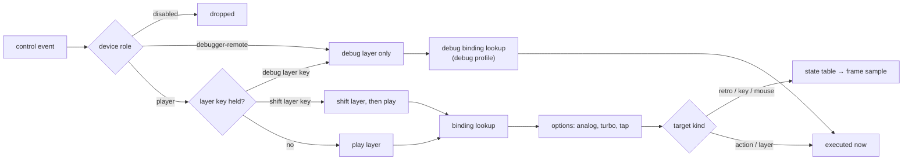
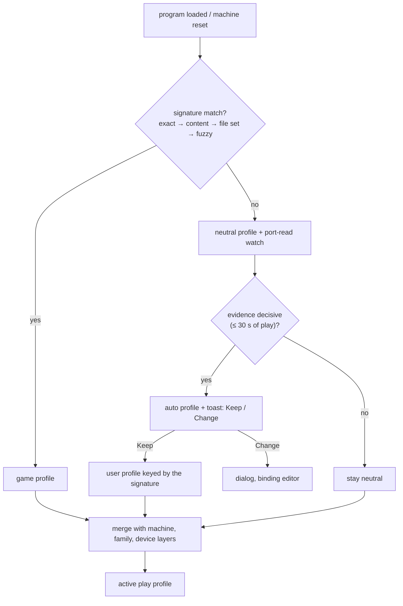

# Controller manager: mapping and profiles

| | |
|---|---|
| **Date** | 2026-10-17 |
| **Status** | Design, for review |
| **Decisions** | D7 (signature → port reads → manual), D8 (separate debug layer and profiles), D9 (layer key, roles) in [README.md](README.md#decisions-2026-10-17) |
| **Generalizes** | [steamdeck-client/input-and-profiles.md](../2026-10-08-steamdeck-client/input-and-profiles.md) §3 routing, §5 heuristic, §6 profile format, §7 defaults |

The Steam Deck design described one router for one device inside one client. This document makes that router part of
the `controllers` library ([architecture.md §3](architecture.md#3-the-controllers-library)), so every client and every
host device uses it. What changes and what stays:

| Steam Deck design | Here |
|:--|:--|
| `ControlEvent` stream, `InputRouter` | Same names, now in `core/controllers/src/router/`. The Deck client links the library instead of keeping its own router. |
| Deck control names (`a`, `l4`, `right_trackpad`) | The canonical vocabulary ([architecture.md §6](architecture.md#6-the-canonical-control-vocabulary)): `south`, `paddle.p3`, `touchpad.x`. The Deck's L4 L5 R4 R5 are `paddle.p1`..`p4`. |
| Targets: key, joystick bit, mouse, app action | Same plus retro controls of any connector device, layers, and debug actions. A target names a connector, not "the joystick". |
| Signatures §4, heuristic §5 | Kept as written; this document fixes the order (D7) and the layering. The signature algorithms stay in the shared `swsignature` library the Deck design proposed. |
| One JSON profile with `controls`, `layers`, `radial` | Split in two: play profiles and debug profiles, separate files and directories (D8). Radial menus stay a play-profile feature of clients that draw them. |
| Defaults §7 for the Deck | The Deck becomes one family in [§8](#8-defaults-out-of-the-box). |

## Contents

- [1. Binding model](#1-binding-model)
- [2. Routing and layers](#2-routing-and-layers)
- [3. Analog handling](#3-analog-handling)
- [4. Keyboard mappings](#4-keyboard-mappings)
- [5. Mouse mappings](#5-mouse-mappings)
- [6. Profile selection](#6-profile-selection)
- [7. Profile format](#7-profile-format)
- [8. Defaults out of the box](#8-defaults-out-of-the-box)
- [9. Two players and more](#9-two-players-and-more)

## 1. Binding model

A binding is **source → target, with options**. A profile is a list of bindings per layer.

### 1.1 Sources

| Form | Example | Meaning |
|:--|:--|:--|
| One control | `south` | Pressed when the button is down, or the axis is past its threshold. |
| OR-list | `["south", "rt.click", "key.space"]` | Any of them (MAME `input_seq` OR, Mesen2's four sets). The same target from a pad and the keyboard at once. |
| Chord | `{"chord": ["view", "menu"]}` | All held together, in any order, within the chord window (60 ms). The members' own bindings are held back until the window closes; if the chord completes, they are not sent ([§2](#2-routing-and-layers) rule 4). |
| Derived digital | `lstick.left`, `lt.click` | An analog control seen as a button through [§3](#3-analog-handling). |
| Analog | `lstick.x`, `rt`, `gyro.y` | For analog targets only: mouse axes, scrub speed, the light gun pointer. |

### 1.2 Targets

| Target | JSON | Reaches the core as |
|:--|:--|:--|
| Retro control | `{"retro": "kempston:fire"}`, `{"retro": "next.left:c"}` | The connector's device state, sampled at frame start ([architecture.md §7](architecture.md#7-the-event-pipeline)). `auto:fire` means "the connector this device drives". |
| ZX key | `{"key": "SPACE"}` | Keyboard overlay (ZX key names of `ZXKeysEnum`, incl. `ZXKEY_EXT_*` composites such as `EDIT`). |
| ZX chord | `{"keys": ["CAPS", "1"]}` | Held together. |
| Macro | `{"macro": ["J", "SYM+P", "SYM+P", "ENTER"]}` | A sequence; each key held one frame and released one frame, so the ROM scan sees every key (Deck design §3). Runs through `DebugKeyboardManager`-style scheduling in the core, so it is journaled. |
| Mouse axis or button | `{"mouse": "dx", "scale": 6}`, `{"mouse": "left"}` | Mouse deltas through the existing `MouseManager` path. |
| Pointer | `{"pointer": "absolute"}` | Light gun / pen position in screen coordinates. |
| Action | `{"action": "ttd.scrub_back"}` | A host command ([debug-and-ttd.md §3](debug-and-ttd.md#3-action-catalogue)); never journaled. Only some actions are allowed in play profiles (OSD keyboard, pause, quick menu, screenshot). |
| Layer | `{"layer": "keys", "mode": "hold"}` | Switches layers ([§2](#2-routing-and-layers)). |
| None | `{"none": true}` | Explicitly unbound; overrides an inherited binding. |

### 1.3 Options per binding

| Option | Values | Default | Notes |
|:--|:--|:--|:--|
| `turbo` | `off`, `classic`, `toggle`, `hold`, `burst` | `off` | `classic`: pulses while held. `toggle`: one press starts pulsing, the next stops it. `hold`: one press holds the target until the next press (autohold). `burst`: `count` pulses per press (vAmiga bullets). |
| `on`, `off` | frames | 2, 2 | Emulated frames, so the pattern is deterministic and replays identically (12.5 Hz at 50 Hz). The phase restarts on each press. |
| `count` | 1..16 | 3 | For `burst`. |
| `press` | `hold`, `tap` | `hold` | `tap`: a fixed `frames` pulse on the press edge regardless of how long the button is held (menu keys, ENTER). |
| `frames` | 1..50 | 2 | Tap length, like `DebugJoystickManager::Tap`. |
| `invert` | bool | false | For axes, and for "released = pressed" oddities. |
| `repeat` | `{delay, rate}` in frames | none | Key repeat for a held ZX key from a pad (menu navigation). |
| `label` | string | none | The game's meaning ("Fire", "Hyperspace"), shown in the picture callouts (RetroArch descriptors). |

## 2. Routing and layers



DT-5, in words:

1. **Role first.** A `debugger-remote` device never reaches the play layer; a `disabled` device reaches nothing.
2. **Layer stack.** Base layer `play`; a held layer key pushes `debug` or a profile's shift layer. Lookup goes top to
   bottom, so a shift layer only overrides what it names (the Deck design's `keys` layer). `debug` is opaque: a
   control not bound in the debug profile does nothing while the debug layer is up; it does not fall through to play.
3. **Layer keys.** Defaults: hold `paddle.p4` on devices with paddles, the chord `view+menu` on pads
   without ([debug-and-ttd.md §2](debug-and-ttd.md#2-entering-the-debug-layer)). Modes: `hold` (default), `toggle`,
   `oneshot` (the next press only).
4. **A layer key is consumed by the layer.** A control used as a layer key (`paddle.p4` for the debug layer, a
   shift-layer button, the `view+menu` chord) acts only as the layer key: its play binding is suppressed for as long as
   it is the layer key, and it never reaches a connector. For a chord, each member's own binding fires only if the
   chord does not complete within the chord window (60 ms from the first member's press); the held-back press is then
   sent with its original press time, so a member pressed alone still works with one window of delay. The picture
   marks such controls `[layer key]` in their callouts ([ui-ux.md](ui-ux.md)).
5. **Held inputs on a layer switch.** Every target held by the old layer is released at the switch, in the same
   frame sample, and the new layer's bindings see only new press edges. Otherwise a held fire would stay held for
   the game while the user scrubs history. A button held across the switch is ignored until released.
6. **Simple mode** (players) hides the debug layer in the UI; the layer key is still configurable in Advanced. With no
   debug profile loaded, the layer key is an ordinary button.

## 3. Analog handling

| Step | Rule | Default |
|:--|:--|:--|
| Radial dead zone | `r = |(x, y)|`; below `dz` → 0; above `sat` → 1; between, rescaled `(r - dz) / (sat - dz)`, direction kept | `dz` 0.15, `sat` 0.95 (MAME `inputdev.cpp`) |
| Digital threshold with hysteresis | a direction turns on at 0.45 and off at 0.35 of the rescaled value | 0.45 / 0.35 (vAmiga) |
| 8-way | sectors of 45°, centred on the axes | on |
| 4-way | sectors of 90°; on a diagonal the previous direction wins until the angle passes 55°, so a slide along a wall does not flicker | per profile (`ways: 4`) for games that hate diagonals |
| Triggers | the resting value is measured at connect (raw APIs report -1 at rest, Nestopia's bug); `lt.click` at 0.5 of the calibrated travel | 0.5 |
| Hair-trigger stops (Elite) | the trigger's full value is the maximum seen in the session, not 1.0; it adapts as the stop changes | adaptive |
| Stick → mouse | `v = sign(x) · max(0, |x| - dz)^γ · speed`, accumulated in sub-pixels, sent as integer mouse counts per frame | γ 1.8, speed 8 counts/frame at full deflection |
| Stick → mouse, precision | a held modifier (default `rstick.click`) scales speed by 0.25 | |
| Gyro → mouse | angular velocity × scale, only while a chosen control is held (a ratchet), never always-on | hold `lb` |
| Gyro or stick → pointer | absolute: the stick (or gyro integrated with recentring on `rstick.click`) gives a screen position for light guns and pens | |
| Stick → D-pad of a retro device | through the threshold and the ways above | |

All values are per binding, with family defaults from the device database (a DB9 adapter reports digital axes and
needs none of this).

## 4. Keyboard mappings

The window keyboard is a host device (`kbd:system`) with controls `key.<PcKey>`. Its events come from Qt
(`KeyboardManager::postHostKey`, `unreal-qt/src/emulator/keyboardmanager.cpp:293`) and the core already turns them into
ZX keys, PS/2 bytes and Kempston bits ([docs/features/keyboard.md](../../features/keyboard.md)).

### 4.1 Keyboard as a joystick

Presets, each a play-profile fragment for `kbd:system`:

| Preset | Directions | Fire | Fire 2 | Source |
|:--|:--|:--|:--|:--|
| `numpad` (today's default) | kp8 kp2 kp4 kp6 | kp0 | kp5 | `JoystickKeys=` default (`joystick.h:35`) |
| `cursor-rctrl` | arrows | right Ctrl | right Alt | WinUAE `kb_ck` |
| `wasd-space` | W S A D | Space | left Alt | WinUAE `kb_se` |
| `qaop-space` | Q A O P | Space | M | Classic ZX layout, when the joystick must come from a PC keyboard laid out the ZX way |

### 4.2 Consumed or passed through

Each keyboard binding has `consume: true|false`:

- **consume** (default for joystick presets): the key drives the retro control only; the ZX keyboard does not see it.
  This is vAmiga's `disconnectJoyKeys`. Without it the numpad 8 would also type 8 on machines that map the numpad.
- **pass**: the key drives both (a key that is the same on both sides, a Sinclair joystick fed from 6-0).
- The existing `Joystick::WantsKey` / `OnPcKey` path (`joystick.h:46-83`) is the consume case; the router replaces the
  table, the core keeps the hook for headless use with `JoystickKeys=`.

### 4.3 Layouts

| Mode | Meaning | Where it exists today |
|:--|:--|:--|
| Positional | the physical key position (`PcKey`, from the native scan code) maps to a ZX key; the host's language layout does not matter | `mapQtEventToPcKey`, `PcKey::FromMacVirtualKey` / `FromWindowsScanCode` / `FromLinuxEvdev` |
| Symbolic | the typed character maps to the ZX key or chord that produces it (`"` → SYM+P) | `PcKey::FromCharacter`, `type_input` |
| PS/2 / XT | the key goes to the machine's own keyboard controller as scan codes | `HostKeyboardRoute {Auto, Matrix, Ps2, Both}` (`keyboard.h:184`), `[INPUT] HostKeyboard=` |

Keyboard profiles add on top: **remaps** (`key.f1` → `{"keys": ["CAPS","1"]}` EDIT), **macros** (`key.f5` →
`LOAD ""` + ENTER), and the per-machine function-key tables of `docs/features/keyboard.md`. The route itself stays a
machine setting (`HostKeyboard=`); the controller manager shows it and links to it, it does not duplicate it.

## 5. Mouse mappings

- The host mouse is `mouse:system`; its deltas already go through `MouseManager` to every `IMouseSink`
  (`io/mouse/mousemanager.h`). The controller manager adds only: binding the host mouse to a chosen mouse connector,
  and mouse targets from pads ([§3](#3-analog-handling)).
- **Button order is a board property, not a host option.** The Kempston mouse has D0 = right on the Kondratyev
  schematic, the Next and Karabas-Pro, and D0 = left on the Evo AVR and the Sprinter
  ([research-retro-hardware.md](research-retro-hardware.md)). The connector declares the order; the user's
  `SwapMouse=` stays a preference applied on top.
- **Wheel.** The Kempston wheel is a 4-bit absolute counter in #FADF bits 7:4 (Next, Evo), not a delta. The device
  accumulates host wheel steps into it; a pad can drive it (`{"mouse": "wheel"}` from `dpad.up` / `dpad.down`).
- Existing settings (`[INPUT] Mouse=`, `Wheel=`, `SwapMouse=`, `MouseScale=`, `MouseReleaseKey=`) stay where they are.

## 6. Profile selection

### 6.1 Order (DT-2, D7)



1. **Signature.** As the Deck design §4 defines: exact SHA-256, then the content signature (TAP / TZX payloads), then
   the TR-DOS file set, then the fuzzy set match. The library index and zx-meta-db key on the same signatures
   ([metadata-manager](../2026-09-27-metadata-manager/design.md)). **Not implemented yet**; until it is, step 1 always
   misses and the chain starts at step 2. The design does not depend on it.
2. **Port-read heuristic.** The core's `PortReadWatch` ([architecture.md §13](architecture.md#13-code-placement))
   counts the guest's reads per frame, smoothed, from the end of loading for up to 30 s of play:

   | Evidence | Decision |
   |:--|:--|
   | a Kempston port (`#1F` with the board's decode) read every frame and the value tested | Kempston on the machine's Kempston connector |
   | `#37` read every frame (Next) | Kempston 2 / MD 2 on the right connector |
   | NR `#B2` read (Next) | MD 6-button pad |
   | half-row `#EFFE` dominant, bits 0-4 tested | Sinclair 1 (6-0) or Cursor (5-8, 0): decided by whether `#F7FE` bit 4 (key 5) is tested too |
   | half-row `#F7FE` dominant | Sinclair 2 (1-5) |
   | `#FBFE` + `#FDFE` + `#DFFE` + `#7FFE` (Q, A, O / P, Space) | QAOP + Space or M |
   | `#7F` read every frame | Fuller |
   | AY R14 read with `#F6` (Timex) | Timex joystick |
   | `#FADF` / `#FBDF` / `#FFDF` | Kempston mouse: the right stick and the host mouse go to the mouse |
   | all half-rows in a loop (text input) | keyboard: hint "this program wants the keyboard" |

   The neutral profile drives Kempston **and** QAOP + Space at once while the watch runs (the Deck design's choice),
   unless the machine has no Kempston connector. The toast offers **Keep** (saves a user profile under the
   signature, or under the media file hash while signatures do not exist) and **Change**.
3. **Manual.** Profiles chosen in the dialog or by `POST /controllers/profiles/{profile}/apply`.

### 6.2 Layering

Two axes, merged field by field; only differences are saved (MAME's diff-only cfg):

| Axis | Order (later wins) |
|:--|:--|
| Scope | built-in (compiled-in and `data/controllers/profiles/`) ⊂ community (same directory, reviewed by PR) ⊂ user (`<user config>/unreal-ng/controllers/profiles/`) |
| Specificity | global → machine model → device family → this device (`HostDeviceId`) → game |

Example: the user remaps `west` to Kempston fire 2 for all Xbox-family pads; a game profile maps `west` to SPACE; on
that game `west` is SPACE, elsewhere fire 2.

Debug profiles layer the same way but on their own: global → machine → family → device. They never have a game level
(the debugger does not change per title).

## 7. Profile format

JSON, one profile per file. Play profiles in `profiles/play/`, debug profiles in `profiles/debug/`; a file in the wrong
directory is refused with a reason. Schema version 1.

### 7.1 Play profile: a Kempston game on an Elite Series 2

```json
{
  "schema": 1,
  "kind": "play",
  "id": "user/sabre-wulf",
  "label": "Sabre Wulf",
  "match": {
    "signatures": ["tape:sha256:5e1c..."],
    "file_sha256": ["3b2a..."],
    "title": "Sabre Wulf",
    "zxdb_id": 4231
  },
  "applies_to": { "families": ["xbox"], "devices": [] },
  "connectors": {
    "kempston": { "device": "kempston-joystick" }
  },
  "options": { "ways": 8, "deadzone": 0.15 },
  "layers": {
    "play": {
      "dpad.*":       { "retro": "kempston:dpad" },
      "lstick":       { "retro": "kempston:dpad", "ways": 8 },
      "south":        { "retro": "kempston:fire", "label": "Sword" },
      "rt.click":     { "retro": "kempston:fire", "turbo": "classic", "on": 2, "off": 2, "label": "Sword (auto)" },
      "east":         { "key": "SPACE", "label": "Start" },
      "menu":         { "key": "ENTER", "press": "tap" },
      "view":         { "action": "osd.keyboard" },
      "paddle.p1":    { "retro": "kempston:fire2" },
      "paddle.p4":    { "layer": "debug", "mode": "hold" }
    }
  }
}
```

The `dpad.*` and `lstick` shorthands expand to the four directions. `kempston:dpad` expands to `up down left right`.

### 7.2 Play profile: a Next MD6 game, two pads

```json
{
  "schema": 1,
  "kind": "play",
  "id": "community/next-md6-two-players",
  "label": "Next, two MD 6-button pads",
  "match": { "machines": ["next"] },
  "connectors": {
    "next.left":  { "device": "md6-pad", "mode": "md1" },
    "next.right": { "device": "md6-pad", "mode": "md2" }
  },
  "players": [
    { "device": "auto:1", "connector": "next.left" },
    { "device": "auto:2", "connector": "next.right" }
  ],
  "layers": {
    "play": {
      "dpad.*":  { "retro": "auto:dpad" },
      "lstick":  { "retro": "auto:dpad" },
      "south":   { "retro": "auto:b" },
      "east":    { "retro": "auto:c" },
      "west":    { "retro": "auto:a" },
      "north":   { "retro": "auto:start" },
      "menu":    { "retro": "auto:start" },
      "view":    { "retro": "auto:mode" },
      "lb":      { "retro": "auto:x" },
      "rb":      { "retro": "auto:z" },
      "rt.click":{ "retro": "auto:y" }
    }
  }
}
```

`auto:` in a target means "the connector this player drives". The NR `#05` mode the guest writes still decides what the
guest reads (MD on `#1F` / `#37`, or keys in Sinclair / Cursor modes): the profile fills the pad, the machine projects it.

### 7.3 Debug profile

```json
{
  "schema": 1,
  "kind": "debug",
  "id": "builtin/debug-elite2",
  "applies_to": { "families": ["xbox-elite"] },
  "layer_key": { "control": "paddle.p4", "mode": "hold" },
  "layers": {
    "debug": {
      "lt":         { "action": "ttd.scrub_back", "curve": "scrub" },
      "rt":         { "action": "ttd.scrub_forward", "curve": "scrub" },
      "dpad.left":  { "action": "ttd.step_back_instruction", "repeat": { "delay": 15, "rate": 4 } },
      "dpad.right": { "action": "run.step_in", "repeat": { "delay": 15, "rate": 4 } }
    }
  }
}
```

The full default set is in [debug-and-ttd.md §4](debug-and-ttd.md#4-default-debug-profiles).

### 7.4 Validation

Unknown controls, unknown connectors and unknown actions are errors that list the candidates (the media manager's
`unknown-slot` style); a binding to a control the device lacks (paddles on a DualShock) is kept and shown greyed, so one
profile serves several families.

## 8. Defaults out of the box

The global default play bindings per family, used when no game or user profile applies. The retro target is the
connector `auto` chose ([retro-devices.md](retro-devices.md)); "fire" means the device's first fire.

| Control | Xbox / Elite | PlayStation | Switch Pro | Generic DB9 adapter | Keyboard |
|:--|:--|:--|:--|:--|:--|
| Directions | D-pad + left stick | D-pad + left stick | D-pad + left stick | stick (axes or hat) | numpad preset |
| Fire | `south` (A) | `south` (Cross) | `south` (B) | button 0 | kp0 |
| Fire 2 (Kempston D5, MD C) | `east` (B) | `east` (Circle) | `east` (A) | button 1 | kp5 |
| Fire 3 (D6, MD A) | `west` (X) | `west` (Square) | `west` (Y) | button 2 | - |
| SPACE | `north` (Y) | `north` (Triangle) | `north` (X) | - | - |
| ENTER | `menu` | `menu` | `menu` (+) | - | - |
| OSD keyboard | `view` | `view` | `view` (-) | - | - |
| Turbo fire | `rt.click` (classic, 2/2) | R2 | ZR | - | - |
| Kempston mouse | right stick | right stick | right stick | - | host mouse |
| Debug layer key | `paddle.p4` (Elite) or `view+menu` held | `view+menu` held (Edge: back button) | `view+menu` held | - | - (keyboard has shortcuts) |

**Next MD 6-button default** (jnext, `joystick_dispatcher.cpp:58-90`): `south` → B (fire 1), `east` → C (fire 2),
`west` → A, `north` and `menu` → START, `view` → MODE, `lb` → X, `rb` → Z, `rt.click` → Y. Only R L D U B C A START reach
`#1F` / `#37`; X Y Z MODE are readable through NR `#B2` only, and the dialog says so next to those buttons.

**Kempston fire 2 and 3.** Classic interfaces read bits 5-7 as 0; the Evo 8-bit mode, the Next and homebrew use D5
(fire 2 / C) and D6 (A). The default binds them, but a connector whose board grounds D5-D7 ignores them, and the
picture shows those callouts as "not wired on this board".

## 9. Two players and more

- Each player is a device → connector pair. `auto` assigns devices in connection order to the machine's connectors in
  their declared order: Kempston first, then Sinclair 1, then Sinclair 2 on a +2A with a Kempston card; left then
  right on a Next.
- `players` in a profile pins them explicitly; MAME's `mapdevice` idea: a `HostDeviceId` substring pinned to player 1.
- Classic two-player setups: Sinclair 1 + Sinclair 2 (both keyboard overlays, independent), Kempston + Sinclair 1, Next
  left + right. The keyboard is a third device and can be a player too.
- Two identical pads are told apart by `HostDeviceId` ([architecture.md §5](architecture.md#5-device-identity-and-merging)).
  The dialog's **Identify** button rumbles the pad (or flashes its LED) and highlights it in the list.
- With several emulator instances, each device follows its instance assignment
  ([architecture.md §9](architecture.md#9-several-emulator-instances)); two players on two machines is two pins.
