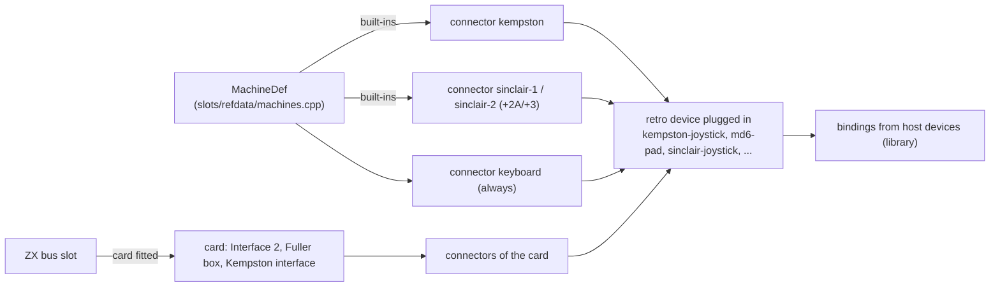
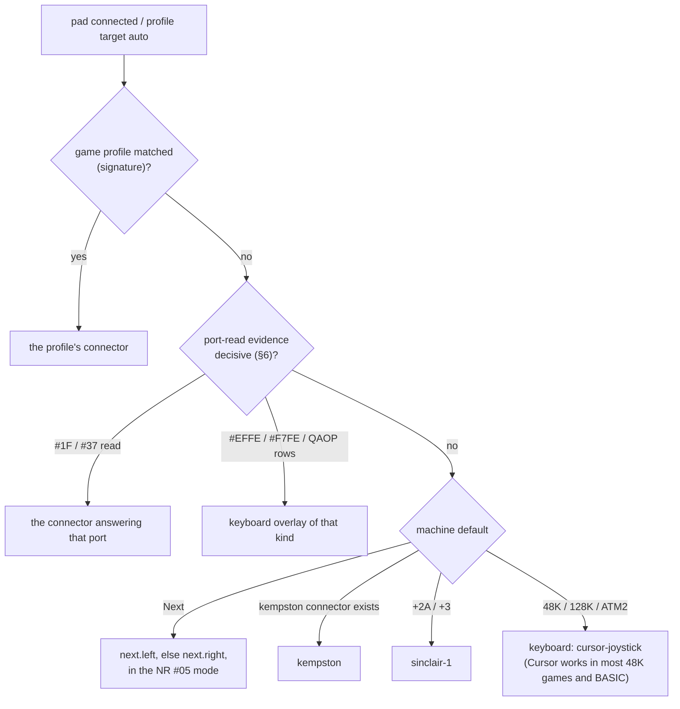

# Controller manager: the emulated side

| | |
|---|---|
| **Date** | 2026-10-17 |
| **Status** | Design, for review |
| **Decisions** | D3, D7, D10 in [README.md](README.md#decisions-2026-10-17) |
| **Hardware facts** | [research-retro-hardware.md](research-retro-hardware.md) |
| **Pattern** | media slots ([media-control-design.md](../2026-09-28-storage-manager/media-control-design.md)), ZX bus slots ([architecture.md](../2026-10-03-zx-bus-slots/architecture.md)) |

## Contents

- [1. The model](#1-the-model)
- [2. Retro device catalogue](#2-retro-device-catalogue)
- [3. Connectors per machine](#3-connectors-per-machine)
- [4. auto: which connector a new pad drives](#4-auto-which-connector-a-new-pad-drives)
- [5. Journal and TTD](#5-journal-and-ttd)
- [6. Port-read evidence](#6-port-read-evidence)
- [7. What the core must add](#7-what-the-core-must-add)

## 1. The model



A **connector** is to a retro device what a media slot is to a medium:

| Media manager | Controller manager |
|:--|:--|
| `IMediaSlot`, `SlotDescriptor` (`core/src/emulator/media/mediaslot.h`) | `Connector`, `ConnectorDescriptor` (`core/src/emulator/io/controllers/connector.h`) |
| slot id `fdd.a`, alias `A:`, `kind:index`, `tag:a+b`, `auto` | connector id `kempston`, `sinclair-1`, `next.left`; alias `joy1`; `joystick:0`; `auto` |
| medium: a file with a format | retro device: a kind with options |
| `MediaControl` verbs, `MediaRequest` → `MediaReply` | `ControllerControl` verbs, `ControllerRequest` → `ControllerReply` |
| `targets`: where can this file go, with a `default` and a `refusal` | `targets`: which connectors accept this retro device, ordered, with a `default` and a `refusal` |
| changes at frame boundaries, a revision counter | plugs at frame boundaries, `ControllerManager::Revision()` |
| `[MEDIA] <slot>=` in the per-model INI | `[CONTROLLERS] <connector>=<device>[,option=value]` |

**Who declares connectors.**

- **Built-ins**: a machine's `BuiltInDef` (`core/src/emulator/slots/slottypes.h:190`) with function `kempston-joystick`,
  `kempston-mouse` and so on already exists in `slots/refdata/machines.cpp` (Pentagon :174, Scorpion :203, ATM3 :353,
  TSConf :369, Sprinter :465). Each such built-in declares its connectors. New built-ins: the +2A / +3 joystick
  sockets, the Next's two DB9 connectors, the Profi's 8255 Kempston (the decoder has it, `portdecoder_profi.cpp:58`;
  the refdata does not).
- **Cards**: a card in a ZX bus slot (Interface 2, Fuller box, a Kempston interface on a 48K) declares its connectors
  when it is fitted (`core/src/emulator/slots/card.h`). Removing the card unplugs them; the reply says which retro
  devices went away.
- **The keyboard**: every machine has connector `keyboard`. Its retro devices are the real matrix (always) and the
  **keyboard joystick** overlays (QAOP, Cursor, Sinclair 1 / 2, user keys) for keys-only games, which need no card.

**Verbs** (`ControllerControl`, the only place they live; every surface calls it, as with `MediaControl`):

| Verb | Request | Reply body |
|:--|:--|:--|
| `list` | — | connectors with id, alias, kind, index, fixed, plugged device, options, accepted devices, state, held controls |
| `get` | connector selector | one connector, the same fields |
| `plug` | connector selector or `auto`, device kind, options, `async` | the connector after the change, `pending` until the frame boundary |
| `unplug` | connector selector, `async` | the connector |
| `options` | connector selector, option map, `async` | the connector (a re-plug of the same device) |
| `targets` | device kind | ordered candidate connectors (free sockets first), `default` index, `refusal` reason |

Options: `port` (1 / 2, `sinclair-joystick`), `shift` (`cursor-joystick`), `keys` (`keys-joystick`,
`up:q,down:a,...`). An option the device does not take is `bad-request`. Later (C10): `state` with the source of each
control, `press` / `release` / `set` / `tap`.

The envelope is `MediaReply`'s: `ok`, `error`, `message`, `connector`, `pending`, `revision`, then the body. Errors
(`ControllerError`, as built in C1b, `core/src/emulator/io/controllers/controllercontrol.{h,cpp}`): `unknown-connector`
(404, with the connector ids), `incompatible` (409), `fixed` (409, part of the board), `recording` (409, TTD v1 only),
`owned-by-replay` (409), `bad-request` (400).

**INI** (`controllerconfig.{h,cpp}`, applied in `Emulator::Init` after the media set, through `ControllerControl`):

```ini
[CONTROLLERS]
keyjoy.1 = sinclair-joystick, port=2
keyjoy.2 = keys-joystick, keys=up:q,down:a,left:o,right:p,fire:m
```

An item without `=` continues the option before it, so `keys=` keeps its commas; `none` empties a socket. Legacy
`[INPUT] Joystick=SINCLAIR1 | SINCLAIR2 | CURSOR | QAOP` (Unreal Speccy's choices) plugs `keyjoy.1` when
`[CONTROLLERS]` does not name it; Kempston stays fitted (only `Joystick=NONE` removes it). Unreal Speccy's `KJoystick=`,
`FJoystick=`, `Fire=`, `FireRate=` are not read by any unreal-ng build: nothing to carry over.

## 2. Retro device catalogue

"Exists" = in the code today; "new" = to add. Projections are what the guest reads; polarity as on the bus.

| Kind | Retro controls | Projection | Options | Status |
|:--|:--|:--|:--|:--|
| `kempston-joystick` | up down left right fire fire2 fire3 fire4 | `#1F` active high; b0 R, b1 L, b2 D, b3 U, b4 F, b5-b7 extended | `extended` (`off` = bits 5-7 read 0, `on`); `im2-leak` (cheap interface on the IM2 bus: the stick byte is the vector when A5 of PC is 0). The decode stays the board's, as its schematic has it (owner 2026-10-17): decode variants belong to a future Kempston card for the 48K | exists: `core/src/emulator/io/joystick/joystick.{h,cpp}`; the decode is the board's (`portdecoder.h:672-702`); `extended` and `im2-leak` built in C1c, refused while TTD records (not journaled; in the fingerprint as `controllers.kempston` when not the default) |
| `md6-pad` (`md3-pad` = the same with X Y Z MODE absent) | up down left right a b c start x y z mode | Next: `#1F` / `#37` b0-b7 = R L D U B C A START, NR #B2 for X Y Z MODE; Evo 8-bit `#1F` = R L D U B C A START | `buttons` (3 / 6) | exists for the Next (`portdecoder_next.cpp:578-627`, `NextExtendedInput`); Evo 8-bit new |
| `sinclair-joystick` | up down left right fire | keyboard overlay: Sinclair 1 = `#EFFE` (6 L, 7 R, 8 D, 9 U, 0 F), Sinclair 2 = `#F7FE` (1 L, 2 R, 3 D, 4 U, 5 F), active low | `port` (1 / 2) | new |
| `cursor-joystick` | up down left right fire | keyboard overlay: 5 L, 6 D, 7 U, 8 R, 0 F | `shift` (also hold CAPS SHIFT, the ZEsarUX variant) | new |
| `keys-joystick` | up down left right fire fire2 ... | keyboard overlay with a user key per control (QAOP + Space, OPQA + M, a game's "redefine keys") | `keys` map | new; the Next UDK mode uses the same overlay with the keyjoy RAM as the map |
| `fuller-joystick` | up down left right fire | `#7F` active low: b0 U, b1 D, b2 L, b3 R, b7 F, b6-b4 = 1 | the card's `decode` (`full-low`, `a7a6a5`) | built in C1c: the slot card `fuller-box` (`core/src/emulator/slots/cards/fuller/fullerboxcard.{h,cpp}`) brings the fixed connector `fuller`; its controls are journaled and saved in the Controllers blob; the AY is TTD type FullerBox (67) |
| `timex-joystick` | up down left right fire | AY R14 through `#F6` with A8 (left) / A9 (right); active low b0 U, b1 D, b2 L, b3 R, fire b7 or b4 **[unc]** | `stick` (left / right) | new (no Timex machine yet) |
| `kempston-mouse` | dx dy left right middle wheel | `#FADF` buttons (active low, b3 = 1, b7:4 wheel counter), `#FBDF` X, `#FFDF` Y | `button-order` (`right-first` / `left-first`, default per board), `wheel` | exists: `io/mouse/mouse.{h,cpp}`, `MouseManager`; button order per board new |
| `evo-mouse`, `sprinter-serial-mouse` | dx dy left right middle wheel | Evo AVR registers; Sprinter SIO B Microsoft 3-byte | — | exist (`evoavrmouse.h:41`, `MsSerialMouse`) |
| `amx-mouse` | dx dy left right middle | Z80 PIO `#1F/#3F/#5F/#7F`, IM2 interrupt per mickey, buttons `#DF` | — | new; needs a daisy-chained IM2 model |
| `ay-mouse` | dx dy buttons | AY R14, axis by R14 b6 | — | new, low priority |
| `light-gun` | trigger pointer.x pointer.y | per model: Gunstick (Kempston or Sinclair rows), Defender, Magnum (AY R14 or EAR), Stack (`#DF`), Trojan pen (`#FE` b6) | `model` | new; needs a beam-position query from the video timing |
| `keyboard` | every ZX key; PC keys on PS/2 machines | the matrix, or the board's controller (EvoAvr, Atm2Kbc, ProfiXtKbc, NextExtendedInput) | `route` (existing `HostKeyboardRoute`) | exists: `io/keyboard/keyboard.{h,cpp}`, `pckey.h` |

Per-board facts that are options with a board default, not separate kinds: the Kempston decode, the mouse button
order (D0 = Right on the Kondratyev schematic, Next, Karabas-Pro; D0 = Left on Evo, Sprinter), Kempston gated off in
TR-DOS, the Sprinter's FDC bits in `#1F` b7:6.

## 3. Connectors per machine

| Machine (model) | Built-in connectors (id: default device) | A card or option adds | Notes |
|:--|:--|:--|:--|
| 48K (`MM_SPECTRUM48`) | `keyboard: keyboard` | Interface 2 card: `sinclair-1`, `sinclair-2`; Kempston interface: `kempston`; Fuller box: `fuller`; Kempston mouse interface: `kempston-mouse` | Today no joystick decode (`portdecoder_spectrum48.cpp:104-107`) |
| 128K (`MM_SPECTRUM128`) | `keyboard` | as 48K | 128 keypad on the AY lines: not planned |
| +2 grey (`MM_PLUS2`) | `keyboard`, `sinclair-1`, `sinclair-2` **[mem: two built-in sockets, Sinclair wiring]** | Kempston interface | Refdata shares the 128K built-ins (`machines.cpp:481`) |
| +2A, +3 (`MM_PLUS2A`, `MM_PLUS3`) | `keyboard`, `sinclair-1`, `sinclair-2` (non-Atari pinout) | Kempston interface | Which socket label is 6-0 **[unc]** |
| Pentagon (`MM_PENTAGON`) | `keyboard`, `kempston: kempston-joystick` (decode `a7`, A6 / A5 optional), `kempston-mouse` | — | `portdecoder_pentagon128.h:56` |
| Pentagon-1024SL | as Pentagon, decode `a5a0` | Z-Controller, ZXMC-1/2 cards (PS/2) | BC#4 |
| Scorpion, ProfROM Scorpion (`MM_SCORP`, `MM_PROFSCORP`) | `keyboard`, `kempston` (decode `scorpion`, `#FF1F` exact for ProfROM), `kempston-mouse` | — | `portdecoder_scorpion256.h:59` |
| Profi v3 / v5 (`MM_PROFI3`, `MM_PROFI`) | `keyboard` (XT controller), `kempston` (8255 port A, outside DOS / CP/M), `kempston-mouse` (CP/M off) | — | Refdata lacks the Kempston built-in |
| ATM Turbo 2 / 2+ (`MM_ATM450`, `MM_ATM710`) | `keyboard` (Atm2Kbc) only; **no Kempston on the board** | a Kempston card on the ZX bus | Today the decoder answers no joystick; keep it so ([research §0.4](research-retro-hardware.md#0-findings-that-change-the-design)) |
| ZX-Evo BaseConf (`MM_ATM3`) | `keyboard` (EvoAvr), `kempston` (full low byte outside shadow; 5-bit), `evo.db9-2` (second stick on the keyboard connector), `kempston-mouse` (EvoAvr) | — | `portdecoder_atm3.h:131`; NedoPC Sega key maps are an AVR feature: modelled as `keys-joystick` presets |
| ZX-Evo TSConf (`MM_TSL`) | as BaseConf, `kempston` 8-bit (Sega A / C / START in b5-b7) | — | `portdecoder_tsconf.h:102`; masked by FDDVirt b7 |
| Sprinter (`MM_SPRINTER`) | `keyboard` (PLD matrix + SIO A), `kempston` (`#1F` DOS off, `#FF` DOS on, b7:6 FDC), `serial-mouse` (SIO B, plus the PLD Kempston view, D0 = L) | — | Sega pads in MAME **[unc]**: not planned |
| ZX Next (`MM_NEXT`) | `keyboard` (membrane + PS/2), `next.left`, `next.right` (DB9: `md6-pad` default), `kempston-mouse` | — | The mode of each DB9 is NR #05: [§4](#4-auto-which-connector-a-new-pad-drives) |
| Kay-1024 (`MM_KAY`) | `keyboard`, `kempston` (decode `odd`) | NemoBus IBM keyboard card | Bit order **[unc]** |
| Quorum, GMX, LSY256, Phoenix | `keyboard`; Kempston per the decoder they reuse | — | To be checked per machine when the connector list is built |
| Timex TC2048 / TS2068 | future: `kempston` (TC2048), `timex.left`, `timex.right` (TS2068) | — | No Timex machine in unreal-ng |

Every machine also has two **keyboard-joystick sockets**, `keyjoy.1` and `keyjoy.2` (kind `keyboard-joystick`),
empty by default, taking `sinclair-joystick`, `cursor-joystick` or `keys-joystick`, so a keys-only game works with a
pad on a bare 48K. The +2 / +2A / +3 sockets `sinclair-1` / `sinclair-2` are the same kind with a fixed
`sinclair-joystick` (port 1 / 2). As built in C1a (`core/src/emulator/io/controllers/controllermanager.cpp`):

| Machine | Connectors |
|:--|:--|
| Next (`HasPads`) | `next.left` (alias `left`), `next.right` (`right`), `keyjoy.1`, `keyjoy.2` |
| A decoder with `HasKempstonJoystick` | `kempston`, `keyjoy.1`, `keyjoy.2` |
| +2 / +2A / +3 | `sinclair-1`, `sinclair-2`, `keyjoy.1`, `keyjoy.2` (plus `kempston` if the decoder answers #1F) |
| Others (48K, 128K, ATM2) | `keyjoy.1`, `keyjoy.2` |
| A card that brings connectors (C1c: the Fuller Box, `fuller`) | the machine's list, then the card's fixed sockets (a second card of the kind gets `.2`) |

## 4. auto: which connector a new pad drives

DT-3. A host pad connected while no profile pins it, or a binding whose target connector is `auto`:



- **Two pads**: the second pad takes the next free connector of the same machine in this order: `next.right`,
  `sinclair-2`, `evo.db9-2`, then the keyboard overlay `sinclair-2`. One host device never drives two connectors unless
  the user binds it so.
- **The Next.** The retro device on `next.left` / `next.right` is always `md6-pad`; the projection follows NR #05 at
  run time, as the hardware does: Kempston 1 / 2 and MD 1 / 2 read the port, Sinclair 1 / 2, Cursor and UDK press keys
  through the overlay (today only reported, `portdecoder_next_state.cpp:673`). The pad is not replugged when the guest
  writes NR #05.
- **The window keyboard** is not a pad: its keyboard-joystick preset (keypad by default, the existing
  `JoystickKeys=` table) binds to whichever connector `auto` chose for the first pad, and to `kempston` / the overlay
  when no pad is connected.
- `targets` returns the same decision as data, with the reason ("signature match", "port #1F read 48 of the last 50
  frames", "machine default").

## 5. Journal and TTD

Existing kinds (`core/src/debugger/ttd/ttdinputjournal.h:72-108`):

| Kind | Carries | Used by |
|:--|:--|:--|
| `Key`, `KeyboardReset`, `PcKey` | matrix key, release-all, physical PC key | keyboard; the keypad-to-Kempston binding travels as `PcKey` |
| `MouseMove`, `MouseButtons`, `MouseWheel`, `MouseCounters` | deltas, mask, notches, absolute write | Kempston mouse and its siblings |
| `Joystick` | the whole Kempston byte | automation, host pads on `kempston` |
| `NextPad` | connector + 12 bits | Next DB9, automation |

**Decided (D13)**: one new kind for every new connector device:

```
ConnectorState { connectorIndex: u8, mask: u16 }   // the retro controls held on that connector, by catalogue bit
```

- The device applies it: `sinclair-joystick` and the other overlays AND their mask into the matrix read of their
  half-rows; `fuller-joystick` builds the `#7F` byte; `light-gun` keeps the trigger (the pointer travels as the
  existing mouse kinds).
- **Overlay, not key events.** A joystick is wired in parallel with the keys. With `Key` events, releasing the stick
  would release a key the user still holds, and a game reading the matrix could not tell the two apart anyway. The
  overlay is ANDed in the half-row read (`Keyboard` gets a per-connector overlay table), as the Next ANDs
  `membrane_stick` into the column scan. The comment at `ttdinputjournal.h:71` ("a Sinclair joystick is keyboard keys:
  no new kind") is superseded by this.
- Kempston and Next keep `Joystick` / `NextPad`, so old journals replay unchanged.
- **Plugs are configuration, journaled like media** (C1b, owner 2026-10-17). A plug while TTD records waits for the
  frame boundary (`ControllerManager::ApplyPending`, in `MainLoop::CompleteFrame` next to the media manager's, before
  the checkpoint) and the reply says `pending` (a sync request waits up to 5 s while frames run). The configuration
  fingerprint names each plugged keyboard joystick (`controllers.<connector>` = a hash of device and options;
  `affectsRestore` false), so the recording gets a `ConfigChange` cut there, and a replay that crosses that frame
  takes its checkpoint (D10). TTD v1 (`TimeTravelManager`, `RecordsMediaChanges` false) keeps no configuration
  changes: there a plug is refused with `recording`. A game that asks "Kempston / Sinclair / Cursor / Keys" after
  loading no longer needs the recording stopped.
- **Checkpoints.** Each device's held state is machine state; the keyboard joysticks' plugs (device, Sinclair port,
  Cursor shift, eight keys), masks and the host key overlay (the ZX keys of key, chord and macro targets, journaled
  as `HostKeys` per half-row, C2b) are the blob of `TTDDeviceType::Controllers` (66, blob v3; v2 without the overlay
  and v1 = masks only still load), registered on every machine as `KeyboardMatrix` is, so a seek before a plug takes it back. Existing ids stay
  (`PeripheralId::KempstonJoystick` = 23, `KempstonMouse` = 7). A new device declares only a `TTDDeviceType` from 66 on
  (the D23 rule: `PeripheralId` is frozen at 65, `ttdserializable.h:136-205`); two devices of one kind on two
  connectors are two instances of one type, keyed by the connector id.
- **Replay owns input.** While the journal or RZX playback owns input, `Sample` results are dropped and
  `ControllerControl` refuses `plug` with `owned-by-replay`.
- **Resync after seek.** The host state is not in a checkpoint. After a seek, restore or snapshot load, the manager
  takes the next live sample and submits the difference against the restored device state, so a held button stays
  held and a released one is released (jnext resyncs its dispatcher the same way).

## 6. Port-read evidence

The second source of `auto` (D7) after signatures. `PortReadWatch` (`core/src/emulator/io/controllers/portreadwatch.h`)
is the cheap counter mode C-4 asks for in [integration.md](../2026-10-08-steamdeck-client/integration.md): counts per
port class per frame, no per-access record, switchable at run time. It builds on the monitored ports of
`MemoryAccessTracker` (`core/src/emulator/memory/memoryaccesstracker.h:96`, `MonitoredPort`, `AccessStats`) but needs
neither its per-access records nor its call traces.

Counted classes (one `u16` counter each, reset per frame, folded into a 50-frame window):

| Class | Matches |
|:--|:--|
| `kempston` | reads the board's Kempston decode accepts (`#1F` and aliases) |
| `kempston2` | `#37` (Next) |
| `fuller` | `#7F` |
| `kmouse` | `#FADF / #FBDF / #FFDF` |
| `row.<half-row>` | `#FE` reads by high byte, eight counters; plus `rows.multi` for reads with several address lines low |
| `row-bits.<half-row>` | which bits of a half-row the code tests after the read (sampled: the next `AND n` / `BIT n` within 8 instructions, when cheap; optional) |
| `ay.r14` | `IN` from the AY data port with R14 selected |
| `nr.b2` | a read of Next register #B2 (the MD pads' X Z Y MODE bits) through `#253B` |

Output, per instance, read by the library's heuristic ([mapping-and-profiles.md](mapping-and-profiles.md)):

```
PortReadEvidence { framesObserved, window: 50, perClass: { class → framesWithReads, readsPerFrame (avg) },
                   sinceLoad: frames since the last media change }
```

The watch starts at the end of loading (media `NC_MEDIA_*` and tape stop) and runs until a decision is decisive or for
30 s of play; the cost target is one table increment per `IN`, zero when off.

Built (C6):

- **Row bits.** For a single half-row `#FE` read the watch reads the code after the `IN` (no execution:
  `TestedBitsAfterIn` over `Memory::DirectReadFromZ80Memory`, set by `ControllerManager` while the watch runs) and
  follows the value: `IN A,(n)` or `IN r,(C)`, then up to 8 instructions of `AND n`, `BIT b,r`, `RRA` / `RRCA` /
  `RRC A` / `RR A` / `SRL A` (each shift moves the tested bit), `LD A,r` from the held register, a carry test right after a
  shift (`JR C`, `JP NC`, `CALL C`, `RET NC`, ...), until a jump, a call, a return, a reload of the register or an ALU
  op that replaces A (`CP` keeps it). The bits are cached per half-row by the code address, so a polling loop costs
  one scan; `PortReadEvidence::RowBits(row)` holds the window's union, `auto` shows them as `evidence.row_bits`
  (`{"row.ef": [0, 1, 2, 3, 4]}`).
- **`ay.r14`** (an IN of the AY's data port, `#FFFD` as the 128K family decodes it, with R14 selected) and
  **`nr.b2`** (an IN of the Next's `#253B` with register #B2 selected) are counted by the watch itself, on the same
  IN-hook path as the ports: `PortReadWatch::OnRead` asks a register probe `ControllerManager` sets while the watch
  runs (`ITurboSoundDevice::getBusReadRegister`: the selected chip's register, -1 for the TSFM status byte or an FM
  address; `NextBoard::SelectedRegister`). The chips and the port decoder carry no hook: nothing while the watch is
  off (the unarmed R14 read benchmarks within noise of the code without the watch).
- **`DecideFromPortReads`**: `nr.b2` every frame comes before the dedicated ports: an MD 6-button pad on
  `next.left`, on `next.right` when `#37` is read every frame too. `#EFFE` and `#F7FE` with bits 0-3 of `#F7FE` tested
  (keys 1-4: Sinclair 2's) is Sinclair 1 (two players), with only bit 4 (key 5) it stays Cursor; the reasons name the
  tested bits. `ay.r14` every frame with nothing else decided gives a `hint` (a Timex joystick, the 128 keypad or an
  AY mouse: none of them exists here yet), not a decision. Tests: `AutoDecision_Test` (`RowBits_*`,
  `Watch_RowBitsAndRegisterReads`, `Decide_NextB2RowBitsAndAyR14`) and `HostInputMachine_Test.PortReadWatchRowBitsAndAyR14`
  / `PortReadWatchNextB2` on a Pentagon and a Next.
- Not done: the Next's board ports are `next.left` / `next.right`, so a `#1F` decision (`kempston`) on a Next names a
  connector the Next lacks and the Qt client ignores it (`applyAuto`); a mapping of `kempston` to `next.left` there is
  left.

## 7. What the core must add

1. `ControllerManager` per emulator, `Connector` / `ConnectorDescriptor`, `ControllerControl` with the verbs and
   envelope of [§1](#1-the-model); `Revision()`; `NC_CONTROLLER_*` notifications.
2. Connector declarations from `BuiltInDef` and cards; add the missing built-ins (+2 grey and +2A / +3 sockets, Next DB9
   left / right, Profi 8255 Kempston); `keyboard` everywhere.
3. `IHostInputSource` and the frame-start `Sample` hook in the main loop next to `DebugJoystickManager::OnFrame`
   (`mainloop.cpp:511-513`); a fake source for tests.
4. Keyboard overlay table in `Keyboard` (per connector, ANDed per half-row); `sinclair-joystick`, `cursor-joystick`,
   `keys-joystick` on it; the Next's Sinclair / Cursor / UDK modes through it.
5. `TTDInputKind::ConnectorState`, its apply case (`ttdinputapply.cpp`), routing through `SubmitLiveInput`.
6. Kempston options: `extended`, `im2-leak` (C1c); decode variants only with a Kempston card; Evo 8-bit Sega layout.
7. `fuller-joystick` (C1c); then `timex-joystick` with a Timex machine.
8. Mouse button order per board (the default changes for Next, Karabas-class and Scorpion ProfROM: E-1 in
   [research §10](research-retro-hardware.md#10-errata-in-other-unreal-ng-docs)), with a test per board.
9. `PortReadWatch` ([§6](#6-port-read-evidence)).
10. `[CONTROLLERS]` INI section; legacy `[INPUT] Joystick=` / `JoystickKeys=` and Unreal Speccy `KJoystick=`,
    `FJoystick=`, `Fire=`, `FireRate=` read as defaults for unset connectors.
11. Later: `amx-mouse` (with a daisy-chained IM2 model), `light-gun` (with a beam-position query), `ay-mouse`.
12. Automation surfaces over `ControllerControl` ([surfaces.md](surfaces.md)); fix the `joystick_input` description
    (E-4).
