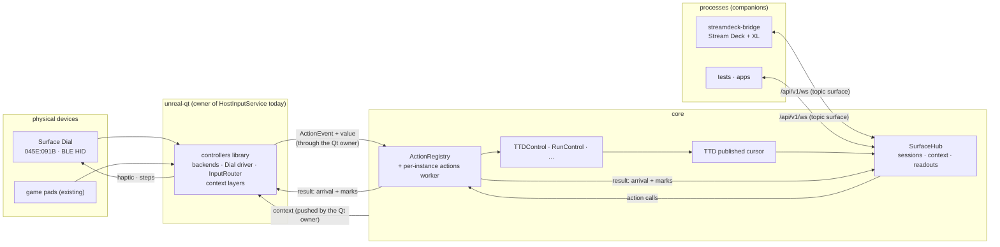

# Control surfaces: dials, button panels and remotes

| | |
|---|---|
| **Date** | 2026-10-18 |
| **Status** | Design, for review; no code. Proposals P1-P10 wait for the owner |
| **Branch** | `control-surfaces-design` |
| **Builds on** | the controller manager ([2026-10-17-controller-manager](../2026-10-17-controller-manager/)), companion clients ([2026-10-16-companion-client](../2026-10-16-companion-client/)), `TTDControl`, the OpenDeck `streamdeck-bridge` (external repo, the Stream Deck + XL client) |
| **POC** | [030 surface-dial-haptics](../../../tools/poc/030-surface-dial-haptics/README.md) |

The controller manager connects game pads to retro controllers and has a debug layer for the debugger and time
travel. It does not have:

- **relative encoders** with steps, a speed and haptic clicks (Surface Dial, the Stream Deck + dials);
- **host actions outside the Qt client**: the `ActionRegistry` lives in `unreal-qt` and its run actions call Qt
  debugger slots, so neither the WebAPI nor a companion can call `ttd.step_back_frame` by id, and no action takes a
  value (a dial's delta and speed);
- **a way for two devices to act as one instrument**: the Stream Deck page "TTD · time code" cannot tell a Surface
  Dial to scrub by time code, and both cannot show and feel the same position without each polling the WebAPI.

A **control surface** is a device whose controls drive host actions and which may give feedback (here: haptic
clicks). Two halves:

- **physical devices** (the Surface Dial; later DIY HID devices and MIDI) are host devices of the controllers
  library, read by its backends;
- **processes** (`streamdeck-bridge`, apps, tests) call actions with values on one WebSocket of the WebAPI, as paired
  companions, and receive the shared context and readouts.

First target, chosen by the owner: **TTD scrubbing with the Surface Dial, a haptic click at every time mark
crossed, in step with the Stream Deck + XL**.

## Documents

| Document | What |
|:--|:--|
| [requirements.md](requirements.md) | **Start here.** Problem, use cases, FR / NFR, non-goals, acceptance |
| [architecture.md](architecture.md) | The core action registry and its worker, the router's part, the surface hub, contexts, readouts, haptic feedback, threads |
| [actions.md](actions.md) | v1 actions with values, the seek curve, timeline marks, readouts |
| [protocol.md](protocol.md) | The surface protocol for companion processes: the `surface` topic of `/api/v1/ws` (D7) |
| [controls-and-feedback.md](controls-and-feedback.md) | The `Encoder` control type, speed, the haptic and steps outputs, patterns |
| [profiles.md](profiles.md) | Context layers in debug profiles; the Surface Dial and Stream Deck defaults |
| [devices.md](devices.md) | Surface Dial (measured on macOS), Stream Deck + XL through `streamdeck-bridge`, DIY HID devices, MIDI later |
| [testing.md](testing.md) | Unit, conformance, live checks |
| [TODO.md](TODO.md) | Phases, later items, owner questions, errata in other docs |

## In one picture

## Proposals for the owner (2026-10-18)

Not decided; [TODO.md](TODO.md#owner-questions) asks them one at a time.

| # | Proposal | Alternative |
|:--|:--|:--|
| P1 | One concept, **control surface**; physical devices stay host devices of the controllers library (a Dial is a host device with an `Encoder` control and haptic outputs), processes are companions. | A separate subsystem for debug devices. |
| P2 | The `ActionRegistry` moves to the core (`core/src/emulator/actions/`, beside the control objects, built without `ENABLE_AUTOMATION`). Executors run on **one actions worker per instance**, in order. Run control gets a core `RunControl` (the logic behind `/step`, `/stepover`, `/stepout`, `/pause`, `/resume`), as `/ttd/*` got `TTDControl`; the Qt client registers only GUI actions (`dbg.open`). | Keep the registry in Qt: the WebAPI and companions cannot use it, and a headless instance has none. |
| P3 | An action takes a **value**: press / release, a delta (fractional steps) with a speed, or a string. The seek curve lives in the action, with its parameters from the binding or the call, so a pad binding, the Dial and a Stream Deck dial share one implementation. | Presses only; a dial turn as N presses (what the bridge sends today as N WebAPI calls). |
| P4 | Physical devices only through backends: HID now (the Dial; a DIY device presents itself as HID in the Dial's descriptor pattern), MIDI later. No device wire protocol of our own. | A custom device protocol over serial / BLE GATT / TCP: reinvents HID, and breaks companion D5. |
| P5 | Processes use the **surface protocol**: JSON on the `surface` topic of `/api/v1/ws` (D7, erratum 2026-10-20), the two-way extension of the companion events WebSocket, same auth, same error codes; v1 has **actions mode only** (the process calls ids with values). Raw controls from processes are later. | The plain REST routes plus polling (today's bridge): no push, no shared context. |
| P6 | One **context** per instance (`ttd`, `ttd.timecode`, `debug.disasm`), set by an action (`ctx.set`) from any source; every surface follows it. In profiles a context is a **layer** of the existing stack (`@ttd`), switched by the context instead of a layer key, inside `debug` profiles. | A new profile kind and its own binding tables. |
| P7 | **Readouts** pushed by the core: `ttd.position`, `run.state`, at up to 50 Hz, changes only, from a new atomic TTD **published cursor** written on every seek, step and frame. | Polling `/ttd/position` (the bridge, 50 Hz today). |
| P8 | **Time marks** in the seek result: second, 10 s, edge (clamped to the history or halted at an external-event barrier), bookmark. The surface that moved feels them. | Each client computes marks from positions. |
| P9 | Surface haptics bypass the rumble mixer: the Dial driver writes its reports on its own writer thread (latest request wins); the haptics gate (H-5) mutes game haptics only. Steps per turn are set by the driver alone, on a context change, from the context layer. | Through the mixer: the gate would mute the Dial exactly while scrubbing. |
| P10 | v1 = the Dial on macOS in the Qt client, the Stream Deck through the protocol, TTD and run actions. Headless instances get the actions and the protocol, not the Dial (the router has no core owner yet, Q-3). Windows, Linux, DIY HID, MIDI, raw mode: later ([TODO.md](TODO.md#later)). | Everything at once. |
