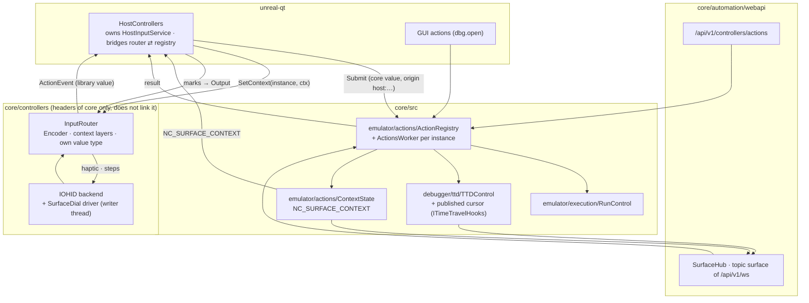
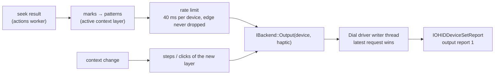
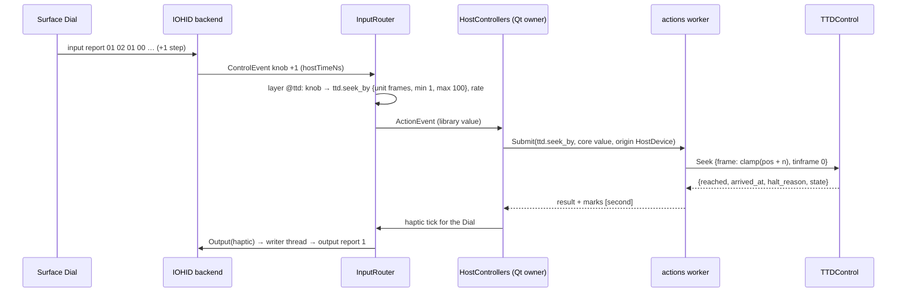

# Control surfaces: architecture

| | |
|---|---|
| **Date** | 2026-10-18 |
| **Status** | Design, for review |
| **Requirements** | [requirements.md](requirements.md) |
| **Extends** | [controller manager architecture](../2026-10-17-controller-manager/architecture.md) (§3 library, §7 pipeline, §9 instances, §11 threads) |

## Contents

- [1. Vocabulary](#1-vocabulary)
- [2. Placement](#2-placement)
- [3. The core action registry](#3-the-core-action-registry)
- [4. Gates: who may do what](#4-gates-who-may-do-what)
- [5. The router's part](#5-the-routers-part)
- [6. Contexts and the followed instance](#6-contexts-and-the-followed-instance)
- [7. The TTD published cursor and readouts](#7-the-ttd-published-cursor-and-readouts)
- [8. The surface hub](#8-the-surface-hub)
- [9. Haptic feedback](#9-haptic-feedback)
- [10. Flows](#10-flows)
- [11. Threads and lifetime](#11-threads-and-lifetime)
- [12. Determinism](#12-determinism)
- [13. Code placement](#13-code-placement)

## 1. Vocabulary

| Term | Meaning |
|:--|:--|
| Control surface | A device whose controls drive host actions and that may give feedback: a Surface Dial (host device), a Stream Deck behind `streamdeck-bridge` (companion process). |
| Action | A host command by id, with a value kind, a scope rule, availability with a reason. |
| Actions worker | One thread per instance that runs action executors in order. |
| Context | The instance's current mode (`ttd`, `ttd.timecode`, `debug.disasm`), one string. |
| Context layer | A layer of a debug profile named `@<context>`, active while the context matches. |
| Readout | A value a companion subscribes to (`ttd.position`, `run.state`), pushed on change. |
| Mark | A point on the recorded timeline a seek crossed (second, 10 s, edge, barrier, bookmark). |

## 2. Placement



- The registry, the context state, `RunControl` and the cursor are core, built with or without `ENABLE_AUTOMATION`,
  present headless.
- The controllers library keeps its rule: core headers only, no link to core (`core/controllers/CMakeLists.txt`),
  no Qt. It gets the context pushed by its owner (`InputRouter::SetContext`) and emits its own `ActionEvent` value;
  the owner (today `HostControllers`) converts to the core's `ActionValue` and back.
- `HostInputService` keeps its owner, the Qt client. Headless instances have actions, contexts, readouts and the
  protocol, not the Dial (Q-3).

## 3. The core action registry

```cpp
namespace actions {

enum class ValueKind : uint8_t { Press, Delta, Text };

struct ActionValue
{
    ValueKind kind = ValueKind::Press;
    bool pressed = true;              // Press: down / up (held actions see both)
    double delta = 0;                 // Delta: signed steps, fractional allowed
    double rate = 0;                  // Delta: steps per second
    std::string text;                 // Text: ctx.set
    StateNode params;                 // ttd.seek_by: unit, min, max, rate_lo, rate_hi
};

struct ActionOrigin
{
    execution::Origin origin;         // Gui, WebApi, Mcp, Cli, Lua, Python, Companion, + HostDevice (new)
    std::string identity;             // the client / session id for automation, the cid for a companion,
                                      // the HostDeviceId for a host device; the op log's source
    std::string session;              // a protocol session id (coalescing never crosses sessions)
};

struct ActionResult
{
    bool ok = false;
    std::string error;                // as the route answers: "Conflict", "Bad Request", "Not Found",
                                      // "Run-control held", "companion_forbidden", "held_by_session", "not_now"
    std::string message;              // one sentence a user can act on
    StateNode body;                   // the route's body; ttd.seek_by adds "marks"
};

struct ActionInfo
{
    std::string id, label, group;
    ValueKind kind = ValueKind::Press;
    bool gui = false;                 // registered by the Qt client; absent headless
};

class ActionRegistry
{
public:
    /// Core actions at core start-up; the Qt client's GUI actions with the handle it keeps until it closes
    RegistrationHandle Register(ActionInfo info, Executor run, Rules rules);
    std::vector<ActionInfo> List() const;
    /// "" when it can run now, else the reason (the gates of §4 included)
    std::string Unavailable(std::string_view id, const std::string& instanceId, const ActionOrigin& origin,
                            const ActionValue& value) const;
    /// Queued on the instance's actions worker; done() is called on that worker
    void Submit(std::string_view id, ActionValue value, std::string instanceId, ActionOrigin origin,
                std::function<void(ActionResult)> done);
};

}  // namespace actions
```

- `Rules` gives per action: the companion scope **as a function of the value and the machine** (`run.pause_toggle`
  pausing needs none, resuming needs `ScopeRun`, as `/pause` is free and `/resume` is not,
  `core/src/emulator/execution/automationgate.cpp`), whether it needs a pause (as `CompanionNeedsPause`: steps,
  instruction steps), whether it changes the machine (for the automation gate), and the availability check.
- **Executors call control objects**:
  - `TTDControl` (seek, steps, bookmarks, record);
  - `RunControl`, new: the logic of the lifecycle and debug routes moved out of them (pause through
    `EmulatorManager::PauseEmulatorWithResult` with its pending / busy outcomes, resume through `ResumeEmulator`
    with the run-control claim check, `core/automation/webapi/src/api/lifecycle_api.cpp`; step in / over / out and
    frame step as `debug_api.cpp` does); the routes call it too;
  - `ContextState`.
  The Qt debugger slots stop being executors; the debugger window follows the machine as it does for WebAPI steps.
- **The worker** runs one executor at a time, in submission order. Executors may block (`TTDControl::Seek` pauses
  the machine and waits up to 1 s, `PauseAndConfirm`); nothing else waits for them.
- **Op-log source**: the worker sets `SourceScope` (`core/src/emulator/coordinator/machineop.h`) from the origin
  around each executor, since the source is thread-local.
- **Coalescing**: a `Delta` merges only into the **last** queued job, and only when id, origin identity, session and
  `params` are equal (the bridge merges into its queue's back the same way, `streamdeck-bridge/src/runtime.cpp`); the
  merged job keeps the higher rate. A merged call's `done` is called with the merged job's result, so every `rid` is
  answered. A `ctx.set` between two deltas therefore stays between them.
- **The companion catalogue** (`core/src/emulator/execution/companionactions.cpp`) stays the scope view of
  `GET /companions/me` (`rewind`, `tape`, `memory`, ...); registry actions name their scope rule, the two agree, no
  aliasing.

### 3.1 As built (S1, 2026-10-20)

`core/src/emulator/actions/actionregistry.h`, `builtinactions.h`, `core/src/emulator/execution/runcontrol.h`.
Differences from the sketch above:

- `ValueKind::Level` (0..1, 0 = released) beside Press, Delta, Text: the analog scrub of the Qt client. `ActionValue`
  carries `level`; `ActionOrigin` adds `client`, `peer` and `lease` (the implicit session's lease) and names the
  carried session `session`.
- `Register` returns a `RegistrationHandle` for every action (the core keeps its own); a newer registration of an id
  replaces the older, whose handle then removes nothing. `ActionRules` has `scope(emulator, value)`, `needsPause`,
  `unavailable(emulator, value)` and the error code of that answer.
- `Statuses(instance, origin)` (one row per action with `available`, `error`, `reason`) instead of a bare `List()`
  with availability: a dry run of the gates that opens no session. `Run()` is Submit plus a bounded wait, for the CLI
  and the scripts.
- `done` is called at once on the calling thread for an unknown action or instance, a value of the wrong kind and the
  release of a Press that is not held; everything else runs on the worker.
- A release that only ends what a press started (a held action's release, a level of 0) passes every gate.
- The worker thread starts with the instance's first action and ends at `EmulatorManager::RemoveEmulator` (queued
  jobs answer "Not Found"; the running one is waited for up to 2 s). Idle instances have no thread. The process's
  registry is never destroyed (the static `EmulatorManager` drops instances in its own destructor at exit).
- Origins `WebApi`, `Mcp`, `Cli` pass the automation gate with the identity of the routes (`webapi|host|client`,
  `cli|peer`); `Lua`, `Python` call `execution::script::Check`; a companion is looked up by id in
  `CompanionRegistry` (a revoked one: `companion_unknown`).
- `RunControl` holds pause, resume, step in / over / out, frame step, run to interrupt / scanline, N scanlines,
  reset, NMI and turbo; `POST /pause`, `/resume`, `/step`, `/stepover`, `/stepout`, `/run_frame`,
  `/run_to_interrupt`, `/run_to_scanline`, `/run_scanlines` call it (same bodies and statuses as before).
- The GUI executors post to the GUI thread and answer at once; the analog scrub's timer submits `ttd.jog_frames`,
  so the GUI thread never waits for a seek.

## 4. Gates: who may do what

Every origin goes through the gate it goes through today on REST, inside the registry:

| Origin | Gate |
|:--|:--|
| WebAPI, MCP (through the WebAPI), CLI, Lua, Python | The automation gate (owner decision 2026-10-11, `automationgate.h`): a changing action opens the implicit run-control session (`EmulatorContext::EnterImplicitRunControl`) for that client, exactly as the REST route would. `/api/v1/controllers/actions/{id}` is outside the gate's `/api/v1/emulator/` prefix today (`automation-webapi.cpp`), so the registry applies it itself. |
| Companion (the surface socket, `POST …/actions/{id}` with a token) | `CheckAction(companion, required, claimed, holder, takeBackHint, needsPause, paused)` with a `MachineView` (`companionregistry.h`): `companion_forbidden`, `held_by_session`, `not_now`. An agent token is refused `companion_not_for_agents`, as on HTTP and the events socket. |
| Host device (the Dial), GUI | The user's own hands, like the GUI: no session is opened; but while another surface holds run control (`IsRunControlClaimed`, a GDB client, an agent session), a changing action is refused "Run-control held", as `/resume` refuses a caller that does not hold control. |

`execution::Origin` (`executionarbiter.h`) gets `HostDevice` so a Dial's pause and resume are attributed in the
arbiter and the op log.

## 5. The router's part

- The library's `ActionEvent` gains a value of its own type (`controllers::ActionValue`: press, delta + rate, text,
  params); Press bindings are unchanged.
- An `Encoder` control bound to a `Delta` action sends one event per router pass with the coalesced delta and the
  speed ([controls-and-feedback.md §2](controls-and-feedback.md#2-encoder)); bound to a `Press` action it fires one
  press per step, at most 16 per pass.
- `InputRouter::SetContext(instance, context)` is called by the owner; the router makes the debug profile's layer
  `@<context>` (or the longest `@<prefix>.*` match) active above `debug` ([profiles.md](profiles.md)).
- Results come back through the owner, which turns marks into `Output(haptic)` for the device that moved
  ([§9](#9-haptic-feedback)).

## 6. Contexts and the followed instance

- `ContextState` (core, per instance) holds one string, `play` at start. `ctx.set` stores it and posts
  `NC_SURFACE_CONTEXT {instance, context, origin}`.
- Setters: the Stream Deck (a page that names a context), the Qt client (debugger pane focus, the TTD panel), any
  automation plane. The last one wins (Q-5).
- Followers: the Qt owner (pushes it into the router), the surface hub (`ctx` to sessions).
- **One followed instance for all surfaces.** The router follows the focused instance
  (`hostcontrollers.cpp`); the hub binds sessions to `EmulatorManager::GetSelectedEmulatorId`, which the Qt client
  never sets today. v1: the Qt client sets the selected instance when the focused one changes, so the Dial, the
  Stream Deck and the WebAPI's selection agree. A session may still pin an instance in `join`.
- Erratum 2026-10-20: the followed instance is the Stream Deck integration's `TargetState`
  ([targeting.md](../2026-10-19-streamdeck-integration/targeting.md)), not the selected instance the Qt client sets:
  each surface follows the focused view or pins a view or an instance.

### 6.1 As built (S2, 2026-10-20)

- `actions::ContextState` (`core/src/emulator/actions/contextstate.h`), process-wide, keyed by instance id; dropped
  with the instance (`EmulatorManager`). A stored name or the default (Q-7: `ttd` while the TTD cursor says there is
  a history, else `play`); the default follows the history without a notification. Names: lowercase letters, digits,
  `.`, `_`, `-`, starting with a letter, at most 64.
- `ctx.set` (kind text, no scope): the last setter wins (Q-5); `""` returns to the default. `NC_SURFACE_CONTEXT`
  (`SurfaceContextPayload {emulatorId, context, previous, by}`) is posted when the context in force changes, not
  when the same one is set again. `by`: `companion:<id>`, `host-device:<id>`, `webapi:<client>`, `gui`, `cli:cli`.
- Read on every plane: `GET /api/v1/surfaces/context` (`/api/v1/controllers/context` was taken: it is the host
  controllers' own verb), MCP `actions` `context`, CLI `action context`, Lua / Python `context()`. The `ctx` push is
  the `surface` topic (S4).
- Not in S2: the Qt client as a setter (pane focus, the TTD panel) and as a follower (`InputRouter::SetContext`):
  S3 with the `@` layers. The instance a surface acts on stays the plane's own rule (the WebAPI: `instance`, else the
  selected, else the only one); `TargetState` (Stream Deck SD4) is not a prerequisite of S2: the context is keyed by
  the instance whichever rule picked it.

## 7. The TTD published cursor and readouts

`GetPublishedSessionInfo` copies a struct under a mutex at most every 100 ms and only after an observer asked
(`timetravelmanager.h`, `kPublishIntervalMs`); `TTDSessionInfo` has no cursor. Added to `ITimeTravelHooks`
(`core/src/debugger/ttd/timetravelhooks.h`), so both backends (`TimeTravelController`, the default, and
`TimeTravelManager`) provide it:

```cpp
struct TTDCursor { uint64_t frame; uint32_t tinframe; uint64_t first; uint64_t end; uint8_t state; bool paused; };
/// Written by the backend on every seek, step, recorded frame and state change; read by anyone without a lock
/// (a seqlock: readers retry while the sequence is odd or changed)
virtual TTDCursor PublishedCursor() const = 0;
```

- Frames are `uint64_t`, as in the TTD (`ttdcheckpoint.h`). A seqlock, not a 16-byte atomic (not lock-free on MSVC,
  libatomic on gcc).
- **Frame rate**: `fps = emulatorState.base_z80_frequency / EmulatorContext::GetBaseFrameTStates()`, the unscaled
  pair (`GetFrameTStates()` grows with the turbo multiplier, `emulatorcontext.h`), so turbo does not change the time
  code (Pentagon 3.5 MHz / 71680 T = 48.83 Hz).
- Readouts in v1: `ttd.position` = the cursor plus `fps`; `run.state` = `running` / `paused` and the speed.
- The hub reads them at the highest `max_hz` any session asked for (≤ 50) and sends a session the values that
  changed since its last message. No subscriber: no tick.

### 7.1 As built (S2, 2026-10-20)

- `TTDCursor` (`timetravelhooks.h`) carries `frame`, `tinframe`, `first`, `end`, `endTinframe`, `state`, `history`
  and `paused`: the end's T-state (a paused or stopped recording ends inside its last frame) and `history` (first
  and end are meaningful) were added. `paused` is read live (`Emulator::IsPaused`), not published.
- The cell is `ttd::TTDCursorCell` (`ttdcursorcell.h`): a seqlock over relaxed atomics; writers are serialized by
  a mutex (the machine's thread and a control thread ending an operation may meet), readers never take it. An equal
  cursor does not move `Sequence()`, so a readout hub (S4) can tell a change by one load.
- Both backends publish at every frame boundary (a guard at the top of `OnFrameBoundary`, whichever way it returns;
  not a control thread's throwaway replays) and in every `GetSessionInfo`, which the end of every changing
  operation calls: a seek, a step, a start, a stop, a load leave the cursor where they left the machine. A debugger
  step inside a frame does not publish (the next boundary or operation does): `tinframe` may lag there.
- `ttd.position` is the TTD `position` verb (`ttdcontrol.cpp`) on every plane: the live position, the bounds from the
  cursor, `history`, `first_frame`, `paused`, `fps` (`ttd::TTDFrameRate`). It no longer calls `SessionEndPosition`,
  so it never takes a session operation (which held the CPU for a detached machine that ran).

## 8. The surface hub

`SurfaceHub` (core/automation/webapi, beside `CompanionEventHub`) serves the `surface` topic of `/api/v1/ws` (D7;
erratum 2026-10-20: no own route `/api/v1/surfaces/ws`):

| Part | What |
|:--|:--|
| Sessions | The authenticated companion, the `join` capabilities, the bound instance, subscriptions. |
| Instance binding | `join.instance` if given; otherwise the selected instance, following it ([§6](#6-contexts-and-the-followed-instance)). |
| Calls | `action` → `ActionRegistry::Submit` with origin Companion; `result` on completion. |
| Push | `ctx` on `NC_SURFACE_CONTEXT` for the bound instance; `readout` on the tick; `revoked` then close when the companion is revoked (as the events socket). |

The protocol is in [protocol.md](protocol.md).

## 9. Haptic feedback



- The device that moved feels the marks. A companion gets them in its `result`; v1 sends no haptics to companions.
- Surface haptics do not go through `HapticMixer`, which mixes rumble motor levels and whose gate (haptics.md H-5)
  mutes on seek, pause and replay, exactly when the Dial must click. The gate stays for game haptics.
- The **driver alone** writes steps and clicks: on a context change the router asks once through `Output`; the
  driver queues it to its writer thread and applies it again after a reconnect.
- `IOHIDDeviceSetReport` blocks for a BLE round trip: never on the IOHID run-loop thread (`iohidbackend.cpp`).

## 10. Flows

### 10.1 Dial turn in context `ttd`



### 10.2 Stream Deck page change

1. The user opens TTD → Time code; `streamdeck-bridge` sends `{"op":"action","id":"ctx.set","value":"ttd.timecode"}`.
2. `ContextState` stores it and posts `NC_SURFACE_CONTEXT`.
3. The Qt owner calls `SetContext`; the router activates `@ttd.timecode` and asks the Dial for its steps and clicks;
   the hub sends `ctx` to the sessions bound to that instance.
4. The next Dial turn seeks by seconds.

## 11. Threads and lifetime

| Thread | Does |
|:--|:--|
| IOHID run loop (`controllers-io`, existing) | Input reports, router events. Never blocks on a seek or a report write. |
| Dial writer (new, per Dial) | Feature and output reports. |
| Actions worker (new, per instance) | Executors in order, coalescing, results. |
| WebAPI threads (existing) | WebSocket frames, `Submit`. |
| Hub tick (new, only with subscribers) | Readouts at ≤ 50 Hz. |
| GUI | GUI actions; context from pane focus; the owner's conversions. |

- Core actions register at core start-up and live until shutdown. The Qt client registers its GUI actions with a
  `RegistrationHandle` and drops it before its objects die; `List()` and `Submit()` never see a dead executor.
- An instance's worker is created with the instance and stopped before it is destroyed: queued jobs get `done` with
  "Not Found" ("the instance is gone"), the running one finishes.
- `done` callbacks into the Qt owner go through a weak handle; after the owner closes they are dropped.

## 12. Determinism

- Actions are host commands, never journaled.
- A seek while recording pauses the recording for browsing (TTD D8), as every navigation does; frame and instruction
  steps follow [debug-and-ttd §6](../2026-10-17-controller-manager/debug-and-ttd.md#6-interaction-with-ttd-recording-and-replay).

## 13. Code placement

| Path | What |
|:--|:--|
| `core/src/emulator/actions/` | `ActionRegistry`, `ActionsWorker`, `ContextState`, the built-in executors (run, ttd, ctx) |
| `core/src/emulator/execution/runcontrol.*` | `RunControl`; `Origin::HostDevice` in `executionarbiter.h` |
| `core/src/debugger/ttd/` | `PublishedCursor` on `ITimeTravelHooks` and both backends; `timelinemarks.*` |
| `core/controllers/src/hostcontrols.*`, `router/` | `Encoder`, speed, context layers, `SetContext`, the library's `ActionValue` |
| `core/controllers/src/hid/drivers/surfacedial.*` | Dial reports and writer thread |
| `core/automation/webapi/src/surface-hub.*`, `api/actions_api.cpp`, `api-websocket.cpp` | the `surface` topic of `/api/v1/ws`, `/api/v1/controllers/actions`, the socket's calls |
| `unreal-qt/src/controllers/` | the owner: registry bridge, context push, marks → output, GUI actions, the selected instance on focus |
| `tools/surfaces/` | `surfacectl` (a virtual companion for tests), the conformance suite |
