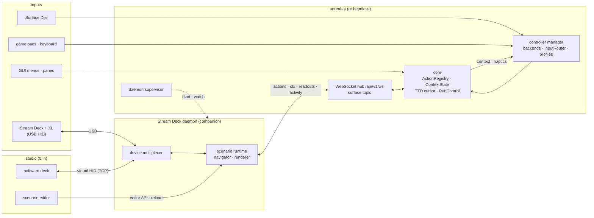

# Stream Deck integration

| | |
|---|---|
| **Date** | 2026-10-19 |
| **Status** | Design, for review; no code |
| **Branch** | `streamdeck-integration-design` (worktree `scratch/wt-streamdeck-integration`) |
| **Builds on** | [companion clients](../2026-10-16-companion-client/) (landed `48e0af786`), [controller manager](../2026-10-17-controller-manager/) (landed `a89e4ccbf`, `ec3eb976a`), the control-surfaces design (`docs/inprogress/2026-10-18-control-surfaces/`, branch `control-surfaces-design`, not on master yet) |
| **Brings in** | the prototype outside the repository: `libsdb` + `sdctl` (driver, scenario runtime) and the software deck with the scenario editor; imported as new code ([migration.md](migration.md)) |

The owner's Stream Deck experiments live outside unreal-ng: a C++ driver and scenario runtime (`sdctl run`) that
calls the WebAPI by REST paths and polls the TTD at 50 Hz, and a Qt software deck with a scenario editor that also
opens the real deck itself. This design brings both into unreal-ng as a **companion**: a separate daemon that owns the
deck, a studio app that shows and edits it, and one shared state model so that **any controller** (Stream Deck,
Surface Dial, game pad, keyboard, GUI) changes the same state and **every surface shows it at once**.

## Decisions (owner, 2026-10-19)

| # | Decision |
|:--|:--|
| D1 | The deck logic (scenarios, navigation, rendering) runs in a **separate daemon**, a paired companion on the WebSocket `/api/v1/ws` (D7). unreal-qt starts and supervises it; it never links it. |
| D2 | Surfaces are synchronised by **state, not by events**: each input runs once, where its mapping lives; the core pushes state, context and readouts to every surface, plus a display-only **activity feed** ("who did what", never executed). |
| D3 | The daemon is the **only USB owner** and **listens**; software decks (the studio) connect to it as clients, any number, mirroring the real deck or showing their own model. The studio never opens USB. |
| D4 | The code moves **into the unreal-ng repository and release**: the daemon, the studio (emulator + editor) and the default scenario ship with unreal-ng. |
| D5 | Many windows, each with one active instance: surfaces **follow the active instance of the last focused window**; focus moving to another application keeps it; any surface can be **pinned** to a window or instance; the deck shows its current target. |
| D6 | Repository layout by role: clients **stay at the root for now** (`unreal-*/`, moved later all at once); new groups **`companions/`**, **`plugins/`**, **`utilities/`**; `tools/` stays internal (build, verification, POCs). Names and the rest: [source-layout.md](source-layout.md), open. |
| D7 | **One WebSocket** for every client, `/api/v1/ws`: one auth, topics (`instances`, `debug.*`, `surface`); the existing sockets (`/api/v1/websocket`, `/api/v1/companions/events`) stay as adapters over the same hub. WebSocket is an **addition** to REST, not its replacement: REST stays a first-class API, a client uses what suits it ([protocol.md §0](protocol.md#0-transport-one-websocket)). (2026-10-20) |

## Documents

| Document | What |
|:--|:--|
| [requirements.md](requirements.md) | **Start here.** What exists, goals, use cases, FR / NFR, non-goals, acceptance |
| [architecture.md](architecture.md) | Processes, state ownership, the sync model, the activity feed, failure modes, threads |
| [targeting.md](targeting.md) | Windows, active instances, focus, pins: which instance a surface drives |
| [protocol.md](protocol.md) | Additions to the surface protocol: activity, target, catalogue, scenario-facing calls |
| [daemon.md](daemon.md) | The Stream Deck daemon: device multiplexer, runtime, actions by id, pairing, supervision, configuration |
| [device-wire.md](device-wire.md) | The virtual-HID wire v2: the daemon listens, many viewers, roles |
| [studio.md](studio.md) | The studio: software deck as a client, editor, preview, recording, automation |
| [scenarios.md](scenarios.md) | Scenario format changes: `action` kind, portable paths, the palette from the live catalogue |
| [use-cases.md](use-cases.md) | Every use case (C1.., U1.., D1..) mapped to catalogue actions and readouts: the input of the scenario specs |
| [scenarios/](scenarios/) | The meta description of each scenario (key grids, coverage), generated by the scenario pipeline ([pipeline.md](../../companions/streamdeck/pipeline.md)) |
| [source-layout.md](source-layout.md) | Repository layout by role, names, third-party dependencies |
| [packaging.md](packaging.md) | What ships where on macOS, Windows, Linux |
| [migration.md](migration.md) | From the prototype: what is copied, rewritten, dropped |
| [testing.md](testing.md) | Unit, conformance, hardware, cross-platform |
| [TODO.md](TODO.md) | Phases, owner questions, later items |

## In one picture

## Reading order

1. [requirements.md](requirements.md) and [architecture.md](architecture.md) for the model.
2. [targeting.md](targeting.md): the multi-window rule (D5).
3. [daemon.md](daemon.md), [device-wire.md](device-wire.md), [studio.md](studio.md) for the companion itself.
4. [source-layout.md](source-layout.md), [packaging.md](packaging.md), [migration.md](migration.md) for how it lands.
