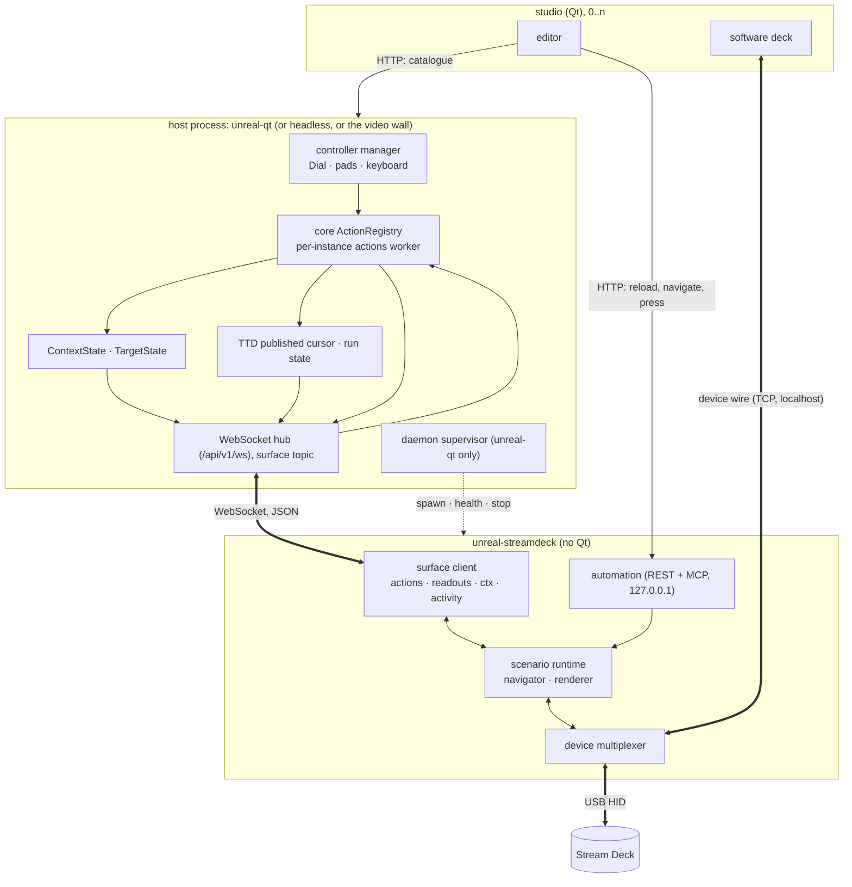
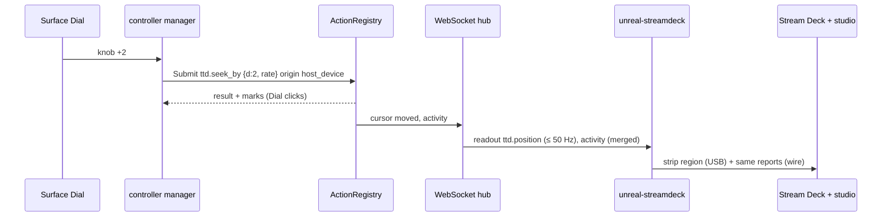

# Stream Deck integration: architecture

| | |
|---|---|
| **Date** | 2026-10-19 |
| **Status** | Design, for review |
| **Requirements** | [requirements.md](requirements.md) |
| **Extends** | control surfaces `architecture.md` (§3 registry, §6 contexts, §7 readouts, §8 hub), branch `control-surfaces-design` |

## Contents

- [1. Vocabulary](#1-vocabulary)
- [2. Processes](#2-processes)
- [3. Who owns which state](#3-who-owns-which-state)
- [4. Why state, not events](#4-why-state-not-events)
- [5. The activity feed](#5-the-activity-feed)
- [6. Contexts and deck pages](#6-contexts-and-deck-pages)
- [7. Flows](#7-flows)
- [8. Failure and restart](#8-failure-and-restart)
- [9. Threads](#9-threads)
- [10. Security](#10-security)
- [11. What changes where](#11-what-changes-where)

## 1. Vocabulary

| Term | Meaning |
|:--|:--|
| Client | A program that shows and runs emulation: unreal-qt, the screen viewer, the video wall, the Steam Deck client (`unreal-deck`), iOS. |
| Companion | A paired process that controls a client's instances through the WebAPI without showing emulation: the Stream Deck daemon, phone apps, `surfacectl`. |
| Surface | Anything with controls that drives actions and shows or feels feedback: a real deck, a software deck, the Dial, a pad, the GUI. |
| Daemon | The Stream Deck companion process: owns the decks, runs the scenario. `unreal-streamdeck` ([source-layout.md §4](source-layout.md#4-names)). |
| Studio | The Qt app with the software deck and the scenario editor (today `streamdeck-emulator`). |
| Viewer | A studio connected to the daemon over the device wire, as a mirror or as its own deck. |
| Target | The instance a surface drives now ([targeting.md](targeting.md)). |
| Activity | A display-only notice that an action ran: id, origin, surface, result. |

## 2. Processes



| Process | Owns | Talks to |
|:--|:--|:--|
| Host (unreal-qt, headless, video wall) | Instances, actions, contexts, targets, readouts, the controller manager | Companions over the WebAPI |
| `unreal-streamdeck` | Every attached Stream Deck (USB), the scenario, the menu stack, what each key shows | The host (surface socket), viewers (device wire), the editor and agents (its automation port) |
| Studio | Its windows, the scenario document being edited | The daemon (device wire + automation), the host (catalogue, read-only) |

- The daemon is a **companion**, not a client: it never shows emulation and never runs an instance.
- The studio never talks to the host to act: everything it does to the machine goes through a scenario on the
  daemon. It reads the host's catalogue to build its palette.
- Decks are not shared between daemons: one daemon per user session ([daemon.md §8](daemon.md#8-single-instance)).

## 3. Who owns which state

| State | Owner | Others learn it by |
|:--|:--|:--|
| Machine: run / pause, speed, turbo, TTD position and span, media, mute | the core, per instance | readouts on the surface socket ([protocol.md](protocol.md#3-readouts)) |
| Interaction context (`play`, `ttd`, `ttd.timecode`, `debug`, `debug.disasm`) | `ContextState`, per instance | `ctx` |
| Target of each surface (followed or pinned instance) | `TargetState` in the host ([targeting.md](targeting.md)) | `target` |
| What just happened (action, origin, result) | the action registry | `activity` |
| Deck page inside a context, menu stack, press highlights, brightness, sleep | the daemon | the device wire to viewers (pixels + `HostPage`) |
| Bindings of the Dial, pads, keyboard | the controller manager (profiles) | not shared |
| Scenario (deck bindings) | the daemon (file), edited by the studio | not shared with the core |

Rule: **one owner per value; everybody else subscribes**. No surface keeps its own copy of the machine state
longer than one redraw, and no surface computes another surface's state (the deck does not guess where a Dial
scrub ended: it reads `ttd.position`).

## 4. Why state, not events

Forwarding raw events between surfaces (the Dial's turn into the daemon as deck input, the deck's key into the
controller manager) fails in three ways:

| Problem | Example |
|:--|:--|
| Double execution | A Dial turn +3 is executed by the controller manager and again by the deck's own `ttd_seek` binding: the TTD moves 6. |
| Wrong meaning | "Knob +3" means 3 frames under the Dial's `@ttd` layer and 300 frames under the deck's dial curve. To interpret it the receiver needs the sender's mapping: a second controller manager. |
| Echo and order | The deck sets a context, the core announces it, the deck takes the announcement for a new change and sets it again; two surfaces racing produce different orders on each side. |

With state:

1. An input is executed **once**, where its binding lives: Dial, pads, keyboard in the controller manager; deck keys
   and dials in the daemon's scenario; GUI menus in the GUI. All of them become `ActionRegistry::Submit`.
2. The executor changes the machine or the context.
3. The core announces the **result** (readouts, `ctx`, `activity`) to every surface; each shows it its own way: the
   deck redraws, the Dial clicks a mark, the GUI moves its slider.

What the user calls "synchronous everywhere" is synchronous **state**: whichever controller is used, every surface
ends up showing the same machine.

## 5. The activity feed

The one place where surfaces learn about each other's inputs, for display only.

```json
{"op":"activity","instance":"0f3a…","seq":812,"id":"run.pause_toggle","value":{"p":true},
 "origin":"host_device","surface":"Xbox Wireless Controller","ok":true,"t_ms":1760870000123}
```

| Field | Meaning |
|:--|:--|
| `id`, `value` | The action and the value it ran with (deltas after coalescing). |
| `origin` | `gui`, `host_device`, `companion`, `webapi`, `mcp`, `cli`, `lua`, `python` (`execution::Origin`). |
| `surface` | Human name: the device name, the companion's name, `GUI`, the agent's client name. |
| `ok`, `error` | The result. |

- Sent to sessions that subscribed to `activity`; a session does not get its own actions back (it has `result`).
- Rate: at most 20 per second per session; deltas of one action within 100 ms are merged (a Dial scrub is one line
  that updates, not 50).
- The daemon maps an activity to a look in the scenario: flash the key bound to the same id, a strip line for a set
  time, or nothing ([scenarios.md §5](scenarios.md#5-activity)).
- Never executed, never journaled.

## 6. Contexts and deck pages

The context is per instance and the last setter wins (control surfaces Q-5).

- A scenario menu may declare `"context": "ttd.timecode"`. Entering it sends `ctx.set`; leaving it to a parent
  without a context sends the parent's context.
- A `ctx` from the core whose `by` is not this session navigates the deck to the **nearest** menu declaring that
  context (the shortest path from the current page; ties: the first in the tree); none: the deck stays.
- Echo: a `ctx` with `by == this session` is ignored. A `ctx` equal to the current page's context is ignored.
- `auto_exit` back to a parent changes the context as any navigation does.
- Target change ([targeting.md](targeting.md)): the new instance's context is applied as a `ctx` from the core.

## 7. Flows

### 7.1 Dial scrub, the deck follows



### 7.2 Deck page sets the Dial's unit

1. The user enters "TTD · time code"; the daemon sends `action ctx.set "ttd.timecode"`.
2. `ContextState` stores it, posts `NC_SURFACE_CONTEXT`.
3. unreal-qt pushes it into the `InputRouter` (layer `@ttd.timecode`), the Dial gets its steps and clicks.
4. The hub sends `ctx` to other sessions; the daemon ignores its own.

### 7.3 Pause from a pad

1. The pad's button runs `run.pause_toggle` (origin `host_device`).
2. `run.state` changes: the daemon redraws the run key's face (`face_on` bound to `run.state.paused`).
3. `activity`: the daemon flashes that key (the default); with the strip message turned on it also writes
   "PAUSE · pad" on the strip for 1 s ([scenarios.md §5](scenarios.md#5-activity)).

### 7.4 Focus moves to another window

1. The user clicks window 2 (instance B).
2. The host sets the followed target; sessions following focus get `target {instance: B, …}`, then `ctx`, then a full
   `readout` of B.
3. The daemon redraws the target line and every state-bound face; the Dial's router follows B.

## 8. Failure and restart

| Failure | Behaviour |
|:--|:--|
| Daemon crashes | The supervisor restarts it after 1 s, 2 s, 4 s, then gives up for 60 s and shows it in the settings. The emulator is not affected (separate process). |
| Daemon hangs | The supervisor's health check (`GET /api/v1/health` on the daemon's automation port, 2 s) fails three times: kill, restart. |
| Host restarts | The daemon reconnects with backoff (0.5 s → 5 s), shows "UNREAL-NG …" on the strip meanwhile, keeps its page; readouts resume with a full snapshot. |
| Token revoked | `revoked`, socket closed; the daemon shows "PAIR AGAIN" and offers pairing on the strip. |
| Deck unplugged | The multiplexer keeps the runtime and the viewers; the deck comes back on the same page when replugged. |
| Viewer disconnects | Nothing else changes. |
| Target instance destroyed | Followers follow focus; a pin falls back to focus and the deck says so ([targeting.md §5](targeting.md#5-lifetime)). |

## 9. Threads

Host side: the actions worker per instance as in control surfaces §11. The WebSocket hub adds no thread
([protocol.md §0.1](protocol.md#01-asynchronous-io-a-fixed-number-of-threads)). Sockets, the readout timer and the
per-connection queues live on the WebAPI's existing event loops, two threads. Producers only store a value and wake
the loop. The activity feed is posted from the actions worker the same way.

Daemon side:

| Thread | Does |
|:--|:--|
| Device | Polls every deck's input, injects viewer input, renders, writes HID reports (today `Runtime::step`; macOS hidapi delivers no input while another thread writes the same handle). |
| Network (one event loop) | Non-blocking, all sockets on one thread: the WebSocket client of `/api/v1/ws` (sends actions, receives `result`, readouts, `ctx`, `target`, `activity`), the wire server (viewers' input, the fan-out; a slow viewer drops frames, never stalls the deck) and the automation REST + MCP. Hands everything to the device thread through a queue and a wakeup. |

Two threads in all, whatever the number of decks, viewers and clients. Today the automation is a cpp-httplib server.
Its pool defaults to max(8, cores - 1) threads (`CPPHTTPLIB_THREAD_POOL_COUNT`), 23 on a 24-core machine, for a
handful of editor calls. SD2 picks an event-loop library for the WebSocket client; the wire server and the automation
move onto the same loop. Until then the pool is pinned to 1.

No actions worker of its own: actions are sent and their results arrive asynchronously; dial coalescing moves to the
core's registry (control surfaces §3), the daemon still merges deltas it has not sent yet.

## 10. Security

- The daemon binds its automation port and the device wire to `127.0.0.1` only. A viewer from another host is out of
  scope; `--any` stays a developer flag.
- The companion token is stored as today (mode 0600, per user) in the daemon's config directory.
- Scenario actions of kinds `shell`, `open`, `keys` run as the user: the studio marks them, the default scenario uses
  none.
- The surface socket's gates are the companion gates: scopes, `held_by_session`, `not_now`.

## 11. What changes where

| Where | Change |
|:--|:--|
| core (control surfaces design) | The registry, contexts, readouts as designed; the surface protocol as the `surface` topic of the one WebSocket hub `/api/v1/ws` instead of its own `SurfaceHub` route; plus `TargetState`, the `activity` feed, `target` messages, state readouts for toggles ([protocol.md](protocol.md)). |
| unreal-qt | Reports window focus and each window's active instance to `TargetState`; daemon supervisor; settings page "Stream Deck". |
| unreal-videowall | Reports its focused tile as its window's active instance (FR-8 applies there too). |
| daemon (from `sdctl run`) | Surface socket client instead of REST; device multiplexer; listens for viewers; config and supervision. |
| studio (from `streamdeck-emulator`) | Connects to the daemon; no USB; palette from the catalogue; recording from `core/recording`. |
