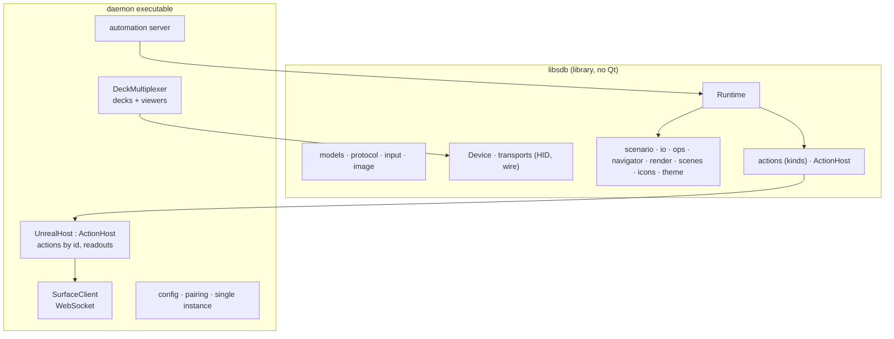
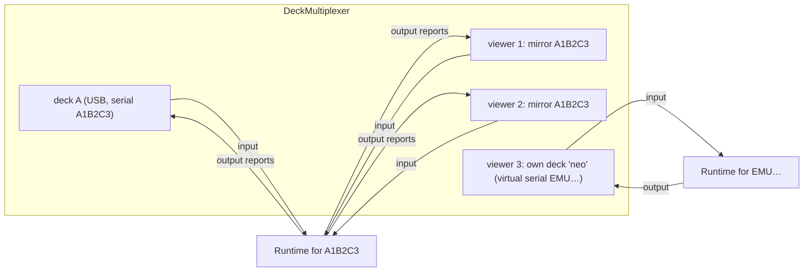

# Stream Deck integration: the daemon

| | |
|---|---|
| **Date** | 2026-10-19 |
| **Status** | Design, for review |
| **From** | the prototype's `sdctl run` ([migration.md](migration.md)) |
| **Name** | `unreal-streamdeck` ([source-layout.md §4](source-layout.md#4-names)) |

## Contents

- [1. Responsibilities](#1-responsibilities)
- [2. Inside](#2-inside)
- [3. Device multiplexer](#3-device-multiplexer)
- [4. Surface client](#4-surface-client)
- [5. Runtime changes](#5-runtime-changes)
- [6. Pairing](#6-pairing)
- [7. Supervision by unreal-qt](#7-supervision-by-unreal-qt)
- [8. Single instance](#8-single-instance)
- [9. Configuration](#9-configuration)
- [10. Automation](#10-automation)
- [11. The CLI](#11-the-cli)
- [12. Platforms](#12-platforms)

## 1. Responsibilities

| Does | Does not |
|:--|:--|
| Open every attached Stream Deck (USB HID), alone | Show emulation, run instances |
| Run one scenario per deck: navigation, rendering, input → actions | Interpret other surfaces' events (architecture §4) |
| Talk to one host over `/api/v1/surfaces/ws` as a paired companion | Poll the WebAPI |
| Serve viewers (studio windows) on the device wire | Accept viewers from other machines (localhost only) |
| Serve its automation (REST + MCP) for the editor and agents | Edit scenarios (the studio does; the daemon reloads) |

## 2. Inside



- `libsdb` stays a library: the studio links its scenario, navigator and renderer for the editor canvas, and the
  wire definitions; the daemon links all of it.
- `UnrealHost` replaces today's `SystemHost` unreal-ng part (`actions.cpp:272-548`): the generic kinds (`http`,
  `shell`, `open`, `keys`, `delay`) stay in a `SystemHost` base.

## 3. Device multiplexer

Replaces `TeeTransport` (`transport_tcp.cpp:166-195`) and the emulator's `UsbListener`.



| Rule | Detail |
|:--|:--|
| One runtime per **logical deck** | A real deck, or a viewer that asked for its own deck (`role: own`). |
| Mirror viewers | Attach to a real deck by serial (or "the first deck"); get every output and feature report the deck gets, at the deck's model; their input is merged into that deck's runtime with `InputSource::Emulator` and its own parser (as `Device::pollEvents` does). |
| Late join | A mirror viewer joining a running deck gets the **current picture** at once: the multiplexer keeps the last image report chain per key, the last strip regions and the brightness, and replays them. |
| Real input to viewers | Every input report from the real deck goes to its mirrors as `HostInput` (they light presses; nothing executes there). |
| `getFeature` | From the real deck only (as Tee). Own viewers answer their own. |
| Slow viewer | Each viewer has a bounded queue (64 frames); on overflow the oldest image chains are dropped and the viewer gets a full replay when it drains; the deck is never stalled. |
| No real deck | Mirror viewers wait ("no deck" on their window); own viewers work. |
| Hot plug | The multiplexer rescans every second (as `UsbListener` did); a replugged serial gets its runtime back on its page. |
| Exclusive open | The daemon opens decks **exclusive** where the OS allows it (macOS: `hid_darwin_set_open_exclusive(1)`); the per-deck `/tmp` lock goes: there is one writer. Other Stream Deck software (the Elgato app) holding the deck is reported as "busy" with the holder if known. |
| `--emulate` | A runtime may present a smaller model on a larger real deck (`Device::emulate`), as today; mirrors then show the physical model (as today's order: mirror before emulate). |

## 4. Surface client

- One WebSocket per **logical deck** (one `join` each, [protocol.md §1](protocol.md#1-join)), all on one connection
  thread.
- Library: the WebSocket client is new to libsdb (today plain HTTP/1.1 on raw sockets). Options in
  [source-layout.md §5](source-layout.md#5-third-party); the default proposal is a small RFC 6455 client on the
  existing socket code (text frames, ping / pong, no extensions; TLS out of scope as the WebAPI is plain HTTP).
- Reconnect with backoff 0.5 s → 5 s; on reconnect: `join` again with the last pin, `subscribe` again, the runtime
  keeps its page and redraws from the first full readout.
- Outgoing deltas not yet sent are merged in the client queue (same id, same params): a fast dial makes one message
  per send slot.
- Results come back with `rid`; the runtime maps them to the job (strip banner on failure, `then: back|home`).

## 5. Runtime changes

| Today (`runtime.cpp`, `actions.cpp`) | Then |
|:--|:--|
| Monitor thread polls `/ttd/position` 50 Hz, `/ttd/status` 2 Hz while a page shows `strip.status: ttd` | Readout `ttd.position` drives the strip; no monitor thread |
| Toggle state flipped locally on success | Faces bound to `toggle.<id>` / `run.state` readouts ([scenarios.md §4](scenarios.md#4-state-bound-faces)) |
| `ttd_seek` curve computed in the deck (`actions.cpp:95-124`) and clamped with `ttdNow()` | `ttd.seek_by` with `{d, rate, unit, min, max}`; the curve is the core's (one implementation for the deck, the Dial, pads) |
| `run_toggle` reads the state over REST then posts | `run.pause_toggle` |
| `dir`, `first`, `multi`, `toggle`, `delay`, `nav` kinds | Kept: they compose steps; steps may be `action` |
| Action worker thread with a FIFO, one mutex with the monitor | Asynchronous sends, results by `rid`; no shared mutex with drawing |
| `describePage` published to the emulator as `HostPage` | Kept (agents and viewers read it) |
| `HostNote` log lines | Kept |
| Strip status line from `ActionResult.status` | Kept for `ttd.seek_by` (from `result.body`), plus the target line and the activity lines |

## 6. Pairing

The companion flow is unchanged (`POST /api/v1/companions/pairings`, approval at the GUI, a token once).

| Way | Detail |
|:--|:--|
| From the deck | No token, or `revoked`: the strip shows "PAIR WITH UNREAL-NG"; a press asks for pairing and shows the 6-digit code on the strip; approval in unreal-qt. |
| From the studio | A "Pair" button calls the daemon's automation (`POST /api/v1/pair`), shows the code. |
| Headless | `UNREAL_COMPANION_TOKENS` on the host, the token in the daemon's config. |

- One pairing request at a time per daemon: the host answers 429 when a request from the same peer address is
  pending (`companionregistry.cpp:331`), and all decks of a daemon share one address. The daemon therefore pairs
  **once** (`device: "Stream Deck daemon"`), and all its decks use that token; each deck is a session, not a companion.
- The token lives in the daemon's config directory (mode 0600), not in the scenario.
- Pairing works only with unreal-qt as host (the video wall and headless answer 503 `pairing_unavailable`); the
  settings page says so.

## 7. Supervision by unreal-qt

| Setting (Preferences → Controllers → Stream Deck) | Behaviour |
|:--|:--|
| Off | Never started by unreal-qt; a daemon started by hand still works. |
| When a deck is attached (default) | unreal-qt watches USB for VID `0x0FD9` (IOHID / SetupAPI / udev matching only, it never opens the deck) and starts the daemon when one appears. |
| Always | Started with unreal-qt (software decks without hardware). |

- Start: `unreal-streamdeck --host 127.0.0.1:<webapi port> --parent <pid> --ready-fd <n>`; the daemon reports ready
  (automation port, decks) on the fd, or the supervisor polls `GET /api/v1/health`.
- `--parent`: the daemon exits when that process is gone (replaces `--with-parent`, which polls `getppid()` and does
  nothing on Windows: use a process handle wait on Windows, `kqueue` `EVFILT_PROC` on macOS, `pidfd` / `prctl` on Linux).
- Restart policy and health check: [architecture §8](architecture.md#8-failure-and-restart).
- Stop: `POST /api/v1/quit` then terminate after 2 s; the daemon clears its decks to the idle screen (logo, dim).
- A daemon already running (started by hand, by the studio, by another unreal-qt): the supervisor **adopts** it
  (health check answers, same host) instead of starting another ([§8](#8-single-instance)).

## 8. Single instance

- One daemon per user session: a lock (`<runtime dir>/unreal-streamdeck.lock` with the automation port inside; a named mutex
  on Windows).
- A second start prints the running one's port and exits 0, so any starter (unreal-qt, the studio, a script) can call
  "start" blindly.
- Several hosts (two unreal-ng processes): out of v1 ([targeting.md §8](targeting.md#8-several-host-processes)).

## 9. Configuration

`<config dir>/streamdeck/daemon.yaml` (the unreal-ng config dir, so a portable install keeps it beside the others):

```yaml
host: 127.0.0.1:8090            # the WebAPI; the supervisor passes its own
token_file: companion.json      # relative to this directory, mode 0600
automation_port: 37053          # 0 = pick a free one and report it
wire_port: 37050                # viewers connect here
decks:
  default:
    scenario: $data/streamdeck/scenarios/unrealng-control.deck.json
    brightness: 70
    target: follow
  A1B2C3:                       # per serial
    scenario: $user/streamdeck/my-debugger.deck.json
    emulate: null
```

- `$data` = the shipped data directory (`Contents/Resources` on macOS, `lib/unreal-ng` on the DEB, beside the exe on
  Windows), `$user` = the user's unreal-ng directory.
- Scenario files are watched (today's `--watch`): edits from the studio reload with the stack kept (`nav_.rebind`).

## 10. Automation

Today's `sdctl run --api` routes stay (`/api/v1/state`, `/page`, `/nodes`, `/navigate`, `/press`, `/reload`,
`/scenario`) and become per deck (`?deck=<serial>`, default the first). Added:

| Route | What |
|:--|:--|
| `GET /api/v1/health` | Ready, version, host connection, decks, viewers |
| `GET /api/v1/decks` | Each logical deck: serial, model, real / own, scenario file, page, target, viewers |
| `PUT /api/v1/decks/{serial}/scenario` | Load another scenario file |
| `PUT /api/v1/decks/{serial}/pin` | Forward a pin ([targeting.md §4](targeting.md#4-pins)) |
| `POST /api/v1/pair`, `GET /api/v1/pair` | Start pairing, its state and code |
| `POST /api/v1/quit` | Clean stop |
| `POST /mcp` | As today: `search_api` + `invoke_api` |

The stdio MCP bridge is unreal-ng's `unreal-mcp-bridge` with `--url http://127.0.0.1:<port>/mcp`; the copy
(`sdeck-mcp-bridge`) goes.

## 11. The CLI

`sdctl` stays as the developer tool (info, events, raw sets, scenes, bench, hid-test, probe). Commands that open
the deck refuse with "held by the daemon (pid N)" when the daemon runs, except `sdctl --device emu` against a studio
in its own-deck role. `sdctl bridge` (the legacy 500 ms poller, `tools/bridge.cpp`) goes; `sdctl pair` becomes a
call to the daemon's `/api/v1/pair`; `sdctl run` becomes `unreal-streamdeck --scenario <file> --foreground`.

## 12. Platforms

| Platform | Work |
|:--|:--|
| macOS | Built and measured today (Stream Deck + XL). Exclusive open; `kqueue` parent watch. |
| Windows | `http.cpp`, `transport_tcp.cpp` use POSIX sockets without `_WIN32` paths: port to Winsock (or to the shared socket helper of `unreal-mcp-bridge`); hidapi Windows backend; `keys` action unsupported (returns false) stays; parent watch by process handle. MSVC and MinGW, zero warnings. |
| Linux | hidapi hidraw backend; a udev rule for `0FD9` (the package installs it); `keys` via `xdotool` stays optional. gcc and clang. |
