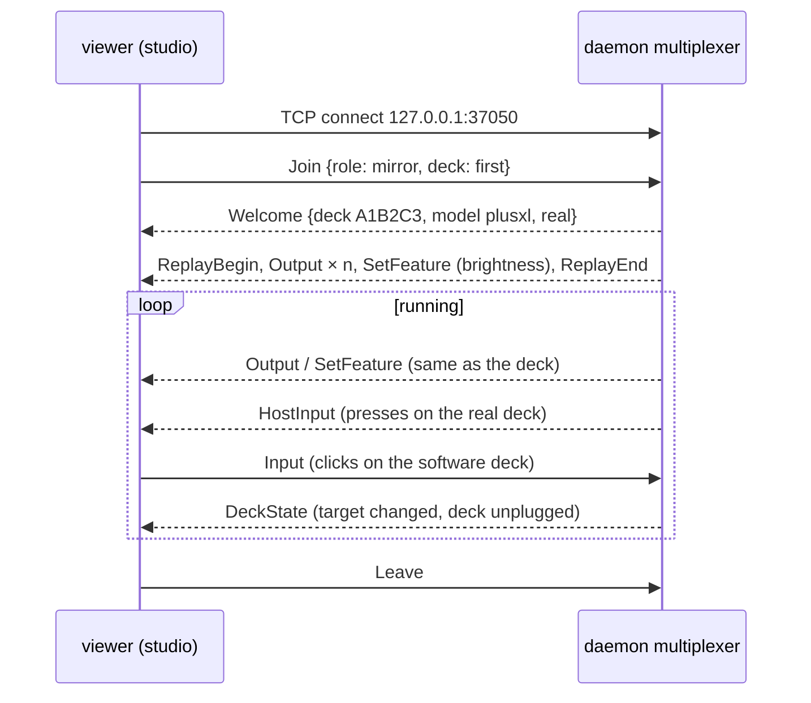

# Stream Deck integration: the device wire v2

The TCP link between the daemon and software decks.

| | |
|---|---|
| **Date** | 2026-10-19 |
| **Status** | Daemon side implemented 2026-10-20 (`companions/streamdeck/lib/include/sdb/devicewire.h`, `deckhub.h`, `picturecache.h`) |
| **Decision** | D3 in [README.md](README.md#decisions-owner-2026-10-19) |
| **From** | `streamdeck-bridge/include/sdb/emuwire.hpp` (v1), `streamdeck-emulator/src/server.cpp` |

## Contents

- [1. v1 today](#1-v1-today)
- [2. What changes](#2-what-changes)
- [3. Frames](#3-frames)
- [4. Session](#4-session)
- [5. Replay on join](#5-replay-on-join)
- [6. Flow control](#6-flow-control)
- [7. Compatibility](#7-compatibility)

## 1. v1 today

- Frame: `[u8 type][u16 length LE][payload]`, payloads are exact HID buffers, report ID first; at most 65535 bytes.
- The **emulator listens** on 37050 (localhost, `--any` for all), **one host, the newest wins**; the host connects.
- Host → emulator: `Output 0x01`, `SetFeature 0x02`, `GetFeature 0x03`, `HostInput 0x06`, `HostNote 0x07`,
  `HostPage 0x08`, `HostMirror 0x09`, `SetModel 0x11`, `Snapshot 0x12`, `Record 0x14`.
- Emulator → host: `FeatureReply 0x04`, `Input 0x05`, `Hello 0x10` (`u8 version, u16 VID, u16 PID, u8 n, serial`),
  `SnapshotDone 0x13`, `RecordDone 0x15`.
- No handshake from the host, no auth. The emulator's README table omits 0x06-0x09.

## 2. What changes

| v1 | v2 |
|:--|:--|
| The emulator is the server, one host | **The daemon is the server**, any number of viewers |
| The emulator reads the real deck itself (`UsbListener`) | The daemon relays real input (`HostInput`) and the current picture |
| The host learns the viewer's model from `Hello`, then may `SetModel` it | The viewer says its role in `Join`; a mirror takes the deck's model; an own deck says its model |
| Snapshot and record requested by the host | Requested by whoever drives the viewer (its own UI, its own automation); the daemon's automation can ask a viewer too |
| 16-bit lengths | 32-bit lengths (`HostPage` of a large menu exceeded 64 KB and was dropped silently, `transport_tcp.cpp:78`) |

## 3. Frames

Frame v2: `[u8 type][u32 length LE][payload]`.

Viewer → daemon:

| Type | Name | Payload |
|:--|:--|:--|
| `0x20` | `Join` | JSON: `{"v":2,"role":"mirror","deck":"A1B2C3"\|"first"}` or `{"v":2,"role":"own","model":"neo","serial":"EMU00C6-1"}`, plus `{"name":"Studio","pid":1234}` |
| `0x05` | `Input` | an input report, as `hid_read` returns it |
| `0x04` | `FeatureReply` | own role only: the answer to a `GetFeature` |
| `0x22` | `Leave` | empty: clean disconnect |

Daemon → viewer:

| Type | Name | Payload |
|:--|:--|:--|
| `0x21` | `Welcome` | JSON: `{"v":2,"deck":"A1B2C3","model":"plusxl","model_name":"Stream Deck + XL","pid":198,"real":true,"daemon":"<version>"}` (`model` is the model's token, the name `Join`'s `model` takes (`ModelToken()` in `sdb/models.h`: `plusxl`, `neo`, `mini`, ..., `0x` and four hex digits for a PID without a name); `model_name` is the display name; `pid` backs the token for a viewer that does not know it), or `{"v":2,"error":..}`: `bad_request` (not a JSON object, a field of the wrong type), `version`, `bad_role`, `bad_model` (own role: an unknown model), each followed by the close; `no_deck` (`"waiting":true`) keeps the connection: the mirror waits, a `Welcome` follows when its deck comes |
| `0x01` | `Output` | output report |
| `0x02` | `SetFeature` | feature report |
| `0x03` | `GetFeature` | own role only |
| `0x06` | `HostInput` | an input report from the real deck (mirror role) |
| `0x07` | `HostNote` | UTF-8 log line |
| `0x08` | `HostPage` | `describePage` JSON |
| `0x23` | `DeckState` | JSON: `{"connected":true,"busy_by":null,"target":"W2 · #3 PENTAGON 128"}` (deck unplugged / replugged; what the runtime targets). Sent today: `{"connected":bool}` only (`busy_by`, `target`: SD5 / SD7) |
| `0x24` | `ReplayBegin` / `0x25` `ReplayEnd` | brackets the replay of the current picture ([§5](#5-replay-on-join)) |

Gone: `SetModel 0x11` (a mirror follows the deck, an own deck chooses its model in `Join`), `HostMirror 0x09`
(implied by the mirror role), `Snapshot 0x12` / `Record 0x14` and their answers (local to the viewer; the daemon's
automation forwards `POST /api/v1/decks/{serial}/viewers/{n}/snapshot` as a JSON `Control 0x26` frame if needed).

## 4. Session

- A viewer that does not send `Join` within 2 s is closed; so is one whose first frame is not a `Join`, and one that
  announces a frame over 16 MB (`kMaxFrame`). Frame types the daemon does not know are ignored (a newer viewer).
- Conformance: `companions/streamdeck/tests/conformance_test.cpp` ([testing.md §3.1](testing.md#31-device-wire-and-daemon-routes-hardware-free-in-ci)).
- Own role: the daemon creates a logical deck and a runtime for it with the scenario configured for `own` decks
  (default: the same default scenario) and joins the host for it ([daemon.md §4](daemon.md#4-surface-client)).
- Several studios mirror the same deck: each gets the same frames; their inputs all reach the deck's runtime.

## 5. Replay on join

The multiplexer keeps, per logical deck:

- per key: the last complete image report chain;
- the strip: a device-space copy of the window (regions are composed into it), sent as one full-window write;
- the last brightness, sleep, Neo sensor colours.

On `Join` it sends them between `ReplayBegin` and `ReplayEnd`; the viewer shows the picture without waiting for the
runtime to redraw. This replaces today's "the emulator keeps the picture across host connections".

## 6. Flow control

- The daemon writes to viewers non-blocking with a bounded per-viewer queue (64 frames). On overflow it drops the
  queued image chains, keeps feature reports, and marks the viewer for a full replay when the queue drains.
- Input from viewers is never dropped.
- The real deck's writes never wait for a viewer.

## 7. Compatibility

- `Welcome.v` / `Join.v`: the daemon speaks v2 only; a v1 emulator (which listens and does not send `Join`) is not
  supported: both ends ship together.
- `sdctl --device emu:host:port` (a developer driving a studio directly, without the daemon) keeps working against a
  studio started with `--listen` (the studio then plays v1's role as a server for one host); that mode is for
  protocol tests only.
