# Stream Deck scenario: unreal

Generated by `companions/streamdeck/tools/deckflow.py` from [`data/streamdeck/scenarios/src/unreal.spec.yaml`](../../../../data/streamdeck/scenarios/src/unreal.spec.yaml); do not edit (edit the spec or the Studio project [`data/streamdeck/scenarios/unreal.deck.yaml`](../../../../data/streamdeck/scenarios/unreal.deck.yaml), then `deckflow.py sync unreal`).

| | |
|:--|:--|
| Model | `plusxl` (4x9 keys, 112 px) |
| Icon pack | `magicwb` (the scenario's `settings.pack`; a deck's own pack setting wins; the pictures below are this pack's) |
| Shared menus | `shared/speed` |

## Contents

- [menu home](#menu-home)
- [menu state](#menu-state)
- [menu media](#menu-media)
- [menu machine](#menu-machine)
- [menu record](#menu-record)
- [menu sound](#menu-sound)
- [menu ay](#menu-ay)
- [menu picture](#menu-picture)
- [menu monitor](#menu-monitor)
- [menu game](#menu-game)
- [menu basic](#menu-basic)
- [menu time](#menu-time)
- [menu debug](#menu-debug)
- [menu speed](#menu-speed-sharedspeed)
- [Coverage](#coverage)

## menu home

Title: Home; context `play`; the root; strip content `title`, status `ttd`, target `true`.

| 0 | 1 | 2 | 3 | 4 | 5 | 6 | 7 | 8 |
|:-:|:-:|:-:|:-:|:-:|:-:|:-:|:-:|:-:|
|  Pause / continue C1.1 |  Reset (hold 1 s) C1.2 | 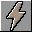 NMI C1.3 |  Turbo C2.2 |  Turbo while held C2.2 |  **SPEED** Speed `X{}` C2.5 |  Speed |  Mute C8.1 |  Screenshot C7.5 |
|  **S1** Quick snapshot C6.1 |  **L1** Quick snapshot C6.1 |  Save state C6 |  Media C4 C5 |  Machine C3 | 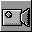 Record C7 |  Sound C8 |  Picture C9 |  Monitoring C10 |
|  **-5S** Back one unit U2.2 |  Resume live U2.3 D3.6 | 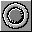 Start / stop recording C7.1 |  Add a bookmark D3.7 |  Game U1 |  BASIC U4 |  **TAPE** Tape `{block}/{blocks}` C4.2 | 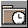 **LAST** Open a recent file C4.3 |  Full screen C9.1 |
|  Step in D2.1 |  Step over D2.1 |  Step out D2.1 |  Frame step D2.3 | 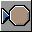 Toggle a breakpoint at PC D4.1 |  Debug mode D4.4 |  Open the debugger D6.1 | 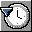 Time D1 D3 |  Debugger D2 D4 D6 D8 D10 |

| Key | Slot | Glyph | Title | Does | Use case |
|:--|:--|:--|:--|:--|:--|
| `pause` | [0, 0] |  `run.pause` /  `run.play` when `run.state.paused` | Pause / continue | `run.pause_toggle` | C1.1 |
| `reset` | [0, 1] |  `mach.reset` | Reset (hold 1 s) | `mach.reset` (held) | C1.2 |
| `nmi` | [0, 2] |  `mach.nmi` | NMI | `mach.nmi` | C1.3 |
| `turbo` | [0, 3] |  `mach.turbo` /  `mach.turbo.on` when `toggle.mach.turbo_toggle` | Turbo | `mach.turbo_toggle` | C2.2 |
| `hold` | [0, 4] |  `run.turbo_hold` | Turbo while held | `run.turbo_hold` (held) | C2.2 |
| `x1` | [0, 5] |  `set.speed` + label SPEED | Speed | shows `X{}` of `run.state.speed`; `set.speed` 1 | C2.5 |
| `speed` | [0, 6] |  `set.speed` | Speed | opens the shared menu `speed` |  |
| `mute` | [0, 7] |  `audio.sound` /  `audio.muted` when `audio.mute.muted` | Mute | `audio.mute_toggle` | C8.1 |
| `shot` | [0, 8] |  `cap.screenshot` | Screenshot | `cap.screenshot` | C7.5 |
| `qsave` | [1, 0] |  `snapshot.quick_save` + label S1 | Quick snapshot | `snapshot.quick` {op: save, slot: 1} | C6.1 |
| `qload` | [1, 1] |  `snapshot.quick_load` + label L1 | Quick snapshot | `snapshot.quick` {op: load, slot: 1} | C6.1 |
| `state` | [1, 2] |  `snapshot.save` | Save state | opens the menu | C6 |
| `media` | [1, 3] |  `media.open` | Media | opens the menu | C4 C5 |
| `machine` | [1, 4] |  `mach.start` | Machine | opens the menu | C3 |
| `record` | [1, 5] |  `cap.record` | Record | opens the menu | C7 |
| `sound` | [1, 6] |  `audio.sound` | Sound | opens the menu | C8 |
| `picture` | [1, 7] |  `nav.folder` | Picture | opens the menu | C9 |
| `monitor` | [1, 8] |  `nav.folder` | Monitoring | opens the menu | C10 |
| `back5` | [2, 0] |  `ttd.unit_back` + label -5S | Back one unit | `ttd.unit_back` {unit: seconds, count: 5} | U2.2 |
| `live` | [2, 1] |  `ttd.resume_live` | Resume live | `ttd.resume_live` | U2.3 D3.6 |
| `ttdrec` | [2, 2] |  `ttd.record` / 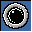 `ttd.record.on` when `toggle.ttd.record_toggle` | Start / stop recording | `ttd.record_toggle` | C7.1 |
| `mark` | [2, 3] |  `ttd.bookmark_add` | Add a bookmark | `ttd.bookmark_add` | D3.7 |
| `game` | [2, 4] |  `input.joystick` | Game | opens the menu | U1 |
| `basic` | [2, 5] |  `basic.menu` | BASIC | opens the menu | U4 |
| `tape` | [2, 6] |  `media.tape.play` + label TAPE | Tape | shows `{block}/{blocks}` of `media.tape`; `media.tape` {op: toggle} | C4.2 |
| `recent` | [2, 7] |  `media.open_recent` + label LAST | Open a recent file | `media.open_recent` {index: 0} | C4.3 |
| `full` | [2, 8] |  `view.fullscreen` /  `view.fullscreen.on` when `toggle.view.fullscreen` | Full screen | `view.fullscreen` | C9.1 |
| `stepin` | [3, 0] |  `run.step_in` | Step in | `run.step_in` | D2.1 |
| `stepovr` | [3, 1] |  `run.step_over` | Step over | `run.step_over` | D2.1 |
| `stepout` | [3, 2] |  `run.step_out` | Step out | `run.step_out` | D2.1 |
| `frame` | [3, 3] |  `run.frame_step` | Frame step | `run.frame_step` | D2.3 |
| `bppc` | [3, 4] |  `dbg.breakpoint_toggle_pc` | Toggle a breakpoint at PC | `dbg.breakpoint_toggle_pc` | D4.1 |
| `dbgmode` | [3, 5] |  `dbg.mode` /  `dbg.mode.on` when `debug.mode.enabled` | Debug mode | `dbg.mode_toggle` | D4.4 |
| `dbgopen` | [3, 6] |  `debug.menu` | Open the debugger | `dbg.open` | D6.1 |
| `time` | [3, 7] |  `ttd.menu` | Time | opens the menu | D1 D3 |
| `debug` | [3, 8] |  `dbg.mode` | Debugger | opens the menu | D2 D4 D6 D8 D10 |

| Dial | Label | Turn | Press | Use case |
|:--|:--|:--|:--|:--|
| 0 | TIME | `ttd.seek_by` {d: $ticks, rate: $rate, unit: seconds, min: 1, max: 50} | `run.pause_toggle` | U2.1 D3.2 |
| 1 | VOLUME | `audio.volume_by` {d: $ticks} | `audio.mute_toggle` | C8.2 |
| 2 | PACE | `run.pace_by` {d: $ticks} | `run.pace_toggle` | D1.1 |
| 3 | STEP | `run.step_by` {d: $ticks, unit: instructions} | `run.step_in` | D2.2 |
| 4 | FRAMES | `ttd.jog_frames` {d: $ticks} | `ttd.bookmark_add` | D3.3 |
| 5 | OPS | `ttd.jog_instructions` {d: $ticks} | `ttd.resume_live` | D3.3 |

## menu state

Title: Save state; use cases C6; opened from `home` at [1, 2].

| 0 | 1 | 2 | 3 | 4 | 5 | 6 | 7 | 8 |
|:-:|:-:|:-:|:-:|:-:|:-:|:-:|:-:|:-:|
| *back* |  Save a snapshot C6.2 |  **A** Save the medium C6.3 |  **B** Save the medium C6.3 |  **C** Save the medium C6.3 |  **D** Save the medium C6.3 |  **A SCL** Save as another format C6.4 |  Save the session C7.1 D12.1 |  Open a session C7.1 |
|  **S1** Quick snapshot C6.1 |  **S2** Quick snapshot C6.1 |  **S3** Quick snapshot C6.1 |  **S4** Quick snapshot C6.1 |  **S5** Quick snapshot C6.1 |  **S6** Quick snapshot C6.1 |  **S7** Quick snapshot C6.1 |  **S8** Quick snapshot C6.1 |  **S9** Quick snapshot C6.1 |
|  **L1** Quick snapshot C6.1 |  **L2** Quick snapshot C6.1 |  **L3** Quick snapshot C6.1 |  **L4** Quick snapshot C6.1 |  **L5** Quick snapshot C6.1 |  **L6** Quick snapshot C6.1 |  **L7** Quick snapshot C6.1 |  **L8** Quick snapshot C6.1 |  **L9** Quick snapshot C6.1 |
|  |  |  |  |  |  |  |  |  |

| Key | Slot | Glyph | Title | Does | Use case |
|:--|:--|:--|:--|:--|:--|
| `file` | [0, 1] |  `snapshot.save` | Save a snapshot | `snapshot.save` {path: $user/snapshots/deck.szx} | C6.2 |
| `diska` | [0, 2] |  `media.save` + label A | Save the medium | `media.save` {drive: A} | C6.3 |
| `diskb` | [0, 3] |  `media.save` + label B | Save the medium | `media.save` {drive: B} | C6.3 |
| `diskc` | [0, 4] |  `media.save` + label C | Save the medium | `media.save` {drive: C} | C6.3 |
| `diskd` | [0, 5] |  `media.save` + label D | Save the medium | `media.save` {drive: D} | C6.3 |
| `scl` | [0, 6] |  `media.export` + label A SCL | Save as another format | `media.export` {drive: A, format: scl} | C6.4 |
| `tdump` | [0, 7] |  `ttd.dump` | Save the session | `ttd.dump` {path: $user/sessions/deck.ttd} | C7.1 D12.1 |
| `tload` | [0, 8] |  `ttd.load` | Open a session | `ttd.load` {path: $user/sessions/deck.ttd} | C7.1 |
| `s1` | [1, 0] |  `snapshot.quick_save` + label S1 | Quick snapshot | `snapshot.quick` {op: save, slot: 1} | C6.1 |
| `s2` | [1, 1] |  `snapshot.quick_save` + label S2 | Quick snapshot | `snapshot.quick` {op: save, slot: 2} | C6.1 |
| `s3` | [1, 2] |  `snapshot.quick_save` + label S3 | Quick snapshot | `snapshot.quick` {op: save, slot: 3} | C6.1 |
| `s4` | [1, 3] |  `snapshot.quick_save` + label S4 | Quick snapshot | `snapshot.quick` {op: save, slot: 4} | C6.1 |
| `s5` | [1, 4] |  `snapshot.quick_save` + label S5 | Quick snapshot | `snapshot.quick` {op: save, slot: 5} | C6.1 |
| `s6` | [1, 5] |  `snapshot.quick_save` + label S6 | Quick snapshot | `snapshot.quick` {op: save, slot: 6} | C6.1 |
| `s7` | [1, 6] |  `snapshot.quick_save` + label S7 | Quick snapshot | `snapshot.quick` {op: save, slot: 7} | C6.1 |
| `s8` | [1, 7] |  `snapshot.quick_save` + label S8 | Quick snapshot | `snapshot.quick` {op: save, slot: 8} | C6.1 |
| `s9` | [1, 8] |  `snapshot.quick_save` + label S9 | Quick snapshot | `snapshot.quick` {op: save, slot: 9} | C6.1 |
| `l1` | [2, 0] |  `snapshot.quick_load` + label L1 | Quick snapshot | `snapshot.quick` {op: load, slot: 1} | C6.1 |
| `l2` | [2, 1] |  `snapshot.quick_load` + label L2 | Quick snapshot | `snapshot.quick` {op: load, slot: 2} | C6.1 |
| `l3` | [2, 2] |  `snapshot.quick_load` + label L3 | Quick snapshot | `snapshot.quick` {op: load, slot: 3} | C6.1 |
| `l4` | [2, 3] |  `snapshot.quick_load` + label L4 | Quick snapshot | `snapshot.quick` {op: load, slot: 4} | C6.1 |
| `l5` | [2, 4] |  `snapshot.quick_load` + label L5 | Quick snapshot | `snapshot.quick` {op: load, slot: 5} | C6.1 |
| `l6` | [2, 5] |  `snapshot.quick_load` + label L6 | Quick snapshot | `snapshot.quick` {op: load, slot: 6} | C6.1 |
| `l7` | [2, 6] |  `snapshot.quick_load` + label L7 | Quick snapshot | `snapshot.quick` {op: load, slot: 7} | C6.1 |
| `l8` | [2, 7] |  `snapshot.quick_load` + label L8 | Quick snapshot | `snapshot.quick` {op: load, slot: 8} | C6.1 |
| `l9` | [2, 8] |  `snapshot.quick_load` + label L9 | Quick snapshot | `snapshot.quick` {op: load, slot: 9} | C6.1 |

## menu media

Title: Media; use cases C4, C5; opened from `home` at [1, 3].

| 0 | 1 | 2 | 3 | 4 | 5 | 6 | 7 | 8 |
|:-:|:-:|:-:|:-:|:-:|:-:|:-:|:-:|:-:|
| *back* |  **1** Open a recent file C4.3 |  **2** Open a recent file C4.3 |  **3** Open a recent file C4.3 |  **4** Open a recent file C4.3 |  **5** Open a recent file C4.3 |  |  **RZX** Open a recent file C4.4 | 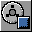 Stop the RZX C4.4 |
|  **PLAY** Tape `{block}/{blocks}` C4.2 |  Tape C4.2 | 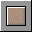 Tape C4.2 |  Tape C4.2 | 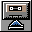 Tape C4.2 |  |  **A-B** Swap disks C5.2 |  **A** New blank disk C5.3 |  **A** Discard changes C5.5 |
| 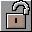 **A** Write protect `{?WP\|RW}` C5.1 |  **B** Write protect `{?WP\|RW}` C5.1 |  **C** Write protect `{?WP\|RW}` C5.1 |  **D** Write protect `{?WP\|RW}` C5.1 |  |  **SAVE A** Save the medium `{?CHANGED\|-}` C6.3 |  **SAVE B** Save the medium `{?CHANGED\|-}` C6.3 |  **SAVE C** Save the medium `{?CHANGED\|-}` C6.3 |  **SAVE D** Save the medium `{?CHANGED\|-}` C6.3 |
|  **A** Eject `{}` C5.1 |  **B** Eject `{}` C5.1 |  **C** Eject `{}` C5.1 |  **D** Eject `{}` C5.1 |  | 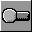 **TRAPS** Toggle a setting U4.4 |  **TAPE** Toggle a setting C2.4 |  **TURBO** Toggle a setting C2.4 |  **DISK** Toggle a setting C2.4 |

| Key | Slot | Glyph | Title | Does | Use case |
|:--|:--|:--|:--|:--|:--|
| `r1` | [0, 1] |  `media.open_recent` + label 1 | Open a recent file | `media.open_recent` {index: 0} | C4.3 |
| `r2` | [0, 2] |  `media.open_recent` + label 2 | Open a recent file | `media.open_recent` {index: 1} | C4.3 |
| `r3` | [0, 3] |  `media.open_recent` + label 3 | Open a recent file | `media.open_recent` {index: 2} | C4.3 |
| `r4` | [0, 4] |  `media.open_recent` + label 4 | Open a recent file | `media.open_recent` {index: 3} | C4.3 |
| `r5` | [0, 5] |  `media.open_recent` + label 5 | Open a recent file | `media.open_recent` {index: 4} | C4.3 |
| `rzxlast` | [0, 7] |  `media.open_recent` + label RZX | Open a recent file | `media.open_recent` {index: 0, kind: rzx} | C4.4 |
| `rzxstop` | [0, 8] |  `rzx.stop` | Stop the RZX | `rzx.stop` | C4.4 |
| `tplay` | [1, 0] |  `media.tape.play` + label PLAY | Tape | shows `{block}/{blocks}` of `media.tape`; `media.tape` {op: play} | C4.2 |
| `tpause` | [1, 1] |  `media.tape.pause` | Tape | `media.tape` {op: pause} | C4.2 |
| `tstop` | [1, 2] |  `media.tape.stop` | Tape | `media.tape` {op: stop} | C4.2 |
| `trew` | [1, 3] |  `media.tape.rewind` | Tape | `media.tape` {op: rewind} | C4.2 |
| `teject` | [1, 4] |  `media.tape.eject` | Tape | `media.tape` {op: eject} | C4.2 |
| `swapab` | [1, 6] |  `media.swap` + label A-B | Swap disks | `media.swap` {drive: A, with: B} | C5.2 |
| `blank` | [1, 7] |  `media.create` + label A | New blank disk | `media.create` {drive: A, format: trdos} | C5.3 |
| `discard` | [1, 8] |  `media.discard` + label A | Discard changes | `media.discard` {drive: A} | C5.5 |
| `wpa` | [2, 0] |  `media.protect` + label A | Write protect | shows `{?WP/RW}` of `media.disk.drives.0.protect`; `media.protect` {drive: A} | C5.1 |
| `wpb` | [2, 1] |  `media.protect` + label B | Write protect | shows `{?WP/RW}` of `media.disk.drives.1.protect`; `media.protect` {drive: B} | C5.1 |
| `wpc` | [2, 2] |  `media.protect` + label C | Write protect | shows `{?WP/RW}` of `media.disk.drives.2.protect`; `media.protect` {drive: C} | C5.1 |
| `wpd` | [2, 3] |  `media.protect` + label D | Write protect | shows `{?WP/RW}` of `media.disk.drives.3.protect`; `media.protect` {drive: D} | C5.1 |
| `savea` | [2, 5] |  `media.save` + label SAVE A | Save the medium | shows `{?CHANGED/-}` of `media.disk.drives.0.dirty`; `media.save` {drive: A} | C6.3 |
| `saveb` | [2, 6] |  `media.save` + label SAVE B | Save the medium | shows `{?CHANGED/-}` of `media.disk.drives.1.dirty`; `media.save` {drive: B} | C6.3 |
| `savec` | [2, 7] |  `media.save` + label SAVE C | Save the medium | shows `{?CHANGED/-}` of `media.disk.drives.2.dirty`; `media.save` {drive: C} | C6.3 |
| `saved` | [2, 8] |  `media.save` + label SAVE D | Save the medium | shows `{?CHANGED/-}` of `media.disk.drives.3.dirty`; `media.save` {drive: D} | C6.3 |
| `eja` | [3, 0] |  `media.eject` + label A | Eject | shows `{}` of `media.disk.drives.0.name`; `media.eject` {drive: A} | C5.1 |
| `ejb` | [3, 1] |  `media.eject` + label B | Eject | shows `{}` of `media.disk.drives.1.name`; `media.eject` {drive: B} | C5.1 |
| `ejc` | [3, 2] |  `media.eject` + label C | Eject | shows `{}` of `media.disk.drives.2.name`; `media.eject` {drive: C} | C5.1 |
| `ejd` | [3, 3] |  `media.eject` + label D | Eject | shows `{}` of `media.disk.drives.3.name`; `media.eject` {drive: D} | C5.1 |
| `trdos` | [3, 5] |  `settings.toggle` / 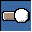 `settings.toggle.on` when `toggle.set.toggle.trdos_traps` + label TRAPS | Toggle a setting | `set.toggle` {name: trdos_traps} | U4.4 |
| `ftape` | [3, 6] |  `settings.toggle` /  `settings.toggle.on` when `toggle.set.toggle.fast_tape` + label TAPE | Toggle a setting | `set.toggle` {name: fast_tape} | C2.4 |
| `ttape` | [3, 7] |  `settings.toggle` /  `settings.toggle.on` when `toggle.set.toggle.turbo_tape` + label TURBO | Toggle a setting | `set.toggle` {name: turbo_tape} | C2.4 |
| `fdisk` | [3, 8] |  `settings.toggle` /  `settings.toggle.on` when `toggle.set.toggle.fast_disk` + label DISK | Toggle a setting | `set.toggle` {name: fast_disk} | C2.4 |

## menu machine

Title: Machine; use cases C3; opened from `home` at [1, 4].

| 0 | 1 | 2 | 3 | 4 | 5 | 6 | 7 | 8 |
|:-:|:-:|:-:|:-:|:-:|:-:|:-:|:-:|:-:|
| *back* |  **PREVIOUS** Previous model `{}` C3.3 |  Restart (cold) C1.2 | **NOW** now `{}` C3.1 |  |  |  | 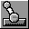 **TURBO** Front-panel switch C1.5 |  **CP/M** Front-panel switch C1.5 |
|  **48K** Start a machine C3.1 |  **128K** Start a machine C3.1 |  **+2** Start a machine C3.1 |  **+2A** Start a machine C3.1 |  **+3** Start a machine C3.1 |  |  **NEXT** Start a machine C3.1 |  **SPRINTER** Start a machine C3.1 |  |
|  **P128** Start a machine C3.1 |  **P512** Start a machine C3.1 |  **P1024** Start a machine C3.1 |  **SCORP** Start a machine C3.1 |  **SC1024** Start a machine C3.1 |  **PROF** Start a machine C3.1 |  **POLY48** Start a machine C3.1 |  **POLY128** Start a machine C3.1 |  **POLY P** Start a machine C3.1 |
|  **ATM450** Start a machine C3.1 |  **ATM710** Start a machine C3.1 |  **EVO** Start a machine C3.1 |  **TSCONF** Start a machine C3.1 |  **VDAC2** Start a machine C3.1 |  **PROFI** Start a machine C3.1 |  **PROFI512** Start a machine C3.1 |  **PROFI3** Start a machine C3.1 |  **PROFI+** Start a machine C3.1 |

| Key | Slot | Glyph | Title | Does | Use case |
|:--|:--|:--|:--|:--|:--|
| `prev` | [0, 1] |  `mach.previous` + label PREVIOUS | Previous model | shows `{}` of `machine.previous.model`; `mach.previous` | C3.3 |
| `cold` | [0, 2] |  `mach.cold_reset` | Restart (cold) | `mach.cold_reset` | C1.2 |
| `now` | [0, 3] | (none) + label NOW | now | shows `{}` of `machine.model` | C3.1 |
| `pturbo` | [0, 7] |  `mach.switch` / 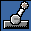 `mach.switch.on` when `toggle.mach.switch.turbo` + label TURBO | Front-panel switch | `mach.switch` {name: turbo} | C1.5 |
| `pcpm` | [0, 8] |  `mach.switch` /  `mach.switch.on` when `toggle.mach.switch.cpm` + label CP/M | Front-panel switch | `mach.switch` {name: cpm} | C1.5 |
| `m48` | [1, 0] |  `mach.start` + label 48K | Start a machine | `mach.start` {model: 48K, replace: true} | C3.1 |
| `m128` | [1, 1] |  `mach.start` + label 128K | Start a machine | `mach.start` {model: 128K, replace: true} | C3.1 |
| `mplus2` | [1, 2] |  `mach.start` + label +2 | Start a machine | `mach.start` {model: PLUS2, replace: true} | C3.1 |
| `mplus2a` | [1, 3] |  `mach.start` + label +2A | Start a machine | `mach.start` {model: PLUS2A, replace: true} | C3.1 |
| `mplus3` | [1, 4] |  `mach.start` + label +3 | Start a machine | `mach.start` {model: PLUS3, replace: true} | C3.1 |
| `mnext` | [1, 6] |  `mach.start` + label NEXT | Start a machine | `mach.start` {model: NEXT, replace: true} | C3.1 |
| `msprint` | [1, 7] |  `mach.start` + label SPRINTER | Start a machine | `mach.start` {model: SPRINTER, replace: true} | C3.1 |
| `mpent` | [2, 0] |  `mach.start` + label P128 | Start a machine | `mach.start` {model: PENTAGON, ram_kb: 128, replace: true} | C3.1 |
| `mpent5` | [2, 1] |  `mach.start` + label P512 | Start a machine | `mach.start` {model: PENTAGON, ram_kb: 512, replace: true} | C3.1 |
| `mpent1` | [2, 2] |  `mach.start` + label P1024 | Start a machine | `mach.start` {model: PENTAGON, ram_kb: 1024, replace: true} | C3.1 |
| `mscorp` | [2, 3] |  `mach.start` + label SCORP | Start a machine | `mach.start` {model: SCORPION, ram_kb: 256, replace: true} | C3.1 |
| `mscorp1` | [2, 4] |  `mach.start` + label SC1024 | Start a machine | `mach.start` {model: SCORPION, ram_kb: 1024, replace: true} | C3.1 |
| `mprofsc` | [2, 5] |  `mach.start` + label PROF | Start a machine | `mach.start` {model: PROFSCORP, replace: true} | C3.1 |
| `mpoly48` | [2, 6] |  `mach.start` + label POLY48 | Start a machine | `mach.start` {model: ZXPOLY-48K, replace: true} | C3.1 |
| `mpoly` | [2, 7] |  `mach.start` + label POLY128 | Start a machine | `mach.start` {model: ZXPOLY-128K, replace: true} | C3.1 |
| `mpolyp` | [2, 8] |  `mach.start` + label POLY P | Start a machine | `mach.start` {model: ZXPOLY-PENTAGON, replace: true} | C3.1 |
| `matm4` | [3, 0] |  `mach.start` + label ATM450 | Start a machine | `mach.start` {model: ATM450, replace: true} | C3.1 |
| `matm7` | [3, 1] |  `mach.start` + label ATM710 | Start a machine | `mach.start` {model: ATM710, replace: true} | C3.1 |
| `mevo` | [3, 2] |  `mach.start` + label EVO | Start a machine | `mach.start` {model: ATM3, replace: true} | C3.1 |
| `mtsl` | [3, 3] |  `mach.start` + label TSCONF | Start a machine | `mach.start` {model: TSL, replace: true} | C3.1 |
| `mvdac` | [3, 4] |  `mach.start` + label VDAC2 | Start a machine | `mach.start` {model: TSL-VDAC2, replace: true} | C3.1 |
| `mprofi` | [3, 5] |  `mach.start` + label PROFI | Start a machine | `mach.start` {model: PROFI, ram_kb: 1024, replace: true} | C3.1 |
| `mprofi5` | [3, 6] |  `mach.start` + label PROFI512 | Start a machine | `mach.start` {model: PROFI, ram_kb: 512, replace: true} | C3.1 |
| `mprofi3` | [3, 7] |  `mach.start` + label PROFI3 | Start a machine | `mach.start` {model: PROFI3, replace: true} | C3.1 |
| `mprofip` | [3, 8] |  `mach.start` + label PROFI+ | Start a machine | `mach.start` {model: PROFI-PLUS, replace: true} | C3.1 |

## menu record

Title: Record; use cases C7; opened from `home` at [1, 5].

| 0 | 1 | 2 | 3 | 4 | 5 | 6 | 7 | 8 |
|:-:|:-:|:-:|:-:|:-:|:-:|:-:|:-:|:-:|
| *back* |  **GAME** Record video C7.2 |  **HQ** Record video C7.2 |  **GIF** Record video C7.2 |  **MULTI** Record video C7.2 |  Pause recording C7.2 |  | **LENGTH** vlen `{:.0f}S` C10.9 | **SIZE** vsize `{:b}` C10.9 |
|  **FLAC** Record video C7.2a |  **WAV** Record video C7.2a |  **AY 10S** Capture audio C7.4 |  | 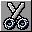 **10S** Clip the last seconds C7.3 |  **GIF 10S** Clip the last seconds C7.3 |  |  Screenshot C7.5 |  **PNG** Save a screenshot C7.5 |
|  Start recording C7.1 | 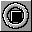 Stop recording C7.1 |  Drop the history C7.1 |  |  Export a range as a clip C7.3 |  |  Save the session C7.1 |  Open a session C7.1 |  |
|  |  |  |  |  |  |  |  |  |

| Key | Slot | Glyph | Title | Does | Use case |
|:--|:--|:--|:--|:--|:--|
| `vgame` | [0, 1] |  `cap.record` / 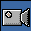 `cap.record.on` when `toggle.cap.record_toggle` + label GAME | Record video | `cap.record_toggle` {preset: gameplay} | C7.2 |
| `vhq` | [0, 2] |  `cap.record` /  `cap.record.on` when `toggle.cap.record_toggle` + label HQ | Record video | `cap.record_toggle` {preset: hq} | C7.2 |
| `vgif` | [0, 3] |  `cap.record` /  `cap.record.on` when `toggle.cap.record_toggle` + label GIF | Record video | `cap.record_toggle` {preset: gif} | C7.2 |
| `vmulti` | [0, 4] |  `cap.record` /  `cap.record.on` when `toggle.cap.record_toggle` + label MULTI | Record video | `cap.record_toggle` {preset: multitrack} | C7.2 |
| `vpause` | [0, 5] |  `cap.record_pause` | Pause recording | `cap.record_pause` | C7.2 |
| `vlen` | [0, 7] | (none) + label LENGTH | vlen | shows `{:.0f}S` of `cap.record.seconds` | C10.9 |
| `vsize` | [0, 8] | (none) + label SIZE | vsize | shows `{:b}` of `cap.record.bytes` | C10.9 |
| `amusic` | [1, 0] |  `cap.record` /  `cap.record.on` when `toggle.cap.record_toggle` + label FLAC | Record video | `cap.record_toggle` {preset: music} | C7.2a |
| `awav` | [1, 1] |  `cap.record` /  `cap.record.on` when `toggle.cap.record_toggle` + label WAV | Record video | `cap.record_toggle` {preset: audio} | C7.2a |
| `aay` | [1, 2] |  `cap.audio_capture` + label AY 10S | Capture audio | `cap.audio_capture` {source: ay1, seconds: 10} | C7.4 |
| `clip` | [1, 4] |  `cap.clip_last` + label 10S | Clip the last seconds | `cap.clip_last` {seconds: 10, format: mp4} | C7.3 |
| `clipgif` | [1, 5] |  `cap.clip_last` + label GIF 10S | Clip the last seconds | `cap.clip_last` {seconds: 10, format: gif} | C7.3 |
| `recshot` | [1, 7] |  `cap.screenshot` | Screenshot | `cap.screenshot` | C7.5 |
| `shotpng` | [1, 8] |  `cap.screenshot_save` + label PNG | Save a screenshot | `cap.screenshot_save` {path: $user/screenshots/deck.png} | C7.5 |
| `tstart` | [2, 0] |  `ttd.record.on` | Start recording | `ttd.start` | C7.1 |
| `rectstop` | [2, 1] |  `ttd.stop` | Stop recording | `ttd.stop` | C7.1 |
| `tdrop` | [2, 2] |  `ttd.invalidate` | Drop the history | `ttd.invalidate` | C7.1 |
| `tclip` | [2, 4] |  `ttd.export_clip` | Export a range as a clip | `ttd.export_clip` {path: $user/clips/history.mp4} | C7.3 |
| `rectdump` | [2, 6] |  `ttd.dump` | Save the session | `ttd.dump` {path: $user/sessions/deck.ttd} | C7.1 |
| `rectload` | [2, 7] |  `ttd.load` | Open a session | `ttd.load` {path: $user/sessions/deck.ttd} | C7.1 |

## menu sound

Title: Sound; use cases C8; opened from `home` at [1, 6].

| 0 | 1 | 2 | 3 | 4 | 5 | 6 | 7 | 8 |
|:-:|:-:|:-:|:-:|:-:|:-:|:-:|:-:|:-:|
| *back* |  Mute C8.1 |  AY channels C8.3 |  |  **STEREO** Set a setting C8.4 |  **FIR** Toggle a setting C8.4 |  **PUNCH** Toggle a setting C8.4 |  **DC** Toggle a setting C8.4 |  |
|  **BEEP** Mute a source C8.2 |  **AY1** Mute a source C8.2 |  **AY2** Mute a source C8.2 |  **AY3** Mute a source C8.2 |  **FM1** Mute a source C8.2 |  **COVOX** Mute a source C8.2 |  **GS** Mute a source C8.2 |  **MS FM** Mute a source C8.2 |  **MS PCM** Mute a source C8.2 |
|  **BEEP** Solo a source C8.2 |  **AY1** Solo a source C8.2 |  **AY2** Solo a source C8.2 |  **AY3** Solo a source C8.2 |  **FM1** Solo a source C8.2 |  **COVOX** Solo a source C8.2 |  **GS** Solo a source C8.2 |  **MS FM** Solo a source C8.2 |  **MS PCM** Solo a source C8.2 |
|  **N AY1** Mute a source C8.2 |  **N AY2** Mute a source C8.2 |  **N AY3** Mute a source C8.2 |  **N DAC** Mute a source C8.2 |  **FM2** Mute a source C8.2 |  **GS MP3** Mute a source C8.2 |  **MIDI** Mute a source C8.2 |  **CD** Mute a source C8.2 |  **SAA** Mute a source C8.2 |

| Key | Slot | Glyph | Title | Does | Use case |
|:--|:--|:--|:--|:--|:--|
| `soumute` | [0, 1] |  `audio.sound` /  `audio.muted` when `audio.mute.muted` | Mute | `audio.mute_toggle` | C8.1 |
| `ay` | [0, 2] |  `audio.sound` | AY channels | opens the menu | C8.3 |
| `stereo` | [0, 4] |  `settings.value` + label STEREO | Set a setting | `set.value` {name: ay_stereo, value: next} | C8.4 |
| `fir` | [0, 5] |  `settings.toggle` /  `settings.toggle.on` when `toggle.set.toggle.fir_filter` + label FIR | Toggle a setting | `set.toggle` {name: fir_filter} | C8.4 |
| `aypunch` | [0, 6] |  `settings.toggle` /  `settings.toggle.on` when `toggle.set.toggle.ay_punch` + label PUNCH | Toggle a setting | `set.toggle` {name: ay_punch} | C8.4 |
| `dc` | [0, 7] |  `settings.toggle` /  `settings.toggle.on` when `toggle.set.toggle.covox_dc_removal` + label DC | Toggle a setting | `set.toggle` {name: covox_dc_removal} | C8.4 |
| `mbeep` | [1, 0] |  `audio.source` + label BEEP | Mute a source | `audio.source_mute` {source: beeper} | C8.2 |
| `may1` | [1, 1] |  `audio.source` + label AY1 | Mute a source | `audio.source_mute` {source: ay1} | C8.2 |
| `may2` | [1, 2] |  `audio.source` + label AY2 | Mute a source | `audio.source_mute` {source: ay2} | C8.2 |
| `may3` | [1, 3] |  `audio.source` + label AY3 | Mute a source | `audio.source_mute` {source: ay3} | C8.2 |
| `mfm1` | [1, 4] |  `audio.source` + label FM1 | Mute a source | `audio.source_mute` {source: fm1} | C8.2 |
| `mcov` | [1, 5] |  `audio.source` + label COVOX | Mute a source | `audio.source_mute` {source: covox} | C8.2 |
| `mgs` | [1, 6] |  `audio.source` + label GS | Mute a source | `audio.source_mute` {source: gs} | C8.2 |
| `mmsfm` | [1, 7] |  `audio.source` + label MS FM | Mute a source | `audio.source_mute` {source: moonsound_fm} | C8.2 |
| `mmspcm` | [1, 8] |  `audio.source` + label MS PCM | Mute a source | `audio.source_mute` {source: moonsound_pcm} | C8.2 |
| `sbeep` | [2, 0] |  `audio.solo` + label BEEP | Solo a source | `audio.source_solo` {source: beeper} | C8.2 |
| `say1` | [2, 1] |  `audio.solo` + label AY1 | Solo a source | `audio.source_solo` {source: ay1} | C8.2 |
| `say2` | [2, 2] |  `audio.solo` + label AY2 | Solo a source | `audio.source_solo` {source: ay2} | C8.2 |
| `say3` | [2, 3] |  `audio.solo` + label AY3 | Solo a source | `audio.source_solo` {source: ay3} | C8.2 |
| `sfm1` | [2, 4] |  `audio.solo` + label FM1 | Solo a source | `audio.source_solo` {source: fm1} | C8.2 |
| `scov` | [2, 5] |  `audio.solo` + label COVOX | Solo a source | `audio.source_solo` {source: covox} | C8.2 |
| `sgs` | [2, 6] |  `audio.solo` + label GS | Solo a source | `audio.source_solo` {source: gs} | C8.2 |
| `smsfm` | [2, 7] |  `audio.solo` + label MS FM | Solo a source | `audio.source_solo` {source: moonsound_fm} | C8.2 |
| `smspcm` | [2, 8] |  `audio.solo` + label MS PCM | Solo a source | `audio.source_solo` {source: moonsound_pcm} | C8.2 |
| `mnay1` | [3, 0] |  `audio.source` + label N AY1 | Mute a source | `audio.source_mute` {source: next_ay1} | C8.2 |
| `mnay2` | [3, 1] |  `audio.source` + label N AY2 | Mute a source | `audio.source_mute` {source: next_ay2} | C8.2 |
| `mnay3` | [3, 2] |  `audio.source` + label N AY3 | Mute a source | `audio.source_mute` {source: next_ay3} | C8.2 |
| `mndac` | [3, 3] |  `audio.source` + label N DAC | Mute a source | `audio.source_mute` {source: next_dac} | C8.2 |
| `mfm2` | [3, 4] |  `audio.source` + label FM2 | Mute a source | `audio.source_mute` {source: fm2} | C8.2 |
| `mgsmp3` | [3, 5] |  `audio.source` + label GS MP3 | Mute a source | `audio.source_mute` {source: gs_mp3} | C8.2 |
| `mmidi` | [3, 6] |  `audio.source` + label MIDI | Mute a source | `audio.source_mute` {source: ms_midi} | C8.2 |
| `mcd` | [3, 7] |  `audio.source` + label CD | Mute a source | `audio.source_mute` {source: cd0} | C8.2 |
| `msaa` | [3, 8] |  `audio.source` + label SAA | Mute a source | `audio.source_mute` {source: ms_saa} | C8.2 |

| Dial | Label | Turn | Press | Use case |
|:--|:--|:--|:--|:--|
| 0 | BEEPER | `audio.volume_by` {d: $ticks, source: beeper} | `audio.source_mute` {source: beeper} | C8.2 |
| 1 | AY1 | `audio.volume_by` {d: $ticks, source: ay1} | `audio.source_mute` {source: ay1} | C8.2 |
| 2 | AY2 | `audio.volume_by` {d: $ticks, source: ay2} | `audio.source_mute` {source: ay2} | C8.2 |
| 3 | COVOX | `audio.volume_by` {d: $ticks, source: covox} | `audio.source_mute` {source: covox} | C8.2 |
| 4 | GS | `audio.volume_by` {d: $ticks, source: gs} | `audio.source_mute` {source: gs} | C8.2 |
| 5 | MASTER | `audio.volume_by` {d: $ticks} | `audio.mute_toggle` | C8.2 |

## menu ay

Title: AY channels; use cases C8.3; opened from `sound` at [0, 2].

| 0 | 1 | 2 | 3 | 4 | 5 | 6 | 7 | 8 |
|:-:|:-:|:-:|:-:|:-:|:-:|:-:|:-:|:-:|
| *back* |  |  |  |  |  |  |  |  |
|  **1A** Mute a source C8.3 |  **1B** Mute a source C8.3 |  **1C** Mute a source C8.3 |  **2A** Mute a source C8.3 |  **2B** Mute a source C8.3 |  **2C** Mute a source C8.3 |  **3A** Mute a source C8.3 |  **3B** Mute a source C8.3 |  **3C** Mute a source C8.3 |
|  **1A** Solo a source C8.3 |  **1B** Solo a source C8.3 |  **1C** Solo a source C8.3 |  **2A** Solo a source C8.3 |  **2B** Solo a source C8.3 |  **2C** Solo a source C8.3 |  **3A** Solo a source C8.3 |  **3B** Solo a source C8.3 |  **3C** Solo a source C8.3 |
|  |  |  |  |  |  |  |  |  |

| Key | Slot | Glyph | Title | Does | Use case |
|:--|:--|:--|:--|:--|:--|
| `m1a` | [1, 0] |  `audio.source` + label 1A | Mute a source | `audio.source_mute` {source: ay1.a} | C8.3 |
| `m1b` | [1, 1] |  `audio.source` + label 1B | Mute a source | `audio.source_mute` {source: ay1.b} | C8.3 |
| `m1c` | [1, 2] |  `audio.source` + label 1C | Mute a source | `audio.source_mute` {source: ay1.c} | C8.3 |
| `m2a` | [1, 3] |  `audio.source` + label 2A | Mute a source | `audio.source_mute` {source: ay2.a} | C8.3 |
| `m2b` | [1, 4] |  `audio.source` + label 2B | Mute a source | `audio.source_mute` {source: ay2.b} | C8.3 |
| `m2c` | [1, 5] |  `audio.source` + label 2C | Mute a source | `audio.source_mute` {source: ay2.c} | C8.3 |
| `m3a` | [1, 6] |  `audio.source` + label 3A | Mute a source | `audio.source_mute` {source: ay3.a} | C8.3 |
| `m3b` | [1, 7] |  `audio.source` + label 3B | Mute a source | `audio.source_mute` {source: ay3.b} | C8.3 |
| `m3c` | [1, 8] |  `audio.source` + label 3C | Mute a source | `audio.source_mute` {source: ay3.c} | C8.3 |
| `s1a` | [2, 0] |  `audio.solo` + label 1A | Solo a source | `audio.source_solo` {source: ay1.a} | C8.3 |
| `s1b` | [2, 1] |  `audio.solo` + label 1B | Solo a source | `audio.source_solo` {source: ay1.b} | C8.3 |
| `s1c` | [2, 2] |  `audio.solo` + label 1C | Solo a source | `audio.source_solo` {source: ay1.c} | C8.3 |
| `s2a` | [2, 3] |  `audio.solo` + label 2A | Solo a source | `audio.source_solo` {source: ay2.a} | C8.3 |
| `s2b` | [2, 4] |  `audio.solo` + label 2B | Solo a source | `audio.source_solo` {source: ay2.b} | C8.3 |
| `s2c` | [2, 5] |  `audio.solo` + label 2C | Solo a source | `audio.source_solo` {source: ay2.c} | C8.3 |
| `s3a` | [2, 6] |  `audio.solo` + label 3A | Solo a source | `audio.source_solo` {source: ay3.a} | C8.3 |
| `s3b` | [2, 7] |  `audio.solo` + label 3B | Solo a source | `audio.source_solo` {source: ay3.b} | C8.3 |
| `s3c` | [2, 8] |  `audio.solo` + label 3C | Solo a source | `audio.source_solo` {source: ay3.c} | C8.3 |

| Dial | Label | Turn | Press | Use case |
|:--|:--|:--|:--|:--|
| 0 | AY1 A | `audio.volume_by` {d: $ticks, source: ay1.a} | `audio.source_mute` {source: ay1.a} | C8.3 |
| 1 | AY1 B | `audio.volume_by` {d: $ticks, source: ay1.b} | `audio.source_mute` {source: ay1.b} | C8.3 |
| 2 | AY1 C | `audio.volume_by` {d: $ticks, source: ay1.c} | `audio.source_mute` {source: ay1.c} | C8.3 |
| 3 | AY2 A | `audio.volume_by` {d: $ticks, source: ay2.a} | `audio.source_mute` {source: ay2.a} | C8.3 |
| 4 | AY2 B | `audio.volume_by` {d: $ticks, source: ay2.b} | `audio.source_mute` {source: ay2.b} | C8.3 |
| 5 | AY2 C | `audio.volume_by` {d: $ticks, source: ay2.c} | `audio.source_mute` {source: ay2.c} | C8.3 |

## menu picture

Title: Picture; use cases C9; opened from `home` at [1, 7].

| 0 | 1 | 2 | 3 | 4 | 5 | 6 | 7 | 8 |
|:-:|:-:|:-:|:-:|:-:|:-:|:-:|:-:|:-:|
| *back* |  Full screen C9.1 |  Window scale C9.1 | 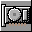 GPU acceleration C9.2 |  Overscan C9.3 | 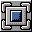 **CROP** Overscan viewport `{}` C9.3 |  |  Toolbar C9.8 |  Status bar C9.8 |
|  CRT effects C9.4 |  CRT profile C9.4 |  **CRT** CRT profile `{}` C9.4 | 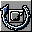 Reset CRT parameters C9.4 |  |  |  |  |  |
| 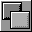 De-flicker (ZX DLSS) C9.5 |  Frame blending C9.5 |  |  |  |  |  |  |  |
| 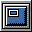 HUD C9.6 | 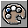 HUD theme C9.6 |  |  On-screen keyboard C9.7 |  Keyboard picture C9.7 |  |  |  |  |

| Key | Slot | Glyph | Title | Does | Use case |
|:--|:--|:--|:--|:--|:--|
| `picfull` | [0, 1] |  `view.fullscreen` /  `view.fullscreen.on` when `toggle.view.fullscreen` | Full screen | `view.fullscreen` | C9.1 |
| `scale` | [0, 2] |  `view.scale` | Window scale | `view.scale` {scale: next} | C9.1 |
| `gpu` | [0, 3] |  `video.gpu` / 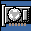 `video.gpu.on` when `toggle.video.gpu_toggle` | GPU acceleration | `video.gpu_toggle` | C9.2 |
| `over` | [0, 4] |  `video.overscan` /  `video.overscan.on` when `toggle.video.overscan_toggle` | Overscan | `video.overscan_toggle` | C9.3 |
| `vport` | [0, 5] |  `video.viewport` + label CROP | Overscan viewport | shows `{}` of `video.viewport.viewport`; `video.viewport` {viewport: next} | C9.3 |
| `toolbar` | [0, 7] |  `view.toolbar` /  `view.toolbar.on` when `toggle.view.toolbar` | Toolbar | `view.toolbar` | C9.8 |
| `status` | [0, 8] |  `view.status_bar` /  `view.status_bar.on` when `toggle.view.status_bar` | Status bar | `view.status_bar` | C9.8 |
| `crt` | [1, 0] |  `video.crt` /  `video.crt.on` when `toggle.video.crt_toggle` | CRT effects | `video.crt_toggle` | C9.4 |
| `crtprev` | [1, 1] |  `video.crt_profile` | CRT profile | `video.crt_profile` {profile: prev} | C9.4 |
| `crtnext` | [1, 2] |  `video.crt_profile` + label CRT | CRT profile | shows `{}` of `video.window.crt_profile`; `video.crt_profile` {profile: next} | C9.4 |
| `crtrst` | [1, 3] |  `video.crt_reset` | Reset CRT parameters | `video.crt_params_reset` | C9.4 |
| `dlss` | [2, 0] |  `video.temporal` /  `video.temporal.on` when `toggle.video.temporal` | De-flicker (ZX DLSS) | `video.temporal` | C9.5 |
| `blend` | [2, 1] |  `video.blending` / 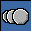 `video.blending.on` when `toggle.video.blending` | Frame blending | `video.blending` | C9.5 |
| `hud` | [3, 0] |  `hud` /  `hud.on` when `toggle.hud.toggle` | HUD | `hud.toggle` | C9.6 |
| `hudth` | [3, 1] |  `hud.theme` | HUD theme | `hud.theme` {theme: next} | C9.6 |
| `osdkb` | [3, 3] |  `osd.keyboard` | On-screen keyboard | `osd.keyboard` | C9.7 |
| `osdpic` | [3, 4] |  `osd.keyboard_picture` | Keyboard picture | `osd.keyboard_picture` {picture: next} | C9.7 |

| Dial | Label | Turn | Press | Use case |
|:--|:--|:--|:--|:--|
| 0 | DECAY | `video.blending_decay_by` {d: $ticks} | `video.blending` | C9.5 |

## menu monitor

Title: Monitoring; use cases C10; opened from `home` at [1, 8]; strip content `title`, status `ttd`, target `true`.

| 0 | 1 | 2 | 3 | 4 | 5 | 6 | 7 | 8 |
|:-:|:-:|:-:|:-:|:-:|:-:|:-:|:-:|:-:|
| *back* | **COUNT** inst `{}` C10.1 | **MODEL** model `{}` C10.1 | **STATE** runst `{}` C10.1 | **CPU** cpu `{:.0f}%` C10.2 | **MEMORY** mem `{:b}` C10.2 | **THREADS** threads `{}` C10.2 | **CLIENTS** clients `{ws.connections} WS
{mcp.connections} MCP` C10.10 | **PAIRED** paired `{}` C10.10 |
| **FPS** fps `{:.1f}` C10.3 | **SPEED** spdpct `{:.0f}%` C10.3 | **BUDGET** budget `{:.0f}%` C10.3 | **WORK US** ftime `{:.0f}` C10.3 | **MHZ** mhz `{:.2f}` C10.3 | **INT/FR** ints `{:.0f}` C10.3 | **MEDIA** slots `{loaded}/{slots:#}` C10.4 | **PLUGGED** pads `{}` C10.4 | **AUDIO** audio `{master.muted?MUTED\|ON}` C10.4 |
|  Clear breakpoints D4.3 |  Reset hit counts D4.3 | **BPS** bps `{active}/{total}` C10.5 | **HIT AT** lasthit `{:04X}` C10.5 | **LABELS** lblcnt `{:k}` C10.6 | **TTD** ttdst `{recording?REC\|IDLE}` C10.7 | **FRAMES** ttdlen `{:k}` C10.7 | **TTD MEM** ttdmem `{:b}` C10.7 | **MARKS** marks `{}` C10.7 |
|  **ALL** Profiler / trace on / off D10.1 |  **ALL** Profiler / trace clear D10.1 | **OPCODES** opcodes `{}` C10.8 | **CALLS** calls `{}` C10.8 | **COVER** covins `{:k}` C10.8 | **RECORD** rec `{recording?REC\|IDLE}` C10.9 | **LENGTH** rectime `{:.0f}S` C10.9 | **SIZE** recsize `{:b}` C10.9 | **VIDEO** video `{recording?REC\|IDLE}` C10.9 |

| Key | Slot | Glyph | Title | Does | Use case |
|:--|:--|:--|:--|:--|:--|
| `inst` | [0, 1] | (none) + label COUNT | inst | shows `{}` of `host.clients.instances` | C10.1 |
| `model` | [0, 2] | (none) + label MODEL | model | shows `{}` of `machine.model` | C10.1 |
| `runst` | [0, 3] | (none) + label STATE | runst | shows `{}` of `run.state.state` | C10.1 |
| `cpu` | [0, 4] | (none) + label CPU | cpu | shows `{:.0f}%` of `host.stats.cpu_percent` (warn 100, alert 200) | C10.2 |
| `mem` | [0, 5] | (none) + label MEMORY | mem | shows `{:b}` of `host.stats.rss_bytes` | C10.2 |
| `threads` | [0, 6] | (none) + label THREADS | threads | shows `{}` of `host.stats.threads` | C10.2 |
| `clients` | [0, 7] | (none) + label CLIENTS | clients | shows `{ws.connections} WS
{mcp.connections} MCP` of `host.clients` | C10.10 |
| `paired` | [0, 8] | (none) + label PAIRED | paired | shows `{}` of `host.clients.companions` | C10.10 |
| `fps` | [1, 0] | (none) + label FPS | fps | shows `{:.1f}` of `emulator.stats.fps` | C10.3 |
| `spdpct` | [1, 1] | (none) + label SPEED | spdpct | shows `{:.0f}%` of `emulator.stats.speed_percent` (warn 95, alert 80) | C10.3 |
| `budget` | [1, 2] | (none) + label BUDGET | budget | shows `{:.0f}%` of `emulator.stats.frame_budget_percent` (warn 80, alert 100) | C10.3 |
| `ftime` | [1, 3] | (none) + label WORK US | ftime | shows `{:.0f}` of `emulator.stats.frame_time_us.avg` | C10.3 |
| `mhz` | [1, 4] | (none) + label MHZ | mhz | shows `{:.2f}` of `emulator.stats.cpu.mhz` | C10.3 |
| `ints` | [1, 5] | (none) + label INT/FR | ints | shows `{:.0f}` of `emulator.stats.interrupts_per_frame` | C10.3 |
| `slots` | [1, 6] | (none) + label MEDIA | slots | shows `{loaded}/{slots:#}` of `media.slots` | C10.4 |
| `pads` | [1, 7] | (none) + label PLUGGED | pads | shows `{}` of `controllers.state.plugged` | C10.4 |
| `audio` | [1, 8] | (none) + label AUDIO | audio | shows `{master.muted?MUTED/ON}` of `audio.mixer` | C10.4 |
| `bpclear` | [2, 0] |  `dbg.breakpoints_clear` | Clear breakpoints | `dbg.breakpoints_clear` | D4.3 |
| `bphits` | [2, 1] |  `dbg.breakpoint_hits_reset` | Reset hit counts | `dbg.breakpoint_hits_reset` | D4.3 |
| `bps` | [2, 2] | (none) + label BPS | bps | shows `{active}/{total}` of `debug.breakpoints` | C10.5 |
| `lasthit` | [2, 3] | (none) + label HIT AT | lasthit | shows `{:04X}` of `debug.breakpoints.last_hit.address` | C10.5 |
| `lblcnt` | [2, 4] | (none) + label LABELS | lblcnt | shows `{:k}` of `debug.labels.total` | C10.6 |
| `ttdst` | [2, 5] | (none) + label TTD | ttdst | shows `{recording?REC/IDLE}` of `ttd.status` (warn 1) | C10.7 |
| `ttdlen` | [2, 6] | (none) + label FRAMES | ttdlen | shows `{:k}` of `ttd.status.frames` | C10.7 |
| `ttdmem` | [2, 7] | (none) + label TTD MEM | ttdmem | shows `{:b}` of `ttd.status.memory_bytes` | C10.7 |
| `marks` | [2, 8] | (none) + label MARKS | marks | shows `{}` of `ttd.status.bookmarks` | C10.7 |
| `profall` | [3, 0] |  `prof.toggle` /  `prof.toggle.on` when `toggle.profiler.all` + label ALL | Profiler / trace on / off | `prof.toggle` {name: all} | D10.1 |
| `profclr` | [3, 1] |  `prof.clear` + label ALL | Profiler / trace clear | `prof.clear` {name: all} | D10.1 |
| `opcodes` | [3, 2] | (none) + label OPCODES | opcodes | shows `{}` of `debug.analyzers.opcode` | C10.8 |
| `calls` | [3, 3] | (none) + label CALLS | calls | shows `{}` of `debug.analyzers.calltrace` | C10.8 |
| `covins` | [3, 4] | (none) + label COVER | covins | shows `{:k}` of `debug.analyzers.coverage.instructions` | C10.8 |
| `rec` | [3, 5] | (none) + label RECORD | rec | shows `{recording?REC/IDLE}` of `recording.state` (warn 1) | C10.9 |
| `rectime` | [3, 6] | (none) + label LENGTH | rectime | shows `{:.0f}S` of `recording.state.duration_s` | C10.9 |
| `recsize` | [3, 7] | (none) + label SIZE | recsize | shows `{:b}` of `recording.state.file_bytes` | C10.9 |
| `video` | [3, 8] | (none) + label VIDEO | video | shows `{recording?REC/IDLE}` of `cap.record` (warn 1) | C10.9 |

## menu game

Title: Game; use cases U1; context `play`; opened from `home` at [2, 4].

| 0 | 1 | 2 | 3 | 4 | 5 | 6 | 7 | 8 |
|:-:|:-:|:-:|:-:|:-:|:-:|:-:|:-:|:-:|
| *back* |  **KEMP** Joystick type U1.3 |  **SINC1** Joystick type U1.3 |  **SINC2** Joystick type U1.3 |  **CURSOR** Joystick type U1.3 |  **MOUSE** Toggle a feature U1.5 | **JOYSTICK** joynow `{}` U1.3 |  |  Release all keys and buttons U1.4 |
|  **SPACE** Key U1.4 |  **ENTER** Key U1.4 |  **BREAK** Key U1.4 |  |  |  |  **UP** Joystick U1.2 |  | 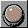 **FIRE** Joystick U1.2 |
|  **Y** Key U1.4 |  **N** Key U1.4 |  |  |  |  **LEFT** Joystick U1.2 |  **DOWN** Joystick U1.2 |  **RIGHT** Joystick U1.2 |  |
|  **1** Key U1.4 |  **2** Key U1.4 |  **3** Key U1.4 |  **4** Key U1.4 |  |  |  |  **-5S** Back one unit U2.2 |  **L1** Quick snapshot U2.4 |

| Key | Slot | Glyph | Title | Does | Use case |
|:--|:--|:--|:--|:--|:--|
| `kemp` | [0, 1] |  `input.joystick_type` + label KEMP | Joystick type | `input.joystick_type` {kind: kempston} | U1.3 |
| `sinc1` | [0, 2] |  `input.joystick_type` + label SINC1 | Joystick type | `input.joystick_type` {kind: sinclair1} | U1.3 |
| `sinc2` | [0, 3] |  `input.joystick_type` + label SINC2 | Joystick type | `input.joystick_type` {kind: sinclair2} | U1.3 |
| `cursor` | [0, 4] |  `input.joystick_type` + label CURSOR | Joystick type | `input.joystick_type` {kind: cursor} | U1.3 |
| `mouse` | [0, 5] |  `settings.toggle` /  `settings.toggle.on` when `toggle.feature.kempstonmouse` + label MOUSE | Toggle a feature | `feature.toggle` {name: kempstonmouse} | U1.5 |
| `joynow` | [0, 6] | (none) + label JOYSTICK | joynow | shows `{}` of `input.connectors.connectors.0.kind` | U1.3 |
| `release` | [0, 8] |  `input.release_all` | Release all keys and buttons | `input.release_all` | U1.4 |
| `space` | [1, 0] |  `input.key` + label SPACE | Key | `input.key` {key: space, hold: true} (held) | U1.4 |
| `enter` | [1, 1] |  `input.key` + label ENTER | Key | `input.key` {key: enter, hold: true} (held) | U1.4 |
| `brk` | [1, 2] |  `input.key` + label BREAK | Key | `input.key` {key: caps+space, hold: true} (held) | U1.4 |
| `up` | [1, 6] |  `input.joy.up` + label UP | Joystick | `input.joystick` {buttons: up, hold: true} (held) | U1.2 |
| `fire` | [1, 8] |  `input.joy.fire` + label FIRE | Joystick | `input.joystick` {buttons: fire, hold: true} (held) | U1.2 |
| `keyy` | [2, 0] |  `input.key` + label Y | Key | `input.key` {key: y, hold: true} (held) | U1.4 |
| `keyn` | [2, 1] |  `input.key` + label N | Key | `input.key` {key: n, hold: true} (held) | U1.4 |
| `left` | [2, 5] |  `input.joy.left` + label LEFT | Joystick | `input.joystick` {buttons: left, hold: true} (held) | U1.2 |
| `down` | [2, 6] |  `input.joy.down` + label DOWN | Joystick | `input.joystick` {buttons: down, hold: true} (held) | U1.2 |
| `right` | [2, 7] |  `input.joy.right` + label RIGHT | Joystick | `input.joystick` {buttons: right, hold: true} (held) | U1.2 |
| `k1` | [3, 0] |  `input.key` + label 1 | Key | `input.key` {key: "1", hold: true} (held) | U1.4 |
| `k2` | [3, 1] |  `input.key` + label 2 | Key | `input.key` {key: "2", hold: true} (held) | U1.4 |
| `k3` | [3, 2] |  `input.key` + label 3 | Key | `input.key` {key: "3", hold: true} (held) | U1.4 |
| `k4` | [3, 3] |  `input.key` + label 4 | Key | `input.key` {key: "4", hold: true} (held) | U1.4 |
| `gamback5` | [3, 7] |  `ttd.unit_back` + label -5S | Back one unit | `ttd.unit_back` {unit: seconds, count: 5} | U2.2 |
| `gamqload` | [3, 8] |  `snapshot.quick_load` + label L1 | Quick snapshot | `snapshot.quick` {op: load, slot: 1} | U2.4 |

## menu basic

Title: BASIC; use cases U4; opened from `home` at [2, 5].

| 0 | 1 | 2 | 3 | 4 | 5 | 6 | 7 | 8 |
|:-:|:-:|:-:|:-:|:-:|:-:|:-:|:-:|:-:|
| *back* |  **48K** BASIC mode from the 128K menu U4.1 |  **128K** BASIC mode from the 128K menu U4.1 |  |  |  |  |  |  |
|  **RUN** Run a BASIC command U4.2 |  **LOAD** Run a BASIC command U4.2 |  NEW (clear the program) U4.2 |  |  |  |  |  |  |
|  **CAT** Key macro U4.3 |  **FORMAT** Key macro U4.3 |  **ERASE** Key macro U4.3 |  **MOVE** Key macro U4.3 |  |  **E** Key macro U4.3 |  **G** Key macro U4.3 |  |  **BREAK** Key macro U4.3 |
|  **TRAPS** Toggle a setting U4.4 |  |  |  |  |  |  |  |  |

| Key | Slot | Glyph | Title | Does | Use case |
|:--|:--|:--|:--|:--|:--|
| `b48` | [0, 1] |  `basic.mode.48` + label 48K | BASIC mode from the 128K menu | `basic.mode` {mode: 48k} | U4.1 |
| `b128` | [0, 2] |  `basic.mode.128` + label 128K | BASIC mode from the 128K menu | `basic.mode` {mode: 128k} | U4.1 |
| `run` | [1, 0] |  `basic.run` + label RUN | Run a BASIC command | `basic.run` | U4.2 |
| `load` | [1, 1] |  `media.tape.load` + label LOAD | Run a BASIC command | `basic.run` {command: "LOAD \"\""} | U4.2 |
| `new` | [1, 2] |  `basic.clear` | NEW (clear the program) | `basic.clear` | U4.2 |
| `cat` | [2, 0] |  `input.macro` + label CAT | Key macro | `input.macro` {name: cat} | U4.3 |
| `format` | [2, 1] |  `input.macro` + label FORMAT | Key macro | `input.macro` {name: format} | U4.3 |
| `erase` | [2, 2] |  `input.macro` + label ERASE | Key macro | `input.macro` {name: erase} | U4.3 |
| `move` | [2, 3] |  `input.macro` + label MOVE | Key macro | `input.macro` {name: move} | U4.3 |
| `emode` | [2, 5] |  `input.macro` + label E | Key macro | `input.macro` {name: e_mode} | U4.3 |
| `gmode` | [2, 6] |  `input.macro` + label G | Key macro | `input.macro` {name: g_mode} | U4.3 |
| `basbrk` | [2, 8] |  `input.macro` + label BREAK | Key macro | `input.macro` {name: break} | U4.3 |
| `traps` | [3, 0] |  `settings.toggle` /  `settings.toggle.on` when `toggle.set.toggle.trdos_traps` + label TRAPS | Toggle a setting | `set.toggle` {name: trdos_traps} | U4.4 |

## menu time

Title: Time; use cases D1, D3; opened from `home` at [3, 7]; strip content `title`, status `ttd`, target `true`.

| 0 | 1 | 2 | 3 | 4 | 5 | 6 | 7 | 8 |
|:-:|:-:|:-:|:-:|:-:|:-:|:-:|:-:|:-:|
| *back* | 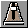 **25FPS** Pace D1.1 |  **5FPS** Pace D1.1 |  **1FPS** Pace D1.1 |  **LINE** Pace D1.1 |  **OP** Pace D1.1 |  **PACE** One step at the pace `{}` D1.2 | 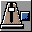 Stop the pace D1.2 |  **FULL** Pace D1.1 |
|  The history's start D3.4 |  Back one frame D3.3 |  Back one scanline D3.3 |  Back one instruction D3.3 |  |  Forward one instruction D3.3 |  Forward one scanline D3.3 |  Forward one frame D3.3 |  The history's end D3.4 |
|  Reverse continue D3.5 |  Reverse step D3.5 |  |  Back one unit D3.3 | **FRAME** tframe `{}` D3.2 |  Forward one unit D3.3 |  |  |  Resume live D3.6 |
|  Previous bookmark D3.7 |  Add a bookmark D3.7 |  Next bookmark D3.7 |  Bookmarks D3.7 |  |  Last write here D5.1 |  **READ** Last access here D5.1 |  **EXEC** Last access here D5.1 |  Start / stop recording C7.1 |

| Key | Slot | Glyph | Title | Does | Use case |
|:--|:--|:--|:--|:--|:--|
| `p25` | [0, 1] |  `run.pace` + label 25FPS | Pace | `run.pace_set` {preset: 25fps} | D1.1 |
| `p5` | [0, 2] |  `run.pace` + label 5FPS | Pace | `run.pace_set` {preset: 5fps} | D1.1 |
| `p1` | [0, 3] |  `run.pace` + label 1FPS | Pace | `run.pace_set` {preset: 1fps} | D1.1 |
| `pline` | [0, 4] |  `run.pace` + label LINE | Pace | `run.pace_set` {preset: 1line} | D1.1 |
| `pop` | [0, 5] |  `run.pace` + label OP | Pace | `run.pace_set` {preset: 1op} | D1.1 |
| `pstep` | [0, 6] |  `run.pace_step` + label PACE | One step at the pace | shows `{}` of `run.state.pace.label`; `run.pace_step` | D1.2 |
| `pstop` | [0, 7] |  `run.pace_stop` | Stop the pace | `run.pace_stop` | D1.2 |
| `pfull` | [0, 8] |  `run.pace` + label FULL | Pace | `run.pace_set` {preset: full} | D1.1 |
| `start` | [1, 0] |  `ttd.go_start` | The history's start | `ttd.seek_start` | D3.4 |
| `bframe` | [1, 1] |  `ttd.step_back_frame` | Back one frame | `ttd.step_back_frame` | D3.3 |
| `bline` | [1, 2] |  `ttd.step_back_scanline` | Back one scanline | `ttd.step_back_scanline` | D3.3 |
| `bop` | [1, 3] |  `ttd.step_back_instruction` | Back one instruction | `ttd.step_back_instruction` | D3.3 |
| `fop` | [1, 5] |  `ttd.step_forward_instruction` | Forward one instruction | `ttd.step_forward_instruction` | D3.3 |
| `fline` | [1, 6] |  `ttd.step_forward_scanline` | Forward one scanline | `ttd.step_forward_scanline` | D3.3 |
| `fframe` | [1, 7] |  `ttd.step_forward_frame` | Forward one frame | `ttd.step_forward_frame` | D3.3 |
| `end` | [1, 8] |  `ttd.go_end` | The history's end | `ttd.seek_end` | D3.4 |
| `rcont` | [2, 0] |  `ttd.reverse_continue` | Reverse continue | `ttd.reverse_continue` | D3.5 |
| `rstep` | [2, 1] |  `ttd.reverse_step` | Reverse step | `ttd.reverse_step` | D3.5 |
| `uback` | [2, 3] |  `ttd.unit_back` | Back one unit | `ttd.unit_back` | D3.3 |
| `tframe` | [2, 4] | (none) + label FRAME | tframe | shows `{}` of `ttd.position.current.frame` | D3.2 |
| `ufwd` | [2, 5] |  `ttd.unit_forward` | Forward one unit | `ttd.unit_forward` | D3.3 |
| `timlive` | [2, 8] |  `ttd.resume_live` | Resume live | `ttd.resume_live` | D3.6 |
| `bmprev` | [3, 0] |  `ttd.bookmark_prev` | Previous bookmark | `ttd.bookmark_prev` | D3.7 |
| `bmadd` | [3, 1] |  `ttd.bookmark_add` | Add a bookmark | `ttd.bookmark_add` | D3.7 |
| `bmnext` | [3, 2] |  `ttd.bookmark_next` | Next bookmark | `ttd.bookmark_next` | D3.7 |
| `bmlist` | [3, 3] |  `ttd.bookmark` | Bookmarks | `ttd.bookmarks` | D3.7 |
| `lastw` | [3, 5] |  `ttd.find_last_write` | Last write here | `ttd.find_last_write` | D5.1 |
| `lastr` | [3, 6] |  `ttd.find_last` + label READ | Last access here | `ttd.find_last` {access: read} | D5.1 |
| `laste` | [3, 7] |  `ttd.find_last` + label EXEC | Last access here | `ttd.find_last` {access: execute} | D5.1 |
| `timttdrec` | [3, 8] |  `ttd.record` /  `ttd.record.on` when `toggle.ttd.record_toggle` | Start / stop recording | `ttd.record_toggle` | C7.1 |

| Dial | Label | Turn | Press | Use case |
|:--|:--|:--|:--|:--|
| 0 | SCRUB | `ttd.seek_by` {d: $ticks, rate: $rate} | `ttd.resume_live` | D3.2 |
| 1 | PACE | `run.pace_by` {d: $ticks} | `run.pace_toggle` | D1.1 |
| 2 | LINES | `run.step_by` {d: $ticks, unit: scanlines} | `run.to_pixel` | D2.4 |
| 3 | T-STATES | `run.step_by` {d: $ticks, unit: tstates} | `run.wait_int` | D2.5 |

## menu debug

Title: Debugger; use cases D2, D4, D6, D8, D10; context `debug`; opened from `home` at [3, 8].

| 0 | 1 | 2 | 3 | 4 | 5 | 6 | 7 | 8 |
|:-:|:-:|:-:|:-:|:-:|:-:|:-:|:-:|:-:|
| *back* |  Step in D2.1 |  Step over D2.1 |  Step out D2.1 |  Run to the cursor D2.6 |  Run to interrupt D2.3 |  Frame step D2.3 |  Step a source line D2.7 |  Run to the first paper pixel D2.4 |
|  Toggle a breakpoint at PC D4.1 |  Toggle a breakpoint at the cursor D4.1 |  **OUT FE** Add a breakpoint D4.2 |  **7FFD** Add a breakpoint D4.2 |  Toggle breakpoints D4.3 |  Clear breakpoints D4.3 |  Reset hit counts D4.3 |  |  Debug mode D4.4 |
|  Open the debugger D6.1 |  Previous debugger pane D6.1 |  Next debugger pane D6.1 |  Page up in the pane D6.2 |  Cursor up in the pane D6.2 |  Page down in the pane D6.2 |  Disassembly follows PC D6.4 |  Memory follows the value under the cursor D6.3 |  Labels in the disassembly D6.4 |
|  Load symbols D8.2 | 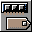 Import an assembler's labels from RAM D8.2 |  Save symbols D8.2 |  Cursor left in the pane D6.2 |  Cursor down in the pane D6.2 |  Cursor right in the pane D6.2 |  **OPS** Profiler / trace on / off D10.1 |  **COVER** Profiler / trace on / off D10.1 |  **CALLS** Profiler / trace on / off D10.1 |

| Key | Slot | Glyph | Title | Does | Use case |
|:--|:--|:--|:--|:--|:--|
| `debstepin` | [0, 1] |  `run.step_in` | Step in | `run.step_in` | D2.1 |
| `debstepovr` | [0, 2] |  `run.step_over` | Step over | `run.step_over` | D2.1 |
| `debstepout` | [0, 3] |  `run.step_out` | Step out | `run.step_out` | D2.1 |
| `debcursor` | [0, 4] |  `run.to_cursor` | Run to the cursor | `run.to_cursor` | D2.6 |
| `int` | [0, 5] |  `run.wait_int` | Run to interrupt | `run.wait_int` | D2.3 |
| `debframe` | [0, 6] |  `run.frame_step` | Frame step | `run.frame_step` | D2.3 |
| `line` | [0, 7] |  `run.step_line` | Step a source line | `run.step_line` | D2.7 |
| `pixel` | [0, 8] |  `run.to_pixel` | Run to the first paper pixel | `run.to_pixel` | D2.4 |
| `debbppc` | [1, 0] |  `dbg.breakpoint_toggle_pc` | Toggle a breakpoint at PC | `dbg.breakpoint_toggle_pc` | D4.1 |
| `bpcur` | [1, 1] |  `dbg.breakpoint_toggle_cursor` | Toggle a breakpoint at the cursor | `dbg.breakpoint_toggle_cursor` | D4.1 |
| `bpfe` | [1, 2] |  `dbg.bp_add` + label OUT FE | Add a breakpoint | `dbg.bp_add` {kind: out, preset: fe} | D4.2 |
| `bp7ffd` | [1, 3] |  `dbg.bp_add` + label 7FFD | Add a breakpoint | `dbg.bp_add` {kind: out, preset: 7ffd} | D4.2 |
| `bpall` | [1, 4] |  `dbg.bp_toggle` | Toggle breakpoints | `dbg.bp_toggle` | D4.3 |
| `debbpclear` | [1, 5] |  `dbg.breakpoints_clear` | Clear breakpoints | `dbg.breakpoints_clear` | D4.3 |
| `debbphits` | [1, 6] |  `dbg.breakpoint_hits_reset` | Reset hit counts | `dbg.breakpoint_hits_reset` | D4.3 |
| `debdbgmode` | [1, 8] |  `dbg.mode` /  `dbg.mode.on` when `debug.mode.enabled` | Debug mode | `dbg.mode_toggle` | D4.4 |
| `open` | [2, 0] |  `debug.menu` | Open the debugger | `dbg.open` | D6.1 |
| `pprev` | [2, 1] |  `dbg.focus_prev_pane` | Previous debugger pane | `dbg.focus_prev_pane` | D6.1 |
| `pnext` | [2, 2] |  `dbg.focus_next_pane` | Next debugger pane | `dbg.focus_next_pane` | D6.1 |
| `pgup` | [2, 3] |  `dbg.page_up` | Page up in the pane | `dbg.page_up` (held) | D6.2 |
| `cup` | [2, 4] |  `dbg.cursor_up` | Cursor up in the pane | `dbg.cursor_up` (held) | D6.2 |
| `pgdn` | [2, 5] |  `dbg.page_down` | Page down in the pane | `dbg.page_down` (held) | D6.2 |
| `follow` | [2, 6] |  `dbg.follow_pc` | Disassembly follows PC | `dbg.follow_pc` | D6.4 |
| `memf` | [2, 7] |  `dbg.memory_follow` | Memory follows the value under the cursor | `dbg.memory_follow` (held) | D6.3 |
| `labels` | [2, 8] |  `dbg.labels_toggle` | Labels in the disassembly | `dbg.labels_toggle` | D6.4 |
| `symload` | [3, 0] |  `sym.import` | Load symbols | `sym.import` {path: $user/build/main.sym} | D8.2 |
| `symlive` | [3, 1] |  `sym.import_live` | Import an assembler's labels from RAM | `sym.import_live` | D8.2 |
| `symsave` | [3, 2] |  `sym.export` | Save symbols | `sym.export` {path: $user/build/deck.sym} | D8.2 |
| `cleft` | [3, 3] |  `dbg.cursor_left` | Cursor left in the pane | `dbg.cursor_left` (held) | D6.2 |
| `cdown` | [3, 4] |  `dbg.cursor_down` | Cursor down in the pane | `dbg.cursor_down` (held) | D6.2 |
| `cright` | [3, 5] |  `dbg.cursor_right` | Cursor right in the pane | `dbg.cursor_right` (held) | D6.2 |
| `prof` | [3, 6] |  `prof.toggle` /  `prof.toggle.on` when `toggle.profiler.opcode` + label OPS | Profiler / trace on / off | `prof.toggle` {name: opcode} | D10.1 |
| `cover` | [3, 7] |  `prof.toggle` /  `prof.toggle.on` when `toggle.profiler.coverage` + label COVER | Profiler / trace on / off | `prof.toggle` {name: coverage} | D10.1 |
| `trace` | [3, 8] |  `prof.toggle` /  `prof.toggle.on` when `toggle.profiler.calltrace` + label CALLS | Profiler / trace on / off | `prof.toggle` {name: calltrace} | D10.1 |

| Dial | Label | Turn | Press | Use case |
|:--|:--|:--|:--|:--|
| 0 | STEP | `run.step_by` {d: $ticks, unit: instructions} | `run.step_in` | D2.2 |
| 1 | FRAMES | `run.step_by` {d: $ticks, unit: frames} | `run.frame_step` | D2.3 |

## menu speed (shared/speed)

Title: Speed; use cases C2.

| 0 | 1 | 2 | 3 | 4 | 5 | 6 | 7 | 8 |
|:-:|:-:|:-:|:-:|:-:|:-:|:-:|:-:|:-:|
| *back* |  **X1** Speed C2.5 |  **X2** Speed C2.1 |  **X4** Speed C2.1 |  **X8** Speed C2.1 |  **X16** Speed C2.1 |  **NEXT** Next speed C2.1 |  |  |
|  |  Turbo C2.2 |  **SOUND** Toggle a setting C2.3 |  **TAPE** Toggle a setting C2.4 |  **DISK** Toggle a setting C2.4 |  |  |  |  |
|  |  |  |  |  |  |  |  |  |
|  |  |  |  |  |  |  |  |  |

| Key | Slot | Glyph | Title | Does | Use case |
|:--|:--|:--|:--|:--|:--|
| `x1` | [0, 1] |  `set.speed` + label X1 | Speed | `set.speed` 1 | C2.5 |
| `x2` | [0, 2] |  `set.speed` + label X2 | Speed | `set.speed` 2 | C2.1 |
| `x4` | [0, 3] |  `set.speed` + label X4 | Speed | `set.speed` 4 | C2.1 |
| `x8` | [0, 4] |  `set.speed` + label X8 | Speed | `set.speed` 8 | C2.1 |
| `x16` | [0, 5] |  `set.speed` + label X16 | Speed | `set.speed` 16 | C2.1 |
| `next` | [0, 6] |  `set.speed` + label NEXT | Next speed | `set.speed` | C2.1 |
| `turbo` | [1, 1] |  `mach.turbo` /  `mach.turbo.on` when `toggle.mach.turbo_toggle` | Turbo | `mach.turbo_toggle` | C2.2 |
| `audio` | [1, 2] |  `settings.toggle` /  `settings.toggle.on` when `toggle.set.toggle.turbo_audio` + label SOUND | Toggle a setting | `set.toggle` {name: turbo_audio} | C2.3 |
| `tape` | [1, 3] |  `settings.toggle` /  `settings.toggle.on` when `toggle.set.toggle.fast_tape` + label TAPE | Toggle a setting | `set.toggle` {name: fast_tape} | C2.4 |
| `disk` | [1, 4] |  `settings.toggle` /  `settings.toggle.on` when `toggle.set.toggle.fast_disk` + label DISK | Toggle a setting | `set.toggle` {name: fast_disk} | C2.4 |

## Coverage

Use cases with a key or a dial (an item counts when it or its section is named):

| Use case | Covered by |
|:--|:--|
| C1.1 Run / pause | `pause` |
| C1.2 Reset (hold 1 s) | `cold`, `reset` |
| C1.3 NMI (the Magic button) | `nmi` |
| C1.5 Profi front panel TURBO / CP/M | `pcpm`, `pturbo` |
| C2 Speed | `speed` |
| C2.1 x1 .. x16, next | `next`, `x16`, `x2`, `x4`, `x8` |
| C2.2 Turbo on / off | `hold`, `turbo` |
| C2.3 Turbo with sound | `audio` |
| C2.4 Fast / turbo tape, fast disk | `disk`, `fdisk`, `ftape`, `tape`, `ttape` |
| C2.5 Back to x1 | `x1` |
| C3 Change the machine | `machine` |
| C3.1 A model, a page per family | `m128`, `m48`, `matm4`, `matm7`, `mevo`, `mnext`, `mpent`, `mpent1`, `mpent5`, `mplus2`, `mplus2a`, `mplus3`, `mpoly`, `mpoly48`, `mpolyp`, `mprofi`, `mprofi3`, `mprofi5`, `mprofip`, `mprofsc`, `mscorp`, `mscorp1`, `msprint`, `mtsl`, `mvdac`, `now` |
| C3.3 Back to the previous model | `prev` |
| C4 Load software | `media` |
| C4.2 Tape deck | `tape`, `teject`, `tpause`, `tplay`, `trew`, `tstop` |
| C4.3 Recent files | `r1`, `r2`, `r3`, `r4`, `r5`, `recent` |
| C4.4 RZX | `rzxlast`, `rzxstop` |
| C5 Media in the drives | `media` |
| C5.1 Per drive A .. D | `eja`, `ejb`, `ejc`, `ejd`, `wpa`, `wpb`, `wpc`, `wpd` |
| C5.2 Swap two drives' disks | `swapab` |
| C5.3 New blank disk | `blank` |
| C5.5 Discard the changes, rescan | `discard` |
| C6 Save state | `state` |
| C6.1 Quick save / load, slots 1 .. 9 | `l1`, `l2`, `l3`, `l4`, `l5`, `l6`, `l7`, `l8`, `l9`, `qload`, `qsave`, `s1`, `s2`, `s3`, `s4`, `s5`, `s6`, `s7`, `s8`, `s9` |
| C6.2 A snapshot file | `file` |
| C6.3 Save changed disks | `diska`, `diskb`, `diskc`, `diskd`, `savea`, `saveb`, `savec`, `saved` |
| C6.4 A disk / the tape in another format | `scl` |
| C7 Record | `record` |
| C7.1 TTD history | `rectdump`, `rectload`, `rectstop`, `tdrop`, `tdump`, `timttdrec`, `tload`, `tstart`, `ttdrec` |
| C7.2 Video | `vgame`, `vgif`, `vhq`, `vmulti`, `vpause` |
| C7.2a Audio only | `amusic`, `awav` |
| C7.3 The last seconds as a clip | `clip`, `clipgif`, `tclip` |
| C7.4 One sound source to a WAV | `aay` |
| C7.5 Screenshot | `recshot`, `shot`, `shotpng` |
| C8 Sound and mixer | `sound` |
| C8.1 Master mute | `mute`, `soumute` |
| C8.2 Mixer page, a key + a dial per source fitted | `home dial`, `may1`, `may2`, `may3`, `mbeep`, `mcd`, `mcov`, `mfm1`, `mfm2`, `mgs`, `mgsmp3`, `mmidi`, `mmsfm`, `mmspcm`, `mnay1`, `mnay2`, `mnay3`, `mndac`, `msaa`, `say1`, `say2`, `say3`, `sbeep`, `scov`, `sfm1`, `sgs`, `smsfm`, `smspcm`, `sound dial` |
| C8.3 Channels page per chip, the same actions with a channel key  | `ay`, `ay dial`, `m1a`, `m1b`, `m1c`, `m2a`, `m2b`, `m2c`, `m3a`, `m3b`, `m3c`, `s1a`, `s1b`, `s1c`, `s2a`, `s2b`, `s2c`, `s3a`, `s3b`, `s3c` |
| C8.4 Character | `aypunch`, `dc`, `fir`, `stereo` |
| C9 Picture | `picture` |
| C9.1 Fullscreen | `full`, `picfull`, `scale` |
| C9.2 GPU on / off | `gpu` |
| C9.3 Overscan | `over`, `vport` |
| C9.4 CRT | `crt`, `crtnext`, `crtprev`, `crtrst` |
| C9.5 De-flicker | `blend`, `dlss`, `picture dial` |
| C9.6 HUD | `hud`, `hudth` |
| C9.7 On-screen keyboard | `osdkb`, `osdpic` |
| C9.8 Toolbar / status bar | `status`, `toolbar` |
| C10 Monitoring | `monitor` |
| C10.1 Instances | `inst`, `model`, `runst` |
| C10.2 Host | `cpu`, `mem`, `threads` |
| C10.3 Emulation | `budget`, `fps`, `ftime`, `ints`, `mhz`, `spdpct` |
| C10.4 Peripherals | `audio`, `pads`, `slots` |
| C10.5 Breakpoints | `bps`, `lasthit` |
| C10.6 Labels and symbol sets | `lblcnt` |
| C10.7 TTD | `marks`, `ttdlen`, `ttdmem`, `ttdst` |
| C10.8 Profilers | `calls`, `covins`, `opcodes` |
| C10.9 Recording | `rec`, `recsize`, `rectime`, `video`, `vlen`, `vsize` |
| C10.10 Clients per plane | `clients`, `paired` |
| U1 Play a game | `game` |
| U1.2 Joystick on the deck | `down`, `fire`, `left`, `right`, `up` |
| U1.3 Joystick type | `cursor`, `joynow`, `kemp`, `sinc1`, `sinc2` |
| U1.4 Keys a game needs | `brk`, `enter`, `k1`, `k2`, `k3`, `k4`, `keyn`, `keyy`, `release`, `space` |
| U1.5 Kempston mouse | `mouse` |
| U2.1 A dial back through the history | `home dial` |
| U2.2 Jump back N seconds | `back5`, `gamback5` |
| U2.3 Back to live | `live` |
| U2.4 Quick load (C6.1) | `gamqload` |
| U4 BASIC and the ROM | `basic` |
| U4.1 48K / 128K BASIC from the 128K menu | `b128`, `b48` |
| U4.2 RUN, LOAD "", a typed command | `load`, `new`, `run` |
| U4.3 Macros | `basbrk`, `cat`, `emode`, `erase`, `format`, `gmode`, `move` |
| U4.4 TR-DOS boot | `traps`, `trdos` |
| D1 Run at a chosen pace | `time` |
| D1.1 The pace ladder on a dial | `home dial`, `p1`, `p25`, `p5`, `pfull`, `pline`, `pop`, `time dial` |
| D1.2 Push the dial | `pstep`, `pstop` |
| D2 Step by a unit | `debug` |
| D2.1 Step in / over / out | `debstepin`, `debstepout`, `debstepovr`, `stepin`, `stepout`, `stepovr` |
| D2.2 N instructions | `debug dial`, `home dial` |
| D2.3 A frame, N frames, to the interrupt | `debframe`, `debug dial`, `frame`, `int` |
| D2.4 Scanlines | `pixel`, `time dial` |
| D2.5 N T-states | `time dial` |
| D2.6 Until PC | `debcursor` |
| D2.7 Source level | `line` |
| D3 Scrub through time (TTD) | `time` |
| D3.2 A dial scrubs in the unit | `home dial`, `tframe`, `time dial` |
| D3.3 One unit back / forward | `bframe`, `bline`, `bop`, `fframe`, `fline`, `fop`, `home dial`, `uback`, `ufwd` |
| D3.4 Start / end of the history | `end`, `start` |
| D3.5 Reverse step, reverse continue | `rcont`, `rstep` |
| D3.6 Back to live | `live`, `timlive` |
| D3.7 Bookmarks | `bmadd`, `bmlist`, `bmnext`, `bmprev`, `mark` |
| D4 Breakpoints | `debug` |
| D4.1 At PC / at the cursor | `bpcur`, `bppc`, `debbppc` |
| D4.2 Add | `bp7ffd`, `bpfe` |
| D4.3 Enable / disable / toggle / remove by id, all, kind, group | `bpall`, `bpclear`, `bphits`, `debbpclear`, `debbphits` |
| D4.4 Debug mode | `dbgmode`, `debdbgmode` |
| D5.1 Last write / access to the address under the cursor, then th | `laste`, `lastr`, `lastw` |
| D6 Navigate the debugger | `debug` |
| D6.1 Open, panes | `dbgopen`, `open`, `pnext`, `pprev` |
| D6.2 Cursor and pages | `cdown`, `cleft`, `cright`, `cup`, `pgdn`, `pgup` |
| D6.3 Memory follows the value under the cursor (a register pair,  | `memf` |
| D6.4 Follow PC, go to, scroll mode, labels | `follow`, `labels` |
| D8 Build loop | `debug` |
| D8.2 Labels / symbols | `symlive`, `symload`, `symsave` |
| D10 Profile and trace | `debug` |
| D10.1 On / off / pause / clear | `cover`, `prof`, `profall`, `profclr`, `trace` |
| D12.1 Video, screenshot (C7); the last seconds (C7.3); the TTD ses | `tdump` |

Use cases without a key:

- C1 Control the machine: C1.4
- C11 The deck itself: C11.1, C11.2
- U2 Undo a mistake: (the section)
- U3 Watch a demo: U3.1, U3.2, U3.3, U3.4
- U5 Game pages (later): U5.1
- D5 Find the cause: D5.2
- D7 Machine state: D7.1, D7.2, D7.3
- D9 Effect timing: D9.1, D9.2, D9.3
- D11 Sound work: D11.1, D11.2
- D12 Capture for the party: (the section)

Actions bound without a glyph (the key shows its title): none.

Glyphs this scenario does not use (97 of 248): `nav.back`, `nav.home`, `nav.prev_page`, `nav.next_page`, `nav.target`, `nav.target.on`, `nav.instances`, `deck.menu`, `deck.brightness`, `run.stop`, `run.to_scanline`, `run.n_scanlines`, `run.steps`, `run.frames`, `run.tstates`, `run.until_pc`, `run.to_line`, `run.pace_next`, `run.pace_prev`, `run.pace_toggle`, `run.pace_toggle.on`, `mach.chip`, `ttd.scrub_unit`, `ttd.bookmark_delete`, `ttd.seek`, `ttd.history_limit`, `ttd.journal`, `ttd.journal.on`, `ttd.journal_build`, `ttd.journal_build_cancel`, `ttd.timecode`, `dbg.bp_remove`, `dbg.bp_enable`, `dbg.bp_disable`, `dbg.bp_toggle.on`, `dbg.bp_group`, `dbg.bp_group.on`, `dbg.register_set`, `mem.write`, `port.out`, `dbg.scroll_mode`, `dbg.goto`, `sym.import_source`, `sym.drop`, `sym.set`, `sym.set.on`, `prof.pause`, `prof.pause.on`, `analyzer.toggle`, `analyzer.toggle.on`, `analyzer.clear`, `debug.disasm`, `debug.memory`, `debug.registers`, `debug.stack`, `media.software`, `media.tape`, `media.disk`, `media.protect.on`, `media.disk.cat`, `media.cdrom`, `media.hdd`, `media.insert`, `media.rescan`, `rzx.play`, `rzx.seek`, `audio.volume_up`, `audio.volume_down`, `audio.source.on`, `audio.solo.on`, `audio.source_volume`, `video.menu`, `view.next_layers`, `view.next_layers.on`, `view.next_layers_mode`, `view.next_layer`, `view.next_layer.on`, `hud.notice`, `hud.notice.on`, `input.keyboard`, `input.mouse.left`, `input.mouse.right`, `input.mouse.middle`, `input.mouse_release`, `input.joy.up_left`, `input.joy.up_right`, `input.joy.down_left`, `input.joy.down_right`, `osd.quick_menu`, `basic.inject`, `settings.menu`, `status.ok`, `status.warn`, `status.error`, `status.busy`, `status.offline`, `status.hold`.
