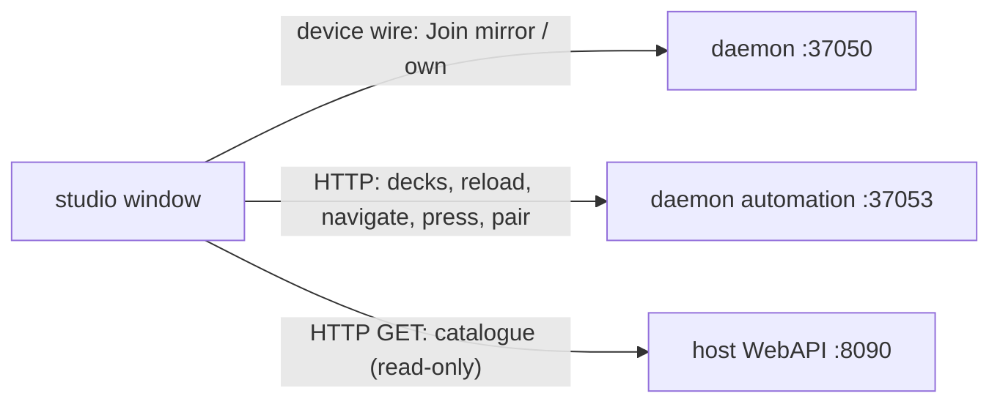

# Stream Deck integration: the studio

The software deck and the scenario editor, today `streamdeck-emulator`.

| | |
|---|---|
| **Date** | 2026-10-19 |
| **Status** | Design, for review |
| **From** | the prototype's software deck and scenario editor ([migration.md](migration.md)) |
| **Name** | "Stream Deck Studio", executable `unreal-streamdeck-studio` ([source-layout.md §4](source-layout.md#4-names)) |

## Contents

- [1. What it is](#1-what-it-is)
- [2. Connection](#2-connection)
- [3. What goes](#3-what-goes)
- [4. Editor](#4-editor)
- [5. Preview and run](#5-preview-and-run)
- [6. Recording](#6-recording)
- [7. Automation](#7-automation)
- [8. Without a daemon](#8-without-a-daemon)

## 1. What it is

| Part | Kept from today |
|:--|:--|
| Software deck | `VirtualDeck` (device side of the HID protocol, all 16 models, firmware quirks), `DeckWidget` (chassis, bezel, LCD, knobs, glows), mouse → input reports |
| Protocol log | 5 sources (now: Daemon, Viewer, Real deck, App, Info), 5000 lines, filters |
| Editor | Tree, design canvas (own private `VirtualDeck`), inspector (form + raw JSON, merge patches), palette, breadcrumbs, issues, output, undo |
| Recording | Video of the deck at 2×, constant rate |
| Automation | WebAPI + MCP on 37052 |

Size today: 3.4 MB plus Qt Widgets / Network / Gui / Core (not bundled, `@rpath`).

## 2. Connection

- On start the studio connects to the daemon; if none runs it starts one (`unreal-streamdeck`, single instance: a running
  one is reused, [daemon.md §8](daemon.md#8-single-instance)). As built (SD7): a daemon that answers gets a lease
  (`POST /api/v1/parents`); none: one is started detached with `--parent <studio pid>` (its output in
  `<temp>/unreal-streamdeck-studio.log`). At quit the lease goes back: the daemon ends unless unreal-qt holds it.
- Pairing (SD7): Deck > Pair with UnrealNG (and `POST /api/v1/pair` on the studio's automation) asks the daemon to pair;
  the status bar and the protocol log show the code until the user approves it in unreal-qt.
- Toolbar "Deck": `Real deck <serial>` (mirror, default when a deck is attached), `Own: <model>` (a virtual deck the
  daemon runs a scenario for), the model list for own decks.
- The window title says the role: "Stream Deck + XL A1B2C3 · mirror" or "Neo · own".
- Presses on the real deck light on the software deck (`HostInput`, blue-violet glow as today); clicks on the software
  deck go to the daemon as `Input`; nothing is drawn on the real deck by the studio.

## 3. What goes

| Today | Why |
|:--|:--|
| `UsbListener` (opens the deck shared, draws keys, sets brightness) | D3: the daemon is the only USB owner |
| `markOnDeck` (draws the press highlight onto the real deck) | The runtime draws pressed faces itself (it already does with a scenario); without a scenario the daemon's idle runtime does |
| "Deck brightness" slider writing USB | Becomes `PUT /api/v1/decks/{serial}/brightness` on the daemon |
| "Real Stream Decks on USB…" (enumerates over hidapi) | `GET /api/v1/decks` on the daemon |
| `PUT /api/v1/usb/brightness`, `GET /api/v1/usb/devices` | Same, forwarded |
| `Server` (listens on 37050, newest host wins) | The studio is a client (device wire v2) |
| `RunController` spawning `sdctl run --watch --api 37053 --with-parent` | The daemon runs scenarios; the studio asks it to load and reload ([§5](#5-preview-and-run)) |
| `src/recording` (copy of `core/recording`) | Links `core/recording` ([§6](#6-recording)) |
| `sdeck-mcp-bridge` (copy) | `unreal-mcp-bridge` |
| Link to hidapi (through `libsdb`) | The studio links the parts of `libsdb` without transports to USB ([source-layout.md §3](source-layout.md#3-the-stream-deck-companion)) |
| `SDECK_SOURCE_DIR` (absolute source paths in the binary for docs and examples) | Shipped data directory |

## 4. Editor

| Area | Change |
|:--|:--|
| Palette | Built from the host's catalogue (`GET /api/v1/controllers/actions`: id, label, group, description, params, toggle) when a host is reachable; falls back to the catalogue shipped with the release (`$data/streamdeck/catalogue.json`, generated at build time from the registry, [scenarios.md §6](scenarios.md#6-the-palette)). `presets/unrealng.json` (405 REST presets) and `gen_unrealng.py` go. |
| Inspector | A form per action from its `params` schema; toggles get a "state from" field (default `toggle.<id>`). |
| Validation | Unknown action ids are issues (from the catalogue); absolute paths are warnings ("use `$data` / `$testdata` / `$user`"). |
| Contexts | A menu's `context` field with the known contexts (`play`, `ttd`, `ttd.timecode`, `debug`, `debug.disasm`, …) |
| Activity | Per action: how the deck shows it when another surface runs it ([scenarios.md §5](scenarios.md#5-activity)) |
| Generic presets | Menu, HTTP, Multi / Toggle / Delay, Shell / Open / Keys / Type, Back / Home / Go to, Brightness stay; their examples stop using unreal-ng REST paths. |

## 5. Preview and run

- "Run on": the selected logical deck (the real one, or an own deck). The studio saves the resolved document to a
  run file in the daemon's run directory and calls `PUT /api/v1/decks/{serial}/scenario`; edits autosave (250 ms) and
  the daemon's watcher reloads with the stack kept, as today.
- "Stop" returns the deck to its configured scenario.
- "Both" disappears as a target: a mirror always shows what the real deck shows.

## 6. Recording

- `core/recording` is linked (static library, as unreal-qt links it), not copied; the three stand-in headers of
  today's copy (`emulator/video/screen.h`, `common/threadhelper.h`, `common/logger.h`) show where the library still
  reaches into the core: the recording-library extraction (`docs/inprogress/2026-07-16-recording-library-extraction`)
  removes them; until then the studio links the same headers from `core/src`.
- Backends as today: VideoToolbox, NVENC, ffmpeg pipe, built-in GIF.

## 7. Automation

Routes as today on 37052 (device, input, view, log, recording, window, editor), minus the USB ones (forwarded to the
daemon), plus:

| Route | What |
|:--|:--|
| `GET /api/v1/connection` | Daemon address, role, deck serial, model, real or own |
| `PUT /api/v1/connection` | Switch role: `{"role":"mirror","deck":…}` / `{"role":"own","model":…}` |
| `/api/v1/runtime/*` | Proxies to the daemon's automation for the connected deck (today: to a spawned `sdctl run` on 37053) |

The docs `04-automation.md` lists 10 routes the code has and the doc does not (`/page`, `/usb/brightness`,
`/editor/export|import|nodes|canvas|screenshot`, `/nodes/{id}/export|inline`, `/runtime/page`); they are documented
when the studio moves.

## 8. Without a daemon

If the daemon cannot start (no binary, refused), the studio still edits scenarios and shows the design canvas; the
software deck says "no daemon" and offers to start it. Protocol tests can run the studio as a v1-style server
(`--listen`) for `sdctl --device emu` ([device-wire.md §7](device-wire.md#7-compatibility)).
