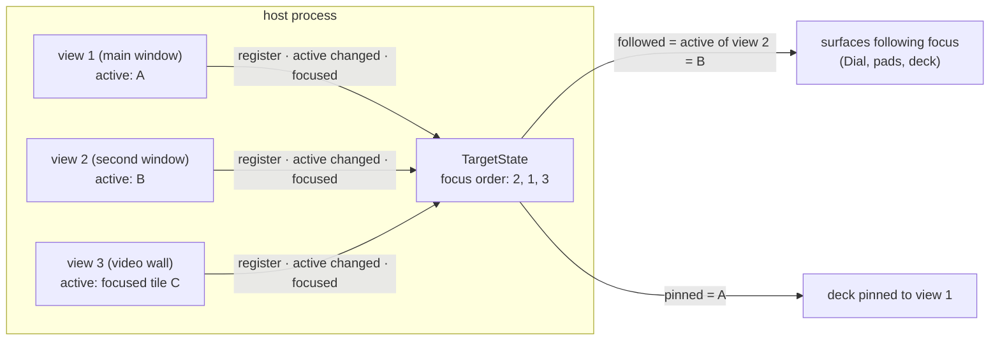

# Stream Deck integration: targeting

Which instance a surface drives when there are many windows and instances.

| | |
|---|---|
| **Date** | 2026-10-19 |
| **Status** | Design, for review |
| **Decision** | D5 in [README.md](README.md#decisions-owner-2026-10-19) |
| **Replaces** | control surfaces architecture §6 "one followed instance for all surfaces" (the selected instance set on focus) |

## Contents

- [1. What exists](#1-what-exists)
- [2. Model](#2-model)
- [3. Rules](#3-rules)
- [4. Pins](#4-pins)
- [5. Lifetime](#5-lifetime)
- [6. Showing the target](#6-showing-the-target)
- [7. Core API](#7-core-api)
- [8. Several host processes](#8-several-host-processes)
- [9. Open points](#9-open-points)

## 1. What exists

| Fact | Where |
|:--|:--|
| One `MainWindow` per unreal-qt process, one `EmulatorBinding` per window (the instance it shows). A second main window is designed, not built. | `unreal-qt/src/main.cpp:140`, `emulatorbinding.h:29`, controller manager `architecture.md:258` |
| `HostControllers` per window; the router follows that window's bound instance (`InputRouter::SetFocus`, `InstanceMode::FollowFocus`). | `hostcontrollers.cpp:324-337`, `core/controllers/src/router/inputrouter.h:79,195` |
| `EmulatorManager` has a global selected instance (`NC_EMULATOR_SELECTION_CHANGED`); the CLI, WebAPI start and Lua / Python set it; unreal-qt never sets it, it follows it (adopts and shows the newly selected one). | `emulatormanager.cpp:1136-1192`, `mainwindow.cpp:4993-5045` |
| The WebAPI resolves "no id" to the selected instance, else the sole one. | `emulator_api.cpp:155-188` |
| The video wall is a separate process with a focused tile (audio follows it); it starts its own WebAPI on 8090 and fails to bind when unreal-qt has it. | `TileGrid.h:42-45`, `VideoWallWindow.cpp:124-135`, `automation-webapi.cpp:230-240` |
| No window id is exposed; `GET …/video/window` says which instance the one window shows. | `core/automation/windowdisplay.h:211` |

The selected instance is the wrong thing to follow: it is changed by automation (a WebAPI `start` selects the new
instance), and making unreal-qt set it on focus would make the GUI and automation fight over one global.

## 2. Model



| Term | Meaning |
|:--|:--|
| View | A window that shows instances and has exactly **one active** instance: a main window (its binding), a second window, the video wall (its focused tile), the screen viewer (its source). Registered by the client that owns it. |
| Active instance | The instance a view's user input goes to. |
| Focus order | The views in order of their last activation by the user. |
| Followed instance | The active instance of the first view in the focus order. |
| Target of a surface | The followed instance, or its pin. |

## 3. Rules

1. Each view has one active instance; changing it (a click on a tile, switching the bound instance) updates the
   view's entry.
2. A view moves to the front of the focus order when it **gets keyboard focus inside the host**: application focus
   moving to another program (the studio, an IDE, a browser) **does not** change the order.
3. The followed instance is the front view's active instance. A view without an active instance is skipped.
4. A headless host has no views: the followed instance is the selected instance, else the sole one (today's WebAPI
   rule), so a CI companion keeps working.
5. Automation selecting an instance does not change the focus order. The GUI's reaction to a new selection (unreal-qt
   adopts and shows it) changes its window's active instance, and through it the followed instance: one rule, no
   special case.
6. Every surface uses the same target rule; the controller manager's per-device modes (`follow focus`, `pinned`,
   `all`, controller manager architecture) map onto it: `follow focus` = followed instance, `pinned` = a pin.

## 4. Pins

| Pin | Meaning | Survives |
|:--|:--|:--|
| `view:<id>` | Always the active instance of that view | The view's active changing (follows it) |
| `instance:<id>` | Always that instance | Focus changes; ends when the instance is destroyed |

- Set by the surface itself (a deck key "Pin to this window", the `join.target` field, `target.pin` action), or from
  the GUI (the Stream Deck settings page, the controller manager's device table).
- A pin is per surface session (the daemon's session; a Dial's device id). The daemon remembers its last pin per
  deck serial and asks for it again at `join`.
- Unpin returns the surface to the followed instance.

## 5. Lifetime

| Event | Effect |
|:--|:--|
| View closed | Removed from the focus order; followers move to the next view's active instance; `view:` pins on it fall back to follow focus with a notice. |
| Instance destroyed | `instance:` pins on it fall back; followers whose target it was follow the view's next active (or the next view). |
| Machine replaced (model switch, "fresh instance per pick") | The view's active instance changes to the new id; `view:` pins and followers follow; an `instance:` pin follows `new_emulator_id` as the bridge does today. |
| No instance at all | Target `null`; the deck shows "NO MACHINE" and offers a machine menu (start = the host's `start`, which makes the new instance active in the front view). |

## 6. Showing the target

- The deck shows the target on the strip (or a key on decks without a strip): view number, instance index, model,
  a pin mark: `W2 · #3 PENTAGON 128 · ⌖` (pinned) or `W2 · #3 PENTAGON 128` (following).
- On a target change the deck flashes the line for 1 s.
- The GUI shows on each view which surfaces target it (a small surface icon in the status bar), so a pin is visible
  from the window side too.
- Actions that change the machine (`mach.reset`, machine replace) say the target in their confirmation on the deck
  ("RESET #3?" on a held key).

## 7. Core API

`TargetState` lives in the core next to `ContextState` (it must exist headless, rule 4), owned by `EmulatorManager`'s
lifetime:

```cpp
namespace actions {

struct ViewInfo { std::string id; std::string name; std::string activeInstance; };

class TargetState
{
public:
    /// Called by the client that owns the view (unreal-qt MainWindow, the video wall)
    ViewHandle RegisterView(std::string name);
    void SetActive(const ViewHandle& view, std::string instanceId);   // "" = none
    void Activated(const ViewHandle& view);                           // moved to the front of the focus order

    std::string Followed() const;                                     // rule 3, else rule 4
    std::string Resolve(const Pin& pin) const;                        // a surface's target
    std::vector<ViewInfo> Views() const;                              // in focus order
};

}  // namespace actions
```

- Changes post `NC_SURFACE_TARGET {followed, views}`; the hub turns them into `target` messages per session, the Qt
  owner into `InputRouter::SetFocus`.
- `ViewHandle` unregisters on destruction (window closed, tile grid gone).
- WebAPI: `GET /api/v1/surfaces/views` (views in focus order, the followed instance), `GET /api/v1/surfaces/sessions`
  (each surface and its target), `PUT /api/v1/surfaces/sessions/{id}/pin`.

## 8. Several host processes

Today two GUI processes cannot both have a WebAPI on 8090. Until a host can choose another port and announce it,
v1 targets **one host process**: the daemon connects to one WebAPI (configured, default `127.0.0.1:8090`). Views
across processes (unreal-qt + the video wall at once, each with a WebAPI) are later ([TODO.md](TODO.md#later)): they
need port allocation, discovery and a focus order shared between processes.

## 9. Open points

| # | Question |
|:--|:--|
| T-1 | **Decided 2026-10-19:** the WebAPI's "no id" resolves to the followed instance when views exist; headless it stays the selected instance, else the sole one. |
| T-2 | **Decided 2026-10-19:** both: the surfaces table in the settings (each surface and its target), and on each window's status bar the icons of the surfaces driving it with "Pin here / Unpin". |
