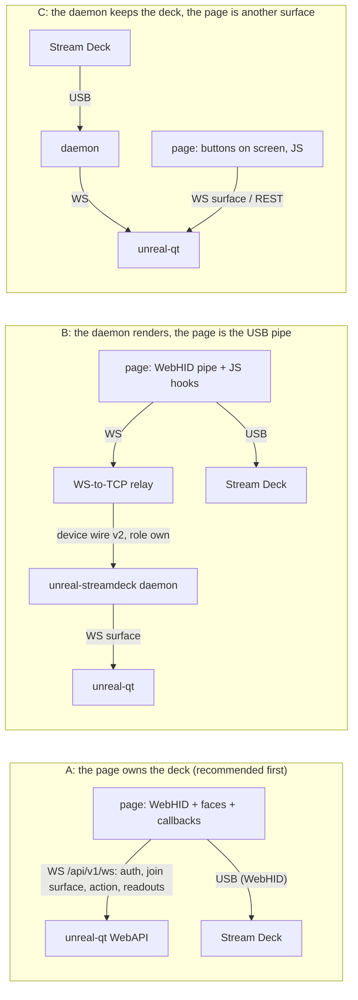

# Stream Deck in the browser: WebHID + unreal-ng

| | |
|---|---|
| **Date** | 2026-10-23 |
| **Status** | Guide for an implementing agent; nothing of it is built |
| **Audience** | A coding agent that writes a web page which drives a real Stream Deck over WebHID, talks to unreal-ng, shows the emulator's screen and runs JS callbacks on keys, dials and the touch strip |
| **Builds on** | [hid/](../../companions/streamdeck/hid/README.md) (the USB protocol as `libsdb` speaks it), [websocket-interface.md](../../emulator/design/control-interfaces/websocket-interface.md), [companion protocol](../2026-10-16-companion-client/protocol.md), [protocol.md](protocol.md), [device-wire.md](device-wire.md), [scenarios.md](scenarios.md) |

Tags used below:

| Tag | Meaning |
|:--|:--|
| **[code]** | Checked in our sources for this guide (file named next to it) |
| **[hw]** | Measured on a real deck by earlier work and written down in [hid/](../../companions/streamdeck/hid/README.md) |
| **[browser?]** | A WebHID / Chrome fact from general knowledge, not checked here: confirm it in the browser in step 1 of the plan |

## Contents

- [1. Short answer](#1-short-answer)
- [2. Three ways to build it](#2-three-ways-to-build-it)
- [3. WebHID requirements](#3-webhid-requirements)
- [4. The device for a JS author](#4-the-device-for-a-js-author)
- [5. A minimal module](#5-a-minimal-module)
- [6. Callbacks](#6-callbacks)
- [7. The emulator link](#7-the-emulator-link)
- [8. Faces in step with the emulator](#8-faces-in-step-with-the-emulator)
- [9. The emulator's screen in the page](#9-the-emulators-screen-in-the-page)
- [10. Scenarios and faces](#10-scenarios-and-faces)
- [11. Living with the daemon](#11-living-with-the-daemon)
- [12. Security](#12-security)
- [13. Step plan](#13-step-plan)
- [14. Pitfalls](#14-pitfalls)
- [15. Verified and open](#15-verified-and-open)

## 1. Short answer

Yes, it can be done. Chrome and Edge have WebHID; the Stream Deck is a plain HID device (output reports for images,
feature reports for settings, input reports for keys, dials and touch), and `libsdb` already documents every byte.
The emulator side needs no new code for the basic case: the WebAPI answers cross-origin requests and the `/api/v1/ws`
socket takes its token in a first message, which is what a browser needs.

What stands in the way:

| # | Blocker | Severity | Way round |
|:--|:--|:--|:--|
| B1 | The deck has one writer at a time in practice. Our daemon opens the deck **shared** on macOS (`hid_darwin_set_open_exclusive(0)`, `transporthid.cpp`) [code]: the browser can open it too, and the two then draw over each other. The Elgato app does the same or worse | must handle | Stop our daemon (`PUT /api/v1/streamdeck/settings {"mode":"off"}`) and quit the Elgato app before the page opens the deck ([§11](#11-living-with-the-daemon)) |
| B2 | The + and + XL key decoder shows 4:2:0 JPEG as noise; only 4:4:4 works [hw] ([04-images.md](../../companions/streamdeck/hid/04-images.md)). What chroma subsampling Chrome's canvas JPEG encoder uses is not known here [browser?] | must check | Check the SOF0 marker of the first encoded JPEG ([§5.3](#53-images)); if it is not 4:4:4, build our own encoder `companions/streamdeck/lib/src/jpeg.cpp` (self-contained, no dependencies [code]) to WASM |
| B3 | The WebAPI serves no static files: only `/`, `/api/v1/docs` and the API (`automation-webapi.cpp`, `emulator_api.h`) [code] | low | Serve the page from any `http://localhost:<port>` (a secure context); CORS lets it reach the WebAPI ([§7.1](#71-cors-and-origins)) |
| B4 | `Access-Control-Expose-Headers` lists only `X-Unreal-Session*` (`automation-webapi.cpp`, post-handling advice) [code]: a page on another origin cannot read `X-Width` / `X-Height` of the binary `capture/framebuffer` | low | Use `encoding=base64` (JSON with `width`, `height`) or add the three headers to the expose list (one line) |
| B5 | The device wire (the daemon's software-deck link) is raw TCP on `127.0.0.1:37050` (`devicewire.h`) [code]: a page cannot open TCP | only for option B | A small WebSocket-to-TCP relay, or a WebSocket listener in the daemon (new code) |
| B6 | The daemon's own API (`127.0.0.1:37053`) sends `Access-Control-Allow-Origin: *` but registers no `OPTIONS` handler and no `Allow-Headers` (`automation.cpp`; cpp-httplib dispatches `OPTIONS` only to registered handlers) [code]: a cross-origin `PUT` / `POST` with a JSON body fails its preflight | only for option C | Add an `OPTIONS` route with the CORS headers to `sdb::automation::Server`, or go through unreal-qt's `/api/v1/streamdeck/*` routes, which have CORS |
| B7 | No origin check anywhere: the WebAPI listens on `0.0.0.0` with `Access-Control-Allow-Origin: *`, and `/api/v1/ws` never reads `Origin` (`api-websocket.cpp`) [code]. Not a blocker for this page, but every web page the user opens can call the emulator too | security note | [§12](#12-security); an origin allowlist is an owner decision |

There is no video stream endpoint (no MJPEG, no frame topic, no WebRTC) [code]: the screen in the page is polled
frames ([§9](#9-the-emulators-screen-in-the-page)).

## 2. Three ways to build it



| | A: page owns the deck | B: daemon renders through the page | C: page as a second surface |
|:--|:--|:--|:--|
| Who opens USB | the page (WebHID) | the page (WebHID) | the daemon (hidapi) |
| Who draws faces | the page (canvas) | the daemon (`scenariorender.cpp`, icon packs, value faces, the TTD strip) | the daemon |
| JS callbacks on deck input | all of them | on every input report the page forwards (it sees them first) | none from the deck (the page only sees `activity`) |
| Scenario files | reimplemented subset, or the page's own layout ([§10](#10-scenarios-and-faces)) | used as they are | used as they are |
| New code outside the page | none | a relay (B5) and a daemon mode that never opens USB (today `--wait` takes the first USB deck that appears, `runcommand.cpp` [code]) | an `OPTIONS` route in the daemon API (B6) if the page calls it |
| When it fits | "control and the emulator in the browser, with JS hooks": the request | the product scenarios in a browser-only setup | a dashboard beside a real deck |

The rest of the guide builds **A**, and notes where B differs. B is a later step: the page in A already has the WebHID
half of B.

## 3. WebHID requirements

| Requirement | Detail |
|:--|:--|
| Browser | Chrome or Edge (Chromium) on the desktop. Not Firefox, not Safari [browser?] |
| Secure context | `https://…` or `http://localhost` / `http://127.0.0.1` [browser?]. A page served by `python3 -m http.server --bind 127.0.0.1` qualifies |
| User gesture | `navigator.hid.requestDevice()` only from a click or key handler (transient activation) [browser?] |
| Filters | `{vendorId: 0x0fd9, productId: …}` for every PID of [§4.1](#41-models) (`kElgatoVid`, `models.cpp` [code]) |
| Permission | Per origin (scheme, host **and port**). `navigator.hid.getDevices()` returns the decks granted before, without a prompt; `device.forget()` drops the grant. A page moved to another port asks again [browser?] |
| Hot plug | `navigator.hid` fires `connect` / `disconnect`; reopen on `connect` when the deck is one from `getDevices()` [browser?] |
| Frames | A page in an `<iframe>` needs `allow="hid"` [browser?] |
| Debugging | `chrome://device-log` lists HID open errors and denied reports [browser?] |

Platforms:

| OS | What to do |
|:--|:--|
| macOS | Nothing beyond the chooser. Quit the Elgato Stream Deck app and stop our daemon first (B1) |
| Windows | Quit the Elgato app and stop our daemon. Whether Chrome can open a deck another process holds is not known here [browser?] |
| Linux | Chrome reads `/dev/hidraw*`: the user needs access. Our rule does it: [`70-unreal-streamdeck.rules`](../../../companions/streamdeck/linux/70-unreal-streamdeck.rules) (`SUBSYSTEM=="hidraw", ATTRS{idVendor}=="0fd9", TAG+="uaccess"`) [code]; unreal-qt also serves its text at `GET /api/v1/streamdeck/udev`. Snap / Flatpak browsers may not see hidraw at all [browser?] |

Prior art: the `@elgato-stream-deck/webhid` npm package (the `node-elgato-stream-deck` project) drives decks from a
browser [browser?]. Read it for WebHID quirks; take the byte layouts from our tables, which were checked on a + XL
where the crate's were wrong ([07-discrepancies.md](../../companions/streamdeck/hid/07-discrepancies.md)).

## 4. The device for a JS author

### 4.1 Models

From `kModels` in [`models.cpp`](../../../companions/streamdeck/lib/src/models.cpp) [code]. "Rotation" is clockwise,
applied before the resize; "mirror both" is the docs' "180 degrees". Key indices run row by row from the top left.

| PID | Model | Family | Keys (cols x rows) | Dials | Key image | Rotation, mirror | Window (logical) | Full panel `0x08` |
|:--|:--|:--|:--|:--|:--|:--|:--|:--|
| `0x0060` | Original (2017) | V1, own headers | 15 (5 x 3) | - | BMP 72 | 0, both; columns mirrored in input and output | - | - |
| `0x006D` `0x0080` `0x00A5` `0x00B9` | Original V2, MK.2, MK.2 Scissor, MK.2 Module | V2 | 15 (5 x 3) | - | JPEG 72 | 0, both | - | 480 x 272 |
| `0x0063` `0x0090` `0x00B3` `0x00B8` | Mini, Mini MK.2, Mini Discord, Mini Module | V1 | 6 (3 x 2) | - | BMP 80 | 90, then mirror x | - | - |
| `0x006C` `0x008F` `0x00BA` | XL, XL V2, XL Module | V2 | 32 (8 x 4) | - | JPEG 96 | 0, both | - | 1024 x 600 |
| `0x009A` | Neo | V2 | 8 (4 x 2) + 2 touch sensors (indices 8, 9) | - | JPEG 96 | 0, both | 248 x 58, rotated 180, no touch; whole-window writes only | 480 x 320 |
| `0x0084` | + | V2 | 8 (4 x 2) | 4 | JPEG 120 | 0, none | 800 x 100, touch; tile 200 per dial | 800 x 480 |
| `0x00C6` | + XL | V2 | 36 (9 x 4) | 6 | JPEG **112** | **270** (90 counter-clockwise), none | 1200 x 100, rotated 270, touch; tile 200 per dial | 1280 x 800 |
| `0x0086` | Pedal | V2 | 3 switches | - | none: never send images | - | - | - |

- The + XL bezel hides about 8 px at the key edges (`keySafeInset`) [hw]: keep content 8 px inside.
- Expanded (V2) models also answer the feature report `0x08` "Get Unit Information": rows, columns, key size, window
  size (`Device::ReadUnitInfo`, `device.cpp` [code]). Read it once to confirm the table (the + XL says 112).

### 4.2 Report IDs: hidapi buffers versus WebHID

Our code and docs write every report as the hidapi buffer: **byte 0 is the report ID** ([01-transport.md](../../companions/streamdeck/hid/01-transport.md)).
WebHID passes the ID separately [browser?]:

| hidapi (our docs) | WebHID |
|:--|:--|
| `hid_write(buf)`, `buf[0]` = `0x02` | `device.sendReport(0x02, buf.subarray(1))` |
| `hid_send_feature_report(buf)`, `buf[0]` = `0x03` (or `0x05`, `0x0B` on V1) | `device.sendFeatureReport(buf[0], buf.subarray(1))` |
| `hid_get_feature_report(buf)` with `buf[0]` = id | `await device.receiveFeatureReport(id)`: a `DataView`; whether its byte 0 is the ID is to be checked [browser?] |
| `hid_read(buf)`: `buf[0]` = `0x01`, then the payload | `inputreport` event: `e.reportId` = `0x01`, `e.data` = the payload **without** the ID, so hidapi offset `n` is `e.data` offset `n - 1` |

Send each report at its full length (output 1024 bytes, feature 32, V1 feature 17, Original V1 output 8191; with the
ID, so 1023 / 31 / 16 / 8190 bytes of data). The device's report sizes are in `device.collections[].outputReports`
and `featureReports` [browser?]: log them once and compare.

### 4.3 Output reports (images)

All from [`protocol.cpp`](../../../companions/streamdeck/lib/src/protocol.cpp) [code]; offsets in the hidapi buffer.
Images are chunked: `payload = reportLength - header`, zero-padded to the report length, "done" only on the last
chunk, chunk index from 0. The device shows the picture when the last chunk arrives [hw].

| Write | Models | Report length, header | Header bytes |
|:--|:--|:--|:--|
| Key image | V2 | 1024, 8 | `02 07 <key> <done> <len lo> <len hi> <page lo> <page hi>` |
| Key image | Mini family | 1024, 16 | `02 01 <page> 00 <done> <key + 1>` then 10 zero bytes |
| Key image | Original V1 | 8191, 16; payload = half the BMP (two reports) | `02 01 <page + 1> 00 <done> <flipped key + 1>` then zeros; flipped key = `row * 5 + (4 - col)` |
| Full panel | V2 | 1024, 8 | `02 08 00 <done> <len16> <page16>` |
| Whole window | Neo, +, + XL | 1024, 8 | `02 0B 00 <done> <len16> <page16>` |
| Partial window | +, + XL (Neo: flagged supported, untested) | 1024, **16** | `02 0C <x16> <y16> <w16> <h16> <done> <page16> <len16> 00`: index **before** size |

Window rules [hw] ([04-images.md](../../companions/streamdeck/hid/04-images.md), `Device::SetLcdRegion`):

- `0x0C` coordinates are **logical** (landscape, x 0..1199 on the + XL), while the JPEG inside is rotated to device
  space (a 200 x 100 tile becomes a 100 x 200 picture on the + XL).
- A `0x0C` rectangle must span the **full window height**: on the + XL a shorter one is silently ignored. Keep a
  shadow canvas of the strip and send the full-height column range around a change.
- A whole strip is one `0x0B` write: 28 reports, 11 ms on the + XL [hw].

Cost [hw] ([01-transport.md](../../companions/streamdeck/hid/01-transport.md)): each report about 0.4 ms with hidapi
on macOS; a typical + XL key 3-6 reports; the full panel 136-200 reports, 55-86 ms. WebHID's cost per `sendReport`
(a promise and a browser IPC each) is not measured [browser?]: measure it in step 2.

### 4.4 Feature reports

| Command | V2 (32 bytes) | V1: Mini, Original (17 bytes) |
|:--|:--|:--|
| Brightness 0..100 | `03 08 <pct>` | `05 55 AA D1 01 <pct>` |
| Show logo (do it before closing) | `03 02` | `0B 63` |
| Fill one key with a colour | `03 06 <key> R G B` (Neo: key 8, 9 = the sensors' LEDs) | not available |
| Fill the whole panel | `03 05 R G B` | not available |
| Sleep after n seconds (0 = never) | `03 0D <int32 LE>` | `0B A2 <int32 LE>` |
| Read serial | get `0x06`, text from byte 2 | get `0x03`, text from byte 5 |
| Read firmware | get `0x05`, text from byte 6 | get `0xA1` (older Minis `0x04`), text from byte 5 |

Clearing keys on V2: `03 06 <key> 0 0 0` per key, one 32-byte transfer each, instead of uploading black JPEGs
(`Device::ClearAllKeys` [code]).

### 4.5 Input reports

From [`input.cpp`](../../../companions/streamdeck/lib/src/input.cpp) [code] and [05-input.md](../../companions/streamdeck/hid/05-input.md) [hw].
Offsets are hidapi offsets (`b[n]`); in WebHID read `e.data.getUint8(n - 1)`.

| Model | `b[1]` | Layout |
|:--|:--|:--|
| V2 without dials (Classic, XL, Neo, Pedal) | `0x00` | `b[4 + i]` = 1 while key `i` is down; Neo: indices 8, 9 are the touch sensors |
| Mini family | key 0 | `b[1 + i]` = key `i` (65-byte report) |
| Original V1 | key 0 | `b[1 + flip(i)]` = key `i` |
| + / + XL, keys | `0x00` | `b[4 + i]` |
| + / + XL, touch | `0x02` | `b[4]` type: 1 tap, 2 press (hold), 3 flick; `b[6..7]` x, `b[8..9]` y; flick end `b[10..11]`, `b[12..13]` (LE16) |
| + / + XL, dials | `0x03` | `b[4]` = 0: `b[5 + i]` = 1 while dial `i` is pressed; `b[4]` = 1: `b[5 + i]` = signed ticks (+ clockwise) |

- Key and dial-press reports carry the **whole state**, not edges: keep the previous state and diff.
- A fast turn packs 1-5 detents into one report [hw].
- Touch is reported **after** the gesture ends; no touch-down, no drag points; a flick spans only 60-110 px however
  long the drag [hw]. Treat a flick's end as an absolute position.
- + XL touch coordinates are logical, x 0..1199, y 0..99, not mirrored [hw].

## 5. A minimal module

A sketch to start from, not tested in a browser. It follows `protocol.cpp`, `input.cpp` and `image.cpp` byte for
byte; the WebHID calls are the [browser?] part.

### 5.1 Models and reports

```js
// deck.js - a Stream Deck over WebHID. Layouts: companions/streamdeck/lib/src/{models,protocol,input,image}.cpp
export const ELGATO_VID = 0x0fd9;

const jpeg = (s, rot, mirror) => ({ mode: 'jpeg', w: s, h: s, rot, mirror });
const bmp = (s, rot, mirror) => ({ mode: 'bmp', w: s, h: s, rot, mirror });
const classic = { family: 'v2', keys: 15, cols: 5, rows: 3, key: jpeg(72, 0, 'both'), panel: [480, 272] };
const xl = { family: 'v2', keys: 32, cols: 8, rows: 4, key: jpeg(96, 0, 'both'), panel: [1024, 600] };
const mini = { family: 'v1', keys: 6, cols: 3, rows: 2, key: bmp(80, 90, 'x') };

export const MODELS = {
  0x0060: { name: 'Stream Deck Original', family: 'v1', original: true, keys: 15, cols: 5, rows: 3, key: bmp(72, 0, 'both') },
  0x006d: { name: 'Stream Deck Original V2', ...classic },
  0x0080: { name: 'Stream Deck MK.2', ...classic },
  0x00a5: { name: 'Stream Deck MK.2 Scissor', ...classic },
  0x00b9: { name: 'Stream Deck MK.2 Module', ...classic },
  0x0063: { name: 'Stream Deck Mini', ...mini },
  0x0090: { name: 'Stream Deck Mini MK.2', ...mini },
  0x00b3: { name: 'Stream Deck Mini Discord', ...mini },
  0x00b8: { name: 'Stream Deck Mini MK.2 Module', ...mini },
  0x006c: { name: 'Stream Deck XL', ...xl },
  0x008f: { name: 'Stream Deck XL V2', ...xl },
  0x00ba: { name: 'Stream Deck XL V2 Module', ...xl },
  0x009a: { name: 'Stream Deck Neo', family: 'v2', keys: 8, cols: 4, rows: 2, touchPoints: 2, key: jpeg(96, 0, 'both'),
            lcd: { kind: 'fill', w: 248, h: 58, rot: 180 }, panel: [480, 320] },
  0x0086: { name: 'Stream Deck Pedal', family: 'v2', keys: 3, cols: 3, rows: 1, key: null },
  0x0084: { name: 'Stream Deck +', family: 'v2', keys: 8, cols: 4, rows: 2, dials: 4, key: jpeg(120, 0, 'none'),
            lcd: { kind: 'region', w: 800, h: 100, rot: 0 }, dialTileW: 200, panel: [800, 480] },
  0x00c6: { name: 'Stream Deck + XL', family: 'v2', keys: 36, cols: 9, rows: 4, dials: 6, key: jpeg(112, 270, 'none'),
            lcd: { kind: 'region', w: 1200, h: 100, rot: 270 }, dialTileW: 200, keySafeInset: 8, panel: [1280, 800] },
};

const lo = (v) => v & 0xff, hi = (v) => (v >> 8) & 0xff;

// protocol.cpp Chunked(): each report built at its final size, header then payload, zero padded; byte 0 = report ID
function chunked(data, reportLen, headerLen, payloadLen, header) {
  const out = [];
  for (let page = 0, sent = 0; sent < data.length; page++) {
    const n = Math.min(payloadLen, data.length - sent);
    const r = new Uint8Array(reportLen);
    r.set(header(page, n, sent + n === data.length ? 1 : 0));
    r.set(data.subarray(sent, sent + n), headerLen);
    out.push(r);
    sent += n;
  }
  return out;
}

const flipOriginal = (m, key) => key - (key % m.cols) + (m.cols - 1 - (key % m.cols));

export function keyImageReports(m, key, data) {
  if (m.original) {
    const k = flipOriginal(m, key);
    return chunked(data, 8191, 16, Math.max(1, data.length >> 1), (p, n, last) => [0x02, 0x01, p + 1, 0, last, k + 1]);
  }
  if (m.family === 'v1')
    return chunked(data, 1024, 16, 1008, (p, n, last) => [0x02, 0x01, p, 0, last, key + 1]);
  return chunked(data, 1024, 8, 1016, (p, n, last) => [0x02, 0x07, key, last, lo(n), hi(n), lo(p), hi(p)]);
}
const v2Image = (cmd, data) =>
  chunked(data, 1024, 8, 1016, (p, n, last) => [0x02, cmd, 0x00, last, lo(n), hi(n), lo(p), hi(p)]);
export const windowReports = (data) => v2Image(0x0b, data);     // Neo, +, + XL: the whole strip
export const fullPanelReports = (data) => v2Image(0x08, data);  // every V2 model with a panel size
// + / + XL: x, y, w, h LOGICAL; h must be the whole strip height; the JPEG inside is rotated to device space
export const regionReports = (x, y, w, h, data) =>
  chunked(data, 1024, 16, 1008, (p, n, last) =>
    [0x02, 0x0c, lo(x), hi(x), lo(y), hi(y), lo(w), hi(w), lo(h), hi(h), last, lo(p), hi(p), lo(n), hi(n), 0x00]);

function feature(len, bytes) {
  const r = new Uint8Array(len);
  r.set(bytes);
  return r;
}
export const brightnessReport = (m, pct) => {
  const p = Math.max(0, Math.min(100, Math.round(pct)));
  return m.family === 'v1' ? feature(17, [0x05, 0x55, 0xaa, 0xd1, 0x01, p]) : feature(32, [0x03, 0x08, p]);
};
export const showLogoReport = (m) => (m.family === 'v1' ? feature(17, [0x0b, 0x63]) : feature(32, [0x03, 0x02]));
export const fillKeyReport = (key, r, g, b) => feature(32, [0x03, 0x06, key, r, g, b]);  // V2 only
```

### 5.2 Input

```js
// input.cpp InputParser, read through hidapi offsets: b(n) = byte n of the hidapi buffer = e.data byte n - 1
export class InputParser {
  constructor(m) {
    this.m = m;
    this.buttons = new Array(m.keys + (m.touchPoints || 0)).fill(false);
    this.dialsDown = new Array(m.dials || 0).fill(false);
  }
  feed(reportId, dv) {
    const out = [];
    if (reportId === 0 || dv.byteLength < 1) return out;
    const size = dv.byteLength + 1;
    const b = (n) => (n >= 1 && n < size ? dv.getUint8(n - 1) : 0);
    const le16 = (n) => b(n) | (b(n + 1) << 8);
    const diff = (now) => {
      now.forEach((down, i) => {
        if (down === this.buttons[i]) return;
        const touch = i >= this.m.keys;
        out.push({ type: touch ? 'touchpoint' : 'key', index: touch ? i - this.m.keys : i, down });
      });
      this.buttons = now;
    };
    const keys = (offset, count) => Array.from({ length: count }, (_, i) => offset + i < size && b(offset + i) !== 0);
    const m = this.m;
    if (m.dials) {                                   // + / + XL
      if (b(1) === 0x00) diff(keys(4, m.keys));
      else if (b(1) === 0x02 && size >= 10) {
        const kind = { 1: 'tap', 2: 'press', 3: 'flick' }[b(4)];
        if (!kind || (kind === 'flick' && size < 14)) return out;
        const e = { type: 'touch', kind, x: le16(6), y: le16(8) };
        if (kind === 'flick') Object.assign(e, { x2: le16(10), y2: le16(12) });
        out.push(e);
      } else if (b(1) === 0x03 && size >= 5 + m.dials) {
        for (let i = 0; i < m.dials; i++) {
          if (b(4) === 0) {
            const down = b(5 + i) !== 0;
            if (down !== this.dialsDown[i]) { this.dialsDown[i] = down; out.push({ type: 'dial', index: i, kind: 'press', down }); }
          } else if (b(4) === 1) {
            const delta = (b(5 + i) << 24) >> 24;   // signed byte
            if (delta) out.push({ type: 'dial', index: i, kind: 'turn', delta });
          }
        }
      }
      return out;
    }
    if (m.original) diff(Array.from({ length: m.keys }, (_, i) => b(1 + flipOriginal(m, i)) !== 0));
    else if (m.family === 'v1') diff(keys(1, m.keys));
    else diff(keys(4, m.keys + (m.touchPoints || 0)));
    return out;
  }
}
```

### 5.3 Images

```js
// image.cpp ToDeviceSpace: rotate (clockwise), resize, mirror. Canvas transforms apply to points in reverse order of
// the calls, so the mirror is set first and the rotation last.
export function toDeviceSpace(src, fmt) {
  const c = new OffscreenCanvas(fmt.w, fmt.h);
  const g = c.getContext('2d');
  if (fmt.mirror === 'x' || fmt.mirror === 'both') { g.translate(fmt.w, 0); g.scale(-1, 1); }
  if (fmt.mirror === 'y' || fmt.mirror === 'both') { g.translate(0, fmt.h); g.scale(1, -1); }
  const swap = fmt.rot === 90 || fmt.rot === 270;
  const lw = swap ? fmt.h : fmt.w, lh = swap ? fmt.w : fmt.h;              // logical size
  if (fmt.rot === 90) { g.translate(fmt.w, 0); g.rotate(Math.PI / 2); }     // (x, y) -> (H-1-y, x)
  else if (fmt.rot === 180) { g.translate(fmt.w, fmt.h); g.rotate(Math.PI); }
  else if (fmt.rot === 270) { g.translate(0, fmt.h); g.rotate(-Math.PI / 2); } // (x, y) -> (y, W-1-x)
  g.drawImage(src, 0, 0, lw, lh);
  return c;
}

// JPEG chroma subsampling from the SOF marker: '444' when every component samples 1x1. Plus / Plus XL need '444'.
export function jpegSampling(bytes) {
  for (let i = 2; i + 3 < bytes.length; ) {
    if (bytes[i] !== 0xff) return 'unknown';
    const marker = bytes[i + 1], len = (bytes[i + 2] << 8) | bytes[i + 3];
    if (marker === 0xc0 || marker === 0xc2) {
      if (marker === 0xc2) return 'progressive';
      const n = bytes[i + 9];
      for (let k = 0; k < n; k++) if (bytes[i + 11 + 3 * k] !== 0x11) return 'subsampled';
      return '444';
    }
    i += 2 + len;
  }
  return 'unknown';
}

async function encodeJpegCanvas(c, quality) {
  const blob = await c.convertToBlob({ type: 'image/jpeg', quality: quality / 100 });
  return new Uint8Array(await blob.arrayBuffer());
}

// image.cpp EncodeBmp: 24-bit, bottom-up rows, BGR, rows padded to 4 bytes, 3780 px/m as the crate's blank BMP
function encodeBmp(c) {
  const w = c.width, h = c.height, px = c.getContext('2d').getImageData(0, 0, w, h).data;
  const row = (w * 3 + 3) & ~3, size = 54 + row * h, b = new Uint8Array(size), v = new DataView(b.buffer);
  b[0] = 0x42; b[1] = 0x4d;
  v.setUint32(2, size, true); v.setUint32(10, 54, true); v.setUint32(14, 40, true);
  v.setInt32(18, w, true); v.setInt32(22, h, true); v.setUint16(26, 1, true); v.setUint16(28, 24, true);
  v.setUint32(34, row * h, true); v.setUint32(38, 3780, true); v.setUint32(42, 3780, true);
  for (let y = 0; y < h; y++)
    for (let x = 0, o = 54 + (h - 1 - y) * row; x < w; x++) {
      const s = (y * w + x) * 4;
      b[o + x * 3] = px[s + 2]; b[o + x * 3 + 1] = px[s + 1]; b[o + x * 3 + 2] = px[s];
    }
  return b;
}

// The encoder is chosen once (step 1 of the plan): the canvas when it yields baseline 4:4:4, else WASM of jpeg.cpp
export let encodeJpeg = encodeJpegCanvas;
export function useJpegEncoder(fn) { encodeJpeg = fn; }   // fn(canvas, quality) -> Uint8Array

export async function encodeFor(src, fmt, quality = 90) {
  const c = toDeviceSpace(src, fmt);
  return fmt.mode === 'bmp' ? encodeBmp(c) : encodeJpeg(c, quality);
}
```

Quality 90 is what the daemon uses (`int quality = 90`, `device.h`, `theme.h` [code]).

### 5.4 The deck object

```js
export class Deck {
  // From a click handler. Filters: every PID we know.
  static async request() {
    const filters = Object.keys(MODELS).map((pid) => ({ vendorId: ELGATO_VID, productId: Number(pid) }));
    const [device] = await navigator.hid.requestDevice({ filters });
    return device ? Deck.open(device) : null;
  }
  // Without a gesture: a deck this origin was granted before.
  static async reopen() {
    const device = (await navigator.hid.getDevices()).find((d) => d.vendorId === ELGATO_VID && MODELS[d.productId]);
    return device ? Deck.open(device) : null;
  }
  static async open(device) {
    if (!device.opened) await device.open();
    return new Deck(device);
  }

  constructor(device) {
    this.dev = device;
    this.m = MODELS[device.productId];
    this.parser = new InputParser(this.m);
    this.listeners = new Set();
    this.pending = new Map();   // slot -> job; the latest picture of a slot replaces a queued one
    this.busy = false;
    this.strip = this.m.lcd ? new OffscreenCanvas(this.m.lcd.w, this.m.lcd.h) : null;  // shadow of the window
    device.addEventListener('inputreport', (e) => {
      for (const ev of this.parser.feed(e.reportId, e.data)) for (const fn of this.listeners) fn(ev);
    });
  }
  onEvent(fn) { this.listeners.add(fn); return () => this.listeners.delete(fn); }

  // One writer: a picture goes out whole, its chunks never interleave with another's (device.cpp DeckWriteLock)
  put(slot, job) {
    this.pending.set(slot, job);
    if (!this.busy) this.pump();
  }
  async pump() {
    this.busy = true;
    try {
      while (this.pending.size) {
        const [slot, job] = this.pending.entries().next().value;
        this.pending.delete(slot);
        try { await job(); } catch (err) { console.warn('deck write', slot, err); }
      }
    } finally { this.busy = false; }
  }
  async sendAll(reports) { for (const r of reports) await this.dev.sendReport(r[0], r.subarray(1)); }
  async feature(r) { await this.dev.sendFeatureReport(r[0], r.subarray(1)); }

  setBrightness(pct) { this.put('brightness', () => this.feature(brightnessReport(this.m, pct))); }
  // src: a canvas (or ImageBitmap) of the logical key face, any size; it is read when the job runs
  setKey(key, src) {
    if (!this.m.key) return;
    this.put(`key${key}`, async () => this.sendAll(keyImageReports(this.m, key, await encodeFor(src, this.m.key))));
  }
  clearKey(key) {
    if (this.m.family === 'v2') this.put(`key${key}`, () => this.feature(fillKeyReport(key, 0, 0, 0)));
    else { const c = new OffscreenCanvas(this.m.key.w, this.m.key.h); c.getContext('2d').fillRect(0, 0, c.width, c.height); this.setKey(key, c); }
  }
  // The whole strip (logical landscape picture)
  setStrip(src) {
    const l = this.m.lcd;
    if (!l) return;
    this.strip.getContext('2d').drawImage(src, 0, 0, l.w, l.h);
    const swap = l.rot === 90 || l.rot === 270;
    const fmt = { mode: 'jpeg', w: swap ? l.h : l.w, h: swap ? l.w : l.h, rot: l.rot, mirror: 'none' };
    this.put('strip', async () => this.sendAll(windowReports(await encodeFor(this.strip, fmt))));
  }
  // Columns x0..x1 of the strip after drawing into this.strip (+ / + XL): a full-height region write
  flushStripColumns(x0, x1) {
    const l = this.m.lcd;
    if (!l || l.kind !== 'region') return this.setStrip(this.strip);
    const w = Math.max(1, Math.min(l.w, x1) - x0), tile = new OffscreenCanvas(w, l.h);
    tile.getContext('2d').drawImage(this.strip, x0, 0, w, l.h, 0, 0, w, l.h);
    const swap = l.rot === 90 || l.rot === 270;
    const fmt = { mode: 'jpeg', w: swap ? l.h : w, h: swap ? w : l.h, rot: l.rot, mirror: 'none' };
    // the slot names the columns: a newer write of the same range replaces a queued one
    this.put(`strip${x0}-${x1}`, async () => this.sendAll(regionReports(x0, 0, w, l.h, await encodeFor(tile, fmt))));
  }
  async close() {
    await this.feature(showLogoReport(this.m));   // docs: show the logo before closing
    await this.dev.close();
  }
}
```

Notes for the implementer:

- Read the serial (`receiveFeatureReport(0x06)` on V2) and the unit information (`0x08`) once after opening and log
  them: they confirm the report-ID question of [§4.2](#42-report-ids-hidapi-buffers-versus-webhid).
- A region write queued under one slot and a whole-strip write under another may both be pending; the strip shadow
  makes both show the same picture, so their order does not matter.
- Our daemon reads with a 5 ms timeout and keeps one thread per handle because macOS hidapi delivered no input when
  two threads shared it [hw]. WebHID has no threads; nothing to copy, but do not open the same device from two tabs.

## 6. Callbacks

The page's API on top of `Deck.onEvent`. Each registration returns a function that removes it.

```js
deck.onKey((index, down) => { … });                         // key edges
deck.onTouchPoint((index, down) => { … });                  // Neo sensors
deck.onDial((index, e) => { … });                           // e: {kind: 'turn', delta, rate} | {kind: 'press', down}
deck.onTouch((e) => { … });                                 // e: {kind: 'tap'|'press'|'flick', x, y, x2?, y2?, tile}
```

| Rule | Why |
|:--|:--|
| Callbacks are called in input order, synchronously; an `async` callback is not awaited | A slow handler must not hold the next press |
| A throw is caught and logged with the event | One broken handler must not stop the deck |
| `rate` (detents a second) is computed as the daemon does: `inst = abs(delta) * 1000 / ms since the last turn`; more than 400 ms since then: `rate = inst * 0.3`, else `rate = rate * 0.5 + inst * 0.5` (`runtime.cpp` [code]) | `ttd.seek_by` accelerates with it; the same feel as the real daemon |
| `tile` = `Math.floor(x / dialTileW)` (200 on + and + XL) | The strip area above each dial |
| A hold (`down` then up) is the page's: it starts a timer on down, never sends a second action on its own | "One press, one request" ([client-guide.md §5](../2026-10-16-companion-client/client-guide.md#5-behaviour-rules)) |

A binding table joins input, emulator actions, JS and faces:

```js
const bindings = [
  { key: 0, action: 'run.pause_toggle', state: 'run.state.paused', face: { glyph: 'run.pause' }, faceOn: { glyph: 'run.play' } },
  { key: 1, action: 'mach.reset', hold: true, face: { label: 'RESET' } },        // press true on down, false on up
  { key: 2, js: (ctx) => ctx.emu.call('POST', `/api/v1/emulator/${ctx.instance}/keyboard/type`, { text: 'LOAD ""\n' }) },
  { key: 3, value: 'emulator.stats', format: (v) => `${v.fps.toFixed(1)}`, label: 'FPS' },   // display only
  { dial: 0, turn: { action: 'ttd.seek_by', value: ({ delta, rate }) => ({ d: delta, rate, unit: 'seconds', min: 1, max: 50 }) },
             press: { action: 'run.pause_toggle' } },
  { touch: 'flick', js: (ctx, e) => (e.x2 > e.x + 40 ? ctx.pages.back() : null) },   // the daemon's "swipe right = back"
];
```

- `action` runs a catalogue id ([§7.3](#73-actions)); `js` gets `ctx` = `{deck, emu, instance, readouts, pages}`
  and the event; a binding may have both (the action first, then the JS with its result).
- The catalogue (`GET /api/v1/controllers/actions`) has `kind` (press, delta, level, text), `toggle`, `scope`,
  `available`, `reason` per id: validate the table against it at start and grey out what the token's scopes do not
  allow.

## 7. The emulator link

### 7.1 CORS and origins

What the WebAPI does today [code] (`automation-webapi.cpp`: `webapi_gate::PassRequestGates`, the post-handling
advice):

| Item | As built |
|:--|:--|
| Listen address | `0.0.0.0:<port>` (`UNREAL_WEBAPI_PORT`, default 8090) |
| Preflight `OPTIONS` | `204`, `Access-Control-Allow-Origin: *`, `Allow-Methods: GET, POST, PUT, DELETE, OPTIONS`, `Allow-Headers`: whatever `Access-Control-Request-Headers` asked (else a default list with `Authorization`), `Max-Age: 86400` |
| Every response | `Access-Control-Allow-Origin: *` (set once: drogon's `addHeader` replaces, so no duplicate header), `Allow-Headers: Content-Type, Authorization, X-Requested-With, X-Unreal-Session, X-Unreal-Source`, `Expose-Headers: X-Unreal-Session, X-Unreal-Session-Implicit, X-Unreal-Session-Advice` |
| Credentials | Not used (a bearer header, no cookies), so `*` is valid with `Authorization` |
| `PATCH` | Not in `Allow-Methods`; no REST route needs it (the WebSocket `call` accepts it) |
| `/api/v1/ws` | Never reads `Origin`: any page may connect |

So a page on `http://localhost:8700` can `fetch` the WebAPI and open its socket. Possible browser-side snags
[browser?]: Chrome's Local Network Access permission for pages on **public** origins calling loopback (a page on
localhost is not affected), and the base64 versus binary choice of B4.

### 7.2 Pairing and the token

The page is a companion, like the daemon ([companion protocol](../2026-10-16-companion-client/protocol.md)):

1. `POST /api/v1/companions/pairings` `{"name": "Browser deck", "device": "Chrome, Stream Deck + XL", "scopes": [...]}`
   with only the scopes the bindings use (`run`, `input`, `media`, `machine`, `rewind`, `debug`, `takeback`).
2. Show the six-digit `code` large on the page **and** on the deck (a key or the strip); the user compares it with the
   prompt in unreal-qt and allows it.
3. Poll `GET /api/v1/companions/pairings/{pid}` once a second until `approved` (store `token`), `denied`, `expired`.
4. Errors: `403 pairing_disabled` (the user turned requests off: Tools > Companions…), `503 pairing_unavailable` (no
   GUI: the owner provisions `UNREAL_COMPANION_TOKENS=name:token[:scopes]`), `429 too_many_pairings`.

A companion opens no automation session: its changes do not lock the GUI. While an MCP agent holds the machine,
actions answer `409 held_by_session`; show the holder and offer take-back only when the user presses it.

### 7.3 Actions

Over the socket ([websocket-interface.md §3.1](../../emulator/design/control-interfaces/websocket-interface.md#31-the-surface-topic)) [code]:

```js
const ws = new WebSocket('ws://127.0.0.1:8090/api/v1/ws');
ws.onopen = () => {
  ws.send(JSON.stringify({ op: 'auth', token }));          // a browser cannot set Authorization on the handshake
  ws.send(JSON.stringify({ op: 'join', v: 1, rid: 1, name: 'Browser deck', model: 'elgato.streamdeck.plusxl',
                           serial, target: 'follow', features: ['activity', 'catalogue'] }));
};
// welcome: {session, instance, context, scopes, target, readouts[], catalogue_rev}
ws.send(JSON.stringify({ op: 'subscribe', session, readouts: ['run.state', 'ttd.position', 'toggle.*', 'media.*'], max_hz: 50 }));
ws.send(JSON.stringify({ op: 'action', session, rid: 7, id: 'run.pause_toggle' }));            // press
ws.send(JSON.stringify({ op: 'action', session, rid: 8, id: 'mach.reset', value: { p: true } })); // hold: down ...
ws.send(JSON.stringify({ op: 'action', session, rid: 9, id: 'mach.reset', value: { p: false } })); // ... up
ws.send(JSON.stringify({ op: 'action', session, rid: 10, id: 'ttd.seek_by',
                         value: { d: -3, rate: 18.5, unit: 'seconds', min: 1, max: 50 } }));
// any REST route as a call: {"op":"call","rid":11,"method":"GET","path":"/api/v1/companions/me"}
```

| Message | Use |
|:--|:--|
| `auth` | answered `{"op":"auth","t":"call","ok":true}`; the token is checked when `join` or a topic first needs it: unknown is `companion_unknown` and the socket closes |
| `welcome` (`t: "surface"`) | `session`, the target instance, `scopes`, `readouts` the instance has |
| `result` | `rid`, `ok`, `error`, `message`, `body` of the action |
| `readout` | `values{}` in full after `subscribe` and after a rebind, then only what changed, at most `max_hz` (1..50) |
| `target` | the followed instance changed (window focus, selection): redraw everything |
| `ctx` | the surface context changed (`play`, `ttd`, `debug`, …) |
| `activity` | another surface (GUI, pad, the daemon) ran an action on the target: flash the bound keys |
| `revoked` | forget the token, show "unpaired" |

REST works too: `POST /api/v1/controllers/actions/{id}` with `Authorization: Bearer <token>` and
`{"value": …, "params": …, "instance": …}` (REST spells delta `{"delta": n, "rate": r}`, press `{"pressed": b}`)
([webapi-interface.md](../../emulator/design/control-interfaces/webapi-interface.md), Host Actions). Use REST only
while the socket is down; the daemon does the same (`ActionResult::notSent`).

Reconnect with a back-off (the daemon: 0.25 .. 5 s), `auth` and `join` again, and take the first `readout` as the
truth. Calls time out after 5 s (the daemon's executor).

### 7.4 Without the socket

`GET /api/v1/surfaces/readouts?names=run.state,ttd.position&instance=` gives the same values once
(`{values, unknown}`, published state only) [code]. Polling it at 4 Hz is the daemon's fallback; use it only when
the socket cannot be had.

## 8. Faces in step with the emulator

The model: the emulator owns the state, the page draws it. Never flip a face on a key press; flip it when the readout
says so, so a pause from the GUI or a pad shows on the deck too ([architecture.md](architecture.md), decision D2).

| Face kind | Readout | Rule |
|:--|:--|:--|
| Toggle key | `state` path: `run.state.paused` (derived from `run.state.state`), `toggle.<id>` (`{on}`), `audio.mute.muted`, `debug.mode.enabled`, `media.tape.playing` | `faceOn` while true (`surfacereadouts.cpp ReadoutField` [code]) |
| Value key | `emulator.stats.fps`, `host.stats.cpu_percent`, `media.slots.slots.0.name`, … | text from the value; redraw only when the shown text or its warn / alert level changed |
| Lit or dark | `GET /api/v1/companions/me` `actions.<a>.available` (or the `instances` topic) | dark with the `reason` when not available |
| Strip timeline | `ttd.position` `{frame, tinframe, first, end, state, history, paused, fps}` | see below |

Redraw on change only:

```js
const shown = new Map();                       // slot -> the string the face was drawn from
function show(slot, key, value, draw) {
  const sig = JSON.stringify(value);
  if (shown.get(slot) === sig) return;         // a 10 Hz readout whose other fields moved redraws nothing
  shown.set(slot, sig);
  deck.setKey(key, draw(value));
}
```

The TTD timeline on the strip ([scenarios.md §3](scenarios.md#3-paths): "the TTD timeline is a strip readout, never
keys"):

- position `x = (frame - first) / max(1, end - first) * stripWidth`; time code `frame / fps`;
- draw into `deck.strip`, then `flushStripColumns(oldX - 8, newX + 8)` for a moving cursor and a whole `setStrip`
  only when the span changes; at 50 Hz that is one small region write per change;
- subscribe at `max_hz: 50` only while the timeline is on screen, 10 otherwise (the daemon's choice, protocol.md §10);
- keep the readout's own `frame` after a seek (the `result` of `ttd.seek_by` has `frame`, `marks`).

## 9. The emulator's screen in the page

The emulator runs as unreal-qt (a GUI or offscreen instance); the page shows its frames. What exists [code]
(`capture_api.cpp`, `framebufferexport.h`, [webapi-interface.md](../../emulator/design/control-interfaces/webapi-interface.md) Screenshots):

| Route | Gives | In the page |
|:--|:--|:--|
| `GET /api/v1/emulator/{id}/capture/framebuffer?format=rgba&encoding=base64` | JSON `{width, height, format, encoding, bytes, data}`: the presented frame, R G B A (352 x 288 on a Spectrum, about 400 KB raw) | `atob` into a `Uint8ClampedArray`, `new ImageData(…)`, `putImageData`, CSS `image-rendering: pixelated` |
| `…/capture/framebuffer` (binary, default) | `application/octet-stream`, size in `X-Width` / `X-Height` | same-origin only, or after B4's one-line fix |
| `…/capture/screen?format=png` | JSON with base64 PNG `data`, `frame.frame_number` | ``; small, but the server encodes a PNG per request |
| `…/capture/screen?source=window` | the picture as the window draws it (CRT, HUD) | only for the GUI's instance |

- No push stream exists: poll. Start at 25 Hz with one request in flight at a time (skip a tick while one is
  pending), and measure what the polling costs the emulation thread per frame before raising it ("reads never park",
  [protocol.md §0.1](protocol.md#01-asynchronous-io-a-fixed-number-of-threads)); the framebuffer route copies the
  presented frame (`CopyPresentedFramebuffer`), it does not stop the machine.
- Over the socket a `call` turns a non-JSON body into `{"text": …}` (`api-websocket.cpp ResultOf`) [code]: use
  `encoding=base64` there, or `fetch` for the binary form.
- Sound is not carried to the page; mute the instance the demo starts (`POST /api/v1/emulator/{id}/audio/mixer/master {"muted": true}`).
- A real stream (a frame topic on `/api/v1/ws` with binary frames, or MJPEG) would be new core work and a design of its
  own; do not add it in this task.

## 10. Scenarios and faces

| Option | What it takes | Fits |
|:--|:--|:--|
| The page's own layout (the binding table of §6) | A few canvas helpers: background, glyph, label, value text | Start here |
| Read `data/streamdeck/scenarios/*.deck.yaml` in the page | A YAML parser and a port of the parts used: menus and `nav`, `at: [row, col]`, `face` / `face_on` / `state`, `glyph`, `face.value` templates (`sdb/valueface.h`), dials `press` / `turn` with `$ticks` / `$rate`, `strip.status` | Later, when one file should drive both the daemon and the page; the runtime is ~1000 lines of C++ (`runtime.cpp`, `scenario.cpp`, `navigator.cpp`, `scenariorender.cpp`) |
| Let the daemon draw (option B) | The relay (B5), a daemon mode without USB | The product scenarios with every pack |

Glyphs: a face names a glyph (`face: {glyph: run.pause}`); the picture is
`data/streamdeck/icons/packs/<pack>/src/<glyph>.png`, with the pack's `fallback` (`pack.json`) and then `magicwb`
([scenarios.md §4.1](scenarios.md#41-glyph-faces-and-the-icon-pack)) [code]. Neither the WebAPI nor the daemon serves
these files over HTTP: the static server that serves the page serves `data/streamdeck/icons/packs/` too. Draw the
glyph at the device key size (no resize afterwards), on the pack's background, label under it; the daemon's face
grid is 144 px (`kFaceSize`), scaled to the key.

## 11. Living with the daemon

D3 says the daemon is the only USB owner ([README.md](README.md#decisions-owner-2026-10-19)). A page that opens the
deck is an exception the user chooses for a session:

| Step | How |
|:--|:--|
| See the daemon's state | `GET /api/v1/streamdeck` (unreal-qt's supervisor) or the `streamdeck.status` topic |
| Stop it for the session | `PUT /api/v1/streamdeck/settings {"mode": "off"}` (modes `off`, `deck`, `always`), or `POST /api/v1/streamdeck/stop`; check which of the two survives a deck replug before relying on it |
| Give it back | the previous `mode`; the daemon gets the deck again, its runtime redraws |
| Elgato's app | quit it; it is not ours to stop |

Do not run both: on macOS both handles open (shared), both draw, the user sees a mix (B1).

Option B in more detail, for later: the page connects through a relay to `127.0.0.1:37050` and sends
`Join {"v":2,"role":"own","model":"plusxl","serial":"WEB-<serial>"}`; frames are `[u8 type][u32 LE length][payload]`
([device-wire.md §3](device-wire.md#3-frames)) [code]. The daemon then sends `Output 0x01` and `SetFeature 0x02` frames
whose payloads are exact hidapi buffers (report ID first): the page passes them to `sendReport(buf[0], buf.subarray(1))`
/ `sendFeatureReport`; `GetFeature 0x03` is answered with `FeatureReply 0x04` from `receiveFeatureReport`; every
`inputreport` goes back as `Input 0x05` with the ID put in front again, and the page's JS hooks see the parsed event
first. Missing today: the relay (no WebSocket on the wire), and a daemon mode that serves viewers without opening USB.

## 12. Security

- **The token is the user's hands** within its scopes, without a session and without the GUI lock. In a page it lives
  in `localStorage` of its origin: give the page an origin of its own (its own port), load no third-party scripts,
  ask only for the scopes used, name the pairing so the user recognises it ("Browser deck"), and offer "Unpair"
  (`DELETE /api/v1/companions/me`). The user revokes it at Tools > Companions…; the socket then gets `revoked`.
- Never log the token; never put it in a URL (`?token=`): use the `auth` message.
- **The open door that already exists** (B7): `Access-Control-Allow-Origin: *`, `0.0.0.0`, no `Origin` check on
  `/api/v1/ws`. Without a token a call passes the gates as any local request does (the automation gate opens an
  implicit session). Any site the user visits could do the same; Chrome's Local Network Access prompt may stop public
  sites [browser?]. An origin allowlist (an environment variable, documented in
  [environment-variables.md](../../emulator/environment-variables.md)) would close it: an owner decision, not part
  of this task.
- **WebHID** lets the page send any report to the deck. Send only the reports of [§4](#4-the-device-for-a-js-author).

## 13. Step plan

A prototype is a POC by the repository rules: `tools/poc/NNN-streamdeck-webhid/` with its charter, registered in
[tools/poc/README.md](../../../tools/poc/README.md). Run the page from a static server on `127.0.0.1` inside the
worktree's `scratch/`; start your own unreal-qt instance on a free port with its sound muted; never touch instances,
daemons or decks other sessions use.

| Step | Do | Acceptance |
|:--|:--|:--|
| 1. Probe | Page with a "Connect" button: `requestDevice`, `open`, log `productId`, `collections` (report IDs and sizes), serial (`0x06`), unit info (`0x08`); encode one canvas to JPEG and run `jpegSampling` | The deck opens; sizes match §4.2; unit info gives the key size of §4.1; the report-ID question of §4.2 answered; the JPEG is `444` or the WASM encoder is chosen |
| 2. Draw | Brightness, one key from a canvas (an arrow pointing up, text "0"), all keys, the strip (`0x0B`), one full-height `0x0C` tile, `03 06` clear | The arrow points up on the glass for the deck's model (rotation right); no noise (4:4:4); a tile lands above its dial; time per key and per strip logged |
| 3. Input | `inputreport` through `InputParser`, the callbacks of §6 | Every key, dial press and turn, tap / press / flick gives one event with the right index; a fast turn sums detents; `rate` grows with speed |
| 4. Reconnect | `getDevices` on load, `connect` / `disconnect` | A reload reopens without a prompt; unplug / replug redraws the last faces |
| 5. Pair | The flow of §7.2 with the code on the page and the deck | Approved token stored; `GET /api/v1/companions/me` answers; revoke at the GUI turns the page to "unpaired" |
| 6. Act | Socket: `auth`, `join`, `action`; REST fallback | Pause toggles the machine; the reset hold sends press then release; a dial seeks time with `ttd.seek_by` |
| 7. Sync | Readouts to faces with change-only redraw; the TTD strip | Pause from the GUI flips the deck key within a frame or two; the timeline follows a seek; no key is written while nothing changes (count writes) |
| 8. Screen | Framebuffer polling into a canvas | The picture moves at the chosen rate; one request in flight; the emulation thread's frame time with and without the page is reported |
| 9. Hand back | Stop / restart the daemon around the session (§11) | The daemon gets the deck back and redraws; never both writing |

## 14. Pitfalls

| Pitfall | Effect | Avoid |
|:--|:--|:--|
| Offsets copied from our docs into `e.data` | Every field one byte off | `b(n) = e.data[n - 1]` (§5.2) |
| 4:2:0 JPEG on + / + XL keys | Stringy noise | 4:4:4 only (B2) |
| + XL key at 120 px (the crate's size) | Picture cropped / shifted | 112 (unit info) |
| `0x0C` with logical coordinates rotated as the crate does | Every tile at x = 0 | Logical coordinates in the header, rotated pixels inside |
| `0x0C` shorter than the strip | Silently ignored | Full-height column ranges from a shadow |
| Two images' chunks interleaved | Garbage on a key | One writer queue (§5.4) |
| Every readout redraws every key | The deck lags (0.4 ms a report on hidapi, likely more on WebHID) | Change-only redraw; coalesce per slot |
| Our daemon or Elgato's app running | Two writers | §11 |
| Permission lost after moving the page to another port | `getDevices()` empty | Keep the origin fixed |
| Touch expected while dragging | Nothing arrives until release; flick 60-110 px | Treat flick end as absolute |
| A toggle face flipped on press | Wrong when another surface toggles | Face from the readout only |
| Automatic retries of actions | A reset sent twice resets twice | One press, one request |
| `capture/framebuffer` binary across origins | `X-Width` unreadable | `encoding=base64` (B4) |
| Pedal or Mini given JPEG / full-panel writes | Ignored or garbage | Model table: Pedal no images, Mini BMP, no `0x08` |

## 15. Verified and open

| Fact | Status |
|:--|:--|
| Model table, report layouts, input layouts, rotation and mirror order, BMP layout, quality 90 | [code] `models.cpp`, `protocol.cpp`, `input.cpp`, `image.cpp`, `device.cpp` |
| + XL 112 px, logical `0x0C`, full-height rule, 4:4:4, touch and flick behaviour, timings | [hw] [hid/](../../companions/streamdeck/hid/README.md) |
| WebAPI CORS headers, preflight, `0.0.0.0`, no origin check on `/api/v1/ws`, the `auth` op, no static files, expose list | [code] `automation-webapi.cpp`, `api-websocket.cpp` |
| Framebuffer and screenshot routes, no stream endpoint | [code] `capture_api.cpp`, grep of `core/automation/webapi/src` |
| Daemon API without `OPTIONS`, device wire on raw TCP, `--wait` takes the first USB deck | [code] `automation.cpp`, `devicewire.h`, `runcommand.cpp` |
| Daemon opens HID shared on macOS | [code] `transporthid.cpp` |
| WebHID API shape, report ID handling, secure context, permissions per origin, Linux hidraw, Windows sharing | [browser?] step 1 |
| Chrome canvas JPEG subsampling | [browser?] step 1 |
| WebHID throughput per report | [browser?] step 2 |
| Chrome Local Network Access prompts for public origins | [browser?] only if the page is not on localhost |
| Cost of framebuffer polling on the emulation thread | to measure, step 8 |
