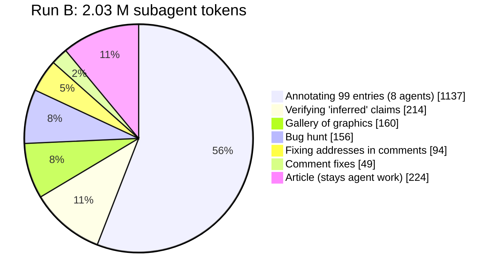
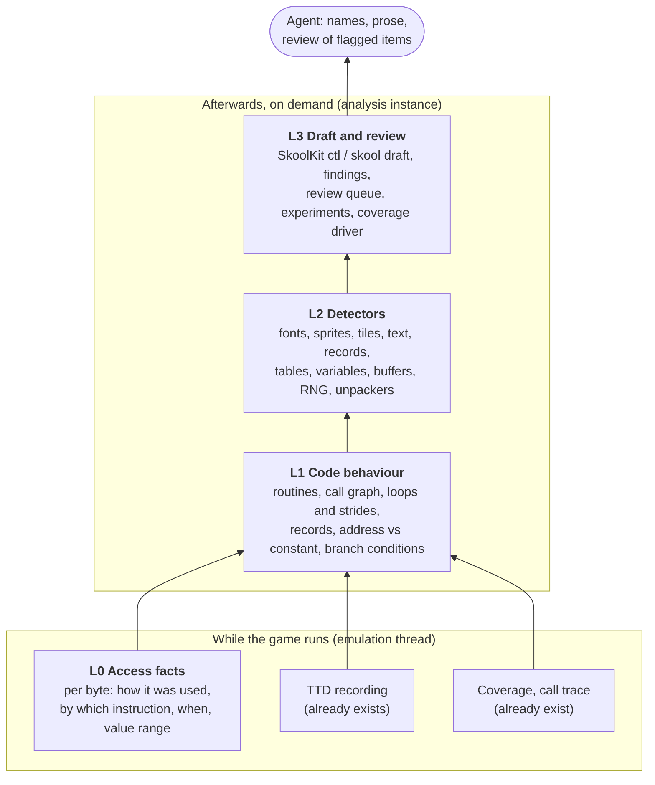
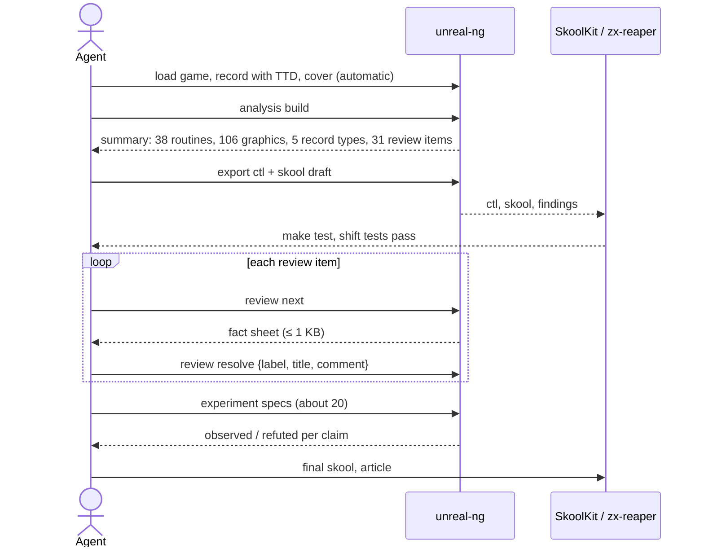
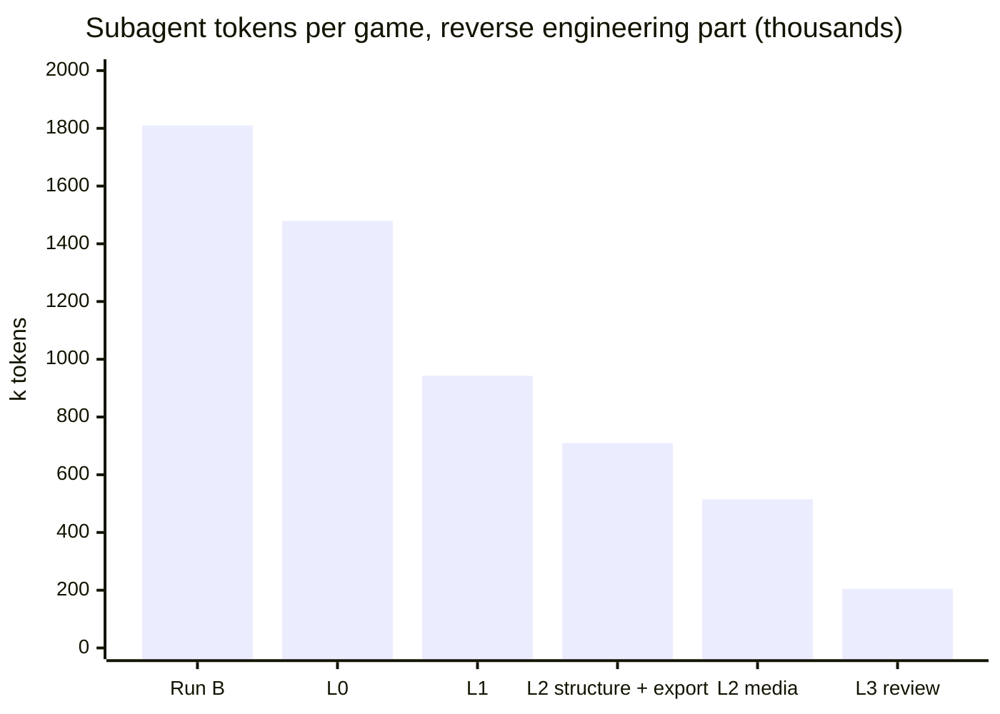

# Analysis layers: let the emulator do the reverse engineering legwork

**Status:** proposal, no code. PLAN.md row #111. Read this file first, then [design.md](design.md) (how each
module is built) and [plan.md](plan.md) (order of work, tests, risks, open questions).

## The problem in one picture

On 2026-10-24 we reverse engineered Manic Miner twice with the zx-reaper method: once with zx-reaper alone,
once with zx-reaper plus unreal-ng. Both runs ended in a tie on quality (about 95 % of names meant the same as
in the skoolkid reference), and both cost about **2 million subagent tokens**.

Where did the tokens go? Mostly into agents finding out, one experiment at a time, things the emulator
already sees on every instruction: who reads this byte, how far apart are the reads, is this number an
address or a constant.

An annotation agent spent 31 to 83 tool calls per batch of routines. Most were runs with a breakpoint or a
watch, a poke and a peek, and each answered one small question like "who writes $80BC?". The emulator
answered that question millions of times during the run and threw the answer away.

**The idea:** keep those answers, build them into a typed picture of the program (code, text, fonts, sprites,
records, variables, tables), and hand the agent a draft plus a short list of things to check. The agent then
names things and reviews instead of crawling memory byte by byte.

**Target:** the reverse engineering part goes from 1.81 M to about 0.2 M tokens per game, 9x by our estimate.
The article stays agent work, so the whole run comes to about 6x.

## Four layers

Each layer is built from the one below it. Only the lowest runs while the game runs; everything above it is
computed afterwards, from a time-travel (TTD) recording, so the emulator does not get slower.

## What each module gives, and why

The numbers below come from run B's token ledger. They are our estimate per module; each phase re-measures
them with the same A/B setup (see [plan.md](plan.md#how-we-measure)).

### L0 Access facts: "explain this address" in one call

**Today** the memory counters say how many times a byte was read, written or executed. Nothing more. To learn
*who* read it, an agent sets a breakpoint, runs, looks, repeats.

**New:** for every byte we also keep what kind of access it was (instruction, operand, data, stack, block copy,
self-modifying code), the last instruction that read it and the last that wrote it, the first and last frame
it was touched, and the smallest and largest value written.

**Gain:** about 0.3 M tokens (annotation shrinks by a quarter). One `explain $80BC` answers "counter, written by
$8B70, values $24..$3F, frames 120..5400" instead of five tool calls with breakpoints.

**Why it is cheap:** the instruction address already reaches the counter code on every memory access and is
dropped. Keeping it is a few stores next to the counters, about 1 MB in total, and only when this level is
switched on.

### L1 Code behaviour: a fact sheet for every routine

**Today** an agent learns what a routine does by reading its disassembly and running experiments.

**New:** we replay the TTD recording with a tracer that watches every instruction, and fold what it sees into:

| Structure | Answers |
|-----------|---------|
| Routines and call graph | where routines start and end, who calls whom, jump tables, PUSH+RET tricks |
| Routine profile | which memory it reads, writes and runs, which ports, how much time per frame, which registers go in and out |
| Loops | how many times each loop ran, and by how much each pointer moved per pass (the **stride**) |
| Base+offset patterns | "`(IX+0)`..`(IX+6)` read, then IX += 7": a record walk |
| Address or constant | `LD HL,$8000` later used as a pointer is an address; `CP $2A` is a number |
| Branch conditions | "at $8C12 the game jumps if ($80BC) = 0" |

**Gain:** about 0.5 M tokens. The annotation wave becomes "read a 1 KB fact sheet, name the routine,
write a comment" instead of discovering the facts.

**Why replay:** these structures need per-instruction work. Done live, they would slow down every run (this is
what stalled the 2026-01 analyzer designs). The TTD replay is deterministic, so doing the heavy work afterwards
gives the same answer as doing it live, at no cost to the live run.

### L2 Detectors: "show me every sprite"

**Today** there is byte-pattern search. To find graphics, an agent guesses geometry and renders candidates.
Gallery agent G2 spent 160 k tokens on 44 images.

**New:** detectors turn L0 and L1 facts into typed regions. Each region has a kind, a range, a geometry, the
routines that use it, the evidence and a confidence.

```mermaid
flowchart LR
    F["L0 + L1 facts"] --> S["Signatures<br/>(ROM, music players, packers)"]
    S --> C["Code map"]
    C --> T["Text"]
    T --> I["Init tables"]
    I --> R["Records"]
    R --> P["Pointer / handler tables"]
    P --> V["Variables"]
    V --> FO["Fonts"]
    FO --> SP["Sprites / tiles"]
    SP --> SB["Screen buffers"]
    SB --> LM["Level maps"]
    LM --> RNG["RNG"]
    RNG --> U["Unpackers"]
    U --> STORE[("Region store")]
```

They run in this order because later detectors use earlier answers: a font is data, not code; a level map is
read by the routine that picks tiles.

How the main detectors recognise their target, in plain words:

- **Sprite or tile:** a loop reads a region and writes the screen or a back buffer. The inner loop's count is
  the width, the outer loop's count is the height, and the source stride gives the frame size. A second source
  that gets ANDed in is a mask.
- **Font:** 8 reads one byte apart, written 256 bytes apart into the screen, glyph picked by a character code.
- **Record array:** the base+offset pattern from L1 with a constant step. Size = step, the fields come with
  the value ranges seen.
- **Variable:** a byte or word outside the other regions. Its role comes from how it is used: only INC/DEC
  means a counter, two values mean a flag, used as an address means a pointer.
- **Init table:** written by one routine early, then only read. Its content is checked against a few known
  generators, such as screen row addresses.
- **Text:** printable bytes with a terminator, read by a print routine. Text that nobody reads but that
  parses as tokenized source code becomes "unused, leftover source" (Manic Miner has 2,484 such bytes at $934C-$9CFF; neither run marked them unused).

**Gain:** about 0.3 M tokens. The gallery is generated, record layouts come for free (both runs laid out all
five Manic Miner record types by hand), and graphics entries arrive titled with their geometry.

### L3 Draft and review: the agent becomes a reviewer

Four modules, each removing one line of the ledger.

| Module | Replaces | Gain |
|--------|----------|------|
| **SkoolKit export.** ctl and skool draft with routine splits, records, relocation (`@isub`, `ALIGN 256`), `#R` references in comments | the lead's 139 hand-written `@isub` lines and its relocation scripts; agent W (94 k); most of agent C (49 k) | ≈ 0.13 M plus the lead's time |
| **Review queue.** Only items that need judgment: conflicts, low confidence, unnamed routines, unknown areas over 16 bytes, candidate bugs. Each with a fact sheet of at most 1 KB; the agent answers with a small JSON | the annotation wave reading whole files | ≈ 0.1 M |
| **Experiment runner.** The agent writes "poke $80BC=$24, run 300 frames, expect PC $8C01 reached"; the runner executes it on a muted clone and answers observed / refuted | most of agent V's 214 k tokens of manual reruns | ≈ 0.12 M |
| **Directed coverage.** For each branch that never went one way, find the variable it tests, poke it from the nearest snapshot, see if new code runs | the lead's 17 minutes of poking Willy onto items and portals | wall time; more code reached |

Candidate bugs (unbounded counters, unchecked indices) are a by-product of variable ranges. All four bugs both
runs found (lives wrap, score overflow, cavern ≥ 20, the ink-7 item) are of this kind. The bug hunt then judges a
list instead of searching: about 0.09 M less.

## The agent's workflow after the change

## Savings by phase

| After | RE part | With the article | Factor (RE part) |
|-------|--------:|-----------------:|-----------------:|
| today (run B) | 1.81 M | 2.03 M | 1x |
| L0 access facts | 1.48 M | 1.70 M | 1.2x |
| L1 code behaviour | 0.94 M | 1.17 M | 1.9x |
| L2 structural detectors + export | 0.71 M | 0.93 M | 2.5x |
| L2 media detectors | 0.52 M | 0.74 M | 3.5x |
| L3 review queue, experiments, coverage | **0.21 M** | **0.36 M** | **≈ 9x** |

This is a model built from one game. The first phase builds the measuring harness, and every phase updates the
table with measured values.

## What stays with the agent

- Names and prose for routines that no signature knows.
- Bugs that need reasoning about level design: the reference lists 6 bugs, and both runs missed 5 of them.
- Resolving conflicts between detectors.
- The article.

## What already exists

Most of the raw data is recorded today, it just is not kept or combined.

| Exists | Code | Used by |
|--------|------|---------|
| Memory counters (read / write / execute per byte, physical pages, segments) | [memoryaccesstracker.h](../../../core/src/emulator/memory/memoryaccesstracker.h) | L0 extends it |
| Call trace (jumps, calls, returns with banks and stack) | [calltrace.h](../../../core/src/emulator/memory/calltrace.h) | L1 |
| Coverage, exported as a SkoolKit code map | [coverageexport.h](../../../core/src/debugger/analyzers/coverage/coverageexport.h) | L1, L3 |
| TTD write journal, coverage index, port and input journals | `core/src/debugger/ttd/` | L1 replay, L3 coverage driver |
| Memory search (pattern + mask) | [memorysearch.h](../../../core/src/debugger/search/memorysearch.h) | signatures |
| Symbols with SkoolKit ctl / skool codecs | `core/src/debugger/labels/` | L3 export |
| Analyzer designs from 2026-01: block segmenter, function / loop detectors, interrupt analyzer, routine classifier | [2026-01-14-analyzers](../2026-01-14-analyzers/TODO.md) | become L1 / L2 parts, run offline |
| Font finder design with an access-pattern tracer | [2026-09-29-font-finder-analyzer](../2026-09-29-font-finder-analyzer/requirements.md) | the tracer becomes the L1 replay tracer, the finder one L2 detector |

The same approach is common in other tools. IDA and Ghidra run analyzers in a fixed order over one program
database and match library signatures. Research tools such as Howard and REWARDS recover data structures from
base+offset patterns and strides in execution traces. On a Z80 game this is much simpler: there is no heap,
and the tables are fixed.
