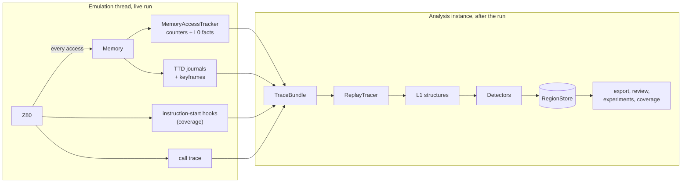
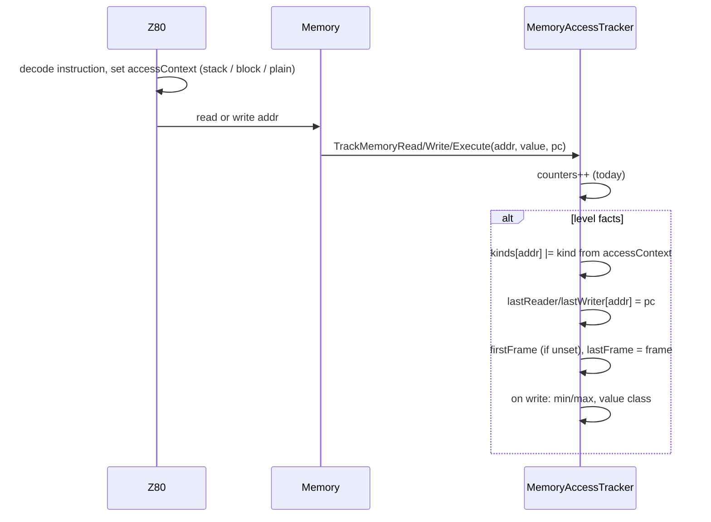
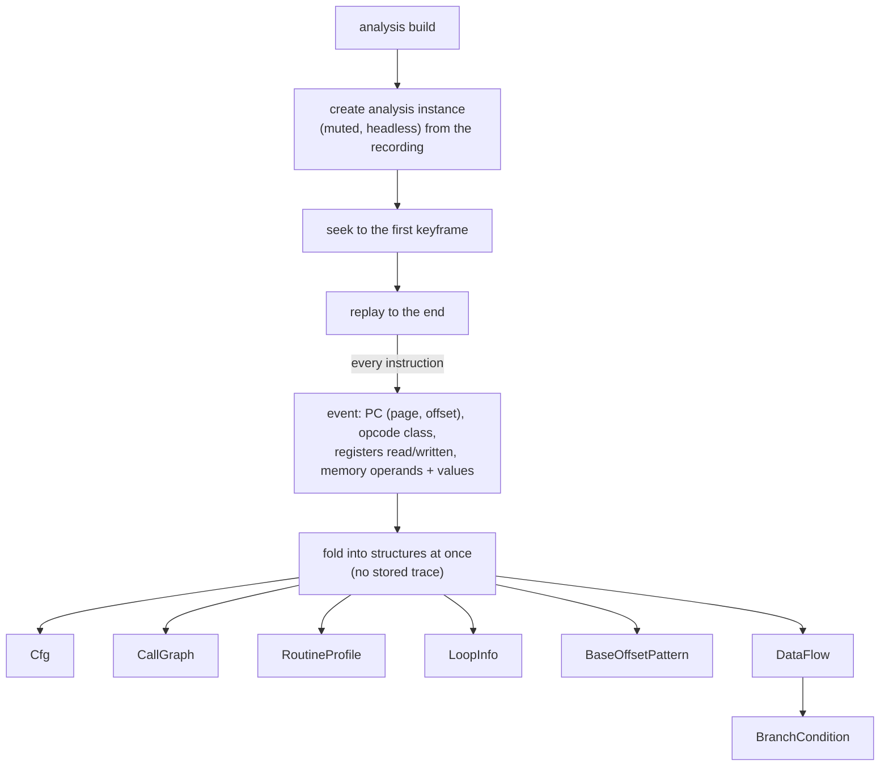
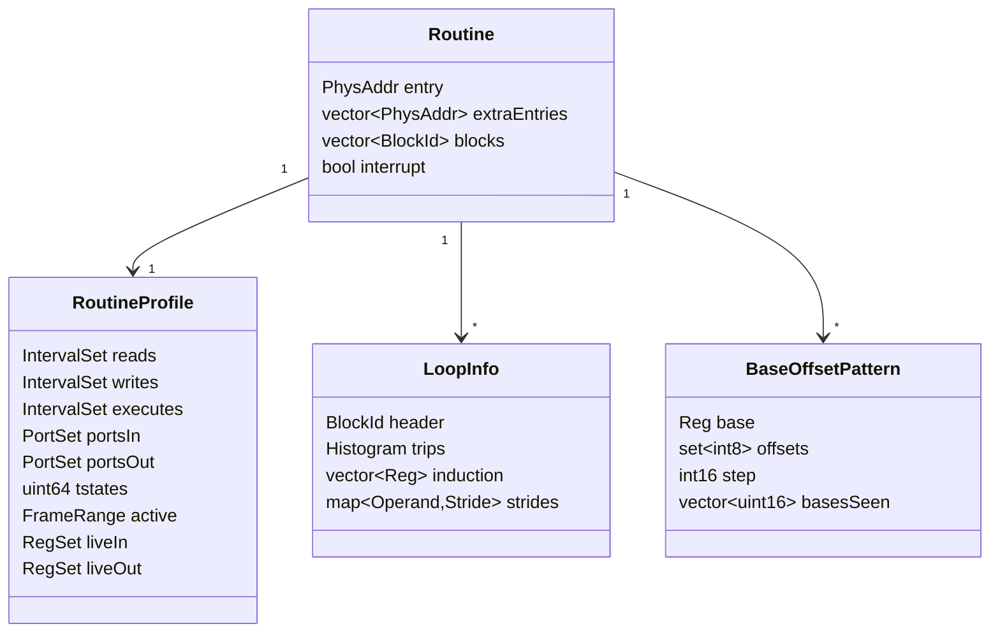
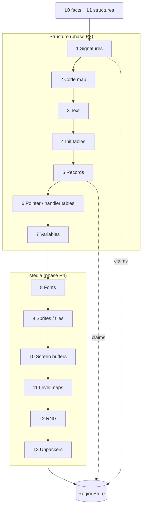
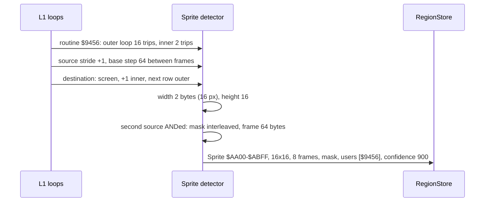
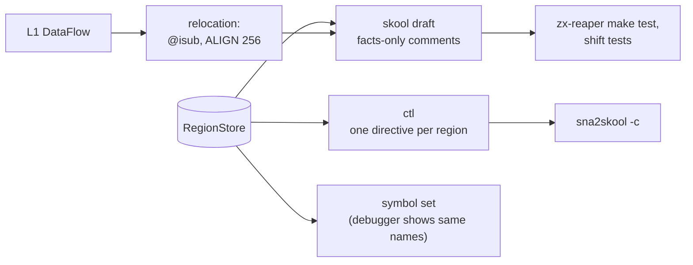
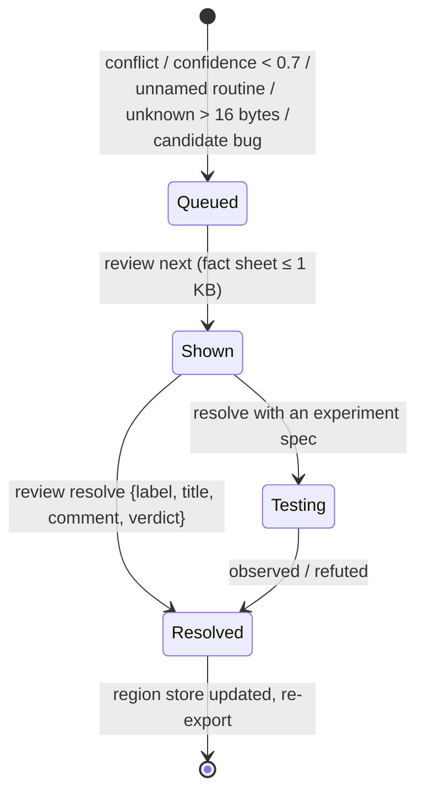
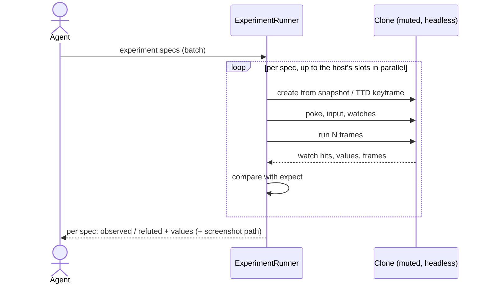
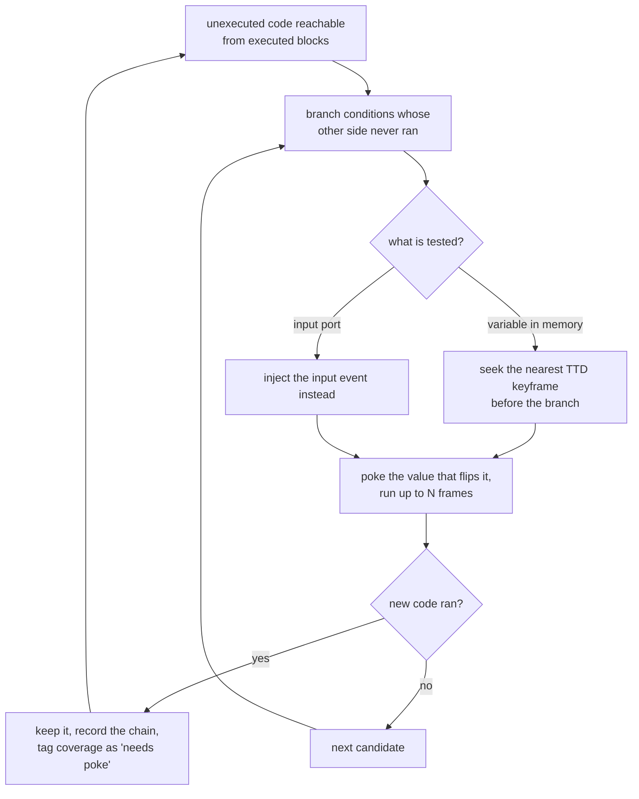

# Design: how each module is built

Companion to [README.md](README.md), which explains what each module gives and why. This file explains how it
works inside. The order follows the layers, bottom up.

## The one rule: heavy work happens in replay



During a live run, only L0 adds work, and only when it is switched on. Everything else runs on an **analysis
instance**: a muted, headless clone built from the TTD recording. A paused live instance can also serve.

A TTD replay is deterministic, so a tracer that watches every instruction during replay sees exactly what it
would have seen live. That is why L1 can afford per-instruction work.

---

## L0 Access facts

### Data

New arrays sit next to the existing counters in `MemoryAccessTracker`. They are allocated only at the new
tracker level `facts`. The existing levels are not changed.

| Array (one entry per Z80 address, 64 K) | Type | Size |
|------------------------------------------|------|-----:|
| access kinds | `uint8_t` bitmask | 64 KB |
| last reader PC, last writer PC | `uint16_t` each | 256 KB |
| first frame, last frame | `uint32_t` each | 512 KB |
| min value, max value written | `uint8_t` each | 128 KB |
| value class (how many distinct values, several readers, several writers) | `uint8_t` | 64 KB |

That is about 1 MB. In physical mode (128K and up) the same arrays exist per RAM page and are allocated when a
page is first touched; a 128K game touches 8-10 pages, about 0.5 MB.

```cpp
enum class AccessKind : uint8_t
{
    OpcodeFetch = 0x01,      // first byte of an instruction
    OperandFetch = 0x02,     // other bytes of an instruction
    DataRead = 0x04,
    DataWrite = 0x08,
    StackRead = 0x10,        // POP, RET, RETI, RETN, EX (SP)
    StackWrite = 0x20,       // PUSH, CALL, RST, interrupt
    BlockAccess = 0x40,      // LDI / LDIR / LDD / LDDR / CPI.. source or destination
    WrittenWhileCode = 0x80  // written after it was executed: self-modifying code
};
```

### How a byte gets its facts



- The caller PC is already a parameter of every `Track*` call. Today it is dropped unless the address is in a
  monitored region; at level `facts` it is stored.
- Stack and block accesses look like plain reads and writes to the memory code. The core has no predecoder and
  no instruction class (checked in P0, [memorytracker-p0.md](baselines/memorytracker-p0.md)), so the context is
  new: a 256-entry class table per prefix, read after `FetchM1` only at level `facts`, sets a one-byte access
  context (stack, block, plain). Interrupt and NMI acceptance push through `MemoryWrite` directly and set the
  stack context themselves. The tracker reads it with one load.
- An address that was executed and is later written gets `WrittenWhileCode`.

### Cost

Per access at level `facts`: one OR, two 16-bit stores, one or two 32-bit stores; writes add min / max and a
class update. All of it lands on cache lines next to the counters.

| Configuration | Budget |
|---------------|--------|
| tracker off | no change (A/A noise is about 1.8 %) |
| level `counters` (today) | baseline, measured in P0: 1.8-2.2x a turbo frame with the tracker off, of which the debug memory path is +46-79 % and the counters +19-35 % on top |
| level `facts` | at most 25 % slower than `counters` |

If the access context costs too much, the stack and block kinds move into the replay tracer, and L0 keeps only
fetch / operand / read / write.

### Interface

`analysis explain <addr>` answers from L0 alone in the first phase: kinds, last reader and writer, frames,
value range, plus today's counters and symbols. Later phases add the routine and the region claims.

---

## L1 Code behaviour

### TraceBundle

Everything one recording session produced, under one handle:
- the L0 facts;
- coverage;
- the call trace;
- the TTD recording (journals and keyframes).

The bundle is what the analysis instance replays and what the export cites as evidence.

### ReplayTracer



The tracer attaches to the instruction-start hook and the memory hooks of the analysis instance only. It folds
each event into the structures immediately, so memory stays bounded however long the recording is. This is the
access-pattern tracer of the font finder design, generalized to all detectors.

Target speed: at least 5x real time for a 48K game, so a 30-minute session builds in a few minutes and L2 on top
adds at most 10 s.

### The structures

**Cfg (control flow graph).** Basic blocks from instruction starts and branch outcomes; each edge has a count.
Indirect jumps (`JP (HL)`, `JP (IX)`) record every target they were seen to take.

**CallGraph.** Built from CALL, RST and RET, with the stack depth tracked so that:
- a `JP` to another routine's entry at the same depth is a tail call;
- `PUSH addr` followed by `RET` is a dispatch edge;
- interrupt entries are marked.

**Routine.** A routine is a set of blocks reachable from an entry point. An entry point is a CALL / RST target,
an interrupt vector, a table target, or a JP target entered from outside the current routine. The last case is
how the entry splits that agents proposed by hand ($8684, $8C83, $8B10 / $8B51 / $8B82, $8E5F) fall out.

**RoutineProfile.** Per routine:
- read, write and execute ranges, as merged intervals;
- ports in and out (from the bus analyzer's view);
- share of T-states, frames it was active;
- live-in and live-out registers.



**LoopInfo.** A back edge in the Cfg makes a loop. For each loop we keep:
- a histogram of trip counts;
- the registers that change by a constant per pass (induction);
- for every memory operand in the loop body, how far its address moves per pass (the stride).

Strides are what tell a sprite (source +1, destination +1 then next screen row) from a font (source +1,
destination +256) or a record walk (+7).

**BaseOffsetPattern.** Runs of `(IX+d)`, `(IY+d)` or `(HL)` with `INC HL` accesses: the base register, the set of
offsets used, the step of the base between iterations, and the base values seen. A constant step with several
fields is a record array.

**DataFlow (shallow on purpose).** Register definitions and uses inside a basic block, plus one hop to the
next block. It answers three questions:
1. Was an immediate later used as an address? `LD HL,nn` followed by `LD A,(HL)` means `nn` is an address
   (relocation needs `@isub` on it).
2. Is a constant compared with a value from memory? `LD A,(nn)` then `CP $2A` means `$2A` is a number, even
   though it would also be a valid address.
3. Is it a page table? `LD H,n / LD L,A / LD A,(HL)` means the table at `n*256` must stay 256-byte aligned.

One block plus one hop covers every case seen in Manic Miner and keeps the tracer linear in the trace length.

**BranchCondition.** For each conditional branch, DataFlow names what was tested: "at $8C12, `JR Z` depends on
`($80BC)` compared with 0; only the not-taken side ran". The coverage driver uses this.

### Paging

Every PC and address is stored as (physical page, offset). The Z80 address is derived when exporting, from the
paging seen at that moment; the call trace already keeps `banks[4]`, and the replay knows the paging at every
instruction. The same Z80 address in two pages is two routines.

---

## L2 Detectors

### Region store

```cpp
struct Region
{
    PhysRange range;               // physical identity; the Z80 view is derived
    RegionKind kind;               // Code, Text, Font, Sprite, Tile, Screen, Buffer, InitTable, RecordArray,
                                   // Variable, PointerTable, HandlerTable, RngState, MusicData, Packed,
                                   // LevelMap, Unused
    Geometry geometry;             // per kind: glyph w/h, sprite w/h/frames/stride/mask, record size/count/fields
    std::vector<RoutineId> users;  // routines that read or write it
    std::vector<Evidence> evidence;
    uint16_t confidence;           // fixed point 0..1000, identical on every compiler
    Status status;                 // Observed, Inferred
    DetectorId detector;
};
```

- Every region carries the evidence that produced it. A detector cannot emit a region without evidence.
- A byte may have several claims. Conflicts are kept and go to the review queue; nothing is resolved silently.
- Output order is fixed (sorted by address, then detector), so the same recording gives the same bytes on
  clang, gcc, MSVC and MinGW.

### Pipeline



Each detector reads the facts and the claims made so far, and adds its own. One file per detector under
`core/src/debugger/analyzers/analysis/detectors/`.

### Detector by detector

| Detector | Rule | Evidence it cites |
|----------|------|-------------------|
| **Signatures** | Masked byte patterns plus a check at the entry. A catalog with one file per family: ROM routines, AY / beeper players, packers. Matching reuses `MemorySearch` | pattern id, offset |
| **Code map** | Opcode and operand bytes are code; bytes only read or written are data; untouched bytes are unknown; code that gets written is self-modifying | L0 kinds |
| **Text** | Printable runs with a terminator (zero, bit 7, length byte), read by a routine that feeds a font or the ROM print path. Unread runs that parse as tokenized source lines become `Unused` with the decoded text | L0 readers, L1 users |
| **Init table** | Written by one routine in a short frame window, then only read. The content is checked against generators: screen row addresses, `x*n`, shifts, 8-bit sine, bit reverse | L0 frames and writer, content |
| **Records** | A base+offset pattern with a constant step. Size = step; count from the bases seen and the terminator test; each field gets the value range seen | L1 pattern |
| **Pointer / handler tables** | Word arrays whose values point into data or code regions and that an indirect use reads (`JP (HL)`, `LD E,(HL) / INC HL / LD D,(HL)`) | L1 indirect targets |
| **Variables** | Data bytes or words outside other regions. Role from use: INC / DEC only is a counter, two values a flag, used as an address a pointer, read as a pair a word | L0 ranges, L1 users |
| **Fonts** | The font finder methods: a loop of height 8 with source stride 1 and destination stride 256, glyph chosen by a character code | L1 loops |
| **Sprites / tiles** | A loop reads a source and writes the screen or a back buffer. Width = inner trips, height = outer trips, frame size = source step. A second source ANDed in is a mask | L1 loops |
| **Screen buffers** | A 6912, 6144, 4096 or 768-byte region copied (block or unrolled) to $4000 / $5800 | L1 copy routine |
| **Level maps** | A byte grid read by the routine that calls the tile drawer, with the grid width from its stride | L1 call graph, strides |
| **RNG** | `LD A,R`, reads of FRAMES or a seed, shift / XOR feedback on one byte or word | L1 opcode classes |
| **Unpackers** | A routine that writes N bytes from M < N source bytes once, after which the output is executed or read | L0 frames, L1 profile |

### Gallery

Graphics regions render to PNG: one image per region, captioned with geometry, users and address. The palette
and attribute code is the screen capture's.

### Example: how a sprite is found



---

## L3 Draft and review

### SkoolKit export



- **ctl.** One directive per region (`c`, `b`, `t`, `w`, `g`, `s`, `u`, `i`), sub-blocks for record fields.
  Titles come from kind and geometry ("16x16 sprites, 8 frames, used by $9456"). Labels come from signatures
  and roles; other routines get `sub_XXXX`.
- **skool draft.** The same, plus instruction comments that state only facts, such as "reads the 7-byte
  guardian record at IX (+0 attribute, +1/+2 attribute address)" or "loop 16 x 2 bytes".
- **Relocation.** `@isub` on each immediate that DataFlow saw used as an address, `ALIGN 256` before each page
  table, constants left as numbers. Checked by the zx-reaper shift tests at +$100 and +$101: a wrong `@isub`
  breaks them.
- **Comments.** Raw addresses that are entries become `#R$xxxx`; DEFB lines are split to the skool2asm width.
  This is the work of agents W and C.
- **Symbols.** The same names go out through the existing symbol codecs, including our skoolkit ones.

### Findings register

JSON lines, with a markdown view in zx-reaper's `findings.md` format. Each claim is a template filled from
detector evidence, for example:
- "$80BC: counter in $24..$3F, decremented by $8B70 once per main-loop pass, frames 120-5400";
- "$8000-$81FF: cavern buffer, filled by $8691 from the 1024-byte record selected by $8407".

Generated claims start as `observed` when the evidence is a direct observation and `inferred` otherwise.

### Review queue



A fact sheet holds at most 1 KB: a disassembly excerpt of up to 24 lines, the routine profile, the region
claims and related findings. The agent answers with a small JSON:

```json
{"label": "MoveGuardians", "title": "Move the horizontal guardians", "comment": "...", "verdict": "ok"}
```

A cap keeps the queue from flooding: past the cap, the remaining items collapse into one summary item.

### Experiment runner

The agent describes what it wants to know; the runner does the driving.

```json
{
  "id": "air-out",
  "from": "snapshot:cavern-start.z80",
  "poke": {"0x80BC": "0x24"},
  "input": [{"frame": 0, "release_all": true}],
  "frames": 300,
  "watch": [
    {"pc": "0x8C01", "as": "dies"},
    {"write": "0x8457", "as": "lives"}
  ],
  "expect": {"dies": "reached"}
}
```



- Each spec gets its own clone; the source instance is never touched.
- Parallelism is bounded by the host's slots (the same logic as `tools/build/slot.sh`).
- Specs are stored with the findings, so a re-run proves the whole register again.

### Directed coverage



Bounded by attempts per branch and total time. Coverage from poked runs is tagged, so the export can say
which code is reachable only by poking (zx-reaper does not track this).

### Candidate bugs

From variable ranges and record fields: a counter with no upper check before it is used as an index, a value
that wraps, an index past a table's end. They go to the review queue as candidates, never as verdicts.

---

## On every plane

| Plane | Shape |
|-------|-------|
| CLI | `analysis start [level] / stop / status / build / query <kind> [range] / explain <addr> / export <format> <path> / experiment <spec.json> / cover [budget] / review next / review resolve <json>` |
| REST | `/api/v1/emulator/{id}/analysis/...` with the same verbs; long operations (`build`, `cover`, `experiment`) return a job id |
| WebSocket | every route as a `call`; topics `analysis.progress`, `analysis.ready`, `analysis.experiment` |
| Python / Lua | `emu.analysis.query("sprite")` and so on, generated from the same command table |
| MCP | tool `analysis` with `action` = `status`, `build`, `query`, `explain`, `export`, `experiment`, `cover`, `review`. The `content[]` text carries a compact table; `structuredContent` the full regions |

Docs chain: `command-interface.md` → a module doc `docs/emulator/analysis/analysis-layers.md` → the plane docs →
a recipe `.recipe/analysis/analysis-layers.md` with the agent workflow from the README.

## Where the code lives

| Path | Content |
|------|---------|
| `core/src/emulator/memory/memoryaccesstracker.*` | L0 level and arrays |
| `core/src/debugger/analyzers/analysis/` | TraceBundle, ReplayTracer, L1 structures, RegionStore, `detectors/`, `signatures/`, export, review queue, experiment runner, coverage driver |
| `core/automation/*` | plane bindings |
| `core/tests/debugger/analyzers/analysis/` | unit and integration tests |
| `core/benchmarks/emulator/memory/`, `core/benchmarks/debugger/` | tracker and replay benchmarks |
| `tools/verification/analysis/` | reference scorer and A/B harness |

## What happens to the earlier designs

| Earlier design | Becomes |
|----------------|---------|
| `AnalysisCoordinator` (2026-01-14) | RegionStore plus the detector order |
| `BlockSegmenter` | the code map detector, offline |
| `FunctionDetector`, `LoopDetector` | Routine and LoopInfo in L1 |
| `InterruptAnalyzer` | the interrupt part of the L1 profile, its design kept |
| `RoutineClassifier` | routine classes from profiles and signatures |
| `AccessPatternTracer` (font finder) | ReplayTracer |
| font finder methods | the font detector |
| beam correlation | out of scope; may read the region store later |
