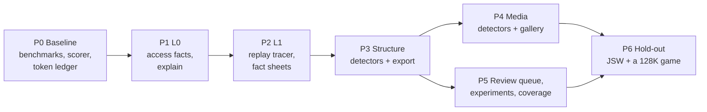

# Plan: order of work, tests, risks, open questions

Companion to [README.md](README.md) (why) and [design.md](design.md) (how).

## Order of work

| Phase | What lands | Done when |
|-------|-----------|-----------|
| **P0 Baseline** | tracker benchmark (off / `counters`); the reference scorer run on today's `sna2ctl -m` output for Manic Miner; run B's token ledger checked in | baseline numbers in the repo |
| **P1 L0 access facts** | level `facts`; `analysis start / stop / status / explain` on every plane; MCP `analysis` | L0 tests pass, `facts` ≤ 25 % over `counters`, MCP live block |
| **P2 L1 code behaviour** | TraceBundle, ReplayTracer, all L1 structures, `explain` for routines, fact sheets | L1 tests pass, replay ≥ 5x real time, same output on clang and gcc |
| **P3 Structure + export** | signatures (ROM first), code map, text, init tables, records, tables, variables; ctl / skool draft with relocation; symbols; `query` | Manic Miner: categories, entries and records match, the draft passes `make test` and both shift tests |
| **P4 Media** | fonts, sprites, tiles, screen buffers, level maps, RNG, unpackers, player signatures; gallery | Manic Miner: ≥ 90 % of the reference's graphics with the right geometry |
| **P5 Review** | findings register, review queue, experiment runner, directed coverage, candidate bugs; recipe | Manic Miner: ≤ 0.2 M subagent tokens, quality at least run B's |
| **P6 Hold-out** | Jet Set Willy and one 128K game through the whole pipeline, no detector tuning on them | the same targets on JSW; categories and graphics on the 128K game |

Every phase ends with a zero-warning build, its tests, the A/B benchmark where the hot path changed, MCP live
checks where a tool changed, and a new measurement with the scorer. gcc / MSVC / MinGW checks follow the usual
batched cadence.

P5's experiment runner and P3's export need only L0 and the existing coverage. They can be pulled forward (open
question 1).

## How we measure

Two tools in `tools/verification/analysis/`, neither needs an agent:

1. **Reference scorer** (`score_draft.py`): compares a draft ctl / skool with a skoolkid reference (mm.skool,
   jsw.skool).

| Measure | Target | Run A / B by hand |
|---------|--------|------------------|
| byte categories (code / data / text / unused) agree | ≥ 95 % | 90.8 % |
| code entry boundaries match | ≥ 32 of 34 on MM, ≥ 90 % on the hold-out | |
| record layouts (cavern, guardians, items, conveyor, Willy) | all 5 | all 5 |
| graphics found with the right geometry | ≥ 90 % | |

2. **A/B harness** (`run_ab.py`): runs the zx-reaper pipeline with a review-only brief on top of the draft, logs
   subagent tokens per step in the ledger format of run B, runs `make test` and the shift tests.

| Measure | Target |
|---------|--------|
| draft passes `make test` and shift tests +$100 / +$101 with no hand fixes | yes |
| subagent tokens for the RE part | ≤ 0.2 M on MM |
| names with the same meaning as the reference | ≥ 94 % |
| share of findings that are observed | ≥ run B's 87 / 93 |

## Tests

Tests come first. A detector lands with its fixture, a positive test, a negative test (same bytes, but no
matching use: no claim or confidence below 0.3) and a mutation that proves the evidence check matters. The usual
rules apply: about 10 ms per test, integration under 1 s, long variants behind `TestTier::Long()`, no
`sleep_for`.

### Fixtures

Small Z80 programs in `testdata/analysis/fixtures/`, assembled at test time with the in-repo assembler, run a
few frames on a 48K (or 128K) instance under TTD, then analyzed. Each has an `.expect.json` with the regions it
must produce.

| Fixture | Must produce |
|---------|--------------|
| `print-font.asm` | font (8x8, base, users), text with a bit-7 terminator, the print routine |
| `print-rst10.asm` | text printed through the ROM |
| `sprite-16x16.asm` | sprites 16x16, 4 frames, mask interleaved, the blit routine |
| `tiles-level.asm` | tiles, a 32x16 level map, a back buffer and its copy routine |
| `records-ix.asm`, `records-hl.asm` | record arrays of 7 and 5 bytes with fields |
| `jump-table.asm`, `push-ret.asm` | handler table and its 8 routines; a PUSH+RET dispatch edge |
| `page-table.asm` | a table that needs `ALIGN 256` |
| `init-rowtable.asm` | an init table of screen row addresses |
| `variables.asm` | a counter, a flag, a pointer, a word |
| `smc.asm` | self-modifying operand and its writer |
| `rng.asm`, `unpack-lz.asm`, `ay-pt3.asm` | RNG state; unpacker and unpacked code; music data via signature |
| `im2.asm`, `delay.asm` | interrupt profile; delay loops |
| `paged-128.asm` | two routines at the same Z80 address in different pages |
| `source-remnant.asm` | unused area with decoded source text |
| `address-vs-constant.asm` | `@isub` on the pointer only, not on `CP $2A` |

### What the tests cover

- **L0:** fetch vs operand, stack and block kinds, the self-modifying flag, last reader / writer, frames, value
  classes, separate facts per page, level `counters` unchanged (today's tracker tests pass as they are).
- **L1:** basic blocks, tail calls, indirect targets, loop trips and strides, base+offset, the three data flow
  cases, branch conditions, registers in / out, paging, and two replays giving byte-identical output.
- **L2:** one suite per detector over its fixtures; conflicts kept in the store; stable order; integer
  confidences.
- **L3:** ctl round trip through our skoolkit codec; `@isub` and ALIGN; `#R` rewriting; review queue selection
  and resolve; an experiment that is observed and one that is refuted; two experiments in parallel not
  touching each other or the source; the coverage driver flipping a branch with a poke, and using an input
  event for a key test.
- **Planes:** CLI / Python / Lua call the same handlers; REST and socket give the same answers; `*Mcp*` tests and
  a live block in `tools/verification/mcp/`.

### Mutations that must be caught

| Mutation | Caught by |
|----------|-----------|
| operand fetch counted as opcode fetch | L0 kinds test, code map tests |
| record detector ignores the base step | `records-ix` negative test |
| sprite width taken from the outer loop | `sprite-16x16` geometry |
| `@isub` on every immediate | `address-vs-constant` |
| detectors iterate an unordered map into the output | deterministic replay, stable order |
| experiment runner reuses the source instance | the parallel experiment test |

### Benchmarks

- Tracker frame benchmark on 48K, 128K and Pentagon game snapshots: off / `counters` / `facts`, interleaved
  rounds, both binaries at once.
- Replay benchmark: replay + L1 over a 5-minute 48K recording, and the L2 stage time.

## Risks

| Risk | What we do |
|------|-----------|
| Detectors fit Manic Miner and nothing else | JSW and a 128K game are hold-outs; each new rule lands with a fixture first |
| Review queue floods and eats the savings | threshold tuned on MM, then frozen; a cap with one summary item |
| Replay tracer too slow | 5x gate in P2; fold in place, no stored trace |
| `facts` slows recording too much | the level is opt-in; stack / block kinds move to replay if the budget fails |
| Address vs constant guessed wrong | the shift tests at +$100 / +$101 break on a wrong `@isub` |
| Experiment clones overload the machine | bounded pool on the build slot logic, muted headless clones |
| SkoolKit / zx-reaper formats drift | round trips through our codecs; zx-reaper's `make status` in the harness |
| Timing differs from SkoolKit's simulator (no contention: 3.4 vs 4.4 frames per MM loop) | timing facts come from unreal-ng and say so |

## Owner decisions (2026-10-25)

1. **Built in a worktree, landed when proven.** The whole design is implemented on a branch; it goes to master
   together, once the A/B harness shows the gain. github/master is merged into the branch regularly.
2. **Order: by layer.** P0 → P1 (L0) → P2 (L1) → P3 / P4 (L2) → P5 (L3) → P6, bottom up.
3. **One MCP tool, `analysis`.** Not `code_analysis`: the detectors find resources too (fonts, sprites, text,
   tables, music, levels). Code and resource actions share one namespace for now; calls are counted per action,
   and the split into separate tools (for example a resources tool) is decided from that distribution later.
4. **L3 lives in core**, on every plane. Only the reference scorer and the A/B harness are in
   `tools/verification/analysis/`.
5. **Games:** Manic Miner for tuning; Jet Set Willy (skoolkid reference) and one 128K game with paging and AY,
   chosen by us, as hold-outs.
6. **zx-reaper:** its gaps are fixed locally on branch `unreal-ng-fixes` of the clone
   (`/Volumes/TB4-4Tb/Projects/emulators/github/zx-reaper`, from upstream 379fdf3 of 2026-10-24), with no PR for
   now; the amount of change decides what to offer upstream at the end.
