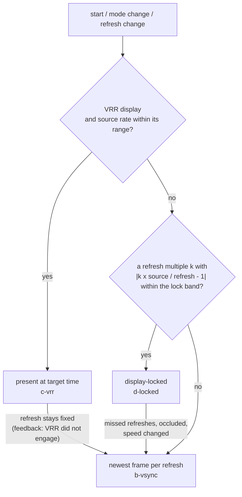
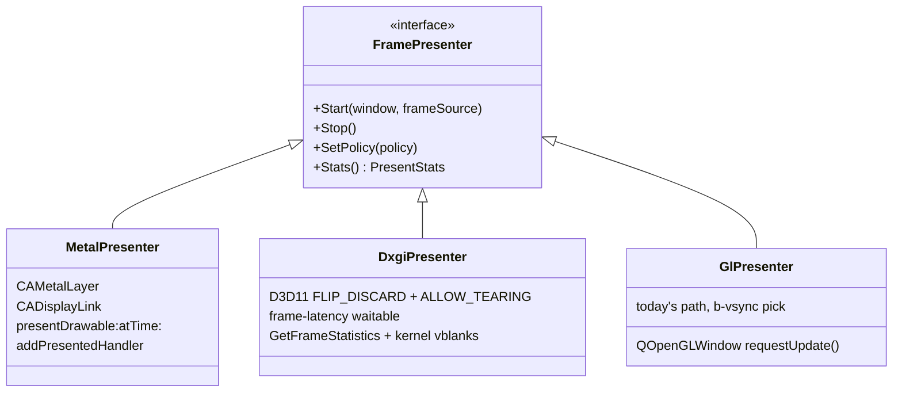

# Frame presenter: smooth video at the machine's own rate, with and without VRR

**Date:** 2026-10-26
**Status:** design; measured in [POC 037](../../../tools/poc/037-frame-presenter/README.md)
([results](../../../tools/poc/037-frame-presenter/results.md)): fixed 60 Hz (Mac), 144 Hz and G-Sync (Windows);
ProMotion is not measured yet (section 9).
**Related:** [A/V sync and presentation](../2026-08-14-av-sync-and-presentation/README.md) (the frame-end latch,
deadline pacing), [audio sync](../2026-08-17-audio-sync/audio-sync-design.md) (the DRC),
[input latency and Game Mode](../2026-09-24-core-performance/unreal-ng-input-latency-and-game-mode.md) (sections 6
and 8: the pacing options, the frontend options), [Steam Deck rendering](../2026-10-08-steamdeck-client/rendering.md)
(section 4: display-locked and core-clocked on the Deck).

## Contents

1. [The problem](#1-the-problem)
2. [What reaches the screen today](#2-what-reaches-the-screen-today)
3. [The model: every frame has a time](#3-the-model-every-frame-has-a-time)
4. [Three policies, chosen by the display](#4-three-policies-chosen-by-the-display)
5. [What "exceptionally smooth" takes](#5-what-exceptionally-smooth-takes)
6. [Architecture](#6-architecture)
7. [Cost](#7-cost)
8. [Plan](#8-plan)
9. [Open items](#9-open-items)

## 1. The problem

The emulated machines run at their own frame rates. The display runs at its own.

| Machine timing | T-states per frame | Clock | Frame rate |
|---|---|---|---|
| Pentagon | 71680 | 3.5 MHz | 48.828 Hz |
| ZX 48K / 128K / Scorpion | 69888 | 3.5 MHz | 50.080 Hz |
| ZX Next, 50 Hz 128K | 70908 | 28 MHz / 8 | 49.36 Hz |
| ZX Next, 60 Hz, VGA 0 / 1 / 2 clock | 60192 | 28.0 / 28.58 / 29.44 MHz / 8 | 58.15 / 59.36 / 61.13 Hz |

| Display | Refresh |
|---|---|
| Mac Studio, DELL U4320Q | fixed 60 Hz |
| MacBook Pro, ProMotion | adaptive, up to 120 Hz |
| Windows host, Dell AW3821DW, G-Sync | up to 144 Hz, variable |

On a fixed display, the screen can change a frame only at a refresh. When the rates differ, a frame stays on screen
for a whole number of refreshes, and that number beats. 50.08 Hz on 60 Hz shows 4 frames for one refresh and the fifth
for two. A scroller moving 4 pixels per frame moves 4, 4, 4, 4, 0 pixels per refresh. The eye sees that as judder.
It is arithmetic. No presenter removes it on a fixed 60 Hz display. Only three things do:

- a display that follows the source (VRR);
- a display mode at the source's rate (50 Hz on a TV, on the Steam Deck);
- running the machine at the display's rate. This is acceptable only when the two rates are close.

What a presenter can and must do is never make it **worse** than the arithmetic:

- no frame shown for a count outside floor / ceil of the refresh ratio;
- no frame skipped;
- no frame shown out of order;
- a constant delay from emulation to screen.

The delay must be constant because the audio has one, and A/V sync depends on both being constant.

## 2. What reaches the screen today

The path, from the emulation thread to the display:

1. `MainLoop` paces each frame with an absolute deadline (`TimeHelper::WaitUntilPrecise`).
2. At frame end, `Screen::LatchFramebuffer` copies the frame into one of 12 present slots.
3. Video is delayed by `_presentDelayFrames` (default 2, `[VIDEO] AVSyncDelayFrames`) so it lands with the audio.
4. `NC_VIDEO_FRAME_REFRESH` reaches `DeviceScreenGLWindow` (a `QOpenGLWindow`, swap interval 1), which calls `update()`.
5. Qt paints at its next opportunity. `paintGL` copies "the presented slot" and swaps.

Nothing ties the choice of frame to the refresh that will show it. The slot is chosen by counting frames, not by time.
GL gives no feedback on when a swap reached the screen.

What POC 037 measured for this pattern (the `a-signal` variant), against a presenter that picks the newest frame on
every refresh (`b-vsync`):

| Host | Pattern | Frames outside the beat pattern per minute | Note |
|---|---|---|---|
| Mac, 60 Hz, 50.08 Hz source | `a-signal` (Qt GL) | 0 | proxy timing (swap return), no screen time on GL |
| Mac, 60 Hz, 50.08 Hz source | `b-vsync` (CADisplayLink, Metal) | 0-3 | screen time from `MTLDrawable.presentedTime` |
| Windows, 144 Hz, 50.08 Hz source | `a-signal` (Qt GL) | 39 | screen time = the first kernel vblank after the swap |
| Windows, 144 Hz, 48.83 Hz source | `a-signal` (Qt GL) | 103 | ditto |
| Windows, 144 Hz, 50.08 Hz source | `b-vsync` (DXGI, waitable) | 11 | ditto |
| Windows, 144 Hz, 48.83 Hz source | `b-vsync` (DXGI, waitable) | 43 | ditto |

Today's path is not broken at 60 Hz. At high refresh rates it shows 2.4-3.6 times more frames for a wrong number of
refreshes than a refresh-driven presenter. The cause is that the frame shown is whichever one was latched when Qt got
around to painting. The bigger gap is elsewhere: today's path cannot use VRR at all. With G-Sync enabled for windows,
the GL window stayed at 144 Hz, while a native present-at-time in the same kind of window drove the panel at the
machine's rate. And today's path has no way to know what the screen did.

## 3. The model: every frame has a time

The core change is small. It is the base of everything else.

Each present slot carries:

| Field | Meaning |
|---|---|
| `serial` | the frame's number; never reset (exists: `_presentSlotSerial`) |
| `emulatedNs` | the emulated time at frame end (T-states / clock), rebased at a reset, a snapshot load or a speed change |
| `latchNs` | the host time of the latch (`steady_clock`; the same clock as the presenter's timestamps on every OS, section 6.3) |

The presenter computes each frame's **target time**:

```
target(n) = anchor + (emulatedNs(n) - emulatedNs(anchor frame)) / speed + D
```

- `anchor` is the host time of a reference latch. It is re-taken when the deadline in `MainLoop` re-anchors (pause,
  stall, speed change).
- `D` is the presentation delay, a time, not a frame count. It replaces `_presentDelayFrames`. Its default is the audio
  path's latency: the DRC ring target plus the device buffer, which today's default of 2 frames approximates. Video and
  audio then leave the emulator at the same emulated instant and reach the user at the same host instant. A/V offset
  becomes ~0 by construction, not by a frame count that only fits one machine rate.

Why the emulated clock and not `latchNs` alone: the latch time carries the scheduler's jitter (POC: p99 0.9-1.8 ms
under load on macOS). With latch-based targets, that jitter reaches the screen under VRR: the presents' interval
error was 1.2 ms p99, against 0.5 ms with targets on the source clock. The emulated time is exact. With the anchor taken from the same deadline `MainLoop` already
keeps, targets are as smooth as the emulated machine is. The latch time stays in the slot to check the deadline: a
frame latched after `target - margin` is late, and is counted.

Two operations then serve all policies:

- `FrameAt(t)`: the newest frame whose target is ≤ t (for a refresh at time t).
- `Next()`: the oldest frame not yet presented, with its target (for present-at-time).

## 4. Three policies, chosen by the display



### 4.1 VRR: present each frame at its target time (`c-vrr`)

Each frame is presented once, at `target(n)`. The display starts a refresh when the frame arrives. Every frame is on
screen for exactly one source period: no beat, no judder, the correct speed, the correct pitch.

- **macOS:** `[commandBuffer presentDrawable:drawable atTime:target]` on a `CAMetalLayer`. On a fixed 60 Hz display it
  degrades gracefully. The system shows the frame at the first refresh after `target`, which is the same beat pattern
  as `b-vsync` at the lowest latency of all measured variants (POC: 28 ms latch to screen, span = one refresh).
  `afterMinimumDuration:` is wrong for this: on 60 Hz it halved the rate to 30 fps.
- **Windows:** a flip-model swap chain (`FLIP_DISCARD`) created with `ALLOW_TEARING`, `Present(0,
  DXGI_PRESENT_ALLOW_TEARING)` at `target(n)` from a high-resolution waitable timer. That is the documented condition
  for VRR in a window. G-Sync also has to be enabled for windowed mode in the driver ("Set up G-SYNC": windowed and
  full screen); with the default (full screen only) the panel stays at its maximum rate.
  - Measured with G-Sync on (AW3821DW, RTX 4090): one refresh per frame at 48.9, 49.4, 50.1 and 61.3 Hz from a plain
    window.
  - Per-frame error with targets on the source clock: 0.05 ms p50 / 0.5 ms p99 at the present, 0.2-0.55 ms p50 /
    1.7-3.5 ms p99 on screen as the kernel's vblanks show it.
  - For comparison, the fixed-rate beat is 6.2-7.8 ms p99 at 144 Hz and 13.4 ms at 60 Hz.
- **Below the VRR floor** (Pentagon 48.83 Hz on a panel with a 48 Hz floor), the driver's low-framerate compensation
  repeats refreshes. The frame time stays exact.
- **Detecting VRR:**
  - macOS reports it: `NSScreen.minimumRefreshInterval` vs `maximumRefreshInterval`.
  - Windows has no API that says G-Sync is active for a window. The presenter verifies instead. In `c-vrr` it watches
    the display's refresh times (section 6.3). If they stay on the fixed grid, VRR did not engage, and the presenter
    falls back to `b-vsync` with a one-time note in the log.

### 4.2 Fixed display, close rates: display-locked (`d-locked`)

When `k x source rate` is within the lock band of the refresh rate (k = 1 for 61.13 Hz on 60; k = 2 for 50.08 Hz on
100 Hz), the display's refresh drives the emulation. Every k-th refresh ticks `MainLoop` instead of its own deadline.
Exactly one frame is shown per k refreshes. The cadence is perfect. The machine then runs at the display's rate, not
its own: Next VGA 2 runs 1.86 % slower on 60 Hz, and VGA 0 3.18 % faster.

Audio follows through the DRC. Its trim range has to cover the rate ratio. Today it is ±0.5 % (`DRC_MAX_TRIM`). In
this mode it widens to the lock band. Measured with the DRC model over the real display-link ticks:

| Source on 60 Hz | Machine speed | Ring error, trim ±0.5 % | Ring error, trim ±4 % |
|---|---|---|---|
| Next VGA 0, 58.15 Hz | +3.18 % | 480 ms (the ring runs away) | 1.4 ms |
| Next VGA 1, 59.36 Hz | +1.06 % | 102 ms | 6.4 ms |
| Next VGA 2, 61.13 Hz | -1.86 % | 247 ms | 1.4 ms |

The price is speed and pitch. 1.86 % is a third of a semitone; a trained ear hears it in a sustained tone. So:

- **Default lock band ±0.5 %**, inaudible. This covers 50.08 Hz on a 50 Hz mode (0.16 %) and 48.83 Hz on 49 Hz
  (0.35 %). It is the Steam Deck rule (rendering.md section 4). No Next 60 Hz timing is within it on a 60 Hz panel.
- **Opt-in up to ±4 %**, as the "Sync to display" setting. This covers Next 60 Hz on any 60 Hz panel.
- Leave the mode (back to `b-vsync`) on missed refreshes (more than 2 in 1 s), occlusion, a speed change, turbo, or the
  debugger stepping. The deadline clock takes over from the last tick without a jump.

### 4.3 Fixed display, other rates: the newest frame per refresh (`b-vsync`)

On every refresh at time `t`, present `FrameAt(t)`. That gives exactly the arithmetic beat pattern and nothing worse.
It fixes the Windows numbers of section 2, and it is the fallback of both other policies.

- **macOS:** a `CADisplayLink` (`[NSScreen displayLinkWithTarget:selector:]`, macOS 14+) and `presentDrawable:atTime:`
  of the link's target timestamp. Do not use `CAMetalDisplayLink` for this: its target was 3 refreshes ahead even with
  `preferredFrameLatency = 1`, 58-75 ms latch to screen against 42-58 ms for `CADisplayLink`.
- **Windows:** wait on the swap chain's frame-latency waitable object (maximum latency 1), then `Present(1, 0)`. The
  object is signalled once at the start and then once per present. Consume it only with a frame to present, or it
  never comes back: the POC lost a whole run to this.
- **GL fallback** (no native backend on the platform): `QOpenGLWindow` with `requestUpdate()` in a loop instead of
  `update()` on the signal, and `FrameAt(now + one refresh)` in `paintGL`.

## 5. What "exceptionally smooth" takes

The policies are half of it. The other half are the conditions that made the POC's measurements clean, each found by a
run that was not:

1. **Pick by time, never by count.** A frame-count delay is correct for one rate only. Section 3.
2. **Present from a thread of its own, not from the GUI thread.** The Qt GUI thread also runs the debugger, the memory
   viewer and the menus. Any of them can delay a paint past the refresh. The presenter thread owns the swap chain and
   wakes per refresh (`b`, `d`) or per frame (`c`). The GUI thread only resizes it.
3. **Precise sleeps on Windows.** MinGW's `std::this_thread::sleep_for` has a ~15.6 ms granularity. The POC's
   producer had a 24.6 ms p99 jitter until its sleep used a high-resolution waitable timer, as
   `TimeHelper::WaitUntilPrecise` already does. The presenter's present-at-time wait must use the same timer, and spin
   only the last ~0.5 ms.
4. **The emulation thread's real-time policy** stays as it is (`ThreadHelper::setRealtimePriority`). Under a load
   average of 40-90 on the Mac Studio, the producer's latch jitter stayed at 0.9-1.8 ms p99.
5. **Keep the display awake.**
   - On Windows, a monitor that went to sleep has no vblanks, and DWM then composes on a ~60 Hz timer. Every
     measurement on the 144 Hz host was wrong until the run woke it. The app sets
     `SetThreadExecutionState(ES_CONTINUOUS | ES_DISPLAY_REQUIRED)` while a machine runs unpaused.
   - On macOS the matching call is `beginActivityWithOptions:NSActivityLatencyCritical | NSActivityUserInitiated`, which
     also keeps App Nap away.
6. **Know when nobody sees the window.** An occluded window's presents are dropped (macOS `presentedTime` = 0; the
   window's `occlusionState`), and display links slow down. Emulation never paces from presents except in `d-locked`,
   and `d-locked` leaves on occlusion.
7. **Measure what the screen did, in production too.** The same feedback that verified the POC counts frames outside
   the beat pattern, late frames and dropped presents. The counts go to the automation planes (section 6.4), so a
   regression is visible, not felt.

## 6. Architecture

### 6.1 Core (`core/`)

- `Screen` present slots gain `emulatedNs` and `latchNs` next to `_presentSlotSerial`. Everything stays under
  `_presentMutex`, as today. The latch writes two more integers.
- `FrameClock` (new, `core/src/emulator/video/`): the anchor, the delay `D`, `target(n)`, re-anchoring on `MainLoop`'s
  events. It has no thread and no OS calls.
- `Screen::CopyFrameAt(t, dst, &info)` and `Screen::CopyNextFrame(dst, &info)` next to `CopyPresentedFramebuffer`.
  `info` holds the serial, the target and the geometry. They respect the temporal effects' slots (ZX DLSS) exactly as
  `PresentedSlotLocked` does today: a temporal effect adds its look-ahead to `D`.
- `MainLoop` gains an external tick source for `d-locked`: `SetFrameTick(callback)`. While one is set, the loop waits
  for the tick, bounded by the deadline plus a refresh, instead of the deadline alone.
- `SoundManager`: `DRC_MAX_TRIM` becomes a per-mode limit (±0.5 % default, the lock band in `d-locked`).

### 6.2 unreal-qt: the presenter



- The screen widget becomes a `QWindow` with a native surface: `QSurface::MetalSurface` on macOS, a plain HWND on
  Windows. It is embedded with `createWindowContainer` as today's GL window is. The presenter draws into it from its
  own thread.
  - POC: a Qt `QWindow` with the native presenter measured the same as an SDL3 window with the same presenter (Mac
    `c-vrr` 28.4 vs 28.1 ms p50; Windows `b-vsync` 10.3 vs 10.4 ms).
  - Qt therefore stays the shell. SDL3 has nothing to add here: `SDL_GPU` has no present-at-time and no presentation
    feedback, so the native presenter is needed under SDL3 too.
- The draw is what `DeviceScreenGLWindow::paintGL` does today: the texture upload, the integer or fit scaling, the
  shaders. It is ported to Metal and D3D11. The GL path stays as the fallback (Linux until a Vulkan presenter exists)
  and runs the `b-vsync` pick.
- The overlays now drawn by `DeviceScreenGLWindow` (OSD, HUD) move with it. They are textures composited in the same
  pass.
- Linux: a Vulkan presenter later. `VK_KHR_present_wait` / `VK_GOOGLE_display_timing` where the compositor offers them,
  `wp_presentation` on Wayland. The Steam Deck client has its own presenter (rendering.md) and shares `FrameClock`.

### 6.3 Timing feedback per OS

| OS | Screen time of a present | Refresh times | Clock |
|---|---|---|---|
| macOS | `MTLDrawable.presentedTime` (0 = dropped) | the display link's timestamps | `CACurrentMediaTime` = `mach_absolute_time` = `CLOCK_UPTIME_RAW` = `steady_clock` |
| Windows, independent flip / fullscreen | `GetFrameStatistics`: `PresentCount` -> `SyncQPCTime` on a fixed refresh; under VRR `SyncQPCTime` is the start of the vblank the flip ended (before the present), so the kernel's vblank is used there too | ditto | QPC = `steady_clock` |
| Windows, composed (DWM) window | none: `GetFrameStatistics` succeeds with all zeros | `D3DKMTWaitForVerticalBlankEvent` on the monitor's adapter, on a thread; the first vblank after the present (a lower bound: DWM may add a refresh) | QPC |

`IDXGIOutput::WaitForVBlank` returns at once in a window. `DwmGetCompositionTimingInfo`'s `qpcVBlank` had gaps of
up to 166 ms (p99), and it ran on a ~60 Hz timer while the monitor slept. Neither works for this.

### 6.4 Settings and automation planes

- `[VIDEO] PresentPolicy = auto | vrr | locked | vsync`. `auto` is the flowchart of section 4.
- `[VIDEO] PresentDelayMs = auto | <ms>`. `auto` = the audio path's latency. It replaces `AVSyncDelayFrames`; the old
  key is read once and converted.
- `[VIDEO] DisplayLockBand = 0.5` (percent; up to 4).
- Per the automation-planes guidelines, every plane gets the same:
  - CLI, Python, Lua, MCP, REST and WebSocket: read and set the policy and the delay;
  - read `PresentStats`: the policy in effect, the display's refresh and VRR state, frames shown outside the beat
    pattern, late, dropped, the latch-to-screen p50 / p99;
  - WebSocket: a topic for policy changes (VRR fell back, lock entered or left).
  - Reads never touch the emulation thread: the presenter publishes `PresentStats` once a second.

## 7. Cost

Measured in POC 037 unless marked. The POC's frames are 384x288x4 bytes, a little larger than the emulator's
352x288.

| Item | Cost |
|---|---|
| Core, per frame | two more integers per latch under the existing mutex; `FrameClock` math per present: nanoseconds |
| Copy per present | one frame copy (~40 µs, as `CopyPresentedFramebuffer` today); on a refresh that repeats a frame, nothing (the presenter keeps the uploaded texture and compares serials) |
| Presenter CPU per present, macOS Metal | 0.15-0.22 ms on the presenter thread (upload, encode, present), Mac Studio M1 Ultra |
| Today's Qt GL path, for comparison | 0.48-0.52 ms per paint, on the GUI thread |
| Presenter CPU, Windows | not resolved: `GetThreadTimes` has a 15.6 ms granularity there; the next runs use `QueryThreadCycleTime` |
| Threads | one presenter thread per emulator window, waking at the refresh rate (`b`, `d`: 60-144 per second) or the frame rate (`c`: ~50 per second); one vblank-watch thread per window on Windows |
| Memory | the native swap chain (2-3 back buffers at the window size) replaces the GL default framebuffer; no change in the core's slots |
| Latency, latch to screen | `c-vrr`: `D` exactly (POC with D = one period: 28 ms on the Mac at 60 Hz; on Windows under G-Sync 27.4-28.8 ms to the end of scan-out, i.e. D + 6.9 ms of scan-out); `b-vsync`: `D` + up to one refresh (Mac `CADisplayLink`: 42-58 ms; Windows DXGI: 10.4 ms); `d-locked` on macOS: 33-66 ms today (the display link's pipeline depth; section 9) |
| A/V | with `D` = the audio latency, the offset is ~0 for every machine rate, not only 50 Hz |
| Speed and pitch | unchanged, except `d-locked` (by design, within the lock band) |

## 8. Plan

Each phase lands on its own with tests and docs.

1. **Core timing.** Slot times, `FrameClock`, `CopyFrameAt` / `CopyNextFrame`, `PresentDelayMs` with the
   `AVSyncDelayFrames` conversion. Unit tests on synthetic latch sequences (rates 48.83-61.13, re-anchor on pause and
   speed change, ZX DLSS delay). No visible change.
2. **The GL path picks by time.** `GlPresenter` = today's window with `requestUpdate()` and `FrameAt`. This is the
   first visible gain (Windows high refresh), and it is the fallback for everything after.
3. **Metal presenter** (macOS): `b-vsync` and `c-vrr`, `presentedTime` stats, occlusion, `beginActivity`.
4. **DXGI presenter** (Windows): `b-vsync` and `c-vrr`, the waitable object, the vblank watch, VRR verification and
   fallback, `ES_DISPLAY_REQUIRED`.
5. **Display-locked.** `MainLoop` tick source, the DRC per-mode limit, entry and exit rules, the lock band setting.
6. **Automation planes.** Settings and `PresentStats` on CLI, Python, Lua, MCP, REST and WebSocket; docs chain per the
   guidelines.
7. Later: Vulkan / Wayland presenter; late input sampling in `c-vrr` and `d-locked` (input-latency doc option B,
   nearly free once frames have target times).

## 9. Open items

- **The on-screen tail under G-Sync** (p99 1.7-3.5 ms against 0.5 ms at the present) is either the kernel's vblank
  event delivery or the panel. A time-critical measuring thread did not shrink it. An optical measurement (photodiode
  or a high-speed camera) would separate them. It does not change the design.
- **G-Sync needs the windowed setting.** Most users have the driver default (full screen only). The app cannot change
  it, but it can see it: in `c-vrr` the refresh stays on the fixed grid. Then it falls back to `b-vsync` and says so in
  the stats, with a hint where to enable it.
- **ProMotion is not measured** (the MacBook Pro was not available to the POC). Apple's documentation for display
  links speaks of frame rates that divide the panel's maximum (120, 60, 40, 30, 24 Hz); whether
  `presentDrawable:atTime:` gets arbitrary intervals (20 ms for 50 Hz) on the built-in panel is exactly what the
  measurement has to show. If it does not, `c-vrr` there behaves like `b-vsync` at 120 Hz (a frame for 2 or 3
  refreshes: 16.7 / 25 ms against 20 ms). That is still smoother than 60 Hz.
- **`d-locked` latency on macOS** is 2-4 refreshes through both display links. The frame ticked at refresh N is
  presented for N + 2 or later. Presenting at the link's own target timestamp with a shorter drawable queue
  (`maximumDrawableCount = 2`) is the next thing to try.
- **The owner's call:** whether `d-locked` beyond ±0.5 % is offered at all (speed and pitch change), and whether
  `auto` may enter it by itself.
