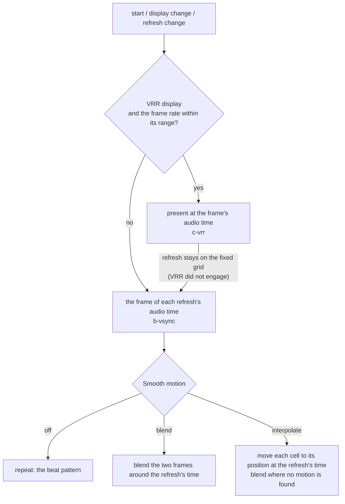
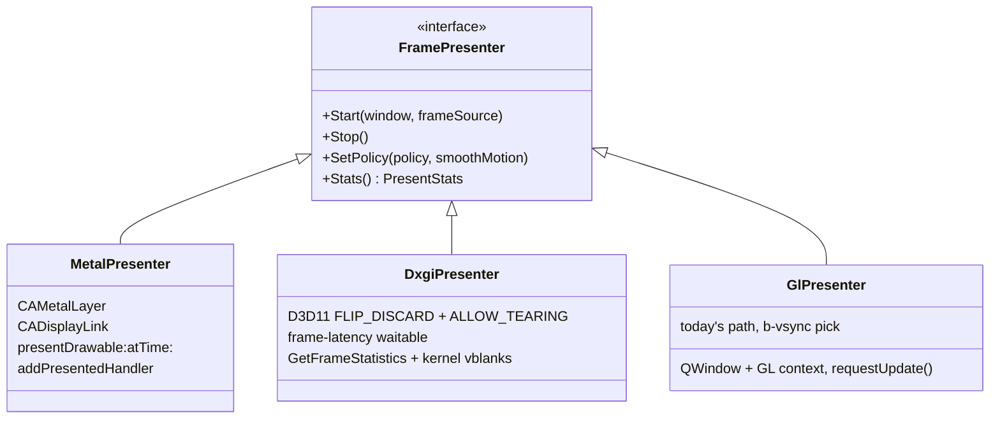

# Frame presenter: video timed by the sound, with and without VRR

**Date:** 2026-10-26
**Status:** implemented on the `frame-presenter` branch: phases 1-8 of section 8 (the audio-timed frames, the GL,
Metal and DXGI presenters, smooth motion on CPU and GPU, the automation planes, the display rate switch, Video
Synchronization), plus the recovery from a GPU reset; not on master yet. Measured in
[POC 037](../../../tools/poc/037-frame-presenter/README.md)
([results](../../../tools/poc/037-frame-presenter/results.md)): fixed 60 Hz (Mac), 144 Hz and G-Sync (Windows);
ProMotion on macOS 12: the 120 Hz grid only (section 9).
**Owner decisions (2026-10-26):**
- Sync is held by the sound. The audio device is the master clock; the display never paces the emulation and never
  changes its speed or the pitch.
- On a fixed display the default is the frame repeat; frame blending is an option.
- Smooth motion without judder (blending and motion-compensated interpolation) is built right after the VRR path is
  stable, not deferred. It is the presenter's own stage: ZX DLSS is for gigascreen and stays separate.
- The work stays on the `frame-presenter` branch until all phases are done; master gets it in one piece.
- Smoothing never adds latency. A game's own picture cadence (a picture every 2nd-5th frame) comes from its game
  profile, with the profile tools of the controller manager (section 4.5), not from guessing at run time.
- Every effect (blend, interpolation, the cadence modes) runs on the GPU and on the CPU, chosen by the mode, on every
  platform, with the same result (section 6.5).

**Related:** [audio sync](../2026-08-17-audio-sync/audio-sync-design.md) (the DRC; "the audio device is the only master
clock"), [A/V sync and presentation](../2026-08-14-av-sync-and-presentation/README.md) (the frame-end latch),
[input latency and Game Mode](../2026-09-24-core-performance/unreal-ng-input-latency-and-game-mode.md) (sections 6
and 8), [Steam Deck rendering](../2026-10-08-steamdeck-client/rendering.md) (section 4).

## Contents

1. [The problem](#1-the-problem)
2. [What reaches the screen today](#2-what-reaches-the-screen-today)
3. [The model: every frame has the time its sound plays](#3-the-model-every-frame-has-the-time-its-sound-plays)
4. [Two policies, chosen by the display](#4-two-policies-chosen-by-the-display)
5. [What "exceptionally smooth" takes](#5-what-exceptionally-smooth-takes)
6. [Architecture](#6-architecture)
7. [Cost](#7-cost)
8. [Plan](#8-plan)
9. [Open items](#9-open-items)

## 1. The problem

The emulated machines run at their own frame rates. The display runs at its own.

| Machine timing | T-states per frame | Clock | Frame rate |
|---|---|---|---|
| Pentagon | 71680 | 3.5 MHz | 48.828 Hz |
| ZX 48K / 128K / Scorpion | 69888 | 3.5 MHz | 50.080 Hz |
| ZX Next, 50 Hz 128K | 70908 | 28 MHz / 8 | 49.36 Hz |
| ZX Next, 60 Hz, VGA 0 / 1 / 2 clock | 60192 | 28.0 / 28.58 / 29.44 MHz / 8 | 58.15 / 59.36 / 61.13 Hz |

| Display | Refresh |
|---|---|
| Mac Studio, DELL U4320Q | fixed 60 Hz |
| MacBook Pro, ProMotion | adaptive, up to 120 Hz |
| Windows host, Dell AW3821DW, G-Sync | up to 144 Hz, variable |

On a fixed display, the screen can change a frame only at a refresh. When the rates differ, a frame stays on screen
for a whole number of refreshes, and that number beats. 50.08 Hz on 60 Hz shows 4 frames for one refresh and the fifth
for two. A scroller moving 4 pixels per frame moves 4, 4, 4, 4, 0 pixels per refresh. The eye sees that as judder.
It is arithmetic.

The sound decides the time (owner decision). So the machine is never sped up or slowed down to fit the display. That
leaves two cases:

- **The display can follow the sound (VRR).** Every frame is shown when its sound plays, for exactly its period. No
  judder.
- **It cannot (a fixed refresh).** The beat stays. The presenter keeps it at the arithmetic minimum, and on request
  hides it by blending neighbouring frames (section 4.3).

In both cases the presenter never makes it worse than the arithmetic:

- no frame shown for a count outside floor / ceil of the refresh ratio;
- no frame skipped;
- no frame shown out of order;
- every frame on screen at the time its sound plays.

## 2. What reaches the screen today

The path, from the emulation thread to the display:

1. `MainLoop` paces each frame with an absolute deadline (`TimeHelper::WaitUntilPrecise`).
2. The DRC keeps the audio ring at 40 ms (`DRC_TARGET_MS`) by trimming the resampler within ±0.5 %.
3. At frame end, `Screen::LatchFramebuffer` copies the frame into one of 12 present slots.
4. Video is delayed by `_presentDelayFrames` (default 2, `[VIDEO] AVSyncDelayFrames`) so it lands with the audio.
5. `NC_VIDEO_FRAME_REFRESH` reaches `DeviceScreenGLWindow` (a `QOpenGLWindow`, swap interval 1), which calls `update()`.
6. Qt paints at its next opportunity. `paintGL` copies "the presented slot" and swaps.

Nothing ties the choice of frame to the refresh that will show it. The slot is chosen by counting frames, not by time.
Two frames of delay match the audio only at about 50 Hz. GL gives no feedback on when a swap reached the screen.

What POC 037 measured for this pattern (`a-signal`) against a presenter that picks the newest frame on every refresh
(`b-vsync`):

| Host | Pattern | Frames outside the beat pattern per minute | Note |
|---|---|---|---|
| Mac, 60 Hz, 50.08 Hz source | `a-signal` (Qt GL) | 0 | proxy timing (swap return), no screen time on GL |
| Mac, 60 Hz, 50.08 Hz source | `b-vsync` (CADisplayLink, Metal) | 0-3 | screen time from `MTLDrawable.presentedTime` |
| Windows, 144 Hz, 50.08 Hz source | `a-signal` (Qt GL) | 39 | screen time = the first kernel vblank after the swap |
| Windows, 144 Hz, 48.83 Hz source | `a-signal` (Qt GL) | 103 | ditto |
| Windows, 144 Hz, 50.08 Hz source | `b-vsync` (DXGI, waitable) | 11 | ditto |
| Windows, 144 Hz, 48.83 Hz source | `b-vsync` (DXGI, waitable) | 43 | ditto |

Today's path is not broken at 60 Hz. At high refresh rates it shows 2.4-3.6 times more frames for a wrong number of
refreshes than a refresh-driven presenter. The cause is that the frame shown is whichever one was latched when Qt got
around to painting.

The bigger gap is VRR: today's path cannot use it at all. With G-Sync enabled for windows, the GL window stayed at
144 Hz, while a native present-at-time in the same kind of window drove the panel at the machine's rate. And today's
path has no way to know what the screen did.

## 3. The model: every frame has the time its sound plays

The sound already has a precise clock: the audio device consumes samples at its crystal's rate, and the DRC keeps the
ring at its target. The frame's picture should reach the screen when the frame's sound reaches the speaker. So the
frame's time is read off the audio path, not set by a frame count.

**What the audio path records** (`AudioClock` in `core/src/common/sound/audioclock.h`, a member of
`AudioDeviceDescriptor`):

- The ring counts its stream: every sample written, every sample removed (played, discarded by a hard resync, dropped
  by a clear). After each enqueue the frontend publishes the write position (`streamWritten`).
- At each frame end, `W(n)`: where frame n's sound ends in that stream. `SoundManager::takeFrameAudioEnd` reads it
  after the frame's sound was delivered, plus the frames the ZX DLSS delay line still holds back.
- In each device callback, a pair: the device position (frames the device asked for so far) and the callback's host
  time. The device's output latency (period size x periods + the OS's latency, 11.6 ms today) is added, so the pair
  says when that sample is heard.
- A line through these pairs: host time = a + b x device position. It is an exponentially weighted least-squares fit
  (~256 callbacks, 1.5-2.5 s), O(1) per callback in the device thread, published through a sequence lock. `b` is the
  device's real sample period in host time, crystal error included. The callback times jitter by milliseconds; the
  fit's line does not.
- The stream maps onto the device position by one offset, taken at every callback that finds data. An underrun (the
  device played silence) or a discard moves it, and every later sample with it.

**The frame's target time:**

```
target(n) = a + b x W(n) + offset
```

- `offset` is the user's lip-sync trim, 0 by default. There is no configured video delay any more: the delay comes
  out of the audio path. The ring target (40 ms) and the device buffer (11.6 ms) put video at about latch + 52 ms
  today, and the same holds at every machine rate.
- Temporal effects (ZX DLSS, the gigascreen mixer) need their look-ahead before the target. They do not move the
  target. If an effect needs more time than the audio delay leaves, the audio delay grows by that much (the DRC
  target).
- **A delay longer than the screen holds frames** (12 present slots): a sound heard more than 9 frames after its
  frame's end (a Bluetooth headset at 200-300 ms, a large lip-sync trim) cannot be waited for, the frame would be
  overwritten first. The target is held at 9 frames after the frame's end (`Screen::kMaxVideoDelayFrames`), so the
  frames keep their cadence and the picture leads its sound by the rest; the present report's
  `timing.delay_clamped` and `video.present`'s `delay.clamped` say so.
- **Without a running audio device** (no device, another instance has the sound, a held output) the emulated clock
  stands in: the frame's end is `MainLoop`'s frame deadline, plus one period of delay (or the ZX DLSS look-ahead). In
  turbo the latch time is used. Muting through the mixer does not stop the device, so the audio clock stays.
- **Switching clocks does not jump** (`FrameClock`, `core/src/emulator/video/frameclock.h`). A step of more than 2 ms
  against the cadence (the device appears or goes, an underrun moves the stream) is carried: that frame keeps the
  cadence, and the carry is paid back by 0.2 ms per frame (1 % of a period). A break in the sequence (latches more
  than 4 periods apart: a pause, a seek, a stall), turbo, or a step of more than 500 ms cuts to the new time at once.
  Targets never go back: each is at least half a period after the last.

Why this gives smooth targets: consecutive frames differ by their sample count, `b x (W(n+1) - W(n))`. That is the
machine's frame period, changed by the DRC trim. The trim moves slowly and stays within ±0.5 %, so neighbouring
frames differ by at most ~0.1 ms. The POC shows what the alternative costs: targets from the latch time carried its
scheduler jitter to the screen (present interval error 1.2 ms p99), and targets on a steady clock cut it to 0.5 ms.

Two operations serve all policies:

- `Screen::CopyFrameAt(t)`: the newest frame whose target is ≤ t, and the next one with the blend weight (for a
  refresh at time t).
- `Screen::CopyNextFrame(serial)`: the oldest frame after the one last presented, with its target (for
  present-at-time).

A frame latched but not timed yet (between the latch and its frame end's stamp, `Screen::StampPresentTiming`) is never
served. A screen no `MainLoop` stamps serves frames by their latch time.

The latch time stays in the slot to check the deadline: a frame latched later than `target - margin` is late, and is
counted.

## 4. Two policies, chosen by the display



### 4.1 VRR: present each frame at its audio time (`c-vrr`)

Each frame is presented once, at `target(n)`. The display starts a refresh when the frame arrives. Every frame is on
screen for exactly its period, in step with its sound: no judder, no speed or pitch change.

- **macOS:** `[commandBuffer presentDrawable:drawable atTime:target]` on a `CAMetalLayer`.
  - On a fixed 60 Hz display it degrades gracefully. The system shows the frame at the first refresh after `target`.
    That is the same beat pattern as `b-vsync`, at the lowest latency of all measured variants (POC: 28 ms latch to
    screen, span = one refresh).
  - `afterMinimumDuration:` is wrong for this: on 60 Hz it halved the rate to 30 fps.
- **Windows:** a flip-model swap chain (`FLIP_DISCARD`) created with `ALLOW_TEARING`, then `Present(0,
  DXGI_PRESENT_ALLOW_TEARING)` at `target(n)` from a high-resolution waitable timer. That is the documented condition
  for VRR in a window.
  - G-Sync also has to be enabled for windowed mode in the driver ("Set up G-SYNC": windowed and full screen). With
    the default (full screen only) the panel stays at its maximum rate.
  - Measured with G-Sync on (AW3821DW, RTX 4090): one refresh per frame at 48.9, 49.4, 50.1 and 61.3 Hz from a plain
    window.
  - Per-frame error with targets on a steady clock: 0.05 ms p50 / 0.5 ms p99 at the present; 0.2-0.55 ms p50 /
    1.7-3.5 ms p99 on screen as the kernel's vblanks show it. For comparison, the fixed-rate beat is 6.2-7.8 ms p99 at
    144 Hz and 13.4 ms at 60 Hz.
- **Below the VRR floor** (Pentagon 48.83 Hz on a panel with a 48 Hz floor), the driver's low-framerate compensation
  repeats refreshes. The frame time stays exact.
- **Detecting VRR:**
  - macOS reports it: `NSScreen.minimumRefreshInterval` vs `maximumRefreshInterval`.
  - Windows has no API that says G-Sync is active for a window. The presenter verifies instead: in `c-vrr` it watches
    the display's refresh times (section 6.3). If they stay on the fixed grid, VRR did not engage. The presenter then
    falls back to `b-vsync` and reports it in the stats.

### 4.2 Fixed display: the frame of each refresh's audio time (`b-vsync`)

On every refresh, the presenter takes the time `t` the refresh will reach the screen, and presents `FrameAt(t)`. That
gives exactly the arithmetic beat pattern, and every frame is on screen within one refresh of its sound. It fixes the
Windows numbers of section 2, and it is the fallback of `c-vrr`.

- **macOS:** a `CADisplayLink` (`[NSScreen displayLinkWithTarget:selector:]`, macOS 14+) and `presentDrawable:atTime:`
  of the link's target timestamp. Do not use `CAMetalDisplayLink` for this: its target was 3 refreshes ahead even with
  `preferredFrameLatency = 1`, 58-75 ms latch to screen against 42-58 ms for `CADisplayLink`.
- **Windows:** wait on the swap chain's frame-latency waitable object (maximum latency 1), then `Present(1, 0)`.
  - The object is signalled once at the start and then once per present. Consume it only with a frame to present, or
    it never comes back: the POC lost a whole run to this.
  - The refresh's time is the next vblank plus the swap chain's depth.
- **GL fallback** (no native backend on the platform): `QOpenGLWindow` with `requestUpdate()` in a loop instead of
  `update()` on the signal, and `FrameAt(now + one refresh)` in `paintGL`.

On a fixed 120 or 144 Hz display the beat's step is one refresh, 8.3 or 6.9 ms. Few people see it. On 60 Hz it is
16.7 ms, a visible hitch in every scroller. The real remedies there are a VRR display or a 50 Hz display mode. The
presenter can name both in a one-time hint when it sees a 60 Hz display and a 50 Hz machine.

### 4.3 Fixed display, optional: blending (`Smooth motion`)

For a refresh at `t` between the targets of frames A and B, the presenter shows a mix of the two:

```
w = (t - target(A)) / (target(B) - target(A))      # 0..1
pixel = (1 - w) x A + w x B
```

The scroller then moves on every refresh, in steps that follow the time. It trades the hitch for softness: during
motion, pixel art shows a semi-transparent double edge, and a FLASH attribute's swap fades over one refresh instead
of switching.

- **No extra latency.** Frame B has to exist at time `t`. Targets sit about 52 ms after their latch (the audio delay,
  section 3), and B's target is less than one period after `t`. So B was latched more than 30 ms before it is needed.
  Blending works whenever the audio delay is more than one period plus the draw.
- **Cost:** one more texture (frame B) and a two-texture fragment shader, about the cost of today's draw.
- **Default off** (owner decision). It is a setting (`SmoothMotion = blend`), mostly useful on 60 Hz displays.
- Where frames are identical (static screens) the mix changes nothing.

### 4.4 Fixed display, optional: motion-compensated interpolation

Blending shows two positions of a moving object at once. Interpolation instead draws the object at the position it
has at the refresh's time: the scroller moves 4 x w pixels, not two half-bright copies.

- **Motion from the frames.** ZX graphics move in whole pixels or attribute cells, on a black or flat background,
  often whole-screen (scrollers) or in a few sprites. The search runs on the presented framebuffer (RGBA, exact
  colours), so it serves every machine, not only the ZX bitmap. `MotionField` (`smoothmotion.h`) estimates one vector
  per 8 x 8 block between consecutive frames: the vectors within ±8 px (`kRangeFrames`) nearest first, scored by the
  pixels where A warped back and B warped forward to the middle disagree; the first with the fewest, at most
  `kAccept` = 16 of 64, wins (a quarter: content that changes shape as it moves, water or spinning dots, keeps its
  motion). Two refinement passes then try zero, the field's four most common vectors and the eight neighbours': on a
  flat or periodic area many vectors agree, and the common motion wins over the nearest.
- **Layers: per pixel, decided per block** (`LayerFlow`, `smoothlayers.{h,cpp}`, built and tuned in
  [POC 047](../../../tools/poc/047-smoothing-filters/README.md)). The in-between picture uses three frames, the one
  before A (`p`), A and B, and two fields (p -> A and A -> B). A layer is a vector: zero, the vectors several blocks of
  both fields share (`kCommon` = 8), and per block those of the 3 x 3 blocks round it. At a pixel and the weight `w`,
  a vector `v` samples A at `x - w v` and B at `x - w v + v`:
  - it **fits** when the two samples agree and `v` carries the pixel's own colour in one of the frames (a static
    layer over motion keeps its pixels; a recoloured or blinking one fits nothing). Zero fits only a pixel that is the
    same in p, A and B, or one where nothing changes round it;
  - a moving vector needs **support**: pixels in a 16 px window where it fits and explains a change, more than the
    changes no vector explains there (flux takes no motion);
  - a **block** takes the vector most of its pixels fit (no mosaic of A and B). Look-alikes that fit as many pixels
    tie; a faster look-alike beats a slower one only with changes of its own; the frame's main motion wins a block it
    fits nearly as well (within 1/8: spinning dots fit a look-alike by chance);
  - **tied regions** (connected blocks with the same tie set) take what most decided blocks round them say, a
    neighbour voting only where its layer continues into the region (its edge colours, its vector carrying them);
  - **holes**: a still pixel a moving layer passes over takes the layer's content when the layer covers that colour
    round here more than it goes under it; in a decided moving block that explains at least half of its changes, a
    pixel the vector does not fit is carried from the nearer frame by the block's vector (shape changing on the move);
  - **ink kept**: per 24 px tile, a picture with less ink than both A and B, or more than both, by over a quarter
    shows no motion of what is there (a cloud of dots, each its own motion) and takes the nearer frame;
  - nothing fits: the nearer frame. The worst case is a frame or the blend, never a made-up picture.

  On the synthetic suite (12 scenes, ground truth at any time) this is 24.5 % wrong pixels over the 10-scene sum,
  against 118 % for the per-block composition it replaced (`MotionField::Compose`, which the game modes of section 4.5
  still use between pictures). Known limits: animation on the move (spinning sprites, water), periodic content that
  fits +v and -v, fast sprites (POC 047 README). The CPU reference is integer and bit-exact; the GPU device runs the
  per-pixel passes over every vector in one draw and the block decisions on the CPU with the reference's own code
  (`LayerFlow::Decide`), the same bits (section 6.5). `UNREAL_SMOOTH_THREADS` splits the CPU passes over a pool.
- **Where it runs.** On the presenter's side, per refresh with that refresh's `w` (at 60 Hz about 1.2 refreshes per
  frame, so about once per frame pair). The audio delay (section 3) leaves 30+ ms for it.
- **Not ZX DLSS.** ZX DLSS (`TemporalEffects`) reconstructs gigascreen pictures inside the core's present slots. This
  stage works on whatever the slots hold, after it, and never writes back.
- **Flicker is not motion** (found on the live demo: a gigascreen dot ring, blue and magenta frames in turn,
  interpolated into a strobe). Alternating frames are the temporal effects' (ZX DLSS, the blending), which have their
  own algorithms (owner). Blend and Interpolate leave them alone: an 8x8 block where at least 3/4 of the pixels
  changing from A to B alternated over the five frames before and including B (B A B A B) shows the frame due, and a
  pair that differs in nothing else is shown as the frame. Four frames (A B A B) were too little: the moving "M" of
  Aleste's title turns one segment on and off and then on again, A B A B by chance, and the hold left that segment
  standing while the letter moved (five frames: Aleste jstep 0.76 -> 0.72, ghost 2.11 -> 1.88; some `earshaver-1`
  border holds lost, its off-ink 3 % up). A block a shift (within 8 px) also explains both ways is a look-alike of
  motion and is flicker only if the 3 x 3 blocks round it alternate as well (3/4 of their changes): Aleste's scroller
  moves 8 px a frame and the Y has a row of dots 8 px apart, so a block on that row saw B A B A B by chance and held
  a dot while the letter moved on (a dot left behind: the owner saw the Y losing a piece and a jerk now and then);
  the row's ends and the letter's other dots round it change otherwise. Gigascreen next to a scroller keeps its hold
  (no shift explains a random picture).
  Aleste jstep 0.72 -> 0.69, ghost 1.88 -> 1.63, tear 5.3 -> 4.9 %; the truth suite, the other five games and the
  action dots unchanged; `vibrations` jstep 2.30 -> 1.92, ghost 5.38 -> 4.29. A single pixel turning back is no evidence: a thin stroke
  of a scroller does that now and then (a per-pixel rule held those and broke the scroll).
- **Measured in [POC 048](../../../tools/poc/048-motion-interpolation/conclusions.md):** on scrollers and moving
  pictures 1/2 to 1/6 of the blend's error, 52-90 % of the changed pixels exact; full-screen effects fall back to the
  blend; 1.3-2.3 ms p50 per frame pair on one core without SIMD. Most games draw every 2nd-5th frame and gain
  nothing between consecutive frames: section 4.5.

### 4.5 Games: their own picture cadence, from the game profile

Most games draw a picture every 2nd-5th frame (Dizzy X every 4th, Green Beret every 3rd, Darkwing Duck scrolls the
play area every 5th and redraws the status row a frame later). Between two repeated frames there is nothing to
interpolate, so section 4.4 leaves a game's judder as it is. Between the game's own pictures the same search works
(POC 048 stage 2): Darkwing Duck's scroll 78 -> 22.5 MAE, 81 % of the changed pixels exact.

- **No added latency** (owner). Two modes:
  - `cadence`: once the next picture is in the lookahead (the audio delay holds about two frames), the step to it is
    interpolated. A 25 Hz game gets the whole step smoothed; a slower one the last two frames of its period.
  - `carry`: the motion of the last two pictures is carried on through the period (the warp at `w` = 1..2), and the
    real picture replaces it when it arrives. Even motion, a small correction where the motion changes. Content that
    enters the window is not known yet: a moving vector draws only pixels whose source changed, so a static border is
    not pulled into the window.
- **From the game profile, not guessed** (owner). Guessing at run time needs half a second, errs when a busy scene
  slows the game down, and does not know the play area. The game profile
  ([mapping-and-profiles.md section 7.7](../2026-10-17-controller-manager/mapping-and-profiles.md#77-video-the-games-picture-cadence))
  gets a `video:` section: the picture period, the mode, the play window (the stage works only inside it, which
  removes the edge artefacts of `carry`), regions to leave alone (score, status row), and optionally the event that
  says "picture complete" (a probe on the game's draw-done address, as the haptic events): then the presenter knows
  each picture's frame exactly, even when the period varies.
- **Tools.** POC 048's capture and cadence detection become the profile tool that drafts the `video:` section (period,
  window from the changing area), as the haptics recipe drafts the events; the mode is chosen by eye per game.
- Without a profile the game gets section 4.4 only (consecutive frames: scrollers, demos).

### 4.6 Rejected: the display drives the emulation


POC 037 measured a "display-locked" mode: the refresh ticks `MainLoop`, one frame per refresh. Its cadence was perfect
(|dur - 1/R| ≤ 0.5 ms). But the machine ran 1.9-3.2 % off its own rate (Next 60 Hz on a 60 Hz panel), and the DRC
needed a ±4 % trim, which shifts the pitch. It contradicts the audio design ("the audio device is the only master
clock") and the owner's decision, so it is not part of the design. The Steam Deck client's display-locked mode
(rendering.md section 4) is subject to the same decision and needs revisiting there.

### 4.7 Fixed display, optional: switch it to the machine's rate (`[VIDEO] DisplayRate`)

The reverse of section 4.6: the machine keeps its own rate and the display follows it. Most "60 Hz" monitors and TVs
also have a 50 Hz mode at the same resolution (the Dell U4320Q: 24, 30, 50, 60 Hz at 4K). At 50 Hz a 48.83 Hz
Pentagon shows each frame once, with one repeat every ~0.85 s (a 2.4 % beat), and a 50.08 Hz Spectrum one every
~12 s: no 3:2 cadence and nothing for smooth motion to invent.

- `[VIDEO] DisplayRate = keep | match`, default `keep`. With `match`, while the emulator is the active application
  the display under the window runs the mode at its current resolution whose rate fits the machine's: a multiple of
  it (50, 100, 150 Hz...) within 5 %, the least error, then the lower rate. Nothing changes when the current rate
  fits as well (a 100 Hz display, a 50 Hz one already) or no mode fits (only 60 / 75 / 144 Hz).
- The machine's rate is measured from the shown frames' target times (`FrameRateMeter`: the median of the last
  25 periods, steady when their interquartile range is within 1 %), so pause and turbo keep whatever runs and a
  machine change (Pentagon to Next 60 Hz) re-decides.
- The display gets its own mode back when the application loses focus, the window moves to another display, the
  setting goes back to `keep` and at quit. A VRR presenter needs no switch: there the display follows the frames
  already (section 4.1), so `match` restores the mode.
- macOS: `CGConfigureDisplayWithDisplayMode` with `kCGConfigureForAppOnly`, so the system restores the mode however
  the application ends. Windows: `ChangeDisplaySettingsExW` with `CDS_FULLSCREEN`, a temporary mode Windows
  restores at exit. X11: RandR's `XRRSetCrtcConfig` on the CRTC under the window (libXrandr loaded at run time,
  `platform/linux/displaymodeswitch_x11.cpp`); the X server keeps a mode a process set after it ends, so the switch
  restores it on quit and focus loss, and on SIGTERM / SIGINT / SIGHUP a thread of its own puts it back on a
  connection of its own before the signal ends the process; only a crash leaves the 50 Hz mode set. Checked on an
  Xorg dummy display (59.81 / 50.02 Hz modes): `match` for the Pentagon picks 50.02, `keep` and the signal restore
  59.81. Wayland and XWayland: none, the
  compositor owns the mode (`unchanged`, the reason says so).
- **Steam Deck LCD (measured 2026-11-07, SteamOS 3.10, KWin 6.7.3, gamescope 3.16.30).** The built-in panel has
  no VRR: the kernel's eDP connector says `vrr_capable = 0`; VRR exists only on an external display over USB-C /
  DisplayPort (Game Mode: Settings > Display, the VRR switch shown when the display reports it; desktop: System
  Settings > Display & Monitor > Adaptive sync, fullscreen). What the panel does take is other fixed rates:
  - Game Mode: gamescope makes 40..60 Hz panel modes itself (`dynamic_modegen` in
    `/usr/share/gamescope/scripts/00-gamescope/displays/valve.steamdeck.lcd.lua`: fixed 800x1280 timings, the
    pixel clock scaled). Steam's refresh slider does not use the root window's `GAMESCOPE_DYNAMIC_REFRESH` atom
    (setting it changed nothing): it sends `set_app_target_refresh_cycle(fps, flags)` of gamescope's Wayland
    protocol `gamescope_control` (`protocol/gamescope-control.xml`), and gamescope runs the highest valid rate the
    fps divides. `display_rate=match` does the same (`platform/linux/gamescopecontrol.cpp`, libwayland-client loaded
    at run time, on `GAMESCOPE_WAYLAND_DISPLAY`; flags internal display, allow refresh switching, only change the
    refresh rate). Measured: Pentagon 48.83 Hz asked 49, the panel ran `800x1280@49.00` and the presenter's OML
    clock 49.005 Hz (beat off 34 in 2659 frames, error p50 13 ms); `keep` sent 0 and the panel went back to 60.
    gamescope keeps the setting after the process ends (Restore on quit, focus loss and the signals), and Steam's
    slider overrides it (the last request wins). XWayland's RandR keeps saying 59.81 Hz, so on a fixed display the
    presenter reports the rate of the vblank counter. `GAMESCOPE_DISPLAY_REFRESH_RATE_FEEDBACK` on the `:0` root
    answers the rate in use. A user script in `~/.config/gamescope/*.lua` can override `dynamic_modegen` (e.g. map
    49 to 48.83 Hz). Not tried yet.
  - Desktop (KWin): `kscreen-doctor output.eDP-1.addCustomMode.800.1280.<mHz>.full` adds a mode the panel
    accepts; the asked rate is not the rate made (CVT clock steps): asked 49020 mHz gave 48.820 Hz on the
    presenter's OML clock, against the Pentagon's 48.828 (one slip in about 2 minutes); asked 50000 gave 49.65.
    KWin's `kde_output_management_v2` (what kscreen uses) would let `display_rate=match` switch on KDE Wayland
    too: not built.
  - XWayland on KDE has `GLX_OML_sync_control`: the `gl-timed` presenter gets screen times there (2455 of 2456
    shown, beat off 1 in 2451; error p50 11 ms, the compositor's frame). Native Wayland stays on EGL, no times.
- The picking (`FitDisplayRate`, `DisplayRatePick`) and the meter live in `core/src/emulator/video/displayrate.h`
  with unit tests; the switch in `unreal-qt/src/platform/displaymodeswitch.h`. The report's `present.display` says
  `keep`, `matched` (with the rate and the original rate) or `unchanged` with the reason.
- A mode switch blanks the display for a second or two on most monitors: that is why it is opt-in, and why focus
  changes switch back rather than back and forth on every frame.

## 5. What "exceptionally smooth" takes

The policies are half of it. The other half are the conditions that made the POC's measurements clean, each found by a
run that was not:

1. **Pick by time, never by count.** A frame-count delay is correct for one rate only. Section 3.
2. **Targets from a clean clock.** The audio clock's fitted line, not the callback times and not the latch times.
   Section 3.
3. **Present from a thread of its own, not from the GUI thread.** The Qt GUI thread also runs the debugger, the memory
   viewer and the menus. Any of them can delay a paint past the refresh. The presenter thread owns the swap chain and
   wakes per refresh (`b`) or per frame (`c`). The GUI thread only resizes it.
4. **Precise sleeps on Windows.** MinGW's `std::this_thread::sleep_for` has a ~15.6 ms granularity. The POC's
   producer had a 24.6 ms p99 jitter until its sleep used a high-resolution waitable timer, as
   `TimeHelper::WaitUntilPrecise` already does. The presenter's present-at-time wait must use the same timer, and spin
   only the last ~0.5 ms.
5. **The emulation thread's real-time policy** stays as it is (`ThreadHelper::setRealtimePriority`). Under a load
   average of 40-90 on the Mac Studio, the producer's latch jitter stayed at 0.9-1.8 ms p99. With targets from the
   audio clock, that jitter no longer reaches the screen. It only has to stay under the audio delay.
6. **Keep the display awake.**
   - On Windows, a monitor that went to sleep has no vblanks, and DWM then composes on a ~60 Hz timer. Every
     measurement on the 144 Hz host was wrong until the run woke it. The app sets
     `SetThreadExecutionState(ES_CONTINUOUS | ES_DISPLAY_REQUIRED)` while a machine runs unpaused.
   - On macOS the matching call is `beginActivityWithOptions:NSActivityLatencyCritical | NSActivityUserInitiated`, which
     also keeps App Nap away.
7. **Know when nobody sees the window.** An occluded window's presents are dropped (macOS `presentedTime` = 0; the
   window's `occlusionState`), and display links slow down. Nothing paces from presents, so the emulation and the
   sound do not notice. The presenter only stops counting dropped presents as errors.
8. **Measure what the screen did, in production too.** The same feedback that verified the POC counts frames outside
   the beat pattern, late frames, dropped presents and the screen-to-sound offset. The counts go to the automation
   planes (section 6.4), so a regression is visible, not felt.
9. **Measure what the filters show.** The smoothing modes (sections 4.3-4.5) are judged on their pictures by
   [tools/verification/smoothmotion](../../../tools/verification/smoothmotion/README.md): position error, jerk, ghost
   and tear per moving region against the ideal trajectory, on synthetic Z80 scenes with known motion
   ([testdata/video/smoothmotion](../../../testdata/video/smoothmotion/README.md)) and on game captures, with gates and
   a baseline.

## 6. Architecture

### 6.1 Core (`core/`)

- `SoundManager` gains `AudioClock`: the per-callback (consumed, host time + output latency) pairs from the device
  callback, the fitted line, `W(n)` at each latch. The callback side is two integers into a lock-free ring. The fit
  runs on the reader's side.
- `Screen` present slots gain `audioPos` (`W(n)`), `emulatedNs` and `latchNs` next to `_presentSlotSerial`. Everything
  stays under `_presentMutex`, as today. The latch writes three more integers.
- `FrameClock` (new, `core/src/emulator/video/`): `target(n)` from the audio clock's line, or from the emulated clock
  when no device runs; the lip-sync offset; the switch between the two clocks without a jump. It has no thread and no
  OS calls.
- `Screen::CopyFrameAt(t, dst, &info)` and `Screen::CopyNextFrame(dst, &info)` next to `CopyPresentedFramebuffer`.
  `info` holds the serial, the target and the geometry. `CopyFrameAt` can also return the following frame and the blend
  weight. Both respect the temporal effects' slots (ZX DLSS) exactly as `PresentedSlotLocked` does today.
- `SmoothMotion` (new, `core/src/emulator/video/`): the CPU reference of the blend, the interpolation and the cadence
  modes (sections 4.3-4.5, 6.5), pure functions on two or three frames, `w` and the game's `video:` settings; no
  thread, no OS calls. The presenters' GPU passes match it bit for bit.
- Not changed: `MainLoop`'s pacing and the DRC. The emulation and the sound do not know the presenter exists.

### 6.2 unreal-qt: the presenter



- The screen widget becomes a `QWindow` with a native surface: `QSurface::MetalSurface` on macOS, a plain HWND on
  Windows. It is embedded with `createWindowContainer` as today's GL window is. The macOS presenter runs on the GUI
  thread on a precise timer (below); its own thread is an option if the GUI thread's stalls show in the tail.
  - POC: a Qt `QWindow` with the native presenter measured the same as an SDL3 window with the same presenter (Mac
    `c-vrr` 28.4 vs 28.1 ms p50; Windows `b-vsync` 10.3 vs 10.4 ms).
  - Qt therefore stays the shell. SDL3 has nothing to add here: `SDL_GPU` has no present-at-time and no presentation
    feedback, so the native presenter is needed under SDL3 too.
- **GL draws, the native presenter shows** (owner decision, 2026-10-26). The draw stays what
  `DeviceScreenGLWindow::paintGL` does: the texture upload, the integer or fit scaling, the CRT profiles, the beam
  models, the slang presets, custom shaders, the HUD and the OSD, plus the blend of section 4.3. It draws into a
  texture shared with the native API, and the presenter only copies that into its drawable and presents it at the
  frame's time:
  - macOS: a ring of three IOSurfaces, each a `GL_TEXTURE_RECTANGLE` framebuffer for GL
    (`CGLTexImageIOSurface2D`) and an `MTLTexture` for Metal. A GL fence (`glClientWaitSync`) before the Metal pass
    reads it; the pass turns the rows over (GL counts from the bottom).
  - Windows: a ring of three D3D11 textures shared with GL through `WGL_NV_DX_interop2` (a GL texture and a
    framebuffer each). The interop's unlock is the GL -> D3D synchronisation; the D3D pass turns the rows over.

  Every effect works under VRR at once, with one renderer to keep. A full Metal / D3D11 renderer is not ported now;
  once GL plus native works, how much more a native renderer would gain is measured, then decided.
- The GL path stays as the fallback (`UNREAL_PRESENTER=gl`, Linux until a Vulkan presenter exists) and runs the
  `b-vsync` pick.
- **Recovery and fallback** (`platform/presenterrecovery.h`, tested without a GPU):
  - A presenter that cannot be made is tried again 20 times, 500 ms apart; on Windows the window gets a new native
    handle after the 2nd failure (a removed device keeps the old swap chain).
  - A presenter whose `BeginFrame` fails for 2 s is made anew. DXGI latches `DXGI_ERROR_DEVICE_REMOVED` / `RESET` /
    `HUNG` from `Present` and the copy, so `BeginFrame` fails at once and the restart starts without the GUI waiting.
  - More than 3 restarts within 60 s: GL `swapBuffers` for the rest of the window's life (macOS switches the window's
    surface to OpenGL). The reason is in `present.sync.reason` and the window status. A rebuilt screen window tries
    the native presenter again.
  - After a GPU reset the GL context, the GL objects and the presenter are made anew
    (`DeviceScreenGLWindow::recreateLostContext`). `UNREAL_TEST_GPU_HANG` and `UNREAL_TEST_PRESENT_FAIL` drive these
    paths; they are compiled only with the CMake option `UNREAL_TEST_HOOKS` (default: `TESTS`).
- **Thread contract.** `BeginFrame` / `PresentFrame` / the destructor run on the GUI thread; the rest reads state
  cached there (Metal: visibility and refresh rates kept in atomics by the window's occlusion and screen observers;
  DXGI: the vblank thread publishes the period median every 16 vblanks), so any thread may ask. The Metal
  presented handlers hold the presenter's state by `shared_ptr`: a present shown after the presenter is gone touches
  nothing freed. The DXGI destructor waits 200 ms for the vblank thread, which may sleep in the kernel while the
  display is off, and detaches it after that.
- A hidden or occluded window draws nothing: the frame stays pending, smooth motion's passes do not run.
- macOS, as built (phase 3): `DeviceScreenGLWindow` is a `QWindow` with its own GL context. In native mode its
  surface is a `MetalSurface` and GL draws on an offscreen surface into the IOSurface. A precise timer on the GUI
  thread wakes a lead before the next frame's target, draws that frame and hands it to `presentDrawable:atTime:`
  at its target. A forced repaint (HUD, settings) rides with the next timed present, or goes at once when nothing is
  timed (a paused machine). An occluded window draws nothing: the system would drop every present.
  - **The lead is a refresh plus 6 ms.** The window server composes a refresh ahead, so a drawable needs about a
    refresh before its vsync, and the draw comes on top. Measured on a fixed 60 Hz display (M1 Ultra, Pentagon at
    48.8 Hz): lead 6 ms showed 65 % of the frames a refresh late (on-screen error p50 19.5 ms against the target);
    18 ms 4-15 % (by load); 23 ms 2 %, error p50 8.1 ms, which is the wait for the next vsync on a fixed display
    (uniform 0-16.7 ms). Frames latch 60-75 ms before their target, so the lead costs nothing.
  - **The margin follows the load.** It starts at 6 ms over a refresh; each present shown a refresh late (more than
    a refresh and 1 ms after the time asked for: the first vsync it can make is less than a refresh away) adds 1 ms, up to 20 ms, and 600 presents on time in a row take 1 ms
    back, down to 4 ms (12 ms was the bound until smooth motion's interpolation, whose draw takes up to 24 ms from the
    wake on the GUI thread, measured 2026-11-01). Late counts from the frame's own time: a window that handed it over after it was late too.
    The DXGI presenter adapts the same way (`platform/presentlead.h`) from 8 ms with no refresh on top: its own thread
    presents at the time. `UNREAL_PRESENT_LEAD_MS` fixes it. `UNREAL_PRESENT_LOG` shows the late count and the lead.
  - The rest of the late tail is the GL fence wait on a busy GPU (p50 0.7 ms, up to 11 ms with other GPU work).
    `glClientWaitSync` with a timeout sleeps in steps of about 10 ms on macOS (p90 10.2 ms with nothing to wait
    for), so the presenter polls the fence without one for the first 4 ms (p90 0.85 ms), then waits on it blocking,
    100 ms in all. A fence still open then is not presented: the present is skipped and counted
    (`gpuWaitTimeouts`, in the `UNREAL_PRESENT_LOG` line).
    `nextDrawable` waits under 0.1 ms.
  - **Smooth motion's presents (one every refresh) count the lead to the time asked for**, half a refresh before the
    refresh, as a frame's own target does; counted to the refresh itself, every present missed it by one (Aleste on
    60 Hz: error p50 25 ms, 425 of 444 late). **Metal queues the presents**: each is shown after the one before, so one
    present shown late leaves all after it late while one comes every refresh, and the lag stepped 0 -> 1 -> 2
    refreshes (the "jitter" seen; asking earlier only deepened the queue). The presenter tells the window the number
    of the newest late present (`NativePresenter::LastLatePresent`); one late since the last refresh left out: the
    window leaves this refresh out, the queue drains, the picture before stays a refresh. DXGI replaces the present
    still waiting and has no queue. Blend after it: 0 late of 481, error 8.33 ms on every present.
    Once per run of late presents: under load the compositor itself falls a refresh behind for a while (every 3-4 s
    for 0.1-0.6 s on the loaded M1 Ultra), presents handed over 20-35 ms ahead still come a refresh late, and a drain
    on every late one left a refresh out every 5 refreshes (a 12 Hz stutter). When the presents handed over after a
    drain are late too (none on time since), the window keeps the lag (each refresh a new picture, a refresh later)
    and drains again only when the lag grows (`LastOnTimePresent`, `LastLateLag`). Aleste, 30 s: on-screen steps of
    one refresh 1074 of 1076 in such a run. A late present widens the lead only when it was handed over less than a
    refresh before its time: more lead cannot help one the compositor held, it only queues more.
  - The GUI thread runs the window's present timer: anything long there skips refreshes. The settings published to
    the automation planes probed the GPU (a GL context made and resolved, ~80 ms) on every publish, and the measured
    machine rate in the publish key changed every second: 4-5 refreshes skipped every 1-3 s. The probe runs once per
    process, the key leaves the measured rate out. The system rounds a present to the nearest vsync: 2-3 % of the frames show
    up to 0.5 ms before their target.
  - **`b-vsync` on a display link** (a fixed grid: `vsync`, or `auto` on a fixed display; macOS 14+). The presenter
    makes a `CADisplayLink` on the view (`displayLinkWithTarget:selector:`, in the main run loop's common modes: it
    ticks through live resizes and menu tracking) and hands each tick to the window (`NativePresenter::
    SetRefreshHandler`). The window draws for the first refresh on the link's grid a present handed over now can
    make, asked for half a refresh before it a lead ahead (the same adaptive lead as the timer's way), the frame due
    when that refresh reaches the screen (`FrameAt(t)`, smooth motion's picture for it), and presents it for that
    refresh. The link's own target timestamp is a refresh away: presents for it came a refresh late, 30 % of the
    frames (off) and all of them (blend) on the Mac at 60 Hz. One refresh per tick: a lead grown by a step does not
    ask for the same refresh twice. The link runs while frames come to a visible window
    (`NativePresenter::WantRefreshes`), pauses when the window is idle, starts again with the next latch.
    - The system stops a display link whose view it does not show. The occlusion check runs in the draw, so a
      watchdog (the window's timer, 100 ms after the last tick) hands the window back to the timer's way until the
      ticks come again: hidden and shown three times, every frame on screen after each.
    - Measured (M1 Ultra, Dell U4320Q at 60 Hz, Pentagon 48.83 Hz, Aleste, 10 s per run, interleaved with the timer's
      way, `UNREAL_PRESENT_DISPLAY_LINK=0`): off: error p99 8.48 ms against 16.0 ms, 0 of 488 late, the beat exact;
      blend: the same as the timer (error 8.4 ms on every present, 0 late). Runs where other windows covered the
      window or the compositor fell behind under load were left out for both ways (0 presents, or every present a
      refresh late, as section 6.2 describes).
  - Diagnostics: `UNREAL_PRESENT_LOG` (stats every 5 s), `UNREAL_PRESENT_TRACE` (one line per present),
    `UNREAL_PRESENT_DUMP` (the drawable as shown, read back: checked upright with crt-geom and the HUD).
- **A GPU reset** (Windows TDR: a pass ran too long and the system reset the GPU; seen on .101, the screen froze)
  loses the GL context and the native presenter's device. The context is created with `ResetNotification`; when it
  is lost, `DeviceScreenGLWindow::recreateLostContext` drops the presenter first (its slots and interop
  registrations belong to the old device), makes a new context and every GL object of the screen in it, and the
  window makes the native presenter again: up to 20 tries 500 ms apart, since the system may still hold the window.
  On Windows the old device may keep the window's swap chain for good (the new one refused with `E_ACCESSDENIED`):
  after the second failed try the window gets a new native handle. `DxgiPresenter` lets a window go at once (swap
  chain and views released, `ClearState` + `Flush`). No presenter after the tries: the window presents with GL
  (Windows) or says so (macOS). `UNREAL_TEST_GPU_HANG=d3d:<s>|gl:<s>` hangs the GPU for real once per process to test
  it (`DxgiPresenter_Test` covers a presenter made anew for the same window).
- The overlays now drawn by `DeviceScreenGLWindow` (OSD, HUD) are drawn by GL into the same texture, never blended
  between frames.
- Linux, as built (level 1, before the merge to master): the timed GL swap, `GlTimedPresenter`
  (`platform/linux/gltimedpresenter.cpp`, presenter `gl-timed`), a native presenter on the GL path. GL draws each
  picture into one of three textures; a present thread with a GL context of its own on the window (shared with the
  drawing one) waits on the draw's fence, waits until the frame's time, blits the texture into the back buffer and
  swaps. The window's timer, the adaptive lead (`PresentLead`, from 8 ms as DXGI: its own thread swaps at the time),
  smooth motion's refresh grid, `ScreenBeat` and the report are the macOS / Windows ones.
  - **Swap mode.** `present_policy` means what it means elsewhere (`linuxpresent::PickSwapMode`): `vrr` swap
    interval 0 at the frame's time (a VRR display starts its refresh when the frame comes), `vsync` interval 1 at the
    time (the first refresh after it, Metal's behaviour on a fixed display), `auto` VRR where `vrr_support` is yes,
    and back to interval 1 when the vblanks stay on the mode's grid while the frames are off it (Windows'
    `CheckVrr` rule, `linuxpresent::VrrEngaged`).
  - **Screen times.** On X11 with Mesa, `GLX_OML_sync_control`: after each swap `glXWaitForSbcOML` gives the UST of
    the vblank it was shown at (CLOCK_MONOTONIC = `steady_clock`), the MSC step gives the refresh period
    (`linuxpresent::VBlankClock`, the median of the last 64). They feed the lead, the error percentiles, the beat
    and the screen-to-sound offset as Metal's `presentedTime` and DXGI's vblanks do. Under a compositor the UST is
    the vblank the compositor's copy went at, not when the composed picture reached the panel.
  - **Without screen times** (Wayland and EGL; a GLX connection without the extension: NVIDIA, Xvfb, where Mesa
    offers it on the client only) there is no refresh grid for
    smooth motion and no lead to adapt: the window keeps the plain GL swap (`b-vsync`, beat counts 0) for `auto` and
    `vsync`, and takes the timed swap only for `vrr` (`linuxpresent::UseTimedSwap`), switching at run time when the
    policy changes. The fixed lead is 8 ms there.
  - **VRR detection** (`vrr_support`, `x11::DecideWindowVrr`, `linuxpresent::DecideVrr`). X11: RandR's
    `vrr_capable` property on the output under the window (amdgpu, i915, nouveau and newer NVIDIA expose it); the
    drivers vary the refresh only for a window they flip, so a window not covering its screen is `no` with that
    reason (View > Full Screen, without the toolbar and status bar). The window and its top level get
    `_VARIABLE_REFRESH` = 1 unless the policy is `vsync` (Mesa sets it on the GL window itself; KWin and
    xf86-video-amdgpu read it). NVIDIA without the property: `unknown`, `no` when `__GL_GSYNC_ALLOWED` or
    `__GL_VRR_ALLOWED` is 0 (NV-CONTROL is not used: no dependency). Wayland and XWayland: `unknown`, no client
    query exists; KDE, GNOME 46+ and gamescope decide for a fullscreen window, `present_policy=vrr` forces the timed
    swap there.
  - X11, RandR and GLX are loaded at run time (`platform/linux/x11display.cpp`: `dlopen` of libX11.so.6 and
    libXrandr.so.2 on a connection of its own; GLX through the libraries Qt's plugin loaded): no headers and no new
    link dependency, the CI image has none of them. Without them: no VRR query, no mode switch, reasons say so.
  - Smooth motion's GL passes on Linux GL 3.3 core: `SmoothMotionGPU_Test` (the GPU steps, LayerFlow, the engine,
    the worst content, frame ids) gives the CPU's bits on Mesa llvmpipe, run by `docker/linux/build.sh --test
    --qt-gl` (Xvfb: Qt's offscreen platform has GL only through GLX; EGL surfaceless gives it none). Plain
    `--test` skips them, as CI does. A container check of the whole window: `UNREAL_GPU_ALLOW_SOFTWARE=1` takes
    llvmpipe as a GPU.
  - Not built: a Vulkan presenter (`VK_KHR_present_wait`, `VK_GOOGLE_display_timing`, `wp_presentation` /
    `wp_fifo` / `wp_commit_timing` on Wayland) is the next stage; it would give Wayland screen times and present-at
    without a timed thread. The Steam Deck client has its own presenter (rendering.md) and shares `FrameClock`.

### 6.3 Timing feedback per OS

| OS | Screen time of a present | Refresh times | Clock |
|---|---|---|---|
| macOS | `MTLDrawable.presentedTime` (0 = dropped) | the display link's timestamps | `CACurrentMediaTime` = `mach_absolute_time` = `CLOCK_UPTIME_RAW` = `steady_clock` |
| Windows, independent flip / fullscreen | `GetFrameStatistics`: `PresentCount` -> `SyncQPCTime` on a fixed refresh; under VRR `SyncQPCTime` is the start of the vblank the flip ended (before the present), so the kernel's vblank is used there too | ditto | QPC = `steady_clock` |
| Windows, composed (DWM) window | none: `GetFrameStatistics` succeeds with all zeros | `D3DKMTWaitForVerticalBlankEvent` on the monitor's adapter, on a thread; the first vblank after the present (a lower bound: DWM may add a refresh) | QPC |
| Linux X11, GLX (Mesa) | `glXWaitForSbcOML`: the UST of the vblank the swap was shown at (composited: the compositor's copy) | the UST / MSC pairs of the swaps | UST = CLOCK_MONOTONIC = `steady_clock` |
| Linux Wayland / EGL | none (the GL path cannot read `wp_presentation`) | none | - |

`IDXGIOutput::WaitForVBlank` returns at once in a window. `DwmGetCompositionTimingInfo`'s `qpcVBlank` had gaps of
up to 166 ms (p99), and it ran on a ~60 Hz timer while the monitor slept. Neither works for this.

The audio clock and the screen times are on the same host clock, so the presenter measures the screen-to-sound offset
directly: the screen time minus the frame's target.

### 6.4 Settings and automation planes

- `[VIDEO] PresentPolicy = auto | vrr | vsync`. `auto` is the flowchart of section 4.
- `[VIDEO] SmoothMotion = off | blend | interpolate | auto` (sections 4.3, 4.4), default off. A VRR display ignores
  it: there every frame is shown for its own period. With `interpolate`, a game whose profile has a `video:` section
  gets its cadence mode (section 4.5). `auto` is View > Video Synchronization's: interpolate only while the display
  shows the frames unevenly (below).
- **View > Video Synchronization** (unreal-qt, `View/VideoSync`, off by default for now): one switch for the steps of
  section 4, the first one the display allows. On, the shown instance gets `SmoothMotion = auto`,
  `PresentPolicy = auto`, `DisplayRate = match`: VRR when the presenter shows each frame at its own time; else the
  display's rate fitting the machine's (switched to 50 / 100 Hz, or already such a rate; section 4.7); else
  interpolation on the fixed rate (`PickVideoSync` in `displayrate.h`, re-checked twice a second and on every change
  of the machine's rate, so a VRR turn on Windows or a refused switch moves it). Off: `off` / `vsync` / `keep`, the
  frame of each refresh. An instance the window starts showing takes the switch; later changes (the automation's
  `smooth_motion` etc.) stay. `UNREAL_QT_VIEW_SETTINGS=off` leaves the instances' `[VIDEO]` values alone. The
  report's `present.sync` {mode: off / vrr / display_rate / interpolate, reason} names the step in effect and why the
  ones before it are not; the software screen has neither VRR nor a switch, so it interpolates unless the display's
  own rate fits. **Tools > Video Synchronization** shows it live (four times a second, as the audio settings show the
  dynamic rate control): the step and the reason, the display's range, the switch, the machine's rate, the
  presenter's shown / dropped / late and timing error, and while interpolating the interpolation's work per second
  (frames in, pictures drawn, interpolated, blended, motion fields, flicker held).
- **The host's displays and GPU without a restart** (unreal-qt, `mainwindow_display.cpp`), as the sound follows its
  devices: a session change (Windows: remote desktop <-> console, unlock), a display added or removed, the primary
  display or the display configuration changed ask the GPU again a second later (and every 2 s, five times, while
  the GPU wanted is not there yet: the driver follows the session late). A remote desktop without hardware OpenGL 3.3
  gets the software screen, the console the GPU screen again; a new renderer (another adapter) rebuilds the GPU
  screen, its presenter with it. The picture's settings carry over, as on View > GPU Acceleration. `View/Gpu` keeps
  the user's wish, not what the session could do.
- `[VIDEO] EffectsDevice = gpu | cpu` (section 6.5), default `gpu`; `UNREAL_EFFECTS_DEVICE` overrides it.
- `[VIDEO] DisplayRate = keep | match` (section 4.7), default `keep`.
- `[VIDEO] LipSyncOffsetMs = 0`. It replaces `AVSyncDelayFrames`, whose job the audio clock now does; the old key is
  read once and dropped.
- Per the automation-planes guidelines, every plane gets the same:
  - CLI, Python, Lua, MCP, REST and WebSocket: read and set the policy, smooth motion and the offset;
  - read `PresentStats`: the policy in effect, the display's refresh and VRR state, the clock in use (audio or
    emulated), frames shown outside the beat pattern, late, dropped, the screen-to-sound offset p50 / p99;
  - WebSocket: a topic for policy changes (VRR fell back, the clock switched).
  - Reads never touch the emulation thread: the presenter publishes `PresentStats` once a second.
- **As built (phase 6).** The window's display settings (`emulator/video/windowdisplay.h`, the one validation every
  plane shares) carry `smooth_motion` (off / blend / interpolate) and `effects_device` (gpu / cpu): the shown
  instance's `[VIDEO]` values, set at run time until it restarts. The report adds `present`: the presenter (metal,
  dxgi, gl-timed, gl, software), `vrr_support` {state yes / no / unknown, reason} (section 6.2, Linux), the display's refresh range, the native presenter's presented / shown / dropped / late counts,
  the adaptive lead, the timing error p50 / p99 / max and the GL wait over its last 600 presents, and smooth motion's
  mode in effect, device and counters (renders, blended, interpolated, motion fields, steps on the device, renders
  with flicker held). CLI `video window`, REST and WebSocket `/video/window`, Lua and Python `window_display()`, MCP
  `window_display` (a `present:` line in the text) take them through the same words. Read with the settings on the
  GUI thread, never from the emulation thread. `present_policy` (auto / vrr / vsync) is the shown instance's
  `[VIDEO] PresentPolicy`, applied to the native presenter at once (Metal: off the refresh grid or on it; DXGI:
  tearing presents or `Present(0)`, auto keeps its VRR check); `UNREAL_PRESENT_POLICY` overrides it. The report's
  `present.vrr` says which way the frames go now. `lip_sync_offset_ms` (-200..200) is `[VIDEO] LipSyncOffsetMs`,
  a relaxed atomic the emulation thread reads per latch: it moves the next frame's target time. The report's
  `present.clock` is the clock that timed the frame on screen (audio / emulated / latch / none, `FrameClockSource`),
  `present.beat` {frames, off} the pictures judged against the beat pattern and those outside it, and
  `present.sound_offset_ms` {p50, p99} the screen time minus the picture's sound over the last 600 shown. Both come
  from `ScreenBeat` (`core/src/emulator/video/screenbeat.h`), fed by each native presenter with the screen time it
  learns and the picture's target the window hands over (`TraceInfo.picture`, `targetNs`: the frame, or with smooth
  motion each picture at its refresh). The rule is POC 037's irregular count: a picture stays on screen for floor or
  ceil of its target span over the display's shortest refresh, or it is off the beat (a refresh missed, a frame held,
  a frame due a refresh or more never shown); the span is the pictures' own target difference, so a fixed display's
  beat, VRR, a machine faster than the display and interpolation share it. The offset takes the lip-sync trim out
  again (the target carries it). The GL and software paths have no screen times: the counts stay 0. The policy topic is `video.present`, a
  monitoring name (so a verb on every plane and a WebSocket topic of the process): the presenter, the policy, VRR,
  the refresh range, smooth motion's setting and mode in effect, the display rate switch's state; no counters, so
  a message only when one of them changes. The window publishes its settings when they change, checked once a second
  (`MainWindow::publishIfPresentChanged`): the presenter's turn to VRR or back has no menu signal.
  `display_rate` (keep / match) is `[VIDEO] DisplayRate` (section 4.7), applied at once; `present.display` reports
  its state (`keep`, `matched`, `unchanged`), the reason, the display's rate now and before, and the machine's rate.
  `present.gpu_ms` {`smooth`, `smooth_cpu`, `picture`: {p50, max over the last 600, `longest` since the GL context
  was made, `measured`}}: `smooth` is the GPU time of smooth motion's passes alone (a refresh's timer-query segments
  summed, each segment closed before a readback, so the CPU's work and waits between them are left out),
  `smooth_cpu` the whole smooth refresh on the CPU's steady clock (the readback waits included), `picture` the GPU
  time of the picture (the CRT composition, beam model, custom shader or preset). GL timestamp queries
  (`GpuPassTimes`, `unreal-qt/src/widgets/gpupasstimes.h`) are read back frames later, never waited for. A pass over
  100 ms is logged at once: the times before a GPU reset show which pass grew. Without timer queries (macOS: Apple's
  GL reads every `GL_TIMESTAMP` as 0) the GPU times stay unmeasured (`measured` 0); `smooth_cpu` is always measured.

### 6.5 Every effect on the GPU and on the CPU

Owner: blend, interpolation and the cadence modes run on the GPU and on the CPU, by the mode, on every platform.

- **One definition, two implementations.** The CPU path is the reference: plain C++ in `core/` (no platform API),
  integer arithmetic only (the blend's weight in 1/256 steps, the warp in whole pixels), so it is bit-exact on
  clang, gcc, MSVC and MinGW. The GPU path implements the same steps per presenter: Metal compute (macOS, iOS), D3D11
  compute (Windows), GL fragment passes (the GL fallback, Linux), later Vulkan. A test renders the POC 048 sequences
  on both and requires identical output.
- **As built (phase 5).** The GL renders on every platform (section 6.2), so there is one GPU implementation:
  `SmoothMotionGPU` (`unreal-qt/src/widgets/smoothmotiongpu.cpp`), GL 3.3 core fragment passes over integer textures
  (RGBA8UI frames, RGBA32I motion field, R8UI mask). No compute: macOS stops at GL 4.1. The block search and the two
  refinement passes run per block on the GPU; the votes between the passes (a few hundred blocks) are counted on the
  CPU from the field read back, with the reference's own code. The picture comes back into memory
  (`RGBA_INTEGER` / `UNSIGNED_INT`): the CRT composition grades the shown frame on the CPU. The engine
  (`smoothmotion::SmoothMotion`) takes a `Device`; a step the device refuses runs on the CPU, so a GPU that fails to
  build its passes costs nothing but the speed. unreal-qt-tests `SmoothMotionGPU_Test` require the same field, blend,
  interpolation, extrapolation and masked composition bit for bit, and the engine's pictures on the GPU equal the
  CPU's (it needs a GL 3.3 core context: `UNREAL_QT_TEST_PLATFORM=cocoa` on macOS, it skips without one).
- **Fields stay on the CPU (phase 5b, step 5).** The GPU's field search costs 4-10 ms per pair against 1-2 ms on the
  CPU: three syncs (the votes are counted between the passes) and only one fragment per block; cutting the search
  order into chunks of 9 vectors (one fragment per block and chunk, then the first of the fewest per block, the same
  bits) took it from 4.9-8.5 to 4.4-6.2 ms at range 8, from 9.9-17 to 6.9-9.9 ms at range 16. The composition takes
  the field from memory either way, so `SmoothMotionGPU` estimates only when asked (`UNREAL_SMOOTH_FIELDS=gpu`, the
  tests; re-measured 2026-11-06 on M1 Ultra: CPU pool 0.3-1.1 ms p50 against GPU 3.4-4.5 ms on real clips):
  the screen in `gpu` mode composes on the GPU over the CPU's fields. Live (action.sna, 3 interleaved rounds of 25 s,
  load 50-88): a refresh late 5-10 of ~595 presents in this hybrid, 8-108 with the fields on the GPU, 40-102 on the
  CPU.
- **Bounded work (2026-11-06).** A GPU reset on Windows (a submission over 2 s) came with GPU smooth motion only: the
  overnight soak on an RTX 4090 had 4 resets, the longest smooth refresh 1814 ms, against 0 on the CPU. The GPU
  cover rule read ~2.3k texels per allowed vector per still pixel (~6G reads a draw at 289 vectors). Now:
  - `LayerFlow::kMaxVectors = 32` (the common vectors first, then the most matched, ties to the first met), applied
    in `Prepare` so CPU and GPU share it; `kMaxAllowed = 26` per block.
  - A `CoverMasks` pass stores per pixel the win / loss bits of x-16..x+15; the picture pass reads at most
    3,221 texels per fragment whatever the content.
  - Every draw is cut into scissor stripes of at most 256M texel reads with a `glFlush` between them (a stripe ~50 ms
    on a 5G reads/s iGPU).
  - The tiled textures are made once per picture size for 32 vectors and freed when smoothing turns off.
  - Worst content, M1 Ultra, GPU p50 / max: 352x288 33 / 58 -> 10 / 27 ms, 640x512 130 / 742 -> 27 / 49 ms; real
    clips +0.4-1 ms p50 (the extra pass); the CPU's output is unchanged where the cap does not apply.
  - The picture still comes back to the CPU each refresh: the CRT grading, `KeepInk`, the flicker hold and the trace
    use it; `Decide` runs on the CPU over the Counts / answers read back.
- **Modes.** `EffectsDevice = gpu` takes the GPU where the presenter has one and the CPU otherwise (a software
  GL, a headless or offscreen instance, the video recording); `gpu` / `cpu` force it. The CPU path runs on the
  presenter's thread for the screen, and serves the readers that have no GPU (screenshots, recording, the video
  wall, WebAPI captures) with the same picture the screen shows.
- **Cost budget** (the design, for POC 048's per-block interpolation). CPU: 1.3-2.3 ms p50 per frame pair scalar;
  SIMD (NEON / SSE2, with a scalar fallback) brings it under 1 ms. GPU: the search is per block and independent, one
  dispatch per refresh. As built, `LayerFlow` costs more and runs on a CPU pool or on the GPU (phase 5b, steps 2
  and 4).

## 7. Cost

Measured in POC 037 unless marked. The POC's frames are 384x288x4 bytes, a little larger than the emulator's
352x288.

| Item | Cost |
|---|---|
| Audio callback | two integers per callback (~170 per second) into a lock-free ring (design, not measured) |
| Audio clock fit | a running least-squares line over ~2 s of pairs, per callback or per present: microseconds (design) |
| Core, per frame | three more integers per latch under the existing mutex; `target(n)`: nanoseconds |
| Copy per present | one frame copy (~40 µs, as `CopyPresentedFramebuffer` today); on a refresh that repeats a frame, nothing (the presenter keeps the uploaded texture and compares serials); with smooth motion, the second frame once per frame, not per refresh |
| Presenter CPU per present, macOS Metal | 0.15-0.22 ms on the presenter thread (upload, encode, present), Mac Studio M1 Ultra |
| Today's Qt GL path, for comparison | 0.48-0.52 ms per paint, on the GUI thread |
| Presenter CPU, Windows | not resolved: `GetThreadTimes` has a 15.6 ms granularity there; the next runs use `QueryThreadCycleTime` |
| Smooth motion, blend | one more texture and a two-texture shader: about one more draw per refresh (design, not measured) |
| Smooth motion, interpolate | a motion field per frame pair (8x8 blocks of the RGBA frame, ±8 px, on the CPU) and `LayerFlow` per refresh: a whole interpolated refresh p50 / p90 3.22 / 4.30 ms on Aleste with the CPU pool, the window's work per refresh p50 6.3-6.9 ms live (phase 5b) |
| Threads | one presenter thread per emulator window, waking at the refresh rate (`b`: 60-144 per second) or the frame rate (`c`: ~50 per second); one vblank-watch thread per window on Windows |
| Memory | the native swap chain (2-3 back buffers at the window size) replaces the GL default framebuffer; no change in the core's slots |
| Latency, latch to screen | the audio delay, as today: ring target + device buffer ≈ 52 ms, the same at every machine rate; `b-vsync` adds up to one refresh. The POC ran with one period of delay to measure the presenters themselves: `c-vrr` 28 ms on the Mac at 60 Hz, 27.4-28.8 ms on Windows under G-Sync to the end of scan-out |
| A/V | the screen time follows the sound's by construction, for every machine rate; today's 2-frame delay fits 50 Hz only |
| Speed and pitch | unchanged in every mode |

## 8. Plan

Each phase lands on its own with tests and docs.

1. **Audio clock and frame times** (done on the branch). `AudioClock`, the ring's stream positions, slot times,
   `FrameClock` (audio, emulated and latch clocks, the carry), `CopyFrameAt` / `CopyNextFrame`, the
   `[VIDEO] LipSyncOffsetMs` key. Unit tests on synthetic sequences: callback jitter, a crystal 100 ppm off, hours of
   audio, underruns and discards, the device stopping (stale) and resetting, the clock switch, steps, gaps, turbo.
   The frame-count path (`CopyPresentedFramebuffer`, `AVSyncDelayFrames`) is untouched: no visible change yet.
2. **The GL path picks by time.** `GlPresenter` = today's window with `requestUpdate()` and `CopyFrameAt`. This is the
   first visible gain (Windows high refresh, A/V at every rate), and it is the fallback for everything after. The
   other readers of `CopyPresentedFramebuffer` (screenshots, recording, the video wall) move to time as well, and
   `AVSyncDelayFrames` goes. Measured on a real device: the audio clock's target interval error (section 9).
3. **Metal presenter** (macOS): `b-vsync` and `c-vrr`, `presentedTime` stats, occlusion, `beginActivity`. On the
   branch: `c-vrr` present-at-time from the GL draw, the stats, occlusion, the lead (section 6.2), and `b-vsync` on a
   display link (section 6.2, macOS 14+; the window's timer on macOS 12-13).
4. **DXGI presenter** (Windows): `b-vsync` and `c-vrr`, the waitable object, the vblank watch, VRR verification and
   fallback, `ES_DISPLAY_REQUIRED`. On the branch (`dxgipresenter.cpp`, behind the `NativePresenter` interface the
   Metal presenter shares): the interop ring, a presenter thread (waitable object, the copy into the back buffer,
   `WaitUntilPrecise` to the frame's time, `Present(0, ALLOW_TEARING)`, on a fixed display `Present(0)` without
   tearing: a frame presented per emulated frame, so `Present(1)` would queue a refresh each and pile up), a vblank thread
   (`D3DKMTWaitForVerticalBlankEvent`) for the screen times and the VRR check (`UNREAL_PRESENT_POLICY`). No
   `WGL_NV_DX_interop2` or no D3D11: the window presents with GL.
   Measured on the Windows host (RTX 4090, AW3821DW with G-Sync on for windows, the console session, Pentagon at
   48.83 Hz, 1650 frames):
   - one refresh per frame (vblank interval p50 20.52 ms), 1 frame of 1923 dropped;
   - present interval error p50 0.26 / p99 0.90 ms, on-screen interval error p50 0.47 / p99 3.57 ms (POC
     `qt-native-c-at` with latch targets: 0.48 / 3.45 ms); screen time minus the frame's time p50 1.3 / p99 5.1 ms;
   - G-Sync follows the frames without `ALLOW_TEARING` too (policy `vsync`: vblank interval p50 20.5 ms), so the
     screen times take the scan-out off by what the panel does, not by the present mode. Re-measured with that rule
     (no-LTO build, 1430 frames each, 0 dropped): policy `vsync` present interval error p50 0.25 / p99 0.96 ms,
     on-screen p50 0.51 / p99 3.42 ms, screen time minus the frame's time p50 1.1 / p99 4.4 ms; policy `auto`
     0.25 / 0.90, 0.48 / 2.85, 1.0 / 4.7 ms;
   - under RDP (a fixed 32 Hz display) the check turns to `Present(0)` without tearing after 100 frames; a
     `Present(1)` per frame piled up there (error up to a refresh): a refresh per present. The check does not stop
     there: when the vblanks leave the grid and follow the presents again (median within 3 % of theirs), auto goes
     back to VRR. Seen on .101 (2026-11-03): a window started over RDP kept `Present(0)` on the console's G-Sync
     monitor and had no VRR in a window until restarted; the same window moved from full screen to a window keeps VRR
     (vblank interval p50 20.4 ms), so the window's layout (the presenter's HWND a child of the main window) is not
     what stops windowed G-Sync. G-Sync is the foreground window's: one in the background gets the grid.
   - A focus change stalls the wait for a back buffer 14-30 ms (0.02 ms otherwise) while the system moves the
     window between direct flip and composition: the frame due then was shown 16 ms late, held 35 ms, and the next
     came 7 ms after it, a flash in the motion (trace on .101; no frame ever shown out of order). A frame whose time
     is past by more than a third of its period now gives way to the next one (queued, or handed over within the
     period), shown at its own time: the picture before holds once instead.
   - Found on the way: `refresh()` marks the texture on every latch, and a wake before the next frame was due uploaded
     the frame on screen again and presented it twice. Under VRR the copy started a refresh of its own, and the next
     frame came during its scan-out: 10 % of the frames off by up to a scan-out. A frame is new now by its serial.
   - A display in power save has no vblanks (`D3DKMTWaitForVerticalBlankEvent` returns
     `STATUS_GRAPHICS_PRESENT_OCCLUDED`, 0xC01E0006): the vblank thread opens the adapter again until it works.
   - After a GPU reset (TDR) the window makes its GL context, its GL objects and the presenter anew, a new native
     window when the old device keeps the swap chain (section 6.2); `present.gpu_ms` shows the GPU time per pass.
     `UNREAL_TEST_GPU_HANG` makes a real reset (section 9).
5. **Smooth motion**, at once after phases 3-4 are stable on the VRR hosts (owner decision):
   - the CPU reference in `core/` (blend, interpolation, the cadence modes; integer, bit-exact), its tests on the
     POC 048 sequences;
   - the GPU implementations in the Metal, DXGI and GL presenters, tested against the CPU output; `EffectsDevice`;
   - the game profile's `video:` section (section 4.5): parser, validation, the drafting tool, profiles for the
     test games (Darkwing Duck, Thundercats, Garfield).
   POC 048 measured the interpolation and the cadence modes (done).

   On the branch:
   - `core/src/emulator/video/smoothmotion.{h,cpp}`: blend, the motion field (a nearest-first search per 8x8 block,
     then two refinement passes over the zero vector, the 4 most voted vectors and the 8 neighbours), the per-pixel
     composition (own, zero, the 4 and 4 diagonal neighbours' vectors, the 2 most common; the best 3x3 agreement
     wins, else the blend, or B when extrapolating), the engine (`Plan(t)` names the picture, `Draw` draws it; Off,
     Blend, Interpolate; a game's `cadence` / `carry` with its window and excluded regions as a mask). Integer only;
     `SmoothMotion_Test.SameBitsOnEveryCompiler` pins the hashes.
   - `Screen::CopyNextFrame(after, ..., markShown = false)` reads the frames to come without moving the shown frame.
   - The GPU screen keeps the next frames in the engine and draws one picture per refresh of the display's grid
     (`NativePresenter::RefreshGrid`: Metal from the last `presentedTime` and the screen's refresh interval, DXGI
     from the last vblank and the median interval; none under VRR), presented half a refresh before the refresh.
     Without a grid (VRR, or none yet) it draws at the due frame's own target: cadence and carry still apply there,
     a game's step is smoothed under VRR too. The software screen draws per paint at the screen's refresh rate.
   - `[VIDEO] SmoothMotion`, `[VIDEO] EffectsDevice`, `UNREAL_SMOOTH_MOTION`, `UNREAL_EFFECTS_DEVICE`.
   - The profile's `video:` section (`core/controllers/src/profiles/videoprofile.{h,cpp}`): play profiles only, the
     most specific one wins whole; `HostControllers::gameVideoChanged` hands it to the screen, checked against the
     framebuffer size. The engine finds a game's pictures by the frames that changed; a `picture_ready` field naming
     the profile's "picture drawn" event is a future item (not parsed: a profile with it is refused).
   - The drafting tool (`tools/smoothmotion/capture.py`, `draft-video-profile.py`) and the profiles of Darkwing Duck
     (period 5, the lives row excluded), Thundercats (4) and Garfield (3).
   - Flickering blocks held as the frame due (section 4.4); the adaptive lead shared by the Metal and DXGI presenters
     (`platform/presentlead.h`), late measured from the frame's own time.

   **5b. Layers** ([POC 047](../../../tools/poc/047-smoothing-filters/README.md)). One composition for every kind of
   motion, tuned on a synthetic suite with ground truth: 24.5 % wrong over the suite's 10-scene sum, against 118 % for
   `MotionField::Compose`. It replaces the per-pair composition of `Interpolate`; the game modes keep theirs (pictures
   several frames apart, extrapolation past B).
   1. CPU reference `smoothmotion::LayerFlow` (`smoothlayers.{h,cpp}`), ported from the POC. The POC calls it, so the
      suite measures the product code. Done: byte-identical to the POC on the 12 scenes.
   2. Speed on the CPU with the same bits. The POC costs 117 ms per refresh on average and 350 ms on full-screen
      parallax (M-series, one thread): the cover rule's per-colour windows 203 ms, the per-vector fits and windows
      99 ms, two field estimates 21 ms. Target: under 4 ms per refresh on full-screen motion. Done, with the suite's
      output still byte-identical (12 scenes) and the bench hashes unchanged. Compose alone on an idle M3 Ultra, one
      thread, 352 x 288: parallax 47.7 -> 4.3 ms, strips 27.6 -> 3.7, flux 32.0 -> 3.7, dotmatrix 17.1 -> 2.4,
      sprites 13.4 -> 1.9. The changes:
      - the cover balance per vector and colour summed at the pixel while few pixels ask, a window image only after
        64 asks;
      - the pictures copied with repeated edges, so reads need no clamp; the per-vector pass reads whole rows and
        vectorizes;
      - window sums as column sums plus a sliding row sum, scores in bytes and support in 16 bits;
      - the per-block counts by popcount over 8-byte rows; the aliases rule only where a slower look-alike fits the
        block;
      - the buffers kept from call to call. The hot loops use raw pointers, because a byte store may alias a
        vector's own pointer and stop the vectorizer.
   3. The engine: `Interpolate` composes with `LayerFlow` from frames k - 1, k, k + 1. The field k - 1 -> k is the
      cached field of the pair before; for the first pair after a start or a seek, p = a with an all-still field.
      Flicker is held as before, the frame due over the composed picture. `Device::ComposeLayers` takes the step when
      a device has it; until step 4 it runs on the CPU. Done; unit tests for the scroller, a sprite over paper, a still
      picture and the pinned hashes. Known limit: a sprite over random background of few colours. The background it
      left between k - 1 and k is not still, and moving vectors fit the noise by chance there.
      The block match takes up to 16 mismatching pixels of 64 (`MotionField::kAccept`, was 4): content that changes
      shape as it moves (water, spinning dots) matched no block before. Measured with the eye model of
      [`tools/verification/smoothmotion/truth`](../../../tools/verification/smoothmotion/README.md#what-the-eye-sees-truth):
      the suite's pursuit sum 196 -> 179 % (`animated` 52 -> 38, the native 50 Hz source 38), the six game clips
      the same, the game modes on the POC 048 clips the same or better (Green Beret exact 38 -> 46 %).
      `nearTies` (`LayerFlow::kNear`): a block takes the frame's main motion when it fits within 1/8 of the block's
      best vector. Aleste's spinning dots on a letter's diagonal stroke (spacing 8 x 8, moving -8, 0) fit (0, 8) by a
      few pixels of chance and tore; now whole. Suite 179 -> 177 %, Aleste ghost 1.70 -> 1.63 px, tear 5.5 -> 4.9 %,
      the other clips the same; 1/4 helped Aleste more but cost `flux` and `dotmatrix`.
      `nearStill`: a dot row whose spacing equals its step (Aleste's rows) is still or moving alike in its middle, and
      the dots' spin made zero win by a few pixels (62 of 64 against 60): the row's middle stood while its ends moved,
      a lagging or torn piece of every letter's top, middle and bottom row. Now a block zero fits best but not wholly,
      the main motion within 1/kNear, joins a region tied {zero, main} and the row's ends decide, as for exact ties;
      its pixels take the region's vector where it fits. Two guards keep pictures that change in place: the frame's
      moving blocks decided alone are mostly (3/4) on the main motion, and the block is periodic, at least
      `kPeriodic` = 20 of its pixels unlike themselves half the main step on (dots a step apart are, flat or finely
      dithered paint is not: an attribute plasma, s4b-2, fits cell-sized shifts by chance). Aleste jstep 0.69 -> 0.64,
      ghost 1.63 -> 1.37 px, tear 4.9 -> 3.9 %, pic 10.2 -> 8.1 %; the suite, the other five clips and action the
      same; of 10 demos s4b-2 changes in 4 refreshes (nearer the frame due), s4b-1 in 4 pixels, the rest not at all.
      Known limit: rows cut by the screen's edge have no end to tell, and stay for a refresh where they leave or
      enter.
   4. The GPU passes in `SmoothMotionGPU`: the per-pixel fits and windows as passes, the per-block votes as a pass
      per block. The tied regions (44 x 36 blocks) need a sequential flood: either iterated on the GPU or read back
      and done on the CPU, whichever is cheaper. The result is tested to the bit against the CPU. Done:
      - `LayerFlow` shares its steps (`Prepare`, `Palette`, `Decide`); the block decisions ask their per-pixel
        answers through `LayerFlow::Evidence`, announced at once (`Ask`), so a device answers them in one pass;
      - every vector's image is a tile of one 2D texture, all vectors in one draw: changed, window sums (row, then
        column), fits, explained, per-vector sums, per-row and per-block counts;
      - the counts are read back and `Decide` runs on the CPU (the flood is sequential and costs ~0.3 ms there); its
        questions (aliases, region edges) go to the GPU in one pass each with one read; the final pass draws;
      - three syncs per refresh (counts, answers, picture). On a loaded M1 Ultra, 352 x 288 with the suite's 12
        scenes: GPU 3.9-6.2 ms wall per refresh against CPU 2.7-7.3 ms, the GPU work itself ~2.3 ms, the rest the
        waits and the CPU steps. Byte-identical to the CPU on all 12 scenes (118 refreshes each); unreal-qt-tests
        `SmoothMotionGPU_Test.LayerFlowOnTheGpuIsTheCpus` pins it on mixed scenes.
      - the CPU path in parallel: the field estimate by row parts, the per-vector loop, the block counts and the
        final pixels by bands of block rows, on a pool of half the cores up to 8 (`UNREAL_SMOOTH_THREADS`, Interactive
        QoS). The split depends only on the picture size, every part has its own buffers, so the bits do not depend on
        the thread count (the bench hashes unchanged). Idle M3 Ultra, a whole interpolated refresh, p50 / p90 / max:
        Aleste 8.45 / 11.5 / 15.8 -> 3.22 / 4.30 / 5.68 ms, Cobra 4.9 / 7.6 / 10.7 -> 1.92 / 2.84 / 3.73 ms. `Decide`
        stays serial (about a sixth). The GPU composition, with four synchronous reads per refresh, is now slower than
        the CPU's (about 5 ms live); moving `Decide` to the GPU would cut the reads to one, not started.
   5. Live check through the WebAPI on the hold-out clips
      ([`live/`](../../../tools/verification/smoothmotion/README.md#what-the-window-shows-live)). The device split
      found here: fields on the CPU, the composition on the GPU (section 6.5). Aleste on the 60 Hz panel, the window in
      front, 8 s per mode after the presenter fixes (section 4) and the parallel CPU: `blend`, `interpolate` on the GPU
      and on the CPU 0 late presents of ~480 each, the present error 8.33 ms (half a refresh, as asked) at p50; the
      window's work per refresh p50 6.3-6.9 / p90 8.1-8.5 ms with interpolation (was up to 24 ms), the Metal present
      call p90 0.6-0.9 ms after the GL fence is polled instead of waited (its timed wait slept in ~10 ms steps).
      The six hold-out clips, `interpolate` on the GPU, 600 refreshes each (2026-11-02, load 60-70): every plan and
      picture the core's; refreshes skipped 0 on five clips, one stall of 100 ms on Cobra; late presents 0-17 of 600;
      jstep live / perfect clock / `off`: Aleste 0.85 / 0.76 / 3.12, Zynaps 0.77 / 0.79 / 1.06, Uridium Plus
      1.83 / 1.82 / 2.84, Cobra 1.01 / 1.01 / 1.15, Hysteria 0.54, Flying Shark 0.47 (both at their perfect clock).
      The trace itself first cost the skips (14-31 per clip): its buffers grew by doubling on the render thread.
      **keepInk** (`LayerFlow::KeepInk`, both devices: the GPU's picture is read back through it). The `action` demo's
      3D dot cloud flickered: each dot has its own motion, the layers' block vectors carried the paper and wiped
      50-75 % of the dots on the refreshes between frames. A 24-pixel tile whose picture lost or gained over a quarter
      of its ink (pixels other than the tile's paper) against both frames takes the nearer frame. Ink off over the
      clip (lost + gained / ink): `action` 34 % -> 1.7 %, `earshaver-1` 0.3 -> 0.1 % (max 15.5 -> 5.1), `s4b-2`
      2.3 -> 1.6 %, `vibrations` 0.5 -> 0.3 %, the other demos unchanged; the truth suite 177 -> 179 wrong, the six
      game clips unchanged (jstep, ghost, tear within 0.01); cost within the run-to-run noise. Thresholds tried:
      1 pixel / 25 % / 24 px kept the dots best without moving the suites; 16 px tiles, 2 pixels or 50 % kept fewer.
      Rejected on the way: preferring a vector that carries a change over one carrying still paper (action 0.85 of
      the dots kept, the truth suite 177 -> 232).
      Known limit: a picture zoomed by resampling (the `action` demo's cyan cube of small squares, frames
      4750-5000 after the snapshot). Between two frames no shift carries its texture (the best one matches 20-50 %
      of the dots), the layers piece the refresh from chance vectors (up to 84 a frame) and the letters break.
      Tried and dropped (none tells it from the dot clouds or the games): the share of a tile's ink the best two
      shifts carry, ink density, joined ink pairs, a block's best shift kept from k - 1 to k + 1, the share of a
      block's changes one shift explains both ways; each one either missed half of the zoom or caught 3-16 % of the
      games' blocks or most of the dot clouds. Owner 2026-11-03: left as a limit.
6. **Automation planes.** Settings and `PresentStats` on CLI, Python, Lua, MCP, REST and WebSocket; docs chain per the
   guidelines. On the branch: `smooth_motion`, `effects_device`, `present_policy`, `lip_sync_offset_ms`,
   `display_rate`, the `present` report with the clock in use, the frames off the beat pattern and the
   screen-to-sound offset (`ScreenBeat_Test`), and the `video.present` topic (section 6.4). Tools > Video
   Synchronization shows them in fixed cells (numbers right aligned at a fixed width, the reason three lines high,
   rates over a second), so nothing moves while they change.
7. **Display rate switch** (section 4.7, on the branch): `[VIDEO] DisplayRate`, the mode picking and the frame-rate
   meter with unit tests (`DisplayRate_Test`), the macOS and Windows switches, `display_rate` and `present.display`
   on every plane. Measured on a monitor by the owner: the agent's shell has no window server.
8. **Video Synchronization** (section 6.4, on the branch): View > Video Synchronization (VRR, else a fitting display
   rate, else interpolation; `smooth_motion = auto`), `present.sync` on every plane, Tools > Video Synchronization
   live; `PickVideoSync` unit tests. To check by the owner: the window on a G-Sync monitor (.101) and on the Mac.
9. Later:
   - a Vulkan / Wayland presenter;
   - the iOS host (section 9) moves to `FrameClock` and the Metal presenter;
   - late input sampling in `c-vrr` (input-latency doc option B, nearly free once frames have target times).

## 9. Open items

- **The on-screen tail under G-Sync** (p99 1.7-3.5 ms against 0.5 ms at the present) is either the kernel's vblank
  event delivery or the panel. A time-critical measuring thread did not shrink it. An optical measurement (photodiode
  or a high-speed camera) would separate them. It does not change the design.
- **G-Sync needs the windowed setting.** Most users have the driver default (full screen only). The app cannot change
  it, but it can see it: in `c-vrr` the refresh stays on the fixed grid. It then falls back to `b-vsync` and says so in
  the stats, with a hint where to enable it.
- **ProMotion (MacBook Pro M1 Max, macOS 12.7, results section 2b): no free-running VRR.**
  `presentDrawable:atTime:` puts a frame on the 120 Hz grid: a 50 Hz frame gets 16.7 or 25 ms, never 20 ms, and
  7-12 % of the frames never reach the screen. So `c-vrr` there is `b-vsync` at 120 Hz, and smooth motion removes
  the 2/3 cadence. Low Power Mode caps the panel at 60 Hz. macOS 14+ (`CAMetalDisplayLink`,
  `preferredFrameRateRange`) is not measured: the machine has macOS 12.
- **iOS / iPadOS.** The iOS host (ios-host-design.md, section 6.3) uses `CAMetalLayer` and `CADisplayLink`, the
  same APIs as the macOS presenter, so it shares that presenter. ProMotion iPhones and iPads (10-120 Hz) are adaptive,
  not free-running VRR: an app asks `CADisplayLink.preferredFrameRateRange`, and the system picks one of the panel's
  rates, which divide 120 (120, 60, 40, 30, 24 Hz...). 50 Hz is not among them. So the expectation is the 120 Hz beat
  (a frame for 2 or 3 refreshes), plus smooth motion on top; `presentDrawable:atTime:` with exact times has to be
  measured on a device; on the MacBook (macOS 12) it gave the 120 Hz grid only. Fixed 60 Hz iPhones and iPads get `b-vsync` and smooth motion. External
  displays on iPad have no VRR.
- **GPU reset recovery, as far as it can be tested.** `UNREAL_TEST_GPU_HANG=d3d:<s>` hangs the DXGI presenter's
  D3D11 device (a compute shader that never ends), `gl:<s>` the screen's GL context. On NVIDIA (.101, driver
  32.0.16.1088) the `gl` hang crashes the driver's own thread after the reset, so the GL side's recovery is a test of
  the driver there, not of the window. A reset on macOS (Metal) is not exercised.
- **The audio clock is designed, not measured.** The POC timed frames on a steady clock. Phase 1 has to show that the
  fitted line of a real device (miniaudio on CoreAudio and WASAPI) is as smooth: target interval error under 0.1 ms
  beyond the DRC trim.
- **Linux, level 1 limits.** No Vulkan presenter yet, so Wayland has no screen times (the beat counts stay 0) and no
  refresh grid for smooth motion on the timed swap; no client query for VRR there (`vrr_support` unknown); no mode
  switch on Wayland / XWayland (the compositor owns it). X11 VRR needs the window flipped, so it is fullscreen only.
