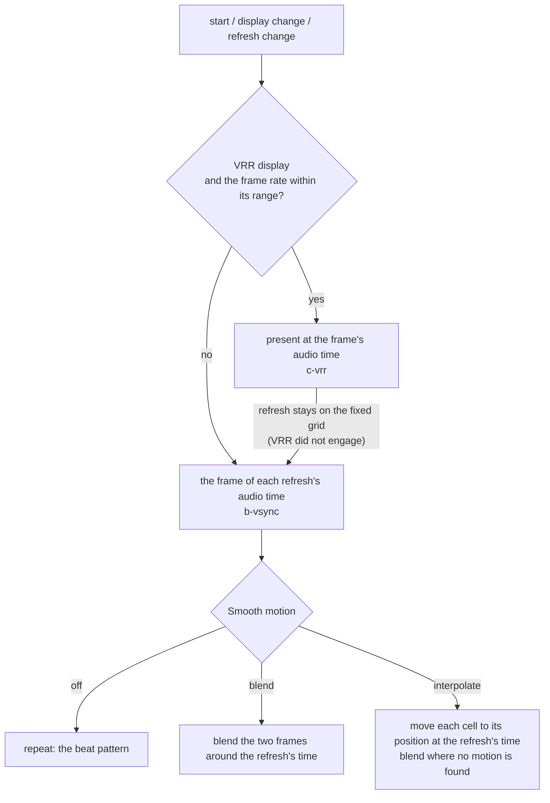
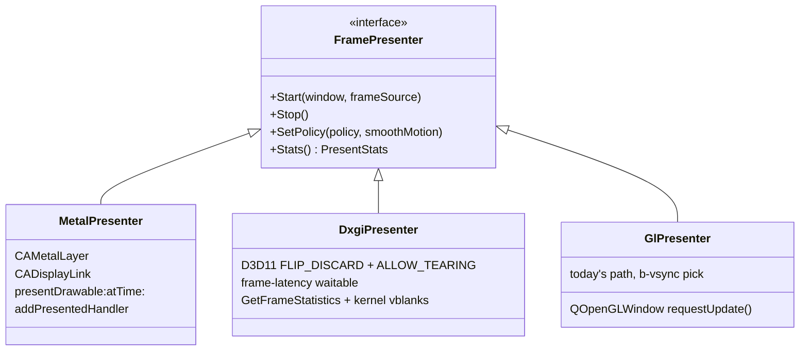

# Frame presenter: video timed by the sound, with and without VRR

**Date:** 2026-10-26
**Status:** design; measured in [POC 037](../../../tools/poc/037-frame-presenter/README.md)
([results](../../../tools/poc/037-frame-presenter/results.md)): fixed 60 Hz (Mac), 144 Hz and G-Sync (Windows);
ProMotion on macOS 12: the 120 Hz grid only (section 9).
**Owner decisions (2026-10-26):**
- Sync is held by the sound. The audio device is the master clock; the display never paces the emulation and never
  changes its speed or the pitch.
- On a fixed display the default is the frame repeat; frame blending is an option.
- Smooth motion without judder (blending and motion-compensated interpolation) is built right after the VRR path is
  stable, not deferred. It is the presenter's own stage: ZX DLSS is for gigascreen and stays separate.
- The work stays on the `frame-presenter` branch until all phases are done; master gets it in one piece.
- Smoothing never adds latency. A game's own picture cadence (a picture every 2nd-5th frame) comes from its game
  profile, with the profile tools of the controller manager (section 4.5), not from guessing at run time.
- Every effect (blend, interpolation, the cadence modes) runs on the GPU and on the CPU, chosen by the mode, on every
  platform, with the same result (section 6.5).

**Related:** [audio sync](../2026-08-17-audio-sync/audio-sync-design.md) (the DRC; "the audio device is the only master
clock"), [A/V sync and presentation](../2026-08-14-av-sync-and-presentation/README.md) (the frame-end latch),
[input latency and Game Mode](../2026-09-24-core-performance/unreal-ng-input-latency-and-game-mode.md) (sections 6
and 8), [Steam Deck rendering](../2026-10-08-steamdeck-client/rendering.md) (section 4).

## Contents

1. [The problem](#1-the-problem)
2. [What reaches the screen today](#2-what-reaches-the-screen-today)
3. [The model: every frame has the time its sound plays](#3-the-model-every-frame-has-the-time-its-sound-plays)
4. [Two policies, chosen by the display](#4-two-policies-chosen-by-the-display)
5. [What "exceptionally smooth" takes](#5-what-exceptionally-smooth-takes)
6. [Architecture](#6-architecture)
7. [Cost](#7-cost)
8. [Plan](#8-plan)
9. [Open items](#9-open-items)

## 1. The problem

The emulated machines run at their own frame rates. The display runs at its own.

| Machine timing | T-states per frame | Clock | Frame rate |
|---|---|---|---|
| Pentagon | 71680 | 3.5 MHz | 48.828 Hz |
| ZX 48K / 128K / Scorpion | 69888 | 3.5 MHz | 50.080 Hz |
| ZX Next, 50 Hz 128K | 70908 | 28 MHz / 8 | 49.36 Hz |
| ZX Next, 60 Hz, VGA 0 / 1 / 2 clock | 60192 | 28.0 / 28.58 / 29.44 MHz / 8 | 58.15 / 59.36 / 61.13 Hz |

| Display | Refresh |
|---|---|
| Mac Studio, DELL U4320Q | fixed 60 Hz |
| MacBook Pro, ProMotion | adaptive, up to 120 Hz |
| Windows host, Dell AW3821DW, G-Sync | up to 144 Hz, variable |

On a fixed display, the screen can change a frame only at a refresh. When the rates differ, a frame stays on screen
for a whole number of refreshes, and that number beats. 50.08 Hz on 60 Hz shows 4 frames for one refresh and the fifth
for two. A scroller moving 4 pixels per frame moves 4, 4, 4, 4, 0 pixels per refresh. The eye sees that as judder.
It is arithmetic.

The sound decides the time (owner decision). So the machine is never sped up or slowed down to fit the display. That
leaves two cases:

- **The display can follow the sound (VRR).** Every frame is shown when its sound plays, for exactly its period. No
  judder.
- **It cannot (a fixed refresh).** The beat stays. The presenter keeps it at the arithmetic minimum, and on request
  hides it by blending neighbouring frames (section 4.3).

In both cases the presenter never makes it worse than the arithmetic:

- no frame shown for a count outside floor / ceil of the refresh ratio;
- no frame skipped;
- no frame shown out of order;
- every frame on screen at the time its sound plays.

## 2. What reaches the screen today

The path, from the emulation thread to the display:

1. `MainLoop` paces each frame with an absolute deadline (`TimeHelper::WaitUntilPrecise`).
2. The DRC keeps the audio ring at 40 ms (`DRC_TARGET_MS`) by trimming the resampler within ±0.5 %.
3. At frame end, `Screen::LatchFramebuffer` copies the frame into one of 12 present slots.
4. Video is delayed by `_presentDelayFrames` (default 2, `[VIDEO] AVSyncDelayFrames`) so it lands with the audio.
5. `NC_VIDEO_FRAME_REFRESH` reaches `DeviceScreenGLWindow` (a `QOpenGLWindow`, swap interval 1), which calls `update()`.
6. Qt paints at its next opportunity. `paintGL` copies "the presented slot" and swaps.

Nothing ties the choice of frame to the refresh that will show it. The slot is chosen by counting frames, not by time.
Two frames of delay match the audio only at about 50 Hz. GL gives no feedback on when a swap reached the screen.

What POC 037 measured for this pattern (`a-signal`) against a presenter that picks the newest frame on every refresh
(`b-vsync`):

| Host | Pattern | Frames outside the beat pattern per minute | Note |
|---|---|---|---|
| Mac, 60 Hz, 50.08 Hz source | `a-signal` (Qt GL) | 0 | proxy timing (swap return), no screen time on GL |
| Mac, 60 Hz, 50.08 Hz source | `b-vsync` (CADisplayLink, Metal) | 0-3 | screen time from `MTLDrawable.presentedTime` |
| Windows, 144 Hz, 50.08 Hz source | `a-signal` (Qt GL) | 39 | screen time = the first kernel vblank after the swap |
| Windows, 144 Hz, 48.83 Hz source | `a-signal` (Qt GL) | 103 | ditto |
| Windows, 144 Hz, 50.08 Hz source | `b-vsync` (DXGI, waitable) | 11 | ditto |
| Windows, 144 Hz, 48.83 Hz source | `b-vsync` (DXGI, waitable) | 43 | ditto |

Today's path is not broken at 60 Hz. At high refresh rates it shows 2.4-3.6 times more frames for a wrong number of
refreshes than a refresh-driven presenter. The cause is that the frame shown is whichever one was latched when Qt got
around to painting.

The bigger gap is VRR: today's path cannot use it at all. With G-Sync enabled for windows, the GL window stayed at
144 Hz, while a native present-at-time in the same kind of window drove the panel at the machine's rate. And today's
path has no way to know what the screen did.

## 3. The model: every frame has the time its sound plays

The sound already has a precise clock: the audio device consumes samples at its crystal's rate, and the DRC keeps the
ring at its target. The frame's picture should reach the screen when the frame's sound reaches the speaker. So the
frame's time is read off the audio path, not set by a frame count.

**What the audio path records** (`AudioClock` in `core/src/common/sound/audioclock.h`, a member of
`AudioDeviceDescriptor`):

- The ring counts its stream: every sample written, every sample removed (played, discarded by a hard resync, dropped
  by a clear). After each enqueue the frontend publishes the write position (`streamWritten`).
- At each frame end, `W(n)`: where frame n's sound ends in that stream. `SoundManager::takeFrameAudioEnd` reads it
  after the frame's sound was delivered, plus the frames the ZX DLSS delay line still holds back.
- In each device callback, a pair: the device position (frames the device asked for so far) and the callback's host
  time. The device's output latency (period size x periods + the OS's latency, 11.6 ms today) is added, so the pair
  says when that sample is heard.
- A line through these pairs: host time = a + b x device position. It is an exponentially weighted least-squares fit
  (~256 callbacks, 1.5-2.5 s), O(1) per callback in the device thread, published through a sequence lock. `b` is the
  device's real sample period in host time, crystal error included. The callback times jitter by milliseconds; the
  fit's line does not.
- The stream maps onto the device position by one offset, taken at every callback that finds data. An underrun (the
  device played silence) or a discard moves it, and every later sample with it.

**The frame's target time:**

```
target(n) = a + b x W(n) + offset
```

- `offset` is the user's lip-sync trim, 0 by default. There is no configured video delay any more: the delay comes
  out of the audio path. The ring target (40 ms) and the device buffer (11.6 ms) put video at about latch + 52 ms
  today, and the same holds at every machine rate.
- Temporal effects (ZX DLSS, the gigascreen mixer) need their look-ahead before the target. They do not move the
  target. If an effect needs more time than the audio delay leaves, the audio delay grows by that much (the DRC
  target).
- **Without a running audio device** (no device, another instance has the sound, a held output) the emulated clock
  stands in: the frame's end is `MainLoop`'s frame deadline, plus one period of delay (or the ZX DLSS look-ahead). In
  turbo the latch time is used. Muting through the mixer does not stop the device, so the audio clock stays.
- **Switching clocks does not jump** (`FrameClock`, `core/src/emulator/video/frameclock.h`). A step of more than 2 ms
  against the cadence (the device appears or goes, an underrun moves the stream) is carried: that frame keeps the
  cadence, and the carry is paid back by 0.2 ms per frame (1 % of a period). A break in the sequence (latches more
  than 4 periods apart: a pause, a seek, a stall), turbo, or a step of more than 500 ms cuts to the new time at once.
  Targets never go back: each is at least half a period after the last.

Why this gives smooth targets: consecutive frames differ by their sample count, `b x (W(n+1) - W(n))`. That is the
machine's frame period, changed by the DRC trim. The trim moves slowly and stays within ±0.5 %, so neighbouring
frames differ by at most ~0.1 ms. The POC shows what the alternative costs: targets from the latch time carried its
scheduler jitter to the screen (present interval error 1.2 ms p99), and targets on a steady clock cut it to 0.5 ms.

Two operations serve all policies:

- `Screen::CopyFrameAt(t)`: the newest frame whose target is ≤ t, and the next one with the blend weight (for a
  refresh at time t).
- `Screen::CopyNextFrame(serial)`: the oldest frame after the one last presented, with its target (for
  present-at-time).

A frame latched but not timed yet (between the latch and its frame end's stamp, `Screen::StampPresentTiming`) is never
served. A screen no `MainLoop` stamps serves frames by their latch time.

The latch time stays in the slot to check the deadline: a frame latched later than `target - margin` is late, and is
counted.

## 4. Two policies, chosen by the display



### 4.1 VRR: present each frame at its audio time (`c-vrr`)

Each frame is presented once, at `target(n)`. The display starts a refresh when the frame arrives. Every frame is on
screen for exactly its period, in step with its sound: no judder, no speed or pitch change.

- **macOS:** `[commandBuffer presentDrawable:drawable atTime:target]` on a `CAMetalLayer`.
  - On a fixed 60 Hz display it degrades gracefully. The system shows the frame at the first refresh after `target`.
    That is the same beat pattern as `b-vsync`, at the lowest latency of all measured variants (POC: 28 ms latch to
    screen, span = one refresh).
  - `afterMinimumDuration:` is wrong for this: on 60 Hz it halved the rate to 30 fps.
- **Windows:** a flip-model swap chain (`FLIP_DISCARD`) created with `ALLOW_TEARING`, then `Present(0,
  DXGI_PRESENT_ALLOW_TEARING)` at `target(n)` from a high-resolution waitable timer. That is the documented condition
  for VRR in a window.
  - G-Sync also has to be enabled for windowed mode in the driver ("Set up G-SYNC": windowed and full screen). With
    the default (full screen only) the panel stays at its maximum rate.
  - Measured with G-Sync on (AW3821DW, RTX 4090): one refresh per frame at 48.9, 49.4, 50.1 and 61.3 Hz from a plain
    window.
  - Per-frame error with targets on a steady clock: 0.05 ms p50 / 0.5 ms p99 at the present; 0.2-0.55 ms p50 /
    1.7-3.5 ms p99 on screen as the kernel's vblanks show it. For comparison, the fixed-rate beat is 6.2-7.8 ms p99 at
    144 Hz and 13.4 ms at 60 Hz.
- **Below the VRR floor** (Pentagon 48.83 Hz on a panel with a 48 Hz floor), the driver's low-framerate compensation
  repeats refreshes. The frame time stays exact.
- **Detecting VRR:**
  - macOS reports it: `NSScreen.minimumRefreshInterval` vs `maximumRefreshInterval`.
  - Windows has no API that says G-Sync is active for a window. The presenter verifies instead: in `c-vrr` it watches
    the display's refresh times (section 6.3). If they stay on the fixed grid, VRR did not engage. The presenter then
    falls back to `b-vsync` and reports it in the stats.

### 4.2 Fixed display: the frame of each refresh's audio time (`b-vsync`)

On every refresh, the presenter takes the time `t` the refresh will reach the screen, and presents `FrameAt(t)`. That
gives exactly the arithmetic beat pattern, and every frame is on screen within one refresh of its sound. It fixes the
Windows numbers of section 2, and it is the fallback of `c-vrr`.

- **macOS:** a `CADisplayLink` (`[NSScreen displayLinkWithTarget:selector:]`, macOS 14+) and `presentDrawable:atTime:`
  of the link's target timestamp. Do not use `CAMetalDisplayLink` for this: its target was 3 refreshes ahead even with
  `preferredFrameLatency = 1`, 58-75 ms latch to screen against 42-58 ms for `CADisplayLink`.
- **Windows:** wait on the swap chain's frame-latency waitable object (maximum latency 1), then `Present(1, 0)`.
  - The object is signalled once at the start and then once per present. Consume it only with a frame to present, or
    it never comes back: the POC lost a whole run to this.
  - The refresh's time is the next vblank plus the swap chain's depth.
- **GL fallback** (no native backend on the platform): `QOpenGLWindow` with `requestUpdate()` in a loop instead of
  `update()` on the signal, and `FrameAt(now + one refresh)` in `paintGL`.

On a fixed 120 or 144 Hz display the beat's step is one refresh, 8.3 or 6.9 ms. Few people see it. On 60 Hz it is
16.7 ms, a visible hitch in every scroller. The real remedies there are a VRR display or a 50 Hz display mode. The
presenter can name both in a one-time hint when it sees a 60 Hz display and a 50 Hz machine.

### 4.3 Fixed display, optional: blending (`Smooth motion`)

For a refresh at `t` between the targets of frames A and B, the presenter shows a mix of the two:

```
w = (t - target(A)) / (target(B) - target(A))      # 0..1
pixel = (1 - w) x A + w x B
```

The scroller then moves on every refresh, in steps that follow the time. It trades the hitch for softness: during
motion, pixel art shows a semi-transparent double edge, and a FLASH attribute's swap fades over one refresh instead
of switching.

- **No extra latency.** Frame B has to exist at time `t`. Targets sit about 52 ms after their latch (the audio delay,
  section 3), and B's target is less than one period after `t`. So B was latched more than 30 ms before it is needed.
  Blending works whenever the audio delay is more than one period plus the draw.
- **Cost:** one more texture (frame B) and a two-texture fragment shader, about the cost of today's draw.
- **Default off** (owner decision). It is a setting (`SmoothMotion = blend`), mostly useful on 60 Hz displays.
- Where frames are identical (static screens) the mix changes nothing.

### 4.4 Fixed display, optional: motion-compensated interpolation

Blending shows two positions of a moving object at once. Interpolation instead draws the object at the position it
has at the refresh's time: the scroller moves 4 x w pixels, not two half-bright copies.

- **Motion from the frames.** ZX graphics move in whole pixels or attribute cells, on a black or flat background,
  often whole-screen (scrollers) or in a few sprites. The search runs on the presented framebuffer (RGBA, exact
  colours), so it serves every machine, not only the ZX bitmap. Per 8 x 8 block of the output: the vector within
  ±8 px (consecutive frames) on which A warped back by `w` and B warped forward by `1 - w` agree, all but at most 4
  of 64 pixels. Candidates first (the zero vector, the neighbours', the most common of this pair), then the full
  search, at most 96 full searches per pair (full-screen effects fall back instead of costing 100+ ms).
- **Per pixel.** Of the candidates on which the two warped sources agree at the pixel, the one agreeing on most of
  its 3 x 3 neighbourhood wins: a coincidental single-pixel match (a static letter under a neighbour's vector) loses.
  Where none agrees: the blend of section 4.3. The worst case is the blend, never a made-up picture.
- **Where it runs.** On the presenter's side, per refresh with that refresh's `w` (at 60 Hz about 1.2 refreshes per
  frame, so about once per frame pair). The audio delay (section 3) leaves 30+ ms for it.
- **Not ZX DLSS.** ZX DLSS (`TemporalEffects`) reconstructs gigascreen pictures inside the core's present slots. This
  stage works on whatever the slots hold, after it, and never writes back.
- **Measured in [POC 038](../../../tools/poc/038-motion-interpolation/conclusions.md):** on scrollers and moving
  pictures 1/2 to 1/6 of the blend's error, 52-90 % of the changed pixels exact; full-screen effects fall back to the
  blend; 1.3-2.3 ms p50 per frame pair on one core without SIMD. Most games draw every 2nd-5th frame and gain
  nothing between consecutive frames: section 4.5.

### 4.5 Games: their own picture cadence, from the game profile

Most games draw a picture every 2nd-5th frame (Dizzy X every 4th, Green Beret every 3rd, Darkwing Duck scrolls the
play area every 5th and redraws the status row a frame later). Between two repeated frames there is nothing to
interpolate, so section 4.4 leaves a game's judder as it is. Between the game's own pictures the same search works
(POC 038 stage 2): Darkwing Duck's scroll 78 -> 22.5 MAE, 81 % of the changed pixels exact.

- **No added latency** (owner). Two modes:
  - `cadence`: once the next picture is in the lookahead (the audio delay holds about two frames), the step to it is
    interpolated. A 25 Hz game gets the whole step smoothed; a slower one the last two frames of its period.
  - `carry`: the motion of the last two pictures is carried on through the period (the warp at `w` = 1..2), and the
    real picture replaces it when it arrives. Even motion, a small correction where the motion changes. Content that
    enters the window is not known yet: a moving vector draws only pixels whose source changed, so a static border is
    not pulled into the window.
- **From the game profile, not guessed** (owner). Guessing at run time needs half a second, errs when a busy scene
  slows the game down, and does not know the play area. The game profile
  ([mapping-and-profiles.md section 7.7](../2026-10-17-controller-manager/mapping-and-profiles.md#77-video-the-games-picture-cadence))
  gets a `video:` section: the picture period, the mode, the play window (the stage works only inside it, which
  removes the edge artefacts of `carry`), regions to leave alone (score, status row), and optionally the event that
  says "picture complete" (a probe on the game's draw-done address, as the haptic events): then the presenter knows
  each picture's frame exactly, even when the period varies.
- **Tools.** POC 038's capture and cadence detection become the profile tool that drafts the `video:` section (period,
  window from the changing area), as the haptics recipe drafts the events; the mode is chosen by eye per game.
- Without a profile the game gets section 4.4 only (consecutive frames: scrollers, demos).

### 4.6 Rejected: the display drives the emulation


POC 037 measured a "display-locked" mode: the refresh ticks `MainLoop`, one frame per refresh. Its cadence was perfect
(|dur - 1/R| ≤ 0.5 ms). But the machine ran 1.9-3.2 % off its own rate (Next 60 Hz on a 60 Hz panel), and the DRC
needed a ±4 % trim, which shifts the pitch. It contradicts the audio design ("the audio device is the only master
clock") and the owner's decision, so it is not part of the design. The Steam Deck client's display-locked mode
(rendering.md section 4) is subject to the same decision and needs revisiting there.

## 5. What "exceptionally smooth" takes

The policies are half of it. The other half are the conditions that made the POC's measurements clean, each found by a
run that was not:

1. **Pick by time, never by count.** A frame-count delay is correct for one rate only. Section 3.
2. **Targets from a clean clock.** The audio clock's fitted line, not the callback times and not the latch times.
   Section 3.
3. **Present from a thread of its own, not from the GUI thread.** The Qt GUI thread also runs the debugger, the memory
   viewer and the menus. Any of them can delay a paint past the refresh. The presenter thread owns the swap chain and
   wakes per refresh (`b`) or per frame (`c`). The GUI thread only resizes it.
4. **Precise sleeps on Windows.** MinGW's `std::this_thread::sleep_for` has a ~15.6 ms granularity. The POC's
   producer had a 24.6 ms p99 jitter until its sleep used a high-resolution waitable timer, as
   `TimeHelper::WaitUntilPrecise` already does. The presenter's present-at-time wait must use the same timer, and spin
   only the last ~0.5 ms.
5. **The emulation thread's real-time policy** stays as it is (`ThreadHelper::setRealtimePriority`). Under a load
   average of 40-90 on the Mac Studio, the producer's latch jitter stayed at 0.9-1.8 ms p99. With targets from the
   audio clock, that jitter no longer reaches the screen. It only has to stay under the audio delay.
6. **Keep the display awake.**
   - On Windows, a monitor that went to sleep has no vblanks, and DWM then composes on a ~60 Hz timer. Every
     measurement on the 144 Hz host was wrong until the run woke it. The app sets
     `SetThreadExecutionState(ES_CONTINUOUS | ES_DISPLAY_REQUIRED)` while a machine runs unpaused.
   - On macOS the matching call is `beginActivityWithOptions:NSActivityLatencyCritical | NSActivityUserInitiated`, which
     also keeps App Nap away.
7. **Know when nobody sees the window.** An occluded window's presents are dropped (macOS `presentedTime` = 0; the
   window's `occlusionState`), and display links slow down. Nothing paces from presents, so the emulation and the
   sound do not notice. The presenter only stops counting dropped presents as errors.
8. **Measure what the screen did, in production too.** The same feedback that verified the POC counts frames outside
   the beat pattern, late frames, dropped presents and the screen-to-sound offset. The counts go to the automation
   planes (section 6.4), so a regression is visible, not felt.

## 6. Architecture

### 6.1 Core (`core/`)

- `SoundManager` gains `AudioClock`: the per-callback (consumed, host time + output latency) pairs from the device
  callback, the fitted line, `W(n)` at each latch. The callback side is two integers into a lock-free ring. The fit
  runs on the reader's side.
- `Screen` present slots gain `audioPos` (`W(n)`), `emulatedNs` and `latchNs` next to `_presentSlotSerial`. Everything
  stays under `_presentMutex`, as today. The latch writes three more integers.
- `FrameClock` (new, `core/src/emulator/video/`): `target(n)` from the audio clock's line, or from the emulated clock
  when no device runs; the lip-sync offset; the switch between the two clocks without a jump. It has no thread and no
  OS calls.
- `Screen::CopyFrameAt(t, dst, &info)` and `Screen::CopyNextFrame(dst, &info)` next to `CopyPresentedFramebuffer`.
  `info` holds the serial, the target and the geometry. `CopyFrameAt` can also return the following frame and the blend
  weight. Both respect the temporal effects' slots (ZX DLSS) exactly as `PresentedSlotLocked` does today.
- `SmoothMotion` (new, `core/src/emulator/video/`): the CPU reference of the blend, the interpolation and the cadence
  modes (sections 4.3-4.5, 6.5), pure functions on two or three frames, `w` and the game's `video:` settings; no
  thread, no OS calls. The presenters' GPU passes match it bit for bit.
- Not changed: `MainLoop`'s pacing and the DRC. The emulation and the sound do not know the presenter exists.

### 6.2 unreal-qt: the presenter



- The screen widget becomes a `QWindow` with a native surface: `QSurface::MetalSurface` on macOS, a plain HWND on
  Windows. It is embedded with `createWindowContainer` as today's GL window is. The presenter draws into it from its
  own thread.
  - POC: a Qt `QWindow` with the native presenter measured the same as an SDL3 window with the same presenter (Mac
    `c-vrr` 28.4 vs 28.1 ms p50; Windows `b-vsync` 10.3 vs 10.4 ms).
  - Qt therefore stays the shell. SDL3 has nothing to add here: `SDL_GPU` has no present-at-time and no presentation
    feedback, so the native presenter is needed under SDL3 too.
- The draw is what `DeviceScreenGLWindow::paintGL` does today: the texture upload, the integer or fit scaling, the
  shaders, plus the blend of section 4.3. It is ported to Metal and D3D11. The GL path stays as the fallback (Linux
  until a Vulkan presenter exists) and runs the `b-vsync` pick.
- The overlays now drawn by `DeviceScreenGLWindow` (OSD, HUD) move with it. They are textures composited in the same
  pass, never blended between frames.
- Linux: a Vulkan presenter later. `VK_KHR_present_wait` / `VK_GOOGLE_display_timing` where the compositor offers them,
  `wp_presentation` on Wayland. The Steam Deck client has its own presenter (rendering.md) and shares `FrameClock`.

### 6.3 Timing feedback per OS

| OS | Screen time of a present | Refresh times | Clock |
|---|---|---|---|
| macOS | `MTLDrawable.presentedTime` (0 = dropped) | the display link's timestamps | `CACurrentMediaTime` = `mach_absolute_time` = `CLOCK_UPTIME_RAW` = `steady_clock` |
| Windows, independent flip / fullscreen | `GetFrameStatistics`: `PresentCount` -> `SyncQPCTime` on a fixed refresh; under VRR `SyncQPCTime` is the start of the vblank the flip ended (before the present), so the kernel's vblank is used there too | ditto | QPC = `steady_clock` |
| Windows, composed (DWM) window | none: `GetFrameStatistics` succeeds with all zeros | `D3DKMTWaitForVerticalBlankEvent` on the monitor's adapter, on a thread; the first vblank after the present (a lower bound: DWM may add a refresh) | QPC |

`IDXGIOutput::WaitForVBlank` returns at once in a window. `DwmGetCompositionTimingInfo`'s `qpcVBlank` had gaps of
up to 166 ms (p99), and it ran on a ~60 Hz timer while the monitor slept. Neither works for this.

The audio clock and the screen times are on the same host clock, so the presenter measures the screen-to-sound offset
directly: the screen time minus the frame's target.

### 6.4 Settings and automation planes

- `[VIDEO] PresentPolicy = auto | vrr | vsync`. `auto` is the flowchart of section 4.
- `[VIDEO] SmoothMotion = off | blend | interpolate` (sections 4.3, 4.4), default off. A VRR display ignores it:
  there every frame is shown for its own period. With `interpolate`, a game whose profile has a `video:` section gets
  its cadence mode (section 4.5).
- `[VIDEO] EffectsDevice = auto | gpu | cpu` (section 6.5), default `auto`.
- `[VIDEO] LipSyncOffsetMs = 0`. It replaces `AVSyncDelayFrames`, whose job the audio clock now does; the old key is
  read once and dropped.
- Per the automation-planes guidelines, every plane gets the same:
  - CLI, Python, Lua, MCP, REST and WebSocket: read and set the policy, smooth motion and the offset;
  - read `PresentStats`: the policy in effect, the display's refresh and VRR state, the clock in use (audio or
    emulated), frames shown outside the beat pattern, late, dropped, the screen-to-sound offset p50 / p99;
  - WebSocket: a topic for policy changes (VRR fell back, the clock switched).
  - Reads never touch the emulation thread: the presenter publishes `PresentStats` once a second.

### 6.5 Every effect on the GPU and on the CPU

Owner: blend, interpolation and the cadence modes run on the GPU and on the CPU, by the mode, on every platform.

- **One definition, two implementations.** The CPU path is the reference: plain C++ in `core/` (no platform API),
  integer arithmetic only (the blend's weight in 1/256 steps, the warp in whole pixels), so it is bit-exact on
  clang, gcc, MSVC and MinGW. The GPU path implements the same steps per presenter: Metal compute (macOS, iOS), D3D11
  compute (Windows), GL fragment passes (the GL fallback, Linux), later Vulkan. A test renders the POC 038 sequences
  on both and requires identical output.
- **Modes.** `EffectsDevice = auto` takes the GPU where the presenter has one and the CPU otherwise (a software
  GL, a headless or offscreen instance, the video recording); `gpu` / `cpu` force it. The CPU path runs on the
  presenter's thread for the screen, and serves the readers that have no GPU (screenshots, recording, the video
  wall, WebAPI captures) with the same picture the screen shows.
- **Cost budget.** CPU: 1.3-2.3 ms p50 per frame pair scalar (POC 038); SIMD (NEON / SSE2, with a scalar fallback)
  brings it under 1 ms. GPU: the search is per block and independent, one dispatch per refresh.

## 7. Cost

Measured in POC 037 unless marked. The POC's frames are 384x288x4 bytes, a little larger than the emulator's
352x288.

| Item | Cost |
|---|---|
| Audio callback | two integers per callback (~170 per second) into a lock-free ring (design, not measured) |
| Audio clock fit | a running least-squares line over ~2 s of pairs, per callback or per present: microseconds (design) |
| Core, per frame | three more integers per latch under the existing mutex; `target(n)`: nanoseconds |
| Copy per present | one frame copy (~40 µs, as `CopyPresentedFramebuffer` today); on a refresh that repeats a frame, nothing (the presenter keeps the uploaded texture and compares serials); with smooth motion, the second frame once per frame, not per refresh |
| Presenter CPU per present, macOS Metal | 0.15-0.22 ms on the presenter thread (upload, encode, present), Mac Studio M1 Ultra |
| Today's Qt GL path, for comparison | 0.48-0.52 ms per paint, on the GUI thread |
| Presenter CPU, Windows | not resolved: `GetThreadTimes` has a 15.6 ms granularity there; the next runs use `QueryThreadCycleTime` |
| Smooth motion, blend | one more texture and a two-texture shader: about one more draw per refresh (design, not measured) |
| Smooth motion, interpolate | a block search per frame pair (1-bit bitmap, 1584 cells of 8x8, ±16 px) on the presenter thread, and a warp per refresh; the POC of phase 5 measures it (design) |
| Threads | one presenter thread per emulator window, waking at the refresh rate (`b`: 60-144 per second) or the frame rate (`c`: ~50 per second); one vblank-watch thread per window on Windows |
| Memory | the native swap chain (2-3 back buffers at the window size) replaces the GL default framebuffer; no change in the core's slots |
| Latency, latch to screen | the audio delay, as today: ring target + device buffer ≈ 52 ms, the same at every machine rate; `b-vsync` adds up to one refresh. The POC ran with one period of delay to measure the presenters themselves: `c-vrr` 28 ms on the Mac at 60 Hz, 27.4-28.8 ms on Windows under G-Sync to the end of scan-out |
| A/V | the screen time follows the sound's by construction, for every machine rate; today's 2-frame delay fits 50 Hz only |
| Speed and pitch | unchanged in every mode |

## 8. Plan

Each phase lands on its own with tests and docs.

1. **Audio clock and frame times** (done on the branch). `AudioClock`, the ring's stream positions, slot times,
   `FrameClock` (audio, emulated and latch clocks, the carry), `CopyFrameAt` / `CopyNextFrame`, the
   `[VIDEO] LipSyncOffsetMs` key. Unit tests on synthetic sequences: callback jitter, a crystal 100 ppm off, hours of
   audio, underruns and discards, the device stopping (stale) and resetting, the clock switch, steps, gaps, turbo.
   The frame-count path (`CopyPresentedFramebuffer`, `AVSyncDelayFrames`) is untouched: no visible change yet.
2. **The GL path picks by time.** `GlPresenter` = today's window with `requestUpdate()` and `CopyFrameAt`. This is the
   first visible gain (Windows high refresh, A/V at every rate), and it is the fallback for everything after. The
   other readers of `CopyPresentedFramebuffer` (screenshots, recording, the video wall) move to time as well, and
   `AVSyncDelayFrames` goes. Measured on a real device: the audio clock's target interval error (section 9).
3. **Metal presenter** (macOS): `b-vsync` and `c-vrr`, `presentedTime` stats, occlusion, `beginActivity`.
4. **DXGI presenter** (Windows): `b-vsync` and `c-vrr`, the waitable object, the vblank watch, VRR verification and
   fallback, `ES_DISPLAY_REQUIRED`.
5. **Smooth motion**, at once after phases 3-4 are stable on the VRR hosts (owner decision):
   - the CPU reference in `core/` (blend, interpolation, the cadence modes; integer, bit-exact), its tests on the
     POC 038 sequences;
   - the GPU implementations in the Metal, DXGI and GL presenters, tested against the CPU output; `EffectsDevice`;
   - the game profile's `video:` section (section 4.5): parser, validation, the drafting tool, profiles for the
     test games (Darkwing Duck, Thundercats, Garfield).
   POC 038 measured the interpolation and the cadence modes (done).
6. **Automation planes.** Settings and `PresentStats` on CLI, Python, Lua, MCP, REST and WebSocket; docs chain per the
   guidelines.
7. Later:
   - a Vulkan / Wayland presenter;
   - the iOS host (section 9) moves to `FrameClock` and the Metal presenter;
   - late input sampling in `c-vrr` (input-latency doc option B, nearly free once frames have target times).

## 9. Open items

- **The on-screen tail under G-Sync** (p99 1.7-3.5 ms against 0.5 ms at the present) is either the kernel's vblank
  event delivery or the panel. A time-critical measuring thread did not shrink it. An optical measurement (photodiode
  or a high-speed camera) would separate them. It does not change the design.
- **G-Sync needs the windowed setting.** Most users have the driver default (full screen only). The app cannot change
  it, but it can see it: in `c-vrr` the refresh stays on the fixed grid. It then falls back to `b-vsync` and says so in
  the stats, with a hint where to enable it.
- **ProMotion (MacBook Pro M1 Max, macOS 12.7, results section 2b): no free-running VRR.**
  `presentDrawable:atTime:` puts a frame on the 120 Hz grid: a 50 Hz frame gets 16.7 or 25 ms, never 20 ms, and
  7-12 % of the frames never reach the screen. So `c-vrr` there is `b-vsync` at 120 Hz, and smooth motion removes
  the 2/3 cadence. Low Power Mode caps the panel at 60 Hz. macOS 14+ (`CAMetalDisplayLink`,
  `preferredFrameRateRange`) is not measured: the machine has macOS 12.
- **iOS / iPadOS.** The iOS host (ios-host-design.md, section 6.3) uses `CAMetalLayer` and `CADisplayLink`, the
  same APIs as the macOS presenter, so it shares that presenter. ProMotion iPhones and iPads (10-120 Hz) are adaptive,
  not free-running VRR: an app asks `CADisplayLink.preferredFrameRateRange`, and the system picks one of the panel's
  rates, which divide 120 (120, 60, 40, 30, 24 Hz...). 50 Hz is not among them. So the expectation is the 120 Hz beat
  (a frame for 2 or 3 refreshes), plus smooth motion on top; `presentDrawable:atTime:` with exact times has to be
  measured on a device; on the MacBook (macOS 12) it gave the 120 Hz grid only. Fixed 60 Hz iPhones and iPads get `b-vsync` and smooth motion. External
  displays on iPad have no VRR.
- **The audio clock is designed, not measured.** The POC timed frames on a steady clock. Phase 1 has to show that the
  fitted line of a real device (miniaudio on CoreAudio and WASAPI) is as smooth: target interval error under 0.1 ms
  beyond the DRC trim.
