# Handheld menu: a controller-driven emulator menu for the Steam Deck

| | |
|---|---|
| **Status** | Design approved (2026-11-12). Sections built: Save & Load, Media, Machine, Expansion, Display, Sound, Network, Controls, Quit (§3.1); the pad on the on-screen keyboard. Time Travel not started. |
| **Branch** | `handheld-menu` (worktree `scratch/wt-handheld-menu`) |
| **Scope** | Handheld mode of `unreal-qt` only: Steam Deck in Game Mode now, Windows handhelds (ROG Ally, Legion Go, ...) later. The desktop UI is unchanged. |
| **Related** | [2026-10-08-steamdeck-client](../2026-10-08-steamdeck-client/README.md) (the full `unreal-deck` front-end design; its quick menu, `ux.md` §5 and FR-22, is what this document builds first, inside `unreal-qt`) |

## 1. Problem

On the Deck, `unreal-qt` runs in Game Mode with its menu bar, toolbars and status bar hidden
(`unreal-qt/src/platform/linux/steamdeckgamemode.cpp`). The emulator can only be driven from the
controller profile and over the WebAPI: there is no way to load a file, save or load a state, change the machine,
or reach any setting from the Deck itself.

The goal is a full emulator menu that looks and feels like the SteamOS UI (reference below), works from the
D-pad, sticks and face buttons, fits 1280×800 with legible text, and covers both basics (load / save, machine
configuration) and the advanced features (media control, display, sound, time travel).

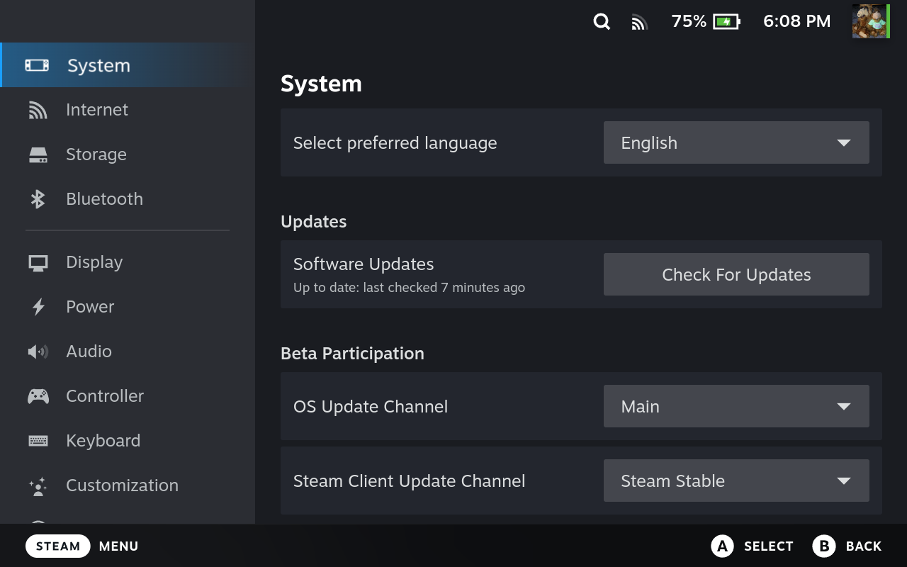

*Reference: SteamOS Settings on the Deck (taken with `gamescopectl screenshot`). Sections on the left, rows with
dropdowns, buttons and toggles on the right, button hints in the footer.*

## 2. Decisions and constraints

| # | Topic | Decision / fact |
|---|---|---|
| C-1 | Where | A part of `unreal-qt`, active only in handheld mode. Not a separate application. |
| C-2 | Activation | Handheld mode = gamescope session (`XDG_CURRENT_DESKTOP=gamescope`, `steamdeck::IsGameMode()`) now; a Windows handheld check later, behind one `handheld::IsHandheldMode()` predicate. A command-line switch forces it on for testing on a desktop. |
| C-3 | Button | **Menu (☰)** opens and closes the menu, **View** shows the on-screen keyboard. The Steam button and Quick Access (…) belong to Steam: an app can see their bits on hidraw, but cannot stop Steam from opening its own overlay, so nothing is bound to them. On the Deck (`play/steam-deck.yaml`) Menu is `handheld.menu`; other pads keep Menu = ENTER. ENTER on the Deck: the on-screen keyboard (Y, L4). |
| C-4 | One window | gamescope shows one window of the app (see `reference-steamdeck-gamemode-testing`): the menu is a child widget of `MainWindow` drawn over the picture, never a top-level or `Qt::Tool` window. |
| C-5 | Actions | Every menu entry calls an existing catalogue action (`core/src/emulator/actions/`) or a readout; the menu adds no new emulator behaviour of its own. What the menu needs and the catalogue lacks is added to the catalogue first, so it is on every automation plane too. |
| C-6 | Pause | The emulation pauses while the menu is open (default), with a setting to keep it running. |
| C-7 | Look | SteamOS dark palette sampled from the reference (§6), large type, one focus ring, footer button hints. |

## 3. Navigation

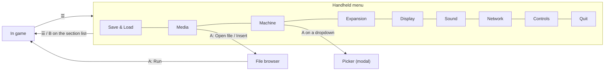

| Button | Section list (left) | Page (right) | Picker / browser |
|---|---|---|---|
| D-pad / left stick | move | move between rows; left / right change a value row (◀▶) | move |
| A | open the page | activate | choose |
| B | close the menu | back to the section list | cancel / folder up |
| X, Y | — | page-specific (shown in the footer) | page-specific |
| L1 / R1 | previous / next section | previous / next section | page up / down |
| ☰ | close the menu | close the menu | close the menu |

Closing the menu always resumes a machine the menu paused (a refused `run.resume` is retried once); a machine paused
before the menu opened stays paused.

### 3.1 Sections (as built)

The desktop menus were sorted by what a player on the couch needs. Left out on the Deck: the debugger and tool
windows, toolbar / status bar, full screen and window scale, video sync, Help, recording, screenshots.

| Section | Rows | Backed by |
|---|---|---|
| Save & Load | nine quick slots with pictures: A load, X save, Y delete | `snapshot.quick` |
| Media | Open file… (browser), Save snapshot to a file (Library/Saves), then one row per medium slot of the machine (`MediaManager::List()`: tape with ▶/■ and block, drives, IDE / SD / CD) with an action picker (play / pause, rewind, go to block, insert or replace through the browser, save the changes, write protect, eject); fast tape / turbo tape / fast disk switches | `media.open`, `media.insert`, `media.tape`, `media.eject`, `media.save`, `media.protect`, `snapshot.save`, `set.toggle` |
| Machine | Pause / Continue (the state the machine is in once the menu closes; the menu closes at once), model and speed pickers, turbo, reset and hard reset (the menu closes: back to the machine at once), NMI, front-panel switches | `mach.start`, `set.speed`, `mach.turbo_toggle`, `mach.reset`, `mach.cold_reset`, `mach.nmi`, `mach.switch`; pause: the menu's own `run.pause` / `run.resume` |
| Expansion | the slot report (configured slots with their card, the machine's own slots, built-in devices); per slot Remove or a card from the catalogue planned into that slot (`catalog` with `slot`: refused cards hidden, plain `label`, "(here now)", "(replaces …)"), Add a card… (the planner's slot); a change restarts the machine, the window follows | `DeviceState::Slots`, `SlotControl` `catalog` / `plug` / `remove` (no desktop dialogs) |
| Display | CRT effect (a popup: Off, the models by name, the shaders); Temporal effect (a popup: Off, frame blending, ZX DLSS de-flicker), with blending its frames ◀▶ and weights (a popup); Overscan on / off and its border crop (a popup), Pentagon only; HUD, GPU. A choice among several is a popup, on / off a switch; no shader parameters (their names and numbers mean nothing on a handheld) | `video.crt_toggle`, `video.crt_profile`, `video.temporal_*`, `video.blending`, `video.overscan_toggle`, `video.viewport`, `hud.toggle`, `video.gpu_toggle` |
| Sound | a mixer drawn as SteamOS sliders: the master and each source (its name from the mixer) with the level on a track and the live peak under it; ◀▶ volume, A mutes | `audio.mixer`, `audio.mute_toggle`, `audio.volume_by`, `audio.source_mute` |
| Network | a monitor, not a list, nothing to focus (500 ms): the card with the settings as chips and Active / Idle; tiles for the traffic (rate, a graph of the last half minute, total), the virtual network, the COM port, other fitted ports, the expansion cards | `DeviceState::Network` |
| Controls | show the keyboard, keyboard picker, the pad's legend on the keyboard, the floppy drive feel ([haptics.md §4.4](../2026-10-17-controller-manager/haptics.md#44-the-floppy-drive-under-the-hand)) | `unrealqt.osd_keyboard_force`; `Controllers/DriveHaptics` (settings) |
| Quit | quick save and quit, quit without saving | `snapshot.quick` |

Value rows (◀▶) take left / right; group captions are never focused; a long page scrolls with the focus. The file
browser offers by slot kind: tapes, disks, or every file (hard disk, CF / SD and CD images).

## 4. Screens

The mock-ups below are the first design; §3.1 is what was built. The Resume page was dropped (owner, 2026-11-12):
closing the menu resumes, quick save / load live in Save & Load, recent files in the browser.

### 4.1 Resume (dropped)

The start page of the first design: the paused picture, the most used actions one press away, recent files.

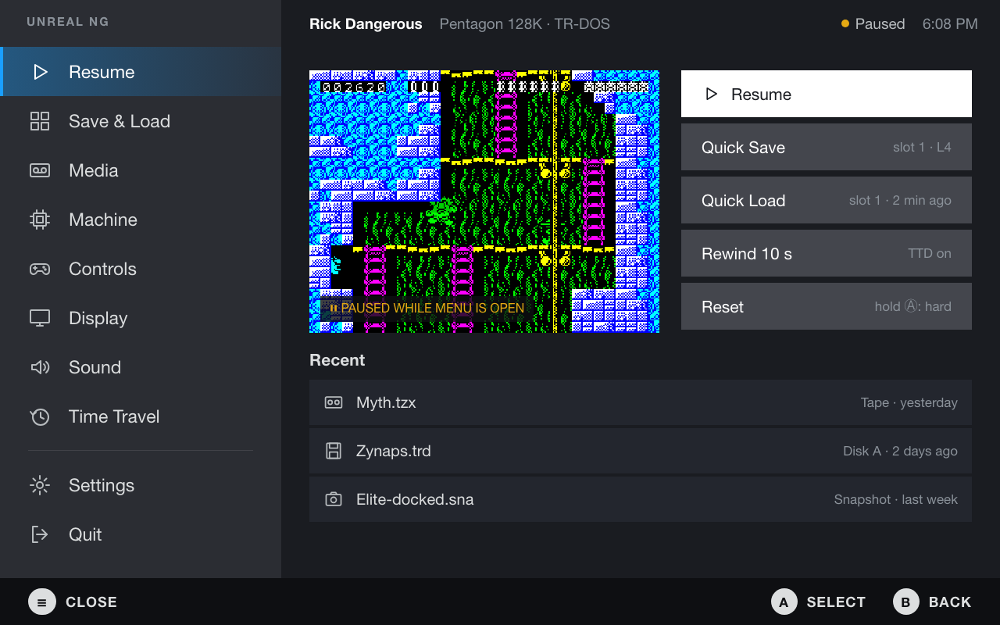

| Entry | Action |
|---|---|
| Resume | close the menu, `run.resume` if the menu paused it |
| Quick Save / Quick Load | `snapshot.quick {op: save|load, slot: 1}` |
| Rewind 10 s | `ttd.seek_by` (only when TTD is recording) |
| Reset (hold A: hard) | `mach.reset` / `mach.cold_reset` |
| Recent | `GET recent` readout, `media.open_recent {index, kind}` |

### 4.2 Save & Load

Nine slots per game, each with its picture and time. A loads, X saves into the focused slot, Y deletes.

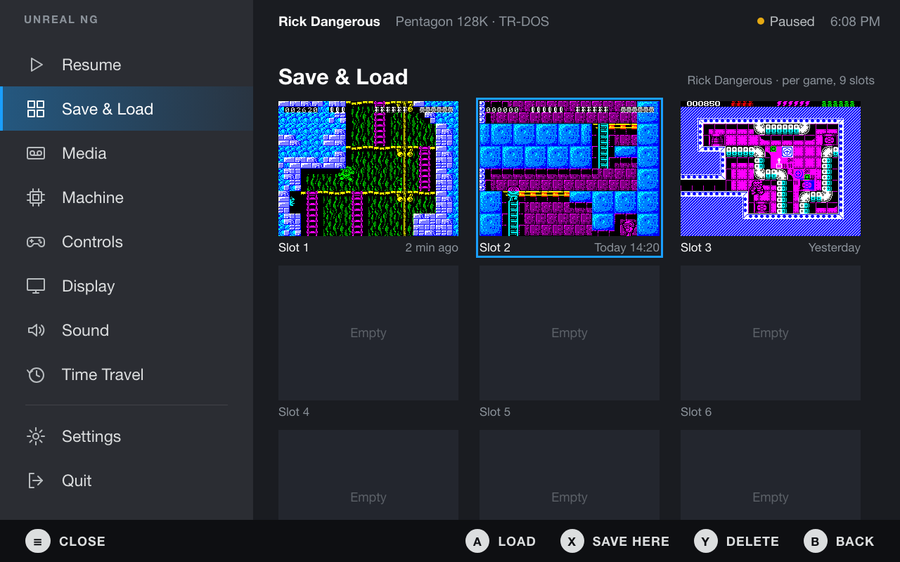

Backed by `snapshot.quick` (slots 1..9). Needed in the catalogue: the slot list with time and a thumbnail per
slot, and slots kept per game (the snapshot folder keyed by the running image's name or signature).

### 4.3 Machine

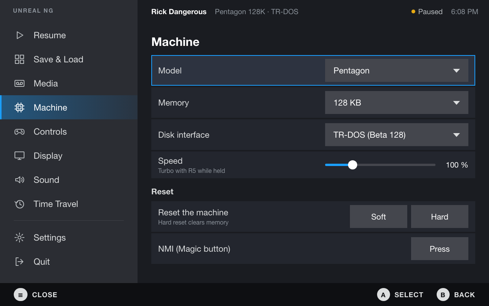

| Row | Action |
|---|---|
| Model | `mach.switch` (the model table `Config::mem_model`, aliases included) |
| Memory | `mach.switch` with the RAM size the model allows |
| Disk interface | slots / cards through their managers (ZX-bus slots API) |
| Speed | `set.speed`; turbo `mach.turbo_toggle` |
| Reset soft / hard | `mach.reset` / `mach.cold_reset` |
| NMI | `mach.nmi` |

Dropdowns open a modal picker. A model change restarts the machine, so the picker warns and offers a quick save:

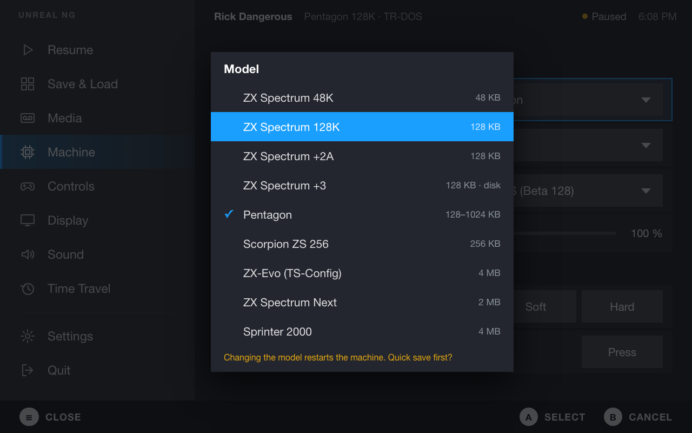

### 4.4 Media and the file browser

The tape with its block list (play, rewind, jump to a block), drives A–D with change / eject / insert.

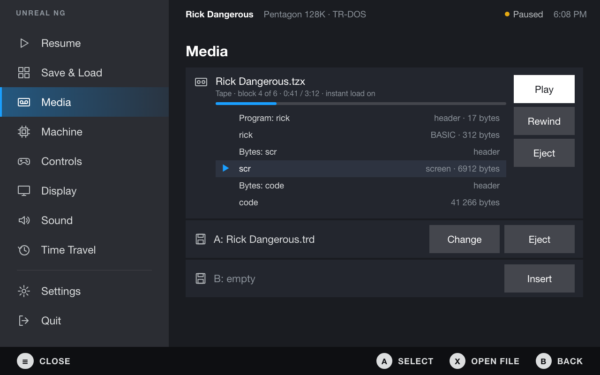

| Element | Action |
|---|---|
| Tape play / stop / rewind / block jump | `media.tape` |
| Drive change / insert / eject | `media.insert` / `media.eject` / `media.swap` |
| Open file | the file browser below, then `media.open` |

The file browser is controller-only (no system file dialog in Game Mode): folders, type icons, a preview of the
selected file (the loading screen for tapes, the first screen for disks and snapshots) and its known profile.

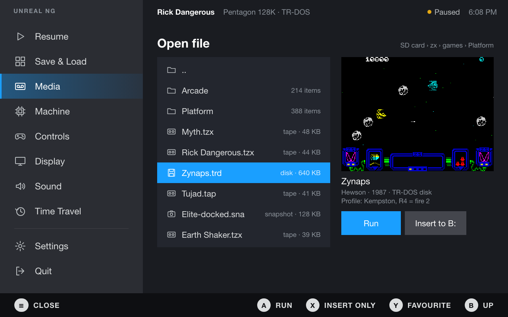

### 4.5 Display

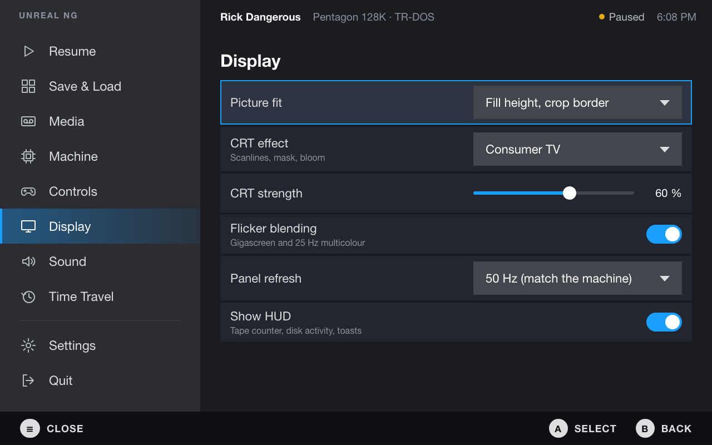

| Row | Action |
|---|---|
| Picture fit | `view.scale` / `video.viewport` |
| CRT effect, strength | `video.crt_profile`, `video.crt_param_by` |
| Flicker blending | `video.blending` / `video.temporal` |
| Panel refresh | gamescope refresh (`gamescopecontrol.h`), the 50 Hz switch |
| Show HUD | `hud.toggle` |

### 4.6 Time Travel

A filmstrip of the recorded past, a scrubber with bookmarks, recording on / off. L1 / R1 step 5 s, A goes there,
X branches. Recording starts only on an explicit Start (no implicit recording).

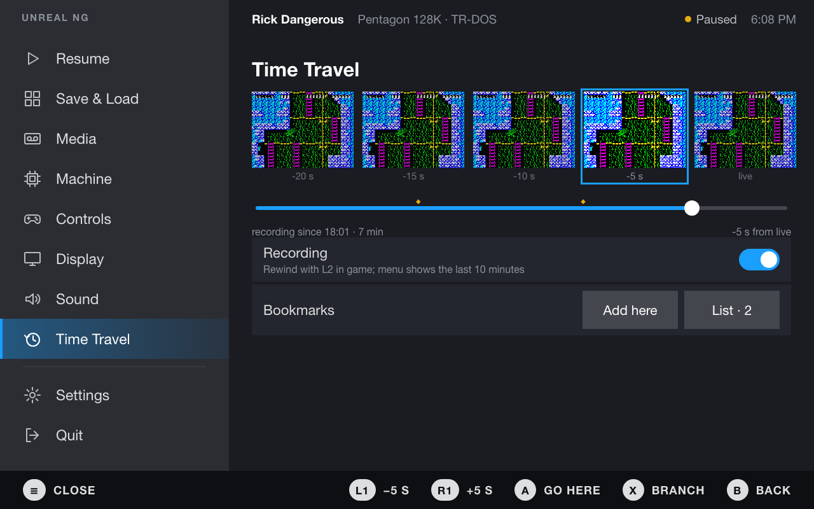

Backed by `ttd.*` (`ttd.start`, `ttd.seek`, `ttd.bookmark_add`, `ttd.resume_live`, branches). Needed: a strip of
thumbnails at given positions (a readout, not a seek per thumbnail).

### 4.7 Not drawn yet

| Section | Content |
|---|---|
| Controls | the active profile summary (what each Deck control does), switch profile, learn a key (`unrealqt.controllers_learn`) |
| Sound | solo, stereo mode |

## 5. Implementation outline

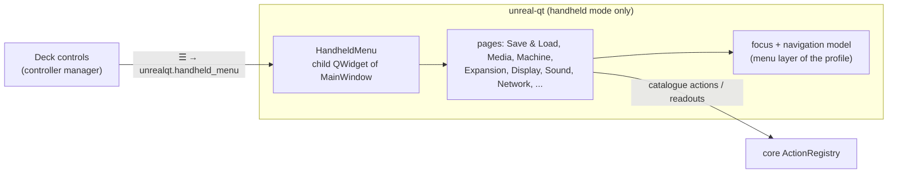

1. **Shell**: `unreal-qt/src/handheld/` with `HandheldMenu` (a child widget over the display), the section list,
   the page frame, footer hints, the palette; a `unrealqt.handheld_menu` action bound to `menu` in the Deck
   profile; a `menu` controller layer while it is open (the pad drives the menu, not the machine).
2. **Basics**: Save & Load (slot readout + thumbnails in the catalogue), Machine with pickers, Quit. Done.
3. **Media**: every medium slot, the controller file browser. Done (previews not yet).
4. **Expansion, Display, Sound, Network, Controls**. Done.
5. **Time Travel**: filmstrip readout, scrubber, bookmarks, branches.
6. **Windows handhelds**: the `IsHandheldMode()` check for Windows, the same menu.

Each step is verified on the Deck through the WebAPI (screenshots with `gamescopectl screenshot`, menu state
readouts), not by hand.

## 5a. Pads in the menu and on the keyboard: UI input

The menu and the on-screen keyboard are the app's UI, not the machine's input: the pads reach them as UI events
before the emulator's router, with no profile, layer or context in between (a user profile that rebinds the D-pad
for a game cannot break the menu, and a paused machine, whose frames drive the router, does not stop it).
`HostInputService::SetUiTap` shows the UI every canonical pad event first; `HandheldPad` takes **Menu** and
**View** always (system buttons, as SteamOS does) and, while the menu or the keyboard is up, every pad event, so
nothing reaches the machine; what the router held is let go (`InputRouter::ReleaseHeld`). Keyboards are never
taken. While Steam's own menus are over the window (the Steam menu, Quick Access: gamescope's focused app is Steam,
769, `platform/linux/steamoverlay.h`) the app is not the controllers' owner: the router is suspended and the tap sees
nothing, so a D-pad press moves Steam's menu only.

| Control | Menu | On-screen keyboard |
|---|---|---|
| D-pad, left stick, left trackpad (Deck) | move (held: repeats after 300 ms, every 70 ms) | the nearest key in the direction |
| A / left trackpad click | select | tap the key (a modifier latches for the next key) |
| B | back; on the sections: close | hide the keyboard |
| X / Y | page buttons (save / delete a slot) | SPACE / ENTER |
| LB / RB | previous / next section | — |
| Menu | close | open the menu |
| View | — | hide the keyboard (shows it in the game) |
| R4 / R5 / L4 (Deck) | — | `basic.run` `LOAD ""` / `RUN "boot"` / ENTER |

The back grips type the loaders without the keyboard too, while the machine reads the whole keyboard (the 128K menu,
BASIC: the same rolling-window decision that gives the pad the cursor keys, `HostControllers::menuKeysChanged`,
`HandheldPad::SetTyping`): the UI takes R4, R5 and L4 then, and B is DELETE (CAPS SHIFT + 0). In a game that reads a
joystick they are the profile's again (the second fire, the auto fire, SPACE; B the second fire).

The keyboard in handheld mode is an overlay the screen draws over the game (`DeviceScreenWrapper::setOverlayPainter`,
`OsdKeyboardWindow::paintOverlay`): the picture fitted by its ratio at the bottom, the whole width of the screen (keys
big enough for a finger), translucent, no switches and no background; no key is highlighted until the first move.
A touch goes to the keyboard first (`DeviceScreenWrapper::setOverlayPointer`, `OsdKeyboardWindow::overlayPointer`):
a key under the finger is pressed and held at least one tap (80 ms); while the keyboard shows, the machine's mouse
gets no pointer events and no cursor is drawn.

The GUI control plane has the same verbs (`handheld.menu`, `.nav`, `.accept`, `.back`, `.option`, `.section`, state
`handheld_menu`; `unrealqt.osd_keyboard_nav`, `_tap`, `_force`, state `osd_keyboard_state`), so an agent drives the
menu with the pad's verbs (`tools/guicontrol/verify_unrealqt.py` checks them in handheld mode, `UNREAL_HANDHELD=1`).

**Which keyboard** (Controls > Keyboard, `unrealqt.osd_keyboard_force`): the machine's own (default), minimal (plain
vector keys: rounded rectangles with their labels, drawn from the key geometry of the machine's matrix, no picture),
any picture whose matrix matches one of the machine's keyboards, or Steam's system keyboard
(`steam steam://open/keyboard`: it types into the window, the host keyboard reaches the machine).

**Catalogue additions** (C-5): `snapshot.quick` got `op: list` (nine slots: used, time, picture) and `op: delete`, and
a save writes the slot's picture (`quick-<n>.png`); `mach.reset {now: true}` resets on the press (the pad's 1 s hold
stays the default).

## 6. Visual tokens

Sampled from the reference screenshot.

| Token | Value | Use |
|---|---|---|
| background | `#1a1c21` | page |
| sidebar | `#2b2d33` | section list |
| row | `#23262e` | a setting row |
| control | `#44464d` | dropdowns, buttons, toggle off |
| accent | `#1a9fff` | focus ring, toggle on, slider fill |
| selected section | `#245880` → `#293441` | gradient, 4 px accent bar on the left |
| footer | `#0e0f12` | button hints |
| divider | `#414248` | |
| text / dim | `#dcdedf` / `#8b929a` | |
| type | 23 px sections, 22 px rows, 16 px captions | a bundled sans font (SteamOS's Motiva Sans is not redistributable) |

## 7. Open questions

| # | Question |
|---|---|
| Q-1 | Resolved: ENTER is on the on-screen keyboard (Y, L4 there). |
| Q-2 | Save slots per game (by image name / signature) or global. The first version uses the global quick slots; per game is `snapshot.quick {dir}` keyed by the running image. |
| Q-3 | Resolved: the keyboard window shows in gamescope. Its "no keyboard for the model" on the Deck was packaging: the Linux / Windows suites did not ship `data/controllers` (fixed in the root `CMakeLists.txt`, checked in `release.yml`). |

## 8. Mock-up sources

The images are rendered from HTML by [mockups/gen.py](mockups/gen.py) (Playwright, 1280×800). The game pictures it
shows (512×384 PNG, file names in the script) come from the reverse cases and are not in this repository: put them
into `mockups/img/` before running it; the pages and PNGs go to `mockups/out/`.
