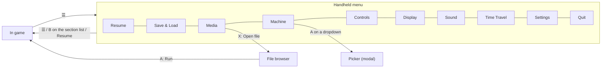
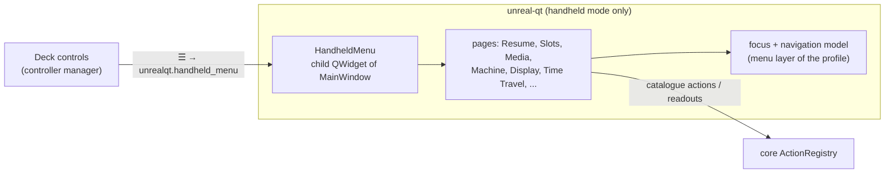

# Handheld menu: a controller-driven emulator menu for the Steam Deck

| | |
|---|---|
| **Status** | Design, mock-ups for review (2026-11-12). No code. |
| **Branch** | `deck-menu-design` (worktree `scratch/wt-deck-menu`) |
| **Scope** | Handheld mode of `unreal-qt` only: Steam Deck in Game Mode now, Windows handhelds (ROG Ally, Legion Go, ...) later. The desktop UI is unchanged. |
| **Related** | [2026-10-08-steamdeck-client](../2026-10-08-steamdeck-client/README.md) (the full `unreal-deck` front-end design; its quick menu, `ux.md` §5 and FR-22, is what this document builds first, inside `unreal-qt`) |

## 1. Problem

On the Deck, `unreal-qt` runs in Game Mode with its menu bar, toolbars and status bar hidden
(`unreal-qt/src/platform/linux/steamdeckgamemode.cpp`). The emulator can only be driven from the
controller profile and over the WebAPI: there is no way to load a file, save or load a state, change the machine,
or reach any setting from the Deck itself.

The goal is a full emulator menu that looks and feels like the SteamOS UI (reference below), works from the
D-pad, sticks and face buttons, fits 1280×800 with legible text, and covers both basics (load / save, machine
configuration) and the advanced features (media control, display, sound, time travel).

*Reference: SteamOS Settings on the Deck (taken with `gamescopectl screenshot`). Sections on the left, rows with
dropdowns, buttons and toggles on the right, button hints in the footer.*

## 2. Decisions and constraints

| # | Topic | Decision / fact |
|---|---|---|
| C-1 | Where | A part of `unreal-qt`, active only in handheld mode. Not a separate application. |
| C-2 | Activation | Handheld mode = gamescope session (`XDG_CURRENT_DESKTOP=gamescope`, `steamdeck::IsGameMode()`) now; a Windows handheld check later, behind one `handheld::IsHandheldMode()` predicate. A command-line switch forces it on for testing on a desktop. |
| C-3 | Button | **Menu (☰)** opens and closes the menu. The Steam button and Quick Access (…) belong to Steam: an app can see their bits on hidraw, but cannot stop Steam from opening its own overlay, so nothing is bound to them. Menu exists on the Deck, on every Xbox-layout pad and on Windows handhelds. Today `play/pad-default.yaml` binds `menu` to ENTER; ENTER moves to another control (proposal: View + A, or the OSK). |
| C-4 | One window | gamescope shows one window of the app (see `reference-steamdeck-gamemode-testing`): the menu is a child widget of `MainWindow` drawn over the picture, never a top-level or `Qt::Tool` window. |
| C-5 | Actions | Every menu entry calls an existing catalogue action (`core/src/emulator/actions/`) or a readout; the menu adds no new emulator behaviour of its own. What the menu needs and the catalogue lacks is added to the catalogue first, so it is on every automation plane too. |
| C-6 | Pause | The emulation pauses while the menu is open (default), with a setting to keep it running. |
| C-7 | Look | SteamOS dark palette sampled from the reference (§6), large type, one focus ring, footer button hints. |

## 3. Navigation

| Button | Section list (left) | Page (right) | Picker / browser |
|---|---|---|---|
| D-pad / left stick | move | move between rows and buttons | move |
| A | open the page | activate | choose |
| B | close the menu | back to the section list | cancel / folder up |
| X, Y | — | page-specific (shown in the footer) | page-specific |
| L1 / R1 | previous / next section | previous / next section | page up / down |
| ☰ | close the menu | close the menu | close the menu |

## 4. Screens

### 4.1 Resume

The start page: the paused picture, the most used actions one press away, recent files.

| Entry | Action |
|---|---|
| Resume | close the menu, `run.resume` if the menu paused it |
| Quick Save / Quick Load | `snapshot.quick {op: save|load, slot: 1}` |
| Rewind 10 s | `ttd.seek_by` (only when TTD is recording) |
| Reset (hold A: hard) | `mach.reset` / `mach.cold_reset` |
| Recent | `GET recent` readout, `media.open_recent {index, kind}` |

### 4.2 Save & Load

Nine slots per game, each with its picture and time. A loads, X saves into the focused slot, Y deletes.

Backed by `snapshot.quick` (slots 1..9). Needed in the catalogue: the slot list with time and a thumbnail per
slot, and slots kept per game (the snapshot folder keyed by the running image's name or signature).

### 4.3 Machine

| Row | Action |
|---|---|
| Model | `mach.switch` (the model table `Config::mem_model`, aliases included) |
| Memory | `mach.switch` with the RAM size the model allows |
| Disk interface | slots / cards through their managers (ZX-bus slots API) |
| Speed | `set.speed`; turbo `mach.turbo_toggle` |
| Reset soft / hard | `mach.reset` / `mach.cold_reset` |
| NMI | `mach.nmi` |

Dropdowns open a modal picker. A model change restarts the machine, so the picker warns and offers a quick save:

### 4.4 Media and the file browser

The tape with its block list (play, rewind, jump to a block), drives A–D with change / eject / insert.

| Element | Action |
|---|---|
| Tape play / stop / rewind / block jump | `media.tape` |
| Drive change / insert / eject | `media.insert` / `media.eject` / `media.swap` |
| Open file | the file browser below, then `media.open` |

The file browser is controller-only (no system file dialog in Game Mode): folders, type icons, a preview of the
selected file (the loading screen for tapes, the first screen for disks and snapshots) and its known profile.

### 4.5 Display

| Row | Action |
|---|---|
| Picture fit | `view.scale` / `video.viewport` |
| CRT effect, strength | `video.crt_profile`, `video.crt_param_by` |
| Flicker blending | `video.blending` / `video.temporal` |
| Panel refresh | gamescope refresh (`gamescopecontrol.h`), the 50 Hz switch |
| Show HUD | `hud.toggle` |

### 4.6 Time Travel

A filmstrip of the recorded past, a scrubber with bookmarks, recording on / off. L1 / R1 step 5 s, A goes there,
X branches. Recording starts only on an explicit Start (no implicit recording).

Backed by `ttd.*` (`ttd.start`, `ttd.seek`, `ttd.bookmark_add`, `ttd.resume_live`, branches). Needed: a strip of
thumbnails at given positions (a readout, not a seek per thumbnail).

### 4.7 Not drawn yet

| Section | Content |
|---|---|
| Controls | the active profile summary (what each Deck control does), switch profile, learn a key (`unrealqt.controllers_learn`), the on-screen keyboard |
| Sound | master volume, per-device volume / mute / solo (`audio.source_volume`, `audio.source_mute`, `audio.source_solo`), stereo mode |
| Settings | pause while the menu is open, instant tape loading, snapshot folder, menu language |
| Quit | quick save and quit / quit without saving |

## 5. Implementation outline

1. **Shell**: `unreal-qt/src/handheld/` with `HandheldMenu` (a child widget over the display), the section list,
   the page frame, footer hints, the palette; a `unrealqt.handheld_menu` action bound to `menu` in the Deck
   profile; a `menu` controller layer while it is open (the pad drives the menu, not the machine).
2. **Basics**: Resume, Save & Load (slot readout + thumbnails in the catalogue), Machine with pickers, Quit.
3. **Media**: tape and drives, the controller file browser with previews.
4. **Display, Sound, Controls, Settings**.
5. **Time Travel**: filmstrip readout, scrubber, bookmarks, branches.
6. **Windows handhelds**: the `IsHandheldMode()` check for Windows, the same menu.

Each step is verified on the Deck through the WebAPI (screenshots with `gamescopectl screenshot`, menu state
readouts), not by hand.

## 6. Visual tokens

Sampled from the reference screenshot.

| Token | Value | Use |
|---|---|---|
| background | `#1a1c21` | page |
| sidebar | `#2b2d33` | section list |
| row | `#23262e` | a setting row |
| control | `#44464d` | dropdowns, buttons, toggle off |
| accent | `#1a9fff` | focus ring, toggle on, slider fill |
| selected section | `#245880` → `#293441` | gradient, 4 px accent bar on the left |
| footer | `#0e0f12` | button hints |
| divider | `#414248` | |
| text / dim | `#dcdedf` / `#8b929a` | |
| type | 23 px sections, 22 px rows, 16 px captions | a bundled sans font (SteamOS's Motiva Sans is not redistributable) |

## 7. Open questions

| # | Question |
|---|---|
| Q-1 | Where ENTER goes once ☰ opens the menu (View + A, or only through the on-screen keyboard). |
| Q-2 | Save slots per game (by image name / signature) or global. The mock-ups show per game. |
| Q-3 | Does the existing on-screen keyboard (`OsdKeyboardWindow`, a `Qt::Tool` top-level) show in gamescope? If not, it moves into the same child-widget layer. |

## 8. Mock-up sources

The images are rendered from HTML by [mockups/gen.py](mockups/gen.py) (Playwright, 1280×800). The game pictures it
shows (512×384 PNG, file names in the script) come from the reverse cases and are not in this repository: put them
into `mockups/img/` before running it; the pages and PNGs go to `mockups/out/`.
