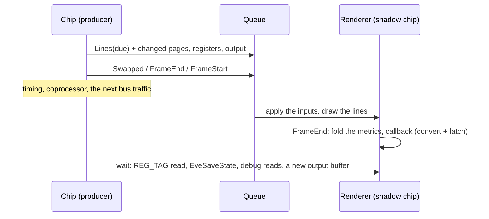

# FT812 drawing on its own thread (eve-emu `EveSetAsyncDrawing`)

Status: implemented on branch `vdac4-ft-speed`, 2026-11-17. Origin: POC 053 measurement 1
(`tools/poc/053-xtensa-jit/measurement-1-profile.md` on the POC branch): after the cheap levers (ROM trap kind per
index, one SPI transaction per FT word, the whole-word frame conversion) the VDAC4 ESP worker spends about 28 % of
its busy time drawing FT812 lines and converting the picture, inside the ESP job, on the critical path of the
frame.

## 1. What the drawing was

- Lazy (`eve-dl.cpp` `CatchUp`): lines the beam has passed are only counted; they are drawn before anything they
  read changes - a RAM_G byte write (`BusWrite`), a write to a register flagged `RegDrawing`, a swap, a memory map
  change, `EveSetOutput` - and at the frame event. In DOOM almost all of it happens at the frame event.
- The inputs of a line: RAM_G and the ROM (the memory map), the active display list, the registers (`REG` and
  `SPECIAL` regions), the bitmap handles and the graphics context, the output (buffer, size, drawing switch) and
  the host settings (line budget margin, fast paths).
- What drawing writes besides pixels: `state.handles` / `context` (the list's `BITMAP_*` words, per line; with
  drawing off the state pass at a swap), `REG_TAG` (the line at `REG_TAG_Y`, guest-visible), the line costs and
  the overflow count (folded into `state.metrics` at the frame event; not guest-visible), derived caches.

Nothing else the guest sees depends on drawing; the coprocessor never reads the handles.

## 2. The design

The chip (the producer: whichever thread advances it) keeps all its timing, coprocessor and registers. Where it
would draw it queues an **operation** instead:

| Operation | Queued by | The renderer does |
|-----------|-----------|-------------------|
| `Lines(due, draw)` | `CatchUp` when new lines passed | `DrawLinesTo` (CatchUp's own work) |
| `FrameStart` | `FrameStart` | `FrameStart` |
| `FrameEnd` | the frame event | `FoldFrameMetrics`, then the host's callback |
| `Swapped(changed)` | `DisplayListSwapped` | copies the list, `DisplayListSwapped` (the state pass when not drawing) |
| `Sync` | enabling | inputs only |

Every operation carries the inputs as of its moment: the `REG` and `SPECIAL` regions, the output, the memory map,
the settings, and the RAM_G pages changed since the previous operation (`ramGPageChanges` newer than the mark).
A pending **sync** rides on the next operation: all of RAM_G and the active list after `DrawingInvalidate`
(restore, reset, memory map change), plus the handles and context (reset, state load, enabling), the metrics
(power-on, state load, enabling), the line costs of the frame in flight (enabling).



The **renderer** is a second `EveChip` made from the producer's `EveConfig`, used only for drawing: its regions
are the shadow, its handles / context / caches / kept lines evolve from its own lines. A line sees exactly the
inputs the producer had when it would have drawn it: the picture, the line costs, the metrics and `REG_TAG` are
those of the drawing on the producer's thread, whatever the renderer's pace.

Back-pressure: the producer waits when two frame ends are queued (or 1024 operations).

Wake-ups: a sleeping renderer is woken once 8 operations wait, at a frame end, and before the producer waits for it
(back-pressure, every barrier below), not for every operation (`kWakeOps`). A wake-up is a system call on the
emulation thread, and a catch-up of 16 lines is often less work than waking for it. The operations and their
order are the same, only when the renderer draws them moves, so the picture is the same.

### 2.1 Waits

- A host read of `REG_TAG` (`BusRead`): the renderer drains the queue (exactly the lines the synchronous drawing
  would have drawn by now) and its `REG_TAG` is copied back.
- `EveSaveState`: the handles, context and metrics in the blob are the renderer's: the same bytes as without it.
- `EveGetLineCost`, `EveGetFrameMetrics`, `EveProbePixel`: read the renderer after a wait (no wait from the
  callback).
- `EveSetOutput` with another buffer or size; the host waits before it resizes its buffers
  (`EveDrawingBarrier`).
- The machine's frame end (`EveHostCard::OnFrameEnd`, `EveFramesBarrier`): waits only for the FT812 frames finished
  by then (they are latched on the `Screen` before the machine's frame is over), not for the lines of the frame in
  flight. `REG_TAG` stays the renderer's as of that point (`tagPending`): the first read waits for the operations
  queued before the barrier, so it reads what the full barrier would have left.
- Drawing ahead (`CatchUpAhead`, every 16 lines at the end of a line): the lines due go to the renderer along the
  scan, so the frame-end wait finds little left. Lines drawn ahead do not move the `REG_TAG` the host sees: the
  renderer keeps it as of the last operation that is not ahead (`tagSeen`); a catch-up after lines drawn ahead
  queues a sync point, so a read sees them as the synchronous drawing would.
- Off: a wait, then the handles, context, metrics, line costs and `REG_TAG` come back to the chip; its kept lines
  are forgotten (the frame buffer holds the renderer's lines).

Only the frame-end wait happens in DOOM's steady state.

## 3. API (`eve.h`)

```c
typedef void (*EveFrameCallback)(void* user, uint64_t frame, int drawn);
int EveSetAsyncDrawing(EveChip* chip, int on, EveFrameCallback onFrame, void* user); /* 0 = done */
int EveAsyncDrawing(const EveChip* chip);
void EveDrawingBarrier(EveChip* chip);
void EveFramesBarrier(EveChip* chip); /* the finished frames only; REG_TAG as of this point */
```

## 4. Host side

`EveHostCard` (`Params::drawThread`): on for the VDAC4 Tang (`[VDAC4] FtDrawThread`, default 1; env
`UNREAL_VDAC4_FT_DRAW_THREAD`) and for the VDAC2 card (`[VDAC2] FtDrawThread`, default 1; env
`UNREAL_VDAC2_FT_DRAW_THREAD`; since 2026-11-23, §6.4). Off while a bus capture is written (it hashes the frame buffer at
the frame event) and in a TTD replay (it composes pictures from the frame buffer); `AdvanceTo` follows the switch
as it follows `Drawing()`. The callback (`OnRendererFrame`, renderer thread) does `OnChipFrame`'s presentation:
the conversion, `Screen::LatchExternalFrame`, the presented metrics. `ConfigureOutput` waits before it resizes;
`TTDPrepareComposedPicture` waits before it converts. Status: `threads.ft_draw_thread` in `vdac4 state` on every
plane.

The lines of a frame are drawn by several threads (`EveSetDrawThreads`, `Params::drawThreads`): `[VDAC4] FtDrawThreads`
/ `[VDAC2] FtDrawThreads`, env `UNREAL_VDAC4_FT_DRAW_THREADS` / `UNREAL_VDAC2_FT_DRAW_THREADS`, 1 (default), 0 = half the
host's cores, 1-4. The picture is the same for any count (eve-replay `--threads` against the single-thread hashes). One is
the default: on Metal Slug after its load (2026-11-26) the emulation never waited for the FT812 with one thread, a replay
took the same wall time with 1-4 threads and 20-50 % more CPU with more, and the live drawing peaks were lowest with one.
Status: `threads.ft_draw_threads` in `vdac4 state` on every plane.

The renderer reads nothing the emulation thread changes meanwhile (TSan, 2026-11-23):

- The callback's `frame` is the frame's `EveCompletedFrames` count. The latch's machine frame number and its
  fraction of the machine frame (the audio position the presenter times it by) come from a ring of 8 stamps keyed
  by that count. `AdvanceTo` writes the stamps of the next two FT812 frames before it advances the chip, so before
  their frame ends are queued; the CPU does not move while the chip advances. `Screen::LatchExternalFrame` takes the
  stamp instead of reading `Z80::t` and `frame_counter`.
- The machine goes away: `PortDecoder_TSConf::BeforeRelease` (the first step of `Core::Release`) calls
  `EveHostCard::BeforeRelease`, which stops the renderer before the Screen and the CPU it presents into are
  released; the card draws on the emulation thread from there on.

## 5. Tests

- `EveAsyncDrawing_Test.TheRendererDrawsWhatTheChipWouldHaveDrawn`: two chips, the same bus traffic (bitmap bytes
  and new lists mid-frame, `REG_TAG` reads, a frame without drawing, the renderer off and on again): the same
  frames, `REG_TAG` values, saved state, metrics and line costs.
- `EveAsyncDrawing_Test.FramesBarrierPresentsTheFramesAndKeepsTheTagOfItsPoint`: frames barriers at machine frames
  not locked to the chip's frames: the presented frames and `REG_TAG` (read at once or later) match the
  synchronous chip. It fails when lines drawn ahead move `REG_TAG`.
- VDAC4 DOOM: the same picture hash as the synchronous drawing and master (§6).

## 6. Measurements

DOOM-VDAC4 in game on the Apple M-class build host: 6000 frames of warm-up on the paused machine, then 600 frames
as fast as possible, four interleaved rounds, ms per frame. The screen hash after the run is `a8e8486fb6c5` in
every run of every variant (the same as master).

| Variant | Rounds | Mean |
|---------|--------|------|
| master `aa7ca3f5f` | 6.16, 5.96, 6.04, 5.91 | 6.02 |
| + ROM trap kind, SPI transaction, word conversion (`FtDrawThread=0`) | 5.02, 4.98, 4.89, 4.89 | 4.95 (-18 %) |
| + drawing on the renderer thread (`FtDrawThread=1`) | 3.97, 3.87, 3.89, 3.88 | 3.90 (-35 %) |
| the same without the wait at the machine's frame end (experiment, not kept) | 3.86, 3.79, 3.78, 3.77 | 3.80 |

The wait at the machine's frame end (`EveHostCard::OnFrameEnd`) costs about 2.5 %; it is kept: the FT812 frame
finished in a machine frame is on the `Screen` when that frame ends, as without the renderer thread.

### 6.1 The second round (2026-11-22)

DOOM-VDAC4 in game: 6000 frames of warm-up, 3000 timed, interleaved rounds; picture hash `ff4c23e15ca6` in every
run. Build host (Apple M-class), ms per frame, JIT and interpreter (`UNREAL_XTENSA_JIT=0`):

| Step | JIT | Interpreter |
|------|-----|-------------|
| before | 2.97 | 3.80 |
| FT812 bus burst: an ESP `ft_wr` of N words is one RAM_G store (`EveWriteRamGWords`, `IVdac4TangLink::LinkFtWrite`) instead of N SPI transactions | 2.89 | 3.49 |
| TS-Conf DRAM wait: the fast path no longer falls back to the interrupt catch-up when a line source is set | 2.88 | 3.50 |
| frames barrier + drawing ahead (above) | 2.24 | 3.13 |
| the conversion of the presented frame into the `Screen` slot in one pass (`LatchExternalFrame(fill)`) | 2.24 | 3.13 |

The last step unloads the renderer thread (64 to 60 % busy), not the frame: the emulation thread is now the
bottleneck (about 90 % busy). Steam Deck, offscreen: 8.3 to 6.4 ms per frame (-23 %); GUI in game with fire: 48.9
fps (full speed) before and after, threads 41 / 38 / 28 % busy before, 39 / 33 / 26 % after, 0 frames dropped.

### 6.2 The emulation thread (2026-11-22)

With the drawing off the critical path the emulation thread is the bottleneck (about 90 % busy). Same run, master
`b84699fa5` vs the changes, four interleaved rounds:

| Step | JIT | Interpreter |
|------|-----|-------------|
| master | 2.34 | 3.35 |
| DRAM arbiter fast path: an access outside the line's fetch blocks takes its cycle without the cycle walk; inline in `DramWait` over the quiet span of the line (`TsConfArbiter::QuickAccess`) | | |
| a DRAM stall with no frame INT in reach leaves the interrupt catch-up to the next one (`TsConfInterrupts::OnWait`) | 2.12 (-9.5 %) | 3.15 (-6 %) |

Tried and not kept: a fast path for the engine's per-instruction catch-up (-1.5 %, in the noise). Left: the waits
for the ESP jobs at a command and at the frame end (about 9 %: synchronisation, not work) and the TS-Conf screen
drawn under the VDAC4 picture (the same work, only earlier).

The same builds on R-Type VDAC4 (`_rtype_vdac4.spg`, 6 x 500 frames with a picture hash after each step, three
interleaved rounds): 2.46 -> 2.22 ms per frame (-9.7 %), the six pictures equal bit for bit. The ESP waits are
measured in [research-esp-waits.md](research-esp-waits.md).

### 6.3 R-Type: the renderer is next (2026-11-22)

A sampled R-Type run after §6.2 (8 s, 1429 samples of the emulation thread):

| Thread | Busy | Where |
|--------|------|-------|
| emulation | 100 % | Z80 and TS-Conf 80 %, of it `DramWait` 7.5 %, port OUT to the ESP 8 % (half of it the command flush); `AsyncFramesBarrier` 11.5 % |
| eve-emu renderer | about 67 % | `DrawBitmapFast` with the row fetch 37 %, `BlendSrcAlpha` 8 %, `PresentPicture` 7 % |
| ESP worker | about 30 % jobs | the rest spins for the next job (`cthread_yield`, not on the critical path) |

R-Type draws far more bitmap pixels than DOOM, so the renderer carries two thirds of a frame and the emulation
thread already waits for it at 11.5 % of its time (DOOM: 2.3 %). Speeding up the emulation thread further gains less
there until the bitmap path (`DrawBitmapFast` row fetch, alpha blend) gets faster as well. HMM2 cannot be measured
(the game's `HMM2.DAT` is not shipped, §8) and DEMO3D is not in the collection.

What the renderer draws (R-Type, 6000 frames, counters per span on the fast path): the background is PALETTED8
magnified 2.67 times (A = 96) with REPEAT on X, 2.44 M spans of about 1024 pixels (2.5 G pixels, 3.4 s); the sprites
are ARGB4 at A = 160 with BORDER (1.2 G pixels, 1.6 s). The REPEAT loop took two divisions per pixel for the wrap.

| Step (R-Type, three interleaved rounds) | ms / frame | renderer samples / emulation samples |
|------|------|------|
| master | 2.22 | 0.65 |
| REPEAT in pieces inside one repetition of the row: column = x' - base, one division a piece (`DecodeSpanWith`) | 2.16 (-2.7 %) | 0.36 |

Pictures equal bit for bit (R-Type six hashes, DOOM `ff4c23e15ca6`); `EveVdac4_Test.RepeatXMatchesTheRowLaidOutRepeatedly`
checks the wrap against a wide BORDER layout holding the row many times over. Tried and not kept: a column kept by
its step (one compare a pixel, a dependency from pixel to pixel: 2.51 ms, slower than the divisions) and BORDER
decoded without the test per pixel (no change in the frame or the renderer's share). The renderer no longer holds
the frame back: the emulation thread is the bottleneck again.

### 6.4 VDAC2 on the renderer thread (2026-11-23)

A profile of the emulation thread (M3 Ultra host, the same five games): on VDAC4 the time is spread (TS-Conf DRAM
model about 30 %, Z80 20 %, interrupts 12 %, the TS-Conf screen 7 %), no single target. On VDAC2 the FT812 drew on
the emulation thread: about 25 % of it (`DrawBitmapFast`, `BlendSrcAlpha`, `ExecuteLine`, `PresentPicture`).

Turning the renderer on for VDAC2 as it was gave R-Type VDAC2 -11 % and Zuma -8 %, but Heroes II +6 %. Heroes II
draws little a frame: the emulation thread woke the sleeping renderer for every 16-line catch-up (`notify_one` =
`__psynch_cvsignal`, 1.7 % of the thread), the renderer drew a few lines and slept again, and the emulation thread's
own work ran slower beside it. The wake-ups are batched now (§2). A catch-up every 64 lines instead also removed
the regression, but changed two of R-Type VDAC4's six pictures: where the catch-ups fall is visible through
`REG_TAG` (a catch-up after lines drawn ahead queues a sync point, §2.1), so the catch-up period stays 16.

| ms / frame, 3 interleaved rounds | drawing on the emulation thread | renderer, a wake-up per operation | renderer, batched wake-ups |
|------|------|------|------|
| Heroes II VDAC2 | 2.516 | 2.624 | 2.311 (-8.2 %) |
| R-Type VDAC2 | 2.865 | 2.506 | 2.421 (-15.5 %) |
| Zuma Deluxe VDAC2 | 2.633 | 2.428 | 2.319 (-11.9 %) |
| R-Type VDAC4 (renderer on before) | - | 2.226 | 2.215 (-0.5 %) |
| DOOM VDAC4 (renderer on before) | - | 1.877 | 1.868 (-0.5 %) |

Pictures equal bit for bit in every run (each game's hashes at every 500 or 1500 frames). The load on the host was
7-17 (other sessions); the rounds agree within about 1 %.
